# GitForge V1.0.0 Data Requirements

## 1. Document Information

| Field          | Value                               |
| -------------- | ----------------------------------- |
| Project        | GitForge - Web Git Hosting Platform |
| Target release | V1.0.0                              |
| Document       | Data Requirements                   |
| SDLC phase     | Requirements Engineering            |
| Milestone      | M1 - Requirements Engineering       |
| Project owner  | Farhad Valizadegan                  |
| Status         | Approved                            |
| Last updated   | 2026-08-17                          |

---

## 2. Purpose

This document defines the authoritative data requirements for GitForge V1.0.0.

Data requirements specify:

* what information the system must store;
* what information the system must derive;
* ownership and relationship rules;
* uniqueness requirements;
* lifecycle expectations;
* integrity constraints;
* security expectations;
* boundaries between relational application data and Git-native repository data.

This document defines logical data needs.

It does not define the final physical database schema.

Physical schema design belongs primarily to the System Design phase.

---

## 3. Requirement Identification

Data requirements use the following identifier format:

```text
DR-XXX
```

Example:

```text
DR-001
```

Each data requirement represents one persistent, derived, relational, integrity, or lifecycle obligation.

---

## 4. Data Classification

GitForge V1.0.0 data is divided into four primary categories.

| Category         | Description                                          |
| ---------------- | ---------------------------------------------------- |
| Application data | Relational data managed directly by GitForge         |
| Repository data  | Git-native repository data stored by Git             |
| Derived data     | Information calculated or read from repository state |
| Operational data | Logs, diagnostics, and configuration-related state   |

---

# 5. User Data Requirements

## DR-001 — User Identifier

The system shall maintain a unique persistent identifier for each registered user.

---

## DR-002 — User Name

The system shall store the user name or equivalent display identity required by the application.

---

## DR-003 — User Email

The system shall store an email address for each registered user.

---

## DR-004 — Unique User Email

The system shall enforce uniqueness for normalized user email addresses where email is used as a unique identity attribute.

---

## DR-005 — Password Representation

The system shall store only a secure one-way representation of the user's password.

Plaintext passwords shall not be persisted.

---

## DR-006 — User Creation Timestamp

The system shall record when a user account was created.

---

## DR-007 — User Update Timestamp

The system shall record when persistent user account information was last updated where applicable.

---

# 6. Repository Metadata Requirements

## DR-008 — Repository Identifier

The system shall maintain a unique persistent application identifier for each repository.

---

## DR-009 — Repository Name

The system shall store the logical name of each repository.

---

## DR-010 — Repository Owner

Each repository shall be associated with exactly one owning user in V1.0.0.

---

## DR-011 — Repository Visibility

The system shall store the visibility state of each repository.

Supported V1.0.0 values are:

```text
public
private
```

---

## DR-012 — Repository Creation Timestamp

The system shall record when repository application metadata was created.

---

## DR-013 — Repository Update Timestamp

The system shall record when persistent repository metadata was last updated where applicable.

---

## DR-014 — Repository Namespace Uniqueness

The combination of repository owner and repository name shall be unique within the applicable user namespace.

Conceptually:

```text
(owner, repository_name) = unique
```

---

## DR-015 — Repository Ownership Integrity

A repository owner reference shall resolve to an existing user.

---

## DR-016 — Repository Visibility Validity

Repository visibility values shall be limited to values supported by V1.0.0.

---

# 7. Physical Git Repository Requirements

## DR-017 — Physical Repository Representation

Each active application repository shall correspond to a filesystem-backed Git repository where required for Git operations.

---

## DR-018 — Repository Storage Root

Physical Git repositories shall be stored below a configured GitForge repository storage root.

---

## DR-019 — Repository Path Derivation

The physical repository path shall be derived through controlled application logic.

User input shall not directly determine an arbitrary filesystem path.

---

## DR-020 — Repository Path Isolation

A repository's physical path shall not resolve outside the configured repository storage root.

---

## DR-021 — Bare Repository Support

Server-side Git repositories shall use a repository format suitable for hosting Git clone, fetch, and push operations.

For V1.0.0, bare Git repositories are the expected server-side representation.

---

## DR-022 — Repository Metadata and Filesystem Relationship

Application metadata and physical repository state shall have a defined one-to-one logical relationship for active hosted repositories.

---

## DR-023 — Missing Physical Repository State

If application repository metadata exists but the corresponding physical repository does not exist, the system shall treat the repository state as inconsistent rather than silently creating arbitrary replacement history.

---

# 8. Git-Native Repository Data

## DR-024 — Git Objects

Git-native objects shall remain managed primarily by Git repository storage.

Git object categories may include:

* commits;
* trees;
* blobs;
* tags.

---

## DR-025 — Git References

Branches and tags shall primarily be obtained from Git repository reference data rather than unnecessarily duplicated into relational application storage.

---

## DR-026 — Commit History

Commit history shall primarily be derived from the Git repository.

---

## DR-027 — Repository Tree Data

Repository directory and file-tree information shall primarily be derived from Git repository state.

---

## DR-028 — File Content

Repository file content shall primarily remain in Git object storage.

---

## DR-029 — Avoid Unnecessary Git Data Duplication

The system should not duplicate complete Git object content into PostgreSQL unless a later approved requirement explicitly justifies such persistence.

---

# 9. Personal Access Token Data Requirements

## DR-030 — Token Identifier

Each Personal Access Token shall have a unique persistent identifier.

---

## DR-031 — Token Owner

Each Personal Access Token shall be associated with exactly one user.

---

## DR-032 — Token Name

The system shall store a descriptive user-defined name for each Personal Access Token.

---

## DR-033 — Token Credential Representation

The system shall persist a secure non-reversible representation of the token secret.

---

## DR-034 — Plaintext Token Persistence Prohibition

The system shall not persist the plaintext Personal Access Token secret after the permitted token-creation display workflow.

---

## DR-035 — Token Creation Timestamp

The system shall record when each Personal Access Token was created.

---

## DR-036 — Token Revocation State

The system shall maintain sufficient persistent state to determine whether a Personal Access Token is active or revoked.

---

## DR-037 — Revocation Timestamp

Where revocation is represented explicitly, the system should record when the token was revoked.

---

## DR-038 — Token Scope Data

If V1.0.0 adopts token scopes, the system shall persist sufficient information to determine the operations permitted by each token.

---

## DR-039 — Token Ownership Integrity

A token owner reference shall resolve to an existing user.

---

# 10. Authentication and Session Data Requirements

## DR-040 — Session Identity

Where web sessions are used, session state shall contain or resolve sufficient information to identify the authenticated user.

---

## DR-041 — Session Storage Protection

Persistent or server-side session data shall be managed using framework-supported storage and protection mechanisms.

---

## DR-042 — Session Lifecycle

Session state shall support:

* creation after successful authentication;
* use during authenticated requests;
* invalidation during logout or expiry.

---

## DR-043 — Sensitive Session Data Minimization

Session state should not unnecessarily contain plaintext reusable credentials.

---

# 11. Repository Browser Data Requirements

## DR-044 — Branch Data

The repository browser shall be able to derive available branches for an accessible repository.

---

## DR-045 — Commit Metadata

The repository browser shall be able to derive supported commit metadata including, where available:

* commit identifier;
* author;
* timestamp;
* commit message;
* parent identifiers.

---

## DR-046 — Tree Entry Data

The repository browser shall be able to derive repository tree entries for a valid revision.

---

## DR-047 — File Content Data

The repository browser shall be able to retrieve supported file content from a valid repository revision.

---

## DR-048 — Revision Resolution

Repository browsing data shall be associated with a resolvable Git revision, branch, tag, or commit identifier.

---

# 12. Data Relationship Requirements

## DR-049 — User-to-Repository Relationship

A user may own zero, one, or multiple repositories.

Conceptually:

```text
User 1 ---- 0..* Repository
```

---

## DR-050 — Repository-to-Owner Relationship

Each repository shall have exactly one owner in V1.0.0.

Conceptually:

```text
Repository * ---- 1 User
```

---

## DR-051 — User-to-Token Relationship

A user may own zero, one, or multiple Personal Access Tokens.

Conceptually:

```text
User 1 ---- 0..* PersonalAccessToken
```

---

## DR-052 — Token-to-Owner Relationship

Each Personal Access Token shall belong to exactly one user.

---

## DR-053 — No Organization Ownership

V1.0.0 shall not require repository ownership by organizations.

---

## DR-054 — No Team Ownership

V1.0.0 shall not require repository ownership by teams.

---

# 13. Data Integrity Requirements

## DR-055 — Database Referential Integrity

Persistent relationships shall use appropriate referential integrity controls where supported and practical.

---

## DR-056 — User Deletion Dependency Handling

If user deletion is introduced, the system shall define how repositories and Personal Access Tokens owned by that user are handled.

No implicit destructive cascade shall be assumed without an approved rule.

---

## DR-057 — Repository Creation Consistency

Repository metadata shall not be considered successfully created when required physical repository creation fails.

---

## DR-058 — Repository Deletion Consistency

If repository deletion is included in V1.0.0, application metadata and physical repository data shall follow a defined deletion consistency strategy.

---

## DR-059 — Token Revocation Persistence

Token revocation state shall be persisted before subsequent authentication attempts can be treated as revoked.

---

## DR-060 — Invalid Relationship Prevention

The system shall prevent persistence of repository or token ownership references to nonexistent users.

---

# 14. Data Validation Requirements

## DR-061 — Repository Name Validation

Repository names shall satisfy the approved repository naming rules before persistence.

---

## DR-062 — Email Validation

User email data shall satisfy the accepted application email-validation rules before normal account creation.

---

## DR-063 — Visibility Validation

Repository visibility shall be limited to supported values.

---

## DR-064 — Token Name Validation

Personal Access Token names shall satisfy defined input validation rules before persistence.

---

## DR-065 — Identifier Validation

Externally supplied identifiers shall be validated before being used for persistent lookup or filesystem resolution.

---

# 15. Data Security Requirements

## DR-066 — Password Data Protection

Password hashes shall be treated as security-sensitive data.

---

## DR-067 — Token Hash Protection

Stored Personal Access Token credential representations shall be treated as security-sensitive data.

---

## DR-068 — Database Credential Separation

Database connection credentials shall not be stored as ordinary application data records.

They shall be supplied through deployment configuration.

---

## DR-069 — Secret Exclusion from Source Control

Runtime secrets shall not be intentionally committed to the source repository.

---

## DR-070 — Sensitive Data Logging Restriction

Sensitive authentication data shall not be intentionally copied into logs.

---

# 16. Data Privacy Requirements

## DR-071 — Data Minimization

GitForge shall store only user data reasonably required for application functionality and operation.

---

## DR-072 — Private Repository Data Restriction

Application interfaces shall expose private repository data only to authorized actors.

---

## DR-073 — Token Secret Exposure Limitation

Plaintext token secrets shall be exposed only during the explicitly permitted token-creation workflow.

---

# 17. Data Lifecycle Requirements

## DR-074 — User Lifecycle

User data shall support at least:

```text
Create
Read
Update where supported
Persist
```

Account deletion is not assumed unless explicitly included elsewhere.

---

## DR-075 — Repository Lifecycle

Repository data shall support at least:

```text
Create
Read
Update supported metadata
Use through Git
```

Deletion is supported only if included in final V1.0.0 scope.

---

## DR-076 — Token Lifecycle

Personal Access Token data shall support:

```text
Create
Read metadata
Authenticate
Revoke
```

---

## DR-077 — Git Repository Lifecycle

Physical repository state shall support:

```text
Initialize
Read
Fetch
Push
Inspect
Delete if repository deletion is supported
```

---

# 18. Data Retention Requirements

## DR-078 — Core Metadata Retention

User, repository, and token metadata shall remain persisted until an authorized lifecycle operation removes or invalidates it.

---

## DR-079 — Git History Retention

Git repository history shall remain under normal Git semantics unless explicitly modified through authorized Git operations or repository lifecycle operations.

---

## DR-080 — Revoked Token Retention

The system may retain revoked token metadata for operational or security purposes where appropriate.

The retained data shall not allow recovery of the original token secret.

---

## DR-081 — Log Retention

Log retention policy shall be configurable or documented as part of deployment and maintenance design.

---

# 19. Data Recovery Requirements

## DR-082 — Application Metadata Backup

The deployment design shall allow persistent relational application data to be backed up.

---

## DR-083 — Git Repository Backup

The deployment design shall allow physical Git repository storage to be backed up.

---

## DR-084 — Coordinated Recovery

Recovery procedures shall account for the relationship between:

* application repository metadata;
* repository ownership;
* repository visibility;
* physical Git repository data.

---

## DR-085 — Recovery Consistency

A recovery process should avoid restoring database metadata and repository storage into knowingly incompatible states.

---

# 20. Derived Data Requirements

## DR-086 — Repository Branch Derivation

Branch lists may be derived dynamically from Git repository state.

---

## DR-087 — Repository Commit Derivation

Commit lists and commit metadata may be derived dynamically from Git repository state.

---

## DR-088 — Repository Tree Derivation

Repository tree information may be derived dynamically from Git repository state.

---

## DR-089 — Repository File Derivation

File content presented by the repository browser may be derived dynamically from Git repository objects.

---

## DR-090 — Derived Data Authorization

Derived repository data shall remain subject to the same access-control rules as the underlying repository.

---

# 21. Operational Data Requirements

## DR-091 — Diagnostic Log Data

The system shall generate operational logs sufficient to diagnose significant application failures.

---

## DR-092 — Security Log Context

Security-relevant logs may include contextual identifiers such as:

* user identifier;
* repository identifier;
* operation type;
* failure category.

---

## DR-093 — Credential Exclusion from Logs

Operational and security logs shall exclude plaintext reusable credentials.

---

## DR-094 — Git Failure Diagnostics

Git process failures shall generate sufficient diagnostic information to identify the affected operation without exposing sensitive credentials.

---

# 22. Data Ownership

Logical ownership for V1.0.0 is:

| Data                           | Logical owner               |
| ------------------------------ | --------------------------- |
| User profile/account data      | User / GitForge             |
| Repository metadata            | Repository owner / GitForge |
| Repository Git content         | Repository owner            |
| Personal Access Token metadata | Token owner                 |
| Operational logs               | GitForge operator           |
| Deployment configuration       | GitForge operator           |

Logical ownership does not imply unrestricted direct database or filesystem access.

---

# 23. Authoritative Data Sources

The following authoritative-source rules apply.

### User and Repository Metadata

Authoritative source:

```text
PostgreSQL application database
```

### Personal Access Token Metadata

Authoritative source:

```text
PostgreSQL application database
```

### Git Commit History

Authoritative source:

```text
Physical Git repository
```

### Git Branches and References

Authoritative source:

```text
Physical Git repository
```

### Git File Content

Authoritative source:

```text
Physical Git repository
```

### Runtime Configuration

Authoritative source:

```text
Deployment environment / application configuration
```

---

# 24. Logical Data Model

The requirements-level logical model is:

```text
User
 |
 | owns
 v
Repository
 |
 | corresponds to
 v
Physical Git Repository
```

and:

```text
User
 |
 | owns
 v
Personal Access Token
```

The following PlantUML diagram represents the requirements-level relationships.

```plantuml
@startuml
title GitForge V1.0.0 - Requirements-Level Data Relationships

entity User {
&#x20;   * user_id
&#x20;   --
&#x20;   name
&#x20;   email
&#x20;   password_hash
}

entity Repository {
&#x20;   * repository_id
&#x20;   --
&#x20;   owner_id
&#x20;   name
&#x20;   visibility
}

entity PersonalAccessToken {
&#x20;   * token_id
&#x20;   --
&#x20;   owner_id
&#x20;   name
&#x20;   token_hash
&#x20;   revocation_state
}

entity "Physical Git Repository" as GitRepository {
&#x20;   repository path
&#x20;   Git objects
&#x20;   references
&#x20;   commit history
}

User ||--o{ Repository : owns
User ||--o{ PersonalAccessToken : owns
Repository ||--|| GitRepository : corresponds to

@enduml
```



This is a logical requirements model, not the final database schema.

---

# 25. Data Requirement Summary

| Range           | Data area                 |
| --------------- | ------------------------- |
| DR-001 – DR-007 | User data                 |
| DR-008 – DR-016 | Repository metadata       |
| DR-017 – DR-023 | Physical Git repositories |
| DR-024 – DR-029 | Git-native data           |
| DR-030 – DR-039 | Personal Access Tokens    |
| DR-040 – DR-043 | Session data              |
| DR-044 – DR-048 | Repository browser data   |
| DR-049 – DR-054 | Relationships             |
| DR-055 – DR-060 | Data integrity            |
| DR-061 – DR-065 | Validation                |
| DR-066 – DR-070 | Security                  |
| DR-071 – DR-073 | Privacy                   |
| DR-074 – DR-077 | Lifecycle                 |
| DR-078 – DR-081 | Retention                 |
| DR-082 – DR-085 | Recovery                  |
| DR-086 – DR-090 | Derived data              |
| DR-091 – DR-094 | Operational data          |

Total data requirements:

```text
94
```

---

## 26. Relationship to Functional Requirements

Examples of cross-requirement dependency include:

```text
FR-013 Repository Creation
        ↓
DR-008 Repository Identifier
DR-009 Repository Name
DR-010 Repository Owner
DR-011 Repository Visibility
DR-017 Physical Repository Representation
```

and:

```text
FR-050 Personal Access Token Creation
        ↓
DR-030 Token Identifier
DR-031 Token Owner
DR-032 Token Name
DR-033 Token Credential Representation
```

and:

```text
FR-030 Branch Listing
        ↓
DR-044 Branch Data
DR-086 Repository Branch Derivation
```

---

## 27. Relationship to System Design

This document defines logical data requirements.

System Design will later determine details such as:

* table names;
* column names;
* SQL data types;
* indexes;
* foreign-key definitions;
* unique indexes;
* deletion behavior;
* migrations;
* ORM relationships;
* repository-path implementation;
* database normalization.

Requirements Engineering therefore defines:

```text
What data must exist
```

while System Design defines:

```text
How that data will be physically represented
```

---

## 28. Scope Exclusions

The V1.0.0 data model does not require persistent entities for:

* organizations;
* teams;
* pull requests;
* merge requests;
* issues;
* project boards;
* CI/CD pipelines;
* package registries;
* billing;
* enterprise permissions;
* repository forks;
* social relationships.

These features remain outside V1.0.0.

---

## 29. Open Data Decisions

The following decisions must be resolved before M1 closes or before their dependent design work begins:

1. exact repository naming constraints;
2. exact repository deletion lifecycle;
3. whether repository rename is included;
4. whether token scopes require persistent read/write permissions;
5. whether account deletion is supported;
6. exact user display-name requirements;
7. whether token last-used timestamps are required;
8. whether repository descriptions are required in V1.0.0;
9. whether repository default-branch metadata should be stored or always derived;
10. whether audit events require dedicated persistent storage beyond ordinary logs.

---

## 30. Traceability

These data requirements derive primarily from:

* Project Definition;
* Requirements Elicitation;
* Actors and External Systems;
* Functional Requirements;
* Non-Functional Requirements.

Detailed requirement mappings will be maintained in:

```text
14-requirements-traceability-matrix.md
```

---

## 31. Completion Criteria

This document is considered complete when:

* all persistent application data needs are represented;
* repository metadata requirements are defined;
* Personal Access Token data requirements are defined;
* relational ownership rules are explicit;
* physical Git repository data is clearly distinguished from relational application data;
* Git-native authoritative data sources are identified;
* integrity requirements are defined;
* security-sensitive data is identified;
* lifecycle requirements are defined;
* backup and recovery needs are represented;
* logical relationships are sufficient to support later database design;
* no physical schema decisions are prematurely treated as requirements.

---

## 32. Document Status

This document is currently:

```text
Approved
```

It will be changed to:

```text
Approved
```

after the data requirements have been reviewed for completeness, integrity, security, lifecycle consistency, and alignment with the V1.0.0 functional requirements.
