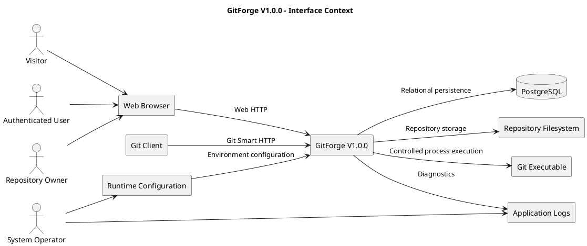

# GitForge V1.0.0 Interface Requirements

## 1. Document Information

| Field          | Value                               |
| -------------- | ----------------------------------- |
| Project        | GitForge - Web Git Hosting Platform |
| Target release | V1.0.0                              |
| Document       | Interface Requirements              |
| SDLC phase     | Requirements Engineering            |
| Milestone      | M1 - Requirements Engineering       |
| Project owner  | Farhad Valizadegan                  |
| Status         | Approved                            |
| Last updated   | 2026-08-17                          |

---

## 2. Purpose

This document defines the authoritative interface requirements for GitForge V1.0.0.

Interface requirements specify how GitForge interacts with:

* human users;
* web browsers;
* Git clients;
* PostgreSQL;
* filesystem-backed repository storage;
* the Git executable;
* the operating environment.

This document defines required interface behavior and boundaries.

It does not define the final API specification, route structure, controller structure, database schema, or deployment topology.

Those details belong primarily to later SDLC phases.

---

## 3. Requirement Identification

Interface requirements use the following identifier format:

```text
IR-XXX
```

Example:

```text
IR-001
```

Each interface requirement defines one externally observable interface obligation or technical boundary constraint.

---

# 4. Interface Categories

GitForge V1.0.0 contains the following primary interface categories:

| Category                        | Purpose                                 |
| ------------------------------- | --------------------------------------- |
| Web User Interface              | Human interaction through a browser     |
| Application HTTP Interface      | Application request/response operations |
| Git Smart HTTP Interface        | Git clone, fetch, and push              |
| PostgreSQL Interface            | Relational persistence                  |
| Filesystem Interface            | Physical repository storage             |
| Git Process Interface           | Native Git service execution            |
| Runtime Configuration Interface | Environment-specific configuration      |
| Logging Interface               | Operational diagnostics                 |

---

# 5. Web User Interface Requirements

## IR-001 — Browser-Based Access

The system shall provide browser-based access to supported user-facing GitForge functionality.

---

## IR-002 — Registration Interface

The web interface shall allow a Visitor to submit the required information for user registration.

---

## IR-003 — Login Interface

The web interface shall allow a registered user to submit authentication credentials.

---

## IR-004 — Logout Interface

The web interface shall provide an authenticated user with a mechanism to terminate the current application session.

---

## IR-005 — Repository Creation Interface

The web interface shall provide an authenticated user with a repository creation workflow.

---

## IR-006 — Repository Listing Interface

The web interface shall provide an authenticated user with access to repositories relevant to that user.

---

## IR-007 — Repository Detail Interface

The web interface shall provide an authorized actor with repository metadata and supported repository actions.

---

## IR-008 — Repository Browser Interface

The web interface shall provide navigation for supported repository browsing capabilities.

Supported capabilities may include:

* branch selection;
* commit history;
* commit detail;
* tree browsing;
* file content viewing.

---

## IR-009 — Repository Visibility Interface

Where repository visibility can be configured, the web interface shall clearly distinguish supported visibility values:

```text
public
private
```

---

## IR-010 — Personal Access Token Management Interface

The web interface shall allow an authenticated user to:

* create Personal Access Tokens;
* view token metadata;
* revoke owned tokens.

---

## IR-011 — Token Secret Presentation

When a newly created Personal Access Token secret is displayed, the interface shall clearly identify the secret as sensitive and communicate any one-time-display behavior.

---

## IR-012 — Validation Feedback

The web interface shall present understandable validation feedback when user-submitted data is rejected.

---

## IR-013 — Authorization-Aware UI

The web interface may hide or disable actions unavailable to the current user, but interface state shall not replace server-side authorization.

---

# 6. Web Interface Usability Requirements

## IR-014 — Consistent Navigation

Primary GitForge pages shall use consistent navigation patterns.

---

## IR-015 — Clear Action Labels

Primary actions shall use labels that communicate their effect.

Examples include:

```text
Create repository
Sign in
Sign out
Create token
Revoke token
```

---

## IR-016 — Destructive Action Identification

Destructive operations shall be clearly distinguishable from ordinary navigation or read operations.

---

## IR-017 — Repository Identity Display

Repository views shall display sufficient identity information to distinguish the repository and owner namespace.

---

## IR-018 — Error Feedback

The web interface shall communicate user-relevant failures without exposing unnecessary internal implementation details.

---

# 7. Application HTTP Interface Requirements

## IR-019 — HTTP Request Handling

GitForge shall expose HTTP endpoints required to support web application and Git Smart HTTP interactions.

---

## IR-020 — HTTP Method Semantics

HTTP operations should use request methods consistent with the type of action being performed.

Examples include:

* GET for retrieval;
* POST for creation or command submission;
* PATCH or PUT for supported updates;
* DELETE for supported deletion operations.

Exact route contracts will be defined during System Design.

---

## IR-021 — HTTP Status Semantics

Application responses shall use appropriate HTTP response semantics for conditions including:

* success;
* validation failure;
* unauthenticated access;
* unauthorized access;
* missing resource;
* internal failure.

---

## IR-022 — Authentication Integration

Protected application HTTP requests shall integrate with the supported authentication mechanism before protected behavior is executed.

---

## IR-023 — Authorization Integration

Protected application HTTP operations shall perform server-side authorization before accessing or modifying protected resources.

---

## IR-024 — Validation Integration

External application input shall be validated before it reaches security-sensitive or persistent operations.

---

## IR-025 — Safe Error Responses

Application HTTP responses shall not intentionally disclose:

* passwords;
* token secrets;
* password hashes;
* database credentials;
* raw internal stack traces in production;
* unrestricted filesystem paths.

---

# 8. Git Smart HTTP Interface Requirements

## IR-026 — Git Smart HTTP Transport

GitForge V1.0.0 shall support Git repository interaction through Git Smart HTTP.

---

## IR-027 — Git Service Discovery

The Git HTTP interface shall support service discovery required by supported Git clients.

Relevant service types include:

```text
git-upload-pack
git-receive-pack
```

---

## IR-028 — Upload-Pack Interface

The Git HTTP interface shall support upload-pack operations required for authorized Git read workflows.

---

## IR-029 — Receive-Pack Interface

The Git HTTP interface shall support receive-pack operations required for authorized Git write workflows.

---

## IR-030 — Clone Support

The Git Smart HTTP interface shall support repository clone operations for repositories accessible to the requesting Git Client.

---

## IR-031 — Fetch Support

The Git Smart HTTP interface shall support repository fetch operations for repositories accessible to the requesting Git Client.

---

## IR-032 — Push Support

The Git Smart HTTP interface shall support repository push operations for authenticated identities with repository write permission.

---

## IR-033 — Public Repository Read Access

Where anonymous Git access is enabled for public repositories, the Git HTTP interface shall permit supported unauthenticated read operations.

---

## IR-034 — Private Repository Authentication

The Git HTTP interface shall require supported authentication before granting access to private repositories.

---

## IR-035 — Write Authentication

The Git HTTP interface shall require authentication for repository write operations.

---

## IR-036 — Git Authorization

The Git HTTP interface shall enforce repository authorization before executing the requested Git service operation.

---

## IR-037 — Personal Access Token Authentication

The Git HTTP interface shall support Personal Access Tokens as an authentication mechanism for supported Git operations.

---

## IR-038 — Invalid Credential Handling

The Git HTTP interface shall reject invalid or revoked credentials.

---

## IR-039 — Git Protocol Compatibility

Responses produced through Git Smart HTTP shall remain compatible with the supported Git client used for V1.0.0 verification.

---

## IR-040 — Git Content Type Handling

The interface shall use protocol-appropriate content types and response behavior required by supported Git Smart HTTP operations.

Exact protocol headers and route details will be specified during System Design.

---

# 9. Git Client Interaction Requirements

## IR-041 — Standard Git Client Use

A user shall be able to use a supported standard Git command-line client without requiring a proprietary GitForge client.

---

## IR-042 — Repository URL

GitForge shall provide or expose a repository HTTP URL usable by a supported Git client.

---

## IR-043 — Credential Prompt Compatibility

Where HTTP authentication requires credentials, the Git interface shall use behavior compatible with supported Git-client credential handling.

---

## IR-044 — Read and Write Distinction

The interface shall distinguish operations requiring read permission from operations requiring write permission.

---

# 10. PostgreSQL Interface Requirements

## IR-045 — PostgreSQL Persistence

GitForge shall use PostgreSQL for persistent relational application data required by V1.0.0.

---

## IR-046 — Configurable Database Connection

Database connection values shall be externally configurable.

Configuration includes, where applicable:

* host;
* port;
* database name;
* application username;
* password.

---

## IR-047 — Application Database Account

GitForge shall connect to PostgreSQL using an application database role appropriate to the application's required privileges.

---

## IR-048 — Parameterized Database Access

Application-to-database interaction shall use framework-supported parameterization or equivalent safe query mechanisms.

---

## IR-049 — Database Failure Detection

The application shall detect and report database failures through controlled application error handling.

---

## IR-050 — Database Transaction Use

Operations that require multiple related relational changes shall use transaction semantics where necessary to preserve consistency.

Exact transaction boundaries will be determined during design and implementation.

---

# 11. Filesystem Interface Requirements

## IR-051 — Repository Filesystem Storage

GitForge shall interact with filesystem-backed Git repository storage.

---

## IR-052 — Configurable Repository Root

The repository storage root shall be configurable outside application source code.

---

## IR-053 — Repository Root Restriction

GitForge shall resolve managed repository paths only within the configured repository root.

---

## IR-054 — Path Validation

Repository identifiers used for filesystem operations shall be validated before path resolution.

---

## IR-055 — Path Traversal Prevention

The filesystem interface shall prevent untrusted identifiers from traversing outside the configured repository root.

---

## IR-056 — Repository Existence Detection

GitForge shall detect whether the required physical repository exists before executing dependent Git operations.

---

## IR-057 — Repository Creation Interface

GitForge shall be able to initialize required server-side Git repository storage through controlled application behavior.

---

## IR-058 — Repository Read Access

The application runtime shall have sufficient filesystem permission to read hosted repositories when required.

---

## IR-059 — Repository Write Access

The application runtime shall have sufficient filesystem permission to modify hosted repositories only where required by supported Git operations.

---

## IR-060 — Filesystem Failure Handling

Filesystem failures shall be handled predictably and logged with sufficient diagnostic context.

---

# 12. Git Executable Interface Requirements

## IR-061 — Installed Git Dependency

The runtime environment shall provide an installed Git executable compatible with V1.0.0 operations.

---

## IR-062 — Controlled Git Invocation

GitForge shall invoke Git through controlled process execution mechanisms.

---

## IR-063 — Approved Git Services

Only Git operations explicitly required by V1.0.0 shall be exposed through application-controlled Git execution.

Primary server services include:

```text
git upload-pack
git receive-pack
```

---

## IR-064 — Repository Binding

Each Git service process shall be bound to the repository already resolved and authorized by GitForge.

---

## IR-065 — Shell Injection Prevention

Untrusted client input shall not be concatenated directly into unrestricted shell command strings.

---

## IR-066 — Process Input Handling

GitForge shall support the transfer of request data required by supported Git service processes.

---

## IR-067 — Process Output Handling

GitForge shall transmit Git process output to the Git Client using behavior appropriate to Git Smart HTTP.

---

## IR-068 — Git Process Exit Status

GitForge shall detect Git process failure using process exit status or equivalent execution results.

---

## IR-069 — Git Process Diagnostics

Unexpected Git process failures shall generate operational diagnostics without exposing reusable authentication secrets.

---

# 13. Runtime Configuration Interface Requirements

## IR-070 — Environment Configuration

Environment-dependent values shall be supplied through application configuration mechanisms.

---

## IR-071 — Database Configuration

The runtime configuration shall support PostgreSQL connection settings.

---

## IR-072 — Repository Storage Configuration

The runtime configuration shall support the Git repository storage root.

---

## IR-073 — Application URL Configuration

The runtime configuration shall support environment-specific application URL settings where required.

---

## IR-074 — Logging Configuration

The runtime configuration shall support environment-appropriate logging behavior.

---

## IR-075 — Secret Configuration

Application secrets shall be supplied through protected environment configuration rather than committed source code.

---

# 14. Logging Interface Requirements

## IR-076 — Application Logging

GitForge shall use the configured application logging interface for unexpected operational failures.

---

## IR-077 — Authentication Diagnostic Logging

Authentication-related failures may be logged with non-secret contextual information where appropriate.

---

## IR-078 — Authorization Diagnostic Logging

Authorization failures may be logged with appropriate user, repository, and operation context where useful.

---

## IR-079 — Git Failure Logging

Git process failures shall generate diagnostic records sufficient for troubleshooting.

---

## IR-080 — Repository Storage Failure Logging

Filesystem and repository-storage failures shall produce diagnostic records.

---

## IR-081 — Secret Exclusion

The logging interface shall not intentionally record plaintext passwords or Personal Access Token secrets.

---

# 15. Interface Authentication Requirements

## IR-082 — Session Authentication

Browser-based protected interfaces shall support authenticated user sessions.

---

## IR-083 — Token Authentication

Git Smart HTTP protected operations shall support Personal Access Token authentication.

---

## IR-084 — Authentication Context Resolution

A successful authentication interface shall resolve the request to an application user identity.

---

## IR-085 — Authentication Before Authorization

Where identity is required, authentication shall occur before user-specific authorization is evaluated.

---

# 16. Interface Authorization Requirements

## IR-086 — Public Read Interface

Public repository interfaces may allow unauthenticated read access only for explicitly permitted public operations.

---

## IR-087 — Private Read Interface

Private repository read interfaces shall require authenticated and authorized access.

---

## IR-088 — Repository Write Interface

Repository write interfaces shall require authenticated write authorization.

---

## IR-089 — Owner-Only Interface

Owner-controlled repository operations shall verify repository ownership before execution.

---

## IR-090 — Token Ownership Interface

Personal Access Token management interfaces shall permit token management only by the token owner.

---

# 17. Interface Validation Requirements

## IR-091 — Identifier Validation

Repository identifiers received through an external interface shall be validated before database, filesystem, or Git-process use.

---

## IR-092 — Request Data Validation

Web application input shall be validated against defined field requirements and constraints.

---

## IR-093 — Unsupported Operation Rejection

External interfaces shall reject operations not supported by V1.0.0.

---

## IR-094 — Visibility Validation

Repository visibility input shall accept only supported visibility values.

---

# 18. Interface Error Requirements

## IR-095 — Authentication Failure

Interfaces requiring authentication shall return a defined failure when valid identity cannot be established.

---

## IR-096 — Authorization Failure

Interfaces shall reject operations when the authenticated actor lacks required permission.

---

## IR-097 — Resource Not Found

Interfaces shall return a defined not-found result when the requested resource does not exist.

---

## IR-098 — Validation Failure

Interfaces shall provide a defined failure response for invalid input.

---

## IR-099 — Dependency Failure

Interfaces shall fail predictably when a required dependency such as PostgreSQL, filesystem storage, or Git execution is unavailable.

---

## IR-100 — Production Error Disclosure

Production-facing interfaces shall not intentionally expose raw internal stack traces or sensitive configuration data.

---

# 19. Interface Security Boundaries

The following interface boundaries are treated as trust boundaries:

```text
Browser
    ↓
GitForge
```

```text
Git Client
    ↓
GitForge
```

```text
GitForge
    ↓
PostgreSQL
```

```text
GitForge
    ↓
Filesystem
```

```text
GitForge
    ↓
Git Executable
```

Each boundary requires controlled validation, authentication, authorization, configuration, or execution appropriate to that boundary.

---

# 20. Interface Context Diagram



---

# 21. Interface Data Flow Summary

| Source         | Destination    | Primary data                            |
| -------------- | -------------- | --------------------------------------- |
| Browser        | GitForge       | Web requests, credentials, form data    |
| GitForge       | Browser        | HTML, redirects, validation/errors      |
| Git Client     | GitForge       | Git Smart HTTP requests, credentials    |
| GitForge       | Git Client     | Git protocol responses                  |
| GitForge       | PostgreSQL     | User, repository, token metadata        |
| PostgreSQL     | GitForge       | Persistent application data             |
| GitForge       | Filesystem     | Repository paths and storage operations |
| Filesystem     | GitForge       | Git repository state                    |
| GitForge       | Git Executable | Approved Git commands and process input |
| Git Executable | GitForge       | Protocol output and diagnostics         |
| Configuration  | GitForge       | Environment settings                    |
| GitForge       | Logs           | Operational events                      |

---

# 22. Interface Requirement Summary

| Range           | Interface area         |
| --------------- | ---------------------- |
| IR-001 – IR-013 | Web User Interface     |
| IR-014 – IR-018 | Web usability          |
| IR-019 – IR-025 | Application HTTP       |
| IR-026 – IR-040 | Git Smart HTTP         |
| IR-041 – IR-044 | Git Client interaction |
| IR-045 – IR-050 | PostgreSQL             |
| IR-051 – IR-060 | Filesystem             |
| IR-061 – IR-069 | Git executable         |
| IR-070 – IR-075 | Runtime configuration  |
| IR-076 – IR-081 | Logging                |
| IR-082 – IR-085 | Authentication         |
| IR-086 – IR-090 | Authorization          |
| IR-091 – IR-094 | Validation             |
| IR-095 – IR-100 | Error handling         |

Total interface requirements:

```text
100
```

---

## 23. Relationship to Functional Requirements

Examples include:

```text
FR-013 Repository Creation
        ↓
IR-005 Repository Creation Interface
IR-057 Repository Creation Interface
```

```text
FR-036 Git Smart HTTP Support
        ↓
IR-026 Git Smart HTTP Transport
IR-027 Git Service Discovery
IR-028 Upload-Pack Interface
IR-029 Receive-Pack Interface
```

```text
FR-050 Personal Access Token Creation
        ↓
IR-010 Personal Access Token Management Interface
IR-011 Token Secret Presentation
```

```text
FR-067 Controlled Repository Root
        ↓
IR-052 Configurable Repository Root
IR-053 Repository Root Restriction
IR-055 Path Traversal Prevention
```

---

## 24. Relationship to Data Requirements

Examples include:

```text
DR-003 User Email
        ↓
Registration / authentication web interfaces
```

```text
DR-011 Repository Visibility
        ↓
IR-009 Repository Visibility Interface
IR-086 Public Read Interface
IR-087 Private Read Interface
```

```text
DR-017 Physical Repository Representation
        ↓
IR-051 Repository Filesystem Storage
IR-061 Installed Git Dependency
```

---

## 25. Relationship to System Design

Requirements Engineering defines:

```text
What interfaces must exist
and
What obligations they must satisfy
```

System Design will define:

```text
Exact routes
Controllers
Services
Middleware
Request/response schemas
API contracts
Git HTTP endpoints
Database adapters
Filesystem abstractions
Process-execution components
```

This document must therefore avoid prematurely fixing unnecessary implementation details.

---

## 26. Scope Exclusions

The V1.0.0 interface requirements do not require:

* SSH Git transport;
* GraphQL;
* package registry interfaces;
* container registry interfaces;
* CI/CD webhooks;
* organization administration interfaces;
* team-management interfaces;
* pull-request interfaces;
* issue-tracking APIs;
* billing APIs;
* federation interfaces;
* enterprise identity federation.

---

## 27. Open Interface Decisions

The following decisions must be finalized before M1 closes or before dependent design work begins:

1. exact Git Smart HTTP URL convention;
2. exact web route naming;
3. whether a separate JSON REST API is required beyond application endpoints;
4. exact supported Git client version or version range;
5. exact browser support statement;
6. whether anonymous web browsing of public repository content is enabled;
7. exact Personal Access Token credential presentation for Git clients;
8. whether token read/write scopes change Git authorization behavior;
9. whether repository deletion and rename interfaces are included in V1.0.0;
10. exact production error representation for Git protocol failures.

---

## 28. Traceability

These interface requirements derive primarily from:

* Requirements Elicitation;
* Actors and External Systems;
* Functional Requirements;
* Non-Functional Requirements;
* Data Requirements.

Detailed mappings will be maintained in:

```text
14-requirements-traceability-matrix.md
```

---

## 29. Completion Criteria

This document is considered complete when:

* all major external interfaces are identified;
* human and Git-client interfaces are represented;
* PostgreSQL interaction requirements are represented;
* filesystem boundaries are represented;
* Git executable interaction requirements are represented;
* authentication and authorization interface behavior is explicit;
* validation and error behavior is represented;
* trust boundaries are recognized;
* interfaces remain consistent with V1.0.0 scope;
* sufficient information exists to support later interface and API design.

---

## 30. Document Status

This document is currently:

```text
Approved
```

It will be changed to:

```text
Approved
```

after the interface requirements have been reviewed for completeness, compatibility, security, consistency, and V1.0.0 scope alignment.
