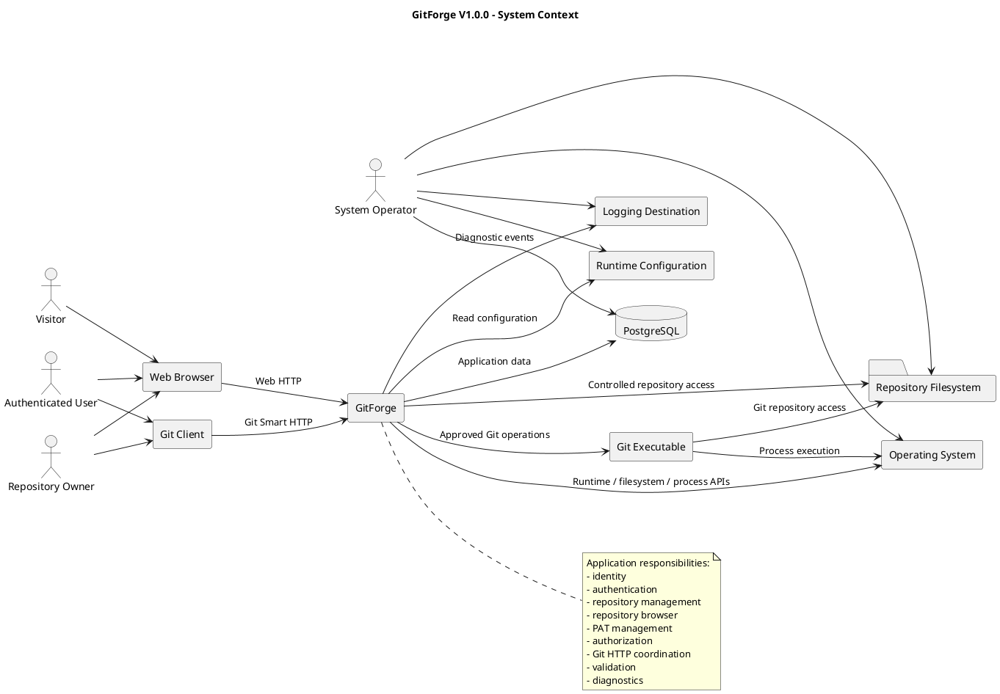
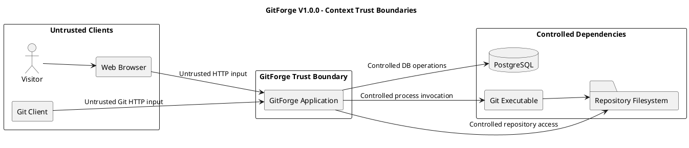

# GitForge V1.0.0 System Context Analysis
## 1. Document Information
| Field | Value |
|---|---|
| Project | GitForge - Web Git Hosting Platform |
| Target release | V1.0.0 |
| Document | System Context Analysis |
| SDLC phase | System Analysis |
| Milestone | M2 - System Analysis |
| Project owner | Farhad Valizadegan |
| Status | Approved |
| Last updated | 2026-08-17 |
---
## 2. Purpose
This document analyzes GitForge V1.0.0 within its external environment.
It defines:
- the GitForge system boundary;
- external human actors;
- external software actors;
- external infrastructure dependencies;
- major interaction flows;
- trust directions;
- responsibility boundaries;
- data-authority boundaries;
- scope boundaries.
This document provides the context required for later domain, workflow, security, data-flow, state, and design activities.
---
## 3. Analysis Objective
This analysis answers:
> What exists outside GitForge, and how does GitForge interact with those external entities?
The analysis distinguishes clearly between:
```text
Inside GitForge
Outside GitForge
```
A dependency required by GitForge is not automatically part of the GitForge application boundary.
---
## 4. System Under Analysis
The system under analysis is:
```text
GitForge V1.0.0
Web Git Hosting Platform
```
GitForge provides web-based repository management and Git Smart HTTP hosting.
Its principal responsibilities include:
- user identity management;
- authentication;
- repository metadata management;
- repository ownership;
- repository visibility;
- repository browsing;
- Personal Access Token management;
- Git Smart HTTP read operations;
- Git Smart HTTP write operations;
- authorization;
- repository-storage coordination;
- controlled Git process execution;
- validation;
- error handling;
- operational diagnostics.
---
## 5. System Boundary
The GitForge application boundary contains the logical responsibilities that receive requests, make application decisions, coordinate persistence, enforce authorization, and orchestrate Git operations.
Conceptually:
```text
+-------------------------------------------------------+
|                    GitForge                           |
|                                                       |
|  Identity                                             |
|  Authentication                                       |
|  Repository Management                                |
|  Repository Browser                                   |
|  PAT Management                                       |
|  Authorization                                        |
|  Git Smart HTTP Handling                              |
|  Repository Storage Coordination                      |
|  Git Process Coordination                             |
|  Validation                                           |
|  Error Handling                                       |
|  Diagnostics                                          |
|                                                       |
+-------------------------------------------------------+
```
External actors and infrastructure interact with this boundary but remain outside it.
---
## 6. Principal External Actors
The principal actors are:
```text
Visitor
Authenticated User
Repository Owner
Git Client
System Operator
```
Repository Owner is a contextual specialization of an Authenticated User for a specific repository.
---
## 7. Visitor
A Visitor is an unauthenticated human actor interacting with GitForge through a web browser.
Primary interactions include:
- opening GitForge;
- registering an account;
- authenticating;
- viewing public repositories;
- browsing public repository content.
A Visitor shall not:
- access private repositories;
- perform repository writes;
- create repositories;
- manage Personal Access Tokens.
---
## 8. Authenticated User
An Authenticated User is a human actor with a valid application session.
Primary interactions include:
- logout;
- repository creation;
- viewing owned repositories;
- viewing public repositories;
- viewing owned private repositories;
- repository browsing;
- creating Personal Access Tokens;
- listing owned PAT metadata;
- revoking owned PATs;
- changing visibility of owned repositories.
Authentication alone does not grant access to another user's private repository.
---
## 9. Repository Owner
Repository Owner is the authorization role held by the authenticated user who owns the target repository.
Primary owner-specific interactions include:
- reading an owned private repository;
- changing repository visibility;
- cloning and fetching an owned private repository;
- pushing to the owned repository.
Conceptually:
```text
Authenticated User
        |
        | owns target repository
        v
Repository Owner
```
Ownership is repository-specific.
---
## 10. System Operator
The System Operator is responsible for operating the GitForge runtime environment.
The operator may interact with:
- application configuration;
- PostgreSQL;
- repository storage;
- operating-system services;
- logs;
- backup processes;
- deployment processes.
The System Operator is not automatically an application-level administrator.
V1.0.0 does not require:
```text
Admin dashboard
User suspension UI
Global repository-management UI
Application superuser role
```
---
## 11. External Software Actor — Git Client
The Git Client is the principal external software actor.
Typical client operations include:
```text
git clone
git fetch
git push
```
The Git Client communicates with GitForge through Git Smart HTTP.
The Git Client shall not directly access:
- PostgreSQL;
- repository filesystem paths;
- GitForge internal services;
- application configuration.
All Git operations pass through the GitForge application boundary.
---
## 12. Git Client Interaction Classes
Git-client interactions may be classified as follows.
### 12.1 Anonymous Git Client
Used for permitted public repository read operations.
Permitted examples:
```text
Public clone
Public fetch
Read-service discovery
```
### 12.2 Authenticated Git Client
Uses a supported GitForge credential.
For V1.0.0, Git authentication uses a Personal Access Token.
### 12.3 Authenticated Owner Git Client
The authenticated identity owns the target repository.
It may perform supported read and write operations.
### 12.4 Authenticated Non-Owner Git Client
The authenticated identity does not own the target repository.
It may:
```text
Read public repositories
```
It may not:
```text
Read another user's private repository
Push to another user's repository
```
---
## 13. External System — Web Browser
A Web Browser is the client environment used by human actors.
The browser communicates with GitForge using application HTTP requests and responses.
Browser interactions include:
- page requests;
- form submissions;
- authentication;
- repository navigation;
- repository browsing;
- PAT management.
The browser is outside the trusted application boundary.
Client-side state shall not be treated as authoritative for authorization.
---
## 14. External System — PostgreSQL
PostgreSQL is the primary application-data persistence dependency.
GitForge uses PostgreSQL as the authoritative store for application-managed data such as:
```text
Users
Repository metadata
Repository ownership
Repository visibility
PAT metadata
Session/application data where applicable
```
PostgreSQL remains outside the GitForge application-process boundary.
External users shall not access it directly.
---
## 15. External System — Repository Filesystem
The repository filesystem stores physical Git repositories.
It is authoritative for Git-native repository state including:
```text
Git objects
Refs
Branches
Commit history
Trees
Blobs
File content
```
GitForge mediates access to this storage.
Clients shall not supply arbitrary physical repository paths.
---
## 16. External System — Git Executable
GitForge relies on the Git executable for approved Git-native operations.
Examples include:
```text
git-upload-pack
git-receive-pack
```
and repository inspection operations required by the web repository browser.
GitForge shall control:
- which Git operation is executed;
- which repository is targeted;
- which arguments are used;
- when execution is permitted.
The client shall not be able to request arbitrary shell commands.
---
## 17. External System — Operating System
The operating system provides the execution environment for:
- PHP/runtime processes;
- filesystem operations;
- process creation;
- environment variables;
- process permissions;
- networking.
The operating system remains outside the GitForge application boundary.
---
## 18. External System — Runtime Configuration
Runtime configuration provides settings such as:
```text
Database connection
Repository root
Application environment
Logging configuration
Git executable configuration
Application secrets
```
Configuration originates outside normal user requests.
Protected configuration values shall not be exposed to ordinary clients.
---
## 19. External System — Logging Destination
GitForge emits operational and security-relevant diagnostic events to configured logging facilities.
Examples include:
- repository operation failures;
- Git execution failures;
- filesystem failures;
- authentication failures;
- authorization failures;
- configuration failures.
Reusable plaintext credentials shall not be intentionally logged.
---
## 20. Context Interaction Summary
| External Entity | Interaction with GitForge |
|---|---|
| Visitor | Registration, login, public repository read |
| Authenticated User | Protected web functionality |
| Repository Owner | Owner-authorized repository operations |
| Git Client | Git Smart HTTP operations |
| System Operator | Runtime and infrastructure operations |
| Web Browser | Web HTTP interface |
| PostgreSQL | Application-data persistence |
| Repository Filesystem | Physical Git repository persistence |
| Git Executable | Git-native operations |
| Operating System | Runtime/process/filesystem services |
| Runtime Configuration | Operational configuration |
| Logging Destination | Diagnostic/event storage |
---
## 21. Web Read Context Flow
```text
Human Actor
    ↓
Web Browser
    ↓
GitForge
    ↓
Authentication / Authorization / Repository Logic
    ↓
PostgreSQL and/or Repository Storage
    ↓
GitForge
    ↓
Web Browser
```
---
## 22. Web Authentication Context Flow
```text
Visitor
    ↓
Web Browser
    ↓
GitForge
    ↓
Authentication Responsibility
    ↓
PostgreSQL
    ↓
Session Identity
    ↓
Web Browser
```
---
## 23. Public Repository Browse Context Flow
```text
Visitor
    ↓
Browser
    ↓
GitForge
    ↓
Resolve Repository Metadata
    ↓
Public Visibility?
    ↓ Yes
Repository Storage / Git Inspection
    ↓
GitForge
    ↓
Browser
```
No authentication is required for approved public repository read operations.
---
## 24. Private Repository Browse Context Flow
```text
User
   ↓
Browser
   ↓
GitForge
   ↓
Authenticate
   ↓
Resolve Repository
   ↓
Authorize Read
   ↓
Repository Storage / Git Inspection
   ↓
GitForge
   ↓
Browser
```
An authenticated non-owner shall be denied private repository access.
---
## 25. Public Git Read Context Flow
```text
Git Client
    ↓
Git Smart HTTP Request
    ↓
GitForge
    ↓
Resolve Repository
    ↓
Repository Public?
    ↓ Yes
Authorize Anonymous Read
    ↓
Approved Git Read Service
    ↓
Git Executable
    ↓
Repository Filesystem
    ↓
Git Smart HTTP Response
    ↓
Git Client
```
---
## 26. Private Git Read Context Flow
```text
Git Client
    ↓
Git Smart HTTP Request
    ↓
GitForge
    ↓
Authenticate PAT
    ↓
Resolve User
    ↓
Resolve Repository
    ↓
Authorize Repository Read
    ↓
Approved Git Read Service
    ↓
Git Executable
    ↓
Repository Filesystem
    ↓
Git Client
```
---
## 27. Git Write Context Flow
```text
Git Client
    ↓
Authenticated Git Smart HTTP Request
    ↓
GitForge
    ↓
Validate PAT
    ↓
Resolve User
    ↓
Resolve Repository
    ↓
Authorize Owner Write
    ↓
Approved git-receive-pack Operation
    ↓
Git Executable
    ↓
Repository Filesystem
    ↓
Git Client
```
Write authorization shall occur before repository mutation.
---
## 28. Repository Creation Context Flow
```text
Authenticated User
        ↓
Browser
        ↓
GitForge
        ↓
Validate Repository Data
        ↓
Verify Namespace Uniqueness
        ↓
Create Application Metadata
        ↓
Initialize Physical Git Repository
        ↓
Establish Consistent State
        ↓
Return Repository Result
```
Failure handling must preserve consistency between application metadata and physical repository state.
---
## 29. PAT Creation Context Flow
```text
Authenticated User
        ↓
Browser
        ↓
GitForge
        ↓
Authenticate Session
        ↓
Generate Secure Token
        ↓
Persist Non-Plaintext Representation
        ↓
Display Plaintext Once
        ↓
User Stores Credential
```
GitForge shall not provide later plaintext token recovery.
---
## 30. PAT Authentication Context Flow
```text
Git Client
    ↓
Credential
    ↓
GitForge
    ↓
Validate Token
    ↓
Check Revocation
    ↓
Resolve Token Owner
    ↓
Establish Identity
    ↓
Perform Repository Authorization
```
PAT authentication does not independently grant repository permission.
---
## 31. Principal Trust Direction
The principal trust direction is:
```text
External Input
     ↓
Untrusted
     ↓
Validation / Authentication / Authorization
     ↓
Trusted Application Decision
     ↓
Controlled Internal Operation
```
Inputs from the following are untrusted:
```text
Browser
Visitor
Authenticated User
Git Client
Repository identifiers
PAT credentials
Git protocol request data
Repository content
```
---
## 32. Trust Boundary — Browser to GitForge
The browser-to-application boundary is a trust boundary.
GitForge must evaluate:
- input validity;
- authentication state;
- target resource;
- authorization conditions.
A hidden or disabled UI control does not constitute authorization enforcement.
---
## 33. Trust Boundary — Git Client to GitForge
The Git Client boundary is security-sensitive.
Before executing a protected Git operation, GitForge must determine:
```text
Requested operation
Target repository
Authentication requirement
Authenticated identity
Authorization result
```
---
## 34. Trust Boundary — GitForge to PostgreSQL
GitForge sends controlled application persistence operations to PostgreSQL.
External actors have no direct database access.
Protected mutations require application-level validation and authorization first.
---
## 35. Trust Boundary — GitForge to Repository Filesystem
Repository filesystem access is security-sensitive.
GitForge must ensure:
- repository identifiers are validated;
- repository paths are derived internally;
- paths remain inside the configured repository root;
- traversal attempts are rejected;
- protected repository access is authorized.
---
## 36. Trust Boundary — GitForge to Git Executable
Process execution is a critical trust boundary.
GitForge must control:
```text
Executable
Git operation
Repository target
Process arguments
Input stream
Execution conditions
```
Arbitrary user-controlled shell execution is prohibited.
---
## 37. Responsibility Boundary
GitForge is responsible for:
```text
Authentication decisions
Authorization decisions
Repository metadata
Repository ownership
Repository visibility policy
PAT lifecycle
Request validation
Repository-path derivation
Git operation authorization
Approved Git process coordination
Application-level error handling
```
GitForge is not responsible for replacing:
```text
PostgreSQL engine semantics
Git object model semantics
Operating-system filesystem semantics
Git executable implementation
Browser implementation
Git client implementation
```
---
## 38. Data Authority Boundary
GitForge has two principal authoritative data domains.
### 38.1 Application Metadata Authority
```text
PostgreSQL
```
Examples:
```text
User identity
Repository metadata
Repository owner
Repository visibility
PAT metadata
```
### 38.2 Git Content Authority
```text
Physical Git Repository
```
Examples:
```text
Refs
Commits
Trees
Blobs
Branches
File contents
```
Git-native repository state shall not be duplicated as a competing authoritative application data source.
---
## 39. Repository Namespace Boundary
The logical repository namespace is:
```text
<owner>/<repository>
```
Example:
```text
farhad/gitforge
```
The logical identifier is not itself a physical filesystem path.
Physical repository paths shall be derived internally after validation.
---
## 40. Public and Private Access Boundary
### 40.1 Public Repository
Permitted:
```text
Anonymous web read
Authenticated web read
Anonymous Git clone
Anonymous Git fetch
Owner write
```
Denied:
```text
Anonymous write
Non-owner write
```
### 40.2 Private Repository
Permitted:
```text
Owner web read
Owner authenticated Git read
Owner write
```
Denied:
```text
Anonymous read
Authenticated non-owner read
Anonymous write
Authenticated non-owner write
```
---
## 41. External Dependency Failure Categories
Context-level dependency failures include:
```text
PostgreSQL unavailable
Repository filesystem unavailable
Physical repository missing
Filesystem permission failure
Git executable unavailable
Git process failure
Logging destination failure
Invalid runtime configuration
```
Detailed handling will be analyzed in:
```text
16-failure-and-exception-analysis.md
```
---
## 42. Context-Level Security Risks
Major context risks include:
```text
Credential theft
Private repository exposure
Unauthorized Git push
Path traversal
Arbitrary command execution
Untrusted repository-content execution
Sensitive error disclosure
Credential logging
Metadata/storage inconsistency
Dependency failure
```
These risks will be refined later in M2.
---
## 43. Context Assumptions
The following assumptions apply:
1. PostgreSQL is available as the approved application database.
2. A filesystem capable of storing Git repositories exists.
3. A supported Git executable is installed.
4. GitForge has controlled access to the configured repository root.
5. external clients access repository functions only through GitForge;
6. Git clients support required Smart HTTP behavior;
7. normal application users do not have direct OS or database access.
These assumptions will later inform System Design and Deployment.
---
## 44. System Context Diagram

---
## 45. Simplified Trust-Boundary Diagram

---
## 46. Context Interaction Matrix
| Interaction | Source | Target | Authentication | Authorization |
|---|---|---|---|---|
| Registration | Visitor | GitForge | No | Public workflow |
| Login | Visitor | GitForge | No | Public workflow |
| Public repository browse | Browser | GitForge | No | Public read |
| Private repository browse | Browser | GitForge | Yes | Owner read |
| Create repository | Browser | GitForge | Yes | Authenticated user |
| Change visibility | Browser | GitForge | Yes | Owner |
| Create PAT | Browser | GitForge | Yes | Current user |
| Revoke PAT | Browser | GitForge | Yes | Token owner |
| Public clone/fetch | Git Client | GitForge | No | Public read |
| Private clone/fetch | Git Client | GitForge | Yes | Owner read |
| Push | Git Client | GitForge | Yes | Owner write |
---
## 47. Context Responsibility Matrix
| Responsibility | GitForge | External Dependency |
|---|---:|---:|
| User authentication decision | Yes | No |
| Repository authorization decision | Yes | No |
| Repository visibility policy | Yes | No |
| Repository metadata persistence | Coordinates | PostgreSQL stores |
| Git object semantics | No | Git |
| Physical repository persistence | Coordinates | Filesystem stores |
| Repository-path validation | Yes | No |
| Git operation selection | Yes | No |
| Git command execution | Coordinates | Git executable performs |
| Browser rendering | No | Browser |
| Git client behavior | No | Git Client |
| OS process isolation | Uses | OS provides |
---
## 48. Context Constraints
The context model remains constrained by the approved V1.0.0 scope.
GitForge shall not assume the existence of:
```text
Organizations
Teams
Collaborator permissions
SSH authentication
Pull request services
Issue services
CI/CD services
Package registries
Repository deletion workflow
Repository rename workflow
```
---
## 49. Relationship to Later M2 Documents
This context analysis feeds directly into:
```text
03-domain-analysis.md
04-logical-system-decomposition.md
05-authentication-analysis.md
06-authorization-analysis.md
09-git-smart-http-read-analysis.md
10-git-smart-http-write-analysis.md
12-repository-storage-analysis.md
13-data-flow-analysis.md
15-trust-boundary-analysis.md
16-failure-and-exception-analysis.md
```
---
## 50. Requirements Traceability
This analysis primarily derives from:
```text
03-actors-and-external-systems.md
04-functional-requirements.md
05-non-functional-requirements.md
06-data-requirements.md
07-interface-requirements.md
08-business-rules.md
09-use-case-model.md
12-authorization-requirements-matrix.md
15-requirements-validation.md
```
Representative mappings include:
```text
Web Browser
    → IR-001 – IR-025
Git Smart HTTP
    → FR-036 – FR-049
    → IR-026 – IR-044
PostgreSQL
    → DR-001 – DR-016
    → IR-045 – IR-050
Repository Filesystem
    → FR-067 – FR-070
    → IR-051 – IR-060
Git Executable
    → FR-071 – FR-074
    → IR-061 – IR-069
Authorization
    → FR-061 – FR-066
    → AR-001 – AR-060
```
Detailed analysis traceability will be consolidated in:
```text
19-analysis-traceability.md
```
---
## 51. Context Analysis Findings
### CA-001 — Dual Client Channels
GitForge has two materially different client interaction channels:
```text
Web HTTP
Git Smart HTTP
```
They share repository authorization semantics but differ in protocol behavior and authentication patterns.
Status:
```text
Confirmed
```
### CA-002 — Dual Persistence Authorities
PostgreSQL and physical Git repository storage represent distinct authoritative data domains.
Status:
```text
Confirmed
```
### CA-003 — Controlled Git Execution Boundary
The Git executable is an external dependency behind a controlled process-execution boundary.
Status:
```text
Confirmed
```
### CA-004 — Internal Repository Paths
Physical repository paths are internal application resources and shall not be directly selected by external actors.
Status:
```text
Confirmed
```
### CA-005 — Operator Versus Application Administrator
The System Operator is operationally significant but does not require an application-level administrator role in V1.0.0.
Status:
```text
Confirmed
```
---
## 52. Areas Requiring Deeper Analysis
The following areas require deeper treatment later in M2:
```text
Git HTTP authentication flow
Authorization decision ordering
Metadata/filesystem consistency
Git Smart HTTP request/response lifecycle
Repository-path derivation
Git process input/output handling
Missing physical repository behavior
Detailed trust-boundary controls
```
These are analysis tasks rather than unresolved scope questions.
---
## 53. Completion Criteria
This document is considered complete when:
- the GitForge system boundary is explicit;
- principal human actors are represented;
- Git Client is represented;
- PostgreSQL is represented;
- repository filesystem is represented;
- Git executable is represented;
- major context interactions are identified;
- trust directions are identified;
- data-authority boundaries are explicit;
- public/private access semantics match approved requirements;
- excluded V1.0.0 capabilities have not been introduced;
- downstream analysis can proceed without guessing the system context.
---
## 54. Analysis Result
System Context Analysis result:
```text
SUFFICIENT FOR DOWNSTREAM SYSTEM ANALYSIS
```
No context-level requirements defect has been identified.
---
## 55. Document Status
This document is currently:
```text
Approved
```
It will be changed to:
```text
Approved
```
after the system boundary, actors, external dependencies, major interactions, trust boundaries, diagrams, and requirements alignment have been reviewed.
