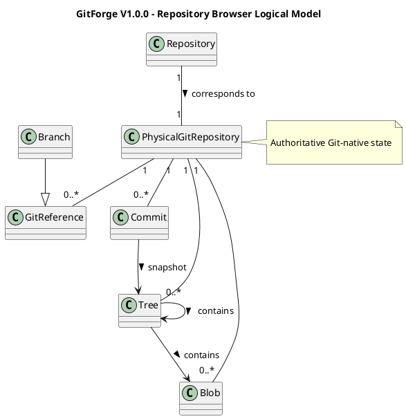

# GitForge V1.0.0 Repository Browser Analysis

## 1. Document Information

| Field | Value |

|---|---|

| Project | GitForge - Web Git Hosting Platform |

| Target release | V1.0.0 |

| Document | Repository Browser Analysis |

| SDLC phase | System Analysis |

| Milestone | M2 - System Analysis |

| Project owner | Farhad Valizadegan |

| Status | Approved |

| Last updated | 2026-08-17 |

---

## 2. Purpose

This document analyzes the logical behavior of the GitForge V1.0.0 Repository Browser.

It defines:

- repository browser scope;

- repository access preconditions;

- branch listing;

- commit history browsing;

- commit detail browsing;

- tree browsing;

- file/blob viewing;

- empty repository behavior;

- repository reference resolution;

- authorization ordering;

- Git-native authority;

- repository content trust;

- browser failure behavior;

- browser-related security boundaries.

The purpose is to establish how GitForge exposes authorized Git repository content through the web interface before System Design begins.

---

## 3. Analysis Objective

This document answers:

> How does GitForge safely expose Git-native repository information through the web interface while preserving repository authorization and Git-native data authority?

The Repository Browser is an analysis-level logical capability.

This document does not prescribe:

```text

Laravel controllers

Blade or React components

REST endpoint names

Git library selection

Exact Git command syntax

Caching implementation

Pagination implementation

Concrete HTML layout

```

Those belong to System Design.

---

## 4. Repository Browser Scope

V1.0.0 Repository Browser capabilities include:

```text

View repository

List branches

View commit history

View commit details

Browse repository tree

View file/blob content

Handle empty repositories

Handle missing Git objects safely

```

---

## 5. Out-of-Scope Browser Capabilities

The following capabilities are excluded from V1.0.0:

```text

Repository search

Code search

Commit comparison

Diff viewer

Blame viewer

Tag-management UI

Branch creation

Branch deletion

Branch protection UI

File editing

Web-based commit creation

Web-based file upload

Merge UI

Pull request UI

Issue references

README rendering beyond ordinary file viewing requirements

Syntax-highlighting requirements beyond approved scope

Binary preview subsystem

Large-file preview system

Git LFS browser

```

These shall not be introduced implicitly during System Design.

---

## 6. Repository Browser Role

The Repository Browser is a read-only logical capability.

Its principal responsibility is:

```text

Authorized Git Repository

&#x20;       ↓

Controlled Git Inspection

&#x20;       ↓

Web-Readable Representation

```

It shall not mutate Git-native repository state.

---

## 7. Repository Browser Inputs

Typical browser inputs include:

```text

Repository namespace

Branch or reference identifier

Commit identifier

Tree path

File path

Navigation request

```

All externally supplied identifiers and paths are untrusted until validated and resolved.

---

## 8. Repository Browser Outputs

Typical outputs include:

```text

Repository metadata

Branch list

Commit list

Commit detail

Tree entries

File/blob content

Empty repository state

Not-found result

Authorization denial

Operational failure

```

---

## 9. Repository Browser Preconditions

Before protected repository content is read, GitForge must establish:

```text

Target repository

Repository visibility

Caller context

Read authorization

Valid physical repository association

Requested Git reference/path

```

Protected content access shall not occur before required authorization succeeds.

---

## 10. Repository Resolution

The Repository Browser begins from a logical repository namespace.

Conceptually:

```text

<owner>/<repository>

&#x20;       ↓

Validate Namespace

&#x20;       ↓

Resolve Repository Metadata

&#x20;       ↓

Determine Visibility / Owner

```

The browser shall not accept an arbitrary physical repository path from the client.

---

## 11. Authorization Before Browsing

Repository Browser authorization follows the approved repository read policy.

### Public Repository

```text

Visitor                 → Allow

Authenticated Non-Owner → Allow

Owner                   → Allow

```

### Private Repository

```text

Visitor                 → Deny

Authenticated Non-Owner → Deny

Owner                   → Allow

```

---

## 12. Authorization Ordering

Logical order:

```text

Receive Browser Request

&#x20;       ↓

Resolve Repository Metadata

&#x20;       ↓

Determine Caller Context

&#x20;       ↓

Authorize Read

&#x20;       ↓

Resolve Physical Repository

&#x20;       ↓

Inspect Git State

```

For private repositories, Git-native content must not be inspected before authorization succeeds.

---

## 13. Repository Browser and Authentication

Authentication is not always required.

### Public Repository

Browser access may proceed anonymously.

### Private Repository

A valid authenticated User identity is required before owner authorization can succeed.

Authentication and authorization remain separate.

---

## 14. Git-Native Authority

The physical Git repository is authoritative for:

```text

Branches

References

Commits

Trees

Blobs

File contents

Commit relationships

```

The Repository Browser reads these values.

It does not maintain a competing authoritative database copy.

---

## 15. Repository Metadata Authority

PostgreSQL remains authoritative for:

```text

Repository identity

Repository name

Repository owner

Repository visibility

Logical repository metadata

```

The Repository Browser therefore coordinates two information domains:

```text

Application Metadata

Git-Native Content

```

---

## 16. Browser Read Model

Conceptually:

```text

Repository Metadata

&#x20;       +

Git-Native State

&#x20;       ↓

Repository Browser View

```

The browser combines authorized application metadata with controlled Git inspection results.

---

## 17. Branch Listing

Branch listing exposes Git branch references available in the repository.

Conceptually:

```text

Repository

&#x20;   ↓

Authorize Read

&#x20;   ↓

Inspect Refs

&#x20;   ↓

Filter/Interpret Branch References

&#x20;   ↓

Return Branch List

```

Branches remain Git-native data.

---

## 18. Branch Identity

A branch is logically represented by a Git reference such as:

```text

refs/heads/main

refs/heads/develop

```

The browser may present a simplified branch name such as:

```text

main

develop

```

Presentation does not alter the authoritative Git reference.

---

## 19. Branch Listing Empty State

A newly initialized repository may contain no branches.

This is a valid state.

Conceptually:

```text

Repository Available

&#x20;       +

No branch refs

&#x20;       ↓

Empty Branch List

```

This must not be reported as repository failure.

---

## 20. Default Branch Consideration

The browser may need a branch or reference context for navigation.

However, the exact default-branch policy is a design concern unless explicitly constrained by requirements.

The analysis therefore recognizes:

```text

Selected reference may exist

Selected reference may be absent

Repository may have no branches

```

No unsupported default-branch assumption shall be introduced.

---

## 21. Commit History Browsing

Commit history browsing exposes commit relationships reachable from an authorized reference.

Conceptually:

```text

Repository

&#x20;   ↓

Authorize Read

&#x20;   ↓

Resolve Reference

&#x20;   ↓

Traverse Commit History

&#x20;   ↓

Return Commit Summaries

```

Commit history comes from the physical Git repository.

---

## 22. Commit History Information

Commit history may logically expose information such as:

```text

Commit identifier

Commit message

Author information

Committer information

Commit timestamp

Parent relationship summary

```

Exact presentation fields belong to design.

---

## 23. Commit History Empty State

An empty repository may have no commits.

Result:

```text

Repository Available

&#x20;       +

No reachable commits

&#x20;       ↓

Empty Commit History

```

This is not an error.

---

## 24. Commit Detail Browsing

Commit detail browsing resolves a specific commit object.

Conceptually:

```text

Commit Identifier

&#x20;     ↓

Validate Identifier

&#x20;     ↓

Resolve in Authorized Repository

&#x20;     ↓

Commit Exists?

&#x20;   /          \\

&#x20; Yes           No

&#x20;  |             |

Return Detail   Safe Not-Found Result

```

---

## 25. Commit Identifier Trust

A client-supplied commit identifier is untrusted.

GitForge must ensure that resolution occurs within the authorized target repository.

The identifier shall not cause arbitrary filesystem or command execution behavior.

---

## 26. Commit Detail Information

A commit detail representation may include:

```text

Commit hash

Message

Author

Committer

Timestamp

Parent commits

Associated tree

```

The exact UI representation is deferred.

---

## 27. Tree Browsing

Tree browsing exposes directory-like Git tree structure.

Conceptually:

```text

Repository

&#x20;   ↓

Authorize Read

&#x20;   ↓

Resolve Reference / Commit

&#x20;   ↓

Resolve Tree

&#x20;   ↓

Resolve Requested Logical Path

&#x20;   ↓

Return Tree Entries

```

---

## 28. Tree Entries

Tree entries may represent:

```text

Files / blobs

Directories / trees

Other Git-supported entry types where safely handled

```

The browser must not assume every entry is ordinary text.

---

## 29. Repository Browser Path

A browser path is a logical repository-content path.

Example:

```text

src/Controller/RepositoryController.php

```

This path refers to a location in a Git tree.

It is not a physical server filesystem path.

---

## 30. Browser Path Versus Filesystem Path

The following distinction is mandatory:

```text

Git Tree Path

&#x20;     ≠

Server Filesystem Path

```

Client-supplied repository-content paths must never be used as arbitrary host filesystem paths.

---

## 31. Tree Path Validation

Logical path handling must prevent unsafe interpretation.

Relevant concerns include:

```text

Traversal-like input

Malformed separators

Unexpected control characters

Invalid reference/path combinations

Oversized path input

```

Exact validation implementation belongs to design.

---

## 32. File Viewing

File viewing resolves a Git blob associated with an authorized repository tree path.

Conceptually:

```text

Repository

&#x20;   ↓

Authorize Read

&#x20;   ↓

Resolve Reference

&#x20;   ↓

Resolve Tree Path

&#x20;   ↓

Resolve Blob

&#x20;   ↓

Return Safe File Representation

```

---

## 33. Blob Authority

Blob content comes from the physical Git repository.

Application metadata does not become authoritative for file content.

---

## 34. Repository Content Is Untrusted

All repository content must be treated as untrusted.

This includes:

```text

File names

Directory names

Commit messages

Author names

Blob content

Repository-controlled text

```

Even repository-owner content is not automatically trusted for rendering or execution.

---

## 35. Repository Content Rendering Principle

Repository content shall be displayed, not executed.

Conceptually:

```text

Repository Content

&#x20;     ↓

Untrusted Data

&#x20;     ↓

Safe Presentation

```

The browser must not interpret repository content as trusted executable application code.

---

## 36. HTML and Script Content Risk

A repository file may contain content such as:

```text

HTML

JavaScript

SVG

Markdown

Template syntax

```

The fact that such content exists in a repository does not make it safe to execute in the GitForge application origin.

Detailed rendering controls belong to System Design and Security Design.

---

## 37. Binary Content

A blob may contain binary data.

The Repository Browser must not assume all blobs are valid text.

Logical outcomes may include:

```text

Displayable text

Binary/non-displayable content

Unsupported preview

Download-oriented response if supported by approved design

```

The exact handling is deferred.

---

## 38. Large Content

Repository blobs or histories may be large.

The browser analysis therefore recognizes that unrestricted reading may create:

```text

Memory pressure

Response-size pressure

Latency

Process overhead

```

Exact limits and pagination strategies belong to System Design.

---

## 39. Repository Reference Resolution

Browser operations may depend on a Git reference or commit.

Conceptually:

```text

Requested Reference

&#x20;      ↓

Validate

&#x20;      ↓

Resolve in Repository

&#x20;      ↓

Git Object / Commit Context

```

Resolution must remain repository-scoped.

---

## 40. Invalid Reference

If a requested branch, reference, or commit cannot be resolved:

```text

Do not guess another object

Do not access another repository

Return safe not-found/error result

```

The exact HTTP response is a design decision.

---

## 41. Repository Browser Navigation

Logical navigation may involve:

```text

Repository root

Branch selection

Commit selection

Tree path

File path

```

The browser must maintain a consistent repository/reference context throughout navigation.

---

## 42. Repository Browser Context

A browser request may logically require:

```text

Repository

Reference or Commit

Tree Path

Caller Context

```

These values together determine the target Git-native content.

---

## 43. Empty Repository Behavior

An empty repository is valid when:

```text

Physical Git repository exists

Git repository is structurally valid

No commits exist

```

Expected browser result:

```text

Repository metadata available

No branches/commits/files yet

Empty-state presentation

```

---

## 44. Empty Repository Versus Missing Repository

These are distinct.

### Empty Repository

```text

Valid physical Git repository

No history yet

```

### Missing Repository

```text

Application metadata exists

Expected physical repository absent

```

The second condition is a storage/consistency failure.

---

## 45. Missing Physical Repository

If repository metadata resolves successfully but physical repository storage is missing:

```text

Authorization may succeed

&#x20;       ↓

Physical repository resolution fails

&#x20;       ↓

Operational/consistency failure

```

This is not a normal empty-state result.

---

## 46. Corrupt Repository

If the physical repository exists but Git cannot interpret required state:

```text

Repository resolution succeeds

Authorization succeeds

Physical repository exists

Git inspection fails

```

The result is an operational failure.

GitForge shall not fabricate repository content.

---

## 47. Repository Browser Failure Categories

### RBF-001 — Repository Not Found

Logical repository cannot be resolved.

### RBF-002 — Authorization Denied

Caller is not permitted to read the repository.

### RBF-003 — Invalid Reference

Requested branch/reference/commit is invalid or unavailable.

### RBF-004 — Invalid Tree Path

Requested repository-content path cannot be safely resolved.

### RBF-005 — Git Object Not Found

Expected commit/tree/blob cannot be resolved.

### RBF-006 — Physical Repository Missing

Expected physical Git repository does not exist.

### RBF-007 — Git Inspection Failure

Controlled Git inspection operation fails.

### RBF-008 — Storage Failure

Repository filesystem cannot be accessed reliably.

### RBF-009 — Unsupported Content Presentation

Content cannot be safely rendered in the requested presentation mode.

### RBF-010 — Dependency Failure

Required persistence or Git dependency is unavailable.

---

## 48. Failure Classification Principle

Repository Browser failures should preserve distinction between:

```text

Authorization failure

Not-found condition

Validation failure

Git object absence

Physical storage failure

Git process failure

Unsupported presentation

```

This improves diagnosis and prevents incorrect behavior.

---

## 49. Safe Failure Response

Internal failure detail and external error detail may differ.

Conceptually:

```text

Internal Browser Failure

&#x20;       ↓

Classify

&#x20;       ↓

Diagnostic Record

&#x20;       +

Safe External Response

```

Sensitive server paths and internal command details shall not be unnecessarily exposed.

---

## 50. Private Repository Failure Disclosure

For private repositories, error handling should avoid unnecessary existence disclosure to unauthorized callers.

The exact external distinction between:

```text

Not Found

Unauthorized

Forbidden

```

is deferred to System Design.

---

## 51. Browser Read-Only Invariant

Repository Browser operations shall not intentionally mutate Git-native state.

Browser capabilities such as:

```text

Branches

Commits

Trees

Files

```

are read-only in V1.0.0.

---

## 52. Git Process Coordination

Repository Browser may require controlled Git-native inspection.

Conceptually:

```text

Repository Browser

&#x20;       ↓

Repository Storage Coordination

&#x20;       ↓

Git Process Coordination

&#x20;       ↓

Git Executable

&#x20;       ↓

Physical Repository

```

The browser does not execute arbitrary user-provided Git commands.

---

## 53. Git Command Selection Boundary

External browser input may influence:

```text

Repository identity

Reference

Logical repository-content path

```

but must not directly select:

```text

Executable

Arbitrary Git subcommand

Shell syntax

Host filesystem path

Unrestricted arguments

```

---

## 54. Repository Storage Coordination

The browser obtains a physical repository reference only after:

```text

Logical repository resolution

Authorization

Safe storage resolution

```

This responsibility protects the boundary between logical namespace and physical storage.

---

## 55. Browser Data Flow

Conceptually:

```text

Browser Client

&#x20;     ↓

Web Interaction

&#x20;     ↓

Repository Resolution

&#x20;     ↓

Authorization

&#x20;     ↓

Repository Browser

&#x20;     ↓

Storage Coordination

&#x20;     ↓

Git Inspection

&#x20;     ↓

Physical Git Repository

&#x20;     ↓

Git Result

&#x20;     ↓

Safe Presentation

&#x20;     ↓

Browser Client

```

---

## 56. Branch Listing Activity

```plantuml

@startuml

title GitForge V1.0.0 - Branch Listing Activity

start

:Receive branch-list request;

:Resolve repository;

if (Repository resolved?) then (yes)

&#x20;   :Evaluate read authorization;

&#x20;   if (Authorized?) then (yes)

&#x20;       :Resolve physical Git repository;

&#x20;       if (Physical repository usable?) then (yes)

&#x20;           :Inspect branch references;

&#x20;           :Return branch list;

&#x20;       else (no)

&#x20;           :Return safe operational failure;

&#x20;       endif

&#x20;   else (no)

&#x20;       :Deny;

&#x20;   endif

else (no)

&#x20;   :Return safe not-found result;

endif

stop

@enduml

```

---

## 57. Commit History Activity

```plantuml

@startuml

title GitForge V1.0.0 - Commit History Activity

start

:Receive commit-history request;

:Resolve repository;

:Authorize read;

if (Authorized?) then (yes)

&#x20;   :Resolve requested reference;

&#x20;   if (Reference exists?) then (yes)

&#x20;       :Read reachable commit history;

&#x20;       :Return commit summaries;

&#x20;   else (no)

&#x20;       :Return safe reference-not-found result;

&#x20;   endif

else (no)

&#x20;   :Deny;

endif

stop

@enduml

```

---

## 58. Tree Browsing Activity

```plantuml

@startuml

title GitForge V1.0.0 - Tree Browsing Activity

start

:Receive tree request;

:Resolve repository;

:Authorize read;

if (Authorized?) then (yes)

&#x20;   :Resolve reference or commit;

&#x20;   :Validate logical tree path;

&#x20;   if (Reference/path valid?) then (yes)

&#x20;       :Resolve Git tree;

&#x20;       :Return tree entries;

&#x20;   else (no)

&#x20;       :Return safe not-found/validation result;

&#x20;   endif

else (no)

&#x20;   :Deny;

endif

stop

@enduml

```

---

## 59. File Viewing Activity

```plantuml

@startuml

title GitForge V1.0.0 - File Viewing Activity

start

:Receive file-view request;

:Resolve repository;

:Authorize read;

if (Authorized?) then (yes)

&#x20;   :Resolve reference;

&#x20;   :Validate logical file path;

&#x20;   if (Path resolves to blob?) then (yes)

&#x20;       :Read blob content;

&#x20;       :Classify presentation type;

&#x20;       :Return safe representation;

&#x20;   else (no)

&#x20;       :Return safe not-found result;

&#x20;   endif

else (no)

&#x20;   :Deny;

endif

stop

@enduml

```

---

## 60. Repository Browser Sequence

```plantuml

@startuml

title GitForge V1.0.0 - Repository Browser Sequence

actor "Web User" as User

participant "Web Interaction" as Web

participant "Repository Resolution" as Repo

participant "Repository Authorization" as Authz

participant "Repository Browser" as Browser

participant "Repository Storage Coordination" as Storage

participant "Git Process Coordination" as Git

User -> Web : Browse repository request

Web -> Repo : Resolve namespace

Repo --> Web : Repository metadata

Web -> Authz : Authorize read

alt Authorized

&#x20;   Authz --> Web : Allow

&#x20;   Web -> Browser : Browse(repository, reference, path)

&#x20;   Browser -> Storage : Resolve physical repository

&#x20;   Storage --> Browser : Safe repository target

&#x20;   Browser -> Git : Inspect Git state

&#x20;   Git --> Browser : Git-native result

&#x20;   Browser --> Web : Safe browser representation

&#x20;   Web --> User : Repository content

else Denied

&#x20;   Authz --> Web : Deny

&#x20;   Web --> User : Safe denial response

end

@enduml

```

---

## 61. Repository Browser Logical Model



---

## 62. Repository Browser Responsibility Matrix

| Responsibility | Logical Owner |

|---|---|

| Receive browser request | Web Interaction |

| Resolve repository metadata | Repository Management / Persistence |

| Resolve caller identity | Authentication when required |

| Evaluate read permission | Repository Authorization |

| Resolve physical repository | Repository Storage Coordination |

| Resolve Git reference | Repository Browser / Git Process Coordination |

| Read branch refs | Repository Browser / Git Process Coordination |

| Read commits | Repository Browser / Git Process Coordination |

| Read trees | Repository Browser / Git Process Coordination |

| Read blobs | Repository Browser / Git Process Coordination |

| Classify content for presentation | Repository Browser |

| Handle browser failure | Failure Handling |

| Record diagnostics | Diagnostics |

---

## 63. Repository Browser Invariants

### RBI-001 — Authorization First

Protected Git-native content shall not be exposed before successful repository read authorization.

### RBI-002 — Read Only

Repository Browser operations shall not intentionally mutate repository Git state.

### RBI-003 — Git Authority

Branches, commits, trees, blobs, and file contents are authoritative in the physical Git repository.

### RBI-004 — Logical Path

Client-supplied repository-content paths are logical Git paths, not host filesystem paths.

### RBI-005 — Physical Path Control

The client shall not select arbitrary physical repository paths.

### RBI-006 — Repository Scope

References, commits, trees, and blobs shall be resolved within the authorized repository context.

### RBI-007 — Empty Repository Validity

A valid repository with no commits or branches is not an error.

### RBI-008 — Missing Repository Distinction

A missing physical repository shall not be treated as an empty repository.

### RBI-009 — Untrusted Repository Content

Repository-controlled text and file content shall be treated as untrusted.

### RBI-010 — No Arbitrary Git Execution

Browser requests shall not directly select arbitrary Git commands or shell execution.

### RBI-011 — Safe Failure Disclosure

Browser failures shall not unnecessarily expose sensitive internal implementation details.

---

## 64. Repository Browser Security Risks

Major risks include:

```text

Private repository disclosure

Authorization bypass

IDOR-style repository access

Path traversal

Host filesystem access

Unsafe Git argument construction

Arbitrary command execution

Stored XSS from repository content

Unsafe HTML/SVG rendering

Large-content resource exhaustion

Malformed Git object handling

Sensitive filesystem-path disclosure

Cross-repository object resolution

Stale authorization state

```

---

## 65. Repository Content Trust Boundary

Repository content crosses a trust boundary when moved from Git storage into a browser response.

Conceptually:

```text

Physical Git Repository

&#x20;       ↓

Untrusted Repository Content

&#x20;       ↓

GitForge Presentation Logic

&#x20;       ↓

Safe Browser Output

```

Authorization alone does not make content trustworthy.

---

## 66. Repository Browser and XSS Risk

Repository-controlled content may contain script-like text or markup.

The Repository Browser must therefore distinguish between:

```text

Displaying source content

Executing source content

```

V1.0.0 requires controlled display behavior, not trusted execution.

Exact escaping/sanitization mechanisms belong to System Design.

---

## 67. Repository Browser and Resource Limits

Potentially expensive operations include:

```text

Large commit history

Large trees

Large blobs

Deep paths

Very large repositories

```

The analysis requires safe bounded behavior.

Exact limits, pagination, and truncation policies are design decisions.

---

## 68. Repository Browser and Concurrent Push

Repository state may change while a user is browsing.

Example:

```text

Browser requests branch history

Owner pushes new commit concurrently

```

The browser must accept that Git-native state may change between separate requests.

No cross-request snapshot guarantee is required unless explicitly designed.

---

## 69. Reference Consistency

A request should resolve its target reference consistently for that operation.

If a branch moves between separate requests, later requests may legitimately observe the newer state.

Exact snapshot mechanisms are not required by current requirements.

---

## 70. Repository Browser and Visibility Change

Visibility may change between browser requests.

Therefore authorization must be evaluated using current authoritative metadata.

Example:

```text

Request 1: Repository Public → anonymous read allowed

Owner changes visibility to Private

Request 2: anonymous read → denied

```

Previous authorization does not persist indefinitely.

---

## 71. Repository Browser and Repository Availability

Authorization and availability are separate.

Example:

```text

Caller = Owner

Repository = Private

Authorization = Allow

Physical repository unavailable

```

Result:

```text

Authorized

but

Operational failure

```

---

## 72. Repository Browser and Git Object Absence

A requested object may not exist even when the repository is otherwise healthy.

Examples:

```text

Unknown commit hash

Deleted/moved branch reference

Unknown tree path

Unknown file path

```

These are normal not-found conditions, not necessarily repository corruption.

---

## 73. Repository Browser Decision Table

| Condition | Result |

|---|---|

| Repository not resolved | Safe not-found result |

| Public repository + Visitor | Allow read |

| Public repository + Authenticated non-owner | Allow read |

| Private repository + Visitor | Deny |

| Private repository + Authenticated non-owner | Deny |

| Private repository + Owner | Allow read |

| Repository empty | Return empty-state representation |

| Requested reference missing | Safe reference-not-found result |

| Requested tree/file path missing | Safe path-not-found result |

| Physical repository missing | Operational/consistency failure |

| Git inspection fails | Safe operational failure |

---

## 74. Branch Browsing Decision Table

| Condition | Result |

|---|---|

| Authorized repository with branches | Return branches |

| Authorized empty repository | Return empty branch list |

| Unauthorized repository | Deny |

| Physical repository unavailable | Operational failure |

---

## 75. Commit Browsing Decision Table

| Condition | Result |

|---|---|

| Valid authorized reference with commits | Return commit history |

| Empty repository | Empty commit history |

| Unknown reference | Safe not-found result |

| Unknown commit | Safe not-found result |

| Unauthorized repository | Deny |

| Git inspection failure | Operational failure |

---

## 76. File Browsing Decision Table

| Condition | Result |

|---|---|

| Valid authorized blob path | Return safe content representation |

| Path refers to tree | Return tree representation where requested |

| Path absent | Safe not-found result |

| Binary content | Safe unsupported/binary representation |

| Unauthorized repository | Deny |

| Physical repository unavailable | Operational failure |

---

## 77. Requirements Alignment

This analysis derives primarily from approved requirements covering:

```text

Repository viewing

Repository browsing

Branch listing

Commit history

Commit details

Tree browsing

File viewing

Public repository read

Private repository protection

Authorization

Repository storage

Git process execution

Failure handling

Security

```

Relevant use cases include:

```text

UC-006 View Repository

UC-009 Browse

UC-010 List Branches

UC-011 Commit History

UC-012 Commit Details

UC-013 Tree

UC-014 File

UC-023 Authorize Read

UC-025 Diagnose Failure

```

Detailed requirement-to-analysis mapping will be consolidated in:

```text

19-analysis-traceability.md

```

---

## 78. Repository Browser Analysis Findings

### RBA-001 — Repository Browser Is Read-Only

The browser exposes Git-native state without intentionally mutating it.

Status:

```text

Confirmed

```

### RBA-002 — Git Repository Remains Authoritative

Branch, commit, tree, blob, and file data shall be obtained from Git-native storage.

Status:

```text

Confirmed

```

### RBA-003 — Authorization Must Precede Protected Git Inspection

Private repository content shall not be inspected before owner authorization succeeds.

Status:

```text

Confirmed

```

### RBA-004 — Git Paths and Filesystem Paths Are Distinct

Repository-content navigation shall not become arbitrary host filesystem access.

Status:

```text

Confirmed

```

### RBA-005 — Empty Repository Is a Normal Browser State

No branches or commits may legitimately exist after repository creation.

Status:

```text

Confirmed

```

### RBA-006 — Repository Content Is Untrusted

Authorized repository content still requires safe presentation.

Status:

```text

Confirmed

```

### RBA-007 — Browser State May Change Between Requests

Git references and repository visibility may change between independent browser requests.

Status:

```text

Confirmed

```

---

## 79. Areas Requiring Later M2 Analysis

The following Repository Browser topics are refined later in M2:

```text

Repository storage behavior

Data flow

Trust boundaries

Failure and exception handling

Sequence models

Activity models

State relationships

```

---

## 80. Design Decisions Intentionally Deferred

This document does not decide:

```text

Exact browser routes

Controller names

Frontend framework components

REST response schema

Pagination sizes

Commit-history page size

Maximum blob preview size

Binary-file UI

Syntax-highlighting implementation

Markdown rendering implementation

Caching

Git library

Git command syntax

Process wrapper

Filesystem layout

Exact HTTP status codes

```

These belong to System Design.

---

## 81. Completion Criteria

This Repository Browser Analysis is complete when:

- repository browsing scope is explicit;

- authorization ordering is explicit;

- branch listing behavior is explicit;

- commit history behavior is explicit;

- commit detail behavior is explicit;

- tree browsing behavior is explicit;

- file/blob viewing behavior is explicit;

- Git-native authority is explicit;

- logical Git paths are separated from filesystem paths;

- empty repository behavior is explicit;

- missing repository behavior is explicit;

- repository content is classified as untrusted;

- browser failure categories are documented;

- browser activities and sequence behavior are modeled;

- excluded V1.0.0 browser capabilities have not been introduced;

- downstream Git, storage, data-flow, trust-boundary, and failure analysis can proceed without inventing browser semantics.

---

## 82. Analysis Result

Repository Browser Analysis result:

```text

SUFFICIENT FOR DOWNSTREAM SYSTEM ANALYSIS

```

No repository-browser contradiction with approved V1.0.0 requirements has been identified.

---

## 83. Document Status

This document is currently:

```text

Approved

```

It will be changed to:

```text

Approved

```

after repository browsing behavior, authorization ordering, Git-native authority, empty-state handling, security boundaries, failure cases, diagrams, and requirements alignment have been reviewed.

