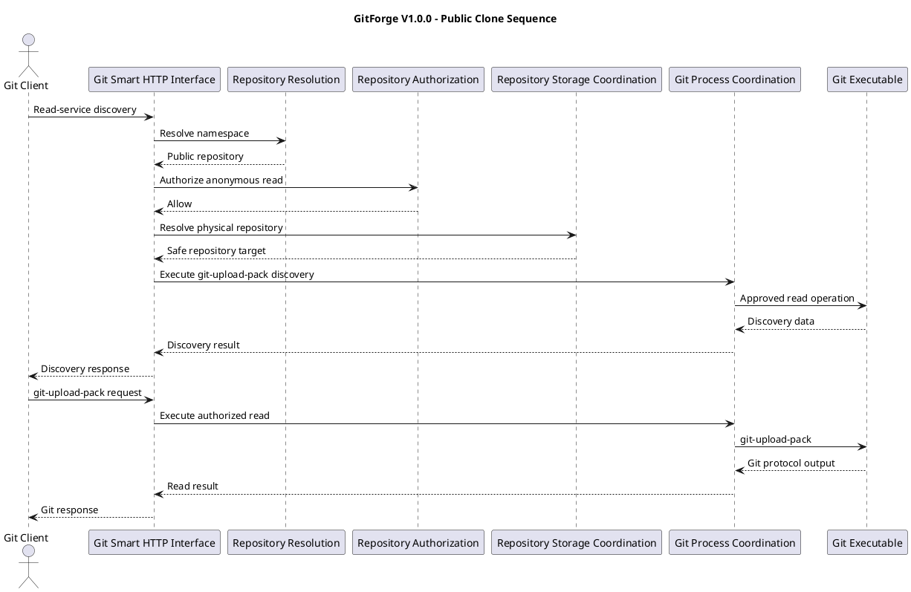
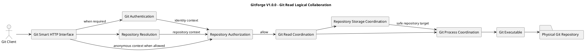

# GitForge V1.0.0 Git Smart HTTP Read Analysis

## 1. Document Information

| Field | Value |

|---|---|

| Project | GitForge - Web Git Hosting Platform |

| Target release | V1.0.0 |

| Document | Git Smart HTTP Read Analysis |

| SDLC phase | System Analysis |

| Milestone | M2 - System Analysis |

| Project owner | Farhad Valizadegan |

| Status | Approved |

| Last updated | 2026-08-17 |

---

## 2. Purpose

This document analyzes GitForge V1.0.0 Git Smart HTTP read behavior.

It defines:

- read-service scope;

- service discovery behavior;

- clone behavior;

- fetch behavior;

- public anonymous read;

- private authenticated read;

- PAT authentication interaction;

- repository resolution;

- read authorization;

- physical repository resolution;

- `git-upload-pack` coordination;

- request and response flow;

- read failure conditions;

- read security boundaries;

- Git protocol responsibility boundaries.

The purpose is to establish the logical behavior of Git Smart HTTP repository reads before System Design begins.

---

## 3. Analysis Objective

This document answers:

> How does GitForge accept, authorize, and execute Git Smart HTTP read operations for public and private repositories?

The principal V1.0.0 Git read service is:

```text

git-upload-pack

```

This analysis is logical and does not prescribe:

```text

Laravel route definitions

Controller classes

Middleware classes

Symfony Process usage

Exact Git command syntax

HTTP server configuration

Exact response streaming implementation

Concrete Git protocol library

```

Those decisions belong primarily to System Design.

---

## 4. Git Smart HTTP Read Scope

V1.0.0 Git Smart HTTP read capabilities include:

```text

Read-service discovery

Clone

Fetch

git-upload-pack execution

Anonymous public repository read

Authenticated private repository read

Authenticated public repository read

Read authorization

Protocol-compatible response handling

```

---

## 5. Out-of-Scope Git Read Capabilities

The following are excluded or deferred from V1.0.0:

```text

SSH Git transport

Git protocol v2-specific optimization requirements unless naturally supported

Partial clone policy

Shallow-clone policy customization

Git LFS

Repository mirroring

Alternate object stores

Federated Git transport

Anonymous private access

Collaborator-based private access

Organization-based repository access

Fine-grained PAT scopes

```

No excluded capability shall be introduced implicitly during System Design.

---

## 6. Principal Git Read Actor

The principal external actor is:

```text

Git Client

```

Typical commands include:

```text

git clone

git fetch

```

The Git Client interacts with GitForge through Git Smart HTTP.

---

## 7. Git Read Service

The Git-native service used for repository reads is:

```text

git-upload-pack

```

Its logical responsibilities include serving repository objects and refs required by supported clone and fetch workflows.

GitForge coordinates this service.

The external client shall not invoke arbitrary Git commands.

---

## 8. Read Interaction Classes

Git Smart HTTP read behavior consists of two major interaction classes:

```text

1. Read-Service Discovery

2. Read-Service Execution

```

Conceptually:

```text

Git Client

&#x20;   ↓

Discover git-upload-pack

&#x20;   ↓

Negotiate / Request Read

&#x20;   ↓

Execute git-upload-pack

&#x20;   ↓

Receive Git Data

```

---

## 9. Read-Service Discovery

Read-service discovery allows the Git Client to discover repository refs and capabilities associated with `git-upload-pack`.

Conceptually:

```text

Git Client

&#x20;   ↓

Read-Service Discovery Request

&#x20;   ↓

GitForge

&#x20;   ↓

Repository Resolution

&#x20;   ↓

Authorization

&#x20;   ↓

git-upload-pack Discovery

&#x20;   ↓

Discovery Response

```

---

## 10. Clone

Clone is a repository read operation.

Conceptually:

```text

Git Client

&#x20;   ↓

Discover Read Service

&#x20;   ↓

Negotiate Repository State

&#x20;   ↓

Request Required Objects

&#x20;   ↓

Receive Git Objects

&#x20;   ↓

Construct Local Repository

```

GitForge provides the authorized server-side repository data.

---

## 11. Fetch

Fetch is a repository read operation against an existing local clone.

Conceptually:

```text

Existing Git Client Repository

&#x20;       ↓

Discover Remote State

&#x20;       ↓

Negotiate Missing Objects

&#x20;       ↓

Receive Required Git Data

&#x20;       ↓

Update Local Remote State

```

Fetch follows the same repository read authorization policy as clone.

---

## 12. Read Authorization Policy

Repository read authorization is:

### Public Repository

```text

Anonymous Git Client           → Allow

Authenticated Non-Owner Client → Allow

Owner Client                   → Allow

```

### Private Repository

```text

Anonymous Git Client           → Deny

Authenticated Non-Owner Client → Deny

Owner Client                   → Allow

```

---

## 13. Authentication Requirement

Authentication depends on repository visibility.

### Public Repository

Authentication is not required.

### Private Repository

Authentication is required.

A valid PAT establishes User identity.

Authorization then determines ownership.

---

## 14. Public Anonymous Read

Public repositories permit anonymous Git read.

Conceptually:

```text

Git Client

&#x20;   ↓

Read Request

&#x20;   ↓

Resolve Repository

&#x20;   ↓

Repository Public

&#x20;   ↓

Authorize Anonymous Read

&#x20;   ↓

Execute Read Service

```

No PAT is required.

---

## 15. Public Authenticated Read

An authenticated User may also read a public repository.

Conceptually:

```text

Valid PAT

&#x20;   ↓

User Identity

&#x20;   ↓

Public Repository

&#x20;   ↓

Read Allowed

```

The caller does not need to own the repository.

---

## 16. Private Read

Private repository Git read requires:

```text

Valid PAT

Authenticated User Identity

Repository Owner Match

```

Conceptually:

```text

Private Repository

&#x20;     ↓

Authenticate PAT

&#x20;     ↓

Resolve User

&#x20;     ↓

Owner?

&#x20;  /      \\

&#x20;No        Yes

&#x20;|          |

Deny       Allow

```

---

## 17. Read Authentication and Authorization Separation

Authentication determines:

```text

Who is the Git client acting as?

```

Authorization determines:

```text

May that User read this Repository?

```

Therefore:

```text

Valid PAT

&#x20;   ≠

Automatic repository read permission

```

---

## 18. Repository Resolution

Git Smart HTTP read begins with a logical repository identifier.

Conceptually:

```text

<owner>/<repository>

&#x20;       ↓

Validate

&#x20;       ↓

Resolve Repository Metadata

&#x20;       ↓

Obtain Owner + Visibility

```

The Git Client does not supply an authoritative physical path.

---

## 19. Repository Resolution Failure

If the logical repository cannot be resolved:

```text

Read cannot proceed

```

The system returns a safe protocol-compatible failure.

Private-resource existence disclosure shall remain controlled.

---

## 20. Physical Repository Resolution

After repository read authorization succeeds:

```text

Logical Repository

&#x20;     ↓

Repository Storage Coordination

&#x20;     ↓

Safe Physical Repository Target

```

The target must remain within the configured repository root.

---

## 21. Authorization Before Physical Read

For protected repositories:

```text

Resolve Metadata

&#x20;     ↓

Authenticate if required

&#x20;     ↓

Authorize Read

&#x20;     ↓

Resolve Physical Repository

&#x20;     ↓

Execute git-upload-pack

```

Protected Git data must not be exposed before authorization.

---

## 22. Read-Service Discovery — Public Repository

Logical flow:

```text

Git Client

&#x20;   ↓

Discovery Request

&#x20;   ↓

Resolve Repository

&#x20;   ↓

Visibility = Public

&#x20;   ↓

Authorize Anonymous Read

&#x20;   ↓

Invoke Approved Discovery Behavior

&#x20;   ↓

Return Refs / Capabilities

```

---

## 23. Read-Service Discovery — Private Repository

Logical flow:

```text

Git Client

&#x20;   ↓

Discovery Request

&#x20;   ↓

Resolve Repository

&#x20;   ↓

Visibility = Private

&#x20;   ↓

Authenticate PAT

&#x20;   ↓

Resolve User

&#x20;   ↓

Authorize Owner Read

&#x20;   ↓

Invoke Approved Discovery Behavior

```

---

## 24. Read-Service Execution

After authorized discovery/negotiation, the read-service execution logically performs:

```text

Receive Git Protocol Input

&#x20;     ↓

Associate with Authorized Repository

&#x20;     ↓

Invoke Controlled git-upload-pack

&#x20;     ↓

Forward Controlled Input

&#x20;     ↓

Capture/Stream Git Output

&#x20;     ↓

Return Protocol-Compatible Response

```

---

## 25. Git Protocol Input

The Git Client may send protocol data required by `git-upload-pack`.

This input is untrusted.

GitForge must ensure that protocol input is associated only with the already authorized repository and approved service.

---

## 26. Git Protocol Output

The Git service returns Git-native response data.

GitForge must preserve protocol correctness while maintaining application-level security boundaries.

The exact streaming strategy is deferred to System Design.

---

## 27. Git Executable Boundary

The Git executable is external to GitForge application logic.

Conceptually:

```text

GitForge

&#x20;  ↓

Approved git-upload-pack Invocation

&#x20;  ↓

Git Executable

&#x20;  ↓

Physical Git Repository

```

Only controlled operations are permitted.

---

## 28. Command Selection Rule

The Git Client shall not directly control:

```text

Executable path

Shell command

Git subcommand

Physical repository path

Arbitrary process arguments

```

GitForge selects the approved read operation.

---

## 29. Repository Target Rule

The target repository for `git-upload-pack` must be derived from:

```text

Validated logical repository

&#x20;       ↓

Resolved application repository

&#x20;       ↓

Authorized repository context

&#x20;       ↓

Safe physical repository resolution

```

---

## 30. Public Read Does Not Mean Arbitrary Access

Public visibility permits supported repository read only.

It does not permit:

```text

Filesystem browsing

Arbitrary Git command execution

Server command execution

Repository write

Configuration access

Database access

```

---

## 31. Read Operation Is Non-Mutating at Application Level

Clone and fetch are read operations.

They shall not intentionally mutate application repository metadata such as:

```text

Owner

Visibility

Namespace

PAT metadata

```

---

## 32. Git Service Internal Effects

The analysis treats `git-upload-pack` as a read-oriented operation.

Any incidental internal Git/runtime behavior must not be interpreted as granting write authorization or changing repository ownership semantics.

---

## 33. Empty Repository Read

A valid empty repository may contain:

```text

No commits

No branches

No reachable objects

```

This does not make the repository invalid.

The Git Client may receive protocol behavior appropriate to an empty repository.

---

## 34. Missing Physical Repository

If metadata exists but the physical repository is missing:

```text

Authorization may succeed

&#x20;       ↓

Storage resolution fails

&#x20;       ↓

Read operation fails

```

This is a storage/consistency failure, not an authorization failure.

---

## 35. Repository Corruption

If the physical repository exists but `git-upload-pack` cannot operate correctly:

```text

Read authorization succeeds

&#x20;       ↓

Git execution fails

&#x20;       ↓

Operational failure

```

GitForge shall not fabricate repository data.

---

## 36. Git Read Failure Categories

### GRF-001 — Repository Not Found

Logical repository cannot be resolved.

### GRF-002 — Authentication Required

Private repository read has no valid authenticated identity.

### GRF-003 — Authentication Failed

Presented PAT fails verification or is revoked.

### GRF-004 — Authorization Denied

Authenticated User is not permitted to read the private repository.

### GRF-005 — Physical Repository Missing

Expected physical repository does not exist.

### GRF-006 — Storage Failure

Repository filesystem cannot be accessed.

### GRF-007 — Git Executable Unavailable

Approved Git executable cannot be invoked.

### GRF-008 — Git Read Process Failure

`git-upload-pack` execution fails.

### GRF-009 — Protocol Input Failure

Git protocol input cannot be processed safely.

### GRF-010 — Response Failure

Valid Git output cannot be delivered reliably to the client.

---

## 37. Authentication Failure Versus Authorization Failure

These must remain distinct internally.

Example:

```text

Private Repository

No Valid PAT

&#x20;   ↓

Authentication Failure

```

versus:

```text

Private Repository

Valid PAT for Non-Owner

&#x20;   ↓

Authorization Failure

```

External protocol responses may intentionally generalize these distinctions.

---

## 38. Authorization Failure Versus Storage Failure

Example:

```text

Private Repository

Owner Authenticated

Authorization = Allow

Physical Repository Missing

```

This is:

```text

Storage / Consistency Failure

```

not:

```text

Authorization Denial

```

---

## 39. Fail-Closed Read Principle

For protected repository reads:

```text

Authentication uncertainty

or

Authorization uncertainty

or

Repository identity uncertainty

&#x20;       ↓

Do not expose Git repository data

```

---

## 40. Safe Failure Response Principle

Conceptually:

```text

Internal Git Read Failure

&#x20;       ↓

Classify

&#x20;       ↓

Diagnostic Event

&#x20;       +

Safe Protocol Response

```

Responses shall not unnecessarily expose:

```text

Server filesystem paths

Database details

PAT values

Internal stack traces

Raw shell commands

Application secrets

```

---

## 41. Private Repository Existence Disclosure

Unauthorized callers should not receive unnecessary confirmation that a private repository exists.

Exact Git/HTTP status mapping belongs to System Design.

---

## 42. Read Request Trust Boundary

The Git Smart HTTP interface is an external trust boundary.

Conceptually:

```text

Git Client

&#x20;   ↓

Untrusted HTTP + Git Protocol Input

&#x20;   ↓

GitForge

&#x20;   ↓

Validation / Authentication / Authorization

&#x20;   ↓

Controlled Read Execution

```

---

## 43. PAT Trust Boundary

For private reads:

```text

Git Client

&#x20;   ↓

PAT Credential

&#x20;   ↓

Git Authentication

&#x20;   ↓

Verified User Identity

```

The PAT is sensitive untrusted input until verification succeeds.

---

## 44. Repository Namespace Trust Boundary

Repository path-like input from Git clients represents a logical namespace only.

Conceptually:

```text

Client Repository Identifier

&#x20;       ↓

Validate

&#x20;       ↓

Application Repository Resolution

&#x20;       ↓

Internal Storage Resolution

```

It must not become direct host filesystem access.

---

## 45. Process Execution Trust Boundary

Before `git-upload-pack` executes, GitForge must establish:

```text

Approved operation

Authorized repository

Safe physical target

Controlled arguments

Controlled process environment

```

---

## 46. Read-Service Discovery Activity

```plantuml

@startuml

title GitForge V1.0.0 - Git Read-Service Discovery

start

:Receive git-upload-pack discovery request;

:Resolve repository metadata;

if (Repository resolved?) then (yes)

&#x20;   if (Repository public?) then (yes)

&#x20;       :Authorize anonymous read;

&#x20;   else (no)

&#x20;       :Authenticate PAT;

&#x20;       if (Authentication succeeds?) then (yes)

&#x20;           :Authorize repository read;

&#x20;       else (no)

&#x20;           :Deny;

&#x20;           stop

&#x20;       endif

&#x20;   endif

&#x20;   if (Read authorized?) then (yes)

&#x20;       :Resolve physical repository;

&#x20;       :Execute approved discovery behavior;

&#x20;       :Return Git discovery response;

&#x20;   else (no)

&#x20;       :Deny;

&#x20;   endif

else (no)

&#x20;   :Return safe repository failure;

endif

stop

@enduml

```

---

## 47. Clone/Fetch Read Activity

```plantuml

@startuml

title GitForge V1.0.0 - Clone and Fetch Read Activity

start

:Receive Git read request;

:Resolve target repository;

if (Repository public?) then (yes)

&#x20;   :Use anonymous or authenticated caller context;

else (no)

&#x20;   :Require PAT authentication;

&#x20;   if (PAT valid?) then (yes)

&#x20;       :Resolve User identity;

&#x20;   else (no)

&#x20;       :Deny;

&#x20;       stop

&#x20;   endif

endif

:Evaluate repository read authorization;

if (Authorized?) then (yes)

&#x20;   :Resolve safe physical repository;

&#x20;   :Invoke controlled git-upload-pack;

&#x20;   :Process Git protocol input/output;

&#x20;   :Return Git response;

else (no)

&#x20;   :Deny;

endif

stop

@enduml

```

---

## 48. Public Clone Sequence



---

## 49. Private Clone Sequence

```plantuml

@startuml

title GitForge V1.0.0 - Private Clone Sequence

actor "Git Client" as Client

participant "Git Smart HTTP Interface" as HTTP

participant "Git Authentication" as Auth

participant "Repository Resolution" as Repo

participant "Repository Authorization" as Authz

participant "Repository Storage Coordination" as Storage

participant "Git Process Coordination" as Process

Client -> HTTP : Private read request + PAT

HTTP -> Auth : Authenticate PAT

alt Authentication succeeds

&#x20;   Auth --> HTTP : User identity

&#x20;   HTTP -> Repo : Resolve repository

&#x20;   Repo --> HTTP : Private repository + owner

&#x20;   HTTP -> Authz : Authorize(User, repository, read)

&#x20;   alt User is owner

&#x20;       Authz --> HTTP : Allow

&#x20;       HTTP -> Storage : Resolve physical repository

&#x20;       Storage --> HTTP : Safe target

&#x20;       HTTP -> Process : Execute git-upload-pack

&#x20;       Process --> HTTP : Git response

&#x20;       HTTP --> Client : Authorized read response

&#x20;   else User is non-owner

&#x20;       Authz --> HTTP : Deny

&#x20;       HTTP --> Client : Safe denial

&#x20;   end

else Authentication fails

&#x20;   Auth --> HTTP : Authentication failure

&#x20;   HTTP --> Client : Authentication denied

end

@enduml

```

---

## 50. Read Logical Collaboration Diagram



---

## 51. Git Read Responsibility Matrix

| Responsibility | Logical Owner |

|---|---|

| Receive Git HTTP read request | Git Smart HTTP Interface |

| Determine requested read service | Git Smart HTTP Interface |

| Resolve repository metadata | Repository Resolution |

| Authenticate PAT when required | Git Authentication |

| Resolve authenticated User | Git Authentication |

| Evaluate read permission | Repository Authorization |

| Resolve physical repository | Repository Storage Coordination |

| Select approved read operation | Git Read Coordination |

| Invoke `git-upload-pack` | Git Process Coordination |

| Handle Git protocol I/O | Git Read / Process Coordination |

| Classify failures | Failure Handling |

| Record diagnostics | Diagnostics |

---

## 52. Git Read Decision Table

| Visibility | Caller | Authentication Required | Read Decision |

|---|---|---:|---:|

| Public | Anonymous | No | Allow |

| Public | Authenticated Non-Owner | Optional | Allow |

| Public | Owner | Optional | Allow |

| Private | Anonymous | Yes | Deny without authentication |

| Private | Authenticated Non-Owner | Yes | Deny |

| Private | Owner | Yes | Allow |

---

## 53. Git Read Service Decision Table

| Operation | Public Anonymous | Public Authenticated | Private Non-Owner | Private Owner |

|---|---:|---:|---:|---:|

| `git-upload-pack` discovery | Allow | Allow | Deny | Allow |

| Clone | Allow | Allow | Deny | Allow |

| Fetch | Allow | Allow | Deny | Allow |

| `git-upload-pack` execution | Allow | Allow | Deny | Allow |

---

## 54. Git Read Invariants

### GRI-001 — Read Authorization

All Git repository reads shall follow approved repository read policy.

### GRI-002 — Public Anonymous Read

Public repositories shall support anonymous Git read.

### GRI-003 — Private Owner Read

Private repositories shall permit Git read only to the authenticated owner.

### GRI-004 — Authentication Is Not Authorization

Valid PAT authentication shall not independently grant private repository access.

### GRI-005 — Authorization Before Protected Read

Protected Git repository data shall not be exposed before successful authorization.

### GRI-006 — Safe Repository Resolution

Physical repository targets shall be derived internally from validated logical repository identity.

### GRI-007 — Approved Git Operation Only

Git read workflows shall invoke only approved read-oriented Git operations.

### GRI-008 — No Arbitrary Command Execution

Git clients shall not control arbitrary process execution.

### GRI-009 — Empty Repository Validity

An empty but valid physical Git repository remains a valid read target.

### GRI-010 — Missing Repository Distinction

A missing physical repository shall not be treated as an empty repository.

### GRI-011 — Fail Closed

Protected reads shall fail closed when authentication, authorization, or repository resolution is uncertain.

### GRI-012 — Sensitive Failure Protection

Git read failures shall not unnecessarily disclose sensitive internal details.

---

## 55. Git Read Data Flow

Conceptually:

```text

Git Client

&#x20;   ↓

HTTP Request

&#x20;   ↓

Git Smart HTTP Interface

&#x20;   ↓

Repository Metadata

&#x20;   ↓

Authentication if required

&#x20;   ↓

Authorization

&#x20;   ↓

Safe Repository Resolution

&#x20;   ↓

git-upload-pack

&#x20;   ↓

Physical Git Repository

&#x20;   ↓

Git Protocol Output

&#x20;   ↓

HTTP Response

&#x20;   ↓

Git Client

```

---

## 56. Git Read and PostgreSQL

PostgreSQL participates in read workflows primarily for application metadata such as:

```text

Repository identity

Repository owner

Repository visibility

PAT verification metadata

User identity

```

PostgreSQL is not authoritative for Git objects transferred during clone/fetch.

---

## 57. Git Read and Physical Repository

The physical Git repository is authoritative for:

```text

Refs

Commits

Trees

Blobs

Pack data

Git object graph

```

GitForge coordinates access to this state.

---

## 58. Git Read and PAT State

For private reads:

```text

PAT Active + Valid

&#x20;       ↓

May establish User identity

```

For revoked PAT:

```text

PAT Revoked

&#x20;       ↓

Authentication denied

&#x20;       ↓

Private read denied

```

---

## 59. Git Read and Visibility Change

Authorization must use current authoritative visibility.

Example:

```text

Repository Public

&#x20;   ↓

Anonymous read allowed

Owner changes to Private

&#x20;   ↓

Next anonymous read denied

```

A previous anonymous read does not create continuing authorization.

---

## 60. Git Read and Concurrent Push

Repository state may change while a clone or fetch interaction is occurring.

The Git service handles Git-native negotiation against repository state available during execution.

No application-level guarantee of cross-request immutable repository state is required.

---

## 61. Git Read and Repository Availability

A caller may be authorized while the repository is operationally unavailable.

Example:

```text

Owner authenticated

Private repository

Authorization = Allow

Filesystem unavailable

```

Result:

```text

Read fails operationally

```

---

## 62. Git Read and Repository Consistency

If metadata points to a missing or invalid physical repository:

```text

Authorization can succeed

&#x20;       ↓

Read cannot execute safely

&#x20;       ↓

Consistency failure

```

This distinction is important for diagnostics.

---

## 63. Git Read Security Risks

Major risks include:

```text

Private repository disclosure

Authentication bypass

Authorization bypass

Repository enumeration

Path traversal

Arbitrary Git command execution

Shell injection

Unsafe process argument construction

PAT leakage

Git protocol abuse

Large request resource exhaustion

Large response resource exhaustion

Sensitive error disclosure

Cross-repository access

Fail-open behavior

```

---

## 64. Resource Consumption Risks

Clone/fetch may involve large data volumes.

Potential risks include:

```text

Large repositories

Large pack generation

Long-running Git processes

High memory usage

High CPU usage

High response volume

Concurrent clone/fetch load

```

The analysis requires bounded and controlled execution.

Exact limits belong to System Design.

---

## 65. Read Process Lifetime

Git read processes shall exist only for the duration required to satisfy the controlled operation.

The exact timeout and termination policy is deferred to System Design.

---

## 66. Read Input/Output Streaming

Git Smart HTTP may require streaming or pass-through behavior.

At analysis level:

```text

Client Protocol Input

&#x20;     ↓

Controlled Git Process

&#x20;     ↓

Git Protocol Output

```

The implementation shall avoid unnecessary protocol corruption.

Exact buffering/streaming choices belong to design.

---

## 67. Read Diagnostics

Useful safe diagnostic context may include:

```text

Read operation type

Repository identifier

Resolved User ID where applicable

Anonymous/authenticated context

Authorization outcome

Git process exit classification

Failure category

Timestamp

```

Diagnostics shall not intentionally record plaintext PATs.

---

## 68. Git Read Analysis Findings

### GRA-001 — Public Anonymous Clone and Fetch Are Core V1.0.0 Capabilities

Public Git read must work without PAT authentication.

Status:

```text

Confirmed

```

### GRA-002 — Private Git Read Requires Both Authentication and Owner Authorization

A valid PAT alone is insufficient.

Status:

```text

Confirmed

```

### GRA-003 — `git-upload-pack` Is the Read-Service Boundary

GitForge coordinates approved `git-upload-pack` behavior for clone/fetch.

Status:

```text

Confirmed

```

### GRA-004 — Repository Resolution Must Precede Physical Storage Access

Logical repository identity must be resolved and authorized before controlled storage access.

Status:

```text

Confirmed

```

### GRA-005 — Git Protocol Traffic Is Untrusted

Protocol input from external Git clients must remain behind controlled service and process boundaries.

Status:

```text

Confirmed

```

### GRA-006 — Read Authorization and Operational Availability Are Independent

An allowed read may still fail because of storage or Git execution failure.

Status:

```text

Confirmed

```

### GRA-007 — Public Read Permission Does Not Expand Write Permission

Public visibility affects read only.

Status:

```text

Confirmed

```

---

## 69. Areas Requiring Later M2 Analysis

The following Git read topics are refined later in M2:

```text

Repository storage

Data flow

Trust boundaries

Failure and exception behavior

Sequence models

Activity models

```

---

## 70. Design Decisions Intentionally Deferred

This document does not decide:

```text

Exact Smart HTTP route structure

Exact HTTP methods

Exact Content-Type handling

Laravel middleware classes

Authentication guard implementation

Exact Basic Auth/PAT credential extraction mechanics

Process execution library

Git executable path

Exact `git-upload-pack` command syntax

Streaming API implementation

Buffer sizes

Timeouts

Process limits

Concurrency limits

Protocol-version optimization

HTTP status mappings

Reverse-proxy configuration

```

These decisions belong to System Design, Security Design, or Deployment Design.

---

## 71. Requirements Alignment

This analysis derives primarily from approved requirements covering:

```text

Git read-service discovery

Clone

Fetch

Public anonymous Git read

Private repository protection

PAT authentication

Read authorization

Repository storage

Git process execution

Failure handling

Security

```

Relevant use cases include:

```text

UC-015 Discover Read Service

UC-016 Clone

UC-017 Fetch

UC-021 Authenticate Git with PAT

UC-023 Authorize Read

UC-025 Diagnose Failure

```

Representative requirement areas include:

```text

FR-036 – FR-049

IR-026 – IR-044

AR-001 – AR-060

```

Detailed requirement-to-analysis mapping will be consolidated in:

```text

19-analysis-traceability.md

```

---

## 72. Completion Criteria

This Git Smart HTTP Read Analysis is complete when:

- read-service discovery behavior is explicit;

- clone behavior is explicit;

- fetch behavior is explicit;

- public anonymous read is explicit;

- private owner-only read is explicit;

- PAT authentication interaction is explicit;

- authentication and authorization remain separate;

- repository resolution ordering is explicit;

- physical repository resolution is controlled;

- `git-upload-pack` is represented as the approved read-service boundary;

- read failure categories are identified;

- empty and missing repository behavior are distinguished;

- protocol trust boundaries are identified;

- read activities and sequences are modeled;

- excluded V1.0.0 Git transport capabilities have not been introduced;

- downstream write, storage, data-flow, trust-boundary, and failure analysis can proceed without inventing Git read semantics.

---

## 73. Analysis Result

Git Smart HTTP Read Analysis result:

```text

SUFFICIENT FOR DOWNSTREAM SYSTEM ANALYSIS

```

No Git-read contradiction with approved V1.0.0 requirements has been identified.

---

## 74. Document Status

This document is currently:

```text

Approved

```

It will be changed to:

```text

Approved

```

after read-service discovery, clone/fetch behavior, authentication and authorization ordering, process boundaries, failure cases, diagrams, invariants, and requirements alignment have been reviewed.

