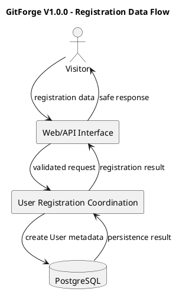
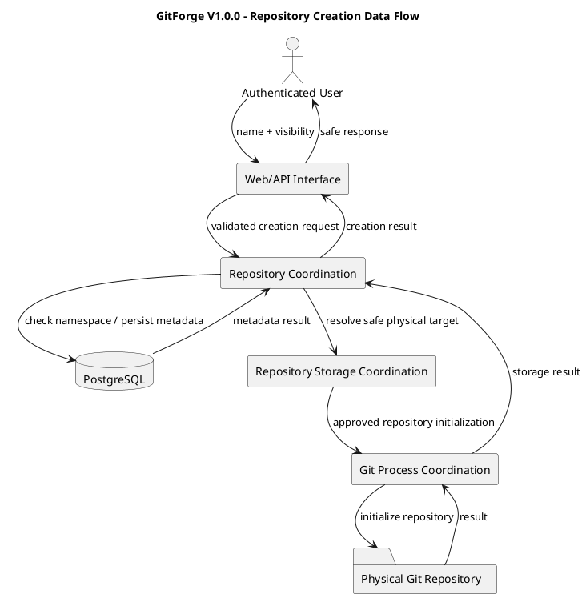
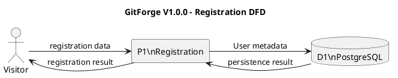
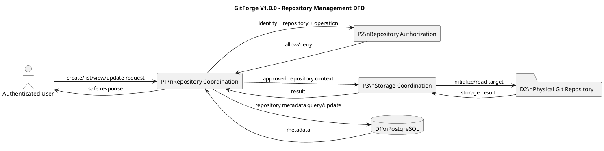
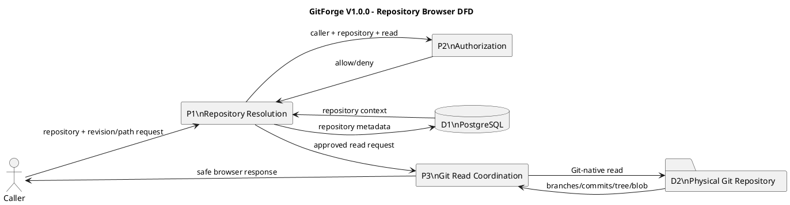
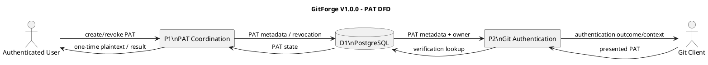
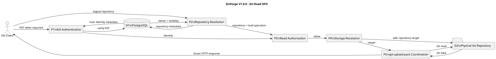
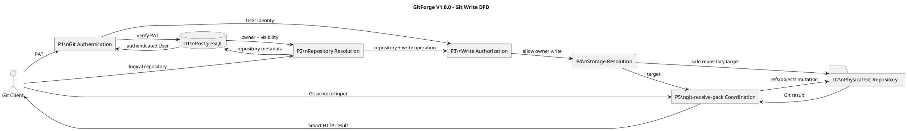

# GitForge V1.0.0 Data Flow Analysis

## 1. Document Information

| Field | Value |

|---|---|

| Project | GitForge - Web Git Hosting Platform |

| Target release | V1.0.0 |

| Document | Data Flow Analysis |

| SDLC phase | System Analysis |

| Milestone | M2 - System Analysis |

| Project owner | Farhad Valizadegan |

| Status | Approved |

| Last updated | 2026-08-17 |

---

## 2. Purpose

This document analyzes the major data flows of GitForge V1.0.0.

It defines how data moves among:

- external actors;

- application interfaces;

- authentication responsibilities;

- authorization responsibilities;

- repository coordination;

- PostgreSQL;

- physical Git repositories;

- Git process execution;

- diagnostics.

The purpose is to establish an implementation-neutral flow model that supports later System Design without prematurely fixing concrete APIs, classes, routes, schemas, or deployment topology.

---

## 3. Analysis Objective

This document answers:

> What information enters GitForge, where does it flow, which logical responsibility evaluates or transforms it, which authority stores it, and where does it leave the system?

The analysis covers both:

```text

Application-oriented flows

Git-oriented flows

```

and distinguishes:

```text

Application metadata

Authentication credentials

Authorization context

Git-native data

Diagnostics

```

---

## 4. Data Flow Scope

The major V1.0.0 flows analyzed are:

```text

User registration

User login

User logout

Repository creation

Repository listing

Repository viewing

Repository visibility change

Repository browsing

Branch listing

Commit history

Commit details

Tree browsing

File viewing

PAT creation

PAT authentication

PAT revocation

Git Smart HTTP read discovery

Clone

Fetch

Git Smart HTTP write discovery

Push

Repository authorization

Repository storage resolution

Failure diagnostics

```

---

## 5. Out-of-Scope Data Flows

The following are excluded or deferred from V1.0.0:

```text

Organizations

Teams

Collaborator invitations

Repository transfer

Repository rename

Repository deletion

Pull requests

Issues

CI/CD pipelines

Package registry

Container registry

Git LFS

SSH Git transport

Federation

Billing

Multi-region replication

Analytics pipelines

Event streaming

Webhook ecosystems

```

---

## 6. Primary External Data Sources

External data enters GitForge principally from:

```text

Visitor

Authenticated User

Git Client

System Operator

```

---

## 7. Primary External Data Destinations

GitForge returns data principally to:

```text

Web/API caller

Git Client

System Operator through diagnostics

```

---

## 8. Primary Internal Data Stores

GitForge V1.0.0 uses two authoritative storage domains.

### Application Metadata Store

```text

PostgreSQL

```

Responsible for:

```text

Users

Repository metadata

Repository ownership

Repository visibility

PAT metadata

PAT revocation state

Application relationships

```

### Git-Native Repository Store

```text

Physical Git Repository

```

Responsible for:

```text

Refs

Branches

Tags

Commits

Trees

Blobs

Git object graph

Repository history

File content

```

---

## 9. Data Authority Principle

Data flows shall preserve the approved authority boundary.

Conceptually:

```text

Application Metadata

&#x20;       ↓

PostgreSQL

Git-Native State

&#x20;       ↓

Physical Git Repository

```

Git-native data shall not silently become authoritative PostgreSQL data.

Application metadata shall not silently become authoritative Git repository data.

---

## 10. Major Logical Processing Responsibilities

Major logical data-processing responsibilities include:

```text

Web/API Interface

Application Authentication

PAT Coordination

Git Authentication

Repository Coordination

Repository Resolution

Repository Authorization

Repository Browser Coordination

Git Read Coordination

Git Write Coordination

Repository Storage Coordination

Git Process Coordination

Failure Handling

Diagnostics

```

---

## 11. High-Level Context Data Flow

```plantuml

@startuml

title GitForge V1.0.0 - High-Level Data Flow

left to right direction

actor Visitor

actor "Authenticated User" as User

actor "Git Client" as GitClient

actor "System Operator" as Operator

rectangle "GitForge" {

&#x20;   rectangle "Web/API Processing" as Web

&#x20;   rectangle "Authentication" as Auth

&#x20;   rectangle "Authorization" as Authz

&#x20;   rectangle "Repository Coordination" as Repo

&#x20;   rectangle "Git Coordination" as GitCoord

&#x20;   rectangle "Diagnostics" as Diag

}

database PostgreSQL as DB

folder "Physical Git Repositories" as GitRepos

rectangle "Git Executable" as GitExe

Visitor --> Web

User --> Web

GitClient --> GitCoord

Web --> Auth

Web --> Repo

GitCoord --> Auth

Repo --> Authz

GitCoord --> Authz

Repo --> DB

Auth --> DB

Repo --> GitRepos

GitCoord --> GitExe

GitExe --> GitRepos

Web --> Diag

Repo --> Diag

GitCoord --> Diag

Diag --> Operator

@enduml

```

---

## 12. Data Classification

Major data classes include:

| Data Class | Examples |

|---|---|

| Identity Data | User identifier, login identity |

| Authentication Data | Password credential, PAT |

| Repository Metadata | Owner, name, visibility |

| Authorization Context | Caller identity, repository relationship, requested operation |

| Git Namespace Data | Branch names, tags, refs |

| Git History Data | Commits, parents, authors, messages |

| Git Tree Data | Trees, paths, filenames |

| Git Content Data | Blob/file content |

| Git Transport Data | Smart HTTP protocol request/response |

| Diagnostic Data | Failure class, operation, timestamp |

| Storage Mapping Data | Logical repository to safe physical target |

---

## 13. Trust Classification

External input is untrusted until validated or verified.

Examples:

```text

Registration input            → Untrusted

Login credential              → Sensitive + Untrusted

Repository name               → Untrusted

PAT                           → Sensitive + Untrusted

Git protocol payload          → Untrusted

Branch/ref/path identifiers   → Untrusted

Repository content            → Untrusted

```

Internal authorization decisions are derived trusted state only after required checks succeed.

---

## 14. Registration Data Flow

Conceptually:

```text

Visitor

&#x20; ↓

Registration Input

&#x20; ↓

Web/API Interface

&#x20; ↓

Input Validation

&#x20; ↓

Application Authentication / User Coordination

&#x20; ↓

PostgreSQL

&#x20; ↓

User Record

&#x20; ↓

Registration Result

&#x20; ↓

Visitor/User

```

---

## 15. Registration Data Flow Diagram



---

## 16. Login Data Flow

Conceptually:

```text

User

&#x20; ↓

Login Credential

&#x20; ↓

Web/API Interface

&#x20; ↓

Credential Verification

&#x20; ↓

PostgreSQL

&#x20; ↓

Identity Established

&#x20; ↓

Authenticated Application Context

```

---

## 17. Login Credential Handling

Password-like credentials are:

```text

Sensitive

Untrusted until verified

Not authorization decisions

```

Successful login yields:

```text

Authenticated User Identity

```

It does not independently authorize repository access.

---

## 18. Logout Data Flow

Conceptually:

```text

Authenticated User

&#x20;     ↓

Logout Request

&#x20;     ↓

Application Authentication

&#x20;     ↓

Invalidate Interactive Authentication State

&#x20;     ↓

Logged-Out Result

```

Exact session implementation belongs to System Design.

---

## 19. Repository Creation Data Flow

Conceptually:

```text

Authenticated User

&#x20;     ↓

Repository Creation Input

&#x20;     ↓

Validation

&#x20;     ↓

Repository Coordination

&#x20;     ↓

Namespace Uniqueness Check

&#x20;     ↓

PostgreSQL

&#x20;     ↓

Safe Storage Resolution

&#x20;     ↓

Physical Git Repository Initialization

&#x20;     ↓

Consistent Repository Result

```

---

## 20. Repository Creation Input

Repository creation data includes:

```text

Repository name

Visibility

Authenticated owner identity

```

The owner identity shall be derived from authenticated context rather than accepted as an arbitrary client-controlled ownership claim.

---

## 21. Repository Creation Flow Diagram



---

## 22. Repository Listing Data Flow

Conceptually:

```text

Authenticated User

&#x20;     ↓

List Owned Repositories

&#x20;     ↓

Repository Coordination

&#x20;     ↓

PostgreSQL

&#x20;     ↓

Repository Metadata Collection

&#x20;     ↓

User

```

This flow does not require reading Git objects.

---

## 23. Repository View Data Flow

A repository view may combine:

```text

Application metadata

\+

Authorized Git-native summary/content

```

Conceptually:

```text

Caller

&#x20; ↓

Logical Repository Identifier

&#x20; ↓

Repository Resolution

&#x20; ↓

PostgreSQL Metadata

&#x20; ↓

Authorization

&#x20; ↓

Optional Git-Native Read

&#x20; ↓

Repository View

```

---

## 24. Visibility Change Data Flow

Conceptually:

```text

Authenticated Owner

&#x20;     ↓

Visibility Update Request

&#x20;     ↓

Repository Resolution

&#x20;     ↓

Owner Authorization

&#x20;     ↓

Validated Visibility

&#x20;     ↓

PostgreSQL

&#x20;     ↓

Updated Repository Metadata

```

Physical Git objects remain unchanged.

---

## 25. Visibility Change Authority

The authoritative data flow is:

```text

Visibility

&#x20;   ↓

PostgreSQL

```

not:

```text

Visibility

&#x20;   ↓

Physical Git Repository

```

---

## 26. Repository Browser Data Flow

Repository browser data originates from the physical Git repository.

Conceptually:

```text

Web Caller

&#x20;   ↓

Repository Identifier

&#x20;   ↓

Repository Resolution

&#x20;   ↓

Authorization

&#x20;   ↓

Repository Storage Resolution

&#x20;   ↓

Git Read Coordination

&#x20;   ↓

Git Process Coordination

&#x20;   ↓

Physical Git Repository

&#x20;   ↓

Git-Native Result

&#x20;   ↓

Web Representation

```

---

## 27. Branch Listing Data Flow

```text

Authorized Caller

&#x20;     ↓

Repository

&#x20;     ↓

Git Read Coordination

&#x20;     ↓

Physical Git Repository

&#x20;     ↓

Branch/Ref Data

&#x20;     ↓

Web Response

```

---

## 28. Commit History Data Flow

```text

Authorized Caller

&#x20;     ↓

Repository + Branch/Ref Context

&#x20;     ↓

Git Read Coordination

&#x20;     ↓

Physical Git Repository

&#x20;     ↓

Commit History

&#x20;     ↓

Web Response

```

---

## 29. Commit Details Data Flow

```text

Authorized Caller

&#x20;     ↓

Repository + Commit Identifier

&#x20;     ↓

Git Read Coordination

&#x20;     ↓

Physical Git Repository

&#x20;     ↓

Commit Metadata / Related Git Data

&#x20;     ↓

Web Response

```

---

## 30. Tree Browsing Data Flow

```text

Authorized Caller

&#x20;     ↓

Repository + Revision + Path

&#x20;     ↓

Validation

&#x20;     ↓

Git Read Coordination

&#x20;     ↓

Physical Git Repository

&#x20;     ↓

Tree Entries

&#x20;     ↓

Web Response

```

---

## 31. File Viewing Data Flow

```text

Authorized Caller

&#x20;     ↓

Repository + Revision + File Path

&#x20;     ↓

Validation

&#x20;     ↓

Git Read Coordination

&#x20;     ↓

Physical Git Repository

&#x20;     ↓

Blob/File Content

&#x20;     ↓

Safe Web Representation

```

Repository file content remains untrusted.

---

## 32. Browser Data Origin Principle

For browser features:

```text

Branches

Commits

Trees

Files

```

must originate from:

```text

Physical Git Repository

```

rather than from duplicated application metadata.

---

## 33. PAT Creation Data Flow

Conceptually:

```text

Authenticated User

&#x20;     ↓

PAT Creation Request

&#x20;     ↓

PAT Coordination

&#x20;     ↓

Generate Plaintext PAT

&#x20;     ↓

Derive Verification Representation

&#x20;     ↓

PostgreSQL

&#x20;     +

One-Time Plaintext Presentation

&#x20;     ↓

User

```

---

## 34. PAT Creation Sensitive Flow

The plaintext PAT has a restricted flow.

```text

Credential Generation

&#x20;     ↓

Plaintext PAT

&#x20;     ├────────→ User once

&#x20;     ↓

Verification Transformation

&#x20;     ↓

Non-Recoverable Stored Representation

```

Plaintext shall not flow into normal persistent storage.

---

## 35. PAT Authentication Data Flow

Conceptually:

```text

Git Client

&#x20;   ↓

Presented PAT

&#x20;   ↓

Git Smart HTTP Interface

&#x20;   ↓

Git Authentication

&#x20;   ↓

PAT Verification Metadata

&#x20;   ↓

PostgreSQL

&#x20;   ↓

Authenticated User Identity

```

---

## 36. PAT Authentication Boundary

The output of PAT authentication is:

```text

User Identity

```

The output is not:

```text

Repository Permission

```

The identity must continue to Repository Authorization.

---

## 37. PAT Revocation Data Flow

```text

Authenticated User

&#x20;     ↓

PAT Revocation Request

&#x20;     ↓

PAT Coordination

&#x20;     ↓

Resolve PAT Ownership

&#x20;     ↓

PostgreSQL

&#x20;     ↓

Persist Revoked State

&#x20;     ↓

Future Authentication Denied

```

---

## 38. Git Smart HTTP Read Discovery Data Flow

For Public Repository:

```text

Git Client

&#x20;   ↓

Read Discovery Request

&#x20;   ↓

Repository Resolution

&#x20;   ↓

Public Read Authorization

&#x20;   ↓

Safe Physical Repository

&#x20;   ↓

git-upload-pack Discovery

&#x20;   ↓

Git Protocol Response

```

---

## 39. Private Git Read Discovery Data Flow

```text

Git Client + PAT

&#x20;     ↓

Git Authentication

&#x20;     ↓

Authenticated User

&#x20;     ↓

Repository Resolution

&#x20;     ↓

Owner Read Authorization

&#x20;     ↓

Safe Physical Repository

&#x20;     ↓

git-upload-pack Discovery

&#x20;     ↓

Git Protocol Response

```

---

## 40. Clone Data Flow

Conceptually:

```text

Git Client

&#x20;   ↓

Repository Read Request

&#x20;   ↓

Authentication if required

&#x20;   ↓

Repository Resolution

&#x20;   ↓

Read Authorization

&#x20;   ↓

Repository Storage Resolution

&#x20;   ↓

git-upload-pack

&#x20;   ↓

Refs / Pack Data

&#x20;   ↓

Git Client

```

---

## 41. Fetch Data Flow

Fetch follows the same principal authorization and storage path as clone.

```text

Git Client

&#x20;   ↓

Fetch Request

&#x20;   ↓

Authentication if required

&#x20;   ↓

Repository Resolution

&#x20;   ↓

Read Authorization

&#x20;   ↓

git-upload-pack

&#x20;   ↓

Requested Git Data

&#x20;   ↓

Git Client

```

---

## 42. Git Read Data Origin

Clone/fetch output is derived from:

```text

Physical Git Repository

```

PostgreSQL participates only in application concerns such as:

```text

Repository identity

Ownership

Visibility

PAT identity

Authorization context

```

---

## 43. Git Smart HTTP Write Discovery Data Flow

```text

Git Client + PAT

&#x20;     ↓

Git Authentication

&#x20;     ↓

Authenticated User

&#x20;     ↓

Repository Resolution

&#x20;     ↓

Owner Write Authorization

&#x20;     ↓

Safe Physical Repository

&#x20;     ↓

git-receive-pack Discovery

&#x20;     ↓

Git Protocol Response

```

---

## 44. Push Data Flow

Conceptually:

```text

Git Client

&#x20;   ↓

PAT

&#x20;   ↓

Git Authentication

&#x20;   ↓

Authenticated User

&#x20;   ↓

Repository Resolution

&#x20;   ↓

Owner Write Authorization

&#x20;   ↓

Safe Physical Repository

&#x20;   ↓

git-receive-pack

&#x20;   ↓

Incoming Git Objects + Ref Updates

&#x20;   ↓

Physical Git Repository

&#x20;   ↓

Git Result

&#x20;   ↓

Git Client

```

---

## 45. Push Mutation Flow

Successful push mutates:

```text

Refs

Objects

Git history

```

inside:

```text

Physical Git Repository

```

It does not normally mutate:

```text

Repository owner

Repository visibility

Repository namespace

PAT metadata

```

---

## 46. Authorization Data Flow

Authorization requires contextual data.

Conceptually:

```text

Caller Identity

&#x20;     +

Repository Metadata

&#x20;     +

Requested Operation

&#x20;     ↓

Repository Authorization

&#x20;     ↓

Allow / Deny

```

---

## 47. Anonymous Read Authorization Flow

```text

No Authenticated Identity

&#x20;     +

Public Repository

&#x20;     +

Read Operation

&#x20;     ↓

Authorization

&#x20;     ↓

Allow

```

---

## 48. Private Read Authorization Flow

```text

Authenticated User

&#x20;     +

Private Repository

&#x20;     +

Owner Relationship

&#x20;     +

Read Operation

&#x20;     ↓

Authorization

&#x20;     ↓

Allow

```

Non-owner relationship produces:

```text

Deny

```

---

## 49. Write Authorization Flow

```text

Authenticated User

&#x20;     +

Repository

&#x20;     +

Owner Relationship

&#x20;     +

Write Operation

&#x20;     ↓

Authorization

&#x20;     ↓

Allow

```

All non-owner and anonymous writes result in:

```text

Deny

```

---

## 50. Repository Storage Resolution Data Flow

Conceptually:

```text

Validated Logical Repository

&#x20;     ↓

Resolved Application Metadata

&#x20;     ↓

Approved Authorization Context

&#x20;     ↓

Repository Storage Coordination

&#x20;     ↓

Safe Internal Physical Target

```

The client does not supply authoritative physical storage location.

---

## 51. Git Process Data Flow

Approved Git operations follow:

```text

Logical Git Operation

&#x20;     +

Safe Repository Target

&#x20;     +

Controlled Input

&#x20;     ↓

Git Process Coordination

&#x20;     ↓

Git Executable

&#x20;     ↓

Physical Git Repository

&#x20;     ↓

Git Result

```

---

## 52. Git Executable Input Rule

External data shall not directly choose:

```text

Executable

Git subcommand

Shell command

Repository filesystem target

Arbitrary command arguments

```

GitForge derives the approved execution context.

---

## 53. Failure Data Flow

Failures are logically classified before being exposed.

Conceptually:

```text

Internal Failure

&#x20;     ↓

Failure Classification

&#x20;     ↓

Safe Diagnostic Event

&#x20;     +

Safe External Response

```

---

## 54. Diagnostic Data Flow

Conceptually:

```text

Application / Git Failure

&#x20;     ↓

Failure Handling

&#x20;     ↓

Sanitized Diagnostic Data

&#x20;     ↓

Diagnostics

&#x20;     ↓

System Operator

```

---

## 55. Sensitive Diagnostic Exclusions

Diagnostics shall not intentionally include:

```text

Plaintext PAT

Plaintext password

Application secrets

Raw authorization credentials

Unnecessary absolute filesystem paths

Database secrets

Internal stack traces in external responses

```

---

## 56. Registration DFD



---

## 57. Repository Management DFD



---

## 58. Repository Browser DFD



---

## 59. PAT DFD



---

## 60. Git Read DFD



---

## 61. Git Write DFD



---

## 62. Data Flow Responsibility Matrix

| Data Flow | Primary Logical Responsibility | Authority / Destination |

|---|---|---|

| Registration input | User Registration | PostgreSQL |

| Login credential | Application Authentication | PostgreSQL-backed verification |

| Repository creation metadata | Repository Coordination | PostgreSQL |

| Repository physical initialization | Storage / Git Process Coordination | Physical Git Repository |

| Visibility update | Repository Coordination | PostgreSQL |

| Repository listing | Repository Coordination | PostgreSQL |

| Branch list | Git Read Coordination | Physical Git Repository |

| Commit history | Git Read Coordination | Physical Git Repository |

| Commit details | Git Read Coordination | Physical Git Repository |

| Tree data | Git Read Coordination | Physical Git Repository |

| File/blob data | Git Read Coordination | Physical Git Repository |

| PAT creation | PAT Coordination | PostgreSQL + one-time user output |

| PAT verification | Git Authentication | PostgreSQL |

| PAT revocation | PAT Coordination | PostgreSQL |

| Clone/fetch | Git Read Coordination | Physical Git Repository |

| Push | Git Write Coordination | Physical Git Repository |

| Authorization context | Repository Authorization | Decision only |

| Storage mapping | Repository Storage Coordination | Safe internal target |

| Diagnostic event | Diagnostics | Operational diagnostic sink |

---

## 63. Data Transformation Boundaries

Not all data is merely forwarded.

Important transformations include:

```text

Registration credential

&#x20;   ↓

Stored verification representation

Plaintext PAT

&#x20;   ↓

Stored non-recoverable verification representation

Logical repository namespace

&#x20;   ↓

Repository metadata resolution

&#x20;   ↓

Safe physical storage target

Git-native repository state

&#x20;   ↓

Web-oriented repository representation

Internal failure

&#x20;   ↓

Safe external failure response

```

---

## 64. Data That Must Not Be Transformed Into Authority

The following anti-patterns are prohibited by analysis:

```text

Client filesystem path

&#x20;   → authoritative storage target

Valid PAT

&#x20;   → automatic repository permission

Public visibility

&#x20;   → public write permission

PostgreSQL commit copy

&#x20;   → authoritative Git history

Physical repository existence

&#x20;   → authorization grant

```

---

## 65. Authentication Data Flow Invariant

Authentication data flows must terminate in:

```text

Authenticated Identity

or

Authentication Failure

```

They must not directly produce repository mutation.

---

## 66. Authorization Data Flow Invariant

Authorization consumes:

```text

Identity

Repository Context

Operation

```

and produces:

```text

Allow

or

Deny

```

Authorization does not itself read or mutate Git objects.

---

## 67. Repository Data Flow Invariant

Application repository metadata flows through PostgreSQL.

Git content flows through the physical Git repository.

These roles remain distinct.

---

## 68. PAT Data Flow Invariant

Plaintext PAT flow is restricted to:

```text

Generation

&#x20;   ↓

One-Time Presentation

```

and:

```text

Presented Credential

&#x20;   ↓

Verification

```

Plaintext PAT shall not enter recoverable persistent storage.

---

## 69. Repository Path Data Flow Invariant

External logical repository identifiers may flow into validation and resolution.

They shall not flow directly into arbitrary filesystem access.

---

## 70. Git Protocol Data Flow Invariant

Git protocol input flows only into approved Git operation coordination.

Conceptually:

```text

Git Protocol Input

&#x20;     ↓

Approved Git Service

```

not:

```text

Git Protocol Input

&#x20;     ↓

Arbitrary Process Execution

```

---

## 71. Failure Data Flow Invariant

Sensitive internal failure details shall not automatically flow to external callers.

Conceptually:

```text

Internal Error Detail

&#x20;     ↓

Sanitization / Classification

&#x20;     ↓

Safe External Error

```

---

## 72. Major Data Flow Risks

Major risks include:

```text

Credential leakage

PAT persistence in plaintext

Authorization context loss

Cross-user repository confusion

Cross-repository storage resolution

Path traversal

Unsafe Git process input

Repository-content injection into web output

Sensitive diagnostic leakage

Stale authorization data

Inconsistent metadata/storage state

Incorrect authority duplication

Fail-open data paths

```

---

## 73. Data Flow Security Controls Required by Analysis

The logical model requires:

```text

Input validation

Credential verification

Server-side authorization

Safe repository resolution

Storage-root containment

Controlled Git command selection

Sensitive data minimization

Safe diagnostic classification

Output handling for untrusted repository content

Fail-closed behavior

```

Exact mechanisms belong to System Design.

---

## 74. Data Flow Failure Categories

### DFF-001 — Invalid External Input

Untrusted input fails validation.

Result:

```text

Reject before protected processing

```

### DFF-002 — Authentication Data Failure

Credentials cannot establish identity.

Result:

```text

Authentication Denied

```

### DFF-003 — Authorization Context Failure

Required identity, repository, or operation context is inconsistent.

Result:

```text

Deny

```

### DFF-004 — Repository Metadata Failure

Required application metadata cannot be resolved reliably.

Result:

```text

Safe application failure

```

### DFF-005 — Storage Mapping Failure

Logical repository cannot be safely mapped to physical storage.

Result:

```text

Do not access physical repository

```

### DFF-006 — Git Read Flow Failure

Approved Git-native read cannot complete.

Result:

```text

Safe read failure

```

### DFF-007 — Git Write Flow Failure

Approved Git-native write cannot complete.

Result:

```text

Do not report successful mutation

```

### DFF-008 — Persistence Failure

Authoritative application metadata cannot be safely stored.

Result:

```text

Do not report successful state change

```

### DFF-009 — Sensitive Data Exposure Risk

Sensitive information is about to flow to an unauthorized destination.

Result:

```text

Suppress / sanitize / reject flow

```

### DFF-010 — Diagnostic Flow Failure

External response would reveal internal sensitive detail.

Result:

```text

Return sanitized failure

```

---

## 75. Data Flow Analysis Findings

### DFA-001 — Two Authoritative Data Domains Exist

Application metadata and Git-native state have separate authorities.

Status:

```text

Confirmed

```

### DFA-002 — Authentication and Authorization Are Separate Flows

Authentication establishes identity; authorization determines repository access.

Status:

```text

Confirmed

```

### DFA-003 — PAT Plaintext Has Restricted Flow

Plaintext PAT is only exposed during creation and presented later for verification.

Status:

```text

Confirmed

```

### DFA-004 — Physical Repository Paths Are Internal Data

External callers supply logical namespace, not authoritative filesystem targets.

Status:

```text

Confirmed

```

### DFA-005 — Git Browser Data Comes From Git Storage

Branches, commits, trees, and files originate from the physical Git repository.

Status:

```text

Confirmed

```

### DFA-006 — Push Mutates Git-Native State

Push changes refs and objects, not normal application repository metadata.

Status:

```text

Confirmed

```

### DFA-007 — Failures Produce Sanitized External Data

Internal failures are classified before exposure.

Status:

```text

Confirmed

```

### DFA-008 — Authorization Must Stay in Every Protected Flow

No protected browser, Git read, or Git write path may bypass authorization.

Status:

```text

Confirmed

```

---

## 76. Data Flow Invariants

### DFI-001 — External Input Is Untrusted

All external data is untrusted until validated or verified.

### DFI-002 — Credentials Are Sensitive

Password credentials and PATs are handled as sensitive data.

### DFI-003 — Authentication Produces Identity

Authentication does not produce repository permission.

### DFI-004 — Authorization Produces Allow/Deny

Authorization consumes identity, repository context, and operation.

### DFI-005 — PostgreSQL Owns Application Metadata

Application repository and PAT metadata flow to/from PostgreSQL.

### DFI-006 — Git Repository Owns Git-Native State

Refs, commits, trees, blobs, and file content flow to/from physical Git repositories.

### DFI-007 — PAT Plaintext Is Not Recoverably Persisted

Plaintext PAT must not flow into recoverable storage.

### DFI-008 — Repository Path Is Derived Internally

External logical identifiers must pass validation and resolution.

### DFI-009 — Protected Physical Access Requires Authorization

Authorized context precedes protected physical repository access.

### DFI-010 — Git Input Reaches Only Approved Git Operations

External Git protocol input cannot select arbitrary execution.

### DFI-011 — Untrusted Repository Content Remains Untrusted

Git content must be safely represented to web callers.

### DFI-012 — Sensitive Diagnostic Data Is Restricted

Secrets do not flow into ordinary logs or external failures.

### DFI-013 — Metadata and Git Data Authorities Remain Separate

Neither storage domain silently replaces the other.

### DFI-014 — Fail Closed

Uncertain identity, authorization, repository resolution, or storage mapping stops protected flow.

---

## 77. Areas Requiring Later M2 Analysis

The following topics build on this document:

```text

State analysis

Trust-boundary analysis

Failure and exception analysis

Consolidated sequence models

Consolidated activity models

Analysis traceability

System analysis validation

```

---

## 78. Design Decisions Intentionally Deferred

This analysis does not decide:

```text

Exact HTTP routes

Exact API payloads

Exact response JSON

Controller classes

Middleware implementation

Database schema

ORM mappings

Exact session mechanism

PAT cryptographic algorithm

Git command syntax

Process library

Streaming implementation

Buffer sizes

Timeouts

Filesystem root path

Logging framework

Audit schema

Queue usage

Cache usage

Reverse-proxy behavior

Deployment topology

```

These decisions belong primarily to System Design.

---

## 79. Requirements Alignment

This analysis derives from approved requirements covering:

```text

User authentication

Repository management

Repository visibility

Repository browsing

PAT management

Git Smart HTTP read

Git Smart HTTP write

Authorization

Repository storage

Data authority

Security

Failure handling

```

Relevant use cases include:

```text

UC-001 Register

UC-002 Authenticate

UC-003 Logout

UC-004 Create Repository

UC-005 List Owned Repositories

UC-006 View Repository

UC-007 Change Visibility

UC-009 Browse

UC-010 List Branches

UC-011 Commit History

UC-012 Commit Details

UC-013 Tree

UC-014 File

UC-015 Discover Read Service

UC-016 Clone

UC-017 Fetch

UC-018 Discover Write Service

UC-019 Push

UC-020 Create PAT

UC-021 Authenticate Git with PAT

UC-022 Revoke PAT

UC-023 Authorize Read

UC-024 Authorize Write

UC-025 Diagnose Failure

```

Exact requirement-to-analysis mapping will be consolidated in:

```text

19-analysis-traceability.md

```

---

## 80. Completion Criteria

This Data Flow Analysis is complete when:

- major external data sources are identified;

- major external data destinations are identified;

- authoritative data stores are explicit;

- application metadata flow is explicit;

- Git-native data flow is explicit;

- registration flow is explicit;

- login/logout flows are explicit;

- repository creation flow is explicit;

- repository management flows are explicit;

- browser flows are explicit;

- PAT creation/authentication/revocation flows are explicit;

- Git Smart HTTP read flows are explicit;

- Git Smart HTTP write flows are explicit;

- authorization data flow is explicit;

- repository storage-resolution flow is explicit;

- Git process flow is explicit;

- diagnostic flow is explicit;

- sensitive data restrictions are explicit;

- major DFDs are modeled;

- data flow invariants are explicit;

- downstream state, trust-boundary, failure, sequence, activity, and traceability analysis can proceed without inventing missing flows.

---

## 81. Analysis Result

Data Flow Analysis result:

```text

SUFFICIENT FOR DOWNSTREAM SYSTEM ANALYSIS

```

No data-flow contradiction with approved V1.0.0 requirements or previously approved M2 analyses has been identified.

---

## 82. Document Status

This document is currently:

```text

Approved

```

It will be changed to:

```text

Approved

```

after authoritative data domains, authentication/authorization flows, repository management, browser flows, PAT flows, Git read/write flows, storage resolution, diagnostics, DFDs, invariants, and requirements alignment have been reviewed.

