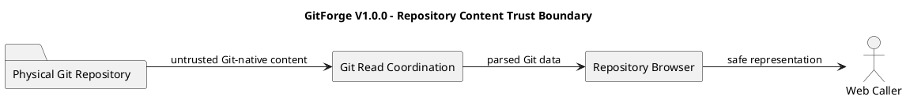

# GitForge V1.0.0 Trust Boundary Analysis

## 1. Document Information

| Field | Value |

|---|---|

| Project | GitForge - Web Git Hosting Platform |

| Target release | V1.0.0 |

| Document | Trust Boundary Analysis |

| SDLC phase | System Analysis |

| Milestone | M2 - System Analysis |

| Project owner | Farhad Valizadegan |

| Status | Approved |

| Last updated | 2026-08-17 |

---

## 2. Purpose

This document analyzes the security-relevant trust boundaries of GitForge V1.0.0.

It defines:

- external trust boundaries;

- credential boundaries;

- application authentication boundaries;

- repository authorization boundaries;

- repository namespace boundaries;

- repository storage boundaries;

- Git protocol boundaries;

- Git process-execution boundaries;

- physical repository boundaries;

- database trust boundaries;

- diagnostic boundaries;

- untrusted repository-content boundaries.

The purpose is to identify where data, identity, authority, or execution crosses from one trust level to another before System Design begins.

---

## 3. Analysis Objective

This document answers:

> Where does GitForge cross trust boundaries, what information crosses each boundary, what must be established before the receiving side may trust that information, and what failures must cause the system to fail closed?

This analysis remains implementation-neutral.

It does not prescribe:

```text

Concrete middleware classes

Firewall rules

Reverse-proxy configuration

TLS implementation

Container boundaries

Operating-system users

Filesystem ACLs

Concrete process APIs

Exact database credentials

Exact logging infrastructure

```

Those belong primarily to System Design, Security Design, and Deployment Design.

---

## 4. Trust Boundary Principle

A trust boundary exists whenever data or control crosses from a less-trusted context into a more-trusted context.

Conceptually:

```text

Untrusted / Less Trusted Context

&#x20;       ↓

Validation / Verification / Authorization

&#x20;       ↓

Trusted Internal Context

```

Crossing a boundary never implies automatic trust.

---

## 5. Trust Is Contextual

No input is globally trusted merely because it was valid earlier.

Examples:

```text

Valid PAT

&#x20;   ≠

Authorized Repository Access

Validated Repository Name

&#x20;   ≠

Authorized Physical Storage Access

Authenticated User

&#x20;   ≠

Owner of Every Repository

Authorized Owner

&#x20;   ≠

Trusted Repository Content

```

---

## 6. Primary Trust Zones

The logical trust zones are:

```text

TZ-01 External Web Client Zone

TZ-02 External Git Client Zone

TZ-03 Application Interface Zone

TZ-04 Authentication Zone

TZ-05 Authorization Zone

TZ-06 Repository Coordination Zone

TZ-07 Data Persistence Zone

TZ-08 Repository Storage Zone

TZ-09 Git Process Execution Zone

TZ-10 Physical Git Repository Zone

TZ-11 Diagnostics / Operations Zone

```

These are logical analysis zones, not deployment containers.

---

## 7. External Web Client Zone

The External Web Client Zone contains:

```text

Visitor-controlled input

Authenticated User-controlled input

Browser requests

Application form data

Repository names

Visibility choices

Revision/path identifiers

PAT-management requests

```

All data originating here is untrusted until validated or verified.

---

## 8. External Git Client Zone

The External Git Client Zone contains:

```text

Git Smart HTTP requests

PAT credentials

Repository namespace identifiers

Git protocol payloads

Ref updates

Pack data

Git capability negotiation

```

This zone is untrusted.

---

## 9. Application Interface Zone

The Application Interface Zone accepts external web/API requests.

It may establish:

```text

Request shape

Input validity

Authenticated application context

```

but must not independently assume repository authorization.

---

## 10. Authentication Zone

The Authentication Zone establishes identity from credentials.

It includes logical responsibilities for:

```text

Interactive authentication

PAT authentication

Credential verification

PAT revocation evaluation

User identity resolution

```

Successful output:

```text

Authenticated User Identity

```

---

## 11. Authorization Zone

The Authorization Zone evaluates access using:

```text

Caller identity

Repository metadata

Repository ownership

Repository visibility

Requested operation

```

Output:

```text

Allow

or

Deny

```

Authorization is a distinct trust boundary from authentication.

---

## 12. Repository Coordination Zone

The Repository Coordination Zone handles:

```text

Repository identity

Repository lifecycle

Repository visibility

Repository resolution

Repository browser coordination

Storage coordination

```

It consumes validated and authorized context.

---

## 13. Data Persistence Zone

The Data Persistence Zone represents PostgreSQL as the authoritative application metadata store.

It contains trusted authoritative state for:

```text

Users

Repository metadata

Ownership

Visibility

PAT metadata

PAT revocation state

```

External callers do not directly control authoritative stored state.

---

## 14. Repository Storage Zone

The Repository Storage Zone resolves internal physical repository targets.

It must establish:

```text

Validated logical repository

Resolved metadata

Authorization context where applicable

Safe physical target

Repository-root containment

```

before physical access.

---

## 15. Git Process Execution Zone

The Git Process Execution Zone coordinates approved Git operations.

It is a critical execution boundary because external data indirectly influences Git behavior.

Permitted logical operations include:

```text

Approved repository initialization

Approved read-only Git inspection

git-upload-pack

git-receive-pack

```

Arbitrary external process selection is not permitted.

---

## 16. Physical Git Repository Zone

The Physical Git Repository Zone contains Git-native authoritative state:

```text

Refs

Branches

Tags

Commits

Trees

Blobs

Object graph

Repository history

```

Repository content remains untrusted from the application's content-safety perspective.

---

## 17. Diagnostics / Operations Zone

This zone receives controlled diagnostic information.

It may expose operational state to the System Operator.

Sensitive external credentials must not cross into this zone in plaintext.

---

## 18. High-Level Trust Boundary Diagram

```plantuml

@startuml

title GitForge V1.0.0 - High-Level Trust Boundaries

left to right direction

actor "Visitor / Web User" as WebUser

actor "Git Client" as GitClient

actor "System Operator" as Operator

rectangle "External Client Trust Zone" {

&#x20;   WebUser

&#x20;   GitClient

}

rectangle "GitForge Application Trust Zone" {

&#x20;   rectangle "Web/API Interface" as Web

&#x20;   rectangle "Authentication" as Auth

&#x20;   rectangle "Authorization" as Authz

&#x20;   rectangle "Repository Coordination" as Repo

&#x20;   rectangle "Repository Storage Coordination" as Storage

&#x20;   rectangle "Git Process Coordination" as Process

&#x20;   rectangle "Diagnostics" as Diag

}

database "PostgreSQL" as DB

folder "Physical Git Repository" as GitRepo

rectangle "Git Executable" as GitExe

WebUser --> Web : untrusted input

GitClient --> Auth : PAT / Git request

Web --> Auth

Auth --> Authz : identity

Repo --> Authz : repository context

Authz --> Repo : allow/deny

Repo --> DB

Repo --> Storage

Storage --> Process : safe target

Process --> GitExe : approved operation

GitExe --> GitRepo

Web --> Diag

Repo --> Diag

Process --> Diag

Diag --> Operator : sanitized diagnostics

@enduml

```

---

## 19. Trust Boundary TB-01 — Web Client to Application Interface

Boundary:

```text

Visitor / Web User

&#x20;     ↓

Web/API Interface

```

Data crossing:

```text

Registration data

Login data

Repository names

Visibility values

Repository identifiers

Revision identifiers

Path identifiers

PAT management requests

```

Required controls at analysis level:

```text

Input validation

Authentication where required

Request contextualization

No trust based solely on client claims

```

---

## 20. TB-01 Security Risks

Major risks include:

```text

Malformed input

Injection

Client-side authorization assumptions

Ownership spoofing

Invalid repository names

Invalid path/revision input

Mass-assignment style ownership confusion

```

---

## 21. Trust Boundary TB-02 — Login Credential to Authentication

Boundary:

```text

External Credential

&#x20;     ↓

Application Authentication

```

The credential is:

```text

Sensitive

Untrusted until verified

```

Successful verification produces:

```text

User Identity

```

---

## 22. TB-02 Invariant

No identity may be established from:

```text

Unverified credential

Malformed credential

Missing credential

Failed credential verification

```

---

## 23. Trust Boundary TB-03 — Git Client PAT to Git Authentication

Boundary:

```text

Git Client

&#x20;   ↓

PAT

&#x20;   ↓

Git Authentication

```

The PAT is sensitive external input.

It is not trusted before verification.

---

## 24. TB-03 Verification Flow

```text

Presented PAT

&#x20;     ↓

Candidate Resolution

&#x20;     ↓

Credential Verification

&#x20;     ↓

Revocation Check

&#x20;     ↓

Owner Resolution

&#x20;     ↓

Authenticated User Identity

```

---

## 25. TB-03 Fail-Closed Rule

If any of the following is uncertain:

```text

PAT validity

PAT revocation state

PAT ownership

User resolution

```

then:

```text

Authentication Denied

```

---

## 26. Trust Boundary TB-04 — Authentication to Authorization

Boundary:

```text

Authenticated Identity

&#x20;     ↓

Repository Authorization

```

Authentication establishes:

```text

Who is the caller?

```

Authorization determines:

```text

May that caller perform this operation?

```

---

## 27. TB-04 Invariant

The following transition is invalid:

```text

Valid Authentication

&#x20;     ↓

Automatic Repository Access

```

Required transition:

```text

Authenticated Identity

&#x20;     +

Repository Context

&#x20;     +

Requested Operation

&#x20;     ↓

Authorization Decision

```

---

## 28. Trust Boundary TB-05 — Repository Identifier to Repository Resolution

Boundary:

```text

External <owner>/<repository>

&#x20;     ↓

Repository Resolution

```

The logical identifier is untrusted input until validated and resolved against authoritative metadata.

---

## 29. TB-05 Risks

Risks include:

```text

Invalid namespace

Path-like manipulation

Case confusion

Cross-user namespace confusion

Repository substitution

Traversal sequences

Malformed identifiers

```

---

## 30. TB-05 Invariant

External logical repository identity must never directly become:

```text

Authoritative Filesystem Path

```

without controlled internal resolution.

---

## 31. Trust Boundary TB-06 — Repository Metadata to Authorization

Boundary:

```text

Authoritative Repository Metadata

&#x20;     ↓

Repository Authorization

```

Relevant metadata includes:

```text

Repository owner

Repository visibility

Repository identity

```

The authorization decision relies on authoritative application metadata.

---

## 32. TB-06 Invariant

Authorization shall not be based on:

```text

Client-claimed ownership

Client-claimed visibility

Filesystem directory existence

PAT possession alone

```

---

## 33. Trust Boundary TB-07 — Authorization to Repository Storage

Boundary:

```text

Authorization Decision

&#x20;     ↓

Repository Storage Coordination

```

Protected storage access occurs only after required authorization succeeds.

---

## 34. TB-07 Protected Access Rule

For private read:

```text

Authenticate

&#x20;     ↓

Authorize Owner Read

&#x20;     ↓

Storage Resolution

```

For write:

```text

Authenticate

&#x20;     ↓

Authorize Owner Write

&#x20;     ↓

Storage Resolution

```

---

## 35. TB-07 Public Read Exception

Public anonymous read does not require identity authentication.

It still requires:

```text

Repository resolution

Public visibility decision

Controlled physical storage resolution

```

Thus public read is not uncontrolled filesystem access.

---

## 36. Trust Boundary TB-08 — Logical Repository to Physical Target

Boundary:

```text

Resolved Logical Repository

&#x20;     ↓

Repository Storage Coordination

&#x20;     ↓

Physical Repository Target

```

This is one of the most security-sensitive boundaries.

---

## 37. TB-08 Required Properties

The resulting physical target must be:

```text

Internally derived

Repository-specific

Contained within configured repository root

Independent from arbitrary client path control

Stable for the resolved repository

```

---

## 38. TB-08 Risks

Major risks include:

```text

Path traversal

Repository-root escape

Cross-repository mapping

Symlink/path aliasing abuse

Platform path confusion

Incorrect namespace mapping

Absolute-path injection

```

---

## 39. TB-08 Fail-Closed Rule

If physical target safety cannot be established:

```text

Do Not Access Repository

```

---

## 40. Trust Boundary TB-09 — Repository Storage to Git Process Coordination

Boundary:

```text

Safe Physical Repository Target

&#x20;     ↓

Git Process Coordination

```

The process layer may trust the repository target only after safe storage resolution.

---

## 41. TB-09 Invariant

The process layer must not re-derive an arbitrary target from external input.

Conceptually:

```text

External Path

&#x20;   ✗

Git Process

```

versus:

```text

Safe Internal Target

&#x20;   ✓

Git Process

```

---

## 42. Trust Boundary TB-10 — Git Protocol Input to Git Process Coordination

Boundary:

```text

External Git Protocol Input

&#x20;     ↓

Approved Git Service Coordination

```

External Git data is untrusted.

---

## 43. TB-10 Permitted Flow

Conceptually:

```text

Git Protocol Input

&#x20;     ↓

Approved git-upload-pack

or

Approved git-receive-pack

```

Not:

```text

Git Protocol Input

&#x20;     ↓

Arbitrary Shell Command

```

---

## 44. TB-10 Risks

Risks include:

```text

Malformed Git protocol data

Resource exhaustion

Command injection

Argument injection

Unexpected capability input

Malicious pack data

Process abuse

```

---

## 45. Trust Boundary TB-11 — Application to Git Executable

Boundary:

```text

GitForge

&#x20;   ↓

Git Executable

```

This is a controlled process-execution boundary.

The application chooses the approved operation.

---

## 46. TB-11 Required Controls

At analysis level:

```text

Approved executable only

Approved operation only

Controlled arguments

Safe repository target

No arbitrary shell construction from client input

Bounded process behavior

Safe failure handling

```

---

## 47. Trust Boundary TB-12 — Git Executable to Physical Repository

Boundary:

```text

Git Executable

&#x20;     ↓

Physical Git Repository

```

This boundary accesses authoritative Git-native state.

---

## 48. TB-12 Read Behavior

Approved reads include:

```text

Branch/ref inspection

Commit history

Commit detail

Tree reads

Blob reads

git-upload-pack

```

---

## 49. TB-12 Write Behavior

Approved writes include:

```text

git-receive-pack

Git-native object transfer

Ref updates

Initial push

Subsequent push

```

Only authorized owner write flows may reach mutation.

---

## 50. Trust Boundary TB-13 — Physical Repository Content to Application Representation

Boundary:

```text

Git Repository Content

&#x20;     ↓

Repository Browser / Web Representation

```

Stored repository content remains untrusted.

---

## 51. TB-13 Untrusted Content Examples

Examples include:

```text

Commit messages

Author names

Branch names

Tag names

File names

Directory names

Blob content

Repository text content

```

---

## 52. TB-13 Invariant

Repository content must not become trusted merely because:

```text

Owner pushed it

Git stored it

Repository is private

Repository is public

```

Content remains untrusted for web rendering and downstream interpretation.

---

## 53. Trust Boundary TB-14 — Application Metadata to PostgreSQL

Boundary:

```text

Validated Application State Change

&#x20;     ↓

PostgreSQL

```

Examples:

```text

User creation

Repository metadata creation

Visibility update

PAT metadata persistence

PAT revocation

```

---

## 54. TB-14 Invariant

Only validated and authorized application changes may become authoritative persistent state.

---

## 55. Trust Boundary TB-15 — PostgreSQL to Application Logic

Boundary:

```text

Authoritative Stored Metadata

&#x20;     ↓

Application Logic

```

The application may rely on PostgreSQL for approved metadata authority, but must still handle:

```text

Missing data

Inconsistent relationships

Persistence failure

Unexpected state

```

---

## 56. Trust Boundary TB-16 — PAT Generation to User

Boundary:

```text

GitForge

&#x20;   ↓

Plaintext PAT

&#x20;   ↓

User-Controlled Environment

```

This is a sensitive outbound trust boundary.

---

## 57. TB-16 Invariant

Plaintext PAT presentation is:

```text

One-Time

Sensitive

Non-Recoverable After Creation Workflow

```

The system shall not intentionally persist the plaintext token in recoverable form.

---

## 58. Trust Boundary TB-17 — Sensitive Data to Diagnostics

Boundary:

```text

Internal Processing

&#x20;     ↓

Diagnostics

```

Sensitive values must be filtered before crossing.

---

## 59. TB-17 Prohibited Diagnostic Data

Diagnostics shall not intentionally contain:

```text

Plaintext PAT

Plaintext password

Application secrets

Database password

Raw authentication header

Unnecessary session secrets

Unnecessary absolute filesystem paths

```

---

## 60. Trust Boundary TB-18 — Diagnostics to System Operator

Boundary:

```text

Diagnostics

&#x20;     ↓

System Operator

```

The System Operator may receive operationally useful information.

However, diagnostic access does not justify exposing application secrets unnecessarily.

---

## 61. Trust Boundary Map

| ID | From | To | Primary Concern |

|---|---|---|---|

| TB-01 | Web Client | Web/API Interface | Untrusted application input |

| TB-02 | Login Credential | Authentication | Credential verification |

| TB-03 | Git Client PAT | Git Authentication | PAT verification |

| TB-04 | Authentication | Authorization | Identity ≠ permission |

| TB-05 | Logical Repository ID | Repository Resolution | Namespace validation |

| TB-06 | Repository Metadata | Authorization | Authoritative policy context |

| TB-07 | Authorization | Storage Coordination | Protected physical access |

| TB-08 | Logical Repository | Physical Target | Path safety |

| TB-09 | Storage Coordination | Git Process | Safe target propagation |

| TB-10 | Git Protocol Input | Git Process | Untrusted protocol data |

| TB-11 | Application | Git Executable | Controlled execution |

| TB-12 | Git Executable | Git Repository | Git-native authority |

| TB-13 | Git Repository Content | Web Representation | Untrusted content |

| TB-14 | Application | PostgreSQL | Authoritative persistence |

| TB-15 | PostgreSQL | Application | Stored-state consistency |

| TB-16 | PAT Generation | User | Secret exposure |

| TB-17 | Internal Processing | Diagnostics | Secret leakage |

| TB-18 | Diagnostics | Operator | Operational information exposure |

---

## 62. Authentication Boundary Diagram

```plantuml

@startuml

title GitForge V1.0.0 - Authentication Trust Boundaries

left to right direction

actor "Web User" as WebUser

actor "Git Client" as GitClient

rectangle "Untrusted External Zone" {

&#x20;   WebUser

&#x20;   GitClient

}

rectangle "Authentication Zone" {

&#x20;   rectangle "Application Authentication" as AppAuth

&#x20;   rectangle "Git Authentication" as GitAuth

}

database "PostgreSQL" as DB

WebUser --> AppAuth : login credential

GitClient --> GitAuth : PAT

AppAuth --> DB : credential/User verification

GitAuth --> DB : PAT/User verification

AppAuth --> WebUser : authenticated context / failure

GitAuth --> GitClient : identity context / failure

@enduml

```

---

## 63. Repository Access Boundary Diagram

```plantuml

@startuml

title GitForge V1.0.0 - Repository Access Trust Boundaries

left to right direction

actor Caller

rectangle "Application Trust Zone" {

&#x20;   rectangle "Repository Resolution" as Resolution

&#x20;   rectangle "Repository Authorization" as Authz

&#x20;   rectangle "Repository Storage Coordination" as Storage

}

database PostgreSQL as DB

folder "Physical Git Repository" as Repo

Caller --> Resolution : logical repository identifier

Resolution --> DB : authoritative metadata

DB --> Resolution : owner + visibility

Resolution --> Authz : caller + repository + operation

Authz --> Storage : allow

Storage --> Repo : safe repository target

@enduml

```

---

## 64. Git Execution Boundary Diagram

```plantuml

@startuml

title GitForge V1.0.0 - Git Execution Trust Boundary

left to right direction

actor "Git Client" as Client

rectangle "GitForge Controlled Zone" {

&#x20;   rectangle "Git Smart HTTP Interface" as HTTP

&#x20;   rectangle "Git Authentication" as Auth

&#x20;   rectangle "Repository Authorization" as Authz

&#x20;   rectangle "Repository Storage Coordination" as Storage

&#x20;   rectangle "Git Process Coordination" as Process

}

rectangle "Git Executable" as Git

folder "Physical Git Repository" as Repo

Client --> HTTP : untrusted protocol input

HTTP --> Auth : PAT

Auth --> Authz : identity

Authz --> Storage : authorized repository context

Storage --> Process : safe physical target

HTTP --> Process : approved protocol stream

Process --> Git : controlled operation

Git --> Repo : read/write Git state

@enduml

```

---

## 65. PAT Trust Boundary Diagram

```plantuml

@startuml

title GitForge V1.0.0 - PAT Trust Boundaries

left to right direction

actor "Authenticated User" as User

actor "Git Client" as Client

rectangle "GitForge" {

&#x20;   rectangle "PAT Coordination" as PAT

&#x20;   rectangle "Git Authentication" as Auth

}

database PostgreSQL as DB

PAT --> User : plaintext PAT once

User --> Client : user-controlled credential handling

Client --> Auth : presented PAT

Auth --> DB : verification + revocation lookup

DB --> Auth : PAT metadata + owner

Auth --> Client : authentication outcome

@enduml

```

---

## 66. Repository Content Trust Boundary Diagram



---

## 67. Trust Boundary and Authorization Ordering

Protected access follows:

```text

Untrusted Request

&#x20;     ↓

Authentication if required

&#x20;     ↓

Repository Resolution

&#x20;     ↓

Authorization

&#x20;     ↓

Safe Storage Resolution

&#x20;     ↓

Approved Git Operation

```

The ordering is itself a security property.

---

## 68. Invalid Trust-Boundary Shortcuts

The following shortcuts are prohibited:

```text

PAT → Physical Repository

Repository Name → Filesystem Path

Physical Repository Exists → Allow

Authenticated User → Write

Git Protocol Input → Shell

Repository Content → Trusted HTML/Execution

Internal Error → Raw External Response

```

---

## 69. Public Read Trust Model

Public read permits unauthenticated repository content access only after:

```text

Repository identity resolved

Visibility verified as Public

Physical target resolved safely

Approved read operation selected

```

Public does not mean:

```text

Unvalidated

Unrestricted

Arbitrary filesystem access

Arbitrary command execution

```

---

## 70. Private Read Trust Model

Private read requires:

```text

PAT verification for Git access where applicable

Authenticated User identity

Repository resolution

Owner authorization

Safe physical target

Approved read operation

```

---

## 71. Write Trust Model

Every supported write requires:

```text

Valid PAT

Authenticated User

Repository resolution

Owner authorization

Safe physical target

Approved git-receive-pack execution

```

---

## 72. PAT Revocation Trust Model

A PAT is trusted for authentication only when:

```text

Credential verification succeeds

PAT is not revoked

PAT owner resolves consistently

```

Revocation uncertainty must deny authentication.

---

## 73. Repository Metadata Trust Model

Repository metadata becomes trusted authorization input because it is obtained from the authoritative application persistence layer.

Client-provided repository claims remain untrusted.

---

## 74. Physical Repository Trust Model

The physical repository is trusted only as the authoritative source of Git-native state.

It is not trusted as:

```text

Authorization authority

User identity authority

Application metadata authority

Safe executable content

```

---

## 75. Git Executable Trust Model

The Git executable is an approved internal dependency.

Its invocation remains security-sensitive because:

```text

Arguments

Repository target

Environment

Input stream

Execution lifetime

```

must be controlled.

---

## 76. Database Trust Model

PostgreSQL is authoritative for approved application metadata.

The application must still handle:

```text

Unavailable database

Missing records

Unexpected relationships

Transaction failure

Inconsistent state

```

without failing open.

---

## 77. Diagnostics Trust Model

Diagnostics are operationally trusted outputs derived from internal state.

They must undergo data minimization before leaving security-sensitive processing.

---

## 78. Trust Boundary Failure Categories

### TBF-001 — Unvalidated External Input Crosses Into Protected Logic

Result:

```text

Reject / Prevent Boundary Crossing

```

### TBF-002 — Invalid Credential Establishes Identity

Result:

```text

Critical Authentication Failure

```

### TBF-003 — Authentication Bypasses Authorization

Result:

```text

Critical Authorization Failure

```

### TBF-004 — Client Controls Physical Repository Path

Result:

```text

Critical Storage Security Failure

```

### TBF-005 — Repository Resolution Escapes Storage Root

Result:

```text

Reject

```

### TBF-006 — Non-Owner Reaches Write Execution

Result:

```text

Critical Authorization Failure

```

### TBF-007 — Git Input Controls Arbitrary Process Execution

Result:

```text

Critical Execution Security Failure

```

### TBF-008 — Repository Content Treated as Trusted Application Content

Result:

```text

Content-Safety Failure

```

### TBF-009 — Plaintext PAT Persists Into Diagnostic or Storage Sink

Result:

```text

Credential Exposure Failure

```

### TBF-010 — Sensitive Internal Error Crosses External Boundary

Result:

```text

Information Disclosure Failure

```

### TBF-011 — Uncertain State Crosses Boundary as Trusted

Result:

```text

Fail-Closed Violation

```

---

## 79. Trust Boundary Threat Categories

Major threat categories include:

```text

Authentication bypass

Authorization bypass

Credential theft

Credential leakage

Path traversal

Cross-repository access

Command injection

Argument injection

Arbitrary process execution

Malicious Git input

Untrusted repository content

Sensitive error disclosure

Storage-root escape

Privilege confusion

Identity confusion

Fail-open processing

```

---

## 80. Trust Boundary Invariants

### TBI-001 — External Input Starts Untrusted

All external web and Git input is untrusted.

### TBI-002 — Credentials Remain Untrusted Until Verified

Password credentials and PATs do not establish identity before successful verification.

### TBI-003 — Authentication Does Not Grant Repository Permission

Authorization remains separate.

### TBI-004 — Repository Metadata Comes From Authoritative Storage

Ownership and visibility decisions use authoritative application metadata.

### TBI-005 — Client Does Not Control Physical Repository Path

Physical storage targets are internally derived.

### TBI-006 — Protected Physical Access Requires Authorization

Private reads and all writes must pass authorization before physical access.

### TBI-007 — Public Read Still Requires Controlled Resolution

Anonymous public access does not bypass repository resolution or storage safety.

### TBI-008 — Git Operations Are Whitelisted Conceptually

Only approved Git operations may execute.

### TBI-009 — Git Protocol Input Cannot Select Arbitrary Execution

External Git input remains constrained to approved services.

### TBI-010 — Repository Content Remains Untrusted

Stored Git content is not trusted application content.

### TBI-011 — PAT Plaintext Has Restricted Boundaries

Plaintext PAT may cross only the creation presentation and later incoming authentication boundaries.

### TBI-012 — Secrets Do Not Enter Ordinary Diagnostics

Sensitive credentials are excluded from normal diagnostic output.

### TBI-013 — Physical Repository Is Not Authorization Authority

Filesystem existence does not imply access permission.

### TBI-014 — Fail Closed

Uncertain identity, authorization, repository mapping, or storage target prevents protected boundary crossing.

---

## 81. Trust Boundary Decision Table

| Boundary Condition | Result |

|---|---|

| External input invalid | Reject |

| Credential invalid | Deny identity |

| PAT revoked | Deny identity |

| User authenticated but non-owner requests write | Deny |

| Private repository + anonymous read | Deny |

| Public repository + anonymous read | Continue through controlled read path |

| Physical target escapes repository root | Reject |

| Git operation not approved | Reject |

| Repository content requested for browser | Treat as untrusted content |

| Diagnostic contains plaintext credential | Suppress / prevent |

| Authorization uncertain | Deny |

| Storage mapping uncertain | Do not access physical repository |

---

## 82. Trust Boundary Responsibility Matrix

| Boundary Concern | Logical Responsibility |

|---|---|

| Web input validation | Web/API Interface |

| Interactive credential verification | Application Authentication |

| PAT verification | Git Authentication |

| Repository access decision | Repository Authorization |

| Repository metadata resolution | Repository Resolution |

| Physical path derivation | Repository Storage Coordination |

| Storage-root containment | Repository Storage Coordination |

| Approved Git operation selection | Git Read/Write Coordination |

| Process invocation | Git Process Coordination |

| Repository content handling | Repository Browser / Git Read Coordination |

| PAT creation secret handling | PAT Coordination |

| Diagnostic sanitization | Failure Handling / Diagnostics |

| Persistent application authority | PostgreSQL Persistence |

| Git-native authority | Physical Git Repository |

---

## 83. Cross-Boundary Security Rules

The following rules apply across the system:

```text

Validate before trust

Verify before identity

Authorize before protected access

Resolve logical identity before physical path

Constrain execution before launching Git

Treat repository content as untrusted

Sanitize before diagnostic exposure

Fail closed when uncertain

```

---

## 84. Trust Boundary Analysis Findings

### TBA-001 — Authentication and Authorization Are Separate Boundaries

Identity establishment cannot replace repository policy evaluation.

Status:

```text

Confirmed

```

### TBA-002 — Repository Path Resolution Is a Critical Boundary

Logical repository names must never directly control physical storage.

Status:

```text

Confirmed

```

### TBA-003 — Git Process Execution Is a Critical Boundary

External Git input must remain constrained to approved Git operations.

Status:

```text

Confirmed

```

### TBA-004 — Public Read Still Crosses Security Boundaries

Public visibility removes the identity requirement for reads but not validation, repository resolution, or safe storage access.

Status:

```text

Confirmed

```

### TBA-005 — Repository Content Remains Untrusted

Stored Git content is authoritative Git data but untrusted application content.

Status:

```text

Confirmed

```

### TBA-006 — PAT Plaintext Has Restricted Trust-Boundary Movement

Plaintext presentation is limited and plaintext persistence is prohibited.

Status:

```text

Confirmed

```

### TBA-007 — Diagnostics Form an Outbound Security Boundary

Sensitive internal values must be minimized before exposure.

Status:

```text

Confirmed

```

### TBA-008 — Fail-Closed Semantics Apply Across Boundaries

Uncertainty prevents trust elevation.

Status:

```text

Confirmed

```

---

## 85. Relationship to Previous Analysis

This document consolidates trust-sensitive findings from:

```text

05-authentication-analysis.md

06-authorization-analysis.md

08-repository-browser-analysis.md

09-git-smart-http-read-analysis.md

10-git-smart-http-write-analysis.md

11-personal-access-token-analysis.md

12-repository-storage-analysis.md

13-data-flow-analysis.md

14-state-analysis.md

```

---

## 86. Relationship to Failure Analysis

Boundary violations and boundary uncertainty become explicit failure categories in:

```text

16-failure-and-exception-analysis.md

```

---

## 87. Relationship to Sequence Models

The ordering of boundary crossings is consolidated in:

```text

17-analysis-sequence-models.md

```

---

## 88. Relationship to Activity Models

Decision points associated with trust transitions are consolidated in:

```text

18-analysis-activity-models.md

```

---

## 89. Design Decisions Intentionally Deferred

This analysis does not decide:

```text

TLS termination

Reverse-proxy architecture

Firewall configuration

Laravel middleware implementation

Authentication package

Session storage

PAT cryptographic algorithm

PAT prefix format

Database role design

Database network segmentation

Filesystem ACLs

Operating-system users

Container isolation

Sandboxing

Git executable location

Process execution library

Shell/no-shell implementation

Linux capabilities

SELinux/AppArmor

Repository filesystem layout

Logging framework

Secret-management system

Rate-limiting implementation

WAF configuration

CSP headers

Exact output-encoding mechanism

```

These belong primarily to System Design, Security Design, and Deployment Design.

---

## 90. Requirements Alignment

This analysis derives from approved requirements covering:

```text

Authentication

PAT authentication

PAT confidentiality

Repository authorization

Repository visibility

Repository ownership

Repository browser

Git Smart HTTP read

Git Smart HTTP write

Repository storage

Safe path derivation

Controlled Git execution

Failure handling

Diagnostics

Security

```

Relevant use cases include:

```text

UC-002 Authenticate

UC-004 Create Repository

UC-006 View Repository

UC-007 Change Visibility

UC-009 Browse

UC-010 List Branches

UC-011 Commit History

UC-012 Commit Details

UC-013 Tree

UC-014 File

UC-015 Discover Read Service

UC-016 Clone

UC-017 Fetch

UC-018 Discover Write Service

UC-019 Push

UC-020 Create PAT

UC-021 Authenticate Git with PAT

UC-022 Revoke PAT

UC-023 Authorize Read

UC-024 Authorize Write

UC-025 Diagnose Failure

```

Exact requirement-to-analysis mapping will be consolidated in:

```text

19-analysis-traceability.md

```

---

## 91. Completion Criteria

This Trust Boundary Analysis is complete when:

- primary logical trust zones are identified;

- web-client boundary is explicit;

- Git-client boundary is explicit;

- login credential boundary is explicit;

- PAT authentication boundary is explicit;

- authentication-to-authorization boundary is explicit;

- repository namespace boundary is explicit;

- repository metadata authority boundary is explicit;

- authorization-to-storage boundary is explicit;

- logical-to-physical repository boundary is explicit;

- Git protocol boundary is explicit;

- Git process execution boundary is explicit;

- physical Git repository boundary is explicit;

- repository-content boundary is explicit;

- PostgreSQL trust boundaries are explicit;

- PAT plaintext outbound boundary is explicit;

- diagnostic boundaries are explicit;

- public/private/read/write trust models are explicit;

- boundary failure categories are identified;

- trust-boundary invariants are explicit;

- diagrams are modeled;

- downstream failure, sequence, activity, and traceability analysis can proceed without inventing missing trust semantics.

---

## 92. Analysis Result

Trust Boundary Analysis result:

```text

SUFFICIENT FOR DOWNSTREAM SYSTEM ANALYSIS

```

No trust-boundary contradiction with approved V1.0.0 requirements or previously approved M2 analyses has been identified.

---

## 93. Document Status

This document is currently:

```text

Approved

```

It will be changed to:

```text

Approved

```

after external input, credentials, authentication, authorization, repository resolution, physical storage, Git process execution, repository content, database, PAT plaintext, diagnostic boundaries, invariants, failure categories, diagrams, and requirements alignment have been reviewed.

