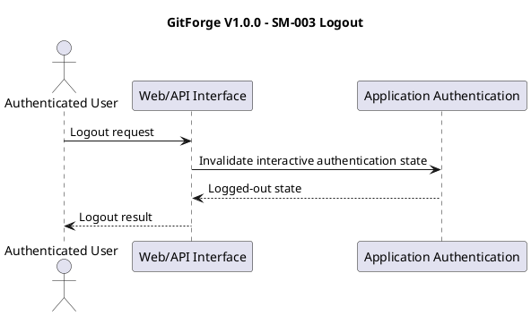
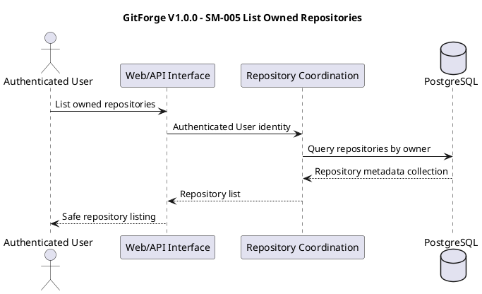
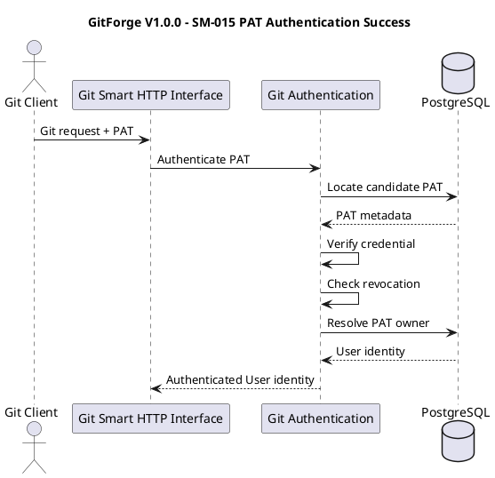

# GitForge V1.0.0 Analysis Sequence Models

## 1. Document Information

| Field | Value |

|---|---|

| Project | GitForge - Web Git Hosting Platform |

| Target release | V1.0.0 |

| Document | Analysis Sequence Models |

| SDLC phase | System Analysis |

| Milestone | M2 - System Analysis |

| Project owner | Farhad Valizadegan |

| Status | Approved |

| Last updated | 2026-08-17 |

---

## 2. Purpose

This document consolidates the critical interaction sequences identified during GitForge V1.0.0 System Analysis.

It models:

- application authentication;

- repository creation;

- repository viewing;

- repository visibility changes;

- repository browsing;

- Personal Access Token creation;

- PAT authentication;

- PAT revocation;

- Git Smart HTTP read discovery;

- clone/fetch;

- Git Smart HTTP write discovery;

- push;

- read authorization;

- write authorization;

- repository storage resolution;

- critical failure paths.

The purpose is to verify ordering, responsibility collaboration, authorization placement, trust-boundary crossings, and failure propagation before System Design begins.

---

## 3. Analysis Objective

This document answers:

> In what logical order do the major GitForge V1.0.0 responsibilities collaborate during critical success and failure scenarios?

These sequence models are analysis models.

They do not prescribe:

```text

Controller classes

Service classes

Middleware classes

API routes

Database schema

HTTP status codes

Framework events

Concrete process APIs

Exact Git command lines

```

Those belong primarily to System Design.

---

## 4. Sequence Modeling Principles

The sequence models follow these principles:

```text

Requirements remain authoritative

Authentication precedes protected identity use

Authorization precedes protected repository access

Logical repository resolution precedes physical path resolution

Physical paths are internally derived

Git execution uses approved operations only

Failure paths remain explicit

Application metadata and Git-native state remain separate

```

---

## 5. Common Logical Participants

The following logical participants recur throughout the models:

```text

Visitor

Authenticated User

Git Client

Web/API Interface

Application Authentication

PAT Coordination

Git Authentication

Repository Coordination

Repository Resolution

Repository Authorization

Repository Browser Coordination

Repository Storage Coordination

Git Read Coordination

Git Write Coordination

Git Process Coordination

Failure Handling

Diagnostics

PostgreSQL

Git Executable

Physical Git Repository

```

---

## 6. Participant Responsibility Summary

| Participant | Primary Analysis Responsibility |

|---|---|

| Visitor | Anonymous web interaction |

| Authenticated User | Authenticated application interaction |

| Git Client | Git Smart HTTP interaction |

| Web/API Interface | Receive application requests |

| Application Authentication | Establish interactive User identity |

| PAT Coordination | PAT creation and revocation |

| Git Authentication | Authenticate Git Client through PAT |

| Repository Coordination | Repository lifecycle and metadata behavior |

| Repository Resolution | Resolve logical repository |

| Repository Authorization | Produce Allow/Deny decision |

| Repository Browser Coordination | Coordinate repository browsing |

| Repository Storage Coordination | Derive safe physical repository target |

| Git Read Coordination | Coordinate Git-native reads |

| Git Write Coordination | Coordinate Git-native writes |

| Git Process Coordination | Execute approved Git operation |

| Failure Handling | Classify and contain failures |

| Diagnostics | Record safe operational information |

| PostgreSQL | Authoritative application metadata |

| Physical Git Repository | Authoritative Git-native state |

| Git Executable | Perform approved Git-native operations |

---

## 7. Common Protected Interaction Order

Protected interactions generally follow:

```text

Request

&#x20; ↓

Authentication if required

&#x20; ↓

Repository Resolution

&#x20; ↓

Authorization

&#x20; ↓

Safe Storage Resolution

&#x20; ↓

Approved Git/Application Operation

&#x20; ↓

Result

```

This ordering is a security and consistency property.

---

## 8. Sequence Model SM-001 — User Registration

```plantuml

@startuml

title GitForge V1.0.0 - SM-001 User Registration

actor Visitor

participant "Web/API Interface" as Web

participant "User Registration Coordination" as Registration

database PostgreSQL as DB

participant "Failure Handling" as Failure

Visitor -> Web : Submit registration data

Web -> Registration : Validate and register

alt Input valid

&#x20;   Registration -> DB : Persist User metadata

&#x20;   alt Persistence succeeds

&#x20;       DB --> Registration : User stored

&#x20;       Registration --> Web : Registration success

&#x20;       Web --> Visitor : Safe success response

&#x20;   else Persistence fails

&#x20;       DB --> Registration : Failure

&#x20;       Registration -> Failure : Classify persistence failure

&#x20;       Failure --> Web : Safe failure

&#x20;       Web --> Visitor : Registration failed

&#x20;   end

else Input invalid

&#x20;   Registration --> Web : Validation rejection

&#x20;   Web --> Visitor : Safe rejection response

end

@enduml

```

---

## 9. SM-001 Analysis Notes

Key rules:

```text

External registration data is untrusted

Validation precedes persistence

Persistence failure does not become success

No User identity is fabricated after failure

```

---

## 10. Sequence Model SM-002 — Interactive Login

```plantuml

@startuml

title GitForge V1.0.0 - SM-002 Interactive Login

actor User

participant "Web/API Interface" as Web

participant "Application Authentication" as Auth

database PostgreSQL as DB

participant "Failure Handling" as Failure

User -> Web : Submit login credential

Web -> Auth : Authenticate

Auth -> DB : Resolve User / verify credential

DB --> Auth : Verification data

alt Credential valid

&#x20;   Auth --> Web : Authenticated User identity

&#x20;   Web --> User : Authenticated application context

else Credential invalid

&#x20;   Auth -> Failure : Authentication failure

&#x20;   Failure --> Web : Safe denial

&#x20;   Web --> User : Authentication denied

end

@enduml

```

---

## 11. SM-002 Analysis Notes

Successful login produces:

```text

Authenticated User Identity

```

It does not produce:

```text

Automatic repository permission

```

Repository access still requires authorization.

---

## 12. Sequence Model SM-003 — Logout



---

## 13. Sequence Model SM-004 — Repository Creation

```plantuml

@startuml

title GitForge V1.0.0 - SM-004 Repository Creation

actor "Authenticated User" as User

participant "Web/API Interface" as Web

participant "Repository Coordination" as Repo

database PostgreSQL as DB

participant "Repository Storage Coordination" as Storage

participant "Git Process Coordination" as Process

rectangle "Git Executable" as Git

folder "Physical Git Repository" as PhysicalRepo

participant "Failure Handling" as Failure

User -> Web : Create repository(name, visibility)

Web -> Repo : Validated creation request + authenticated User

Repo -> DB : Check namespace uniqueness

DB --> Repo : Unique / conflict

alt Namespace available

&#x20;   Repo -> Storage : Derive safe repository target

&#x20;   Storage --> Repo : Safe physical target

&#x20;   Repo -> Process : Initialize repository(target)

&#x20;   Process -> Git : Approved repository initialization

&#x20;   Git -> PhysicalRepo : Create Git repository

&#x20;   alt Physical initialization succeeds

&#x20;       Git --> Process : Success

&#x20;       Process --> Repo : Initialization success

&#x20;       Repo -> DB : Persist repository metadata + owner + visibility

&#x20;       alt Metadata persistence succeeds

&#x20;           DB --> Repo : Stored

&#x20;           Repo --> Web : Repository available

&#x20;           Web --> User : Creation success

&#x20;       else Metadata persistence fails

&#x20;           DB --> Repo : Failure

&#x20;           Repo -> Failure : Metadata/storage consistency failure

&#x20;           Failure --> Web : Safe creation failure

&#x20;           Web --> User : Creation failed

&#x20;       end

&#x20;   else Physical initialization fails

&#x20;       Git --> Process : Failure

&#x20;       Process --> Repo : Initialization failure

&#x20;       Repo -> Failure : Storage/Git initialization failure

&#x20;       Failure --> Web : Safe failure

&#x20;       Web --> User : Creation failed

&#x20;   end

else Namespace conflict

&#x20;   Repo --> Web : Reject duplicate namespace

&#x20;   Web --> User : Safe rejection

end

@enduml

```

---

## 14. SM-004 Analysis Notes

Critical ordering:

```text

Authenticated User

&#x20;   ↓

Validate

&#x20;   ↓

Check namespace

&#x20;   ↓

Derive safe physical target

&#x20;   ↓

Initialize Git repository

&#x20;   ↓

Persist/confirm authoritative metadata

&#x20;   ↓

Report available

```

Exact transaction/compensation ordering remains a design decision.

No partial result may be represented as fully successful.

---

## 15. Sequence Model SM-005 — List Owned Repositories



---

## 16. Sequence Model SM-006 — View Public Repository

```plantuml

@startuml

title GitForge V1.0.0 - SM-006 View Public Repository

actor Caller

participant "Web/API Interface" as Web

participant "Repository Resolution" as Resolution

database PostgreSQL as DB

participant "Repository Authorization" as Authz

participant "Repository Browser Coordination" as Browser

participant "Repository Storage Coordination" as Storage

participant "Git Read Coordination" as Read

folder "Physical Git Repository" as Repo

Caller -> Web : View <owner>/<repository>

Web -> Resolution : Resolve logical repository

Resolution -> DB : Load repository metadata

DB --> Resolution : Repository + owner + visibility

Resolution -> Authz : Authorize read(caller, repository)

alt Repository is Public

&#x20;   Authz --> Resolution : Allow

&#x20;   Resolution -> Browser : Build repository view

&#x20;   Browser -> Storage : Resolve physical repository

&#x20;   Storage --> Browser : Safe repository target

&#x20;   Browser -> Read : Read Git-native summary/content

&#x20;   Read -> Repo : Approved Git read

&#x20;   Repo --> Read : Git-native data

&#x20;   Read --> Browser : Result

&#x20;   Browser --> Web : Repository representation

&#x20;   Web --> Caller : Public repository view

else Read denied

&#x20;   Authz --> Resolution : Deny

&#x20;   Resolution --> Web : Safe denial

&#x20;   Web --> Caller : Access denied

end

@enduml

```

---

## 17. Sequence Model SM-007 — View Private Repository as Owner

```plantuml

@startuml

title GitForge V1.0.0 - SM-007 View Private Repository as Owner

actor "Authenticated User" as User

participant "Web/API Interface" as Web

participant "Repository Resolution" as Resolution

database PostgreSQL as DB

participant "Repository Authorization" as Authz

participant "Repository Browser Coordination" as Browser

participant "Repository Storage Coordination" as Storage

participant "Git Read Coordination" as Read

folder "Physical Git Repository" as Repo

User -> Web : View private repository

Web -> Resolution : Repository identifier + User identity

Resolution -> DB : Resolve repository metadata

DB --> Resolution : Private repository + owner

Resolution -> Authz : Authorize read(User, repository)

alt User is owner

&#x20;   Authz --> Resolution : Allow

&#x20;   Resolution -> Browser : Authorized repository context

&#x20;   Browser -> Storage : Resolve physical repository

&#x20;   Storage --> Browser : Safe target

&#x20;   Browser -> Read : Approved Git-native read

&#x20;   Read -> Repo : Read

&#x20;   Repo --> Read : Git data

&#x20;   Read --> Browser : Result

&#x20;   Browser --> Web : Repository view

&#x20;   Web --> User : Private repository content

else User is non-owner

&#x20;   Authz --> Resolution : Deny

&#x20;   Resolution --> Web : Safe denial

&#x20;   Web --> User : Access denied

end

@enduml

```

---

## 18. Sequence Model SM-008 — Change Repository Visibility

```plantuml

@startuml

title GitForge V1.0.0 - SM-008 Change Repository Visibility

actor "Authenticated User" as User

participant "Web/API Interface" as Web

participant "Repository Resolution" as Resolution

database PostgreSQL as DB

participant "Repository Authorization" as Authz

participant "Repository Coordination" as Repo

participant "Failure Handling" as Failure

User -> Web : Change visibility

Web -> Resolution : Resolve repository + User identity

Resolution -> DB : Load repository metadata

DB --> Resolution : Repository + owner + current visibility

Resolution -> Authz : Authorize metadata change

alt User is owner

&#x20;   Authz --> Resolution : Allow

&#x20;   Resolution -> Repo : Apply validated visibility change

&#x20;   Repo -> DB : Persist new visibility

&#x20;   alt Persistence succeeds

&#x20;       DB --> Repo : Stored

&#x20;       Repo --> Web : Visibility changed

&#x20;       Web --> User : Success

&#x20;   else Persistence fails

&#x20;       DB --> Repo : Failure

&#x20;       Repo -> Failure : Persistence failure

&#x20;       Failure --> Web : Safe failure

&#x20;       Web --> User : Update failed

&#x20;   end

else User is non-owner

&#x20;   Authz --> Resolution : Deny

&#x20;   Resolution --> Web : Safe denial

&#x20;   Web --> User : Access denied

end

@enduml

```

---

## 19. Sequence Model SM-009 — List Branches

```plantuml

@startuml

title GitForge V1.0.0 - SM-009 List Branches

actor Caller

participant "Web/API Interface" as Web

participant "Repository Resolution" as Resolution

database PostgreSQL as DB

participant "Repository Authorization" as Authz

participant "Repository Storage Coordination" as Storage

participant "Git Read Coordination" as Read

participant "Git Process Coordination" as Process

rectangle "Git Executable" as Git

folder "Physical Git Repository" as Repo

Caller -> Web : List branches

Web -> Resolution : Resolve repository

Resolution -> DB : Load metadata

DB --> Resolution : Owner + visibility

Resolution -> Authz : Authorize read

alt Allowed

&#x20;   Authz --> Resolution : Allow

&#x20;   Resolution -> Storage : Resolve safe physical repository

&#x20;   Storage --> Resolution : Safe target

&#x20;   Resolution -> Read : List branches

&#x20;   Read -> Process : Approved Git read operation

&#x20;   Process -> Git : Read refs/branches

&#x20;   Git -> Repo : Inspect Git-native state

&#x20;   Repo --> Git : Branch/ref data

&#x20;   Git --> Process : Result

&#x20;   Process --> Read : Branch data

&#x20;   Read --> Web : Branch list

&#x20;   Web --> Caller : Safe branch representation

else Denied

&#x20;   Authz --> Resolution : Deny

&#x20;   Resolution --> Web : Safe denial

&#x20;   Web --> Caller : Access denied

end

@enduml

```

---

## 20. Sequence Model SM-010 — Commit History

```plantuml

@startuml

title GitForge V1.0.0 - SM-010 Commit History

actor Caller

participant "Web/API Interface" as Web

participant "Repository Resolution" as Resolution

participant "Repository Authorization" as Authz

participant "Repository Storage Coordination" as Storage

participant "Git Read Coordination" as Read

folder "Physical Git Repository" as Repo

Caller -> Web : Request commit history(ref)

Web -> Resolution : Resolve repository

Resolution -> Authz : Authorize read

alt Allowed

&#x20;   Authz --> Resolution : Allow

&#x20;   Resolution -> Storage : Resolve safe repository

&#x20;   Storage --> Resolution : Safe target

&#x20;   Resolution -> Read : Read commit history(ref)

&#x20;   Read -> Repo : Git-native history lookup

&#x20;   alt Ref resolves

&#x20;       Repo --> Read : Commit history

&#x20;       Read --> Web : History data

&#x20;       Web --> Caller : Safe commit history

&#x20;   else Ref invalid/missing

&#x20;       Repo --> Read : Resolution failure

&#x20;       Read --> Web : Safe object-resolution failure

&#x20;       Web --> Caller : Requested history unavailable

&#x20;   end

else Denied

&#x20;   Authz --> Resolution : Deny

&#x20;   Resolution --> Web : Deny

&#x20;   Web --> Caller : Access denied

end

@enduml

```

---

## 21. Sequence Model SM-011 — Commit Details

```plantuml

@startuml

title GitForge V1.0.0 - SM-011 Commit Details

actor Caller

participant "Repository Resolution" as Resolution

participant "Repository Authorization" as Authz

participant "Repository Storage Coordination" as Storage

participant "Git Read Coordination" as Read

folder "Physical Git Repository" as Repo

Caller -> Resolution : Repository + commit identifier

Resolution -> Authz : Authorize read

alt Allowed

&#x20;   Authz --> Resolution : Allow

&#x20;   Resolution -> Storage : Resolve safe target

&#x20;   Storage --> Resolution : Target

&#x20;   Resolution -> Read : Resolve commit

&#x20;   Read -> Repo : Read commit object

&#x20;   alt Commit resolves

&#x20;       Repo --> Read : Commit metadata/data

&#x20;       Read --> Caller : Safe commit representation

&#x20;   else Commit missing/invalid

&#x20;       Repo --> Read : Resolution failure

&#x20;       Read --> Caller : Safe failure

&#x20;   end

else Denied

&#x20;   Authz --> Resolution : Deny

&#x20;   Resolution --> Caller : Safe denial

end

@enduml

```

---

## 22. Sequence Model SM-012 — Tree Browsing

```plantuml

@startuml

title GitForge V1.0.0 - SM-012 Tree Browsing

actor Caller

participant "Repository Resolution" as Resolution

participant "Repository Authorization" as Authz

participant "Repository Storage Coordination" as Storage

participant "Git Read Coordination" as Read

folder "Physical Git Repository" as Repo

Caller -> Resolution : Repository + revision + path

Resolution -> Authz : Authorize read

alt Allowed

&#x20;   Authz --> Resolution : Allow

&#x20;   Resolution -> Storage : Resolve safe target

&#x20;   Storage --> Resolution : Target

&#x20;   Resolution -> Read : Resolve revision/path

&#x20;   Read -> Repo : Read Git tree

&#x20;   alt Tree exists

&#x20;       Repo --> Read : Tree entries

&#x20;       Read --> Caller : Safe tree representation

&#x20;   else Tree/path invalid or missing

&#x20;       Repo --> Read : Resolution failure

&#x20;       Read --> Caller : Safe failure

&#x20;   end

else Denied

&#x20;   Authz --> Resolution : Deny

&#x20;   Resolution --> Caller : Safe denial

end

@enduml

```

---

## 23. Sequence Model SM-013 — File Viewing

```plantuml

@startuml

title GitForge V1.0.0 - SM-013 File Viewing

actor Caller

participant "Repository Resolution" as Resolution

participant "Repository Authorization" as Authz

participant "Repository Storage Coordination" as Storage

participant "Git Read Coordination" as Read

participant "Repository Browser Coordination" as Browser

folder "Physical Git Repository" as Repo

Caller -> Resolution : Repository + revision + file path

Resolution -> Authz : Authorize read

alt Allowed

&#x20;   Authz --> Resolution : Allow

&#x20;   Resolution -> Storage : Resolve safe target

&#x20;   Storage --> Resolution : Target

&#x20;   Resolution -> Read : Resolve file/blob

&#x20;   Read -> Repo : Read blob

&#x20;   alt Blob exists

&#x20;       Repo --> Read : Blob content

&#x20;       Read -> Browser : Untrusted repository content

&#x20;       Browser --> Caller : Safe representation

&#x20;   else Blob/path missing

&#x20;       Repo --> Read : Resolution failure

&#x20;       Read --> Caller : Safe failure

&#x20;   end

else Denied

&#x20;   Authz --> Resolution : Deny

&#x20;   Resolution --> Caller : Safe denial

end

@enduml

```

---

## 24. Sequence Model SM-014 — PAT Creation

```plantuml

@startuml

title GitForge V1.0.0 - SM-014 PAT Creation

actor "Authenticated User" as User

participant "Web/API Interface" as Web

participant "PAT Coordination" as PAT

participant "Credential Generation" as Generator

database PostgreSQL as DB

participant "Failure Handling" as Failure

User -> Web : Create PAT

Web -> PAT : Authenticated PAT creation request

PAT -> Generator : Generate strong plaintext PAT

alt Generation succeeds

&#x20;   Generator --> PAT : Plaintext PAT

&#x20;   PAT -> PAT : Derive verification representation

&#x20;   PAT -> DB : Persist PAT metadata + owner + verifier

&#x20;   alt Persistence succeeds

&#x20;       DB --> PAT : Stored

&#x20;       PAT --> Web : Plaintext PAT once

&#x20;       Web --> User : Display plaintext PAT

&#x20;   else Persistence fails

&#x20;       DB --> PAT : Failure

&#x20;       PAT -> Failure : PAT persistence failure

&#x20;       Failure --> Web : Safe creation failure

&#x20;       Web --> User : PAT creation failed

&#x20;   end

else Generation fails

&#x20;   Generator --> PAT : Failure

&#x20;   PAT -> Failure : Token generation failure

&#x20;   Failure --> Web : Safe failure

&#x20;   Web --> User : PAT creation failed

end

@enduml

```

---

## 25. SM-014 Analysis Notes

Plaintext PAT flow:

```text

Generated

&#x20;   ↓

Verification representation persisted

&#x20;   ↓

Plaintext shown once

```

Plaintext PAT is not recoverably persisted.

---

## 26. Sequence Model SM-015 — PAT Authentication Success



---

## 27. Sequence Model SM-016 — PAT Authentication Failure

```plantuml

@startuml

title GitForge V1.0.0 - SM-016 PAT Authentication Failure

actor "Git Client" as Client

participant "Git Smart HTTP Interface" as HTTP

participant "Git Authentication" as Auth

database PostgreSQL as DB

participant "Failure Handling" as Failure

Client -> HTTP : Git request + PAT

HTTP -> Auth : Authenticate PAT

Auth -> DB : Resolve PAT candidate

DB --> Auth : Candidate / none

alt Candidate absent

&#x20;   Auth -> Failure : Unknown PAT

&#x20;   Failure --> HTTP : Authentication denied

else Candidate exists

&#x20;   Auth -> Auth : Verify credential

&#x20;   alt Verification fails

&#x20;       Auth -> Failure : Invalid PAT

&#x20;       Failure --> HTTP : Authentication denied

&#x20;   else Verification succeeds

&#x20;       Auth -> Auth : Check revocation

&#x20;       alt PAT revoked

&#x20;           Auth -> Failure : Revoked PAT

&#x20;           Failure --> HTTP : Authentication denied

&#x20;       else PAT active

&#x20;           Auth -> DB : Resolve owner

&#x20;           alt Owner resolves

&#x20;               DB --> Auth : User identity

&#x20;               Auth --> HTTP : Authenticated User

&#x20;           else Owner inconsistent

&#x20;               DB --> Auth : Failure

&#x20;               Auth -> Failure : PAT consistency failure

&#x20;               Failure --> HTTP : Authentication denied

&#x20;           end

&#x20;       end

&#x20;   end

end

HTTP --> Client : Safe authentication outcome

@enduml

```

---

## 28. Sequence Model SM-017 — PAT Revocation

```plantuml

@startuml

title GitForge V1.0.0 - SM-017 PAT Revocation

actor "Authenticated User" as User

participant "Web/API Interface" as Web

participant "PAT Coordination" as PAT

database PostgreSQL as DB

participant "Failure Handling" as Failure

User -> Web : Revoke PAT

Web -> PAT : PAT ID + authenticated User

PAT -> DB : Resolve PAT

DB --> PAT : PAT metadata + owner

alt User owns PAT

&#x20;   PAT -> DB : Persist revoked state

&#x20;   alt Persistence succeeds

&#x20;       DB --> PAT : Revoked

&#x20;       PAT --> Web : Success

&#x20;       Web --> User : PAT revoked

&#x20;   else Persistence fails

&#x20;       DB --> PAT : Failure

&#x20;       PAT -> Failure : Revocation persistence failure

&#x20;       Failure --> Web : Safe failure

&#x20;       Web --> User : Revocation failed

&#x20;   end

else User does not own PAT

&#x20;   PAT --> Web : Deny

&#x20;   Web --> User : Safe denial

end

@enduml

```

---

## 29. Sequence Model SM-018 — Public Git Read-Service Discovery

```plantuml

@startuml

title GitForge V1.0.0 - SM-018 Public Git Read-Service Discovery

actor "Git Client" as Client

participant "Git Smart HTTP Interface" as HTTP

participant "Repository Resolution" as Resolution

database PostgreSQL as DB

participant "Repository Authorization" as Authz

participant "Repository Storage Coordination" as Storage

participant "Git Read Coordination" as Read

participant "Git Process Coordination" as Process

rectangle "Git Executable" as Git

folder "Physical Git Repository" as Repo

Client -> HTTP : Discover git-upload-pack

HTTP -> Resolution : Resolve logical repository

Resolution -> DB : Load repository metadata

DB --> Resolution : Public repository

Resolution -> Authz : Authorize read(anonymous, repository)

Authz --> Resolution : Allow

Resolution -> Storage : Resolve safe target

Storage --> Resolution : Physical repository target

Resolution -> Read : Discover read service

Read -> Process : Execute approved discovery

Process -> Git : git-upload-pack discovery

Git -> Repo : Inspect repository

Repo --> Git : Advertised refs/capabilities

Git --> Process : Discovery result

Process --> Read : Result

Read --> HTTP : Git discovery response

HTTP --> Client : Smart HTTP response

@enduml

```

---

## 30. Sequence Model SM-019 — Private Git Read-Service Discovery

```plantuml

@startuml

title GitForge V1.0.0 - SM-019 Private Git Read-Service Discovery

actor "Git Client" as Client

participant "Git Smart HTTP Interface" as HTTP

participant "Git Authentication" as Auth

database PostgreSQL as DB

participant "Repository Resolution" as Resolution

participant "Repository Authorization" as Authz

participant "Repository Storage Coordination" as Storage

participant "Git Read Coordination" as Read

Client -> HTTP : Discovery request + PAT

HTTP -> Auth : Authenticate PAT

Auth -> DB : Verify PAT + resolve User

DB --> Auth : User identity

alt Authentication succeeds

&#x20;   Auth --> HTTP : Authenticated User

&#x20;   HTTP -> Resolution : Resolve private repository

&#x20;   Resolution -> DB : Repository metadata

&#x20;   DB --> Resolution : Owner + Private

&#x20;   Resolution -> Authz : Authorize read(User, repository)

&#x20;   alt User is owner

&#x20;       Authz --> Resolution : Allow

&#x20;       Resolution -> Storage : Resolve safe target

&#x20;       Storage --> Resolution : Target

&#x20;       Resolution -> Read : Execute read discovery

&#x20;       Read --> HTTP : Discovery response

&#x20;       HTTP --> Client : Smart HTTP response

&#x20;   else User is non-owner

&#x20;       Authz --> Resolution : Deny

&#x20;       Resolution --> HTTP : Safe denial

&#x20;       HTTP --> Client : Access denied

&#x20;   end

else Authentication fails

&#x20;   Auth --> HTTP : Failure

&#x20;   HTTP --> Client : Authentication denied

end

@enduml

```

---

## 31. Sequence Model SM-020 — Public Clone/Fetch

```plantuml

@startuml

title GitForge V1.0.0 - SM-020 Public Clone / Fetch

actor "Git Client" as Client

participant "Git Smart HTTP Interface" as HTTP

participant "Repository Resolution" as Resolution

database PostgreSQL as DB

participant "Repository Authorization" as Authz

participant "Repository Storage Coordination" as Storage

participant "Git Read Coordination" as Read

participant "Git Process Coordination" as Process

rectangle "Git Executable" as Git

folder "Physical Git Repository" as Repo

Client -> HTTP : Clone/fetch protocol request

HTTP -> Resolution : Resolve repository

Resolution -> DB : Load metadata

DB --> Resolution : Public repository

Resolution -> Authz : Authorize anonymous read

Authz --> Resolution : Allow

Resolution -> Storage : Resolve physical target

alt Storage available

&#x20;   Storage --> Resolution : Safe target

&#x20;   Resolution -> Read : Execute read

&#x20;   Read -> Process : Invoke git-upload-pack

&#x20;   Process -> Git : Approved read operation

&#x20;   Git -> Repo : Read refs/objects

&#x20;   Repo --> Git : Git-native data

&#x20;   Git --> Process : Pack/protocol result

&#x20;   Process --> Read : Stream result

&#x20;   Read --> HTTP : Smart HTTP response

&#x20;   HTTP --> Client : Clone/fetch data

else Storage failure

&#x20;   Storage --> Resolution : Failure

&#x20;   Resolution --> HTTP : Safe operational failure

&#x20;   HTTP --> Client : Read failed

end

@enduml

```

---

## 32. Sequence Model SM-021 — Private Clone/Fetch

```plantuml

@startuml

title GitForge V1.0.0 - SM-021 Private Clone / Fetch

actor "Git Client" as Client

participant "Git Smart HTTP Interface" as HTTP

participant "Git Authentication" as Auth

database PostgreSQL as DB

participant "Repository Resolution" as Resolution

participant "Repository Authorization" as Authz

participant "Repository Storage Coordination" as Storage

participant "Git Read Coordination" as Read

participant "Git Process Coordination" as Process

rectangle "Git Executable" as Git

folder "Physical Git Repository" as Repo

Client -> HTTP : Clone/fetch request + PAT

HTTP -> Auth : Authenticate PAT

Auth -> DB : Verify PAT / resolve User

DB --> Auth : User identity

alt Authentication succeeds

&#x20;   Auth --> HTTP : User identity

&#x20;   HTTP -> Resolution : Resolve repository

&#x20;   Resolution -> DB : Repository metadata

&#x20;   DB --> Resolution : Private repository + owner

&#x20;   Resolution -> Authz : Authorize read

&#x20;   alt User is owner

&#x20;       Authz --> Resolution : Allow

&#x20;       Resolution -> Storage : Resolve safe target

&#x20;       Storage --> Resolution : Target

&#x20;       Resolution -> Read : Execute Git read

&#x20;       Read -> Process : Invoke git-upload-pack

&#x20;       Process -> Git : Approved read

&#x20;       Git -> Repo : Read Git data

&#x20;       Repo --> Git : Objects/refs

&#x20;       Git --> Process : Result

&#x20;       Process --> Read : Stream

&#x20;       Read --> HTTP : Smart HTTP response

&#x20;       HTTP --> Client : Clone/fetch result

&#x20;   else User is non-owner

&#x20;       Authz --> Resolution : Deny

&#x20;       Resolution --> HTTP : Safe denial

&#x20;       HTTP --> Client : Access denied

&#x20;   end

else Authentication fails

&#x20;   Auth --> HTTP : Failure

&#x20;   HTTP --> Client : Authentication denied

end

@enduml

```

---

## 33. Sequence Model SM-022 — Git Read Failure Due to Missing Storage

```plantuml

@startuml

title GitForge V1.0.0 - SM-022 Git Read Missing Storage Failure

actor "Git Client" as Client

participant "Git Smart HTTP Interface" as HTTP

participant "Repository Resolution" as Resolution

participant "Repository Authorization" as Authz

participant "Repository Storage Coordination" as Storage

participant "Failure Handling" as Failure

participant "Diagnostics" as Diag

Client -> HTTP : Read request

HTTP -> Resolution : Resolve repository

Resolution -> Authz : Authorize read

Authz --> Resolution : Allow

Resolution -> Storage : Resolve physical repository

Storage --> Resolution : Expected repository missing

Resolution -> Failure : Storage consistency failure

Failure -> Diag : Sanitized diagnostic

Failure --> HTTP : Safe failure

HTTP --> Client : Repository read unavailable

@enduml

```

---

## 34. Sequence Model SM-023 — Git Write-Service Discovery

```plantuml

@startuml

title GitForge V1.0.0 - SM-023 Git Write-Service Discovery

actor "Git Client" as Client

participant "Git Smart HTTP Interface" as HTTP

participant "Git Authentication" as Auth

database PostgreSQL as DB

participant "Repository Resolution" as Resolution

participant "Repository Authorization" as Authz

participant "Repository Storage Coordination" as Storage

participant "Git Write Coordination" as Write

participant "Git Process Coordination" as Process

rectangle "Git Executable" as Git

folder "Physical Git Repository" as Repo

Client -> HTTP : Discover git-receive-pack + PAT

HTTP -> Auth : Authenticate PAT

Auth -> DB : Verify PAT / resolve User

DB --> Auth : User identity

alt Authentication succeeds

&#x20;   Auth --> HTTP : Authenticated User

&#x20;   HTTP -> Resolution : Resolve repository

&#x20;   Resolution -> DB : Load repository metadata

&#x20;   DB --> Resolution : Repository + owner

&#x20;   Resolution -> Authz : Authorize write

&#x20;   alt User is owner

&#x20;       Authz --> Resolution : Allow

&#x20;       Resolution -> Storage : Resolve safe physical target

&#x20;       Storage --> Resolution : Target

&#x20;       Resolution -> Write : Discover write service

&#x20;       Write -> Process : Execute approved discovery

&#x20;       Process -> Git : git-receive-pack discovery

&#x20;       Git -> Repo : Inspect refs

&#x20;       Repo --> Git : Advertisement data

&#x20;       Git --> Process : Result

&#x20;       Process --> Write : Result

&#x20;       Write --> HTTP : Discovery response

&#x20;       HTTP --> Client : Smart HTTP response

&#x20;   else User is non-owner

&#x20;       Authz --> Resolution : Deny

&#x20;       Resolution --> HTTP : Safe denial

&#x20;       HTTP --> Client : Access denied

&#x20;   end

else Authentication fails

&#x20;   Auth --> HTTP : Failure

&#x20;   HTTP --> Client : Authentication denied

end

@enduml

```

---

## 35. Sequence Model SM-024 — Successful Push

```plantuml

@startuml

title GitForge V1.0.0 - SM-024 Successful Push

actor "Git Client" as Client

participant "Git Smart HTTP Interface" as HTTP

participant "Git Authentication" as Auth

database PostgreSQL as DB

participant "Repository Resolution" as Resolution

participant "Repository Authorization" as Authz

participant "Repository Storage Coordination" as Storage

participant "Git Write Coordination" as Write

participant "Git Process Coordination" as Process

rectangle "Git Executable" as Git

folder "Physical Git Repository" as Repo

Client -> HTTP : Push request + PAT

HTTP -> Auth : Authenticate PAT

Auth -> DB : Verify PAT + resolve User

DB --> Auth : Authenticated User

Auth --> HTTP : User identity

HTTP -> Resolution : Resolve repository

Resolution -> DB : Load metadata

DB --> Resolution : Repository + owner

Resolution -> Authz : Authorize write(User, repository)

alt User is owner

&#x20;   Authz --> Resolution : Allow

&#x20;   Resolution -> Storage : Resolve safe physical repository

&#x20;   Storage --> Resolution : Target

&#x20;   Resolution -> Write : Execute authorized push

&#x20;   Client -> Write : Git protocol input

&#x20;   Write -> Process : Invoke git-receive-pack

&#x20;   Process -> Git : Approved write operation

&#x20;   Git -> Repo : Receive objects / update refs

&#x20;   Repo --> Git : Git-native result

&#x20;   Git --> Process : Success

&#x20;   Process --> Write : Write result

&#x20;   Write --> HTTP : Smart HTTP success

&#x20;   HTTP --> Client : Push succeeded

else User is non-owner

&#x20;   Authz --> Resolution : Deny

&#x20;   Resolution --> HTTP : Safe denial

&#x20;   HTTP --> Client : Push denied

end

@enduml

```

---

## 36. Sequence Model SM-025 — Push Authentication Failure

```plantuml

@startuml

title GitForge V1.0.0 - SM-025 Push Authentication Failure

actor "Git Client" as Client

participant "Git Smart HTTP Interface" as HTTP

participant "Git Authentication" as Auth

participant "Failure Handling" as Failure

Client -> HTTP : Push request + invalid/revoked PAT

HTTP -> Auth : Authenticate PAT

Auth --> Failure : Authentication failure

Failure --> HTTP : Deny

HTTP --> Client : Authentication denied

note right of HTTP

No repository mutation

No write authorization

No physical repository access

end note

@enduml

```

---

## 37. Sequence Model SM-026 — Push Authorization Failure

```plantuml

@startuml

title GitForge V1.0.0 - SM-026 Push Authorization Failure

actor "Git Client" as Client

participant "Git Smart HTTP Interface" as HTTP

participant "Git Authentication" as Auth

participant "Repository Resolution" as Resolution

participant "Repository Authorization" as Authz

participant "Failure Handling" as Failure

Client -> HTTP : Push request + valid PAT

HTTP -> Auth : Authenticate

Auth --> HTTP : User identity

HTTP -> Resolution : Resolve repository

Resolution -> Authz : Authorize write

Authz --> Resolution : Deny (non-owner)

Resolution -> Failure : Authorization denial

Failure --> HTTP : Safe denial

HTTP --> Client : Push denied

note right of Authz

Git execution does not begin.

Physical mutation does not occur.

end note

@enduml

```

---

## 38. Sequence Model SM-027 — Push Storage Failure

```plantuml

@startuml

title GitForge V1.0.0 - SM-027 Push Storage Failure

actor "Git Client" as Client

participant "Git Smart HTTP Interface" as HTTP

participant "Git Authentication" as Auth

participant "Repository Resolution" as Resolution

participant "Repository Authorization" as Authz

participant "Repository Storage Coordination" as Storage

participant "Failure Handling" as Failure

participant "Diagnostics" as Diag

Client -> HTTP : Push request + valid PAT

HTTP -> Auth : Authenticate

Auth --> HTTP : Owner identity

HTTP -> Resolution : Resolve repository

Resolution -> Authz : Authorize write

Authz --> Resolution : Allow

Resolution -> Storage : Resolve physical repository

Storage --> Resolution : Missing/unavailable/unwritable

Resolution -> Failure : Storage failure

Failure -> Diag : Sanitized diagnostic

Failure --> HTTP : Safe failure

HTTP --> Client : Push failed

note right of Storage

git-receive-pack is not executed.

end note

@enduml

```

---

## 39. Sequence Model SM-028 — Push Ref Rejection

```plantuml

@startuml

title GitForge V1.0.0 - SM-028 Push Ref Rejection

actor "Git Client" as Client

participant "Git Smart HTTP Interface" as HTTP

participant "Git Authentication" as Auth

participant "Repository Authorization" as Authz

participant "Git Write Coordination" as Write

participant "Git Process Coordination" as Process

rectangle "Git Executable" as Git

folder "Physical Git Repository" as Repo

participant "Failure Handling" as Failure

Client -> HTTP : Push + valid PAT

HTTP -> Auth : Authenticate

Auth --> HTTP : Owner identity

HTTP -> Authz : Authorize owner write

Authz --> HTTP : Allow

HTTP -> Write : Execute authorized push

Write -> Process : Invoke git-receive-pack

Process -> Git : Approved write

Git -> Repo : Attempt ref/object update

Repo --> Git : Ref update rejected

Git --> Process : Git-native failure

Process --> Write : Ref rejection

Write -> Failure : Git write failure

Failure --> HTTP : Safe Git failure

HTTP --> Client : Push rejected

@enduml

```

---

## 40. Sequence Model SM-029 — Repository Browser Missing Commit

```plantuml

@startuml

title GitForge V1.0.0 - SM-029 Browser Missing Commit

actor Caller

participant "Repository Resolution" as Resolution

participant "Repository Authorization" as Authz

participant "Repository Storage Coordination" as Storage

participant "Git Read Coordination" as Read

folder "Physical Git Repository" as Repo

Caller -> Resolution : Repository + commit ID

Resolution -> Authz : Authorize read

Authz --> Resolution : Allow

Resolution -> Storage : Resolve safe target

Storage --> Resolution : Target

Resolution -> Read : Resolve commit

Read -> Repo : Lookup commit

Repo --> Read : Commit not found

Read --> Caller : Safe object-not-found result

@enduml

```

---

## 41. Sequence Model SM-030 — Repository Browser Empty Repository

```plantuml

@startuml

title GitForge V1.0.0 - SM-030 Empty Repository Browser

actor Caller

participant "Repository Resolution" as Resolution

participant "Repository Authorization" as Authz

participant "Repository Storage Coordination" as Storage

participant "Git Read Coordination" as Read

folder "Physical Git Repository" as Repo

Caller -> Resolution : View repository

Resolution -> Authz : Authorize read

Authz --> Resolution : Allow

Resolution -> Storage : Resolve physical repository

Storage --> Resolution : Available repository

Resolution -> Read : Read repository state

Read -> Repo : Inspect refs/history

Repo --> Read : Valid empty repository

Read --> Caller : Empty repository representation

note right of Repo

Empty is valid.

Missing storage would be a failure.

end note

@enduml

```

---

## 42. Sequence Model SM-031 — Authorization Decision

```plantuml

@startuml

title GitForge V1.0.0 - SM-031 Repository Authorization

actor Caller

participant "Repository Authorization" as Authz

database "Repository Metadata" as Metadata

Caller -> Authz : identity/context + operation

Authz -> Metadata : owner + visibility

Metadata --> Authz : authoritative repository context

alt Public read

&#x20;   Authz --> Caller : Allow

else Private + owner read

&#x20;   Authz --> Caller : Allow

else Owner write

&#x20;   Authz --> Caller : Allow

else Any unauthorized protected operation

&#x20;   Authz --> Caller : Deny

end

@enduml

```

---

## 43. Sequence Model SM-032 — Safe Repository Storage Resolution

```plantuml

@startuml

title GitForge V1.0.0 - SM-032 Safe Repository Storage Resolution

participant "Repository Coordination" as Repo

participant "Repository Storage Coordination" as Storage

folder "Repository Storage Root" as Root

participant "Failure Handling" as Failure

Repo -> Storage : Validated repository identity + approved context

Storage -> Storage : Derive internal physical target

Storage -> Storage : Verify root containment

alt Target safely contained

&#x20;   Storage -> Root : Resolve repository location

&#x20;   Root --> Storage : Repository availability

&#x20;   Storage --> Repo : Safe physical target

else Target unsafe / ambiguous

&#x20;   Storage -> Failure : Storage security failure

&#x20;   Failure --> Repo : Reject physical access

end

@enduml

```

---

## 44. Sequence Model SM-033 — Git Process Execution

```plantuml

@startuml

title GitForge V1.0.0 - SM-033 Controlled Git Process Execution

participant "Git Read/Write Coordination" as Coord

participant "Git Process Coordination" as Process

rectangle "Git Executable" as Git

folder "Physical Git Repository" as Repo

participant "Failure Handling" as Failure

Coord -> Process : Approved operation + safe repository target

Process -> Process : Validate internal execution context

Process -> Git : Execute approved Git operation

Git -> Repo : Read/write Git-native state

alt Git succeeds

&#x20;   Repo --> Git : Result

&#x20;   Git --> Process : Success

&#x20;   Process --> Coord : Operation result

else Git fails

&#x20;   Git --> Process : Failure

&#x20;   Process -> Failure : Git/process failure

&#x20;   Failure --> Coord : Safe failure

end

@enduml

```

---

## 45. Sequence Model SM-034 — Diagnostic Failure Propagation

```plantuml

@startuml

title GitForge V1.0.0 - SM-034 Failure Propagation and Diagnostics

participant "Domain Responsibility" as Domain

participant "Failure Handling" as Failure

participant "Diagnostics" as Diag

actor Caller

actor "System Operator" as Operator

Domain -> Failure : Internal failure context

Failure -> Failure : Classify + sanitize

Failure -> Diag : Safe diagnostic event

Diag --> Operator : Operational diagnostic

Failure --> Caller : Safe external failure response

note right of Failure

No plaintext PAT

No plaintext password

No unnecessary filesystem path

No raw internal stack trace externally

end note

@enduml

```

---

## 46. Sequence Model SM-035 — Public to Private Visibility Effect

```plantuml

@startuml

title GitForge V1.0.0 - SM-035 Visibility Change Effect

actor Owner

participant "Repository Coordination" as Repo

database PostgreSQL as DB

actor "Anonymous Caller" as Anonymous

participant "Repository Authorization" as Authz

Owner -> Repo : Change Public to Private

Repo -> DB : Persist Private

DB --> Repo : Updated

Anonymous -> Authz : Request repository read

Authz -> DB : Load visibility

DB --> Authz : Private

Authz --> Anonymous : Deny

@enduml

```

---

## 47. Sequence Model SM-036 — Private to Public Visibility Effect

```plantuml

@startuml

title GitForge V1.0.0 - SM-036 Private to Public Visibility Effect

actor Owner

participant "Repository Coordination" as Repo

database PostgreSQL as DB

actor "Anonymous Caller" as Anonymous

participant "Repository Authorization" as Authz

Owner -> Repo : Change Private to Public

Repo -> DB : Persist Public

DB --> Repo : Updated

Anonymous -> Authz : Request repository read

Authz -> DB : Load visibility

DB --> Authz : Public

Authz --> Anonymous : Allow

@enduml

```

---

## 48. Sequence Model SM-037 — PAT Revocation Effect on Git Authentication

```plantuml

@startuml

title GitForge V1.0.0 - SM-037 PAT Revocation Effect

actor User

participant "PAT Coordination" as PAT

database PostgreSQL as DB

actor "Git Client" as Client

participant "Git Authentication" as Auth

User -> PAT : Revoke PAT

PAT -> DB : Persist revoked state

DB --> PAT : Revoked

Client -> Auth : Present same PAT

Auth -> DB : Resolve PAT state

DB --> Auth : Revoked

Auth --> Client : Authentication denied

@enduml

```

---

## 49. Sequence Model SM-038 — First Push to Empty Repository

```plantuml

@startuml

title GitForge V1.0.0 - SM-038 First Push to Empty Repository

actor "Git Client" as Client

participant "Git Authentication" as Auth

participant "Repository Authorization" as Authz

participant "Git Write Coordination" as Write

participant "Git Process Coordination" as Process

rectangle "Git Executable" as Git

folder "Empty Physical Git Repository" as Repo

Client -> Auth : PAT

Auth --> Client : Owner identity

Client -> Authz : Push repository

Authz --> Client : Allow owner write

Client -> Write : First push

Write -> Process : git-receive-pack

Process -> Git : Approved write

Git -> Repo : Create initial refs / store objects

Repo --> Git : Success

Git --> Process : Success

Process --> Write : Result

Write --> Client : Push succeeded

note right of Repo

Repository transitions logically:

Empty -> Has History

end note

@enduml

```

---

## 50. Sequence Model SM-039 — Concurrent Push Ref Conflict

```plantuml

@startuml

title GitForge V1.0.0 - SM-039 Concurrent Push Ref Conflict

actor "Git Client A" as A

actor "Git Client B" as B

participant "Git Write Coordination" as Write

rectangle "Git Executable" as Git

folder "Physical Git Repository" as Repo

A -> Write : Authorized push A

B -> Write : Authorized push B

Write -> Git : Execute push A

Git -> Repo : Update ref

Repo --> Git : Success

Git --> Write : Push A success

Write --> A : Success

Write -> Git : Execute push B

Git -> Repo : Attempt stale/conflicting ref update

Repo --> Git : Reject

Git --> Write : Ref rejection

Write --> B : Git-native write failure

@enduml

```

---

## 51. Sequence Model SM-040 — Private Repository Read by Non-Owner

```plantuml

@startuml

title GitForge V1.0.0 - SM-040 Private Read by Non-Owner

actor "Authenticated Non-Owner" as User

participant "Repository Resolution" as Resolution

database PostgreSQL as DB

participant "Repository Authorization" as Authz

User -> Resolution : Read private repository

Resolution -> DB : Resolve repository metadata

DB --> Resolution : Private + owner B

Resolution -> Authz : Authorize(User A, repository, read)

Authz --> Resolution : Deny

Resolution --> User : Safe denial

note right of Resolution

No protected physical Git access occurs.

end note

@enduml

```

---

## 52. Sequence Model SM-041 — Public Repository Read by Anonymous Caller

```plantuml

@startuml

title GitForge V1.0.0 - SM-041 Anonymous Public Read

actor Visitor

participant "Repository Resolution" as Resolution

database PostgreSQL as DB

participant "Repository Authorization" as Authz

participant "Repository Storage Coordination" as Storage

participant "Git Read Coordination" as Read

folder "Physical Git Repository" as Repo

Visitor -> Resolution : Read public repository

Resolution -> DB : Resolve metadata

DB --> Resolution : Public repository

Resolution -> Authz : Authorize anonymous read

Authz --> Resolution : Allow

Resolution -> Storage : Resolve safe target

Storage --> Resolution : Target

Resolution -> Read : Approved repository read

Read -> Repo : Read Git-native state

Repo --> Read : Data

Read --> Visitor : Safe repository representation

@enduml

```

---

## 53. Sequence Model SM-042 — Non-Owner Write Denial

```plantuml

@startuml

title GitForge V1.0.0 - SM-042 Non-Owner Write Denial

actor "Git Client" as Client

participant "Git Authentication" as Auth

participant "Repository Resolution" as Resolution

participant "Repository Authorization" as Authz

Client -> Auth : Valid PAT

Auth --> Client : User A identity

Client -> Resolution : Repository owned by User B

Resolution -> Authz : Authorize(User A, repository B, write)

Authz --> Resolution : Deny

Resolution --> Client : Push denied

note right of Authz

Public/private visibility does not change write policy.

end note

@enduml

```

---

## 54. Sequence Model SM-043 — Invalid Repository Identifier

```plantuml

@startuml

title GitForge V1.0.0 - SM-043 Invalid Repository Identifier

actor Caller

participant "Web/Git Interface" as Interface

participant "Repository Resolution" as Resolution

participant "Failure Handling" as Failure

Caller -> Interface : Invalid logical repository identifier

Interface -> Resolution : Resolve

Resolution -> Resolution : Validate identifier

Resolution -> Failure : Validation/resolution failure

Failure --> Interface : Reject

Interface --> Caller : Safe failure

note right of Resolution

No filesystem target is derived.

end note

@enduml

```

---

## 55. Sequence Model SM-044 — Storage-Root Escape Prevention

```plantuml

@startuml

title GitForge V1.0.0 - SM-044 Storage Root Escape Prevention

participant "Repository Resolution" as Resolution

participant "Repository Storage Coordination" as Storage

participant "Failure Handling" as Failure

participant "Diagnostics" as Diag

Resolution -> Storage : Valid logical repository context

Storage -> Storage : Derive physical target

Storage -> Storage : Verify configured-root containment

alt Target inside root

&#x20;   Storage --> Resolution : Safe physical target

else Target escapes/ambiguous

&#x20;   Storage -> Failure : Security-critical storage failure

&#x20;   Failure -> Diag : Sanitized high-value diagnostic

&#x20;   Failure --> Resolution : Reject physical access

end

@enduml

```

---

## 56. Sequence Model SM-045 — Plaintext PAT Restricted Flow

```plantuml

@startuml

title GitForge V1.0.0 - SM-045 Plaintext PAT Restricted Flow

actor "Authenticated User" as User

participant "PAT Coordination" as PAT

database PostgreSQL as DB

PAT -> PAT : Generate plaintext PAT

PAT -> PAT : Derive verification representation

PAT -> DB : Persist non-recoverable representation

DB --> PAT : Stored

PAT --> User : Present plaintext PAT once

note right of DB

Plaintext PAT is not

recoverably persisted.

end note

@enduml

```

---

## 57. Sequence Model SM-046 — Missing PAT on Write

```plantuml

@startuml

title GitForge V1.0.0 - SM-046 Missing PAT on Write

actor "Git Client" as Client

participant "Git Smart HTTP Interface" as HTTP

participant "Git Authentication" as Auth

Client -> HTTP : Push request without usable PAT

HTTP -> Auth : Authenticate

Auth --> HTTP : Authentication failure

HTTP --> Client : Deny

note right of HTTP

No repository authorization.

No storage resolution.

No mutation.

end note

@enduml

```

---

## 58. Sequence Model SM-047 — Repository Metadata Exists but Storage Missing

```plantuml

@startuml

title GitForge V1.0.0 - SM-047 Metadata Present, Storage Missing

actor Caller

participant "Repository Resolution" as Resolution

database PostgreSQL as DB

participant "Repository Authorization" as Authz

participant "Repository Storage Coordination" as Storage

participant "Failure Handling" as Failure

Caller -> Resolution : Repository request

Resolution -> DB : Resolve metadata

DB --> Resolution : Repository exists

Resolution -> Authz : Authorize operation

Authz --> Resolution : Allow

Resolution -> Storage : Resolve physical repository

Storage --> Resolution : Missing

Resolution -> Failure : Metadata/storage inconsistency

Failure --> Caller : Safe operational failure

@enduml

```

---

## 59. Sequence Model SM-048 — Physical Repository Exists Without Metadata

```plantuml

@startuml

title GitForge V1.0.0 - SM-048 Orphaned Physical Repository

actor Caller

participant "Repository Resolution" as Resolution

database PostgreSQL as DB

folder "Physical Git Repository" as Repo

Caller -> Resolution : Request logical repository

Resolution -> DB : Resolve application metadata

DB --> Resolution : Not found

Resolution --> Caller : Safe not-found result

note right of Repo

Any orphaned physical repository

is not automatically exposed.

end note

@enduml

```

---

## 60. Sequence Model SM-049 — Unexpected Git Process Failure

```plantuml

@startuml

title GitForge V1.0.0 - SM-049 Unexpected Git Process Failure

participant "Git Read/Write Coordination" as Coord

participant "Git Process Coordination" as Process

rectangle "Git Executable" as Git

participant "Failure Handling" as Failure

participant "Diagnostics" as Diag

Coord -> Process : Approved operation

Process -> Git : Execute

Git --> Process : Unexpected process failure

Process -> Failure : Process failure context

Failure -> Diag : Sanitized diagnostic

Failure --> Coord : Safe failure

note right of Failure

No uncontrolled fallback execution.

No false success.

end note

@enduml

```

---

## 61. Sequence Model SM-050 — Database Persistence Failure

```plantuml

@startuml

title GitForge V1.0.0 - SM-050 Persistence Failure

actor User

participant "Domain Coordination" as Domain

database PostgreSQL as DB

participant "Failure Handling" as Failure

User -> Domain : Request state change

Domain -> DB : Persist authoritative application state

DB --> Domain : Persistence failure

Domain -> Failure : Persistence failure

Failure --> Domain : Safe failure outcome

Domain --> User : State change failed

note right of Domain

Do not report successful state change.

end note

@enduml

```

---

## 62. Sequence Model Coverage Matrix

| Sequence Model | Primary Use Cases |

|---|---|

| SM-001 Registration | UC-001 |

| SM-002 Login | UC-002 |

| SM-003 Logout | UC-003 |

| SM-004 Repository Creation | UC-004 |

| SM-005 List Repositories | UC-005 |

| SM-006/007 Repository View | UC-006, UC-023 |

| SM-008 Visibility Change | UC-007 |

| SM-009–013 Browser | UC-009–UC-014 |

| SM-014 PAT Creation | UC-020 |

| SM-015/016 PAT Authentication | UC-021 |

| SM-017 PAT Revocation | UC-022 |

| SM-018/019 Read Discovery | UC-015, UC-023 |

| SM-020/021 Clone/Fetch | UC-016, UC-017, UC-023 |

| SM-023 Write Discovery | UC-018, UC-024 |

| SM-024 Push | UC-019, UC-024 |

| SM-025–028 Git Write Failures | UC-019, UC-021, UC-024, UC-025 |

| SM-031 Authorization | UC-023, UC-024 |

| SM-032 Storage Resolution | UC-025 |

| SM-033 Git Process Execution | UC-015–UC-019 |

| SM-034 Diagnostics | UC-025 |

---

## 63. Critical Ordering Invariants

### ASI-001 — Authentication Before Protected Identity Use

Where authentication is required:

```text

Credential Verification

&#x20;     ↓

User Identity

```

must precede protected authorization.

### ASI-002 — Authorization Before Protected Physical Access

Private read and all write sequences require:

```text

Authorization = Allow

```

before protected physical repository access.

### ASI-003 — Authorization Before Mutation

No Git write sequence may reach mutation before owner authorization.

### ASI-004 — Logical Resolution Before Physical Resolution

External namespace is resolved logically before internal physical path derivation.

### ASI-005 — Safe Target Before Git Execution

Git execution receives only a safely resolved repository target.

### ASI-006 — PAT Authentication Is Not Authorization

Successful PAT verification proceeds to repository authorization where required.

### ASI-007 — Git-Native Data Comes From Physical Repository

Branches, commits, trees, blobs, clone/fetch output, and push mutation remain Git-native.

### ASI-008 — Failure Stops Invalid Continuation

Critical failure prevents later protected stages from executing.

### ASI-009 — Diagnostic Sanitization Precedes External/Operator Exposure

Sensitive data is minimized before diagnostic boundary crossing.

### ASI-010 — No False Success

Persistence, storage, Git, or consistency failure cannot be sequenced into a successful result.

---

## 64. Negative-Path Sequence Invariants

The following sequences must never occur:

```text

Invalid PAT

&#x20;   ↓

Authenticated Identity

Authenticated Non-Owner

&#x20;   ↓

Authorized Write

Private + Anonymous

&#x20;   ↓

Protected Read

Invalid Repository Identifier

&#x20;   ↓

Physical Filesystem Access

Unsafe Physical Target

&#x20;   ↓

Git Process Execution

Git Failure

&#x20;   ↓

Success Response

Revoked PAT

&#x20;   ↓

Authenticated User

Repository Metadata Missing

&#x20;   ↓

Expose Orphaned Physical Repository

```

---

## 65. Authentication Sequence Findings

### ASF-001

Interactive login and PAT authentication both establish User identity but use different interaction contexts.

Status:

```text

Confirmed

```

### ASF-002

PAT authentication must evaluate revocation before identity is trusted.

Status:

```text

Confirmed

```

---

## 66. Repository Sequence Findings

### ASF-003

Repository creation spans application metadata and physical Git storage.

Status:

```text

Confirmed

```

### ASF-004

Repository browsing requires application authorization before Git-native reads.

Status:

```text

Confirmed

```

### ASF-005

Visibility changes mutate application metadata only.

Status:

```text

Confirmed

```

---

## 67. Git Read Sequence Findings

### ASF-006

Public reads may bypass identity authentication but not repository resolution, authorization policy, safe storage resolution, or approved Git execution.

Status:

```text

Confirmed

```

### ASF-007

Private Git reads require PAT authentication plus owner authorization.

Status:

```text

Confirmed

```

---

## 68. Git Write Sequence Findings

### ASF-008

Every Git write requires PAT authentication and owner authorization.

Status:

```text

Confirmed

```

### ASF-009

`git-receive-pack` occurs only after safe target resolution.

Status:

```text

Confirmed

```

### ASF-010

Git-native ref rejection remains distinct from authentication and authorization failure.

Status:

```text

Confirmed

```

---

## 69. PAT Sequence Findings

### ASF-011

Plaintext PAT is presented only during creation.

Status:

```text

Confirmed

```

### ASF-012

Revocation changes future authentication behavior without altering repository state.

Status:

```text

Confirmed

```

---

## 70. Failure Sequence Findings

### ASF-013

Failures are classified before safe external response generation.

Status:

```text

Confirmed

```

### ASF-014

Critical failures stop downstream protected execution.

Status:

```text

Confirmed

```

### ASF-015

Storage consistency failures remain distinct from authorization denials.

Status:

```text

Confirmed

```

---

## 71. Relationship to Activity Models

Sequence models emphasize:

```text

Temporal collaboration among responsibilities

```

The next deliverable:

```text

18-analysis-activity-models.md

```

will emphasize:

```text

Decision flow

Branching

Activities

Success/failure paths

```

---

## 72. Relationship to Traceability

Each critical sequence will be mapped to approved requirements and use cases in:

```text

19-analysis-traceability.md

```

---

## 73. Relationship to System Analysis Validation

Sequence-model consistency will be reviewed in:

```text

20-system-analysis-validation.md

```

Validation includes:

```text

Authentication ordering

Authorization ordering

Storage ordering

Git process ordering

Failure-path completeness

Requirement alignment

```

---

## 74. Design Decisions Intentionally Deferred

This document does not decide:

```text

Concrete class names

Controller boundaries

Service-layer structure

Laravel middleware

API endpoints

Route ordering

Database transaction syntax

ORM methods

Process library

Git command syntax

HTTP Basic credential extraction

Exact Git Smart HTTP methods

Content-Type mappings

Streaming implementation

Timeout values

Logging implementation

Filesystem layout

Deployment boundaries

```

These belong primarily to System Design.

---

## 75. Requirements Alignment

These sequence models derive from approved V1.0.0 requirements covering:

```text

Registration

Authentication

Logout

Repository creation

Repository listing

Repository viewing

Visibility change

Repository browsing

Branch listing

Commit history

Commit details

Tree browsing

File viewing

PAT creation

PAT authentication

PAT revocation

Git Smart HTTP read discovery

Clone

Fetch

Git Smart HTTP write discovery

Push

Repository authorization

Repository storage

Git process execution

Failure handling

Security

Diagnostics

```

Relevant use cases include:

```text

UC-001 through UC-025

```

Detailed requirement-to-sequence mapping will be consolidated in:

```text

19-analysis-traceability.md

```

---

## 76. Completion Criteria

This Analysis Sequence Models document is complete when:

- registration sequence is modeled;

- login/logout sequences are modeled;

- repository creation sequence is modeled;

- repository listing/view sequences are modeled;

- visibility-change sequence is modeled;

- repository-browser sequences are modeled;

- PAT creation sequence is modeled;

- PAT authentication success and failure sequences are modeled;

- PAT revocation sequence is modeled;

- public/private Git read discovery is modeled;

- clone/fetch sequences are modeled;

- write discovery is modeled;

- push success is modeled;

- push authentication failure is modeled;

- push authorization failure is modeled;

- push storage failure is modeled;

- Git ref rejection is modeled;

- storage resolution is modeled;

- controlled Git process execution is modeled;

- diagnostic propagation is modeled;

- critical negative paths are explicit;

- ordering invariants are explicit;

- no sequence bypasses required authentication, authorization, or safe storage resolution;

- downstream activity modeling, traceability, and validation can proceed without inventing missing interaction order.

---

## 77. Analysis Result

Analysis Sequence Models result:

```text

SUFFICIENT FOR DOWNSTREAM SYSTEM ANALYSIS

```

No sequence-order contradiction with approved V1.0.0 requirements or previously approved M2 analyses has been identified.

---

## 78. Document Status

This document is currently:

```text

Approved

```

It will be changed to:

```text

Approved

```

after authentication, repository lifecycle, repository browser, PAT, Git read, Git write, storage, process-execution, failure, diagnostic, ordering, negative-path, invariant, and requirements-alignment sequences have been reviewed.

