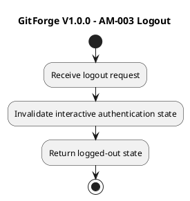

# GitForge V1.0.0 Analysis Activity Models

## 1. Document Information

| Field | Value |

|---|---|

| Project | GitForge - Web Git Hosting Platform |

| Target release | V1.0.0 |

| Document | Analysis Activity Models |

| SDLC phase | System Analysis |

| Milestone | M2 - System Analysis |

| Project owner | Farhad Valizadegan |

| Status | Approved |

| Last updated | 2026-08-17 |

---

## 2. Purpose

This document consolidates the critical activity flows identified during GitForge V1.0.0 System Analysis.

It models:

- user registration;

- interactive authentication;

- repository creation;

- repository viewing;

- repository visibility changes;

- repository browsing;

- Personal Access Token creation;

- PAT authentication;

- PAT revocation;

- Git Smart HTTP read;

- Git Smart HTTP write;

- repository authorization;

- repository storage resolution;

- controlled Git process execution;

- failure handling;

- trust-boundary decisions;

- negative and exceptional paths.

The purpose is to verify decision flow, branching, termination conditions, failure handling, and protected-operation ordering before System Design begins.

---

## 3. Analysis Objective

This document answers:

> What activities and decision points govern the critical GitForge V1.0.0 workflows, and where must execution stop, continue, allow, deny, reject, or fail?

These are analysis-level activity models.

They do not prescribe:

```text

Concrete controllers

Concrete services

Laravel middleware

HTTP route structure

Database schema

Framework exceptions

Exact HTTP status codes

Exact Git command syntax

Concrete process libraries

Deployment topology

```

Those belong primarily to System Design.

---

## 4. Activity Modeling Principles

The activity models follow these principles:

```text

Requirements remain authoritative

External input starts untrusted

Validation precedes protected execution

Authentication precedes protected identity use

Authorization precedes protected access

Logical repository resolution precedes physical resolution

Physical paths are internally derived

Git execution is restricted to approved operations

Failures terminate invalid continuation

Uncertain security state fails closed

No failed operation becomes false success

```

---

## 5. Common Outcome States

Critical activities terminate in one of:

```text

Succeeded

Allowed

Denied

Rejected

Failed

```

These outcomes have distinct meanings.

---

## 6. Outcome Meaning

| Outcome | Meaning |

|---|---|

| Succeeded | Requested operation completed successfully |

| Allowed | Policy permits downstream protected processing |

| Denied | Policy or authentication prevents access |

| Rejected | Request/input is invalid |

| Failed | Valid/authorized operation could not complete |

---

## 7. Activity Model AM-001 — User Registration

```plantuml

@startuml

title GitForge V1.0.0 - AM-001 User Registration

start

:Receive registration request;

:Validate registration input;

if (Input valid?) then (yes)

&#x20;   :Check required registration conditions;

&#x20;   if (Conditions satisfied?) then (yes)

&#x20;       :Persist User metadata;

&#x20;       if (Persistence succeeds?) then (yes)

&#x20;           :Return registration success;

&#x20;       else (no)

&#x20;           :Classify persistence failure;

&#x20;           :Return safe failure;

&#x20;       endif

&#x20;   else (no)

&#x20;       :Reject registration request;

&#x20;   endif

else (no)

&#x20;   :Reject invalid input;

endif

stop

@enduml

```

---

## 8. AM-001 Rules

```text

Invalid registration input does not reach persistence

Persistence failure does not create false success

No User identity is fabricated after failure

```

---

## 9. Activity Model AM-002 — Interactive Login

```plantuml

@startuml

title GitForge V1.0.0 - AM-002 Interactive Login

start

:Receive login request;

:Validate credential input;

if (Credential input valid?) then (yes)

&#x20;   :Resolve User;

&#x20;   :Verify credential;

&#x20;   if (Credential valid?) then (yes)

&#x20;       :Establish authenticated User identity;

&#x20;       :Return authenticated context;

&#x20;   else (no)

&#x20;       :Remain unauthenticated;

&#x20;       :Return safe authentication denial;

&#x20;   endif

else (no)

&#x20;   :Remain unauthenticated;

&#x20;   :Reject invalid authentication request;

endif

stop

@enduml

```

---

## 10. Activity Model AM-003 — Logout



---

## 11. Activity Model AM-004 — Repository Creation

```plantuml

@startuml

title GitForge V1.0.0 - AM-004 Repository Creation

start

:Receive repository creation request;

if (User authenticated?) then (yes)

&#x20;   :Validate repository name;

&#x20;   :Validate visibility;

&#x20;   if (Input valid?) then (yes)

&#x20;       :Check owner namespace uniqueness;

&#x20;       if (Namespace available?) then (yes)

&#x20;           :Derive safe physical repository target;

&#x20;           if (Target safely contained?) then (yes)

&#x20;               :Initialize physical Git repository;

&#x20;               if (Initialization succeeds?) then (yes)

&#x20;                   :Persist repository metadata;

&#x20;                   if (Persistence succeeds?) then (yes)

&#x20;                       :Repository becomes Available;

&#x20;                       :Return success;

&#x20;                   else (no)

&#x20;                       :Detect partial creation / consistency failure;

&#x20;                       :Return failure;

&#x20;                   endif

&#x20;               else (no)

&#x20;                   :Return storage/Git initialization failure;

&#x20;               endif

&#x20;           else (no)

&#x20;               :Reject unsafe physical target;

&#x20;           endif

&#x20;       else (no)

&#x20;           :Reject duplicate repository namespace;

&#x20;       endif

&#x20;   else (no)

&#x20;       :Reject invalid creation input;

&#x20;   endif

else (no)

&#x20;   :Deny repository creation;

endif

stop

@enduml

```

---

## 12. Repository Creation Analysis

Critical decisions:

```text

Authenticated?

Input valid?

Namespace unique?

Physical target safe?

Git initialization successful?

Metadata persistence successful?

```

No downstream activity may skip these decisions.

---

## 13. Activity Model AM-005 — List Owned Repositories

```plantuml

@startuml

title GitForge V1.0.0 - AM-005 List Owned Repositories

start

:Receive list-owned-repositories request;

if (User authenticated?) then (yes)

&#x20;   :Resolve authenticated User identity;

&#x20;   :Query repositories owned by User;

&#x20;   if (Persistence operation succeeds?) then (yes)

&#x20;       :Return repository metadata list;

&#x20;   else (no)

&#x20;       :Return safe persistence failure;

&#x20;   endif

else (no)

&#x20;   :Deny request;

endif

stop

@enduml

```

---

## 14. Activity Model AM-006 — Repository Read Authorization

```plantuml

@startuml

title GitForge V1.0.0 - AM-006 Repository Read Authorization

start

:Receive repository read context;

:Resolve repository metadata;

if (Repository exists?) then (yes)

&#x20;   if (Visibility is Public?) then (yes)

&#x20;       :Allow read;

&#x20;   else (no)

&#x20;       if (Caller authenticated?) then (yes)

&#x20;           if (Caller is repository owner?) then (yes)

&#x20;               :Allow read;

&#x20;           else (no)

&#x20;               :Deny read;

&#x20;           endif

&#x20;       else (no)

&#x20;           :Deny read;

&#x20;       endif

&#x20;   endif

else (no)

&#x20;   :Return repository-resolution failure;

endif

stop

@enduml

```

---

## 15. Read Authorization Decision Table

| Visibility | Caller | Ownership | Result |

|---|---|---|---|

| Public | Anonymous | N/A | Allow |

| Public | Authenticated | Non-owner | Allow |

| Public | Authenticated | Owner | Allow |

| Private | Anonymous | N/A | Deny |

| Private | Authenticated | Non-owner | Deny |

| Private | Authenticated | Owner | Allow |

---

## 16. Activity Model AM-007 — Repository Write Authorization

```plantuml

@startuml

title GitForge V1.0.0 - AM-007 Repository Write Authorization

start

:Receive repository write context;

if (Caller authenticated?) then (yes)

&#x20;   :Resolve repository metadata;

&#x20;   if (Repository exists?) then (yes)

&#x20;       if (Caller is repository owner?) then (yes)

&#x20;           :Allow write;

&#x20;       else (no)

&#x20;           :Deny write;

&#x20;       endif

&#x20;   else (no)

&#x20;       :Return repository-resolution failure;

&#x20;   endif

else (no)

&#x20;   :Deny write;

endif

stop

@enduml

```

---

## 17. Write Authorization Rule

Repository visibility does not expand write permission.

```text

Public Repository

≠

Public Write

```

Only repository owner write is allowed.

---

## 18. Activity Model AM-008 — View Repository

```plantuml

@startuml

title GitForge V1.0.0 - AM-008 View Repository

start

:Receive repository view request;

:Resolve logical repository;

if (Repository resolved?) then (yes)

&#x20;   :Evaluate read authorization;

&#x20;   if (Read allowed?) then (yes)

&#x20;       :Resolve safe physical repository target;

&#x20;       if (Physical repository available?) then (yes)

&#x20;           :Read Git-native repository state;

&#x20;           if (Git read succeeds?) then (yes)

&#x20;               if (Repository has history?) then (yes)

&#x20;                   :Build repository representation;

&#x20;               else (no)

&#x20;                   :Build valid empty-repository representation;

&#x20;               endif

&#x20;               :Return safe repository view;

&#x20;           else (no)

&#x20;               :Return Git-read failure;

&#x20;           endif

&#x20;       else (no)

&#x20;           :Return storage/consistency failure;

&#x20;       endif

&#x20;   else (no)

&#x20;       :Deny repository view;

&#x20;   endif

else (no)

&#x20;   :Return safe repository-resolution result;

endif

stop

@enduml

```

---

## 19. Activity Model AM-009 — Change Repository Visibility

```plantuml

@startuml

title GitForge V1.0.0 - AM-009 Change Repository Visibility

start

:Receive visibility-change request;

if (User authenticated?) then (yes)

&#x20;   :Resolve repository;

&#x20;   if (Repository exists?) then (yes)

&#x20;       :Authorize repository metadata change;

&#x20;       if (User is owner?) then (yes)

&#x20;           :Validate requested visibility;

&#x20;           if (Visibility valid?) then (yes)

&#x20;               :Persist new visibility;

&#x20;               if (Persistence succeeds?) then (yes)

&#x20;                   :Return success;

&#x20;               else (no)

&#x20;                   :Return persistence failure;

&#x20;               endif

&#x20;           else (no)

&#x20;               :Reject invalid visibility;

&#x20;           endif

&#x20;       else (no)

&#x20;           :Deny update;

&#x20;       endif

&#x20;   else (no)

&#x20;       :Return repository-resolution failure;

&#x20;   endif

else (no)

&#x20;   :Deny update;

endif

stop

@enduml

```

---

## 20. Activity Model AM-010 — Repository Branch Listing

```plantuml

@startuml

title GitForge V1.0.0 - AM-010 Branch Listing

start

:Receive branch-list request;

:Resolve repository;

if (Repository resolved?) then (yes)

&#x20;   :Authorize read;

&#x20;   if (Allowed?) then (yes)

&#x20;       :Resolve safe physical repository;

&#x20;       if (Storage available?) then (yes)

&#x20;           :Execute approved Git branch/ref read;

&#x20;           if (Git read succeeds?) then (yes)

&#x20;               :Return safe branch list;

&#x20;           else (no)

&#x20;               :Return Git-read failure;

&#x20;           endif

&#x20;       else (no)

&#x20;           :Return storage failure;

&#x20;       endif

&#x20;   else (no)

&#x20;       :Deny read;

&#x20;   endif

else (no)

&#x20;   :Return repository-resolution failure;

endif

stop

@enduml

```

---

## 21. Activity Model AM-011 — Commit History

```plantuml

@startuml

title GitForge V1.0.0 - AM-011 Commit History

start

:Receive repository + ref;

:Resolve repository;

:Authorize read;

if (Read allowed?) then (yes)

&#x20;   :Resolve safe physical repository;

&#x20;   if (Storage available?) then (yes)

&#x20;       :Validate/resolve ref;

&#x20;       if (Ref resolves?) then (yes)

&#x20;           :Read commit history;

&#x20;           if (Git operation succeeds?) then (yes)

&#x20;               :Return safe history representation;

&#x20;           else (no)

&#x20;               :Return Git-read failure;

&#x20;           endif

&#x20;       else (no)

&#x20;           :Return ref-resolution failure;

&#x20;       endif

&#x20;   else (no)

&#x20;       :Return storage failure;

&#x20;   endif

else (no)

&#x20;   :Deny read;

endif

stop

@enduml

```

---

## 22. Activity Model AM-012 — Commit Details

```plantuml

@startuml

title GitForge V1.0.0 - AM-012 Commit Details

start

:Receive repository + commit identifier;

:Resolve repository;

:Authorize read;

if (Allowed?) then (yes)

&#x20;   :Resolve safe physical repository;

&#x20;   :Resolve commit identifier;

&#x20;   if (Commit exists?) then (yes)

&#x20;       :Read commit data;

&#x20;       if (Git read succeeds?) then (yes)

&#x20;           :Return safe commit representation;

&#x20;       else (no)

&#x20;           :Return Git-read failure;

&#x20;       endif

&#x20;   else (no)

&#x20;       :Return commit-not-found result;

&#x20;   endif

else (no)

&#x20;   :Deny read;

endif

stop

@enduml

```

---

## 23. Activity Model AM-013 — Tree Browsing

```plantuml

@startuml

title GitForge V1.0.0 - AM-013 Tree Browsing

start

:Receive repository + revision + path;

:Resolve repository;

:Authorize read;

if (Allowed?) then (yes)

&#x20;   :Resolve safe physical repository;

&#x20;   :Validate revision/path;

&#x20;   if (Input valid?) then (yes)

&#x20;       :Resolve Git tree;

&#x20;       if (Tree exists?) then (yes)

&#x20;           :Read tree entries;

&#x20;           :Return safe tree representation;

&#x20;       else (no)

&#x20;           :Return tree/path-not-found result;

&#x20;       endif

&#x20;   else (no)

&#x20;       :Reject invalid revision/path;

&#x20;   endif

else (no)

&#x20;   :Deny read;

endif

stop

@enduml

```

---

## 24. Activity Model AM-014 — File Viewing

```plantuml

@startuml

title GitForge V1.0.0 - AM-014 File Viewing

start

:Receive repository + revision + file path;

:Resolve repository;

:Authorize read;

if (Allowed?) then (yes)

&#x20;   :Resolve safe physical repository;

&#x20;   :Validate revision/path;

&#x20;   if (Input valid?) then (yes)

&#x20;       :Resolve Git blob;

&#x20;       if (Blob exists?) then (yes)

&#x20;           :Read blob content;

&#x20;           :Treat repository content as untrusted;

&#x20;           :Prepare safe representation;

&#x20;           :Return file view;

&#x20;       else (no)

&#x20;           :Return file-not-found result;

&#x20;       endif

&#x20;   else (no)

&#x20;       :Reject invalid revision/path;

&#x20;   endif

else (no)

&#x20;   :Deny read;

endif

stop

@enduml

```

---

## 25. Activity Model AM-015 — PAT Creation

```plantuml

@startuml

title GitForge V1.0.0 - AM-015 PAT Creation

start

:Receive PAT creation request;

if (User authenticated?) then (yes)

&#x20;   :Generate plaintext PAT;

&#x20;   if (Generation succeeds?) then (yes)

&#x20;       :Derive verification representation;

&#x20;       :Associate PAT with authenticated User;

&#x20;       :Persist PAT metadata/verifier;

&#x20;       if (Persistence succeeds?) then (yes)

&#x20;           :Present plaintext PAT once;

&#x20;           :Return creation success;

&#x20;       else (no)

&#x20;           :Do not report PAT success;

&#x20;           :Return persistence failure;

&#x20;       endif

&#x20;   else (no)

&#x20;       :Return PAT-generation failure;

&#x20;   endif

else (no)

&#x20;   :Deny PAT creation;

endif

stop

@enduml

```

---

## 26. PAT Creation Invariant

```text

Plaintext generated

&#x20;     ↓

Verification representation persisted

&#x20;     ↓

Plaintext presented once

```

Plaintext PAT is not recoverably persisted.

---

## 27. Activity Model AM-016 — PAT Authentication

```plantuml

@startuml

title GitForge V1.0.0 - AM-016 PAT Authentication

start

:Receive presented PAT;

:Validate credential shape;

if (Credential usable?) then (yes)

&#x20;   :Resolve PAT candidate;

&#x20;   if (Candidate exists?) then (yes)

&#x20;       :Verify credential;

&#x20;       if (Verification succeeds?) then (yes)

&#x20;           :Check revocation state;

&#x20;           if (PAT active?) then (yes)

&#x20;               :Resolve PAT owner;

&#x20;               if (Owner resolves?) then (yes)

&#x20;                   :Establish authenticated User identity;

&#x20;                   :Return authentication success;

&#x20;               else (no)

&#x20;                   :Classify PAT consistency failure;

&#x20;                   :Deny authentication;

&#x20;               endif

&#x20;           else (no)

&#x20;               :Deny revoked PAT;

&#x20;           endif

&#x20;       else (no)

&#x20;           :Deny invalid PAT;

&#x20;       endif

&#x20;   else (no)

&#x20;       :Deny unknown PAT;

&#x20;   endif

else (no)

&#x20;   :Deny malformed/missing PAT;

endif

stop

@enduml

```

---

## 28. Activity Model AM-017 — PAT Revocation

```plantuml

@startuml

title GitForge V1.0.0 - AM-017 PAT Revocation

start

:Receive PAT revocation request;

if (User authenticated?) then (yes)

&#x20;   :Resolve PAT metadata;

&#x20;   if (PAT exists?) then (yes)

&#x20;       if (User owns PAT?) then (yes)

&#x20;           :Persist revoked state;

&#x20;           if (Persistence succeeds?) then (yes)

&#x20;               :PAT becomes Revoked;

&#x20;               :Return success;

&#x20;           else (no)

&#x20;               :Do not report revocation success;

&#x20;               :Return persistence failure;

&#x20;           endif

&#x20;       else (no)

&#x20;           :Deny revocation;

&#x20;       endif

&#x20;   else (no)

&#x20;       :Return safe PAT-not-found result;

&#x20;   endif

else (no)

&#x20;   :Deny revocation;

endif

stop

@enduml

```

---

## 29. Activity Model AM-018 — Public Git Smart HTTP Read

```plantuml

@startuml

title GitForge V1.0.0 - AM-018 Public Git Smart HTTP Read

start

:Receive Git read request;

:Resolve logical repository;

if (Repository exists?) then (yes)

&#x20;   if (Repository Public?) then (yes)

&#x20;       :Authorize anonymous read;

&#x20;       :Resolve safe physical repository target;

&#x20;       if (Storage available?) then (yes)

&#x20;           :Select approved git-upload-pack operation;

&#x20;           :Execute Git read service;

&#x20;           if (Git operation succeeds?) then (yes)

&#x20;               :Stream Git Smart HTTP response;

&#x20;           else (no)

&#x20;               :Return safe Git-read failure;

&#x20;           endif

&#x20;       else (no)

&#x20;           :Return storage failure;

&#x20;       endif

&#x20;   else (no)

&#x20;       :Require authentication path;

&#x20;   endif

else (no)

&#x20;   :Return safe repository-resolution result;

endif

stop

@enduml

```

---

## 30. Activity Model AM-019 — Private Git Smart HTTP Read

```plantuml

@startuml

title GitForge V1.0.0 - AM-019 Private Git Smart HTTP Read

start

:Receive Git read request + PAT;

:Authenticate PAT;

if (Authentication succeeds?) then (yes)

&#x20;   :Resolve repository;

&#x20;   if (Repository exists?) then (yes)

&#x20;       :Authorize read;

&#x20;       if (Authenticated User is owner?) then (yes)

&#x20;           :Resolve safe physical repository;

&#x20;           if (Storage available?) then (yes)

&#x20;               :Execute approved git-upload-pack operation;

&#x20;               if (Git read succeeds?) then (yes)

&#x20;                   :Stream Git response;

&#x20;               else (no)

&#x20;                   :Return Git-read failure;

&#x20;               endif

&#x20;           else (no)

&#x20;               :Return storage failure;

&#x20;           endif

&#x20;       else (no)

&#x20;           :Deny read;

&#x20;       endif

&#x20;   else (no)

&#x20;       :Return repository-resolution failure;

&#x20;   endif

else (no)

&#x20;   :Deny authentication;

endif

stop

@enduml

```

---

## 31. Activity Model AM-020 — Git Clone / Fetch

```plantuml

@startuml

title GitForge V1.0.0 - AM-020 Clone / Fetch

start

:Receive clone/fetch interaction;

:Resolve repository;

if (Repository Public?) then (yes)

&#x20;   :Allow read;

else (no)

&#x20;   :Authenticate PAT;

&#x20;   if (Authentication succeeds?) then (yes)

&#x20;       :Authorize private owner read;

&#x20;       if (Authorized?) then (yes)

&#x20;       else (no)

&#x20;           :Deny;

&#x20;           stop

&#x20;       endif

&#x20;   else (no)

&#x20;       :Deny;

&#x20;       stop

&#x20;   endif

endif

:Resolve safe physical repository;

if (Storage available?) then (yes)

&#x20;   :Execute approved git-upload-pack;

&#x20;   if (Git operation succeeds?) then (yes)

&#x20;       :Return/stream Git read data;

&#x20;   else (no)

&#x20;       :Return Git read failure;

&#x20;   endif

else (no)

&#x20;   :Return storage failure;

endif

stop

@enduml

```

---

## 32. Activity Model AM-021 — Git Write-Service Discovery

```plantuml

@startuml

title GitForge V1.0.0 - AM-021 Git Write-Service Discovery

start

:Receive git-receive-pack discovery request;

:Authenticate PAT;

if (Authentication succeeds?) then (yes)

&#x20;   :Resolve repository;

&#x20;   if (Repository exists?) then (yes)

&#x20;       :Authorize owner write;

&#x20;       if (Authorized?) then (yes)

&#x20;           :Resolve safe physical repository;

&#x20;           if (Storage available?) then (yes)

&#x20;               :Execute approved write-service discovery;

&#x20;               if (Discovery succeeds?) then (yes)

&#x20;                   :Return Git service advertisement;

&#x20;               else (no)

&#x20;                   :Return Git discovery failure;

&#x20;               endif

&#x20;           else (no)

&#x20;               :Return storage failure;

&#x20;           endif

&#x20;       else (no)

&#x20;           :Deny write service;

&#x20;       endif

&#x20;   else (no)

&#x20;       :Return repository-resolution failure;

&#x20;   endif

else (no)

&#x20;   :Deny authentication;

endif

stop

@enduml

```

---

## 33. Activity Model AM-022 — Git Push

```plantuml

@startuml

title GitForge V1.0.0 - AM-022 Git Push

start

:Receive push request + PAT;

:Authenticate PAT;

if (Authentication succeeds?) then (yes)

&#x20;   :Resolve repository;

&#x20;   if (Repository exists?) then (yes)

&#x20;       :Authorize owner write;

&#x20;       if (Authorized?) then (yes)

&#x20;           :Resolve safe physical repository;

&#x20;           if (Storage available and writable?) then (yes)

&#x20;               :Select approved git-receive-pack operation;

&#x20;               :Execute Git write;

&#x20;               if (Git write succeeds?) then (yes)

&#x20;                   :Return push success;

&#x20;               else (no)

&#x20;                   :Classify Git/ref/protocol failure;

&#x20;                   :Return push failure;

&#x20;               endif

&#x20;           else (no)

&#x20;               :Return storage failure;

&#x20;           endif

&#x20;       else (no)

&#x20;           :Deny push;

&#x20;       endif

&#x20;   else (no)

&#x20;       :Return repository-resolution failure;

&#x20;   endif

else (no)

&#x20;   :Deny push authentication;

endif

stop

@enduml

```

---

## 34. Activity Model AM-023 — First Push to Empty Repository

```plantuml

@startuml

title GitForge V1.0.0 - AM-023 First Push to Empty Repository

start

:Receive authorized owner push;

:Confirm physical repository exists;

if (Repository exists?) then (yes)

&#x20;   :Determine Git history state;

&#x20;   if (Repository Empty?) then (yes)

&#x20;       :Execute git-receive-pack;

&#x20;       :Receive objects and initial refs;

&#x20;       if (Git write succeeds?) then (yes)

&#x20;           :Transition Empty -> Has History;

&#x20;           :Return success;

&#x20;       else (no)

&#x20;           :Remain valid repository state;

&#x20;           :Return Git write failure;

&#x20;       endif

&#x20;   else (no)

&#x20;       :Process as normal subsequent push;

&#x20;   endif

else (no)

&#x20;   :Return storage consistency failure;

endif

stop

@enduml

```

---

## 35. Activity Model AM-024 — Git Push Ref Rejection

```plantuml

@startuml

title GitForge V1.0.0 - AM-024 Git Push Ref Rejection

start

:Authenticate PAT;

:Authorize owner write;

:Resolve safe repository;

:Execute git-receive-pack;

:Attempt Git ref update;

if (Git accepts ref update?) then (yes)

&#x20;   :Return push success;

else (no)

&#x20;   :Classify Git-native ref rejection;

&#x20;   :Return Git write failure;

endif

stop

@enduml

```

---

## 36. Ref Rejection Rule

A ref rejection occurs after:

```text

Authentication Success

Authorization Allow

Storage Resolution Success

```

Therefore it is not:

```text

Authentication Failure

Authorization Failure

```

It is a Git-native write failure.

---

## 37. Activity Model AM-025 — Safe Repository Storage Resolution

```plantuml

@startuml

title GitForge V1.0.0 - AM-025 Safe Repository Storage Resolution

start

:Receive validated logical repository context;

:Derive internal physical target;

:Normalize/resolve target under configured repository root;

if (Target contained within root?) then (yes)

&#x20;   :Check expected repository location;

&#x20;   if (Repository exists?) then (yes)

&#x20;       :Return safe physical repository target;

&#x20;   else (no)

&#x20;       :Return storage/consistency failure;

&#x20;   endif

else (no)

&#x20;   :Classify security-critical path failure;

&#x20;   :Reject physical access;

endif

stop

@enduml

```

---

## 38. Activity Model AM-026 — Repository Storage State

```plantuml

@startuml

title GitForge V1.0.0 - AM-026 Repository Storage State Evaluation

start

:Resolve expected physical repository;

if (Repository exists?) then (yes)

&#x20;   if (Repository usable?) then (yes)

&#x20;       :State = Available;

&#x20;   else (no)

&#x20;       if (Repository corrupt?) then (yes)

&#x20;           :State = Corrupt;

&#x20;       else (no)

&#x20;           :State = Unavailable;

&#x20;       endif

&#x20;   endif

else (no)

&#x20;   :State = Missing;

endif

stop

@enduml

```

---

## 39. Activity Model AM-027 — Metadata/Storage Consistency Evaluation

```plantuml

@startuml

title GitForge V1.0.0 - AM-027 Metadata Storage Consistency

start

:Check application repository metadata;

:Check expected physical repository;

if (Metadata exists?) then (yes)

&#x20;   if (Physical repository exists?) then (yes)

&#x20;       :Repository relationship consistent;

&#x20;   else (no)

&#x20;       :Classify metadata-present/storage-missing inconsistency;

&#x20;       :Stop protected operation;

&#x20;   endif

else (no)

&#x20;   if (Physical repository exists?) then (yes)

&#x20;       :Classify orphaned physical repository;

&#x20;       :Do not expose repository automatically;

&#x20;   else (no)

&#x20;       :Repository does not exist;

&#x20;   endif

endif

stop

@enduml

```

---

## 40. Activity Model AM-028 — Controlled Git Process Execution

```plantuml

@startuml

title GitForge V1.0.0 - AM-028 Controlled Git Process Execution

start

:Receive approved Git operation + safe target;

if (Operation approved?) then (yes)

&#x20;   if (Target safe?) then (yes)

&#x20;       :Prepare controlled execution context;

&#x20;       :Execute approved Git executable/subcommand;

&#x20;       if (Process succeeds?) then (yes)

&#x20;           :Return Git operation result;

&#x20;       else (no)

&#x20;           :Classify process/Git failure;

&#x20;           :Return safe failure;

&#x20;       endif

&#x20;   else (no)

&#x20;       :Reject execution;

&#x20;   endif

else (no)

&#x20;   :Reject unapproved operation;

endif

stop

@enduml

```

---

## 41. Controlled Execution Rule

Invalid activity:

```text

External Input

&#x20;   ↓

Arbitrary Shell Command

```

Required activity:

```text

Validated Internal Operation

&#x20;   +

Safe Repository Target

&#x20;   ↓

Approved Git Execution

```

---

## 42. Activity Model AM-029 — Generic Failure Handling

```plantuml

@startuml

title GitForge V1.0.0 - AM-029 Generic Failure Handling

start

:Receive failure context;

:Classify failure;

if (Security-sensitive?) then (yes)

&#x20;   :Stop protected operation;

&#x20;   :Apply fail-closed outcome;

endif

:Sanitize diagnostic data;

:Record internal diagnostic where possible;

:Prepare safe external response;

if (Operation completed authoritatively?) then (yes)

&#x20;   :Return appropriate completed outcome;

else (no)

&#x20;   :Do not report success;

&#x20;   :Return rejection/denial/failure;

endif

stop

@enduml

```

---

## 43. Activity Model AM-030 — Authentication Failure Handling

```plantuml

@startuml

title GitForge V1.0.0 - AM-030 Authentication Failure

start

:Receive authentication failure;

if (Credential invalid/missing/revoked?) then (yes)

&#x20;   :Establish no User identity;

&#x20;   :Deny protected authentication flow;

else (no)

&#x20;   :Classify consistency/dependency failure;

&#x20;   :Fail closed;

endif

:Return safe authentication outcome;

stop

@enduml

```

---

## 44. Activity Model AM-031 — Authorization Failure Handling

```plantuml

@startuml

title GitForge V1.0.0 - AM-031 Authorization Failure

start

:Receive identity + repository + operation;

:Evaluate authorization;

if (Authorization Allow?) then (yes)

&#x20;   :Continue protected operation;

else (no)

&#x20;   :Stop protected operation;

&#x20;   :Do not resolve protected mutation path;

&#x20;   :Return safe denial;

endif

stop

@enduml

```

---

## 45. Activity Model AM-032 — Private Repository Read by Non-Owner

```plantuml

@startuml

title GitForge V1.0.0 - AM-032 Private Read by Non-Owner

start

:Resolve private repository;

:Resolve authenticated User identity;

if (User is owner?) then (yes)

&#x20;   :Allow read;

&#x20;   :Continue to storage resolution;

else (no)

&#x20;   :Deny read;

&#x20;   :Stop before protected Git content access;

endif

stop

@enduml

```

---

## 46. Activity Model AM-033 — Anonymous Public Repository Read

```plantuml

@startuml

title GitForge V1.0.0 - AM-033 Anonymous Public Read

start

:Receive anonymous repository read;

:Resolve repository metadata;

if (Repository Public?) then (yes)

&#x20;   :Allow read without identity authentication;

&#x20;   :Resolve safe physical repository;

&#x20;   :Execute approved read;

else (no)

&#x20;   :Deny anonymous read;

endif

stop

@enduml

```

---

## 47. Activity Model AM-034 — Non-Owner Write

```plantuml

@startuml

title GitForge V1.0.0 - AM-034 Non-Owner Write

start

:Authenticate PAT;

if (Authentication succeeds?) then (yes)

&#x20;   :Resolve repository;

&#x20;   :Compare authenticated User with repository owner;

&#x20;   if (User is owner?) then (yes)

&#x20;       :Allow write path;

&#x20;   else (no)

&#x20;       :Deny write;

&#x20;       :Stop before git-receive-pack;

&#x20;   endif

else (no)

&#x20;   :Deny;

endif

stop

@enduml

```

---

## 48. Activity Model AM-035 — Invalid Repository Identifier

```plantuml

@startuml

title GitForge V1.0.0 - AM-035 Invalid Repository Identifier

start

:Receive logical repository identifier;

:Validate namespace/name;

if (Identifier valid?) then (yes)

&#x20;   :Resolve authoritative metadata;

else (no)

&#x20;   :Reject identifier;

&#x20;   :Do not derive physical filesystem path;

endif

stop

@enduml

```

---

## 49. Activity Model AM-036 — Storage-Root Escape Prevention

```plantuml

@startuml

title GitForge V1.0.0 - AM-036 Storage Root Escape Prevention

start

:Derive physical repository target;

:Verify target containment;

if (Contained inside configured repository root?) then (yes)

&#x20;   :Permit storage-resolution continuation;

else (no)

&#x20;   :Reject target;

&#x20;   :Classify security-critical failure;

&#x20;   :Record sanitized diagnostic;

&#x20;   :Stop physical access;

endif

stop

@enduml

```

---

## 50. Activity Model AM-037 — Revoked PAT Use

```plantuml

@startuml

title GitForge V1.0.0 - AM-037 Revoked PAT Use

start

:Receive PAT;

:Resolve PAT record;

:Verify credential;

if (Verification valid?) then (yes)

&#x20;   :Check revocation;

&#x20;   if (PAT revoked?) then (yes)

&#x20;       :Deny authentication;

&#x20;   else (no)

&#x20;       :Resolve owner;

&#x20;       :Establish authenticated User identity;

&#x20;   endif

else (no)

&#x20;   :Deny authentication;

endif

stop

@enduml

```

---

## 51. Activity Model AM-038 — Empty Repository

```plantuml

@startuml

title GitForge V1.0.0 - AM-038 Empty Repository Evaluation

start

:Resolve physical repository;

if (Physical repository exists?) then (yes)

&#x20;   :Inspect refs/history;

&#x20;   if (Any repository history?) then (yes)

&#x20;       :State = Has History;

&#x20;   else (no)

&#x20;       :State = Empty;

&#x20;       :Return valid empty representation;

&#x20;   endif

else (no)

&#x20;   :State = Missing;

&#x20;   :Return storage/consistency failure;

endif

stop

@enduml

```

---

## 52. Empty Versus Missing Rule

```text

Empty

=

Repository exists

\+

No commits/history

```

```text

Missing

=

Expected repository does not exist

```

Empty is valid.

Missing is failure.

---

## 53. Activity Model AM-039 — Repository Browser Object Resolution

```plantuml

@startuml

title GitForge V1.0.0 - AM-039 Repository Object Resolution

start

:Receive authorized repository read;

:Validate revision and path;

if (Input valid?) then (yes)

&#x20;   :Resolve requested Git object;

&#x20;   if (Object resolves?) then (yes)

&#x20;       :Read Git-native data;

&#x20;       :Prepare safe representation;

&#x20;       :Return result;

&#x20;   else (no)

&#x20;       :Return object-not-found result;

&#x20;   endif

else (no)

&#x20;   :Reject invalid revision/path;

endif

stop

@enduml

```

---

## 54. Activity Model AM-040 — Diagnostic Sanitization

```plantuml

@startuml

title GitForge V1.0.0 - AM-040 Diagnostic Sanitization

start

:Receive internal failure context;

:Identify sensitive fields;

if (Contains plaintext credential?) then (yes)

&#x20;   :Remove/suppress credential;

endif

if (Contains unnecessary internal path?) then (yes)

&#x20;   :Minimize path detail;

endif

if (Contains raw external authentication data?) then (yes)

&#x20;   :Suppress sensitive authentication data;

endif

:Record safe diagnostic;

:Return sanitized failure response;

stop

@enduml

```

---

## 55. Sensitive Diagnostic Exclusions

Ordinary diagnostics must not intentionally include:

```text

Plaintext PAT

Plaintext password

Database password

Application secret

Raw Authorization header

Unnecessary session secret

Unnecessary absolute filesystem path

```

---

## 56. Activity Model AM-041 — Fail-Closed Decision

```plantuml

@startuml

title GitForge V1.0.0 - AM-041 Fail-Closed Decision

start

:Evaluate protected-operation prerequisite;

if (Identity certain?) then (yes)

else (no)

&#x20;   :Deny/fail;

&#x20;   stop

endif

if (Authorization certain?) then (yes)

else (no)

&#x20;   :Deny;

&#x20;   stop

endif

if (Repository mapping certain?) then (yes)

else (no)

&#x20;   :Fail;

&#x20;   stop

endif

if (Physical target safe?) then (yes)

&#x20;   :Continue protected operation;

else (no)

&#x20;   :Reject/fail;

endif

stop

@enduml

```

---

## 57. Activity Model AM-042 — No False Success

```plantuml

@startuml

title GitForge V1.0.0 - AM-042 No False Success

start

:Execute requested state-changing operation;

if (Required authoritative change completed?) then (yes)

&#x20;   if (Required dependent execution completed?) then (yes)

&#x20;       :Return success;

&#x20;   else (no)

&#x20;       :Return failure;

&#x20;   endif

else (no)

&#x20;   :Return failure;

endif

stop

@enduml

```

---

## 58. No-False-Success Applications

This principle applies to:

```text

Repository creation

Repository visibility update

PAT creation

PAT revocation

Git push

```

---

## 59. Activity Model AM-043 — Public to Private Transition

```plantuml

@startuml

title GitForge V1.0.0 - AM-043 Public to Private Transition

start

:Owner requests Public -> Private;

:Authorize owner metadata change;

:Persist Private visibility;

if (Persistence succeeds?) then (yes)

&#x20;   :Future anonymous reads evaluate Private;

&#x20;   :Anonymous read result = Deny;

else (no)

&#x20;   :Visibility remains authoritative previous state;

&#x20;   :Return update failure;

endif

stop

@enduml

```

---

## 60. Activity Model AM-044 — Private to Public Transition

```plantuml

@startuml

title GitForge V1.0.0 - AM-044 Private to Public Transition

start

:Owner requests Private -> Public;

:Authorize owner metadata change;

:Persist Public visibility;

if (Persistence succeeds?) then (yes)

&#x20;   :Future anonymous reads evaluate Public;

&#x20;   :Anonymous read result = Allow;

else (no)

&#x20;   :Return update failure;

endif

stop

@enduml

```

---

## 61. Activity Model AM-045 — Concurrent Repository Creation

```plantuml

@startuml

title GitForge V1.0.0 - AM-045 Concurrent Repository Creation

start

:Request creation of <owner>/<repository>;

:Check namespace availability;

if (Namespace available?) then (yes)

&#x20;   :Attempt authoritative repository creation;

&#x20;   if (Uniqueness still holds at persistence?) then (yes)

&#x20;       :Complete valid creation;

&#x20;   else (no)

&#x20;       :Reject concurrent namespace conflict;

&#x20;   endif

else (no)

&#x20;   :Reject duplicate namespace;

endif

stop

@enduml

```

---

## 62. Activity Model AM-046 — Concurrent Push

```plantuml

@startuml

title GitForge V1.0.0 - AM-046 Concurrent Push

start

:Two authorized pushes target same repository;

:Git processes ref updates according to Git-native rules;

if (First update succeeds?) then (yes)

&#x20;   :Repository refs change;

endif

:Second push evaluates current Git refs;

if (Second update accepted?) then (yes)

&#x20;   :Apply second update;

&#x20;   :Return success;

else (no)

&#x20;   :Return Git-native ref rejection;

endif

stop

@enduml

```

---

## 63. Activity Model AM-047 — Database Failure

```plantuml

@startuml

title GitForge V1.0.0 - AM-047 Database Failure

start

:Attempt authoritative metadata operation;

if (Database operation succeeds?) then (yes)

&#x20;   :Continue normal flow;

else (no)

&#x20;   :Classify persistence/dependency failure;

&#x20;   :Prevent false success;

&#x20;   :Return safe failure;

endif

stop

@enduml

```

---

## 64. Activity Model AM-048 — Git Process Failure

```plantuml

@startuml

title GitForge V1.0.0 - AM-048 Git Process Failure

start

:Execute approved Git operation;

if (Process starts?) then (yes)

&#x20;   if (Operation completes successfully?) then (yes)

&#x20;       :Return Git result;

&#x20;   else (no)

&#x20;       :Classify Git/process failure;

&#x20;       :Return safe failure;

&#x20;   endif

else (no)

&#x20;   :Classify process-launch/dependency failure;

&#x20;   :Return safe failure;

endif

stop

@enduml

```

---

## 65. Activity Model AM-049 — Unexpected Internal Failure

```plantuml

@startuml

title GitForge V1.0.0 - AM-049 Unexpected Internal Failure

start

:Unexpected internal exception occurs;

:Stop unsafe continuation;

:Classify internal failure;

:Sanitize diagnostic data;

:Record diagnostic where possible;

:Return safe external failure;

:Do not expose raw internal detail;

:Do not report success;

stop

@enduml

```

---

## 66. Activity Model AM-050 — End-to-End Protected Git Write

```plantuml

@startuml

title GitForge V1.0.0 - AM-050 End-to-End Protected Git Write

start

:Receive Git write request + PAT;

:Validate request;

if (Request valid?) then (yes)

&#x20;   :Authenticate PAT;

&#x20;   if (Authentication succeeds?) then (yes)

&#x20;       :Resolve repository;

&#x20;       if (Repository exists?) then (yes)

&#x20;           :Authorize owner write;

&#x20;           if (Authorization allows?) then (yes)

&#x20;               :Resolve safe physical target;

&#x20;               if (Target safe and available?) then (yes)

&#x20;                   :Execute approved git-receive-pack;

&#x20;                   if (Git operation succeeds?) then (yes)

&#x20;                       :Return success;

&#x20;                   else (no)

&#x20;                       :Return Git write failure;

&#x20;                   endif

&#x20;               else (no)

&#x20;                   :Return storage/security failure;

&#x20;               endif

&#x20;           else (no)

&#x20;               :Deny;

&#x20;           endif

&#x20;       else (no)

&#x20;           :Return repository-resolution failure;

&#x20;       endif

&#x20;   else (no)

&#x20;       :Deny authentication;

&#x20;   endif

else (no)

&#x20;   :Reject request;

endif

stop

@enduml

```

---

## 67. Critical Activity Ordering

The primary protected workflow order is:

```text

Validate

&#x20;  ↓

Authenticate if required

&#x20;  ↓

Resolve logical repository

&#x20;  ↓

Authorize

&#x20;  ↓

Resolve safe physical repository

&#x20;  ↓

Execute approved Git/application operation

&#x20;  ↓

Handle result

```

---

## 68. Invalid Activity Ordering

The following are invalid:

```text

Physical repository access before authorization

Git write before owner authorization

Filesystem path derivation directly from raw external input

PAT validity assumed before verification

Repository content trusted before safe representation

Git failure followed by success result

Persistence failure followed by successful state-change result

```

---

## 69. Activity Invariants

### AAI-001 — Validate Before Protected Processing

Invalid external input does not enter protected execution.

### AAI-002 — Authentication Before Protected Identity Use

Credentials must be verified before identity is trusted.

### AAI-003 — Authorization Before Protected Access

Private reads and all writes require authorization before protected repository access.

### AAI-004 — Owner Authorization Before Git Write

`git-receive-pack` cannot begin for anonymous or non-owner callers.

### AAI-005 — Logical Resolution Before Physical Resolution

External repository identity does not directly become a filesystem target.

### AAI-006 — Safe Physical Target Before Git Execution

Git execution requires an internally resolved safe repository target.

### AAI-007 — Public Read Does Not Bypass Storage Safety

Anonymous public reads still require controlled repository resolution.

### AAI-008 — PAT Authentication Does Not Imply Write Permission

PAT identity still passes repository authorization.

### AAI-009 — Revoked PAT Cannot Establish Identity

Revocation terminates future authentication.

### AAI-010 — Empty Repository Is Valid

Empty repository state does not become storage failure.

### AAI-011 — Missing Repository Is Failure

Expected metadata with absent physical storage is inconsistent.

### AAI-012 — Git-Native Rejection Is Preserved

Ref rejection remains a Git write failure.

### AAI-013 — Failure Stops Invalid Continuation

Critical failure paths terminate downstream protected activity.

### AAI-014 — Fail Closed

Uncertain identity, authorization, mapping, or storage safety does not become Allow.

### AAI-015 — No False Success

Incomplete authoritative state change or Git execution does not produce success.

---

## 70. Activity Coverage Matrix

| Activity Model | Primary Use Cases |

|---|---|

| AM-001 | UC-001 |

| AM-002 | UC-002 |

| AM-003 | UC-003 |

| AM-004 | UC-004 |

| AM-005 | UC-005 |

| AM-006 | UC-006, UC-023 |

| AM-007 | UC-024 |

| AM-008 | UC-006, UC-009 |

| AM-009 | UC-007 |

| AM-010 | UC-010 |

| AM-011 | UC-011 |

| AM-012 | UC-012 |

| AM-013 | UC-013 |

| AM-014 | UC-014 |

| AM-015 | UC-020 |

| AM-016 | UC-021 |

| AM-017 | UC-022 |

| AM-018/019 | UC-015, UC-023 |

| AM-020 | UC-016, UC-017 |

| AM-021 | UC-018, UC-024 |

| AM-022–024 | UC-019, UC-024, UC-025 |

| AM-025–027 | UC-004, UC-006, UC-009–UC-019, UC-025 |

| AM-028 | UC-015–UC-019 |

| AM-029–031 | UC-025 |

| AM-032–034 | UC-023, UC-024 |

| AM-040–042 | UC-025 |

| AM-050 | UC-019, UC-021, UC-024, UC-025 |

---

## 71. Authentication Activity Findings

### AAF-001

Interactive authentication and PAT authentication are separate flows that both establish User identity.

Status:

```text

Confirmed

```

### AAF-002

PAT revocation is evaluated before identity is trusted.

Status:

```text

Confirmed

```

---

## 72. Authorization Activity Findings

### AAF-003

Read and write authorization have different decision rules.

Status:

```text

Confirmed

```

### AAF-004

Repository visibility affects read authorization but not write authorization.

Status:

```text

Confirmed

```

### AAF-005

Authorization denial stops protected downstream activity.

Status:

```text

Confirmed

```

---

## 73. Repository Activity Findings

### AAF-006

Repository creation requires coordination between application metadata and Git storage.

Status:

```text

Confirmed

```

### AAF-007

Empty repository is a valid repository state.

Status:

```text

Confirmed

```

### AAF-008

Metadata/storage disagreement is a consistency failure.

Status:

```text

Confirmed

```

---

## 74. Git Activity Findings

### AAF-009

Public Git reads may proceed anonymously after visibility authorization.

Status:

```text

Confirmed

```

### AAF-010

Private Git reads require authentication plus owner authorization.

Status:

```text

Confirmed

```

### AAF-011

All Git writes require PAT authentication plus owner authorization.

Status:

```text

Confirmed

```

### AAF-012

Git-native ref rejection remains a Git-native failure.

Status:

```text

Confirmed

```

---

## 75. Storage Activity Findings

### AAF-013

Safe physical repository resolution is a mandatory gateway before Git execution.

Status:

```text

Confirmed

```

### AAF-014

Storage-root escape terminates the operation as a security-critical failure.

Status:

```text

Confirmed

```

---

## 76. Failure Activity Findings

### AAF-015

Failure classification precedes safe response generation.

Status:

```text

Confirmed

```

### AAF-016

Unexpected failures do not produce false success.

Status:

```text

Confirmed

```

### AAF-017

Security uncertainty results in fail-closed termination.

Status:

```text

Confirmed

```

---

## 77. Relationship to Sequence Models

This document complements:

```text

17-analysis-sequence-models.md

```

The sequence models emphasize:

```text

Temporal interaction among participants

```

The activity models emphasize:

```text

Decision flow

Branching

Activity progression

Termination

Success/failure paths

```

---

## 78. Relationship to Traceability

Critical activities and decisions will be mapped to approved requirements in:

```text

19-analysis-traceability.md

```

---

## 79. Relationship to System Analysis Validation

Activity-model completeness and consistency will be reviewed in:

```text

20-system-analysis-validation.md

```

Validation includes:

```text

Authentication decisions

Authorization decisions

Repository-state decisions

Storage-safety decisions

Git process decisions

Failure termination

Negative-path completeness

Requirement alignment

```

---

## 80. Design Decisions Intentionally Deferred

This document does not decide:

```text

Concrete class structure

Controller/service boundaries

Laravel middleware

Route implementation

Exact validation APIs

Database schema

ORM queries

Transaction implementation

HTTP response codes

Git Smart HTTP exact protocol mappings

Process library

Git executable path

Filesystem layout

Concrete error classes

Logging framework

Monitoring implementation

Retry implementation

Concurrency primitives

```

These belong primarily to System Design.

---

## 81. Requirements Alignment

These activity models derive from approved V1.0.0 requirements covering:

```text

Registration

Authentication

Logout

Repository creation

Repository listing

Repository viewing

Visibility change

Repository browsing

Branch listing

Commit history

Commit details

Tree browsing

File viewing

PAT creation

PAT authentication

PAT revocation

Git Smart HTTP read discovery

Clone

Fetch

Git Smart HTTP write discovery

Push

Read authorization

Write authorization

Repository storage

Controlled Git execution

Failure handling

Trust boundaries

Diagnostics

Security

```

Relevant use cases include:

```text

UC-001 through UC-025

```

Detailed requirement-to-analysis mapping will be consolidated in:

```text

19-analysis-traceability.md

```

---

## 82. Completion Criteria

This Analysis Activity Models document is complete when:

- registration flow is modeled;

- interactive authentication flow is modeled;

- logout flow is modeled;

- repository creation flow is modeled;

- owned repository listing flow is modeled;

- read authorization flow is modeled;

- write authorization flow is modeled;

- repository viewing flow is modeled;

- repository visibility update flow is modeled;

- repository branch/history/commit/tree/file flows are modeled;

- PAT creation flow is modeled;

- PAT authentication flow is modeled;

- PAT revocation flow is modeled;

- public and private Git read flows are modeled;

- clone/fetch flow is modeled;

- Git write discovery is modeled;

- push flow is modeled;

- first-push state transition is modeled;

- Git ref rejection is modeled;

- safe repository storage resolution is modeled;

- storage consistency is modeled;

- controlled Git process execution is modeled;

- authentication failure is modeled;

- authorization failure is modeled;

- diagnostic sanitization is modeled;

- fail-closed flow is modeled;

- no-false-success flow is modeled;

- concurrency examples are modeled;

- critical activity invariants are explicit;

- downstream traceability and system-analysis validation can proceed without inventing missing activity decisions.

---

## 83. Analysis Result

Analysis Activity Models result:

```text

SUFFICIENT FOR DOWNSTREAM SYSTEM ANALYSIS

```

No activity-flow contradiction with approved V1.0.0 requirements or previously approved M2 analyses has been identified.

---

## 84. Document Status

This document is currently:

```text

Approved

```

It will be changed to:

```text

Approved

```

after authentication, authorization, repository lifecycle, repository browser, PAT, Git read, Git write, storage, process-execution, trust-boundary, failure, diagnostic, negative-path, invariant, and requirements-alignment activities have been reviewed.

