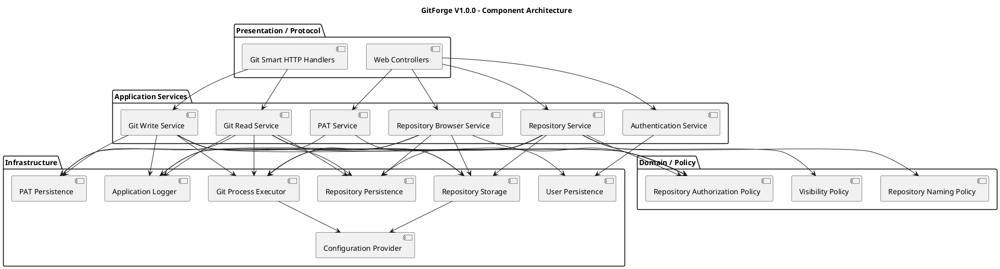
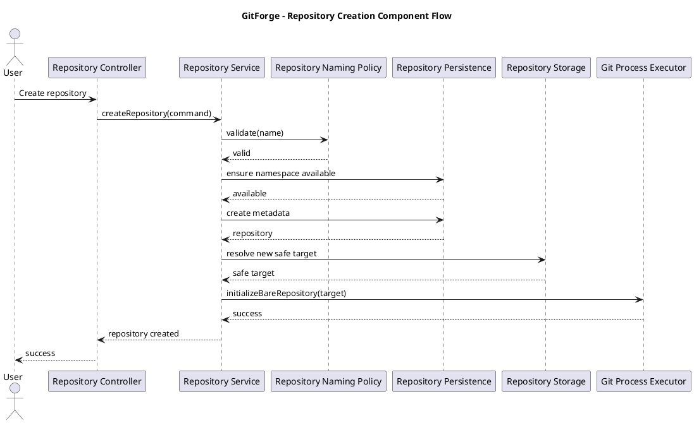
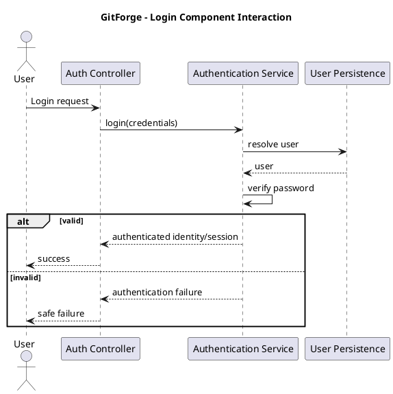
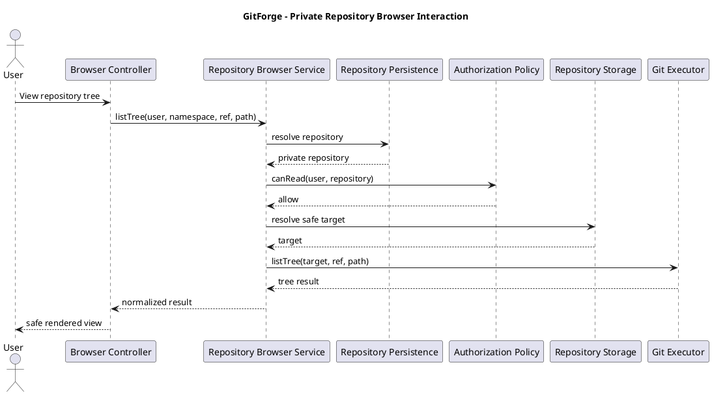
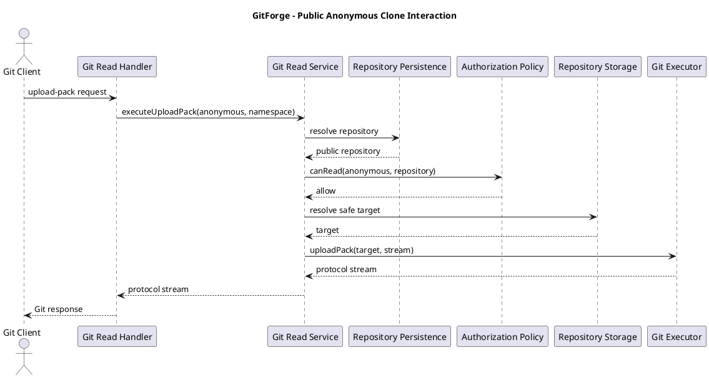
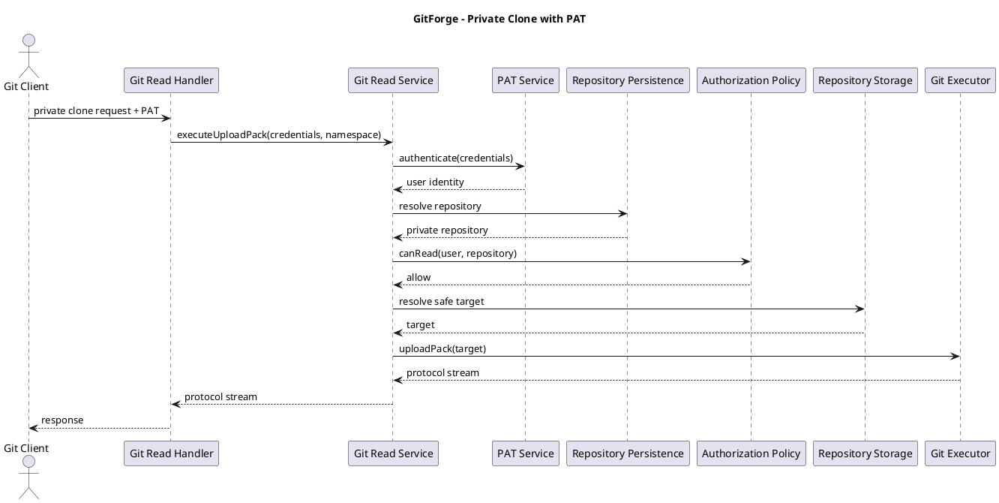
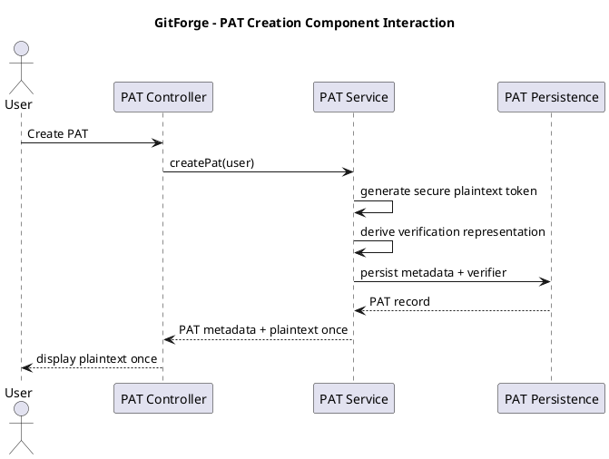

# GitForge V1.0.0 Component Design

## 1. Document Information

| Field | Value |

|---|---|

| Project | GitForge - Web Git Hosting Platform |

| Target release | V1.0.0 |

| Document | Component Design |

| SDLC phase | System Design |

| Milestone | M3 - System Design |

| Project owner | Farhad Valizadegan |

| Status | Approved |

| Last updated | 2026-08-18 |

---

## 2. Purpose

This document defines the internal component design of the GitForge V1.0.0 Laravel application.

It translates:

```text

Approved requirements

System Analysis

Architecture Decisions

Container Architecture

```

into concrete application components with explicit:

```text

Responsibilities

Dependencies

Inputs

Outputs

Security boundaries

Failure behavior

Persistence interactions

Git interactions

```

The objective is to make the Laravel application sufficiently structured for later database, API, storage, security, and implementation design.

---

## 3. Design Boundary

This document defines logical implementation components.

It does not yet finalize:

```text

Exact PHP class names

Exact namespace layout

Exact database table definitions

Exact route URIs

Exact request/response schemas

Exact Git command arguments

Exact filesystem directory layout

Exact frontend implementation

```

Those are refined in later M3 artifacts.

---

## 4. Application Architecture

The Laravel application follows a modular-monolith architecture.

Conceptually:

```text

Protocol / Presentation Layer

             ↓

Application Layer

             ↓

Domain / Policy Layer

             ↓

Infrastructure Layer

```

---

## 5. Primary Component Groups

The application contains the following primary component groups:

```text

CG-01 Web Interface

CG-02 Git Smart HTTP Interface

CG-03 Authentication

CG-04 Personal Access Token Management

CG-05 Repository Management

CG-06 Repository Authorization

CG-07 Repository Browser

CG-08 Repository Storage

CG-09 Git Process Execution

CG-10 Persistence

CG-11 Validation

CG-12 Failure Handling

CG-13 Observability

CG-14 Configuration

```

---

# Component Architecture

## 6. High-Level Component Diagram



---

# CG-01 — Web Interface Components

## 7. Responsibility

The Web Interface receives browser-facing requests.

Its primary responsibility is adaptation between:

```text

HTTP request

```

and:

```text

Application service operation

```

---

## 8. Web Interface Components

Expected components include:

```text

Authentication Controller

Repository Controller

Repository Browser Controller

PAT Controller

Request Validation Objects

Response/View Models

```

Exact class names may differ during implementation.

---

## 9. Web Controller Rule

Controllers should remain thin.

A controller should generally:

```text

Receive request

Validate/resolve request input

Resolve authenticated actor

Invoke application service

Map result to response

```

A controller should not directly implement:

```text

Repository authorization policy

Filesystem path composition

Git process execution

PAT cryptography

Complex persistence orchestration

```

---

## 10. Web Authentication Adapter

The web authentication interface delegates credential handling to Laravel authentication mechanisms and the Authentication component.

Responsibilities include:

```text

Registration request adaptation

Login request adaptation

Logout request adaptation

Session-aware request context

```

---

## 11. Repository Web Adapter

Responsibilities include:

```text

Create repository request

List owned repositories

View repository

Update visibility

```

It delegates core behavior to:

```text

Repository Service

```

---

## 12. Repository Browser Web Adapter

Responsibilities include HTTP adaptation for:

```text

Repository overview

Branch listing

Commit history

Commit details

Tree listing

File/blob view

```

It delegates to:

```text

Repository Browser Service

```

---

## 13. PAT Web Adapter

Responsibilities include:

```text

Create PAT

Display newly created plaintext once

List PAT metadata where required

Revoke PAT

```

It delegates to:

```text

PAT Service

```

---

# CG-02 — Git Smart HTTP Interface

## 14. Responsibility

The Git Smart HTTP Interface adapts Git HTTP requests to internal Git read/write application services.

It handles protocol-specific concerns while delegating security and repository behavior.

---

## 15. Git Interface Components

Expected components include:

```text

Git Service Discovery Handler

Git Upload-Pack Handler

Git Receive-Pack Handler

Git Credential Extractor

Git Protocol Response Adapter

Git Stream Adapter

```

---

## 16. Protocol Separation

Git Smart HTTP endpoints remain separate from ordinary web/API response behavior.

They may require protocol-specific:

```text

Content-Type

Request body

Response streaming

Service advertisement

Failure representation

```

---

## 17. Git Credential Extraction

The Git HTTP adapter may extract credentials from the incoming HTTP authentication context.

It must not:

```text

Authenticate the PAT itself

Authorize repository access itself

Log plaintext credential

```

It delegates authentication to the appropriate authentication/PAT component.

---

## 18. Git Read Handler

The Git read handler coordinates:

```text

Service discovery

Clone

Fetch

```

through:

```text

Git Read Service

```

---

## 19. Git Write Handler

The Git write handler coordinates:

```text

Write service discovery

Push

```

through:

```text

Git Write Service

```

---

# CG-03 — Authentication Component

## 20. Responsibility

The Authentication component establishes user identity.

It supports:

```text

Interactive web authentication

Authenticated session identity

Git PAT identity resolution

```

Authentication remains distinct from repository authorization.

---

## 21. Web Authentication Responsibilities

The component supports:

```text

User registration

Password verification

Login

Logout

Current user resolution

```

---

## 22. Password Handling

Password verification must use:

```text

Laravel-supported password hashing

```

No custom reversible password storage is permitted.

---

## 23. Session Identity

After successful web authentication:

```text

Session

       ↓

Authenticated User Identity

```

Repository authorization is still required separately.

---

## 24. PAT Identity

PAT authentication follows:

```text

Presented Token

       ↓

PAT Candidate Resolution

       ↓

Secure Verification

       ↓

Revocation Check

       ↓

Owner Resolution

       ↓

Authenticated User Identity

```

---

## 25. Authentication Failure

Any of the following result in authentication failure:

```text

Unknown account

Invalid password

Unknown PAT

Invalid PAT

Revoked PAT

Malformed credential

Missing required credential

PAT owner inconsistency

```

No identity is established.

---

# CG-04 — Personal Access Token Management

## 26. Responsibility

The PAT component manages the lifecycle of Git credentials.

---

## 27. PAT Operations

Supported operations:

```text

Create PAT

Persist verification representation

Present plaintext once

List PAT metadata where required

Revoke PAT

Verify PAT

Resolve PAT owner

```

---

## 28. PAT Generation

PAT creation must produce a cryptographically strong token.

Conceptually:

```text

Secure Random Token

       ↓

Plaintext Token

       ↓

Secure Verification Representation

```

---

## 29. PAT Persistence

The persistence layer stores:

```text

PAT owner

PAT lookup metadata

Secure verification representation

Revocation state

Creation timestamp

Relevant identifying metadata

```

It does not store recoverable plaintext PAT.

---

## 30. One-Time Plaintext

Plaintext PAT is available only during the successful creation result.

Afterward:

```text

Original plaintext

=

Unavailable

```

---

## 31. PAT Revocation

Revocation transitions:

```text

Active

   ↓

Revoked

```

A revoked PAT must not authenticate.

---

## 32. Deferred PAT Behavior

The component does not implement:

```text

PAT scopes

PAT expiration

```

for V1.0.0.

---

# CG-05 — Repository Management Component

## 33. Responsibility

The Repository Management component coordinates repository metadata lifecycle operations.

---

## 34. Supported Operations

The component supports:

```text

Create repository

List owned repositories

Resolve repository

View repository metadata

Change repository visibility

```

It does not support:

```text

Delete repository

Rename repository

Transfer repository

```

in V1.0.0.

---

## 35. Repository Creation Responsibilities

Repository creation coordinates:

```text

Authenticated user

Repository input validation

Repository naming policy

Namespace uniqueness

Visibility validation

Metadata persistence

Safe storage target resolution

Bare Git initialization

Compensation on partial failure

Result generation

```

---

## 36. Repository Creation Flow



---

## 37. Partial Creation Failure

If physical initialization fails after metadata creation:

```text

Repository Service

       ↓

Compensation

```

must attempt to restore consistency.

Possible compensation includes:

```text

Remove newly created metadata

Remove safely identifiable partial repository storage

Record diagnostic event

Return creation failure

```

Exact ordering is finalized in Repository Storage Design.

---

## 38. Repository Listing

Repository listing operates on authoritative application metadata.

It does not scan the filesystem to discover repositories.

---

## 39. Repository Resolution

Repository resolution uses logical identity:

```text

<owner>/<repository>

```

to resolve authoritative metadata.

Physical storage resolution occurs separately.

---

## 40. Visibility Update

Visibility change requires:

```text

Authenticated User

+

Repository ownership

```

and updates application metadata.

---

# CG-06 — Repository Authorization Component

## 41. Responsibility

The Repository Authorization component centralizes repository access decisions.

---

## 42. Authorization Inputs

A policy decision receives:

```text

Actor identity or anonymous state

Repository metadata

Requested operation

```

---

## 43. Core Operations

Authorization operations are conceptually:

```text

canReadRepository

canWriteRepository

canManageRepository

```

Exact implementation names may differ.

---

## 44. Read Policy

```text

Public Repository

Visitor                  Allow

Authenticated Non-Owner  Allow

Owner                    Allow

```

```text

Private Repository

Visitor                  Deny

Authenticated Non-Owner  Deny

Owner                    Allow

```

---

## 45. Write Policy

```text

Anonymous                 Deny

Authenticated Non-Owner   Deny

Owner                     Allow

```

Visibility does not modify write permission.

---

## 46. Management Policy

Repository metadata mutation such as visibility change requires:

```text

Authenticated Owner

```

---

## 47. Authorization Result

Authorization should return a clear internal decision:

```text

Allow

Deny

```

and may include safe failure classification.

It should not directly execute repository operations.

---

## 48. Policy Centralization Rule

The following must not independently implement repository policy:

```text

Controllers

Git handlers

Storage component

Git executor

Persistence component

```

They depend on centralized authorization decisions.

---

# CG-07 — Repository Browser Component

## 49. Responsibility

The Repository Browser component provides read-only access to Git-native repository content.

---

## 50. Supported Browser Operations

```text

Repository summary

List branches

Commit history

Commit details

Tree listing

Blob/file retrieval

```

---

## 51. Browser Operation Ordering

Every protected browser operation follows:

```text

Resolve Repository Metadata

       ↓

Authorize Read

       ↓

Resolve Safe Physical Repository

       ↓

Execute Approved Git Read

       ↓

Parse Result

       ↓

Return Safe Representation

```

---

## 52. Browser Read-Only Rule

The browser component must never execute mutation-oriented Git operations.

---

## 53. Branch Listing

Branch listing may use a controlled Git-native command such as:

```text

git for-each-ref

```

or another approved equivalent.

---

## 54. Commit History

Commit history may use controlled Git-native inspection such as:

```text

git log

```

with explicitly defined output formatting.

---

## 55. Commit Details

Commit detail retrieval must use an explicit commit/object identifier and controlled Git-native read operation.

Untrusted identifiers require validation before invocation.

---

## 56. Tree Listing

Tree browsing may use:

```text

git ls-tree

```

or equivalent controlled operation.

---

## 57. Blob Retrieval

Blob/file retrieval may use:

```text

git cat-file

git show

```

or equivalent safe Git-native reads.

---

## 58. Empty Repository Handling

An empty repository is valid.

The Browser component should return an empty-state result rather than:

```text

Repository Missing

```

---

## 59. Untrusted Content

Outputs from the Git repository remain untrusted.

This includes:

```text

Commit messages

Ref names

Paths

File names

Blob content

```

Safe rendering belongs to the web response/presentation boundary.

---

# CG-08 — Repository Storage Component

## 60. Responsibility

The Repository Storage component is the exclusive application abstraction for safe filesystem repository location behavior.

---

## 61. Storage Responsibilities

It owns:

```text

Configured repository root

Logical-to-physical mapping

Path normalization

Containment checking

Repository target creation

Repository existence checking

Storage-state checking

Safe cleanup

```

---

## 62. Storage Input

The Storage component should receive trusted internal repository identity or metadata.

It must not accept arbitrary client absolute paths.

---

## 63. Storage Output

Successful resolution returns:

```text

Validated Physical Repository Target

```

that is guaranteed to remain within:

```text

GITFORGE_REPOSITORY_ROOT

```

---

## 64. Path Containment

Before returning a path:

```text

Derive candidate

       ↓

Normalize

       ↓

Resolve root

       ↓

Verify containment

       ↓

Return safe target

```

If containment cannot be proven:

```text

Security Failure

```

---

## 65. Repository Initialization Target

For a new repository, Storage provides a safe unused target to the Repository Service/Git Executor.

---

## 66. Existing Repository Validation

For existing repositories, Storage distinguishes:

```text

Exists and valid

Missing

Unavailable

Inconsistent

Unsafe

```

---

## 67. Missing Repository

If metadata exists but expected physical storage does not:

```text

Consistency Failure

```

The Storage component must not silently recreate it.

---

## 68. Orphaned Storage

Physical storage without corresponding metadata is:

```text

Orphaned

```

It is not automatically attached to a user request.

Operational repair is separate.

---

# CG-09 — Git Process Execution Component

## 69. Responsibility

The Git Process Execution component is the controlled application boundary for launching Git subprocesses.

---

## 70. Exclusive Process Rule

Normal application Git execution must go through this component.

Controllers and other services must not launch arbitrary Git processes directly.

---

## 71. Process Input

Each invocation defines:

```text

Approved operation

Validated argument set

Safe physical repository target

Controlled stdin

Timeout policy

Controlled environment

```

---

## 72. Process Output

A process result should contain safe internal values such as:

```text

Exit code

stdout or stream

stderr where appropriate

Duration

Failure classification

```

---

## 73. Approved Command Families

Expected operation families include:

```text

Repository initialization

Ref inspection

Commit inspection

Tree inspection

Blob inspection

Upload-pack

Receive-pack

```

Exact command allowlist belongs to:

```text

09-git-process-execution-design.md

```

---

## 74. No Shell Command Strings

The component must not accept:

```text

"git " + userInput

```

or arbitrary command strings.

Invocation must use structured executable and argument handling.

---

## 75. Executable Configuration

The Git executable path is deployment configuration.

The process executor uses only the approved configured executable.

---

## 76. Controlled Environment

The process environment should be explicitly defined rather than inheriting uncontrolled interactive shell state.

---

## 77. Timeout

Every Git process receives an explicit timeout policy.

No application-launched Git process may run indefinitely.

---

## 78. Exit Codes

Non-zero exit status must be treated according to operation-specific semantics.

It must never automatically become application success.

---

## 79. stderr

stderr is diagnostic input.

It must not automatically be exposed raw to external clients.

---

## 80. Streaming

Git Smart HTTP operations should support streaming where practical.

Ordinary small repository-browser reads may use bounded buffered results.

---

# CG-10 — Persistence Components

## 81. Responsibility

Persistence components isolate application metadata access to PostgreSQL.

---

## 82. Primary Persistence Components

Expected persistence responsibilities include:

```text

User Persistence

Repository Persistence

PAT Persistence

```

They may be implemented through Eloquent models and repository/service abstractions as appropriate.

---

## 83. User Persistence

Handles:

```text

User creation

User lookup

Authentication-related identity retrieval

```

Password hashing remains handled through Laravel security APIs.

---

## 84. Repository Persistence

Handles:

```text

Create repository metadata

Resolve repository by logical namespace

List repositories by owner

Update visibility

Namespace uniqueness

Ownership relationship

```

---

## 85. PAT Persistence

Handles:

```text

Create PAT metadata

Resolve PAT candidate

Read verification representation

Read revocation state

Resolve PAT owner

Revoke PAT

List user PAT metadata

```

---

## 86. Persistence Rule

Persistence components must not implement Git repository storage behavior.

They know application metadata, not Git object contents.

---

## 87. Database Transactions

Application services use database transactions where multiple metadata writes form one logical operation.

Filesystem operations remain outside native database transaction scope.

---

# CG-11 — Validation Components

## 88. Responsibility

Validation components protect application services from malformed external input.

---

## 89. Validation Areas

Input validation includes:

```text

Registration fields

Login fields

Repository name

Repository visibility

Repository logical identifiers

Branch/ref identifiers where applicable

Commit/object identifiers

Tree paths

PAT management input

```

---

## 90. Repository Naming Policy

Repository name validation enforces approved rules:

```text

Length 1–100

Lowercase ASCII

Digits

Hyphen

Underscore

Safe periods

No slash

No backslash

No ..

No traversal

No control characters

```

---

## 91. Validation Versus Authorization

Validation answers:

```text

Is the input structurally acceptable?

```

Authorization answers:

```text

May this actor perform this operation?

```

They remain separate.

---

# CG-12 — Failure Handling Component

## 92. Responsibility

Failure Handling provides consistent internal classification and external mapping.

---

## 93. Internal Failure Categories

Expected categories include:

```text

Validation Failure

Authentication Failure

Authorization Denial

Repository Not Found

Repository Consistency Failure

Storage Failure

Git Execution Failure

Git Protocol Failure

Persistence Failure

Security Failure

Unexpected Internal Failure

```

---

## 94. External Error Mapping

Internal errors are converted to safe protocol-appropriate responses.

Examples:

```text

Web/UI error

API error

Git Smart HTTP failure

```

Internal stack traces or secret-bearing diagnostics are not returned directly.

---

## 95. No-False-Success Rule

Failure handling must preserve:

```text

Failure

≠

Success Response

```

especially for:

```text

Repository creation

PAT creation

PAT revocation

Visibility change

Push

```

---

## 96. Fail-Closed Rule

Security-sensitive ambiguity maps to:

```text

Deny

Reject

Fail

```

not Allow.

---

# CG-13 — Observability Component

## 97. Responsibility

Observability provides safe diagnostic information.

---

## 98. Logging Responsibilities

Structured logs may include:

```text

Request/correlation ID

Operation type

Authenticated user ID where appropriate

Logical repository identifier where safe

Failure category

Git operation type

Exit code

Duration

```

---

## 99. Sensitive Data Prohibition

Logs must not intentionally contain:

```text

Plaintext password

Plaintext PAT

Raw Authorization header

Database password

Application secret

Session secret

Unnecessary file contents

```

---

## 100. Authorization Logging

Authorization denials may be logged where operationally useful, while avoiding excessive disclosure.

---

## 101. Git Logging

Git process logging may record:

```text

Approved operation

Duration

Exit code

Failure category

```

but not raw credentials.

---

# CG-14 — Configuration Component

## 102. Responsibility

Configuration centralizes environment-specific technical settings.

---

## 103. Configuration Values

Examples include:

```text

Database connection

Repository root

Git executable path

Git timeout defaults

Application environment

Logging level

Application URL

```

---

## 104. Secret Configuration

Secrets are provided through deployment configuration and not committed to source control.

---

## 105. Configuration Access Rule

Components should consume configuration through framework configuration abstractions rather than scattering direct environment-variable access throughout business logic.

---

# Application Services

## 106. Service — Authentication Service

Primary operations:

```text

register

login

logout

resolveCurrentUser

authenticatePat

```

Responsibilities:

```text

Coordinate identity establishment

Delegate persistence

Use framework authentication

Return identity result

```

---

## 107. Service — PAT Service

Primary operations:

```text

createPat

listPats

revokePat

verifyPat

```

Responsibilities:

```text

Generate secure token

Persist verification representation

Return plaintext once

Verify token

Check revocation

Resolve token owner

```

---

## 108. Service — Repository Service

Primary operations:

```text

createRepository

listOwnedRepositories

getRepository

changeVisibility

```

Responsibilities:

```text

Coordinate validation

Coordinate authorization

Coordinate persistence

Coordinate storage

Coordinate Git initialization

Handle compensation

```

---

## 109. Service — Repository Browser Service

Primary operations:

```text

listBranches

getCommitHistory

getCommit

listTree

getBlob

```

Responsibilities:

```text

Resolve repository

Authorize read

Resolve storage

Execute approved Git read

Return normalized domain/application result

```

---

## 110. Service — Git Read Service

Primary operations:

```text

discoverUploadPack

executeUploadPack

```

Responsibilities:

```text

Resolve repository

Authenticate PAT when private access requires it

Authorize read

Resolve storage

Launch upload-pack

Stream protocol output

```

---

## 111. Service — Git Write Service

Primary operations:

```text

discoverReceivePack

executeReceivePack

```

Responsibilities:

```text

Authenticate PAT

Resolve repository

Authorize owner write

Resolve storage

Launch receive-pack

Stream protocol result

```

---

# Domain and Policy Components

## 112. Repository Authorization Policy

Inputs:

```text

Actor

Repository

Operation

```

Output:

```text

Allow / Deny

```

---

## 113. Repository Naming Policy

Input:

```text

Repository name

```

Output:

```text

Valid

Invalid

```

---

## 114. Visibility Policy

Permitted values:

```text

Public

Private

```

No ambiguous null state should represent visibility.

---

# Component Interaction Scenarios

## 115. Login Scenario



---

## 116. Private Repository Browser Scenario



---

## 117. Public Anonymous Clone Scenario



---

## 118. Private Clone with PAT Scenario



---

## 119. Push Scenario


---

## 120. PAT Creation Scenario



---

# Component Dependency Rules

## 121. Rule CR-001 — Presentation Depends on Services

```text

Controller / Handler

       ↓

Application Service

```

not the reverse.

---

## 122. Rule CR-002 — Services Own Use-Case Coordination

Application Services coordinate cross-component workflows.

---

## 123. Rule CR-003 — Policies Do Not Depend on HTTP

Authorization and naming policies must not require HTTP request objects.

---

## 124. Rule CR-004 — Persistence Does Not Own Business Authorization

Persistence components retrieve/store metadata.

They do not decide whether users may act.

---

## 125. Rule CR-005 — Storage Does Not Own Repository Authorization

Repository Storage validates physical safety.

It does not decide repository read/write permissions.

---

## 126. Rule CR-006 — Git Executor Does Not Own Repository Authorization

Git Executor executes an approved operation against a safe target.

Authorization must occur before invocation.

---

## 127. Rule CR-007 — Git Executor Is the Process Boundary

Application components do not independently launch Git.

---

## 128. Rule CR-008 — PostgreSQL and Git Storage Remain Separate Authorities

Persistence components must not duplicate Git-native history into PostgreSQL as authoritative application records.

---

## 129. Rule CR-009 — Controllers Do Not Compose Filesystem Paths

Physical repository mapping belongs exclusively to Repository Storage.

---

## 130. Rule CR-010 — External Protocol Components Do Not Bypass Services

Git handlers and controllers must pass through application/service-layer behavior.

---

# Component Security Invariants

## 131. CSI-001 — Authentication Does Not Grant Repository Permission

```text

Authenticated

≠

Authorized

```

---

## 132. CSI-002 — Public Read

```text

Public + Read

=

Allow

```

for:

```text

Visitor

Authenticated Non-Owner

Owner

```

---

## 133. CSI-003 — Private Read

```text

Private + Read

=

Owner only

```

---

## 134. CSI-004 — Write

```text

Write

=

Authenticated Owner only

```

---

## 135. CSI-005 — Safe Physical Target

Git Executor may receive only a safe physical target returned through Repository Storage.

---

## 136. CSI-006 — No Arbitrary Command

Git Executor accepts only predefined operation types and structured arguments.

---

## 137. CSI-007 — PAT Confidentiality

Plaintext PAT is never recoverably persisted.

---

## 138. CSI-008 — Repository Content Untrusted

Browser results remain untrusted until safely represented at the presentation boundary.

---

## 139. CSI-009 — Fail Closed

Unknown or unsafe security state results in denial/failure.

---

## 140. CSI-010 — Sensitive Logging Prohibited

Credentials and application secrets are not intentionally recorded.

---

# Component Failure Behavior

## 141. Authentication Failure

Affected components:

```text

Authentication Service

PAT Service

```

Result:

```text

No identity

No protected continuation

```

---

## 142. Authorization Failure

Affected component:

```text

Repository Authorization Policy

```

Result:

```text

No protected storage resolution

No protected Git execution

```

---

## 143. Persistence Failure

Affected components:

```text

User Persistence

Repository Persistence

PAT Persistence

```

Result:

```text

Application operation fails

No false success

```

---

## 144. Storage Failure

Affected component:

```text

Repository Storage

```

Result:

```text

Repository-dependent operation fails

Git Executor is not invoked with unsafe/invalid target

```

---

## 145. Git Process Failure

Affected component:

```text

Git Process Executor

```

Result:

```text

Git operation failure

```

not:

```text

Authentication Failure

Authorization Failure

Success

```

---

## 146. Repository Creation Partial Failure

Affected components:

```text

Repository Service

Repository Persistence

Repository Storage

Git Executor

```

Repository Service owns compensation coordination.

---

# Component Testability

## 147. Unit-Test Candidates

High-value unit-test targets include:

```text

Repository Authorization Policy

Repository Naming Policy

PAT verification logic

Repository Storage containment logic

Failure mapping

```

---

## 148. Service-Test Candidates

Application service tests should cover:

```text

Repository creation

Visibility changes

PAT creation/revocation

Repository browsing

Git read orchestration

Git write orchestration

```

---

## 149. Integration-Test Candidates

Integration boundaries include:

```text

Laravel ↔ PostgreSQL

Laravel ↔ Filesystem

Laravel ↔ Git executable

Git Smart HTTP ↔ Git client

```

Detailed test planning belongs to later SDLC phases.

---

# Framework Mapping

## 150. Likely Laravel Mapping

The component design may map to Laravel constructs such as:

```text

Controllers

Form Requests

Models

Policies

Services

Actions

Middleware

Configuration

Logging

Exceptions

```

The exact source directory layout is an Implementation decision constrained by this design.

---

## 151. Authorization Mapping

Repository authorization may be implemented using:

```text

Laravel Policy

+

Dedicated authorization/service logic where protocol-independent use is required

```

The final implementation must ensure Git Smart HTTP handlers can reuse identical policy semantics.

---

## 152. Validation Mapping

Laravel Form Request or dedicated validators may enforce browser/API input rules.

Git protocol-specific validation may occur through dedicated protocol adapters/services.

---

## 153. Persistence Mapping

Expected models include concepts corresponding to:

```text

User

Repository

PersonalAccessToken

```

Concrete schema is defined in:

```text

05-database-schema-design.md

```

---

# Component Traceability

## 154. Requirements-to-Component Coverage

Major capability mapping:

| Capability | Primary Component |

|---|---|

| Registration | Authentication |

| Login | Authentication |

| Logout | Authentication |

| Repository creation | Repository Management |

| Repository listing | Repository Management |

| Repository metadata view | Repository Management |

| Visibility update | Repository Management + Authorization |

| Repository browser | Repository Browser |

| Branch listing | Repository Browser |

| Commit history | Repository Browser |

| Commit details | Repository Browser |

| Tree browsing | Repository Browser |

| File/blob view | Repository Browser |

| PAT creation | PAT Management |

| PAT authentication | PAT Management + Authentication |

| PAT revocation | PAT Management |

| Git read | Git Read Service |

| Clone | Git Read Service |

| Fetch | Git Read Service |

| Git write | Git Write Service |

| Push | Git Write Service |

| Read authorization | Repository Authorization |

| Write authorization | Repository Authorization |

| Physical repository resolution | Repository Storage |

| Git-native operations | Git Process Execution |

| Metadata persistence | Persistence |

| Diagnostics | Observability |

---

## 155. M2 Responsibility Mapping

M2 logical responsibilities map to M3 components as follows:

```text

Identity Management

       ↓

Authentication Component

```

```text

Access Decision

       ↓

Repository Authorization Component

```

```text

Repository Metadata Management

       ↓

Repository Management + Persistence

```

```text

Repository Content Read

       ↓

Repository Browser + Git Executor

```

```text

Git Protocol Read

       ↓

Git Read Service

```

```text

Git Protocol Write

       ↓

Git Write Service

```

```text

Credential Lifecycle

       ↓

PAT Service

```

```text

Physical Repository Safety

       ↓

Repository Storage

```

```text

Git-Native Execution

       ↓

Git Process Executor

```

---

# Scope Preservation

## 156. Excluded Components

M3 does not introduce components for:

```text

Organizations

Teams

Collaborator management

Forks

Pull requests

Issues

Project boards

CI/CD

Wiki

Package registry

Container registry

Git LFS

SSH key management

Billing

Enterprise ACLs

Federation

Analytics

Social features

```

---

## 157. Deferred Component Behavior

No component must implement:

```text

Repository deletion

Repository rename

Repository transfer

Repository description

Account deletion

PAT scopes

PAT expiration

```

for V1.0.0.

---

# Component Validation

## 158. Architecture Alignment

The component design preserves:

```text

Modular monolith

Laravel application boundary

PostgreSQL metadata authority

Git-native repository authority

Centralized authorization

Safe repository storage

Controlled Git execution

```

Result:

```text

PASS

```

---

## 159. Container Alignment

All internal components remain within the Laravel application container, except explicit infrastructure dependencies:

```text

PostgreSQL

Repository Storage

Git Executable

```

Result:

```text

PASS

```

---

## 160. Authentication Alignment

Session and PAT identity mechanisms remain separated from authorization.

Result:

```text

PASS

```

---

## 161. Authorization Alignment

Read/write/manage policies are centralized.

Result:

```text

PASS

```

---

## 162. Storage Alignment

Only Repository Storage owns physical repository mapping and containment.

Result:

```text

PASS

```

---

## 163. Git Execution Alignment

Only Git Process Execution owns normal Git subprocess invocation.

Result:

```text

PASS

```

---

## 164. Data Authority Alignment

Application metadata and Git-native authority remain separated.

Result:

```text

PASS

```

---

## 165. Failure Alignment

No component design introduces false-success or fail-open behavior.

Result:

```text

PASS

```

---

## 166. Scope Alignment

Unapproved functional components introduced:

```text

0

```

Result:

```text

PASS

```

---

# Completion

## 167. Completion Criteria

This component design is complete when:

- presentation/protocol boundaries are defined;

- authentication component is defined;

- PAT management component is defined;

- repository management component is defined;

- repository authorization component is defined;

- repository browser component is defined;

- repository storage component is defined;

- Git process-execution component is defined;

- persistence components are defined;

- validation responsibilities are defined;

- failure handling responsibilities are defined;

- observability responsibilities are defined;

- configuration responsibilities are defined;

- application-service orchestration is defined;

- component dependencies are explicit;

- security invariants are preserved;

- failure behavior is preserved;

- component-to-requirement mapping is established;

- architecture and container decisions are preserved;

- excluded/deferred scope remains preserved;

- no blocking component-design gap remains.

---

## 168. Component Design Result

Component architecture:

```text

DEFINED

```

Blocking component-design gaps:

```text

0

```

Readiness for database schema design:

```text

READY

```

Next design artifact:

```text

05-database-schema-design.md

```

---

## 169. Document Status

This document is currently:

```text

Approved

```

It will be changed to:

```text

Approved

```

after component responsibilities, dependencies, policy boundaries, persistence boundaries, storage boundaries, Git execution boundaries, security invariants, failure behavior, and architecture alignment have been reviewed.
