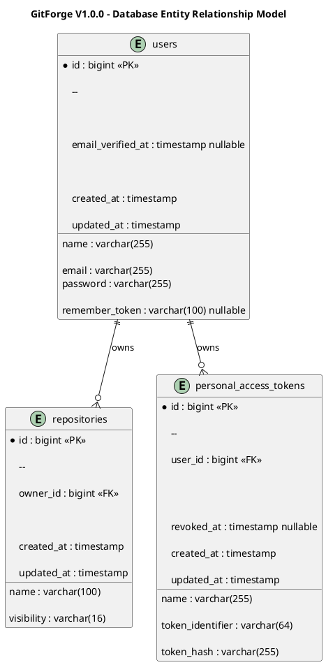

# GitForge V1.0.0 Database Schema Design

## 1. Document Information

| Field | Value |

|---|---|

| Project | GitForge - Web Git Hosting Platform |

| Target release | V1.0.0 |

| Document | Database Schema Design |

| SDLC phase | System Design |

| Milestone | M3 - System Design |

| Project owner | Farhad Valizadegan |

| Status | Approved |

| Last updated | 2026-08-18 |

---

## 2. Purpose

This document defines the PostgreSQL database schema design for GitForge V1.0.0.

It translates approved:

```text

Requirements

System Analysis

Architecture Decisions

Container Architecture

Component Design

```

into an implementation-ready relational model for authoritative application metadata.

The database design covers:

```text

Users

Repositories

Repository ownership

Repository visibility

Personal Access Tokens

PAT revocation state

Integrity constraints

Indexes

Relationships

Timestamps

Concurrency-sensitive uniqueness

```

---

## 3. Database Role

PostgreSQL is authoritative for:

```text

Application metadata

```

It is not authoritative for:

```text

Git refs

Branches

Tags

Commits

Trees

Blobs

Repository history

Repository file content

Packfiles

```

Those remain authoritative in physical Git repositories.

---

## 4. Database Technology

GitForge V1.0.0 uses:

```text

PostgreSQL 18

```

Application persistence is primarily implemented through:

```text

Laravel Eloquent

Laravel migrations

Laravel database transactions

```

---

## 5. Schema Objectives

The schema must provide:

```text

Strong referential integrity

Owner-scoped repository uniqueness

Explicit visibility

Secure PAT verification storage

Reliable revocation state

Efficient repository lookup

Efficient ownership lookup

Efficient PAT candidate lookup

Simple Laravel integration

No duplication of Git-native authority

```

---

# Core Entity Model

## 6. Primary Entities

V1.0.0 requires three primary persistent entities:

```text

User

Repository

Personal Access Token

```

Conceptually:

```text

User

  ├── owns many Repositories

  └── owns many Personal Access Tokens

```

---

## 7. Entity Relationship Diagram



---

# Table: users

## 8. Purpose

The `users` table stores application user identity and authentication metadata.

---

## 9. users Columns

| Column | Type | Null | Purpose |

|---|---|---:|---|

| id | bigint | No | Internal primary key |

| name | varchar(255) | No | User display/name value |

| email | varchar(255) | No | Login/contact identifier |

| email_verified_at | timestamp | Yes | Optional Laravel-compatible verification timestamp |

| password | varchar(255) | No | Secure password hash |

| remember_token | varchar(100) | Yes | Laravel remember-token support |

| created_at | timestamp | No | Creation timestamp |

| updated_at | timestamp | No | Last update timestamp |

---

## 10. users Primary Key

```text

PRIMARY KEY (id)

```

---

## 11. users Email Constraint

Email must be unique:

```text

UNIQUE (email)

```

---

## 12. Password Storage Rule

The `password` column stores only:

```text

Secure one-way password hash

```

It must never store plaintext passwords.

Password hashing is performed through Laravel-supported password hashing APIs.

---

## 13. User Deletion

Account deletion is deferred for V1.0.0.

Therefore no user-facing account-deletion workflow is designed.

The schema must not depend on routine deletion of users.

---

# Table: repositories

## 14. Purpose

The `repositories` table stores authoritative application metadata for hosted repositories.

It does not store Git object data.

---

## 15. repositories Columns

| Column | Type | Null | Purpose |

|---|---|---:|---|

| id | bigint | No | Internal repository identity |

| owner_id | bigint | No | Repository owner |

| name | varchar(100) | No | Owner-scoped repository name |

| visibility | varchar(16) | No | Public/private visibility |

| created_at | timestamp | No | Creation timestamp |

| updated_at | timestamp | No | Last metadata update timestamp |

---

## 16. repositories Primary Key

```text

PRIMARY KEY (id)

```

---

## 17. Repository Ownership Foreign Key

```text

repositories.owner_id

       ↓

users.id

```

Constraint:

```text

FOREIGN KEY (owner_id)

REFERENCES users(id)

```

---

## 18. Repository Ownership Rule

Every repository has exactly one owner.

```text

repository.owner_id

=

one valid user.id

```

No nullable owner is permitted.

---

## 19. Repository Name Rules

The application validates repository names according to approved V1.0.0 rules:

```text

Length 1–100

Lowercase ASCII

Digits

Hyphen

Underscore

Safe periods

No slash

No backslash

No ..

No path traversal

No control characters

```

Application validation is the primary format-enforcement layer.

Database constraints provide structural integrity and uniqueness.

---

## 20. Repository Namespace Uniqueness

Repository names must be unique within an owner namespace.

Required unique constraint:

```text

UNIQUE (owner_id, name)

```

This enforces:

```text

<owner>/<repository>

```

uniqueness under concurrency.

---

## 21. Repository Visibility

Allowed values:

```text

public

private

```

The database representation is explicit.

Recommended constraint:

```text

CHECK (visibility IN ('public', 'private'))

```

---

## 22. Visibility Nullability

`visibility` must not be nullable.

There is no third or unknown visibility state.

---

## 23. Default Visibility

Recommended V1.0.0 default:

```text

private

```

The application may require explicit selection during repository creation, but the database default remains defensive.

Recommended definition:

```text

DEFAULT 'private'

```

---

## 24. Repository Rename

Repository rename is deferred.

The `name` field remains part of the schema because repository creation and logical namespace resolution require it.

No rename workflow is designed for V1.0.0.

---

## 25. Repository Description

Repository description is deferred.

No `description` column is required for V1.0.0.

---

## 26. Repository Deletion

Repository deletion is deferred.

No normal V1.0.0 workflow relies on repository-row deletion.

---

## 27. Physical Repository Path

The database must not store arbitrary client-provided filesystem paths.

The repository schema does not require a public or user-controlled `path` column.

Physical location is derived internally by the Repository Storage component.

---

## 28. Physical Mapping Principle

Conceptually:

```text

repository.id

+

trusted repository metadata

       ↓

Repository Storage component

       ↓

Safe physical repository target

```

The database stores logical identity, not untrusted physical path input.

---

# Table: personal_access_tokens

## 29. Purpose

The `personal_access_tokens` table stores application metadata needed to authenticate Git clients using PATs.

---

## 30. PAT Design Goal

The table must support:

```text

PAT creation

PAT candidate lookup

Secure verification

Owner resolution

Revocation

Listing metadata

```

while ensuring:

```text

Plaintext token is not recoverably persisted

```

---

## 31. personal_access_tokens Columns

| Column | Type | Null | Purpose |

|---|---|---:|---|

| id | bigint | No | PAT primary key |

| user_id | bigint | No | PAT owner |

| name | varchar(255) | No | Human-readable token label |

| token_identifier | varchar(64) | No | Non-secret lookup identifier |

| token_hash | varchar(255) | No | Secure verification representation |

| revoked_at | timestamp | Yes | Revocation timestamp |

| created_at | timestamp | No | Creation timestamp |

| updated_at | timestamp | No | Last update timestamp |

---

## 32. PAT Primary Key

```text

PRIMARY KEY (id)

```

---

## 33. PAT Ownership Foreign Key

```text

personal_access_tokens.user_id

       ↓

users.id

```

Constraint:

```text

FOREIGN KEY (user_id)

REFERENCES users(id)

```

---

## 34. PAT Plaintext Rule

The table must never contain:

```text

Plaintext PAT

```

The original token is presented once during creation and is not recoverably persisted.

---

## 35. PAT Lookup Design

PAT verification should avoid scanning all stored token hashes.

Therefore the token format should contain or derive a non-secret lookup identifier.

Conceptually:

```text

PAT plaintext

=

identifier + secret

```

Authentication performs:

```text

Extract identifier

       ↓

Lookup candidate row

       ↓

Verify secret against token_hash

```

---

## 36. token_identifier

`token_identifier` is:

```text

Non-secret

Unique

Indexed

Suitable for candidate lookup

```

Required constraint:

```text

UNIQUE (token_identifier)

```

---

## 37. token_hash

`token_hash` stores only the secure verification representation of the secret portion or full token according to the final cryptographic implementation.

It must not be directly usable as the original PAT credential.

---

## 38. PAT Naming

`name` allows the user to distinguish tokens.

Examples:

```text

Laptop

Workstation

IDE

CLI

```

The name is metadata only.

It does not grant authorization.

---

## 39. PAT Revocation

A PAT is active when:

```text

revoked_at IS NULL

```

A PAT is revoked when:

```text

revoked_at IS NOT NULL

```

---

## 40. Revocation Semantics

Once revoked:

```text

PAT

       ↓

Cannot authenticate

```

V1.0.0 does not include token reactivation.

---

## 41. PAT Expiration

PAT expiration is deferred.

No `expires_at` column is required for V1.0.0.

---

## 42. PAT Scopes

PAT scopes are deferred.

No token-scope table or scope JSON structure is required.

---

# Relational Integrity

## 43. User → Repository Relationship

```text

users.id

       ↓

repositories.owner_id

```

Cardinality:

```text

One User

       ↓

Zero or Many Repositories

```

---

## 44. User → PAT Relationship

```text

users.id

       ↓

personal_access_tokens.user_id

```

Cardinality:

```text

One User

       ↓

Zero or Many PATs

```

---

## 45. Repository → PAT Relationship

No direct database relationship is required.

PATs authenticate users.

Repository authorization then evaluates:

```text

Authenticated User

+

Repository

+

Operation

```

---

## 46. No Collaborator Relationship

V1.0.0 does not require tables such as:

```text

repository_users

repository_members

collaborators

repository_permissions

teams

organization_repository

```

because repository write access is owner-only.

---

# Constraints

## 47. Constraint Summary

Required database-level integrity:

```text

users.id primary key

users.email unique

repositories.id primary key

repositories.owner_id foreign key

repositories.owner_id NOT NULL

repositories.name NOT NULL

repositories.visibility NOT NULL

repositories(owner_id, name) unique

repositories.visibility constrained to public/private

personal_access_tokens.id primary key

personal_access_tokens.user_id foreign key

personal_access_tokens.user_id NOT NULL

personal_access_tokens.name NOT NULL

personal_access_tokens.token_identifier NOT NULL

personal_access_tokens.token_identifier unique

personal_access_tokens.token_hash NOT NULL

```

---

## 48. Why Database Constraints Matter

Application validation alone cannot safely enforce concurrency-sensitive invariants.

Example:

```text

Request A checks repository name available

Request B checks repository name available

Request A inserts

Request B inserts

```

Without database uniqueness:

```text

Duplicate namespace possible

```

With:

```text

UNIQUE(owner_id, name)

```

only one succeeds.

---

# Index Design

## 49. Index Objectives

Indexes should support:

```text

User login lookup

Owner repository listing

Repository namespace resolution

PAT lookup

PAT owner listing

```

---

## 50. users Indexes

Required:

```text

UNIQUE INDEX on email

```

Primary key index exists on:

```text

id

```

---

## 51. repositories Indexes

Required:

```text

PRIMARY KEY index on id

UNIQUE INDEX on (owner_id, name)

```

Recommended additional index:

```text

INDEX on owner_id

```

Depending on PostgreSQL execution plans, the composite unique index may already support many owner-prefix queries.

---

## 52. Repository Namespace Lookup

Primary logical repository lookup:

```text

owner identity

+

repository name

```

The composite unique index supports this operation directly.

---

## 53. personal_access_tokens Indexes

Required:

```text

PRIMARY KEY index on id

UNIQUE INDEX on token_identifier

INDEX on user_id

```

---

## 54. PAT Authentication Lookup

Authentication should normally use:

```text

token_identifier

```

rather than:

```text

token_hash scan

```

---

# Timestamp Strategy

## 55. created_at

Every primary entity stores:

```text

created_at

```

for creation auditability.

---

## 56. updated_at

Every primary entity stores:

```text

updated_at

```

for last metadata modification.

---

## 57. revoked_at

PAT revocation uses:

```text

revoked_at

```

rather than a simple boolean because it records both:

```text

State

+

Time of transition

```

---

# Suggested PostgreSQL DDL

## 58. users Table

Conceptual PostgreSQL DDL:

```sql

CREATE TABLE users (

     id BIGINT GENERATED BY DEFAULT AS IDENTITY PRIMARY KEY,

     name VARCHAR(255) NOT NULL,

     email VARCHAR(255) NOT NULL,

     email_verified_at TIMESTAMP NULL,

     password VARCHAR(255) NOT NULL,

     remember_token VARCHAR(100) NULL,

     created_at TIMESTAMP NOT NULL,

     updated_at TIMESTAMP NOT NULL,

     CONSTRAINT users_email_unique

         UNIQUE (email)

);

```

---

## 59. repositories Table

Conceptual PostgreSQL DDL:

```sql

CREATE TABLE repositories (

     id BIGINT GENERATED BY DEFAULT AS IDENTITY PRIMARY KEY,

     owner_id BIGINT NOT NULL,

     name VARCHAR(100) NOT NULL,

     visibility VARCHAR(16) NOT NULL DEFAULT 'private',

     created_at TIMESTAMP NOT NULL,

     updated_at TIMESTAMP NOT NULL,

     CONSTRAINT repositories_owner_fk

         FOREIGN KEY (owner_id)

         REFERENCES users(id),

     CONSTRAINT repositories_owner_name_unique

         UNIQUE (owner_id, name),

     CONSTRAINT repositories_visibility_check

         CHECK (visibility IN ('public', 'private'))

);

```

---

## 60. personal_access_tokens Table

Conceptual PostgreSQL DDL:

```sql

CREATE TABLE personal_access_tokens (

     id BIGINT GENERATED BY DEFAULT AS IDENTITY PRIMARY KEY,

     user_id BIGINT NOT NULL,

     name VARCHAR(255) NOT NULL,

     token_identifier VARCHAR(64) NOT NULL,

     token_hash VARCHAR(255) NOT NULL,

     revoked_at TIMESTAMP NULL,

     created_at TIMESTAMP NOT NULL,

     updated_at TIMESTAMP NOT NULL,

     CONSTRAINT personal_access_tokens_user_fk

         FOREIGN KEY (user_id)

         REFERENCES users(id),

     CONSTRAINT personal_access_tokens_identifier_unique

         UNIQUE (token_identifier)

);

```

---

## 61. Recommended Additional Indexes

```sql

CREATE INDEX repositories_owner_id_index

     ON repositories(owner_id);

CREATE INDEX personal_access_tokens_user_id_index

     ON personal_access_tokens(user_id);

```

---

# Laravel Migration Mapping

## 62. Migration Strategy

Recommended migrations:

```text

create_users_table

create_repositories_table

create_personal_access_tokens_table

```

If Laravel already provides the users migration, it should be adapted rather than duplicated.

---

## 63. Repository Migration Concept

Conceptually:

```php

Schema::create('repositories', function (Blueprint $table) {

     $table->id();

     $table->foreignId('owner_id')

         ->constrained('users');

     $table->string('name', 100);

     $table->string('visibility', 16)

         ->default('private');

     $table->timestamps();

     $table->unique(\['owner_id', 'name']);

});

```

A PostgreSQL-compatible visibility check constraint should also be added through migration SQL or supported schema tooling.

---

## 64. PAT Migration Concept

Conceptually:

```php

Schema::create('personal_access_tokens', function (Blueprint $table) {

     $table->id();

     $table->foreignId('user_id')

         ->constrained('users');

     $table->string('name');

     $table->string('token_identifier', 64)

         ->unique();

     $table->string('token_hash');

     $table->timestamp('revoked_at')

         ->nullable();

     $table->timestamps();

     $table->index('user_id');

});

```

---

# Eloquent Model Mapping

## 65. User Model

Conceptual relationships:

```php

User::repositories()

```

maps:

```text

User

       ↓

hasMany Repository

```

and:

```php

User::personalAccessTokens()

```

maps:

```text

User

       ↓

hasMany PersonalAccessToken

```

---

## 66. Repository Model

Conceptual relationship:

```php

Repository::owner()

```

maps:

```text

Repository

       ↓

belongsTo User

```

---

## 67. PersonalAccessToken Model

Conceptual relationship:

```php

PersonalAccessToken::user()

```

maps:

```text

PersonalAccessToken

       ↓

belongsTo User

```

---

# Data Authority Rules

## 68. DAR-001 — Repository Metadata

PostgreSQL stores:

```text

Repository ID

Owner

Name

Visibility

Application timestamps

```

---

## 69. DAR-002 — Git State

PostgreSQL does not store authoritative:

```text

Default branch refs

Branches

Tags

Commit SHA history

Trees

Blobs

File contents

Pack data

```

---

## 70. DAR-003 — Repository Discovery

The application discovers repositories from:

```text

PostgreSQL metadata

```

not by scanning repository filesystem directories.

---

## 71. DAR-004 — Repository Content

Repository-browser content is read from:

```text

Physical Git Repository

```

through controlled Git operations.

---

## 72. DAR-005 — PAT Identity

PAT database records establish:

```text

Token candidate

Verification data

Owner

Revocation state

```

They do not grant repository authorization by themselves.

---

# Repository Namespace Design

## 73. Logical Namespace

Externally:

```text

<owner>/<repository>

```

---

## 74. Owner Resolution

The owner component of the namespace resolves to authoritative user metadata.

The exact public owner identifier may be defined in API/UI design.

Internal relational identity remains:

```text

users.id

```

---

## 75. Repository Resolution

After owner resolution:

```text

owner_id

+

repository name

```

is used to locate the repository row.

---

## 76. Physical Repository Mapping

Physical path is derived after metadata resolution.

The database does not trust the route namespace as a physical path.

---

# Concurrency Design

## 77. Concurrent Repository Creation

Database uniqueness protects:

```text

(owner_id, name)

```

against duplicate repository creation.

Application behavior:

```text

Attempt insert

       ↓

Unique violation if concurrent duplicate

       ↓

Map to repository-name conflict

```

---

## 78. Concurrent PAT Revocation

PAT revocation should be idempotent from a security perspective.

If two requests revoke the same PAT:

```text

Final state

=

Revoked

```

---

## 79. Concurrent Visibility Updates

Visibility updates may follow last-successful-write semantics for V1.0.0 unless a later requirement introduces optimistic locking.

No version column is required currently.

---

# Transaction Design

## 80. Metadata-Only Transactions

Transactions should be used where multiple metadata changes form one operation.

Examples may include:

```text

PAT creation metadata

Visibility-related future multi-row changes

```

---

## 81. Repository Creation Transaction Boundary

Repository creation spans:

```text

PostgreSQL

+

Filesystem

+

Git process

```

Therefore a database transaction alone cannot guarantee full atomicity.

---

## 82. Repository Creation Strategy

The Repository Service coordinates:

```text

Create metadata

       ↓

Resolve safe storage target

       ↓

Initialize bare repository

```

If initialization fails after metadata persistence:

```text

Compensation

       ↓

Remove newly created metadata

```

and safely remove partial storage where appropriate.

---

## 83. No Distributed Transaction

GitForge V1.0.0 does not introduce:

```text

Distributed transaction coordinator

Two-phase commit

Saga infrastructure

```

Application-level compensation is sufficient.

---

# Foreign Key Deletion Policy

## 84. User Deletion Constraint

Because account deletion is deferred, the application does not require cascade-delete behavior for user-facing workflows.

Recommended foreign-key behavior:

```text

RESTRICT

```

or PostgreSQL default no-action semantics.

---

## 85. Repository Owner Deletion

A user row must not disappear while owned repository metadata exists.

This protects repository ownership integrity.

---

## 86. PAT Owner Deletion

A user row must not disappear while PAT records remain, unless a future controlled account-deletion design explicitly defines cleanup.

---

# Security Design

## 87. SQL Injection Resistance

Application persistence must use:

```text

Eloquent

Query Builder

Parameterized SQL

```

Untrusted input must not be concatenated directly into SQL strings.

---

## 88. Password Confidentiality

The database stores only password hashes.

---

## 89. PAT Confidentiality

The database stores only:

```text

Non-secret token identifier

Secure verification representation

```

not plaintext PATs.

---

## 90. Least-Privilege Database User

The application connects using:

```text

git_hosting_app

```

with application-required privileges only.

The application role should not require:

```text

SUPERUSER

CREATEDB

CREATEROLE

REPLICATION

```

---

## 91. Database Network Exposure

PostgreSQL should not be publicly accessible from untrusted networks.

---

# Failure Design

## 92. Database Unavailable

If PostgreSQL is unavailable:

```text

Authentication-dependent operations fail

Repository resolution fails

PAT authentication fails

Repository metadata operations fail

```

The application must not infer ownership or authorization from filesystem state.

---

## 93. Unique Constraint Violation

Repository namespace uniqueness failure maps to:

```text

Repository Name Conflict

```

not generic success or silent overwrite.

---

## 94. Foreign Key Violation

Foreign key violations represent:

```text

Application consistency failure

```

and must not be exposed as raw SQL details to external clients.

---

## 95. Invalid Visibility

A visibility constraint failure maps to:

```text

Validation / persistence failure

```

No invalid visibility value may become authoritative metadata.

---

## 96. PAT Lookup Failure

Unknown `token_identifier` results in:

```text

Authentication Failure

```

No user identity is established.

---

## 97. PAT Verification Failure

Hash verification failure results in:

```text

Authentication Failure

```

---

## 98. Revoked PAT

When:

```text

revoked_at IS NOT NULL

```

authentication fails.

---

# Data Validation Boundaries

## 99. Application Validation

Application validation handles:

```text

Repository name syntax

Email format

PAT name requirements

Visibility allowed values

General input structure

```

---

## 100. Database Validation

Database constraints handle:

```text

Uniqueness

Nullability

Referential integrity

Visibility-domain integrity

```

---

## 101. Defense in Depth

```text

Application Validation

+

Database Constraints

=

Metadata Integrity

```

Neither layer replaces the other.

---

# Database Access Responsibilities

## 102. User Persistence

May access:

```text

users

```

for identity operations.

---

## 103. Repository Persistence

May access:

```text

repositories

users

```

as required for repository resolution and ownership relationships.

---

## 104. PAT Persistence

May access:

```text

personal_access_tokens

users

```

for token authentication and lifecycle.

---

## 105. Repository Browser

Repository Browser should not query database tables for Git-native objects.

It uses Repository Persistence only to resolve repository metadata.

---

## 106. Git Smart HTTP

Git read/write services use database metadata for:

```text

PAT identity

Repository metadata

Authorization inputs

```

Git protocol payloads are not stored as relational database content.

---

# Query Design

## 107. Repository List Query

Conceptually:

```sql

SELECT *

FROM repositories

WHERE owner_id = :owner_id

ORDER BY created_at DESC;

```

---

## 108. Repository Namespace Query

Conceptually:

```sql

SELECT *

FROM repositories

WHERE owner_id = :owner_id

   AND name = :repository_name

LIMIT 1;

```

---

## 109. PAT Candidate Query

Conceptually:

```sql

SELECT *

FROM personal_access_tokens

WHERE token_identifier = :identifier

LIMIT 1;

```

---

## 110. User PAT Listing

Conceptually:

```sql

SELECT id, name, token_identifier, revoked_at, created_at, updated_at

FROM personal_access_tokens

WHERE user_id = :user_id

ORDER BY created_at DESC;

```

The `token_hash` value should not be unnecessarily exposed outside authentication/persistence logic.

---

# Schema Scope Preservation

## 111. Tables Not Required in V1.0.0

The schema does not require:

```text

organizations

teams

team_members

repository_collaborators

repository_permissions

forks

pull_requests

issues

issue_comments

project_boards

pipelines

jobs

artifacts

wiki_pages

packages

container_images

ssh_keys

billing_accounts

repository_stars

followers

activity_feeds

```

---

## 112. Deferred Schema Areas

No V1.0.0 schema is required for:

```text

Repository deletion workflow

Repository rename history

Repository transfer

Repository description

Account deletion

PAT scopes

PAT expiration

```

---

# Schema Traceability

## 113. Requirements Mapping

| Requirement Area | Schema Element |

|---|---|

| User identity | users |

| User authentication | users.password |

| Repository ownership | repositories.owner_id |

| Repository naming | repositories.name |

| Namespace uniqueness | UNIQUE(owner_id, name) |

| Public/private visibility | repositories.visibility |

| PAT ownership | personal_access_tokens.user_id |

| PAT verification | token_identifier + token_hash |

| PAT revocation | revoked_at |

| Git-native repository state | Not stored in PostgreSQL |

---

## 114. Architecture Decision Mapping

This schema implements:

```text

ADR-003 PostgreSQL Application Database

ADR-004 Git-Native State Outside PostgreSQL

ADR-013 PAT Authentication

ADR-014 One-Time PAT Plaintext

ADR-015 PAT Scopes/Expiration Deferred

ADR-018 Owner-Only Repository Write

ADR-019 Visibility Controls Read

ADR-027 Database Integrity Constraints

ADR-029 Eloquent Metadata Persistence

ADR-030 Database Transactions

ADR-060 Database IDs as Internal Identity

ADR-061 Repository Namespace Uniqueness

ADR-062 Explicit Visibility Representation

```

---

# Schema Validation

## 115. Metadata Authority Validation

PostgreSQL stores only authoritative application metadata.

Result:

```text

PASS

```

---

## 116. Git Authority Validation

Git-native history and content are not duplicated as authoritative database records.

Result:

```text

PASS

```

---

## 117. Ownership Validation

Every repository has exactly one owner.

Result:

```text

PASS

```

---

## 118. Namespace Validation

Owner-scoped repository name uniqueness is database-enforced.

Result:

```text

PASS

```

---

## 119. Visibility Validation

Only:

```text

public

private

```

are valid.

Result:

```text

PASS

```

---

## 120. PAT Confidentiality Validation

Plaintext PAT is not represented in the persistent schema.

Result:

```text

PASS

```

---

## 121. PAT Revocation Validation

Revocation state is explicitly represented.

Result:

```text

PASS

```

---

## 122. PAT Scope Validation

No scope schema is introduced.

Result:

```text

PASS

```

---

## 123. PAT Expiration Validation

No expiration schema is introduced.

Result:

```text

PASS

```

---

## 124. Database Integrity Validation

Primary keys, foreign keys, unique constraints, and visibility constraints are defined.

Result:

```text

PASS

```

---

## 125. Scope Validation

Unapproved database entities introduced:

```text

0

```

Result:

```text

PASS

```

---

# Implementation Readiness

## 126. Required Migrations

Implementation can proceed with migrations for:

```text

users

repositories

personal_access_tokens

```

---

## 127. Required Models

Implementation can proceed with models corresponding to:

```text

User

Repository

PersonalAccessToken

```

---

## 128. Required Relationships

Implementation-ready relationships:

```text

User hasMany Repository

Repository belongsTo User

User hasMany PersonalAccessToken

PersonalAccessToken belongsTo User

```

---

## 129. Required Constraints

Implementation-ready constraints:

```text

Unique user email

Repository owner foreign key

Unique owner/repository namespace

Explicit visibility domain

PAT owner foreign key

Unique PAT identifier

Required PAT verification representation

```

---

# Completion

## 130. Completion Criteria

This database schema design is complete when:

- primary application metadata entities are defined;

- users schema is defined;

- repositories schema is defined;

- PAT schema is defined;

- ownership relationships are defined;

- repository namespace uniqueness is defined;

- visibility representation is defined;

- PAT revocation representation is defined;

- PAT plaintext is excluded from persistent storage;

- PAT scopes remain deferred;

- PAT expiration remains deferred;

- Git-native authority remains outside PostgreSQL;

- primary keys are defined;

- foreign keys are defined;

- unique constraints are defined;

- required indexes are defined;

- transaction boundaries are understood;

- repository-creation compensation implications are documented;

- database failure behavior is defined;

- SQL injection protections are defined;

- least-privilege database access is preserved;

- excluded/deferred scope remains preserved;

- schema is sufficient for Laravel migration implementation.

---

## 131. Database Schema Design Result

Database schema:

```text

DEFINED

```

Blocking database-design gaps:

```text

0

```

Readiness for API specification:

```text

READY

```

Next design artifact:

```text

06-api-specification.md

```

---

## 132. Document Status

This document is currently:

```text

Approved

```

It will be changed to:

```text

Approved

```

after entities, relationships, constraints, indexes, authority boundaries, PAT confidentiality, repository namespace integrity, security, transactions, failure behavior, and implementation readiness have been reviewed.
