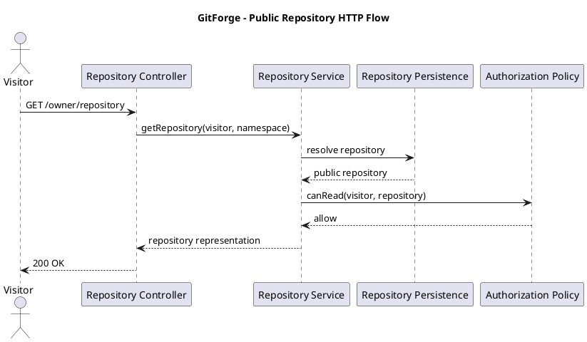
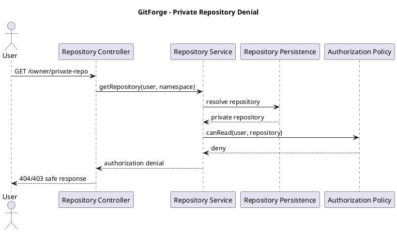
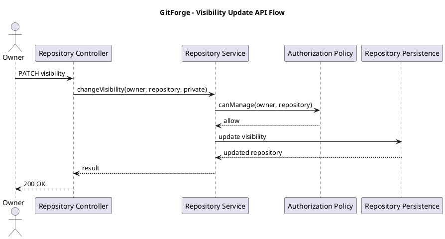

# GitForge V1.0.0 API Specification

## 1. Document Information

| Field | Value |

|---|---|

| Project | GitForge - Web Git Hosting Platform |

| Target release | V1.0.0 |

| Document | API Specification |

| SDLC phase | System Design |

| Milestone | M3 - System Design |

| Project owner | Farhad Valizadegan |

| Status | Approved |

| Last updated | 2026-08-18 |

---

## 2. Purpose

This document defines the application-facing HTTP interface for GitForge V1.0.0.

It translates approved:

```text

Requirements

System Analysis

Architecture Decisions

Container Architecture

Component Design

Database Schema Design

```

into implementation-ready HTTP contracts for:

```text

Registration

Login

Logout

Repository creation

Repository listing

Repository detail

Repository visibility update

Repository browsing

PAT creation

PAT listing

PAT revocation

```

Git Smart HTTP protocol endpoints are also defined at the interface boundary, while their protocol mechanics are specified separately in the Git process-execution design.

---

## 3. API Design Goals

The API must be:

```text

Consistent

Predictable

Secure

Authorization-aware

Validation-aware

Failure-aware

Implementation-ready

REST-oriented where practical

Compatible with the Web UI

Compatible with Git Smart HTTP

```

---

## 4. API Categories

GitForge exposes two interface categories:

```text

A. Application HTTP Interface

B. Git Smart HTTP Interface

```

The two interfaces share application services but differ in protocol semantics.

---

## 5. Application HTTP Interface

The Application HTTP Interface supports browser/UI workflows.

It uses:

```text

HTTP

Session authentication

CSRF protection for state-changing browser requests

Structured validation

Application-oriented responses

```

---

## 6. Git Smart HTTP Interface

The Git Smart HTTP Interface supports:

```text

Clone

Fetch

Push

```

using:

```text

git-upload-pack

git-receive-pack

```

It uses protocol-specific response formats and must not be forced into ordinary JSON semantics.

---

# General API Conventions

## 7. Base URL

Conceptually:

```text

https://<gitforge-host>/

```

Application routes and Git protocol routes are rooted beneath the same application host.

---

## 8. Transport Security

Production-like deployments should use:

```text

HTTPS

```

for all externally accessible authenticated operations.

Plain HTTP may be used only in controlled local development.

---

## 9. Content Types

Application endpoints may use:

```text

application/json

application/x-www-form-urlencoded

multipart/form-data

text/html

```

depending on UI implementation.

Git Smart HTTP uses Git-specific content types.

---

## 10. Authentication Modes

Two authentication modes exist:

```text

Web UI

=

Session Authentication

```

```text

Git Client

=

PAT Authentication

```

---

## 11. Authorization Rule

Authentication does not automatically grant repository access.

Every protected operation evaluates:

```text

Actor

+

Repository

+

Operation

```

---

## 12. Resource Naming

Primary application resources:

```text

users

sessions

repositories

personal access tokens

repository branches

repository commits

repository trees

repository blobs/files

```

---

## 13. Identifier Strategy

Internal database identifiers are not required to appear in external URLs where domain identifiers are clearer.

Repository routing uses a logical namespace conceptually equivalent to:

```text

<owner>/<repository>

```

Physical filesystem paths are never exposed as API identifiers.

---

# Response Semantics

## 14. Successful Responses

Typical HTTP success codes:

```text

200 OK

201 Created

204 No Content

```

---

## 15. Client Validation Errors

Use:

```text

422 Unprocessable Entity

```

for structurally valid HTTP requests containing invalid application input.

---

## 16. Authentication Failure

Use:

```text

401 Unauthorized

```

when authentication is required and valid identity cannot be established.

---

## 17. Authorization Denial

Use:

```text

403 Forbidden

```

where revealing the resource relationship is acceptable.

For private repository confidentiality, a not-found style response may be used where appropriate to avoid unnecessary existence disclosure.

The final external mapping must remain consistent.

---

## 18. Resource Not Found

Use:

```text

404 Not Found

```

for unavailable logical resources or intentionally concealed protected resources.

---

## 19. Conflict

Use:

```text

409 Conflict

```

for conflicts such as:

```text

Duplicate repository namespace

```

where the conflict is not represented as field validation.

---

## 20. Internal Failure

Use:

```text

500 Internal Server Error

```

for unexpected application failures.

Sensitive internal details must not be returned.

---

## 21. Service Unavailability

Use:

```text

503 Service Unavailable

```

where an essential infrastructure dependency is temporarily unavailable and this mapping is appropriate.

---

# Error Representation

## 22. Application Error Envelope

For JSON-oriented endpoints, a standard error shape should be used.

Example:

```json

{

   "error": {

     "code": "repository_not_found",

     "message": "Repository not found."

   }

}

```

---

## 23. Validation Error Example

```json

{

   "error": {

     "code": "validation_failed",

     "message": "The request contains invalid data.",

     "fields": {

       "name": \[

         "The repository name is invalid."

       ]

     }

   }

}

```

---

## 24. Error Safety

External errors must not reveal:

```text

Stack traces

SQL statements

Database credentials

Filesystem paths

PAT hashes

Plaintext PATs

Raw Authorization headers

Git command internals unnecessarily

Application secrets

```

---

# Authentication API

## 25. Register User

### Endpoint

```text

POST /register

```

### Authentication

```text

Anonymous

```

### CSRF

Required for browser form submission.

### Request

Example:

```json

{

   "name": "Farhad",

   "email": "user@example.com",

   "password": "secret-password",

   "password_confirmation": "secret-password"

}

```

### Validation

```text

name required

email required

email valid

email unique

password required

password confirmation required

password policy satisfied

```

### Success

```text

201 Created

```

or browser redirect according to UI implementation.

### Failure

```text

422 Validation Failed

409 Conflict where appropriate

500 Internal Failure

```

---

## 26. Login

### Endpoint

```text

POST /login

```

### Authentication

```text

Anonymous

```

### Request

```json

{

   "email": "user@example.com",

   "password": "secret-password"

}

```

### Behavior

```text

Resolve user

Verify password

Establish session

Regenerate session identifier

```

### Success

```text

200 OK

```

or browser redirect.

### Failure

```text

401 Unauthorized

422 Validation Failed

```

No user identity is established on failure.

---

## 27. Logout

### Endpoint

```text

POST /logout

```

### Authentication

```text

Session required

```

### Behavior

```text

Invalidate authenticated session

Rotate/invalidate CSRF/session state as appropriate

```

### Success

```text

204 No Content

```

or browser redirect.

---

# Repository API

## 28. Create Repository

### Endpoint

```text

POST /repositories

```

### Authentication

```text

Session required

```

### Authorization

Any authenticated user may create a repository in their own namespace.

### Request

```json

{

   "name": "my-project",

   "visibility": "private"

}

```

### Validation

Repository name must satisfy:

```text

Length 1–100

Lowercase ASCII

Digits

Hyphen

Underscore

Safe periods

No slash

No backslash

No ..

No traversal

No control characters

```

Visibility must be:

```text

public

private

```

### Behavior

```text

Validate request

Resolve authenticated user

Check namespace uniqueness

Create metadata

Resolve safe repository target

Initialize bare Git repository

Compensate on partial failure

```

### Success

```text

201 Created

```

Example response:

```json

{

   "repository": {

     "name": "my-project",

     "owner": "farhad",

     "visibility": "private"

   }

}

```

### Failure

```text

401 Unauthorized

409 Repository Namespace Conflict

422 Validation Failed

500 Persistence/Storage/Git Failure

503 Infrastructure Unavailable

```

No successful response may be returned unless both required metadata and physical repository initialization succeed.

---

## 29. List Owned Repositories

### Endpoint

```text

GET /repositories

```

### Authentication

```text

Session required

```

### Behavior

Return repositories owned by the authenticated user.

### Success

```text

200 OK

```

Example:

```json

{

   "repositories": \[

     {

       "name": "project-a",

       "visibility": "public"

     },

     {

       "name": "project-b",

       "visibility": "private"

     }

   ]

}

```

---

## 30. View Repository

### Endpoint

```text

GET /{owner}/{repository}

```

### Authentication

Conditional.

### Authorization

```text

Public repository

→ anonymous/authenticated read allowed

Private repository

→ owner only

```

### Success

```text

200 OK

```

### Failure

```text

404 Not Found

403 Forbidden where policy permits disclosure

500 Internal Failure

```

---

## 31. Repository Response Shape

Conceptual repository representation:

```json

{

   "repository": {

     "owner": "farhad",

     "name": "my-project",

     "visibility": "public",

     "created_at": "2026-08-18T09:00:00Z",

     "updated_at": "2026-08-18T09:00:00Z"

   }

}

```

Physical repository path must not appear.

---

## 32. Update Repository Visibility

### Endpoint

```text

PATCH /{owner}/{repository}/visibility

```

### Authentication

```text

Session required

```

### Authorization

```text

Repository owner only

```

### Request

```json

{

   "visibility": "private"

}

```

### Validation

Allowed values:

```text

public

private

```

### Success

```text

200 OK

```

Example:

```json

{

   "repository": {

     "owner": "farhad",

     "name": "my-project",

     "visibility": "private"

   }

}

```

### Failure

```text

401 Unauthorized

403/404 Authorization Denial

422 Invalid Visibility

500 Persistence Failure

```

---

## 33. Repository Deletion

Not implemented in V1.0.0.

No endpoint such as:

```text

DELETE /{owner}/{repository}

```

is included.

---

## 34. Repository Rename

Not implemented in V1.0.0.

---

## 35. Repository Transfer

Not implemented in V1.0.0.

---

# Repository Browser API

## 36. Browser Access Rule

Every repository-browser operation follows:

```text

Resolve repository metadata

       ↓

Authorize read

       ↓

Resolve safe physical target

       ↓

Execute controlled Git-native read

       ↓

Return safe representation

```

---

## 37. List Branches

### Endpoint

```text

GET /{owner}/{repository}/branches

```

### Authentication

Conditional based on visibility.

### Authorization

Repository read policy.

### Success

```text

200 OK

```

Example:

```json

{

   "branches": \[

     {

       "name": "main",

       "commit": "0123456789abcdef"

     }

   ]

}

```

---

## 38. Empty Repository Branch Response

For a valid empty repository:

```json

{

   "branches": \[]

}

```

This is not a repository-not-found condition.

---

## 39. Commit History

### Endpoint

```text

GET /{owner}/{repository}/commits

```

Optional query:

```text

?ref=main

```

### Authorization

Repository read policy.

### Success

```text

200 OK

```

Example:

```json

{

   "commits": \[

     {

       "id": "0123456789abcdef",

       "author_name": "Example User",

       "author_email": "user@example.com",

       "committed_at": "2026-08-18T09:00:00Z",

       "message": "Initial commit"

     }

   ]

}

```

---

## 40. Commit History Pagination

The interface should support bounded history retrieval.

Conceptually:

```text

limit

cursor/page

```

Exact implementation may use:

```text

?page=

?per_page=

```

or another bounded mechanism.

Unbounded history responses should be avoided.

---

## 41. Commit Details

### Endpoint

```text

GET /{owner}/{repository}/commits/{commit}

```

### Authorization

Repository read policy.

### Validation

`commit` must be treated as an untrusted Git object/ref identifier.

### Success

```text

200 OK

```

Example:

```json

{

   "commit": {

     "id": "0123456789abcdef",

     "tree": "abcdef0123456789",

     "parents": \[],

     "author_name": "Example User",

     "author_email": "user@example.com",

     "authored_at": "2026-08-18T09:00:00Z",

     "committer_name": "Example User",

     "committer_email": "user@example.com",

     "committed_at": "2026-08-18T09:00:00Z",

     "message": "Initial commit"

   }

}

```

---

## 42. Tree Listing

### Endpoint

```text

GET /{owner}/{repository}/tree/{ref}

```

Optional path:

```text

?path=src

```

### Authorization

Repository read policy.

### Success

```text

200 OK

```

Example:

```json

{

   "ref": "main",

   "path": "src",

   "entries": \[

     {

       "name": "App.php",

       "type": "blob",

       "object_id": "abcdef123456"

     },

     {

       "name": "Services",

       "type": "tree",

       "object_id": "123456abcdef"

     }

   ]

}

```

---

## 43. File / Blob View

### Endpoint

Conceptually:

```text

GET /{owner}/{repository}/blob/{ref}

```

with:

```text

?path=README.md

```

### Authorization

Repository read policy.

### Success

```text

200 OK

```

Example for textual content:

```json

{

   "file": {

     "path": "README.md",

     "object_id": "abcdef123456",

     "content_type": "text",

     "size": 1200,

     "content": "# Project"

   }

}

```

---

## 44. Binary Content

Binary repository content must not be blindly interpreted as text or executable HTML.

A binary representation may return:

```json

{

   "file": {

     "path": "image.png",

     "content_type": "binary",

     "size": 20480

   }

}

```

The exact binary download/view behavior may be refined during UI implementation.

---

## 45. Browser Output Safety

The following are untrusted:

```text

Branch names

Commit messages

Author data

Paths

File names

Blob content

```

Responses and views must encode or otherwise safely represent them.

---

# Personal Access Token API

## 46. Create PAT

### Endpoint

```text

POST /settings/tokens

```

### Authentication

```text

Session required

```

### Request

```json

{

   "name": "Laptop"

}

```

### Behavior

```text

Generate secure token

Generate non-secret identifier

Create secure verification representation

Persist PAT metadata

Return plaintext token once

```

### Success

```text

201 Created

```

Example:

```json

{

   "token": {

     "id": 10,

     "name": "Laptop",

     "token_identifier": "abc123",

     "plaintext": "gitforge_abc123_super-secret-value",

     "created_at": "2026-08-18T09:00:00Z"

   }

}

```

---

## 47. Plaintext PAT Response Rule

The `plaintext` value is returned only during successful PAT creation.

Subsequent PAT responses must not include it.

---

## 48. List PATs

### Endpoint

```text

GET /settings/tokens

```

### Authentication

```text

Session required

```

### Success

```text

200 OK

```

Example:

```json

{

   "tokens": \[

     {

       "id": 10,

       "name": "Laptop",

       "token_identifier": "abc123",

       "revoked": false,

       "created_at": "2026-08-18T09:00:00Z",

       "revoked_at": null

     }

   ]

}

```

The following must not be returned:

```text

token_hash

plaintext PAT

```

---

## 49. Revoke PAT

### Endpoint

```text

POST /settings/tokens/{token}/revoke

```

or REST-oriented equivalent:

```text

DELETE /settings/tokens/{token}

```

For V1.0.0, the selected implementation must represent logical revocation, not necessarily row deletion.

Preferred semantic operation:

```text

POST /settings/tokens/{token}/revoke

```

### Authentication

```text

Session required

```

### Authorization

PAT owner only.

### Behavior

```text

Set revoked_at

```

### Success

```text

204 No Content

```

or:

```text

200 OK

```

with updated token metadata.

---

## 50. Revocation Idempotency

Repeated revocation may safely result in:

```text

Already revoked

```

without reactivating or invalidating security state.

---

## 51. PAT Scope API

Not included.

PAT scopes are deferred.

---

## 52. PAT Expiration API

Not included.

PAT expiration is deferred.

---

# Git Smart HTTP Interface

## 53. Git Repository URL

Conceptually:

```text

https://<host>/<owner>/<repository>.git

```

The `.git` suffix may be accepted as part of Git-facing routing while the logical application repository remains:

```text

<owner>/<repository>

```

Exact routing normalization must be consistent.

---

## 54. Read Service Discovery

Git client discovery request conceptually:

```text

GET /{owner}/{repository}.git/info/refs?service=git-upload-pack

```

### Authorization

```text

Public repository

→ anonymous allowed

Private repository

→ PAT-authenticated owner only

```

### Git Service

```text

git-upload-pack

```

---

## 55. Upload-Pack Execution

Conceptual endpoint:

```text

POST /{owner}/{repository}.git/git-upload-pack

```

### Content Type

Request:

```text

application/x-git-upload-pack-request

```

Response:

```text

application/x-git-upload-pack-result

```

### Authorization

Repository read policy.

### Behavior

```text

Resolve repository

Authenticate if required

Authorize read

Resolve safe physical target

Execute controlled git-upload-pack

Stream protocol response

```

---

## 56. Write Service Discovery

Conceptual endpoint:

```text

GET /{owner}/{repository}.git/info/refs?service=git-receive-pack

```

### Authentication

```text

PAT required

```

### Authorization

```text

Repository owner only

```

---

## 57. Receive-Pack Execution

Conceptual endpoint:

```text

POST /{owner}/{repository}.git/git-receive-pack

```

### Content Type

Request:

```text

application/x-git-receive-pack-request

```

Response:

```text

application/x-git-receive-pack-result

```

### Authentication

PAT required.

### Authorization

Owner only.

### Behavior

```text

Authenticate PAT

Resolve repository

Authorize write

Resolve safe physical target

Execute controlled git-receive-pack

Stream protocol result

```

---

## 58. Anonymous Push

Must fail.

```text

Anonymous

+

git-receive-pack

=

Deny

```

---

## 59. Non-Owner Push

Must fail.

```text

Authenticated Non-Owner

+

git-receive-pack

=

Deny

```

---

## 60. Public Repository Push

Public visibility does not grant write access.

```text

Public

≠

Writable by everyone

```

---

## 61. Git Authentication Credential

PAT-based Git authentication should use a standard HTTP authentication mechanism compatible with Git clients.

The exact username/password-token convention is finalized in the Git process-execution/security design.

Security invariant:

```text

PAT credential

       ↓

Authenticated User

       ↓

Repository Authorization

```

---

## 62. Git Protocol Error Semantics

Git-native process/protocol errors remain distinct from:

```text

Authentication Failure

Authorization Denial

```

Examples:

```text

Non-fast-forward rejection

Invalid ref update

Git repository corruption

Pack/protocol failure

```

---

# Authorization Matrix

## 63. Application Endpoint Authorization

| Operation | Visitor | Authenticated Non-Owner | Owner |

|---|---:|---:|---:|

| Register | Allow | Allow/Not needed | Allow/Not needed |

| Login | Allow | Allow/Not needed | Allow/Not needed |

| Logout | Deny | Allow | Allow |

| Create repository | Deny | Allow own namespace | Allow own namespace |

| List own repositories | Deny | Allow own | Allow own |

| View public repository | Allow | Allow | Allow |

| View private repository | Deny | Deny | Allow |

| Change visibility | Deny | Deny | Allow |

| Browse public repository | Allow | Allow | Allow |

| Browse private repository | Deny | Deny | Allow |

| Create PAT | Deny | Allow own | Allow own |

| List PATs | Deny | Allow own | Allow own |

| Revoke PAT | Deny | Own tokens only | Own tokens only |

---

## 64. Git Endpoint Authorization

| Operation | Visitor | Authenticated Non-Owner | Owner |

|---|---:|---:|---:|

| Public upload-pack discovery | Allow | Allow | Allow |

| Public clone/fetch | Allow | Allow | Allow |

| Private upload-pack discovery | Deny | Deny | Allow |

| Private clone/fetch | Deny | Deny | Allow |

| receive-pack discovery | Deny | Deny | Allow |

| Push | Deny | Deny | Allow |

---

# Input Validation

## 65. Repository Namespace Input

External:

```text

owner

repository

```

must remain logical identifiers.

They must never be concatenated into an unvalidated filesystem path.

---

## 66. Repository Name Validation

Enforce:

```text

1–100 characters

lowercase ASCII

digits

hyphen

underscore

safe periods

no /

no \\

no ..

no control characters

```

---

## 67. Visibility Validation

Allowed:

```text

public

private

```

---

## 68. Commit Identifier Validation

Commit/ref values are untrusted.

They must be passed only to approved Git operations using structured argument handling.

They must never become shell fragments.

---

## 69. Tree Path Validation

Tree/blob path parameters are Git repository paths, not server filesystem paths.

They must never be interpreted as physical repository filesystem navigation.

---

# Pagination and Limits

## 70. Collection Limits

Potentially large collections should use bounded retrieval.

Applicable areas include:

```text

Repositories

Branches where large

Commit history

PAT listing

Tree entries where large

```

---

## 71. Default Page Size

A concrete default may be selected during implementation.

Recommended initial range:

```text

20–50 items

```

The exact value is not architecture-critical.

---

## 72. Maximum Page Size

A server-enforced maximum should prevent unbounded requests.

---

# API Security

## 73. CSRF

Session-authenticated state-changing browser operations require Laravel CSRF protection.

Examples:

```text

POST /repositories

PATCH /{owner}/{repository}/visibility

POST /settings/tokens

POST /settings/tokens/{token}/revoke

POST /logout

```

Git Smart HTTP PAT requests are not browser-session CSRF flows.

---

## 74. SQL Injection Protection

All metadata access uses parameterized persistence through:

```text

Eloquent

Query Builder

Parameterized SQL

```

---

## 75. XSS Protection

Untrusted textual values must be encoded by default.

Examples:

```text

Repository names

Commit messages

Branch names

Paths

Blob text

PAT labels

```

---

## 76. Credential Logging

The interface layer must not log:

```text

Plaintext password

Plaintext PAT

Raw Authorization header

Session secret

```

---

## 77. Repository Existence Disclosure

Private repository failure responses should avoid unnecessary disclosure to unauthorized callers.

Where appropriate:

```text

404

```

may be preferable to a distinguishable access-denied response.

---

## 78. Rate Limiting

Authentication and credential-sensitive endpoints should support framework-level rate limiting.

High-value candidates:

```text

POST /login

Git PAT authentication attempts

POST /register

PAT creation

```

Exact thresholds are defined during security design.

---

# API Failure Mapping

## 79. Validation Failure

Internal:

```text

Validation Failure

```

External:

```text

422

```

---

## 80. Authentication Failure

Internal:

```text

Authentication Failure

```

External:

```text

401

```

or Git-compatible authentication failure behavior.

---

## 81. Authorization Denial

Internal:

```text

Authorization Denial

```

External:

```text

403

```

or:

```text

404

```

where private resource concealment applies.

---

## 82. Repository Not Found

Internal:

```text

Repository Not Found

```

External:

```text

404

```

---

## 83. Repository Consistency Failure

Internal:

```text

Repository Consistency Failure

```

External:

```text

500

```

or:

```text

503

```

depending on operational classification.

No silent repository recreation occurs.

---

## 84. Storage Failure

External representation must remain generic.

Internal logs may contain safe diagnostic classification.

---

## 85. Git Execution Failure

For browser/API Git inspection:

```text

500

```

or suitable safe failure.

For Git Smart HTTP:

```text

Git-compatible protocol/HTTP failure semantics

```

must be preserved.

---

## 86. Database Failure

External:

```text

500

503

```

depending on whether the condition is internal or availability-related.

---

# Request Flow Examples

## 87. Public Repository View



---

## 88. Private Non-Owner Repository View



---

## 89. Visibility Update



---

# API-to-Component Mapping

## 90. Mapping

| Endpoint Area | Primary Component |

|---|---|

| Registration/Login/Logout | Authentication Service |

| Repository create/list/view | Repository Service |

| Visibility update | Repository Service + Authorization Policy |

| Branches/commits/tree/blob | Repository Browser Service |

| PAT create/list/revoke | PAT Service |

| Git upload-pack | Git Read Service |

| Git receive-pack | Git Write Service |

---

# Database Mapping

## 91. Registration

Uses:

```text

users

```

---

## 92. Repository Endpoints

Use:

```text

repositories

users

```

for application metadata only.

---

## 93. PAT Endpoints

Use:

```text

personal_access_tokens

users

```

---

## 94. Repository Browser

Uses PostgreSQL only to resolve:

```text

Repository metadata

Authorization inputs

```

Git-native content is read from physical Git storage.

---

# API Scope Preservation

## 95. Excluded Endpoints

V1.0.0 does not expose APIs for:

```text

Organizations

Teams

Collaborators

Forks

Pull requests

Issues

Project boards

CI/CD

Wiki

Packages

Container registry

Git LFS

SSH keys

Billing

Stars

Followers

Social feeds

Analytics

```

---

## 96. Deferred Endpoints

No V1.0.0 endpoints are required for:

```text

Repository deletion

Repository rename

Repository transfer

Repository description

Account deletion

PAT scopes

PAT expiration

```

---

# API Invariants

## 97. APII-001 — Authentication Separation

```text

Authenticated

≠

Authorized

```

---

## 98. APII-002 — Public Read

```text

Public Repository + Read

=

Allow

```

---

## 99. APII-003 — Private Read

```text

Private Repository + Read

=

Owner only

```

---

## 100. APII-004 — Write

```text

Repository Write

=

Owner only

```

---

## 101. APII-005 — No Physical Paths

No external response exposes or accepts authoritative physical repository paths.

---

## 102. APII-006 — PAT Plaintext

Plaintext PAT appears only in the creation response.

---

## 103. APII-007 — No PAT Hash Exposure

`token_hash` is never returned through normal API responses.

---

## 104. APII-008 — Git Protocol Integrity

Git protocol endpoints preserve Git Smart HTTP semantics.

---

## 105. APII-009 — No False Success

Failed repository creation, push, visibility update, PAT creation, or PAT revocation must not return successful operation semantics.

---

## 106. APII-010 — Fail Closed

Security-sensitive uncertainty results in denial/failure.

---

# API Validation

## 107. Requirements Alignment

The API covers all required application-facing V1.0.0 capabilities.

Result:

```text

PASS

```

---

## 108. Authentication Alignment

Session and PAT authentication interfaces are distinct.

Result:

```text

PASS

```

---

## 109. Authorization Alignment

Public/private read and owner-only write semantics are preserved.

Result:

```text

PASS

```

---

## 110. Database Alignment

API contracts align with:

```text

users

repositories

personal_access_tokens

```

without requiring Git-native data duplication.

Result:

```text

PASS

```

---

## 111. Component Alignment

Every major endpoint maps to an approved application component.

Result:

```text

PASS

```

---

## 112. Storage Alignment

No endpoint accepts arbitrary physical filesystem paths.

Result:

```text

PASS

```

---

## 113. Git Alignment

Clone/fetch/push are represented through standard Git Smart HTTP service paths.

Result:

```text

PASS

```

---

## 114. Security Alignment

The API preserves:

```text

CSRF protection

Input validation

PAT confidentiality

Authorization before protected access

Output safety

Credential logging prohibition

Fail-closed behavior

```

Result:

```text

PASS

```

---

## 115. Scope Alignment

Unapproved endpoint families introduced:

```text

0

```

Result:

```text

PASS

```

---

# Implementation Readiness

## 116. Route Groups

Implementation can proceed with route groups conceptually covering:

```text

Authentication

Repositories

Repository Browser

PAT Management

Git Smart HTTP

```

---

## 117. Controller/Handler Readiness

Implementation-ready interface adapters include:

```text

Authentication Controller

Repository Controller

Repository Browser Controller

PAT Controller

Git Upload-Pack Handler

Git Receive-Pack Handler

```

---

## 118. Validation Readiness

Implementation can define validation contracts for:

```text

Registration

Login

Repository creation

Visibility update

PAT creation

Repository browser identifiers

```

---

## 119. Authorization Readiness

Every protected endpoint has an identified authorization rule.

---

## 120. Failure Mapping Readiness

Major application failure classes have external HTTP/protocol mappings.

---

# Completion

## 121. Completion Criteria

This API specification is complete when:

- registration interface is defined;

- login interface is defined;

- logout interface is defined;

- repository creation is defined;

- repository listing is defined;

- repository view is defined;

- visibility update is defined;

- repository browser endpoints are defined;

- branch listing is defined;

- commit history is defined;

- commit detail is defined;

- tree browsing is defined;

- file/blob retrieval is defined;

- PAT creation is defined;

- PAT listing is defined;

- PAT revocation is defined;

- PAT plaintext confidentiality is preserved;

- Git upload-pack discovery is defined;

- Git upload-pack execution is defined;

- Git receive-pack discovery is defined;

- Git receive-pack execution is defined;

- public/private read authorization is defined;

- owner-only write authorization is defined;

- validation semantics are defined;

- error semantics are defined;

- security constraints are defined;

- database/component mappings are consistent;

- excluded/deferred scope remains preserved;

- no blocking API-design gap remains.

---

## 122. API Specification Result

API specification:

```text

DEFINED

```

Blocking API-design gaps:

```text

0

```

Readiness for authorization design:

```text

READY

```

Next design artifact:

```text

07-authorization-design-matrix.md

```

---

## 123. Document Status

This document is currently:

```text

Approved

```

It will be changed to:

```text

Approved

```

after endpoint contracts, authentication requirements, authorization rules, validation behavior, error semantics, Git Smart HTTP boundaries, security requirements, component mappings, and scope alignment have been reviewed.
