# GitForge V1.0.0 Wireframes

## 1. Document Information

| Field | Value |

|---|---|

| Project | GitForge - Web Git Hosting Platform |

| Target release | V1.0.0 |

| Document | Wireframes |

| SDLC phase | System Design |

| Milestone | M3 - System Design |

| Project owner | Farhad Valizadegan |

| Status | Approved |

| Last updated | 2026-08-18 |

---

## 2. Purpose

This document defines low-fidelity wireframes for the GitForge V1.0.0 web interface.

It translates the approved:

```text

Requirements

System Analysis

Architecture Decisions

Component Design

API Specification

Authorization Design

UI Information Architecture

```

into implementation-oriented screen structures.

The wireframes define:

```text

Page composition

Navigation placement

Information hierarchy

Primary actions

Forms

Repository navigation

Repository browser structure

PAT management structure

Empty states

Error states

Authorization-aware controls

```

They intentionally do not define final:

```text

Visual branding

Exact colors

Typography

Spacing tokens

Production CSS

Animation

Micro-interaction polish

```

---

## 3. Wireframe Level

The wireframes are:

```text

Low-Fidelity

Structure-Oriented

Implementation-Oriented

```

Their purpose is to answer:

```text

What appears on each page?

Where is it placed?

What is the primary action?

How does the user move to the next state?

```

---

## 4. Wireframe Notation

PlantUML Salt syntax is used for interface wireframes.

Each wireframe represents a conceptual layout rather than pixel-perfect visual design.

---

# Shared Layout

## 5. Anonymous Global Layout

Anonymous pages use this conceptual structure:

```text

+--------------------------------------------------------------+

| GitForge                          Login       Register        |

+--------------------------------------------------------------+

|                                                              |

|                         Page Content                         |

|                                                              |

+--------------------------------------------------------------+

```

---

## 6. Authenticated Global Layout

Authenticated pages use:

```text

+--------------------------------------------------------------+

| GitForge             Repositories   Tokens        Logout     |

+--------------------------------------------------------------+

|                                                              |

|                         Page Content                         |

|                                                              |

+--------------------------------------------------------------+

```

---

## 7. Repository Context Layout

Repository pages use:

```text

+--------------------------------------------------------------+

| GitForge             Repositories   Tokens        Logout     |

+--------------------------------------------------------------+

| owner / repository                         \[Public|Private]  |

| Files    Commits    Branches    Settings \[Owner only]       |

+--------------------------------------------------------------+

|                                                              |

|                     Repository Content                       |

|                                                              |

+--------------------------------------------------------------+

```

---

# WF-01 — Home

## 8. Purpose

The Home page introduces GitForge and provides authentication entry points.

---

## 9. Wireframe

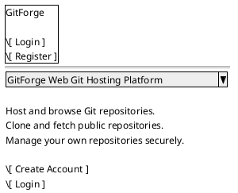

---

## 10. Primary Actions

```text

Register

Login

```

---

## 11. Anonymous State

The Home page must not expose:

```text

Private repositories

User dashboard data

PAT information

Operational diagnostics

```

---

# WF-02 — Register

## 12. Purpose

Allows a Visitor to create a GitForge account.

---

## 13. Wireframe

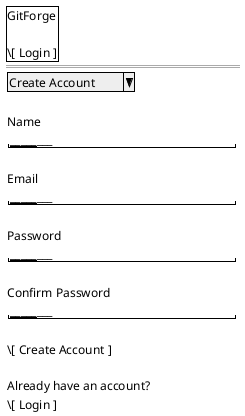

---

## 14. Validation Placement

Field errors appear near their corresponding controls.

Example:

```text

Email

\[user@example]

Enter a valid email address.

```

---

# WF-03 — Login

## 15. Purpose

Authenticates a user through the web session.

---

## 16. Wireframe

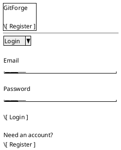

---

## 17. Authentication Failure

Example:

```text

Unable to authenticate with the supplied credentials.

```

The UI must not unnecessarily reveal whether the email address exists.

---

# WF-04 — My Repositories

## 18. Purpose

Provides the authenticated user's main repository dashboard.

---

## 19. Wireframe

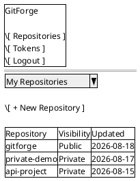

---

## 20. Repository Row Behavior

Repository names are navigable to:

```text

Repository Overview

```

---

## 21. Primary Action

```text

New Repository

```

---

# WF-05 — Empty Repository Dashboard

## 22. Purpose

Represents an authenticated user who owns no repositories.

---

## 23. Wireframe

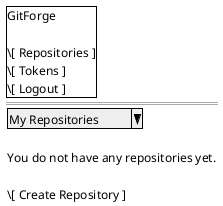

---

# WF-06 — Create Repository

## 24. Purpose

Creates a repository in the authenticated user's own namespace.

---

## 25. Wireframe

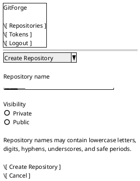

---

## 26. Default Visibility

```text

Private

```

---

## 27. Creation Failure

If physical Git initialization fails:

```text

The repository could not be created.

```

The UI must not route to a successful repository page.

---

# WF-07 — Repository Overview

## 28. Purpose

Provides the central landing page for one repository.

---

## 29. Wireframe

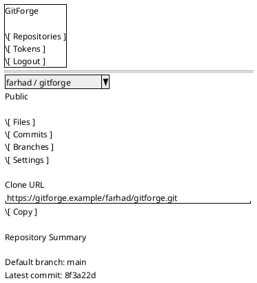

---

## 30. Owner Controls

The `Settings` action appears only to the repository owner.

---

## 31. Public Non-Owner View

For a Visitor or authenticated non-owner:

```text

Files

Commits

Branches

```

remain available for public repositories.

`Settings` is absent.

---

# WF-08 — Empty Repository Overview

## 32. Purpose

Represents a valid repository with no Git history.

---

## 33. Wireframe

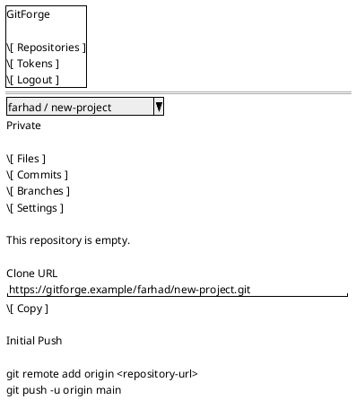

---

## 34. Empty-State Rule

```text

Empty Repository

≠

Repository Not Found

```

---

# WF-09 — Repository Files

## 35. Purpose

Allows read-only browsing of repository tree content.

---

## 36. Wireframe

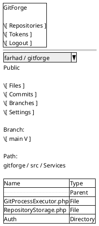

---

## 37. Tree Interaction

Selecting:

```text

Directory

```

opens the corresponding tree path.

Selecting:

```text

File

```

opens the File/Blob View.

---

## 38. Breadcrumb Behavior

Example:

```text

gitforge / src / Services

```

Each ancestor path is navigable.

---

# WF-10 — File / Blob View

## 39. Purpose

Displays one repository file.

---

## 40. Wireframe

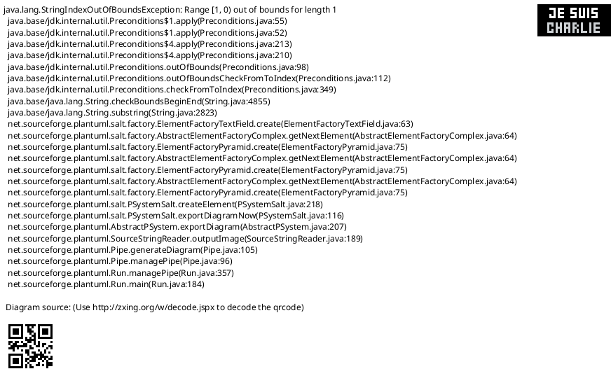

---

## 41. File Safety

Repository text is rendered as:

```text

Text

```

not executable HTML.

---

# WF-11 — Binary File

## 42. Purpose

Represents a Git blob unsuitable for text rendering.

---

## 43. Wireframe

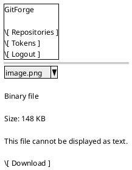

---

## 44. Binary Rule

Binary content must not be blindly interpreted as:

```text

HTML

JavaScript

Text source

```

---

# WF-12 — Large File

## 45. Purpose

Represents content exceeding configured browser display limits.

---

## 46. Wireframe

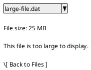

---

# WF-13 — Branches

## 47. Purpose

Lists repository branches.

---

## 48. Wireframe

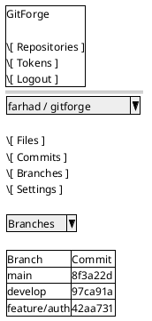

---

## 49. Branch Interaction

Selecting a branch routes to repository browsing with that branch as the current ref.

---

# WF-14 — Empty Branches

## 50. Wireframe

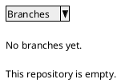

---

# WF-15 — Commit History

## 51. Purpose

Provides bounded commit-history navigation.

---

## 52. Wireframe

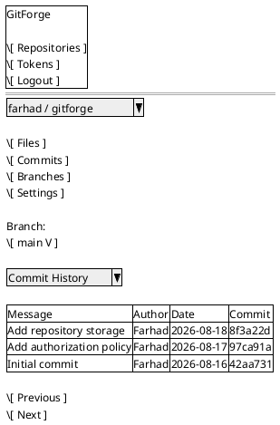

---

# WF-16 — Commit Details

## 53. Purpose

Displays one commit's metadata.

---

## 54. Wireframe

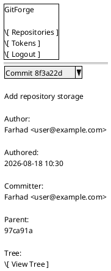

---

## 55. Commit Safety

All commit metadata remains untrusted and safely encoded.

---

# WF-17 — Empty Commit History

## 56. Wireframe

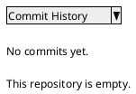

---

# WF-18 — Repository Settings

## 57. Purpose

Allows the owner to manage V1.0.0 repository metadata.

---

## 58. Wireframe

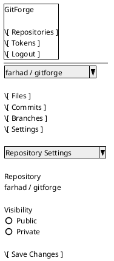

---

## 59. Settings Scope

No V1.0.0 controls appear for:

```text

Delete

Rename

Transfer

Collaborators

Teams

Description

```

---

# WF-19 — Personal Access Tokens

## 60. Purpose

Lists the authenticated user's PATs.

---

## 61. Wireframe

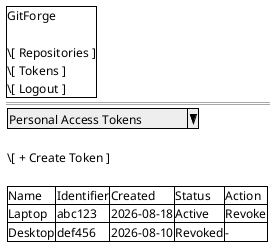

---

## 62. Secret Exclusion

The page must never display:

```text

Plaintext PAT

token_hash

```

---

# WF-20 — Empty PAT List

## 63. Wireframe

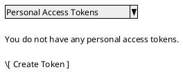

---

# WF-21 — Create PAT

## 64. Purpose

Creates a new Personal Access Token.

---

## 65. Wireframe

```plantuml

@startsalt

{

   {+

     GitForge

     .

     \[ Repositories ]

     \[ Tokens ]

     \[ Logout ]

   }

   ==

   {

     ^Create Personal Access Token^

     .

     Token name

     "____________________________"

     .

     Example: Laptop

     .

     \[ Create Token ]

     \[ Cancel ]

   }

}

@endsalt

```

---

## 66. Deferred Controls

The creation form does not contain:

```text

Scopes

Expiration

Repository selection

```

---

# WF-22 — PAT One-Time Secret

## 67. Purpose

Displays a newly generated plaintext token exactly once.

---

## 68. Wireframe

```plantuml

@startsalt

{

   {+

     GitForge

     .

     \[ Repositories ]

     \[ Tokens ]

     \[ Logout ]

   }

   ==

   {

     ^Token Created^

     .

     Copy this token now.

     You will not be able to view it again.

     .

     "gitforge_abc123_super-secret-value"

     \[ Copy Token ]

     .

     \[ Done ]

   }

}

@endsalt

```

---

## 69. Security Requirement

After leaving this state:

```text

Plaintext PAT

```

must not be retrievable from later UI requests.

---

# WF-23 — PAT Revocation Confirmation

## 70. Purpose

Reduces accidental token revocation.

---

## 71. Wireframe

```plantuml

@startsalt

{

   {

     ^Revoke Token?^

     .

     Token:

     Laptop

     .

     Applications using this token

     will no longer authenticate.

     .

     \[ Revoke Token ]

     \[ Cancel ]

   }

}

@endsalt

```

---

## 72. Revocation Result

After success:

```text

Status = Revoked

```

The secret is not displayed.

---

# WF-24 — Public Repository as Visitor

## 73. Purpose

Shows authorization-aware repository navigation.

---

## 74. Wireframe

```plantuml

@startsalt

{

   {+

     GitForge

     .

     \[ Login ]

     \[ Register ]

   }

   ==

   {

     ^farhad / public-project^

     Public

     .

     \[ Files ]

     \[ Commits ]

     \[ Branches ]

     .

     Clone URL

     "https://gitforge.example/farhad/public-project.git"

     \[ Copy ]

   }

}

@endsalt

```

---

## 75. Absent Owner Controls

Visitor does not see:

```text

Settings

Visibility mutation

PAT controls for repository

```

---

# WF-25 — Private Repository Concealment

## 76. Purpose

Represents unauthorized access to a private repository.

---

## 77. Wireframe

```plantuml

@startsalt

{

   {+

     GitForge

     .

     \[ Login ]

     \[ Register ]

   }

   ==

   {

     ^Repository Not Found^

     .

     The requested repository could not be found.

     .

     \[ Home ]

   }

}

@endsalt

```

---

## 78. Concealment Rule

This page may represent either:

```text

Repository does not exist

```

or:

```text

Private repository exists but actor is unauthorized

```

External UI does not need to distinguish them.

---

# WF-26 — Generic Not Found

## 79. Purpose

Handles missing logical resources.

---

## 80. Wireframe

```plantuml

@startsalt

{

   {

     ^Not Found^

     .

     The requested resource could not be found.

     .

     \[ Back ]

     \[ Home ]

   }

}

@endsalt

```

---

## 81. Applicable Cases

May include:

```text

Unknown repository

Unknown commit

Unknown ref

Unknown tree path

Unknown file

Concealed private repository

```

depending on route and policy.

---

# WF-27 — Operational Error

## 82. Purpose

Represents safe application/storage/Git failures.

---

## 83. Wireframe

```plantuml

@startsalt

{

   {

     ^Something Went Wrong^

     .

     The repository could not be accessed.

     Please try again later.

     .

     \[ Retry ]

     \[ Back ]

   }

}

@endsalt

```

---

## 84. Information Exclusion

Do not expose:

```text

Stack trace

Physical repository path

Git executable path

Raw stderr

Database error

SQL statement

Internal exception class

```

---

# WF-28 — Validation Error

## 85. Purpose

Shows form-local validation failure.

---

## 86. Wireframe

```plantuml

@startsalt

{

   {

     ^Create Repository^

     .

     Repository name

     "../project"

     Repository name is invalid.

     .

     Visibility

     (X) Private

     () Public

     .

     \[ Create Repository ]

   }

}

@endsalt

```

---

# WF-29 — Responsive Repository Layout

## 87. Desktop Concept

```text

+----------------------------------------------------------------+

| GitForge      Repositories      Tokens      Logout              |

+----------------------------------------------------------------+

| farhad / gitforge                              Public           |

| Files       Commits       Branches       Settings               |

+----------------------------------------------------------------+

| Repository Content                                             |

+----------------------------------------------------------------+

```

---

## 88. Narrow-Screen Concept

```text

+-------------------------------+

| GitForge                  ☰   |

+-------------------------------+

| farhad / gitforge             |

| Public                        |

+-------------------------------+

| Files | Commits | More        |

+-------------------------------+

| Repository Content            |

+-------------------------------+

```

---

## 89. Responsive Rule

Responsive adaptation may change:

```text

Placement

Wrapping

Navigation presentation

```

but not:

```text

Information meaning

Authorization semantics

Available functionality

```

---

# Reusable Components

## 90. Global Header

Contains:

```text

Product identity

Primary navigation

Authentication/session action

```

---

## 91. Repository Header

Contains:

```text

Owner

Repository name

Visibility

```

---

## 92. Repository Tabs

Contains:

```text

Files

Commits

Branches

Settings \[owner only]

```

---

## 93. Repository List Row

Contains:

```text

Repository name

Visibility

Optional timestamps

```

---

## 94. Tree Row

Contains:

```text

Name

Type

Navigation target

```

---

## 95. Commit Row

Contains:

```text

Message summary

Author

Timestamp

Commit ID

```

---

## 96. PAT Row

Contains:

```text

Token name

Identifier

Created date

Status

Revoke action

```

---

## 97. Empty-State Component

Contains:

```text

State explanation

Relevant next action

```

---

## 98. Error-State Component

Contains:

```text

Safe message

Recovery action where practical

```

---

# Interaction Design Rules

## 99. Primary Action Visibility

Each form-oriented page should provide one clearly dominant action.

Examples:

```text

Create Account

Login

Create Repository

Save Changes

Create Token

Copy Token

Revoke Token

```

---

## 100. Destructive Actions

PAT revocation is security-sensitive and effectively destructive.

It should receive explicit confirmation.

---

## 101. No Repository Delete Action

Repository deletion is deferred and therefore must not appear as an enabled UI action.

---

## 102. Navigation Consistency

Repository pages should not move primary repository navigation between unrelated positions across screens.

---

# Authorization-Aware UI Matrix

## 103. Repository Controls

| UI Element | Visitor | Authenticated Non-Owner | Owner |

|---|---:|---:|---:|

| Public repository Files | Show | Show | Show |

| Public repository Commits | Show | Show | Show |

| Public repository Branches | Show | Show | Show |

| Private repository content | Hide/Not Found | Hide/Not Found | Show |

| Repository Settings | Hide | Hide | Show |

| Visibility control | Hide | Hide | Show |

| Clone public URL | Show | Show | Show |

| Clone private URL | Hide | Hide | Show |

---

## 104. Global Controls

| UI Element | Visitor | Authenticated User |

|---|---:|---:|

| Login | Show | Hide/Redirect |

| Register | Show | Hide/Redirect |

| Repositories | Hide | Show |

| Tokens | Hide | Show |

| Logout | Hide | Show |

---

# Empty-State Matrix

## 105. Empty States

| Context | Message | Primary Action |

|---|---|---|

| No repositories | No repositories yet | Create Repository |

| Empty repository | This repository is empty | Clone / Initial push guidance |

| No branches | No branches yet | None |

| No commits | No commits yet | None |

| Empty tree | This directory is empty | Navigate back |

| No PATs | No personal access tokens | Create Token |

---

# Error-State Matrix

## 106. Errors

| Condition | User-Facing State |

|---|---|

| Validation failure | Inline validation |

| Login failure | Authentication error |

| Unknown public repository | Not Found |

| Unauthorized private repository | Not Found / concealed |

| Unknown commit | Not Found |

| Repository storage missing | Operational error |

| Git execution failure | Operational error |

| Internal server failure | Generic operational error |

---

# Accessibility Design

## 107. Form Accessibility

Every field must have:

```text

Visible label

Keyboard focus

Associated validation message

```

---

## 108. Navigation Accessibility

Global navigation and repository navigation must be keyboard reachable.

---

## 109. Table/List Accessibility

Repository, branch, commit, and token collections must remain understandable without visual styling alone.

---

## 110. Visibility Accessibility

Repository visibility uses explicit text:

```text

Public

Private

```

not color alone.

---

## 111. Error Accessibility

Error state and validation messages must be perceivable by assistive technologies where practical.

---

# Security Design

## 112. UI Authorization Is Advisory

The UI may hide unauthorized controls, but backend policy is still mandatory.

---

## 113. Repository Data Is Untrusted

Wireframes displaying repository data assume safe output handling for:

```text

Repository names

Branch names

Commit messages

Authors

Tree paths

File names

Blob text

```

---

## 114. PAT Secret Handling

The one-time PAT screen must not:

```text

Persist plaintext to normal page history unnecessarily

Re-render plaintext in PAT list

Expose token in logs

Offer secret recovery

```

---

## 115. Physical Storage Confidentiality

No wireframe displays:

```text

Repository database ID as storage identity

Physical repository directory

Repository root

Filesystem diagnostics

```

---

# Route Mapping

## 116. Wireframe-to-Route Mapping

| Wireframe | Route Concept |

|---|---|

| Home | `GET /` |

| Register | `GET /register` |

| Login | `GET /login` |

| My Repositories | `GET /repositories` |

| Create Repository | `GET /repositories/create` |

| Repository Overview | `GET /{owner}/{repository}` |

| Files | `GET /{owner}/{repository}/tree/{ref}` |

| File | `GET /{owner}/{repository}/blob/{ref}` |

| Branches | `GET /{owner}/{repository}/branches` |

| Commit History | `GET /{owner}/{repository}/commits` |

| Commit Details | `GET /{owner}/{repository}/commits/{commit}` |

| Repository Settings | `GET /{owner}/{repository}/settings` |

| PAT List | `GET /settings/tokens` |

| Create PAT | `GET /settings/tokens/create` |

---

# API Action Mapping

## 117. Form/Action Mapping

| UI Action | HTTP Action |

|---|---|

| Register | `POST /register` |

| Login | `POST /login` |

| Logout | `POST /logout` |

| Create Repository | `POST /repositories` |

| Change Visibility | `PATCH /{owner}/{repository}/visibility` |

| Create PAT | `POST /settings/tokens` |

| Revoke PAT | `POST /settings/tokens/{token}/revoke` |

---

# User Flow — Repository Lifecycle

## 118. Flow

```plantuml

@startuml

title GitForge - Repository UI Lifecycle

actor User

User -> "Login" : Authenticate

"Login" -> "My Repositories" : Success

User -> "Create Repository" : New Repository

"Create Repository" -> "Repository Overview" : Successful creation

User -> "Files" : Browse files

User -> "Commits" : View history

User -> "Branches" : View branches

User -> "Repository Settings" : Owner settings

"Repository Settings" -> "Repository Overview" : Visibility updated

@enduml

```

---

# User Flow — PAT Lifecycle

## 119. Flow

```plantuml

@startuml

title GitForge - PAT UI Lifecycle

actor User

User -> "PAT List" : Open

User -> "Create PAT" : Create

"Create PAT" -> "One-Time Secret" : Success

"One-Time Secret" -> "PAT List" : Done

User -> "PAT List" : Select Revoke

"PAT List" -> "Revoke Confirmation" : Confirm

"Revoke Confirmation" -> "PAT List" : Revoked

@enduml

```

---

# User Flow — Public Repository

## 120. Flow

```plantuml

@startuml

title GitForge - Public Repository Visitor Flow

actor Visitor

Visitor -> "Repository Overview" : Open public repository

Visitor -> "Files" : Browse

Visitor -> "File View" : Open file

Visitor -> "Commits" : View commits

Visitor -> "Commit Details" : Open commit

Visitor -> "Branches" : View branches

@enduml

```

---

# Scope Preservation

## 121. No Collaborator UI

No wireframe includes:

```text

Invite collaborator

Team permission

Member access

Role assignment

```

---

## 122. No Organization UI

No:

```text

Organization switcher

Organization dashboard

Team dashboard

```

is included.

---

## 123. No Pull Request UI

No:

```text

Pull Request

Merge Request

Code Review

Diff Review

```

screen is included.

---

## 124. No Issue UI

No:

```text

Issues

Labels

Milestones

Issue comments

```

screen is included.

---

## 125. No CI/CD UI

No:

```text

Pipelines

Actions

Jobs

Build logs

Deployment jobs

```

screen is included.

---

## 126. No Repository Deletion UI

Repository deletion remains deferred.

---

## 127. No Repository Rename/Transfer UI

Rename and transfer remain deferred.

---

## 128. No PAT Scope/Expiration UI

PAT scope and expiration controls are not present.

---

# Requirements and Use-Case Alignment

## 129. Supported Use Cases

These wireframes directly support:

```text

UC-001 Register

UC-002 Authenticate

UC-003 Logout

UC-004 Create Repository

UC-005 List Owned Repositories

UC-006 View Repository

UC-007 Change Visibility

UC-009 Browse Repository

UC-010 List Branches

UC-011 Commit History

UC-012 Commit Details

UC-013 Tree

UC-014 File

UC-020 Create PAT

UC-022 Revoke PAT

```

---

## 130. Git Client Support

Web wireframes support Git client use indirectly through:

```text

Clone URL

PAT creation

PAT one-time display

Initial push guidance

```

---

# Architecture Alignment

## 131. Server-Oriented UI

Wireframes are compatible with a:

```text

Server-oriented Laravel UI

```

and do not require a mandatory SPA architecture.

---

## 132. Authorization Alignment

Wireframes preserve:

```text

Public anonymous read

Private owner-only read

Owner-only repository management

Owner-only PAT management

```

---

## 133. Repository Browser Alignment

Repository browser screens remain:

```text

Read-only

Git-native

Authorization-aware

```

---

## 134. API Alignment

All mutation controls map to approved application endpoints.

---

# Wireframe Invariants

## 135. WFI-001

```text

Every primary V1.0.0 browser workflow

has a defined screen

```

---

## 136. WFI-002

```text

Public repository read

does not require login UI

```

---

## 137. WFI-003

```text

Private repository controls/content

are not shown to unauthorized actors

```

---

## 138. WFI-004

```text

Repository Settings

are owner-only

```

---

## 139. WFI-005

```text

Empty repository

has an explicit valid state

```

---

## 140. WFI-006

```text

PAT plaintext

appears only on one-time creation screen

```

---

## 141. WFI-007

```text

Physical repository paths

never appear

```

---

## 142. WFI-008

```text

Repository content

is treated as untrusted display data

```

---

## 143. WFI-009

```text

Deferred features

do not receive active UI controls

```

---

# Validation

## 144. UI Information Architecture Alignment

All page families identified by the approved UI Information Architecture have corresponding wireframes.

Result:

```text

PASS

```

---

## 145. Authentication Alignment

Registration, login, logout navigation, and authenticated layout are represented.

Result:

```text

PASS

```

---

## 146. Repository Management Alignment

Repository listing, creation, overview, and visibility management are represented.

Result:

```text

PASS

```

---

## 147. Repository Browser Alignment

Branches, commit history, commit details, tree browsing, and file viewing are represented.

Result:

```text

PASS

```

---

## 148. Empty-State Alignment

Required empty states are explicitly defined.

Result:

```text

PASS

```

---

## 149. PAT Alignment

PAT listing, creation, one-time secret display, and revocation are represented.

Result:

```text

PASS

```

---

## 150. Authorization Alignment

Owner/non-owner/visitor UI differences are explicit.

Result:

```text

PASS

```

---

## 151. Security Alignment

Private resource concealment, PAT secret handling, output safety, and operational error safety are represented.

Result:

```text

PASS

```

---

## 152. Accessibility Alignment

Form labels, keyboard navigation, semantic visibility labels, and error association expectations are defined.

Result:

```text

PASS

```

---

## 153. Scope Alignment

Unapproved V1.0.0 UI features introduced:

```text

0

```

Result:

```text

PASS

```

---

# Implementation Readiness

## 154. Page Readiness

All required V1.0.0 pages have defined low-fidelity layouts.

---

## 155. Navigation Readiness

Global and repository-level navigation structures are defined.

---

## 156. Form Readiness

Required forms are defined for:

```text

Registration

Login

Repository creation

Visibility update

PAT creation

PAT revocation confirmation

```

---

## 157. Repository Browser Readiness

Files, branches, commits, commit details, binary-file, large-file, and empty states are defined.

---

## 158. PAT Readiness

The PAT lifecycle has complete UI states.

---

## 159. Error-State Readiness

Validation, not-found, concealment, and operational failure states are defined.

---

# Completion

## 160. Completion Criteria

This wireframe design is complete when:

- shared anonymous layout is defined;

- shared authenticated layout is defined;

- repository-context layout is defined;

- Home is wireframed;

- Register is wireframed;

- Login is wireframed;

- My Repositories is wireframed;

- empty repository dashboard is wireframed;

- repository creation is wireframed;

- repository overview is wireframed;

- empty repository overview is wireframed;

- tree/file browsing is wireframed;

- binary-file handling is represented;

- large-file handling is represented;

- branch listing is wireframed;

- commit history is wireframed;

- commit details are wireframed;

- repository settings are wireframed;

- PAT listing is wireframed;

- PAT creation is wireframed;

- PAT one-time secret state is wireframed;

- PAT revocation confirmation is wireframed;

- public Visitor repository state is represented;

- private repository concealment is represented;

- generic not-found is represented;

- operational errors are represented;

- validation failures are represented;

- responsive structural behavior is represented;

- authorization-aware control visibility is defined;

- route and API mappings are defined;

- accessibility expectations are defined;

- security expectations are defined;

- excluded/deferred scope remains preserved;

- no blocking wireframe-design gap remains.

---

## 161. Wireframe Design Result

Wireframe design:

```text

DEFINED

```

Blocking wireframe-design gaps:

```text

0

```

Readiness for deployment design:

```text

READY

```

Next design artifact:

```text

12-deployment-design.md

```

---

## 162. Document Status

This document is currently:

```text

Approved

```

It will be changed to:

```text

Approved

```

after page layouts, navigation structures, repository workflows, repository browser states, PAT lifecycle screens, authorization-aware controls, empty/error states, responsive structure, accessibility, security, route mapping, and scope alignment have been reviewed.
