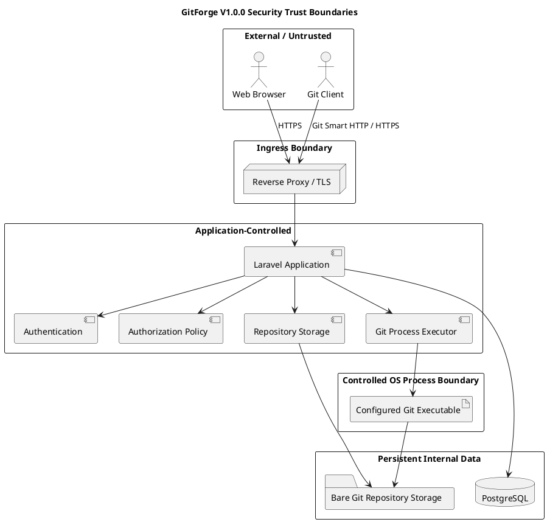
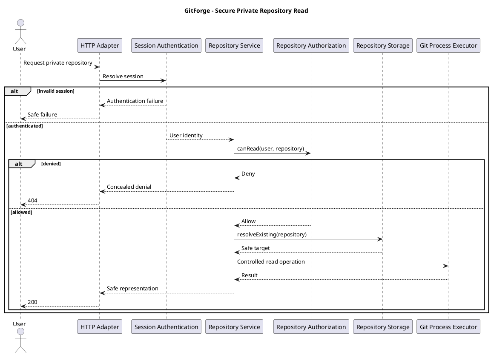
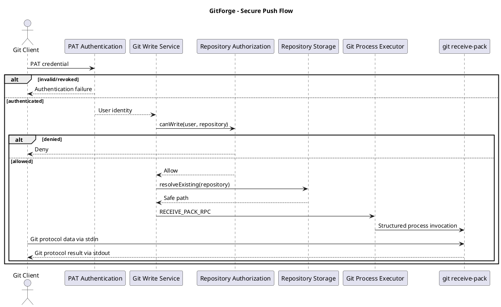

# GitForge V1.0.0 Security Design

## 1. Document Information

| Field | Value |

|---|---|

| Project | GitForge - Web Git Hosting Platform |

| Target release | V1.0.0 |

| Document | Security Design |

| SDLC phase | System Design |

| Milestone | M3 - System Design |

| Project owner | Farhad Valizadegan |

| Status | Approved |

| Last updated | 2026-08-18 |

---

## 2. Purpose

This document defines the implementation-ready security design for GitForge V1.0.0.

It consolidates the approved security decisions from:

```text

Requirements Engineering

System Analysis

Architecture Decisions

Container Architecture

Component Design

Database Schema Design

API Specification

Authorization Design Matrix

Repository Storage Design

Git Process Execution Design

Deployment Design

Observability Design

```

and defines concrete security controls for:

```text

Identity

Session authentication

Personal Access Tokens

Repository authorization

Input validation

Output encoding

CSRF protection

SQL injection prevention

Path traversal prevention

Command injection prevention

Git process execution

Repository content handling

Credential protection

Secret management

Transport security

Database security

Filesystem security

Logging

Error handling

Availability protection

Deployment hardening

Backup security

Failure behavior

```

---

## 3. Security Objectives

GitForge V1.0.0 must protect:

```text

User accounts

Authentication credentials

Personal Access Tokens

Private repository metadata

Private repository Git content

Repository ownership

Application metadata

Physical Git repository storage

Database integrity

Server filesystem

Git process execution boundary

Application secrets

Operational logs

```

The design follows:

```text

Least Privilege

Fail Closed

Explicit Authorization

Defense in Depth

Safe Defaults

Controlled Execution

Data Minimization

Secure Error Handling

```

---

## 4. Security Scope

Security controls apply to:

```text

Web Browser Requests

Session Authentication

Application APIs

Repository Browser

Git Smart HTTP

PAT Authentication

Repository Storage

Git Subprocesses

PostgreSQL

Deployment Runtime

Application Logs

Backup and Restore

```

---

## 5. Security Scope Exclusions

V1.0.0 does not include:

```text

SSH Git transport

Git LFS

Organizations

Teams

Collaborators

Enterprise ACL

SAML

OIDC federation

OAuth provider

MFA

Hardware tokens

PAT scopes

PAT expiration

Repository deletion

Repository transfer

Repository rename

CI/CD execution

User-defined server hooks

Secret scanning

Malware scanning

Content moderation

```

These exclusions must not be mistaken for authorization gaps in the approved V1.0.0 scope.

---

# Security Model

## 6. Security Domains

The system is divided into:

```text

External Client Domain

HTTP Ingress Domain

Application Domain

Database Domain

Repository Storage Domain

Git Execution Domain

Operational Domain

```

---

## 7. Trust Boundary Model



---

## 8. Trust Principle

Every value crossing from an external trust boundary is treated as untrusted until validated.

This includes:

```text

HTTP parameters

Headers

Cookies

Form data

JSON

Git credentials

Git protocol payloads

Repository names

Repository paths inside Git trees

Branch names

Commit IDs

Commit metadata

File names

Blob contents

```

---

# Threat Categories

## 9. Primary Threat Categories

The V1.0.0 design explicitly addresses:

```text

Authentication bypass

Credential theft

Broken access control

Private repository disclosure

Cross-Site Request Forgery

Cross-Site Scripting

SQL injection

Filesystem path traversal

Command injection

Git option injection

Arbitrary process execution

Sensitive log exposure

Secret leakage

Unsafe error disclosure

Repository storage corruption

Unauthorized push

Unauthorized PAT management

Denial-of-service/resource exhaustion

Insecure transport

Insecure deployment permissions

```

---

# Authentication Security

## 10. Web Authentication

Web users authenticate through:

```text

Laravel session authentication

```

using:

```text

Email

Password

```

---

## 11. Password Storage

Passwords must never be stored in plaintext.

GitForge uses the framework-supported password hashing mechanism.

Conceptually:

```text

password

       ↓

Secure Framework Password Hash

       ↓

users.password

```

---

## 12. Password Verification

Password verification uses the framework password-hashing API.

The application must not implement custom plaintext comparison.

---

## 13. Session Regeneration

After successful login:

```text

Session identifier must be regenerated

```

to reduce session fixation risk.

---

## 14. Logout

Logout must:

```text

Invalidate authenticated session

Regenerate/invalidate session token state where appropriate

Invalidate CSRF-related session state where appropriate

```

---

## 15. Authentication Failure

Authentication failure must not establish partial identity.

---

## 16. Account Enumeration

Login failure messages should avoid unnecessary distinction between:

```text

Unknown email

Incorrect password

```

---

## 17. Authentication Rate Limiting

Login attempts should use Laravel rate-limiting controls.

Exact thresholds may be implementation configuration.

Security objective:

```text

Reduce automated password guessing

without introducing unnecessary denial of legitimate access

```

---

# Session Security

## 18. Session Cookie

Production session cookies should use secure configuration appropriate to HTTPS deployment.

Expected properties include:

```text

Secure

HttpOnly

Appropriate SameSite value

```

---

## 19. HTTPS Requirement

Authenticated production session traffic must use:

```text

HTTPS

```

---

## 20. Session Storage

Session implementation may use Laravel-supported storage appropriate to deployment.

V1.0.0 does not require Redis.

---

# Personal Access Token Security

## 21. PAT Purpose

PATs authenticate Git clients over Git Smart HTTP.

They establish:

```text

User Identity

```

not direct repository authorization.

---

## 22. PAT Structure

The token design conceptually separates:

```text

Token Identifier

+

Secret

```

The identifier permits candidate lookup.

The secret is securely verified.

---

## 23. Plaintext PAT Rule

Plaintext PAT is available only:

```text

Immediately after successful creation

```

It is not recoverably stored.

---

## 24. PAT Persistence

Database stores:

```text

token_identifier

token_hash

metadata

revoked_at

```

It does not store:

```text

plaintext token

```

---

## 25. PAT Verification

Authentication flow:

```text

Receive credential

       ↓

Parse controlled token representation

       ↓

Resolve candidate by identifier

       ↓

Check revoked state

       ↓

Securely verify secret against token_hash

       ↓

Establish user identity

```

---

## 26. Invalid PAT

Invalid PAT results in:

```text

Authentication Failure

```

---

## 27. Revoked PAT

A PAT with:

```text

revoked_at != null

```

must not authenticate.

---

## 28. PAT Revocation

PAT revocation requires:

```text

Authenticated web session

+

PAT ownership

```

---

## 29. PAT Scope

PAT scopes are deferred.

Therefore a valid active PAT establishes user identity without scope evaluation.

Repository permissions remain controlled by repository authorization.

---

## 30. PAT Expiration

PAT expiration is deferred.

No expiration security semantics may be silently invented in V1.0.0.

---

## 31. PAT Logging

Never log:

```text

Plaintext PAT

token_hash

Raw Authorization header

Full credential

```

---

# Authorization Security

## 32. Central Authorization

Repository authorization is centralized.

Approved operations:

```text

Read

Write

Manage

```

---

## 33. Public Read

```text

Public Repository

+

Read

=

Allow

```

for:

```text

Visitor

Authenticated Non-Owner

Owner

```

---

## 34. Private Read

```text

Private Repository

+

Read

=

Authenticated Owner Only

```

---

## 35. Repository Write

```text

Repository Write

=

Authenticated Owner Only

```

regardless of visibility.

---

## 36. Metadata Management

Repository metadata mutation is:

```text

Authenticated Owner Only

```

---

## 37. Public Does Not Mean Writable

```text

Public

≠

Public Write

```

---

## 38. Authorization Source

Repository ownership must come from:

```text

repositories.owner_id

```

not:

```text

URL text

Filesystem ownership

Commit authors

Git configuration

Repository directory name

```

---

## 39. Authorization Ordering

For protected repository operations:

```text

Authentication where required

       ↓

Repository metadata resolution

       ↓

Authorization

       ↓

Safe storage resolution

       ↓

Git operation

```

---

## 40. Fail Closed

If authorization cannot be reliably determined:

```text

Deny / Fail

```

The system must not guess.

---

# Private Repository Confidentiality

## 41. Private Repository Concealment

Unauthorized callers should not receive unnecessary confirmation that a private repository exists.

External behavior may use:

```text

404 Not Found

```

while internal diagnostics preserve the actual classification.

---

## 42. No Private Content Before Authorization

No unauthorized private request may reach:

```text

Git object access

Git tree access

Blob access

upload-pack

Repository filesystem path

```

---

# CSRF Security

## 43. CSRF Scope

Session-authenticated state-changing browser requests require Laravel CSRF protection.

Examples:

```text

POST /logout

POST /repositories

PATCH /{owner}/{repository}/visibility

POST /settings/tokens

POST /settings/tokens/{token}/revoke

```

---

## 44. Git Smart HTTP CSRF

Git Smart HTTP PAT operations are not browser-session CSRF flows.

They should not be incorrectly forced through browser CSRF semantics.

---

# Input Validation

## 45. Validation Principle

All external data is validated before use.

Validation must occur according to context.

---

## 46. Repository Name

Approved repository name rules:

```text

Length: 1–100

Lowercase ASCII letters

Digits

Hyphen

Underscore

Safe periods

No slash

No backslash

No ..

No traversal

No control characters

```

---

## 47. Visibility

Allowed values:

```text

public

private

```

No unknown visibility value may fall back silently.

---

## 48. Authentication Input

Login input must be validated for:

```text

Required fields

Valid email form

Expected password input form

```

---

## 49. PAT Name

PAT display name must be treated as untrusted text.

---

## 50. Git Refs and Object Identifiers

Values such as:

```text

Branch

Tag

Commit

Tree

Blob identifier

```

remain untrusted and may only be used in approved Git operations.

---

# SQL Injection Prevention

## 51. Database Query Principle

Database access must use:

```text

Eloquent

Laravel Query Builder

Parameterized SQL

```

---

## 52. No SQL String Concatenation

Untrusted values must not be directly concatenated into SQL statements.

---

## 53. Database Constraints

Database constraints provide additional integrity protection.

Examples:

```text

UNIQUE users.email

UNIQUE repositories(owner_id, name)

CHECK repositories.visibility

Foreign keys

UNIQUE personal_access_tokens.token_identifier

```

---

# Cross-Site Scripting Prevention

## 54. Repository Content Is Untrusted

The following values may originate from Git repository data:

```text

Commit messages

Author names

Author emails

Branch names

Tag names

File names

Tree paths

Blob contents

```

All are untrusted.

---

## 55. Output Encoding

Laravel/templating output should be encoded by default.

Raw HTML output must not be used for repository-controlled values unless explicitly sanitized and justified.

---

## 56. Blob Rendering

Text blobs must not execute as:

```text

HTML

JavaScript

Server templates

```

---

## 57. Binary Content

Binary repository content must not be automatically interpreted as executable browser content.

---

## 58. Content-Disposition / Content-Type

Where binary download behavior is implemented, response headers should prevent unsafe interpretation where appropriate.

---

# Filesystem Security

## 59. Repository Path Authority

Clients cannot specify authoritative physical repository paths.

---

## 60. Internal Mapping

Physical path is derived from:

```text

Configured repository root

+

Authoritative repository ID

```

---

## 61. ID-Based Mapping

Conceptual mapping:

```text

Repository ID: 42

Physical:

<repository-root>/repositories/42.git

```

---

## 62. Root Containment

Every resolved repository target must be proven to remain inside:

```text

GITFORGE_REPOSITORY_ROOT

```

---

## 63. Path Traversal

Inputs such as:

```text

../

..\\

/

\\

absolute paths

drive changes

```

must never control physical repository selection.

---

## 64. Symbolic Links and Reparse Points

Filesystem indirection must not permit root escape.

Implementation must account for platform behavior involving:

```text

Symbolic links

Junctions

Reparse points

```

---

## 65. Unexpected Existing Target

Repository creation must not overwrite an unexpected existing physical target.

---

## 66. Missing Storage

If metadata exists but repository storage is missing:

```text

Do not silently recreate it

```

---

## 67. Orphan Storage

Physical repositories without metadata must not be automatically adopted.

---

# Git Process Security

## 68. Git Executable

Only the configured deployment-controlled Git executable may be launched.

---

## 69. No Arbitrary Command Execution

Clients cannot provide:

```text

Executable

Git subcommand

Command line

Shell script

Process expression

```

---

## 70. Operation Allowlist

Only approved operation categories may execute.

Examples:

```text

INIT_BARE

UPLOAD_PACK_ADVERTISE

UPLOAD_PACK_RPC

RECEIVE_PACK_ADVERTISE

RECEIVE_PACK_RPC

LIST_REFS

COMMIT_HISTORY

COMMIT_DETAILS

TREE_LIST

BLOB_READ

REPOSITORY_VERIFY

```

---

## 71. No Shell

Normal Git process execution must not use:

```text

cmd.exe /c

PowerShell -Command

sh -c

bash -c

```

---

## 72. Structured Process Arguments

Arguments must be supplied separately to the process API.

Do not construct:

```text

git command + user string

```

as one shell command.

---

## 73. Git Option Injection

User-controlled Git values must not become arbitrary command options.

Values beginning with:

```text

-

```

require rejection or safe operation-specific handling where relevant.

---

## 74. Revision Separation

For Git commands supporting argument separators:

```text

--

```

should be used where appropriate to separate revisions/options from repository paths or Git-internal paths.

---

## 75. Git Tree Paths

Repository tree paths are:

```text

Git object paths

```

not operating-system filesystem paths.

---

## 76. Process Environment

Git subprocesses run in a controlled environment.

The design should prevent unintended behavior from:

```text

Interactive prompts

Pager configuration

Editor configuration

Credential helpers

Unexpected global aliases

Sensitive inherited environment variables

```

---

## 77. Non-Interactive Execution

Git subprocesses must not block waiting for interactive input.

---

## 78. Process Timeout

Every Git process must have an explicit timeout policy.

---

## 79. Timeout Failure

A timeout results in:

```text

Process termination

Failure classification

No false success

Resource cleanup

```

---

# Git Smart HTTP Security

## 80. Public Clone and Fetch

Public repositories permit anonymous:

```text

upload-pack advertisement

clone

fetch

```

---

## 81. Private Clone and Fetch

Private repository Git read requires:

```text

Valid PAT identity

+

Repository ownership

```

---

## 82. Push

Push requires:

```text

Valid PAT identity

+

Repository ownership

```

---

## 83. Anonymous Push

Always:

```text

Deny

```

---

## 84. Non-Owner Push

Always:

```text

Deny

```

---

## 85. Protocol Payload

Git protocol payload is:

```text

Untrusted Binary Data

```

It is streamed to/from the approved Git subprocess.

It must not be interpreted as shell input.

---

# Repository Content Security

## 86. Content Trust

All repository content is untrusted.

---

## 87. No Repository Code Execution

GitForge V1.0.0 must not automatically execute:

```text

Repository scripts

Build scripts

CI definitions

Shell files

PHP files

Python files

JavaScript files

Binaries

```

---

## 88. Git Hooks

Users cannot install or control executable server-side Git hooks.

---

## 89. Hook Directory

Repository content must not be allowed to become an executable server hook configuration.

---

## 90. Browser Read-Only Rule

Repository Browser functionality is read-only.

It must not modify Git-native repository content.

---

# Error Security

## 91. Safe External Errors

External errors must not expose:

```text

Stack traces

Internal exception names unnecessarily

Physical paths

Database credentials

SQL statements

Git executable path

Raw stderr

Environment variables

PAT hashes

Application secrets

```

---

## 92. Internal Diagnostics

Internal logs may contain additional safe diagnostic classifications.

---

## 93. Authentication versus Authorization Errors

Internal classification must preserve:

```text

Authentication Failure

Authorization Denial

```

as separate conditions.

---

## 94. Git Failure

Git-native rejection must remain distinct from:

```text

Authentication Failure

Authorization Denial

```

---

# Logging Security

## 95. Never Log

```text

Password

Plaintext PAT

PAT hash

Authorization header

Session secret

APP_KEY

Database password

Full secret environment

Packfile payload

Arbitrary blob content

```

---

## 96. Safe Context

Logs may use:

```text

request_id

user_id

repository_id

operation

authorization decision

failure category

duration

Git exit code

```

---

## 97. Bounded stderr

Git stderr logging must be:

```text

Bounded

Internal

Sanitized where practical

```

---

## 98. Log Injection

Untrusted values included in logs should be structured fields where possible rather than uncontrolled formatted log text.

---

# Secret Management

## 99. Deployment Secrets

Examples:

```text

APP_KEY

DB_PASSWORD

Future infrastructure credentials

```

---

## 100. Secret Storage

Production secrets must not be:

```text

Hard-coded

Committed to Git

Rendered in UI

Included in diagnostics

Logged

```

---

## 101. Environment Configuration

Secrets come from deployment configuration or an equivalent secure mechanism.

---

# Transport Security

## 102. HTTPS

Production-like deployments must use:

```text

HTTPS

```

for externally accessible traffic.

---

## 103. PAT Transport

PAT-based Git authentication must not be used over untrusted plaintext HTTP in production.

---

## 104. HTTP Redirect

Plain HTTP may redirect to HTTPS.

Authentication credentials should not be intentionally submitted before secure transport is established.

---

# Database Security

## 105. Database Role

GitForge uses a dedicated application role.

Conceptually:

```text

git_hosting_app

```

---

## 106. Least Privilege

The role must not require:

```text

SUPERUSER

CREATEDB

CREATEROLE

REPLICATION

```

---

## 107. Database Exposure

PostgreSQL should be available only to trusted application network contexts.

---

## 108. Database Password

Database credentials are deployment secrets.

---

## 109. Database Integrity

Foreign keys and unique/check constraints enforce structural integrity in addition to application validation.

---

# Filesystem Permissions

## 110. Dedicated Runtime Identity

Production-like deployment should use a dedicated service identity.

---

## 111. Repository Root Permissions

The runtime needs only the permissions required for:

```text

Read

Write

Traverse

Create repositories

Controlled partial cleanup

```

inside the configured repository root.

---

## 112. No Broad Filesystem Rights

The application must not require arbitrary write access across the host filesystem.

---

## 113. Public Web Root

Repository storage must not be under a publicly served web directory.

---

# Deployment Security

## 114. Application Public Directory

The web server document root should expose only:

```text

Laravel public/

```

---

## 115. Sensitive Application Files

The following must not be publicly served:

```text

.env

vendor internals

storage internals

application source

repository storage

database files

```

---

## 116. Service Privilege

Normal application execution must not require:

```text

root

Administrator

```

---

## 117. Environment Separation

Development, test, and production must not unintentionally share:

```text

Database

Repository storage

Secrets

Application keys

```

---

# Availability and Resource Security

## 118. Availability Principle

Security includes protection against uncontrolled resource consumption.

---

## 119. Rate Limiting

High-value candidates include:

```text

Login

Registration

PAT authentication failure paths

PAT creation

```

---

## 120. Git Process Limits

Application/deployment should prevent uncontrolled Git subprocess creation.

---

## 121. Request Limits

HTTP/proxy limits should protect the server without breaking valid Git Smart HTTP operations.

---

## 122. Streaming

Clone/fetch/push should use streaming to avoid unnecessary full-request buffering in application memory.

---

## 123. Blob Display Limits

Repository browser should limit very large blob rendering.

---

## 124. Process Timeout

Git process timeout reduces indefinite resource occupation.

---

## 125. Disk Capacity

Low disk capacity can affect:

```text

Repository pushes

Repository creation

PostgreSQL

Logs

```

Operational monitoring should detect disk pressure where possible.

---

# Repository Creation Security

## 126. Creation Preconditions

Repository creation requires:

```text

Authenticated User

Validated repository name

Validated visibility

Own namespace

Database uniqueness

Safe physical target

```

---

## 127. Safe Target

Target must:

```text

Be internally derived

Be contained

Be unused

```

---

## 128. Partial Failure

If Git initialization fails after metadata creation:

```text

Return failure

Compensate metadata

Safely clean partial storage where permitted

```

---

## 129. Cleanup Security

Cleanup may affect only a target that:

```text

Was derived internally

Is contained

Belongs to the failed creation operation

```

---

# Security Failure Classification

## 130. Authentication Failure

Examples:

```text

Invalid password

Missing PAT

Invalid PAT

Revoked PAT

Invalid session

```

---

## 131. Authorization Failure

Examples:

```text

Non-owner private read

Non-owner push

Anonymous push

Non-owner visibility change

Non-owner PAT revocation

```

---

## 132. Validation Failure

Examples:

```text

Invalid repository name

Invalid visibility

Malformed token input

Invalid route parameter

```

---

## 133. Security Path Failure

Examples:

```text

Root containment cannot be established

Unexpected filesystem redirection

Unsafe physical target

```

---

## 134. Process Security Failure

Examples:

```text

Unapproved operation

Unsafe argument

Invalid Git executable configuration

```

---

## 135. Configuration Security Failure

Examples:

```text

Missing APP_KEY

Invalid repository root

Missing Git binary

Invalid database secret configuration

```

---

# Security Event Flow

## 136. Private Repository Read



---

## 137. Secure Push



---

# Security Control Matrix

## 138. Control Matrix

| Threat | Primary Control |

|---|---|

| Password theft from DB | Secure password hashing |

| Session fixation | Session regeneration |

| CSRF | Laravel CSRF middleware |

| SQL injection | Eloquent/parameterized queries |

| XSS | Output encoding |

| Broken access control | Central authorization policy |

| Private repo disclosure | Owner-only private read + concealment |

| Unauthorized push | Owner-only write authorization |

| PAT theft from DB | Hash-only secret persistence |

| Revoked token use | `revoked_at` validation |

| Path traversal | ID-based mapping + containment |

| Command injection | No shell + structured args |

| Git option injection | Allowlisted commands + argument validation |

| Arbitrary repo code execution | No repository script/hook execution |

| Secret logging | Sensitive field exclusion |

| Git process hang | Explicit timeout |

| Resource exhaustion | Streaming + limits |

| Public filesystem exposure | Repository root outside web root |

| DB privilege escalation | Least-privilege application role |

| Insecure transport | HTTPS |

---

# Security Testing Requirements

## 139. Authentication Tests

Test:

```text

Valid login

Invalid password

Unknown account

Session regeneration

Logout invalidation

```

---

## 140. PAT Tests

Test:

```text

Valid active PAT

Invalid PAT

Malformed PAT

Revoked PAT

PAT plaintext unavailable after creation

PAT hash never returned

```

---

## 141. Authorization Tests

Test:

```text

Public anonymous read → Allow

Public non-owner read → Allow

Private anonymous read → Deny

Private non-owner read → Deny

Private owner read → Allow

Anonymous push → Deny

Non-owner push → Deny

Owner push → Allow

Non-owner visibility update → Deny

Owner visibility update → Allow

```

---

## 142. CSRF Tests

State-changing session routes must reject missing/invalid CSRF tokens where middleware applies.

---

## 143. SQL Injection Tests

Test malicious input against:

```text

Login

Repository names

PAT names

Repository lookup

```

and verify parameterized behavior.

---

## 144. XSS Tests

Use malicious content in:

```text

Repository name where accepted

PAT name

Branch name

Commit message

Author name

File name

Blob text

```

and verify it is safely encoded.

---

## 145. Path Traversal Tests

Test values resembling:

```text

../

..\\

/etc/passwd

C:\\Windows

owner/../../repo

```

and verify they never control server storage paths.

---

## 146. Command Injection Tests

Test Git-related values containing:

```text

;

\&\&

||

|

>

<

$()

backticks

quotes

leading -

```

and verify no shell or unapproved process behavior occurs.

---

## 147. Git Option Injection Tests

Verify user-controlled refs and paths cannot introduce arbitrary Git options.

---

## 148. Storage Containment Tests

Verify every repository physical path remains beneath the configured repository root.

---

## 149. Missing Repository Tests

Verify:

```text

Metadata exists

Physical repository missing

```

results in failure and not silent `git init`.

---

## 150. Orphan Repository Tests

Verify physical repository without metadata is not automatically adopted.

---

## 151. Logging Tests

Verify logs exclude:

```text

Passwords

Plaintext PAT

PAT hashes

Authorization header

APP_KEY

DB password

Repository blob content

```

---

## 152. Private Repository Concealment Tests

Verify unauthorized private access does not reveal unnecessary repository existence information.

---

## 153. Git Timeout Tests

Verify a timed-out Git process:

```text

Terminates

Returns failure

Produces safe diagnostic event

Does not return success

```

---

## 154. Deployment Security Tests

Verify:

```text

Repository storage not publicly served

.env not publicly served

Database not publicly exposed unnecessarily

Application runtime does not require admin/root

HTTPS enabled in production-like deployment

```

---

# Security Invariants

## 155. SEC-001 — Authentication Is Separate

```text

Authentication

≠

Authorization

```

---

## 156. SEC-002 — Private Repository Protection

```text

Private repository read

=

Authenticated Owner only

```

---

## 157. SEC-003 — Owner-Only Write

```text

Repository write

=

Authenticated Owner only

```

---

## 158. SEC-004 — PAT Plaintext One-Time Only

```text

PAT plaintext

is never recoverably persisted

```

---

## 159. SEC-005 — Fail Closed

```text

Security-sensitive uncertainty

=

Deny / Fail

```

---

## 160. SEC-006 — Authorization Before Storage

```text

Protected repository access

requires authorization

before storage use

```

---

## 161. SEC-007 — Authorization Before Git

```text

Protected Git process execution

requires authorization first

```

---

## 162. SEC-008 — No Arbitrary Paths

```text

Client input

cannot directly choose

physical repository path

```

---

## 163. SEC-009 — Root Containment

```text

Every repository target

remains inside

configured repository root

```

---

## 164. SEC-010 — No Arbitrary Commands

```text

Client input

cannot select arbitrary executable or Git command

```

---

## 165. SEC-011 — No Shell

```text

Normal Git process execution

does not invoke a command shell

```

---

## 166. SEC-012 — Untrusted Repository Content

```text

Repository data

is never automatically trusted as executable code

```

---

## 167. SEC-013 — No Secret Logging

```text

Passwords and credentials

never enter normal logs

```

---

## 168. SEC-014 — HTTPS

```text

Production authenticated external traffic

uses TLS

```

---

## 169. SEC-015 — Least Privilege

```text

Application runtime

uses minimum required DB/filesystem/process privileges

```

---

## 170. SEC-016 — No Silent Repair

```text

Missing repository storage

is not silently recreated

```

---

## 171. SEC-017 — No Automatic Orphan Adoption

```text

Unknown physical repository

is not automatically assigned to a user/repository

```

---

## 172. SEC-018 — Safe Output

```text

Repository-controlled content

is encoded/safely represented

```

---

# Traceability

## 173. Requirements Mapping

This security design implements approved requirements covering:

```text

Authentication

Authorization

PAT security

Private repository confidentiality

Input validation

Output safety

Repository storage security

Git process security

Failure behavior

Logging

Deployment security

```

---

## 174. Authorization Requirement Mapping

The design preserves approved:

```text

AR-001 through AR-060

```

The detailed requirement-to-design mapping is completed in:

```text

15-design-traceability.md

```

---

## 175. Use-Case Mapping

Security controls apply to:

```text

UC-001 Register

UC-002 Authenticate

UC-003 Logout

UC-004 Create Repository

UC-005 List Owned Repositories

UC-006 View Repository

UC-007 Change Visibility

UC-009 Browse Repository

UC-010 List Branches

UC-011 Commit History

UC-012 Commit Details

UC-013 Tree

UC-014 File

UC-015 Discover Read Service

UC-016 Clone

UC-017 Fetch

UC-018 Discover Write Service

UC-019 Push

UC-020 Create PAT

UC-021 Authenticate Git with PAT

UC-022 Revoke PAT

UC-023 Authorize Read

UC-024 Authorize Write

UC-025 Diagnose Failure

```

---

## 176. Architecture Decision Mapping

This security design implements or supports:

```text

ADR-009 No Arbitrary Shell Execution

ADR-012 Session Authentication

ADR-013 PAT Authentication

ADR-014 PAT Plaintext One-Time Only

ADR-015 PAT Scopes/Expiration Deferred

ADR-016 Centralized Repository Authorization

ADR-017 Authorization Before Protected Storage

ADR-018 Owner-Only Repository Write

ADR-019 Visibility Controls Read Only

ADR-021 Repository Content Is Untrusted

ADR-027 Database Constraints

ADR-028 Explicit API Validation

ADR-034 Explicit Git Process Timeout

ADR-035 Controlled Git Process Environment

ADR-036 Fail-Closed Architecture

ADR-037 No Application Admin Role

ADR-040 Sensitive Data Excluded from Logs

ADR-041 Safe Error Mapping

ADR-042 Framework Password Hashing

ADR-043 CSRF Protection

ADR-044 Parameterized Database Access

ADR-045 Output Encoding

ADR-050 Persistent Repository Storage

ADR-052 Secrets via Deployment Configuration

ADR-058 Central Security-Critical Configuration

ADR-059 Internal Repository Physical Mapping

ADR-063 Git Failure Distinct from Auth Failure

ADR-065 Missing Storage Is Consistency Failure

ADR-066 No Implicit Repair

ADR-067 Repository Browser Is Read-Only

```

---

# Scope Preservation

## 177. No MFA Requirement

V1.0.0 does not require multi-factor authentication.

---

## 178. No OAuth/OIDC Requirement

No federated identity provider is required.

---

## 179. No Collaborator ACL

No collaborator/team authorization model is introduced.

---

## 180. No Application Admin Override

No application administrator bypasses repository ownership rules.

---

## 181. No User Git Hooks

Users cannot configure arbitrary executable server hooks.

---

## 182. No SSH Git Authentication

Git authentication is PAT-based over Smart HTTP only.

---

## 183. No PAT Scopes

No scope-based authorization is introduced.

---

## 184. No PAT Expiration

No expiration policy is introduced.

---

# Security Validation

## 185. Authentication Alignment

Session and PAT authentication designs are explicit and separated.

Result:

```text

PASS

```

---

## 186. Authorization Alignment

Public/private read and owner-only write semantics are preserved.

Result:

```text

PASS

```

---

## 187. PAT Alignment

PAT plaintext confidentiality, secure verification, ownership, and revocation are preserved.

Result:

```text

PASS

```

---

## 188. Database Alignment

Parameterized access, integrity constraints, and least-privilege DB role are defined.

Result:

```text

PASS

```

---

## 189. Repository Storage Alignment

ID-based mapping, containment, no silent repair, and no orphan adoption are preserved.

Result:

```text

PASS

```

---

## 190. Git Process Alignment

Allowlisted operations, no shell, structured arguments, timeouts, controlled environment, and safe path requirements are preserved.

Result:

```text

PASS

```

---

## 191. API Alignment

CSRF, validation, safe errors, authentication, authorization, and protocol separation align with approved API contracts.

Result:

```text

PASS

```

---

## 192. UI Alignment

Output encoding, private-repository concealment, and one-time PAT display align with approved UI design.

Result:

```text

PASS

```

---

## 193. Deployment Alignment

TLS, least privilege, secret isolation, filesystem permissions, and non-public repository storage are defined.

Result:

```text

PASS

```

---

## 194. Observability Alignment

Security events remain diagnosable without logging credentials or repository contents.

Result:

```text

PASS

```

---

## 195. Scope Alignment

Unapproved security capabilities or roles introduced:

```text

0

```

Result:

```text

PASS

```

---

# Implementation Readiness

## 196. Authentication Readiness

Password, session, PAT, and revocation security behavior are defined.

---

## 197. Authorization Readiness

Repository read/write/manage decisions are implementation-ready.

---

## 198. Validation Readiness

Security-critical external input classes are identified.

---

## 199. Storage Security Readiness

Path mapping, containment, inconsistency, and cleanup rules are defined.

---

## 200. Process Security Readiness

Git process allowlisting, no-shell execution, argument control, environment control, and timeout requirements are defined.

---

## 201. Web Security Readiness

CSRF, XSS mitigation, session controls, safe errors, and transport requirements are defined.

---

## 202. Deployment Security Readiness

TLS, secrets, filesystem permissions, database privileges, and service identity are defined.

---

## 203. Test Readiness

Security test categories and expected behavior are defined.

---

# Completion

## 204. Completion Criteria

This security design is complete when:

- security objectives are defined;

- trust boundaries are defined;

- primary threat categories are identified;

- password security is defined;

- session security is defined;

- PAT security is defined;

- PAT revocation behavior is defined;

- authentication and authorization are separated;

- public repository read security is defined;

- private repository confidentiality is defined;

- owner-only write security is defined;

- CSRF protection is defined;

- input validation is defined;

- SQL injection prevention is defined;

- XSS/output safety is defined;

- filesystem path security is defined;

- repository-root containment is defined;

- symbolic-link/reparse-point risk is addressed;

- Git process execution security is defined;

- command injection prevention is defined;

- Git option injection prevention is defined;

- Git Smart HTTP security is defined;

- repository content trust is defined;

- executable hook/content restrictions are defined;

- safe error handling is defined;

- log secret exclusion is defined;

- deployment secret management is defined;

- TLS requirements are defined;

- database least privilege is defined;

- filesystem least privilege is defined;

- deployment hardening boundaries are defined;

- resource/availability protections are defined;

- repository creation security is defined;

- security failure classifications are defined;

- security tests are defined;

- security invariants are defined;

- excluded/deferred security scope remains preserved;

- no blocking security-design gap remains.

---

## 205. Security Design Result

Security design:

```text

DEFINED

```

Blocking security-design gaps:

```text

0

```

Readiness for design traceability:

```text

READY

```

Next design artifact:

```text

15-design-traceability.md

```

---

## 206. Document Status

This document is currently:

```text

Approved

```

It will be changed to:

```text

Approved

```

after authentication, session security, PAT security, authorization, private repository confidentiality, validation, CSRF, SQL injection, XSS, filesystem security, Git process security, transport security, secret management, database security, deployment hardening, observability security, availability controls, testing, and scope alignment have been reviewed.
