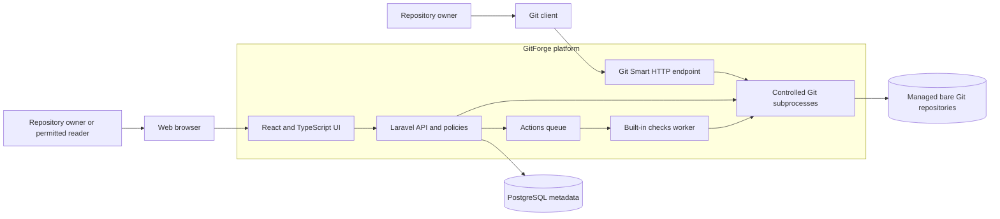

# Project context diagram

This diagram shows the platform boundary and its primary runtime dependencies. PostgreSQL metadata and bare Git storage remain separate and require coordinated recovery.

[Editable Mermaid source](diagrams/project-context.mmd). For deployment detail, see the [architecture design](../SDLC/System-Design/03-container-architecture.md).
