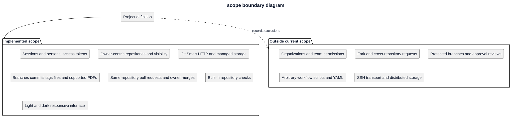

# Scope boundary diagram

Development capabilities shown here are implemented on main; a new tagged release has not been declared. Excluded capabilities are future options, not promised work.

[PlantUML source](diagrams/scope-boundary.puml)

[Editable PlantUML source](diagrams/scope-boundary.puml). See [scope](project-scope.md) for operational limitations and release distinctions.
