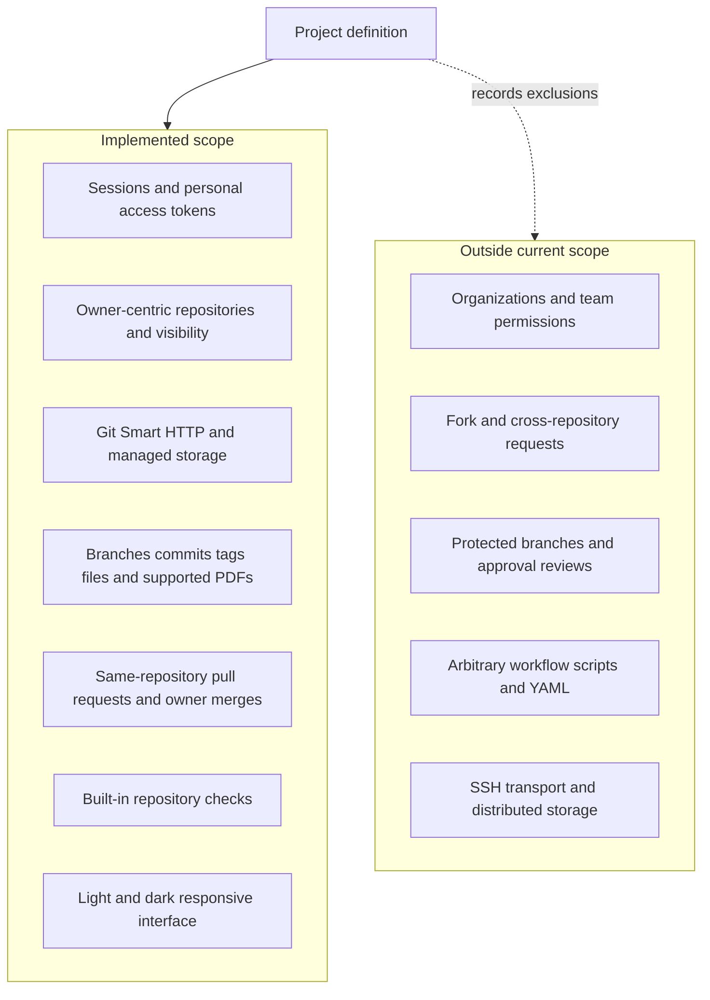

# Scope boundary diagram

Development capabilities shown here are implemented on main; a new tagged release has not been declared. Excluded capabilities are future options, not promised work.

[Editable Mermaid source](diagrams/scope-boundary.mmd). See [scope](project-scope.md) for operational limitations and release distinctions.
