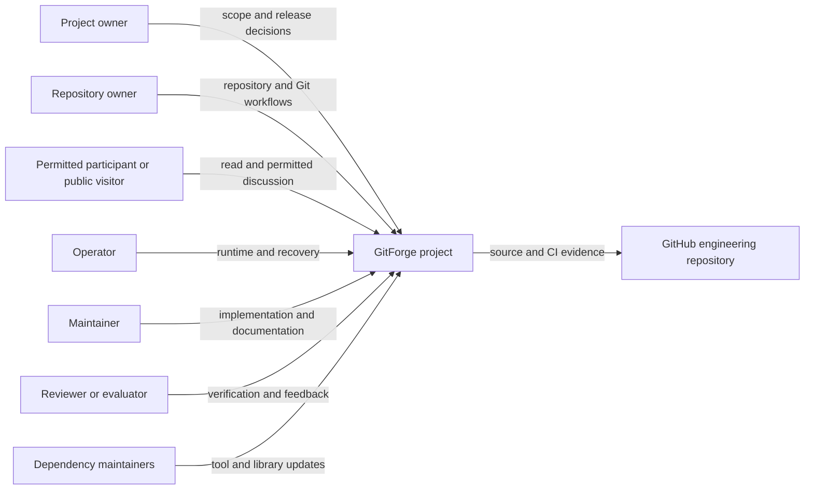

# Stakeholder ecosystem diagram

This view describes roles around the project. It is not an authorization diagram; server-side policies determine application permissions.

[Editable Mermaid source](diagrams/stakeholder-ecosystem.mmd). Role details and external boundaries are in [stakeholders and external systems](stakeholders-and-external-systems.md).
