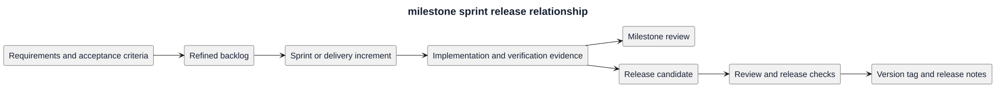

# Milestone, sprint, and release relationship

A milestone records an engineering outcome; a sprint or delivery increment groups bounded work; a release identifies published behavior at an immutable version tag. They are related but not interchangeable.

[PlantUML source](diagrams/milestone-sprint-release.puml)

Several increments may support one milestone. One increment may touch multiple SDLC phases. A merged change is not automatically a published release. M0-M7 describe the historical v1.0.0 lifecycle; October changes are delivery records, not retrospectively invented sprint commitments.

[Editable source](diagrams/milestone-sprint-release.puml), [milestones](milestones.md), [sprint records](../Sprints/README.md), and [release index](../Releases/v1/README.md).
