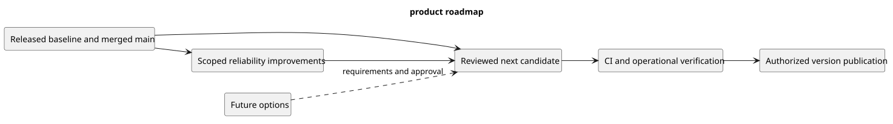

# Product roadmap

This roadmap orders potential work by dependency and evidence. It assigns no unapproved delivery dates.

| Horizon | Focus | Exit condition |
| --- | --- | --- |
| Current baseline | Maintain v1.0.1 and merged main changes | Scope and operational limitations remain documented |
| Next candidate | Review merged collaboration, browsing, and UI changes | Candidate commit passes applicable CI and release criteria |
| Reliability improvements | Worker startup, fresh visual QA, bundle optimization, platform coverage | Each scoped backlog item's acceptance evidence is recorded |
| Future expansion | Team permissions, forks, protected branches, runners, SSH | Separate requirements, architecture, and authorized delivery plan |

[PlantUML source](diagrams/product-roadmap.puml)

[Editable source](diagrams/product-roadmap.puml). Read [product backlog](product-backlog.md), [future scope](future-scope.md), and [release criteria](../Releases/v1/RELEASE-CHECKLIST.md) before treating an option as committed delivery.
