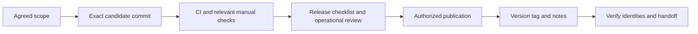

# Release pipeline

1. Agree scope and select a candidate commit.
2. Review affected requirements, code, documentation, risks, and migrations.
3. Run Backend CI, Frontend CI where triggered, Deployment Validation, and Release Readiness. The release gate also validates frontend behavior.
4. Perform applicable visual and operational checks; record skipped or blocked scenarios.
5. Review coordinated backup/restore and worker-restart requirements.
6. Update the changelog, release notes, version metadata, and known limitations.
7. Merge reviewed work when needed and confirm the intended release commit.
8. Publish a new tag and release only through the authorized release process.
9. Verify remote/local identities and published notes after publication.

Passing checks alone does not assign a version or authorize publication. Existing v1.0.0 publication automation is version-specific; review it before using it as a template for another version. Historical tags must not be moved to represent new work.

[Editable source](diagrams/release-pipeline.mmd), [release checklist](../Releases/v1/RELEASE-CHECKLIST.md), [versioning policy](../SDLC/08-maintenance/02-versioning-policy.md), and [release history](../Releases/v1/README.md).
