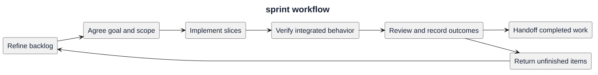

# Sprint workflow

Use this process for future planned sprints or bounded delivery increments. Historical work remains recorded under its original milestone or increment labels.

1. Refine backlog items and agree a focused goal.
2. Record included items, dependencies, exclusions, and acceptance criteria.
3. Implement in reviewable slices; keep one owner for each shared write surface.
4. Verify each slice with appropriate checks and isolated data.
5. Review integrated behavior and update documentation and traceability.
6. Record completion, incomplete work, operational handoff, and exact verification commits.
7. Carry unfinished items back to the backlog with their actual state.

[PlantUML source](diagrams/sprint-workflow.puml)

[Editable source](diagrams/sprint-workflow.puml), [record template](../Sprints/TEMPLATE.md), [definition of done](DELIVERY.md), and [product backlog](product-backlog.md).
