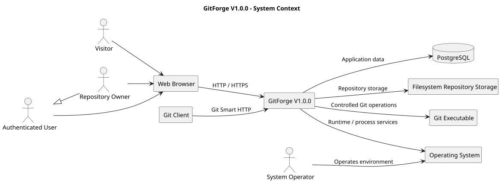

# GitForge V1.0.0 Actors and External Systems

## 1. Document Information

| Field          | Value                               |
| -------------- | ----------------------------------- |
| Project        | GitForge - Web Git Hosting Platform |
| Target release | V1.0.0                              |
| Document       | Actors and External Systems         |
| SDLC phase     | Requirements Engineering            |
| Milestone      | M1 - Requirements Engineering       |
| Project owner  | Farhad Valizadegan                  |
| Status         | Approved                            |
| Last updated   | 2026-08-17                          |

---

## 2. Purpose

This document identifies and defines the actors and external systems that interact with GitForge V1.0.0.

The purpose is to establish a clear system boundary before formal functional requirements and use cases are finalized.

This document distinguishes between:

* human actors;
* role-based actors;
* external software actors;
* infrastructure systems;
* internal technical boundaries.

---

## 3. System Boundary

GitForge V1.0.0 is a web-based Git hosting application.

The GitForge application is responsible for:

* user identity management;
* authentication;
* repository metadata management;
* repository ownership;
* repository visibility;
* repository browsing;
* Personal Access Token management;
* authorization;
* Git Smart HTTP request handling;
* controlled interaction with Git repositories;
* controlled execution of Git service processes.

Systems outside the GitForge application boundary include:

* web browsers;
* Git clients;
* PostgreSQL;
* filesystem storage;
* the Git executable;
* operating-system services.

---

## 4. Actor Classification

Actors are classified into the following categories.

| Category            | Description                                                          |
| ------------------- | -------------------------------------------------------------------- |
| Primary actor       | Initiates an interaction to achieve a goal                           |
| Supporting actor    | Supports execution of a system function                              |
| External system     | Software or infrastructure outside the GitForge application boundary |
| Role specialization | A specialized role derived from another actor                        |

---

## 5. Primary Human Actors

### 5.1 Visitor

**Type:** Primary human actor

A Visitor is a person interacting with GitForge without an authenticated application session.

Typical goals include:

* viewing publicly accessible application pages;
* registering a user account;
* signing in;
* accessing public repositories where permitted.

A Visitor must not be treated as an authenticated user.

#### Capabilities

A Visitor may:

* access the registration interface;
* submit a registration request;
* access the login interface;
* submit authentication credentials;
* browse public repositories where public anonymous browsing is enabled.

A Visitor may not:

* create repositories;
* modify repositories;
* access private repositories;
* create Personal Access Tokens;
* push Git changes;
* perform protected account actions.

---

### 5.2 Authenticated User

**Type:** Primary human actor

An Authenticated User is a registered user with a valid authenticated application session.

Typical goals include:

* viewing account-specific information;
* creating repositories;
* viewing owned repositories;
* browsing authorized repositories;
* creating and managing Personal Access Tokens;
* performing authorized Git operations.

#### Capabilities

An Authenticated User may:

* access authenticated application areas;
* create repositories;
* view repositories accessible to the user;
* browse authorized repository content;
* manage Personal Access Tokens belonging to the user;
* perform Git operations when authorization conditions are satisfied.

Authentication alone does not imply authorization to modify every repository.

---

### 5.3 Repository Owner

**Type:** Role specialization of Authenticated User

A Repository Owner is an Authenticated User who owns a specific repository.

Ownership is evaluated in the context of a repository.

A user may therefore be:

* owner of one repository;
* non-owner of another repository;
* unauthorized for another private repository.

#### Capabilities

For an owned repository, the Repository Owner may be permitted to:

* view repository metadata;
* browse repository content;
* change supported repository settings;
* change repository visibility where supported;
* perform Git read operations;
* perform Git write operations;
* manage the repository lifecycle where supported by V1.0.0.

Repository ownership is the primary write-authorization model for V1.0.0 unless a more specific requirement overrides it.

---

### 5.4 System Operator

**Type:** Supporting human actor

A System Operator is responsible for operating, configuring, maintaining, or troubleshooting the deployed GitForge application.

The System Operator is not necessarily represented by a normal application account.

Typical responsibilities may include:

* application configuration;
* environment management;
* database operation;
* repository storage management;
* log inspection;
* backup and recovery activities;
* deployment and maintenance.

V1.0.0 does not require a complete web-based administrative console unless explicitly specified elsewhere.

---

## 6. External Software Actor

### 6.1 Git Client

**Type:** Primary external software actor

A Git Client is Git-compatible client software that communicates with GitForge using Git Smart HTTP.

Examples include:

```text
git clone
git fetch
git pull
git push
```

The Git Client acts on behalf of a human user but communicates through protocol-level HTTP requests rather than normal browser workflows.

#### Git Client Goals

The Git Client may need to:

* discover repository references;
* clone repositories;
* fetch repository objects;
* push repository objects and references;
* authenticate using supported credentials.

#### Git Client Constraints

The Git Client:

* must target an existing repository;
* must follow supported Git Smart HTTP semantics;
* must satisfy authentication requirements when applicable;
* must satisfy authorization rules;
* must not bypass repository visibility or ownership rules.

---

## 7. Actor Generalization

The principal human actor relationship is:

```text
Visitor
&#x20;  |
&#x20;  | successful authentication
&#x20;  v
Authenticated User
&#x20;  |
&#x20;  | owns a specific repository
&#x20;  v
Repository Owner
```

Repository Owner is not a permanently separate account type.

It is a contextual authorization role.

---

## 8. Authentication States

GitForge distinguishes at least the following authentication states:

| State                 | Description                                            |
| --------------------- | ------------------------------------------------------ |
| Unauthenticated       | No valid authenticated identity                        |
| Session authenticated | User authenticated through web application session     |
| Token authenticated   | User authenticated using a valid Personal Access Token |
| Authentication failed | Credentials were missing, invalid, expired, or revoked |

Authentication state does not independently determine authorization.

---

## 9. Authorization Contexts

Authorization depends on one or more of the following:

* actor identity;
* authentication state;
* repository ownership;
* repository visibility;
* requested operation;
* token validity;
* token permissions where applicable.

Example:

```text
Authenticated User
&#x20;       +
Repository Owner
&#x20;       +
Valid write-capable credential
&#x20;       =
Authorized repository push
```

The authoritative authorization rules will be defined in:

```text
12-authorization-requirements-matrix.md
```

---

## 10. External Systems

The following systems exist outside the GitForge application boundary.

### 10.1 Web Browser

**Type:** External client system

The Web Browser provides the user interface execution environment for human users.

Responsibilities include:

* rendering HTML and CSS;
* executing supported JavaScript;
* submitting HTTP requests;
* maintaining browser-side session state such as cookies;
* displaying application responses.

GitForge must not rely on browser-side controls as the sole authorization mechanism.

---

### 10.2 PostgreSQL Database

**Type:** External persistence system

PostgreSQL stores application-managed relational data.

Candidate data includes:

* users;
* authentication-related metadata;
* repositories;
* repository ownership;
* repository visibility;
* Personal Access Tokens;
* timestamps;
* application relationships.

PostgreSQL is not the authoritative storage mechanism for Git object data unless a specific later requirement explicitly requires such storage.

---

### 10.3 Filesystem

**Type:** External infrastructure boundary

The filesystem stores Git repository directories and related filesystem-based data.

Responsibilities include:

* storing bare Git repositories;
* preserving repository files and Git object databases;
* supporting controlled read/write access from GitForge;
* enforcing operating-system-level path and permission constraints.

GitForge must ensure that repository paths cannot be manipulated to access unauthorized filesystem locations.

---

### 10.4 Git Executable

**Type:** External supporting system

The Git executable provides native Git repository operations and Smart HTTP service commands.

Candidate operations include:

```text
git upload-pack
git receive-pack
```

GitForge must invoke Git processes only through controlled command execution.

User-controlled values must not enable arbitrary operating-system command execution.

---

### 10.5 Operating System

**Type:** External infrastructure system

The operating system provides:

* process execution;
* filesystem services;
* environment configuration;
* networking;
* access permissions;
* runtime process isolation mechanisms where available.

GitForge depends on the operating system but does not control the operating system itself.

---

## 11. External System Interaction Summary

| External system  | Primary interaction              | Direction                |
| ---------------- | -------------------------------- | ------------------------ |
| Web Browser      | Web application HTTP requests    | Bidirectional            |
| Git Client       | Git Smart HTTP                   | Bidirectional            |
| PostgreSQL       | Application metadata persistence | Bidirectional            |
| Filesystem       | Repository storage               | Bidirectional            |
| Git Executable   | Repository protocol operations   | Bidirectional            |
| Operating System | Runtime and process services     | Primarily GitForge to OS |

---

## 12. Human-to-System Interaction Paths

### 12.1 Visitor Path

```text
Visitor
&#x20;  |
&#x20;  v
Web Browser
&#x20;  |
&#x20;  v
GitForge Web Interface
```

---

### 12.2 Authenticated User Path

```text
Authenticated User
&#x20;  |
&#x20;  v
Web Browser
&#x20;  |
&#x20;  v
GitForge
&#x20;  |
&#x20;  +--> PostgreSQL
&#x20;  |
&#x20;  +--> Repository Storage
```

---

### 12.3 Git User Path

```text
Human User
&#x20;  |
&#x20;  v
Git Client
&#x20;  |
&#x20;  v
Git Smart HTTP
&#x20;  |
&#x20;  v
GitForge
&#x20;  |
&#x20;  +--> Authentication / Authorization
&#x20;  |
&#x20;  +--> Git Executable
&#x20;  |
&#x20;  +--> Repository Storage
```

---

## 13. System Context Diagram

The following PlantUML diagram represents the high-level actor and external-system context.



[PlantUML source](diagrams/03-actors-and-external-systems.puml)

---

## 14. Actor Responsibilities

### 14.1 Visitor Responsibilities

The Visitor is responsible for:

* providing valid registration information;
* providing valid authentication credentials;
* respecting public access boundaries.

---

### 14.2 Authenticated User Responsibilities

The Authenticated User is responsible for:

* protecting account credentials;
* protecting issued Personal Access Tokens;
* using repositories within authorized boundaries;
* providing valid repository input.

---

### 14.3 Repository Owner Responsibilities

The Repository Owner is responsible for:

* managing owned repository settings;
* protecting write credentials;
* maintaining legitimate repository content;
* understanding the effect of repository visibility settings.

---

### 14.4 System Operator Responsibilities

The System Operator is responsible for:

* securing environment configuration;
* controlling filesystem permissions;
* protecting secrets;
* maintaining database availability;
* maintaining Git executable availability;
* reviewing operational failures.

---

## 15. Trust Boundaries

The following trust boundaries are material to V1.0.0.

### 15.1 Client-to-Application Boundary

Requests from browsers and Git clients are untrusted.

GitForge must validate:

* identity;
* credentials;
* parameters;
* repository identifiers;
* requested operations.

---

### 15.2 Application-to-Database Boundary

Database access must occur through controlled application data access mechanisms.

The application must not construct unsafe database queries from untrusted input.

---

### 15.3 Application-to-Filesystem Boundary

Repository paths are security-sensitive.

The application must prevent:

* path traversal;
* access outside configured repository roots;
* unauthorized repository reads;
* unauthorized repository writes.

---

### 15.4 Application-to-Git-Process Boundary

Git process execution is security-sensitive.

GitForge must control:

* executable selection;
* permitted commands;
* repository path arguments;
* process input;
* environment variables;
* process output handling.

---

## 16. Actor Access Summary

| Capability                         |                  Visitor | Authenticated User |   Repository Owner |  Git Client |
| ---------------------------------- | -----------------------: | -----------------: | -----------------: | ----------: |
| Register account                   |                      Yes |                N/A |                N/A |          No |
| Login                              |                      Yes |                N/A |                N/A |          No |
| Create repository                  |                       No |                Yes |                Yes |          No |
| View public repository             |            Candidate Yes |                Yes |                Yes |         Yes |
| View authorized private repository |                       No |        Conditional |                Yes | Conditional |
| Browse repository content          | Public only if supported |        Conditional |                Yes |         N/A |
| Create PAT                         |                       No |                Yes |                Yes |          No |
| Clone repository                   |       Through Git client | Through Git client | Through Git client | Conditional |
| Fetch repository                   |       Through Git client | Through Git client | Through Git client | Conditional |
| Push repository                    |                       No |        Conditional |                Yes | Conditional |
| Change owned repository settings   |                       No |      Only if owner |                Yes |          No |

`Conditional` means the operation depends on authorization rules that will be formalized later.

---

## 17. Actor-to-Capability Mapping

### Visitor

Primary capabilities:

```text
Register
Authenticate
View permitted public resources
```

### Authenticated User

Primary capabilities:

```text
Manage account session
Create repository
List accessible repositories
Browse accessible repositories
Manage Personal Access Tokens
Use authorized Git read operations
```

### Repository Owner

Primary capabilities:

```text
Manage owned repository
Read repository
Write repository
Push changes
Control supported repository settings
```

### Git Client

Primary capabilities:

```text
Discover refs
Clone
Fetch
Push
Authenticate through supported Git credentials
```

### System Operator

Primary capabilities:

```text
Configure
Deploy
Observe
Maintain
Recover
```

---

## 18. Actor Scope Decisions

The following scope decisions apply to V1.0.0.

### 18.1 No Organization Actor

Organizations are outside V1.0.0.

Repositories are owned directly by users.

### 18.2 No Team Actor

Team-based repository permissions are outside V1.0.0.

### 18.3 No Collaborator Role Unless Explicitly Added

V1.0.0 uses ownership-based write authorization as the primary model.

A separate repository collaborator role must not be assumed unless formally introduced by an approved requirement.

### 18.4 No Anonymous Write Actor

Unauthenticated users must never perform repository write operations.

### 18.5 No Full Administrative Application Role Required

System operation may be performed through deployment and environment tooling rather than an application-level administrator interface.

---

## 19. External Interfaces Derived from Actors

Actor analysis identifies the following required interface families:

| Actor/System       | Interface                      |
| ------------------ | ------------------------------ |
| Visitor            | Web UI                         |
| Authenticated User | Web UI / application HTTP      |
| Repository Owner   | Web UI / application HTTP      |
| Git Client         | Git Smart HTTP                 |
| PostgreSQL         | Database connection            |
| Filesystem         | Repository storage interface   |
| Git Executable     | Process execution interface    |
| System Operator    | Runtime/deployment environment |

These interfaces will be formalized in:

```text
07-interface-requirements.md
```

---

## 20. Actor-Related Security Requirements

Actor analysis produces the following security expectations:

1. every protected operation must resolve an authenticated identity where required;
2. repository authorization must be evaluated server-side;
3. repository ownership must be validated before owner-only operations;
4. Git Client authentication must map to a valid application user;
5. invalid or revoked credentials must not grant access;
6. private repository identifiers must not be sufficient to bypass authorization;
7. user-controlled repository paths must not be passed directly to filesystem or command execution;
8. public access must never implicitly enable repository writes;
9. authentication failure and authorization failure must be handled predictably;
10. system operation privileges must remain separate from ordinary user privileges.

---

## 21. Actor-Related Assumptions

The following assumptions apply:

* one application user represents one primary GitForge identity;
* repository ownership is directly associated with an application user;
* a user may own multiple repositories;
* a repository has one primary owner in V1.0.0;
* the Git Client acts on behalf of a user;
* token-authenticated Git operations resolve to an application user identity;
* operators manage infrastructure separately from normal repository ownership.

---

## 22. Unresolved Actor Questions

The following questions remain for subsequent requirements documents:

1. Should unauthenticated Visitors be allowed to browse public repository source files through the web interface?
2. Will an Authenticated User be allowed read access to every public repository?
3. Will V1.0.0 support any non-owner write permission?
4. Will repository deletion be owner-only?
5. Will repository rename be owner-only?
6. Will System Operator actions require application-level audit records?
7. Will Personal Access Tokens support separate read and write scopes?

These must be resolved before M1 is completed.

---

## 23. Traceability to Project Definition

Actor definitions support the following upstream concerns:

| Actor              | Project concern                       |
| ------------------ | ------------------------------------- |
| Visitor            | Accessibility and onboarding          |
| Authenticated User | Core platform usage                   |
| Repository Owner   | Repository management and Git hosting |
| Git Client         | Real Git interoperability             |
| System Operator    | Operability and maintainability       |

Detailed mapping will be added to the Requirements Traceability Matrix.

---

## 24. Input to Subsequent Requirements Work

This document provides direct input to:

```text
04-functional-requirements.md
05-non-functional-requirements.md
07-interface-requirements.md
08-business-rules.md
09-use-case-model.md
10-detailed-use-case-specifications.md
11-user-stories-and-acceptance-criteria.md
12-authorization-requirements-matrix.md
```

---

## 25. Completion Criteria

This document is considered complete when:

* all primary V1.0.0 actors are identified;
* human and software actors are distinguished;
* actor roles are defined without ambiguity;
* external systems are identified;
* the application boundary is clear;
* major trust boundaries are identified;
* actor capabilities are described;
* authorization context is recognized;
* actor assumptions and unresolved questions are documented;
* the definitions are sufficient to support formal functional requirements and use cases.

---

## 26. Document Status

This document is currently:

```text
Approved
```

It will be changed to:

```text
Approved
```

after actor definitions, external systems, and system boundaries have been reviewed and accepted for GitForge V1.0.0.
