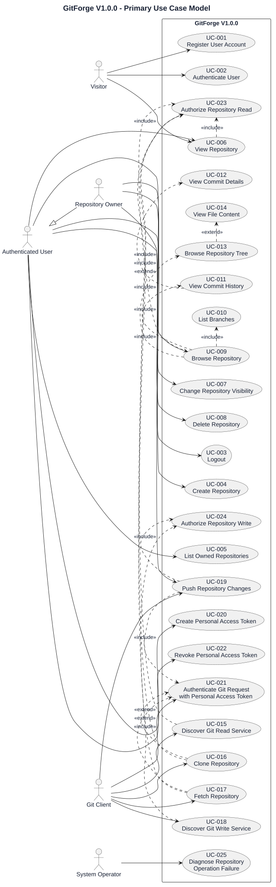
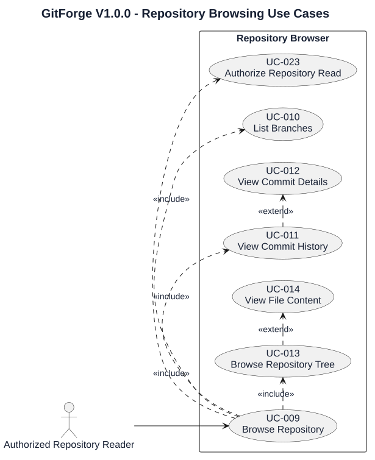
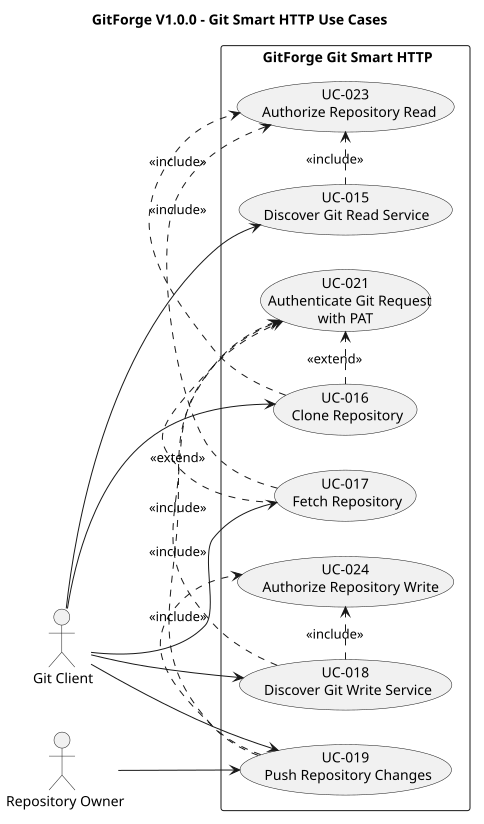
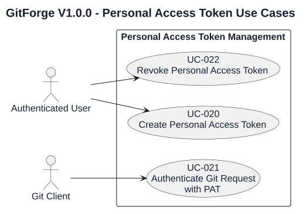

# GitForge V1.0.0 Use Case Model

## 1. Document Information

| Field          | Value                               |
| -------------- | ----------------------------------- |
| Project        | GitForge - Web Git Hosting Platform |
| Target release | V1.0.0                              |
| Document       | Use Case Model                      |
| SDLC phase     | Requirements Engineering            |
| Milestone      | M1 - Requirements Engineering       |
| Project owner  | Farhad Valizadegan                  |
| Status         | Approved                            |
| Last updated   | 2026-08-17                          |

---

## 2. Purpose

This document defines the requirements-level use case model for GitForge V1.0.0.

The use case model describes how external actors interact with GitForge to achieve user or system goals.

It establishes:

* primary actors;
* supporting actors;
* major use cases;
* actor-to-use-case relationships;
* use-case dependencies;
* high-level system behavior;
* scope boundaries.

Detailed step-by-step behavior for critical use cases will be defined in:

```text
10-detailed-use-case-specifications.md
```

---

## 3. Use Case Identification

Use cases use the following identifier format:

```text
UC-XXX
```

Example:

```text
UC-001
```

Each use case represents an actor goal that GitForge supports.

---

## 4. System Boundary

The use case system boundary is:

```text
GitForge V1.0.0
```

Activities performed entirely by:

* the web browser;
* PostgreSQL;
* the filesystem;
* the Git executable;
* the operating system;

are not modeled as independent user-facing use cases unless they directly support an external actor goal.

---

## 5. Actors

The authoritative actor definitions are maintained in:

```text
03-actors-and-external-systems.md
```

The use case model uses the following actors.

### 5.1 Visitor

An unauthenticated human user.

Primary goals:

* register;
* authenticate;
* access permitted public repository information.

---

### 5.2 Authenticated User

A registered user with a valid web session.

Primary goals:

* manage authenticated interaction;
* create repositories;
* view accessible repositories;
* manage Personal Access Tokens;
* browse authorized repositories.

---

### 5.3 Repository Owner

A contextual specialization of Authenticated User for a repository owned by that user.

Primary goals:

* manage owned repositories;
* perform owner-only actions;
* push changes;
* control supported repository settings.

---

### 5.4 Git Client

External Git-compatible software using Git Smart HTTP.

Primary goals:

* clone;
* fetch;
* push;
* perform Git service discovery.

---

### 5.5 System Operator

A supporting actor responsible for operating the environment.

Primary goals relevant to requirements include:

* diagnose failures;
* operate repository storage;
* maintain deployment configuration.

Detailed operational workflows belong primarily to Deployment and Maintenance.

---

# 6. Use Case Groups

Use cases are grouped into the following functional areas:

| Group                  | Purpose                                                   |
| ---------------------- | --------------------------------------------------------- |
| Identity               | Registration and authentication                           |
| Repository Management  | Create, view, update, and potentially delete repositories |
| Repository Browser     | Inspect branches, commits, trees, and files               |
| Git Read               | Clone and fetch                                           |
| Git Write              | Push                                                      |
| Personal Access Tokens | Create and revoke credentials                             |
| Authorization          | Protect repository operations                             |
| Operational Support    | Diagnose system failures                                  |

---

# 7. Identity Use Cases

## UC-001 — Register User Account

**Primary actor:** Visitor

**Goal:** Create a GitForge user account.

**High-level result:** A valid new user account is persisted.

**Related requirements:**

```text
FR-001
FR-002
FR-003
FR-004
```

---

## UC-002 — Authenticate User

**Primary actor:** Visitor

**Goal:** Establish an authenticated GitForge session.

**High-level result:** A valid user identity becomes associated with the current session.

**Related requirements:**

```text
FR-005
FR-006
FR-007
```

---

## UC-003 — Logout

**Primary actor:** Authenticated User

**Goal:** Terminate the current authenticated web session.

**High-level result:** The active authenticated session is invalidated or terminated.

**Related requirements:**

```text
FR-008
```

---

# 8. Repository Management Use Cases

## UC-004 — Create Repository

**Primary actor:** Authenticated User

**Goal:** Create a new hosted Git repository.

**High-level result:**

* repository metadata exists;
* authenticated creator becomes owner;
* visibility is assigned;
* corresponding physical Git repository is initialized.

**Related requirements:**

```text
FR-013
FR-014
FR-015
FR-016
FR-017
FR-018
FR-019
FR-020
```

---

## UC-005 — List Owned Repositories

**Primary actor:** Authenticated User

**Goal:** View repositories owned by the current user.

**High-level result:** GitForge returns the repository list visible within the owned-repository context.

**Related requirements:**

```text
FR-021
```

---

## UC-006 — View Repository

**Primary actors:**

* Visitor for public repositories where anonymous web access is enabled;
* Authenticated User;
* Repository Owner.

**Goal:** View repository metadata and available repository actions.

**High-level result:** Repository information is displayed only if access policy permits it.

**Related requirements:**

```text
FR-022
FR-023
FR-024
FR-025
FR-026
FR-027
FR-028
```

---

## UC-007 — Change Repository Visibility

**Primary actor:** Repository Owner

**Goal:** Change an owned repository between supported visibility states.

**High-level result:** Repository visibility becomes:

```text
public
```

or:

```text
private
```

where this capability remains included in V1.0.0.

**Related requirements:**

```text
FR-084
FR-085
```

---

## UC-008 — Delete Repository

**Primary actor:** Repository Owner

**Goal:** Permanently remove an owned repository.

**Status:** Conditional V1.0.0 use case.

This use case applies only if repository deletion is retained in final V1.0.0 scope.

**High-level result:**

* explicit confirmation is obtained;
* application metadata and physical repository storage follow the approved deletion strategy.

**Related requirements:**

```text
FR-086
FR-087
FR-088
```

---

# 9. Repository Browser Use Cases

## UC-009 — Browse Repository

**Primary actors:**

* Authenticated User;
* Repository Owner;
* Visitor where public anonymous browsing is enabled.

**Goal:** Navigate repository content through the web interface.

**High-level result:** GitForge provides authorized access to supported repository inspection capabilities.

**Related requirements:**

```text
FR-029
```

---

## UC-010 — List Branches

**Primary actor:** Authorized repository reader

**Goal:** View branches available in the repository.

**Related requirements:**

```text
FR-030
```

---

## UC-011 — View Commit History

**Primary actor:** Authorized repository reader

**Goal:** View repository commit history.

**Related requirements:**

```text
FR-031
```

---

## UC-012 — View Commit Details

**Primary actor:** Authorized repository reader

**Goal:** Inspect metadata for a selected commit.

**Related requirements:**

```text
FR-032
```

---

## UC-013 — Browse Repository Tree

**Primary actor:** Authorized repository reader

**Goal:** Navigate directories and files for a supported revision.

**Related requirements:**

```text
FR-033
FR-035
```

---

## UC-014 — View File Content

**Primary actor:** Authorized repository reader

**Goal:** View supported text-file content at a selected repository revision.

**Related requirements:**

```text
FR-034
FR-035
```

---

# 10. Git Read Use Cases

## UC-015 — Discover Git Read Service

**Primary actor:** Git Client

**Goal:** Discover Git repository references and upload-pack service information.

**High-level result:** GitForge returns Git Smart HTTP discovery information if repository read access is allowed.

**Related requirements:**

```text
FR-036
FR-037
FR-038
```

---

## UC-016 — Clone Repository

**Primary actor:** Git Client

**Goal:** Obtain a complete usable copy of an accessible repository.

**Supporting identity:** Human user represented by the Git Client where authentication is required.

**High-level result:** Git objects and references required for clone are transferred.

**Authorization behavior:**

* public repository may allow anonymous clone if enabled;
* private repository requires authenticated authorized access.

**Related requirements:**

```text
FR-039
FR-040
FR-041
```

---

## UC-017 — Fetch Repository

**Primary actor:** Git Client

**Goal:** Retrieve repository updates from GitForge.

**High-level result:** Authorized Git repository objects and references are transferred to the client.

**Related requirements:**

```text
FR-042
```

---

# 11. Git Write Use Cases

## UC-018 — Discover Git Write Service

**Primary actor:** Git Client

**Goal:** Discover receive-pack service information for a repository.

**Precondition:** Requesting identity has repository write permission.

**Related requirements:**

```text
FR-043
```

---

## UC-019 — Push Repository Changes

**Primary actor:** Git Client

**Associated human actor:** Repository Owner

**Goal:** Send Git objects and reference updates to an owned repository.

**High-level result:** The authorized repository receives valid pushed Git changes.

**Related requirements:**

```text
FR-044
FR-045
FR-046
FR-047
FR-048
FR-049
```

---

# 12. Personal Access Token Use Cases

## UC-020 — Create Personal Access Token

**Primary actor:** Authenticated User

**Goal:** Create a credential usable for supported Git operations.

**High-level result:**

* token metadata is persisted;
* a secure token secret is generated;
* plaintext secret is shown only through the approved creation workflow;
* stored credential representation is non-reversible.

**Related requirements:**

```text
FR-050
FR-051
FR-052
FR-053
FR-054
```

---

## UC-021 — Authenticate Git Request with Personal Access Token

**Primary actor:** Git Client

**Goal:** Establish an application user identity for a Git operation using a Personal Access Token.

**High-level result:**

* valid token resolves to its owner;
* invalid or revoked token fails authentication.

**Related requirements:**

```text
FR-055
FR-056
FR-057
FR-059
```

---

## UC-022 — Revoke Personal Access Token

**Primary actor:** Authenticated User

**Goal:** Disable a token owned by the user.

**High-level result:** The revoked token can no longer authenticate future requests.

**Related requirements:**

```text
FR-058
FR-059
FR-060
```

---

# 13. Authorization Supporting Use Cases

Authorization is primarily a cross-cutting requirement rather than a user goal.

For modeling purposes, the following supporting use cases are defined.

## UC-023 — Authorize Repository Read

**Primary requesting actors:**

* Visitor;
* Authenticated User;
* Git Client.

**Goal:** Determine whether the current request may read the target repository.

**Decision inputs include:**

* repository existence;
* repository visibility;
* authenticated identity;
* ownership;
* requested operation.

**Related requirements:**

```text
FR-061
FR-063
FR-065
FR-066
```

---

## UC-024 — Authorize Repository Write

**Primary requesting actors:**

* Repository Owner;
* Git Client.

**Goal:** Determine whether the current request may modify the target repository.

**Decision inputs include:**

* authenticated identity;
* repository ownership;
* requested write operation;
* token validity;
* token scope where applicable.

**Related requirements:**

```text
FR-061
FR-062
FR-064
FR-065
FR-066
```

---

# 14. Operational Supporting Use Cases

## UC-025 — Diagnose Repository Operation Failure

**Primary actor:** System Operator

**Goal:** Identify the cause of repository-storage or Git-process failures.

**High-level result:** Appropriate logs provide sufficient non-secret diagnostic context.

**Related requirements:**

```text
FR-096
FR-097
FR-098
```

---

# 15. Use Case Summary

| ID     | Use Case                              | Primary Actor                     |
| ------ | ------------------------------------- | --------------------------------- |
| UC-001 | Register User Account                 | Visitor                           |
| UC-002 | Authenticate User                     | Visitor                           |
| UC-003 | Logout                                | Authenticated User                |
| UC-004 | Create Repository                     | Authenticated User                |
| UC-005 | List Owned Repositories               | Authenticated User                |
| UC-006 | View Repository                       | Authorized repository reader      |
| UC-007 | Change Repository Visibility          | Repository Owner                  |
| UC-008 | Delete Repository                     | Repository Owner                  |
| UC-009 | Browse Repository                     | Authorized repository reader      |
| UC-010 | List Branches                         | Authorized repository reader      |
| UC-011 | View Commit History                   | Authorized repository reader      |
| UC-012 | View Commit Details                   | Authorized repository reader      |
| UC-013 | Browse Repository Tree                | Authorized repository reader      |
| UC-014 | View File Content                     | Authorized repository reader      |
| UC-015 | Discover Git Read Service             | Git Client                        |
| UC-016 | Clone Repository                      | Git Client                        |
| UC-017 | Fetch Repository                      | Git Client                        |
| UC-018 | Discover Git Write Service            | Git Client                        |
| UC-019 | Push Repository Changes               | Git Client                        |
| UC-020 | Create Personal Access Token          | Authenticated User                |
| UC-021 | Authenticate Git Request with PAT     | Git Client                        |
| UC-022 | Revoke Personal Access Token          | Authenticated User                |
| UC-023 | Authorize Repository Read             | Supporting authorization use case |
| UC-024 | Authorize Repository Write            | Supporting authorization use case |
| UC-025 | Diagnose Repository Operation Failure | System Operator                   |

Total use cases:

```text
25
```

---

# 16. Primary Use Case Diagram



[PlantUML source](diagrams/09-use-case-model-001.puml)

---

# 17. Repository Browsing Use Case Diagram



[PlantUML source](diagrams/09-use-case-model-002.puml)

---

# 18. Git Smart HTTP Use Case Diagram



[PlantUML source](diagrams/09-use-case-model-003.puml)

---

# 19. Personal Access Token Use Case Diagram



[PlantUML source](diagrams/09-use-case-model-004.puml)

---

# 20. Use Case Relationships

## 20.1 Include Relationship

`<<include>>` indicates behavior that is required as part of another use case.

Example:

```text
Push Repository Changes
        |
        +-- includes --> Authenticate Git Request with PAT
        |
        +-- includes --> Authorize Repository Write
```

---

## 20.2 Extend Relationship

`<<extend>>` indicates optional or conditionally invoked behavior.

Example:

```text
Browse Repository Tree
        |
        +-- optionally --> View File Content
```

---

## 20.3 Actor Generalization

Repository Owner is modeled as a specialization of Authenticated User:

```text
Authenticated User
        ^
        |
Repository Owner
```

A Repository Owner therefore inherits applicable authenticated-user capabilities.

---

# 21. Core User Journeys

## 21.1 First-Time User Journey

```text
Visitor
   ↓
UC-001 Register User Account
   ↓
UC-002 Authenticate User
   ↓
UC-004 Create Repository
   ↓
UC-006 View Repository
```

---

## 21.2 Repository Browsing Journey

```text
Authorized User
   ↓
UC-006 View Repository
   ↓
UC-009 Browse Repository
   ↓
UC-010 List Branches
   ↓
UC-011 View Commit History
   ↓
UC-013 Browse Repository Tree
   ↓
UC-014 View File Content
```

---

## 21.3 Git Clone Journey

```text
Git Client
   ↓
UC-015 Discover Git Read Service
   ↓
UC-023 Authorize Repository Read
   ↓
UC-016 Clone Repository
```

For a private repository:

```text
Git Client
   ↓
UC-021 Authenticate Git Request with PAT
   ↓
UC-023 Authorize Repository Read
   ↓
UC-016 Clone Repository
```

---

## 21.4 Git Push Journey

```text
Authenticated User
   ↓
UC-020 Create Personal Access Token
   ↓
Git Client
   ↓
UC-021 Authenticate Git Request with PAT
   ↓
UC-024 Authorize Repository Write
   ↓
UC-019 Push Repository Changes
```

---

# 22. Use Case Preconditions

Common preconditions include:

| Use Case Area           | Typical Preconditions                        |
| ----------------------- | -------------------------------------------- |
| Authenticated actions   | User has valid authenticated session         |
| Owner actions           | User owns target repository                  |
| Private repository read | Valid authenticated and authorized identity  |
| Git write               | Valid authentication and write authorization |
| Repository browsing     | Repository exists and is readable            |
| PAT revocation          | Token exists and belongs to current user     |

Detailed use-case specifications will define exact preconditions.

---

# 23. Use Case Postconditions

Common postconditions include:

| Use Case                | Expected Postcondition                           |
| ----------------------- | ------------------------------------------------ |
| Register User Account   | User account exists                              |
| Authenticate User       | Session identifies user                          |
| Create Repository       | Metadata and physical repository exist           |
| Change Visibility       | New visibility is persisted                      |
| Create PAT              | Token metadata exists and secret has been issued |
| Revoke PAT              | Token no longer authenticates                    |
| Push Repository Changes | Authorized Git changes are stored                |
| Delete Repository       | Approved deletion state is established           |

---

# 24. Use Case Failure Categories

Use cases must consider failure conditions including:

* invalid input;
* invalid credentials;
* revoked credentials;
* unauthenticated access;
* unauthorized access;
* repository not found;
* invalid Git revision;
* repository filesystem missing;
* PostgreSQL failure;
* Git executable failure;
* unsupported Git request;
* repository path validation failure.

Detailed alternative and exception flows will be documented in the detailed use-case specifications.

---

# 25. Mapping to Actors

| Actor              | Main Use Cases                                         |
| ------------------ | ------------------------------------------------------ |
| Visitor            | UC-001, UC-002, UC-006 conditionally                   |
| Authenticated User | UC-003, UC-004, UC-005, UC-006, UC-009, UC-020, UC-022 |
| Repository Owner   | UC-007, UC-008, UC-019                                 |
| Git Client         | UC-015, UC-016, UC-017, UC-018, UC-019, UC-021         |
| System Operator    | UC-025                                                 |

---

# 26. Mapping to Functional Requirement Areas

| Use Case Group         | Functional Requirements          |
| ---------------------- | -------------------------------- |
| Identity               | FR-001 – FR-009                  |
| Repository Management  | FR-013 – FR-028, FR-084 – FR-088 |
| Repository Browser     | FR-029 – FR-035                  |
| Git Read               | FR-036 – FR-042                  |
| Git Write              | FR-043 – FR-049                  |
| Personal Access Tokens | FR-050 – FR-060                  |
| Authorization          | FR-061 – FR-066                  |
| Operational Support    | FR-096 – FR-098                  |

---

# 27. Use Cases Deferred Beyond V1.0.0

The following use cases are explicitly outside V1.0.0:

* create organization;
* manage team;
* invite collaborator;
* fork repository;
* create pull request;
* review code;
* merge pull request;
* create issue;
* manage project board;
* configure CI/CD pipeline;
* publish package;
* use SSH Git transport;
* manage billing;
* administer enterprise organization.

These capabilities shall not be introduced implicitly into V1.0.0 use-case specifications.

---

# 28. Open Use Case Decisions

The following decisions remain unresolved and must be finalized before M1 closes:

1. whether Visitors may browse public repository source code through the web interface;
2. whether public repositories support anonymous Git clone and fetch by default;
3. whether repository deletion remains part of V1.0.0;
4. whether repository rename is required;
5. whether PAT scopes distinguish read and write;
6. whether token expiration is required;
7. whether any non-owner repository write workflow exists;
8. whether repository description editing is part of V1.0.0.

Affected use cases must be updated when these decisions are resolved.

---

# 29. Input to Detailed Use Cases

The following use cases are considered sufficiently important to receive detailed specifications:

```text
UC-001 Register User Account
UC-002 Authenticate User
UC-004 Create Repository
UC-006 View Repository
UC-009 Browse Repository
UC-016 Clone Repository
UC-017 Fetch Repository
UC-019 Push Repository Changes
UC-020 Create Personal Access Token
UC-021 Authenticate Git Request with PAT
UC-022 Revoke Personal Access Token
UC-023 Authorize Repository Read
UC-024 Authorize Repository Write
```

Additional use cases may be detailed if needed for completeness.

---

# 30. Traceability

The use case model derives from:

* Requirements Elicitation;
* Actors and External Systems;
* Functional Requirements;
* Non-Functional Requirements;
* Data Requirements;
* Interface Requirements;
* Business Rules.

Detailed traceability will be maintained in:

```text
14-requirements-traceability-matrix.md
```

---

# 31. Completion Criteria

This use case model is considered complete when:

* all primary V1.0.0 actors are represented;
* all major user goals are represented;
* core repository-management workflows are represented;
* repository browsing is represented;
* Git clone, fetch, and push are represented;
* Personal Access Token workflows are represented;
* authorization behavior is represented;
* actor-to-use-case relationships are clear;
* critical use cases are identified for detailed specification;
* use cases remain consistent with approved V1.0.0 scope;
* no major functional capability exists without a corresponding actor interaction or justified supporting behavior.

---

# 32. Document Status

This document is currently:

```text
Approved
```

It will be changed to:

```text
Approved
```

after the use case model has been reviewed for actor coverage, requirement coverage, behavioral consistency, scope alignment, and traceability.
