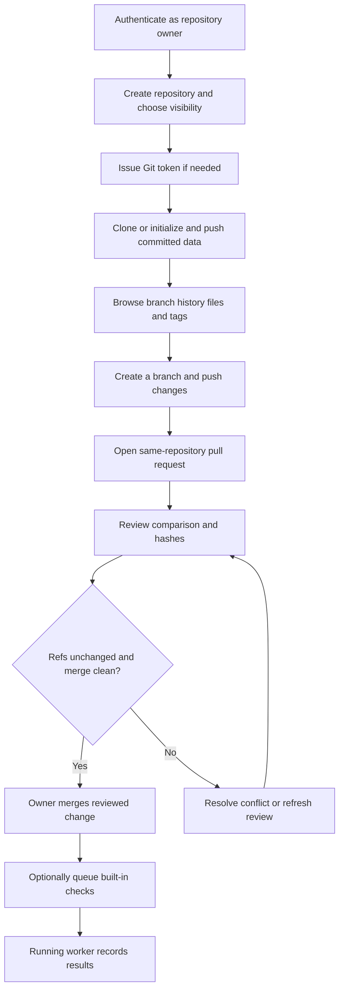

# Main user workflow diagram

This is a representative owner journey, not the only supported ordering. Checks are optional and are not required merge gates. A stopped worker leaves a run queued. [Editable source](diagrams/main-user-workflow.mmd) and [acceptance criteria](acceptance-criteria.md).
