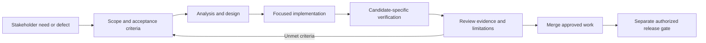

# Requirements lifecycle diagram

Requirement documentation, merged code, passing checks, and a tagged release are distinct outcomes. Update traceability when scope or acceptance changes. [Editable source](diagrams/requirements-lifecycle.mmd), [refinement process](../../Project-Management/backlog-refinement.md), and [traceability](requirements-traceability-matrix.md).
