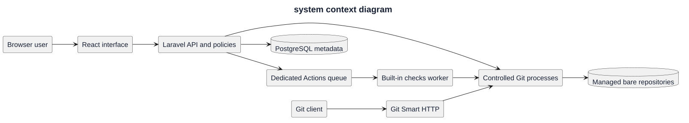

# System context diagram

[PlantUML source](diagrams/system-context.puml)

The diagram describes runtime boundaries; GitHub hosts this project's engineering source/CI separately. [Editable source](diagrams/system-context.puml), [integration requirements](integration-requirements.md), and [trust-boundary analysis](../03-system-analysis/15-trust-boundary-analysis.md).
