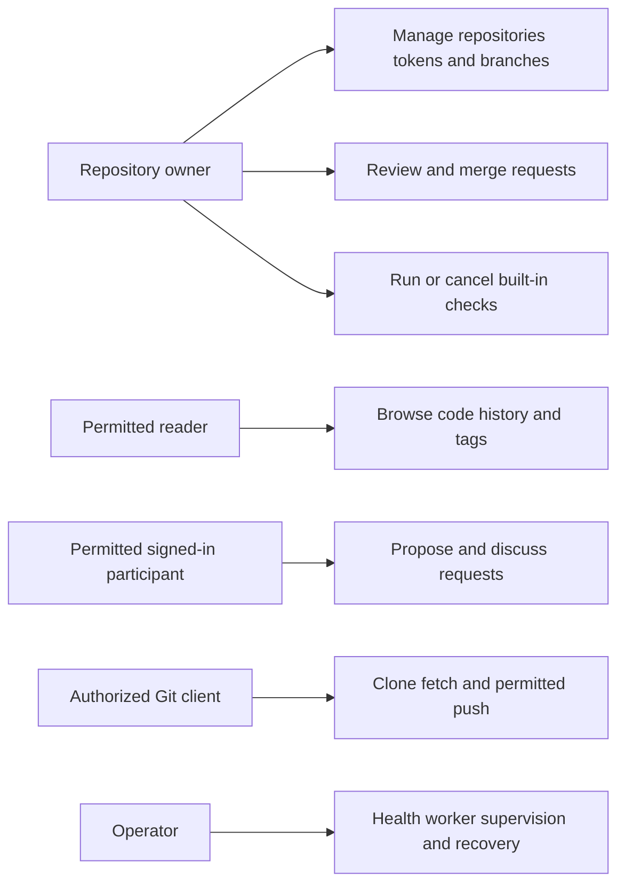

# Use-case diagram

Actor permission depends on repository visibility and server policy. Public visitors can read public content; private repositories remain owner-only. Operator recovery is an operational procedure, not a public application endpoint. [Editable source](diagrams/use-case.mmd) and [use cases](use-cases.md).
