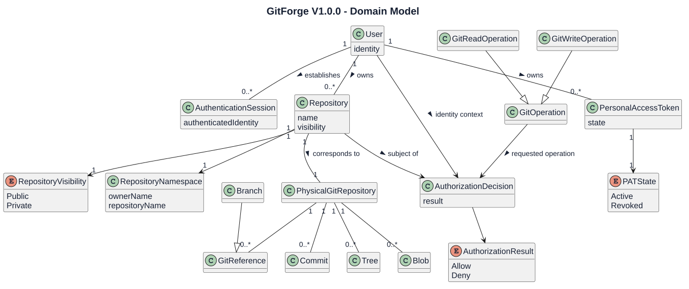
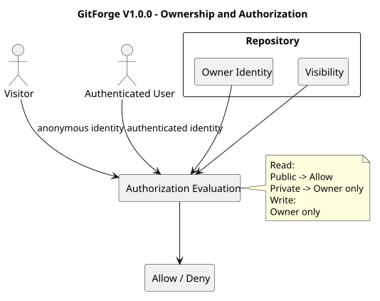
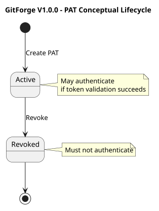
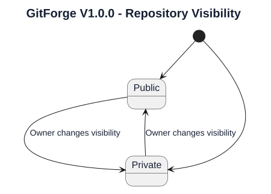

# GitForge V1.0.0 Domain Analysis

## 1. Document Information

| Field | Value |
|---|---|
| Project | GitForge - Web Git Hosting Platform |
| Target release | V1.0.0 |
| Document | Domain Analysis |
| SDLC phase | System Analysis |
| Milestone | M2 - System Analysis |
| Project owner | Farhad Valizadegan |
| Status | Approved |
| Last updated | 2026-08-17 |

---

## 2. Purpose

This document defines the logical domain model of GitForge V1.0.0.

It identifies:

- principal domain concepts;
- domain relationships;
- ownership semantics;
- repository identity;
- repository visibility;
- Personal Access Token semantics;
- authentication concepts;
- authorization concepts;
- Git repository concepts;
- important domain invariants;
- domain boundaries.

The purpose is to establish a technology-aware but implementation-independent understanding of the business and system concepts before System Design begins.

---

## 3. Analysis Objective

This document answers:

> What are the essential domain concepts of GitForge V1.0.0, how are they related, and what rules govern them?

This analysis intentionally avoids premature decisions about:

```text
Database tables
Laravel models
Controllers
Services
Repositories
API endpoint classes
Concrete storage adapters
Concrete package structure
```

Those decisions belong primarily to System Design.

---

## 4. Domain Scope

The V1.0.0 domain includes concepts related to:

- users;
- authentication;
- repositories;
- repository ownership;
- repository namespaces;
- repository visibility;
- repository browsing;
- Git references;
- commits;
- trees;
- blobs;
- Personal Access Tokens;
- Git client authentication;
- repository authorization;
- Git read operations;
- Git write operations;
- repository storage identity;
- operation results and failures.

---

## 5. Excluded Domain Concepts

The following concepts are outside the V1.0.0 domain:

```text
Organization
Team
Collaborator
Repository Membership
Fork
Pull Request
Merge Request
Issue
Project Board
Wiki
CI/CD Pipeline
Package
Container Registry
Git LFS Object
SSH Key
Billing Account
Subscription
Enterprise Permission Group
Repository Star
Repository Watch
Social Follow
```

These concepts shall not be introduced implicitly by downstream analysis or design.

---

## 6. Principal Domain Concepts

The principal domain concepts are:

```text
User
Authentication Session
Repository
Repository Namespace
Repository Ownership
Repository Visibility
Personal Access Token
Git Client Identity
Authorization Decision
Git Repository
Git Reference
Branch
Commit
Tree
Blob
Repository Path
Git Read Operation
Git Write Operation
Operation Result
```

---

## 7. User

A User represents a registered GitForge account.

A User has an application identity and may interact with protected GitForge functionality after successful authentication.

A User may:

- authenticate;
- maintain an authenticated session;
- create repositories;
- own repositories;
- browse accessible repositories;
- create Personal Access Tokens;
- revoke Personal Access Tokens;
- perform authorized Git operations.

A User is not inherently an administrator.

---

## 8. User Identity

User identity is the application-level identity established after successful authentication.

Conceptually:

```text
Credential
    ↓
Authentication
    ↓
User Identity
```

User identity is required before owner-specific authorization decisions can be made.

Identity and authorization are distinct concepts.

---

## 9. Authentication Session

An Authentication Session represents an authenticated web interaction context.

Its purpose is to associate subsequent protected browser requests with a User identity.

Conceptually:

```text
User
  1
  |
  | establishes
  |
  0..*
Authentication Session
```

A session does not itself determine repository authorization.

---

## 10. Repository

A Repository represents a GitForge-managed Git repository.

A Repository has application metadata and is associated with exactly one owner in V1.0.0.

Core logical properties include:

```text
Repository identity
Repository name
Owner
Visibility
Logical namespace
Physical repository association
```

A Repository is distinct from its physical Git object database.

---

## 11. Repository Ownership

Every V1.0.0 Repository has exactly one User owner.

Conceptually:

```text
User
  1
  |
  | owns
  |
  0..*
Repository
```

For a particular Repository:

```text
Repository Owner = Repository.owner
```

Ownership determines protected management and write permissions.

V1.0.0 does not support:

```text
Multiple owners
Collaborators
Team ownership
Organization ownership
Shared write access
```

---

## 12. Repository Owner Role

Repository Owner is a contextual authorization role rather than a permanent user type.

A User becomes Repository Owner only relative to a specific Repository when:

```text
Authenticated User ID
        =
Repository Owner ID
```

Therefore:

```text
User A may be Owner of Repository X
User A may be Non-Owner of Repository Y
```

---

## 13. Repository Name

A Repository Name is the user-selected name component of the repository namespace.

Approved V1.0.0 constraints include:

- length from 1 to 100 characters;
- lowercase ASCII letters;
- digits;
- hyphen;
- underscore;
- safe periods;
- no slash;
- no backslash;
- no `..`;
- no path traversal;
- no control characters.

The repository name must be unique within the owner's namespace.

---

## 14. Repository Namespace

The logical repository namespace is:

```text
<owner>/<repository>
```

Example:

```text
farhad/gitforge
```

The namespace identifies a repository logically.

It is not a client-controlled physical filesystem path.

---

## 15. Namespace Uniqueness

Repository name uniqueness is scoped to the owner.

Therefore:

```text
alice/project
bob/project
```

may both exist.

However:

```text
alice/project
alice/project
```

may not represent two different repositories.

Domain invariant:

```text
For each owner:
Repository name must be unique.
```

---

## 16. Repository Visibility

Repository Visibility represents the read-access classification of a Repository.

V1.0.0 supports exactly:

```text
Public
Private
```

No additional visibility states are required.

---

## 17. Public Repository

A Public Repository permits anonymous read access through supported interfaces.

Permitted read behavior includes:

```text
Anonymous web browsing
Anonymous Git clone
Anonymous Git fetch
Authenticated read
Owner read
```

Public visibility does not grant write access.

---

## 18. Private Repository

A Private Repository restricts repository read access to its owner.

Permitted:

```text
Owner web read
Owner authenticated Git read
Owner write
```

Denied:

```text
Visitor read
Authenticated non-owner read
Anonymous Git read
Non-owner Git read
Anonymous write
Non-owner write
```

---

## 19. Visibility Transition

V1.0.0 supports changing Repository Visibility.

Valid logical transitions are:

```text
Public  → Private
Private → Public
```

The Repository remains the same logical repository after a visibility change.

The transition changes authorization semantics, not repository identity.

---

## 20. Git Repository

A Git Repository is the physical Git-native repository associated with a GitForge Repository.

It contains authoritative Git-native data including:

```text
Refs
Branches
Commits
Trees
Blobs
Git object graph
```

Conceptually:

```text
Repository Metadata
        1
        |
        | corresponds to
        |
        1
Physical Git Repository
```

The metadata representation and physical Git repository are distinct but must remain logically consistent.

---

## 21. Application Metadata Versus Git Data

Two authoritative domains exist.

### Application Metadata

Authoritative source:

```text
PostgreSQL
```

Examples:

```text
User
Repository metadata
Repository owner
Visibility
PAT metadata
```

### Git-Native Data

Authoritative source:

```text
Physical Git Repository
```

Examples:

```text
Refs
Branches
Commits
Trees
Blobs
File contents
```

GitForge shall not create a second competing authoritative representation of Git-native content in application metadata.

---

## 22. Repository Storage Identity

Repository Storage Identity represents the internal relationship between a logical Repository and its physical Git repository.

External actors use:

```text
<owner>/<repository>
```

GitForge derives the physical repository location internally.

Conceptually:

```text
Logical Namespace
      ↓
Validate
      ↓
Resolve Repository
      ↓
Internal Storage Identity
      ↓
Physical Repository
```

---

## 23. Repository Path

A Repository Path is an internal storage concern.

It must not be accepted directly from external clients as an authoritative physical path.

Domain rule:

```text
External logical identifier
        ≠
Trusted physical path
```

The physical path must be internally derived from validated repository identity.

---

## 24. Personal Access Token

A Personal Access Token, or PAT, is an application-managed credential associated with exactly one User.

Its primary V1.0.0 purpose is Git HTTP authentication.

Conceptually:

```text
User
  1
  |
  | owns
  |
  0..*
Personal Access Token
```

---

## 25. PAT Ownership

Every PAT belongs to one User.

Only the owning User may manage that token through supported application functionality.

V1.0.0 PAT management includes:

```text
Create
List metadata
Revoke
```

---

## 26. PAT Secret

The plaintext PAT secret is a sensitive credential.

The intended lifecycle is:

```text
Generate
   ↓
Display plaintext during creation
   ↓
Persist non-recoverable verification representation
   ↓
Do not expose plaintext again
```

Plaintext PAT recovery is not part of V1.0.0.

---

## 27. PAT State

At minimum, a PAT has a logical usability state:

```text
Active
Revoked
```

An Active PAT may participate in authentication.

A Revoked PAT shall not establish a valid GitForge identity.

PAT expiration is deferred from V1.0.0.

PAT scopes are deferred from V1.0.0.

---

## 28. Git Client Identity

Git Client Identity is the User identity established when a valid PAT is presented through Git Smart HTTP authentication.

Conceptually:

```text
PAT Credential
    ↓
Validate
    ↓
Resolve PAT Owner
    ↓
Git Client Identity
```

A successful identity result does not automatically authorize the requested repository operation.

---

## 29. Authentication

Authentication answers:

> Who is making this request?

Two major V1.0.0 authentication contexts exist:

```text
Web Authentication
Git PAT Authentication
```

Authentication produces or resolves a User identity.

---

## 30. Authorization

Authorization answers:

> May this identity perform this operation on this repository?

Authorization depends on context including:

```text
Identity
Repository
Repository visibility
Repository ownership
Requested operation
```

Authentication and authorization must remain logically separate.

---

## 31. Authorization Decision

An Authorization Decision represents the outcome of evaluating access policy for a requested operation.

Logical outcomes are:

```text
Allow
Deny
```

Conceptually:

```text
Identity
Repository
Visibility
Ownership
Operation
    ↓
Authorization Evaluation
    ↓
Allow / Deny
```

---

## 32. Repository Read Authorization

Repository read policy is:

### Public Repository

```text
Visitor                 → Allow
Authenticated Non-Owner → Allow
Owner                   → Allow
```

### Private Repository

```text
Visitor                 → Deny
Authenticated Non-Owner → Deny
Owner                   → Allow
```

---

## 33. Repository Write Authorization

Repository write policy is:

```text
Anonymous               → Deny
Authenticated Non-Owner → Deny
Owner                   → Allow
```

Repository visibility does not change this write rule in V1.0.0.

---

## 34. Repository Management Authorization

Protected repository management operations are owner-controlled.

Examples include:

```text
Change repository visibility
```

Repository creation is available to an authenticated User because ownership begins with the newly created Repository.

---

## 35. Git Read Operation

A Git Read Operation represents an approved Git Smart HTTP operation that reads repository state without mutating it.

Examples include:

```text
Service discovery for git-upload-pack
Clone
Fetch
git-upload-pack execution
```

A Git Read Operation must be authorized before protected repository content is exposed.

---

## 36. Git Write Operation

A Git Write Operation represents an approved Git Smart HTTP operation that may mutate repository refs or Git state.

Examples include:

```text
Service discovery for git-receive-pack
Push
git-receive-pack execution
```

A Git Write Operation requires authenticated owner authorization.

---

## 37. Git Operation

Git Operation is the general domain concept covering supported Git read and write operations.

Conceptually:

```text
Git Operation
    |
    +-- Git Read Operation
    |
    +-- Git Write Operation
```

Only explicitly supported Git operations are part of V1.0.0.

---

## 38. Git Reference

A Git Reference identifies a Git object indirectly.

Examples include:

```text
refs/heads/main
refs/tags/v1.0.0
HEAD
```

References are Git-native state and are authoritative in the physical Git repository.

---

## 39. Branch

A Branch is a Git reference representing a movable line of development.

Conceptually:

```text
Branch
   ↓
Reference
   ↓
Commit
```

Branches are discovered from Git-native repository state.

They are not independently authoritative application metadata.

---

## 40. Commit

A Commit is an immutable Git object representing a repository snapshot and history relationship.

Conceptually, a Commit contains references to:

```text
Tree
Parent Commit(s)
Author information
Committer information
Message
```

Commit data originates from the physical Git repository.

---

## 41. Tree

A Tree is a Git object representing a directory-like snapshot structure.

A Tree may reference:

```text
Blob
Tree
Other Git-supported entries
```

Tree data is authoritative in the Git repository.

---

## 42. Blob

A Blob is a Git object representing file content.

GitForge may display supported Blob content through repository browsing.

Repository content must be treated as untrusted input.

---

## 43. Repository Browser

Repository Browser is a logical capability that exposes Git-native repository information through the web interface.

It may expose:

```text
Branches
Commit history
Commit details
Tree entries
File/blob content
```

The browser capability reads from the physical Git repository through controlled Git inspection behavior.

---

## 44. Repository Browser Domain Flow

Conceptually:

```text
Requested Repository
        ↓
Resolve Metadata
        ↓
Authorize Read
        ↓
Resolve Physical Repository
        ↓
Inspect Git State
        ↓
Return Repository View
```

Authorization precedes protected Git content access.

---

## 45. Repository Creation

Repository Creation represents establishment of both:

```text
Application Repository Metadata
Physical Git Repository
```

A successful creation operation must result in a consistent logical repository.

Conceptually:

```text
Validate Request
      ↓
Validate Namespace
      ↓
Establish Metadata
      ↓
Initialize Git Repository
      ↓
Confirm Consistency
      ↓
Repository Available
```

---

## 46. Repository Creation Consistency

Repository creation spans two persistence domains:

```text
PostgreSQL
Filesystem / Git Repository
```

Therefore, partial success is a meaningful domain failure condition.

Invalid final states include:

```text
Metadata exists but physical repository is unusable
Physical repository exists with no valid application repository identity
```

Detailed failure handling will be analyzed later in M2.

---

## 47. Repository Identity

Repository Identity must remain stable independently of presentation details.

Logical repository identity shall not be inferred solely from a raw filesystem path.

Repository identity is resolved through application-controlled metadata and namespace rules.

---

## 48. Repository Deletion

Repository deletion is excluded from V1.0.0.

Therefore, this domain analysis does not define:

```text
Deletion lifecycle
Soft delete
Trash
Restore
Retention period
Physical purge
```

These shall not be introduced during V1.0.0 System Design.

---

## 49. Repository Rename

Repository rename is excluded from V1.0.0.

Therefore, this analysis does not require namespace transition semantics for repository renaming.

---

## 50. Repository Description

Repository description is deferred from V1.0.0.

It is not a required core domain attribute.

---

## 51. PAT Scope

PAT scopes are deferred from V1.0.0.

Therefore, authorization shall not depend on token-specific scope values.

Repository authorization remains based on:

```text
Authenticated User Identity
Repository Ownership
Repository Visibility
Requested Operation
```

---

## 52. PAT Expiration

PAT expiration is deferred from V1.0.0.

The required lifecycle therefore focuses on:

```text
Creation
Active use
Revocation
```

---

## 53. Domain Invariants

The following invariants apply to V1.0.0.

### DI-001 — Repository Ownership

Every Repository has exactly one owner.

### DI-002 — Repository Name Uniqueness

A Repository name is unique within its owner's namespace.

### DI-003 — Visibility Domain

Repository Visibility is exactly one of:

```text
Public
Private
```

### DI-004 — Private Read

A private Repository may be read only by its owner.

### DI-005 — Repository Write

Only the Repository owner may perform supported writes.

### DI-006 — Anonymous Write

Anonymous repository writes are prohibited.

### DI-007 — PAT Ownership

Each PAT belongs to exactly one User.

### DI-008 — Revoked PAT

A revoked PAT cannot establish authenticated identity.

### DI-009 — Plaintext PAT Persistence

Reusable plaintext PAT values shall not be recoverably persisted.

### DI-010 — Physical Path Control

Physical repository paths are internally derived.

### DI-011 — Git Authority

Git-native data is authoritative in the physical Git repository.

### DI-012 — Metadata Authority

Application metadata is authoritative in PostgreSQL.

### DI-013 — Authorization Before Protected Access

Protected repository access requires successful authorization before content exposure or mutation.

### DI-014 — Authentication Is Not Authorization

Successful authentication does not independently grant repository permission.

---

## 54. Domain Relationship Summary

```text
User
 ├── establishes → Authentication Session
 ├── owns → Repository
 └── owns → Personal Access Token

Repository
 ├── has → Repository Visibility
 ├── belongs to → Repository Namespace
 ├── corresponds to → Physical Git Repository
 └── is subject to → Authorization Decision

Physical Git Repository
 ├── contains → Git References
 ├── contains → Commits
 ├── contains → Trees
 └── contains → Blobs

Git Client
 ├── authenticates using → Personal Access Token
 └── requests → Git Operation

Git Operation
 ├── may be → Git Read Operation
 └── may be → Git Write Operation
```

---

## 55. Domain Model Diagram



[PlantUML source](diagrams/03-domain-analysis-001.puml)

---

## 56. Ownership and Authorization Diagram



[PlantUML source](diagrams/03-domain-analysis-002.puml)

---

## 57. PAT Conceptual Lifecycle



[PlantUML source](diagrams/03-domain-analysis-003.puml)

---

## 58. Repository Visibility State Model



[PlantUML source](diagrams/03-domain-analysis-004.puml)

The initial visibility is determined during repository creation according to the accepted creation request.

---

## 59. Concept Classification

### Entity-Like Concepts

Concepts with meaningful identity include:

```text
User
Repository
Personal Access Token
Physical Git Repository
Commit
Git Reference
```

### Value-Like Concepts

Concepts primarily representing descriptive values include:

```text
Repository Name
Repository Visibility
Repository Namespace
PAT State
Authorization Result
```

### Process/Interaction Concepts

Concepts describing behavior include:

```text
Authentication
Authorization
Repository Creation
Git Read Operation
Git Write Operation
Repository Browsing
```

This classification is analytical and does not prescribe final implementation classes.

---

## 60. Domain Boundary — Application Versus Git

The application domain controls:

```text
Users
Ownership
Visibility
PATs
Authentication
Authorization
Repository metadata
Logical repository identity
```

The Git domain controls:

```text
Objects
Refs
Commits
Trees
Blobs
Branches
Repository-native history
```

GitForge coordinates these two domains without replacing Git semantics.

---

## 61. Domain Boundary — Identity Versus Authorization

Identity answers:

```text
Who is the caller?
```

Authorization answers:

```text
What may the caller do?
```

For Git Smart HTTP:

```text
PAT
 ↓
Authentication
 ↓
User Identity
 ↓
Repository + Operation
 ↓
Authorization
 ↓
Allow / Deny
```

---

## 62. Domain Boundary — Logical Namespace Versus Physical Storage

External callers identify repositories logically:

```text
<owner>/<repository>
```

Internal repository storage uses a controlled physical representation.

The system shall not equate unvalidated external path-like input with physical storage location.

---

## 63. Domain Security Considerations

Security-sensitive concepts include:

```text
User identity
Authentication session
PAT secret
Repository ownership
Repository visibility
Authorization decision
Repository path
Git operation
Repository content
```

Repository content is treated as untrusted even when stored inside an authorized repository.

---

## 64. Domain Failure Concepts

Meaningful domain failures include:

```text
Unknown user
Invalid credentials
Invalid PAT
Revoked PAT
Unknown repository
Invalid repository name
Duplicate repository namespace
Unauthorized repository read
Unauthorized repository write
Missing physical repository
Repository initialization failure
Git operation failure
Storage access failure
Metadata/storage inconsistency
```

Detailed failure semantics will be defined in:

```text
16-failure-and-exception-analysis.md
```

---

## 65. Domain Assumptions

The following assumptions apply:

1. one User may own multiple repositories;
2. each Repository has exactly one owner;
3. each PAT belongs to exactly one User;
4. repositories have public or private visibility only;
5. public status affects read permission but not write ownership;
6. write operations remain owner-only;
7. Git-native repository data remains authoritative in Git storage;
8. application metadata remains authoritative in PostgreSQL;
9. logical namespace resolution precedes physical repository access;
10. Git operations are restricted to explicitly supported operations.

---

## 66. Requirements Alignment

The domain model is derived from the approved Requirements Engineering artifacts, particularly:

```text
03-actors-and-external-systems.md
04-functional-requirements.md
05-non-functional-requirements.md
06-data-requirements.md
07-interface-requirements.md
08-business-rules.md
09-use-case-model.md
10-detailed-use-case-specifications.md
11-user-stories-and-acceptance-criteria.md
12-authorization-requirements-matrix.md
15-requirements-validation.md
```

Important requirement areas represented by this model include:

```text
User registration and authentication
Repository creation
Repository ownership
Repository visibility
Repository browsing
Public repository reading
Private repository protection
Git clone and fetch
Git push
PAT creation
PAT authentication
PAT revocation
Repository authorization
Safe repository storage access
```

Detailed requirement-to-analysis mapping will be consolidated in:

```text
19-analysis-traceability.md
```

---

## 67. Domain Analysis Findings

### DA-001 — Repository Owner Is Contextual

Repository Owner is not a separate account type.

It is derived from the relationship between User and Repository.

Status:

```text
Confirmed
```

### DA-002 — Repository Has Dual Representation

A repository has:

```text
Application metadata representation
Physical Git repository representation
```

These are distinct but logically associated.

Status:

```text
Confirmed
```

### DA-003 — Git-Native Data Remains External to Application Metadata

Branches, commits, trees, blobs, and refs are not required to become authoritative application records.

Status:

```text
Confirmed
```

### DA-004 — Visibility Controls Read, Not Write Ownership

Public visibility allows broader read access but does not grant non-owner write permission.

Status:

```text
Confirmed
```

### DA-005 — PAT Resolves Identity

A PAT establishes User identity for Git authentication.

Repository permission is determined separately.

Status:

```text
Confirmed
```

### DA-006 — Namespace and Filesystem Path Are Distinct

The public repository namespace is a logical identifier, not a trusted physical path.

Status:

```text
Confirmed
```

---

## 68. Areas for Later M2 Refinement

The following domain concepts require deeper behavioral analysis in later documents:

```text
Authentication Session lifecycle
Authorization evaluation sequence
Repository creation consistency behavior
Repository browsing interaction
Git Smart HTTP read flow
Git Smart HTTP write flow
PAT authentication workflow
Repository storage resolution
Failure-state handling
```

These are planned analysis tasks and do not block this domain model.

---

## 69. Design Questions Intentionally Deferred

This document does not decide:

```text
Exact database schema
Primary key type
Laravel model structure
Repository table structure
PAT table structure
Session storage technology
Filesystem directory layout
Concrete Git command wrapper
Controller names
Service class names
API route definitions
DTO classes
Policy class names
```

These decisions belong to System Design.

---

## 70. Completion Criteria

This Domain Analysis is complete when:

- all principal V1.0.0 domain concepts are identified;
- repository ownership semantics are explicit;
- repository namespace semantics are explicit;
- repository visibility semantics are explicit;
- PAT semantics are explicit;
- authentication and authorization are separated;
- application metadata and Git-native authority are separated;
- principal Git-native concepts are represented;
- required domain invariants are documented;
- excluded V1.0.0 concepts have not been introduced;
- downstream System Analysis can proceed without inventing missing domain concepts.

---

## 71. Analysis Result

Domain Analysis result:

```text
SUFFICIENT FOR DOWNSTREAM SYSTEM ANALYSIS
```

No domain-level requirement contradiction has been identified.

---

## 72. Document Status

This document is currently:

```text
Approved
```

It will be changed to:

```text
Approved
```

after the domain concepts, relationships, invariants, diagrams, scope alignment, and requirement consistency have been reviewed.
