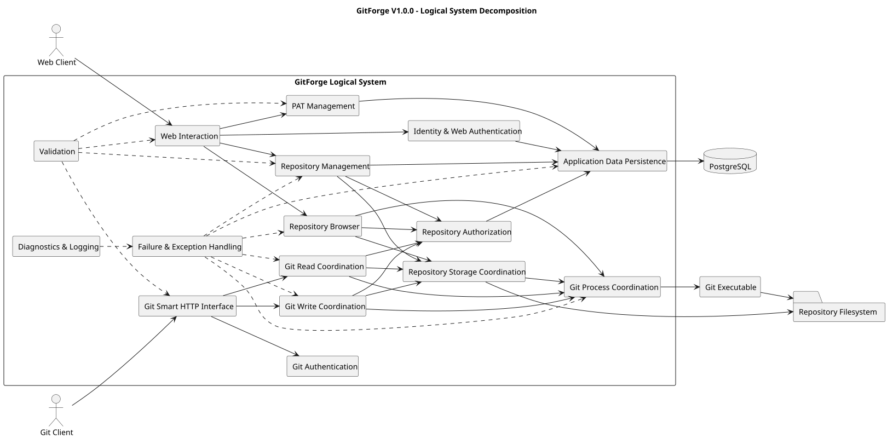
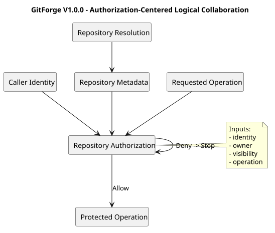
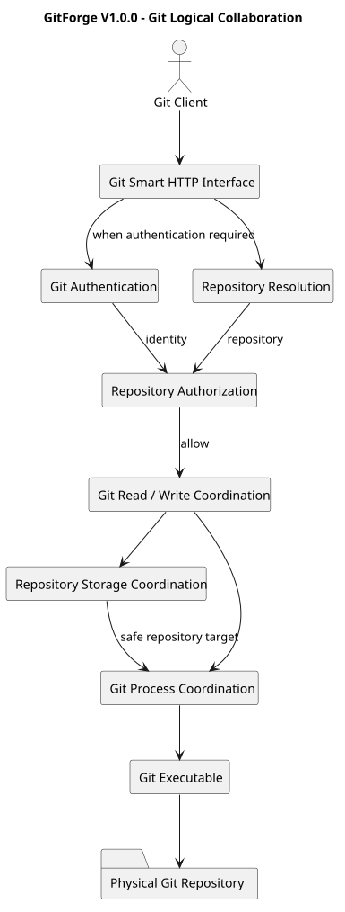

# GitForge V1.0.0 Logical System Decomposition

## 1. Document Information

| Field | Value |
|---|---|
| Project | GitForge - Web Git Hosting Platform |
| Target release | V1.0.0 |
| Document | Logical System Decomposition |
| SDLC phase | System Analysis |
| Milestone | M2 - System Analysis |
| Project owner | Farhad Valizadegan |
| Status | Approved |
| Last updated | 2026-08-17 |

---

## 2. Purpose

This document decomposes GitForge V1.0.0 into logical system responsibilities.

The decomposition identifies:

- major logical subsystems;
- responsibility boundaries;
- information ownership;
- logical dependencies;
- interaction directions;
- security-sensitive responsibility boundaries;
- relationships between web and Git workflows.

The purpose is to understand what responsibilities the system must perform before concrete architecture and component design begin.

---

## 3. Analysis Objective

This document answers:

> What major logical responsibilities exist inside GitForge, and how do they cooperate to satisfy the approved requirements?

The decomposition remains analysis-level.

It does not prescribe:

```text
Laravel controller classes
Laravel service classes
Database tables
REST endpoint classes
Folder structures
Deployment containers
Concrete packages
Concrete interfaces
Framework middleware structure
```

Those decisions belong primarily to System Design.

---

## 4. Decomposition Principle

GitForge is decomposed according to cohesive responsibility rather than implementation technology.

The principal rule is:

```text
Logical responsibility first
Concrete component later
```

A logical subsystem may later map to:

- one component;
- multiple components;
- framework capabilities;
- infrastructure adapters.

No one-to-one mapping is assumed at this stage.

---

## 5. Principal Logical Subsystems

GitForge V1.0.0 is decomposed into the following major logical subsystems:

```text
1. Web Interaction
2. Identity and Web Authentication
3. Repository Management
4. Repository Authorization
5. Repository Browser
6. Personal Access Token Management
7. Git Smart HTTP Interface
8. Git Authentication
9. Git Read Coordination
10. Git Write Coordination
11. Repository Storage Coordination
12. Git Process Coordination
13. Application Data Persistence
14. Validation
15. Failure and Exception Handling
16. Diagnostics and Logging
```

---

## 6. Logical Decomposition Overview

Conceptually:

```text
External Clients
      |
      +-----------------------+
      |                       |
      v                       v
Web Interaction       Git Smart HTTP Interface
      |                       |
      v                       v
Identity / Auth       Git Authentication
      |                       |
      +-----------+-----------+
                  |
                  v
         Repository Authorization
                  |
          +-------+--------+
          |                |
          v                v
 Repository Management   Git Operations
          |                |
          |          +-----+------+
          |          |            |
          v          v            v
Application Data   Git Read     Git Write
Persistence       Coordination  Coordination
                       |            |
                       +-----+------+
                             |
                             v
                  Repository Storage
                       Coordination
                             |
                             v
                    Git Process Coordination
                             |
                     +-------+-------+
                     |               |
                     v               v
              Git Executable   Repository Filesystem
```

Cross-cutting responsibilities include:

```text
Validation
Failure Handling
Diagnostics
```

---

## 7. Web Interaction Subsystem

The Web Interaction subsystem represents the logical entry point for browser-based application requests.

Responsibilities include:

- receiving browser requests;
- identifying the requested application operation;
- collecting validated input;
- invoking the appropriate logical responsibility;
- returning application responses;
- presenting allowed repository information.

It does not own authorization policy.

It must not treat client-side controls as authorization enforcement.

---

## 8. Web Interaction Inputs

Typical inputs include:

```text
Registration data
Login credentials
Repository creation data
Repository identifiers
Visibility-change requests
Repository browsing requests
PAT management requests
```

All externally supplied values are considered untrusted until validated.

---

## 9. Web Interaction Outputs

Typical outputs include:

```text
Authentication result
Repository list
Repository metadata
Repository browser content
PAT metadata
PAT plaintext at creation only
Validation errors
Authorization failures
Operational errors
```

---

## 10. Identity and Web Authentication Subsystem

This subsystem establishes authenticated User identity for browser-based requests.

Responsibilities include:

- registration identity establishment;
- credential verification;
- session establishment;
- session identity resolution;
- logout/session termination.

Its primary question is:

```text
Who is making this browser request?
```

It does not determine repository permission.

---

## 11. Authentication Separation Rule

Authentication and authorization remain logically separate.

Conceptually:

```text
Credentials
    ↓
Authentication
    ↓
User Identity
    ↓
Repository Authorization
    ↓
Allow / Deny
```

A valid authenticated session does not grant access to another user's private repository.

---

## 12. Repository Management Subsystem

Repository Management handles application-level repository lifecycle responsibilities included in V1.0.0.

Responsibilities include:

- creating repositories;
- resolving repository metadata;
- listing owned repositories;
- maintaining ownership association;
- maintaining public/private visibility;
- processing owner-authorized visibility changes.

Excluded responsibilities include:

```text
Repository deletion
Repository rename
Collaborator management
Organization ownership
Fork management
```

---

## 13. Repository Creation Responsibility

Repository creation logically requires coordination across:

```text
Request validation
Authenticated identity
Namespace validation
Application metadata
Physical Git repository initialization
Consistency handling
```

Conceptually:

```text
Create Request
     ↓
Validate
     ↓
Resolve User
     ↓
Check Namespace
     ↓
Create Logical Repository
     ↓
Initialize Physical Repository
     ↓
Confirm Consistent Result
```

---

## 14. Repository Resolution Responsibility

Repository Resolution determines the application repository represented by a logical identifier.

External representation:

```text
<owner>/<repository>
```

Resolution must occur before protected physical repository access.

Conceptually:

```text
Logical Namespace
      ↓
Validate
      ↓
Resolve Application Repository
      ↓
Obtain Ownership / Visibility
```

---

## 15. Repository Authorization Subsystem

Repository Authorization is the central logical responsibility for deciding whether a caller may perform an operation on a repository.

Inputs include:

```text
Caller identity
Repository
Repository owner
Repository visibility
Requested operation
```

Output:

```text
Allow
or
Deny
```

---

## 16. Authorization Operation Classes

At analysis level, repository operations can be grouped as:

```text
Read
Write
Manage
```

Examples:

### Read

```text
View repository
Browse tree
View file
View commit history
Clone
Fetch
```

### Write

```text
Push
```

### Manage

```text
Change visibility
```

---

## 17. Repository Read Authorization

Public repository:

| Caller | Decision |
|---|---|
| Visitor | Allow |
| Authenticated non-owner | Allow |
| Owner | Allow |

Private repository:

| Caller | Decision |
|---|---|
| Visitor | Deny |
| Authenticated non-owner | Deny |
| Owner | Allow |

---

## 18. Repository Write Authorization

Repository write policy is:

| Caller | Decision |
|---|---|
| Anonymous | Deny |
| Authenticated non-owner | Deny |
| Owner | Allow |

This rule applies regardless of public/private visibility.

---

## 19. Repository Management Authorization

Management operations included in V1.0.0 are owner-controlled.

For example:

```text
Change Visibility
    ↓
Authenticated?
    ↓
Owns Repository?
    ↓
Allow / Deny
```

---

## 20. Repository Browser Subsystem

Repository Browser exposes authorized Git-native repository information through the web application.

Responsibilities include logically obtaining:

```text
Branches
Commit history
Commit details
Trees
Files
Blob content
```

It does not create an independent authoritative copy of Git repository history.

---

## 21. Repository Browser Flow

Conceptually:

```text
Browser Request
      ↓
Resolve Repository
      ↓
Authorize Read
      ↓
Resolve Physical Repository
      ↓
Perform Controlled Git Inspection
      ↓
Interpret Result
      ↓
Return Browser Representation
```

Authorization must precede protected repository inspection.

---

## 22. Repository Browser Authority Rule

The physical Git repository remains authoritative for:

```text
Branches
Refs
Commits
Trees
Blobs
File content
```

The Repository Browser reads Git-native state.

It does not redefine it.

---

## 23. Personal Access Token Management Subsystem

PAT Management handles the lifecycle of GitForge Personal Access Tokens.

Responsibilities include:

```text
Create PAT
List PAT metadata
Revoke PAT
```

V1.0.0 excludes:

```text
PAT scopes
PAT expiration
PAT plaintext recovery
```

---

## 24. PAT Creation Responsibility

Conceptually:

```text
Authenticated User
      ↓
Request PAT Creation
      ↓
Generate Credential
      ↓
Persist Verification Representation
      ↓
Return Plaintext Once
```

The reusable plaintext credential must not remain recoverably persisted.

---

## 25. PAT Revocation Responsibility

Conceptually:

```text
Authenticated User
      ↓
Select Owned PAT
      ↓
Verify Ownership
      ↓
Revoke
      ↓
Future Authentication Denied
```

Revocation changes authentication usability.

It does not alter User identity or repository ownership.

---

## 26. Git Smart HTTP Interface Subsystem

The Git Smart HTTP Interface represents the logical protocol boundary between external Git clients and GitForge.

Responsibilities include:

- receiving supported Smart HTTP requests;
- identifying the requested Git service;
- resolving the target logical repository;
- passing authentication requirements to Git Authentication;
- invoking repository authorization;
- coordinating approved Git services;
- returning protocol-compatible responses.

---

## 27. Supported Git Service Classes

V1.0.0 requires logical support for:

```text
git-upload-pack
git-receive-pack
```

These correspond to:

```text
Read-oriented service
Write-oriented service
```

Only controlled Git service operations are permitted.

---

## 28. Git Authentication Subsystem

Git Authentication establishes User identity for protected Git Smart HTTP operations.

V1.0.0 uses PAT-based authentication.

Conceptually:

```text
Presented Credential
        ↓
Validate PAT
        ↓
Active?
        ↓
Resolve PAT Owner
        ↓
Authenticated User Identity
```

---

## 29. Git Authentication Does Not Authorize

A successfully validated PAT answers:

```text
Who is the Git client acting as?
```

It does not answer:

```text
May that User access this Repository?
```

Repository Authorization must execute separately.

---

## 30. Anonymous Git Read

Public repositories allow anonymous clone/fetch.

Therefore Git Authentication is not mandatory for every Git read request.

Conceptually:

```text
Requested Repository
       ↓
Public?
   /       \\
 Yes        No
  |          |
Anonymous   Authenticate
Read Path    PAT
```

Authorization still evaluates the repository and requested operation.

---

## 31. Git Read Coordination Subsystem

Git Read Coordination handles approved read-oriented Git operations.

Examples include:

```text
Clone
Fetch
git-upload-pack service discovery
git-upload-pack execution
```

Responsibilities include:

- repository resolution;
- read authorization;
- physical repository resolution;
- approved Git read-service selection;
- interaction with Git Process Coordination;
- returning protocol output.

---

## 32. Git Read Logical Flow

```text
Git Client
    ↓
Git Smart HTTP Interface
    ↓
Resolve Repository
    ↓
Determine Authentication Need
    ↓
Authenticate if Required
    ↓
Authorize Read
    ↓
Resolve Physical Repository
    ↓
Invoke Approved Read Service
    ↓
Return Git Response
```

---

## 33. Git Write Coordination Subsystem

Git Write Coordination handles supported repository mutation through Git Smart HTTP.

The principal V1.0.0 write operation is:

```text
Push
```

Responsibilities include:

- requiring authentication;
- resolving User identity;
- resolving repository;
- authorizing owner write;
- resolving physical repository;
- invoking approved write service;
- returning protocol-compatible success/failure information.

---

## 34. Git Write Logical Flow

```text
Git Client
    ↓
Git Smart HTTP Interface
    ↓
Authenticate PAT
    ↓
Resolve User
    ↓
Resolve Repository
    ↓
Authorize Owner Write
    ↓
Resolve Physical Repository
    ↓
Invoke git-receive-pack
    ↓
Repository Mutation
    ↓
Return Git Response
```

Authorization shall occur before mutation.

---

## 35. Repository Storage Coordination Subsystem

Repository Storage Coordination manages the logical relationship between application repositories and physical Git repositories.

Responsibilities include:

- deriving physical repository identity;
- enforcing repository-root containment;
- preventing traversal;
- validating expected repository existence;
- coordinating repository initialization;
- exposing controlled physical repository references to internal Git responsibilities.

---

## 36. Repository Storage Boundary

External clients use logical namespace identifiers:

```text
<owner>/<repository>
```

Repository Storage Coordination internally derives physical storage information.

Conceptually:

```text
External Namespace
       ↓
Repository Resolution
       ↓
Internal Repository Identity
       ↓
Safe Storage Resolution
       ↓
Physical Repository
```

Clients do not directly select the physical repository path.

---

## 37. Repository Initialization

Repository creation requires physical Git repository initialization.

Logical responsibility includes:

```text
Validate target storage identity
Ensure target is permitted
Initialize Git repository
Detect initialization failure
Return result to Repository Management
```

The exact command, directory layout, and process wrapper belong to System Design.

---

## 38. Git Process Coordination Subsystem

Git Process Coordination represents controlled interaction with the external Git executable.

Responsibilities include:

- selecting approved Git operations;
- providing approved arguments;
- associating execution with a resolved physical repository;
- passing controlled input;
- capturing output;
- detecting process failures;
- preventing arbitrary command execution.

---

## 39. Git Process Security Rule

External users shall not directly control:

```text
Executable path
Shell command
Arbitrary arguments
Physical repository path
```

The system determines these values from validated operation context.

---

## 40. Application Data Persistence Subsystem

Application Data Persistence represents logical access to PostgreSQL-backed application data.

Authoritative application data includes:

```text
Users
Repository metadata
Ownership
Visibility
PAT metadata
Application-managed authentication state where applicable
```

This subsystem does not own Git-native repository history.

---

## 41. Persistence Authority Separation

Application data:

```text
PostgreSQL
```

Git-native data:

```text
Physical Git Repository
```

The decomposition preserves this separation.

---

## 42. Validation Subsystem

Validation is a cross-cutting responsibility.

It evaluates untrusted or externally derived values before they participate in protected operations.

Validation areas include:

```text
Registration data
Authentication inputs
Repository names
Repository namespace components
Visibility values
PAT management inputs
Git service identifiers
Repository references
Request parameters
```

---

## 43. Repository Name Validation

Repository-name validation must enforce approved rules including:

```text
Length 1–100
Lowercase ASCII letters
Digits
Hyphen
Underscore
Safe periods
No slash
No backslash
No ..
No traversal
No control characters
```

Validation is distinct from namespace uniqueness checking.

---

## 44. Failure and Exception Handling Subsystem

Failure and Exception Handling provides consistent logical treatment of unsuccessful operations.

Relevant failure categories include:

```text
Validation failure
Authentication failure
Authorization failure
Repository not found
Duplicate namespace
Physical repository missing
Repository initialization failure
Database failure
Filesystem failure
Git process failure
Invalid configuration
```

Detailed semantics are defined later in M2.

---

## 45. Failure Boundary Rule

Internal dependency failures shall not automatically expose sensitive implementation details to external clients.

Conceptually:

```text
Internal Failure
      ↓
Classify
      ↓
Record Diagnostic Context
      ↓
Return Safe External Error
```

---

## 46. Diagnostics and Logging Subsystem

Diagnostics provides operational observability for significant system events and failures.

Responsibilities include recording sufficient context for investigation without intentionally exposing or persisting reusable secrets.

Examples include:

```text
Authentication failure category
Authorization denial
Repository resolution failure
Physical repository failure
Git process failure
Database failure
Configuration failure
```

---

## 47. Sensitive Logging Rule

The system shall not intentionally log reusable plaintext credentials such as:

```text
PAT plaintext
User password
```

Error messages must also avoid unnecessary sensitive filesystem or configuration disclosure.

---

## 48. Cross-Cutting Security Responsibilities

Security responsibilities span multiple logical subsystems.

Examples:

```text
Web Authentication
Git Authentication
Repository Authorization
Input Validation
Safe Repository Resolution
Controlled Git Execution
Credential Protection
Failure Disclosure Control
Logging Protection
```

Security is therefore not isolated into one subsystem.

---

## 49. Logical Dependency Direction

Major dependency direction is:

```text
Client Interface
      ↓
Identity / Authentication
      ↓
Repository Resolution
      ↓
Authorization
      ↓
Business Operation
      ↓
Persistence / Storage / Git Execution
```

Protected low-level operations shall not be invoked before required authorization decisions.

---

## 50. Web Repository Read Collaboration

Logical collaboration:

```text
Web Interaction
       ↓
Repository Management / Resolution
       ↓
Repository Authorization
       ↓
Repository Browser
       ↓
Repository Storage Coordination
       ↓
Git Process Coordination
       ↓
Git Repository
```

---

## 51. Web Repository Creation Collaboration

Logical collaboration:

```text
Web Interaction
       ↓
Identity / Web Authentication
       ↓
Validation
       ↓
Repository Management
      / \\
     /   \\
    v     v
Application Data Persistence
Repository Storage Coordination
              ↓
      Git Process Coordination
```

Consistency must be preserved across the two persistence domains.

---

## 52. PAT Creation Collaboration

```text
Web Interaction
       ↓
Identity / Web Authentication
       ↓
PAT Management
       ↓
Application Data Persistence
```

Plaintext token output returns only through the creation interaction.

---

## 53. Public Clone Collaboration

```text
Git Client
    ↓
Git Smart HTTP Interface
    ↓
Repository Resolution
    ↓
Repository Authorization
    ↓
Git Read Coordination
    ↓
Repository Storage Coordination
    ↓
Git Process Coordination
    ↓
git-upload-pack
```

Git Authentication may be omitted when anonymous public read is permitted.

---

## 54. Private Clone Collaboration

```text
Git Client
    ↓
Git Smart HTTP Interface
    ↓
Git Authentication
    ↓
Repository Resolution
    ↓
Repository Authorization
    ↓
Git Read Coordination
    ↓
Repository Storage Coordination
    ↓
Git Process Coordination
```

---

## 55. Push Collaboration

```text
Git Client
    ↓
Git Smart HTTP Interface
    ↓
Git Authentication
    ↓
Repository Resolution
    ↓
Repository Authorization
    ↓
Git Write Coordination
    ↓
Repository Storage Coordination
    ↓
Git Process Coordination
    ↓
git-receive-pack
```

---

## 56. Logical Subsystem Responsibility Matrix

| Logical Subsystem | Primary Responsibility |
|---|---|
| Web Interaction | Browser-facing application interaction |
| Identity and Web Authentication | Browser User identity establishment |
| Repository Management | Repository metadata lifecycle |
| Repository Authorization | Repository access decisions |
| Repository Browser | Web access to Git-native content |
| PAT Management | PAT lifecycle |
| Git Smart HTTP Interface | Git protocol entry point |
| Git Authentication | PAT-based Git identity establishment |
| Git Read Coordination | Clone/fetch/read-service behavior |
| Git Write Coordination | Push/write-service behavior |
| Repository Storage Coordination | Safe physical repository resolution |
| Git Process Coordination | Controlled Git execution |
| Application Data Persistence | PostgreSQL-backed application data |
| Validation | Input and domain validation |
| Failure and Exception Handling | Failure classification and safe response |
| Diagnostics and Logging | Operational evidence |

---

## 57. Logical Subsystem Data Responsibilities

| Information | Logical Authority / Responsibility |
|---|---|
| User identity | Identity / Authentication + Application Persistence |
| Repository metadata | Repository Management + Application Persistence |
| Ownership | Repository Management + Application Persistence |
| Visibility | Repository Management + Application Persistence |
| PAT metadata | PAT Management + Application Persistence |
| Git refs | Physical Git repository |
| Branches | Physical Git repository |
| Commits | Physical Git repository |
| Trees | Physical Git repository |
| Blobs | Physical Git repository |
| Authorization result | Repository Authorization |
| Physical repository resolution | Repository Storage Coordination |
| Git execution result | Git Process Coordination |

---

## 58. Logical Decomposition Diagram



[PlantUML source](diagrams/04-logical-system-decomposition-001.puml)

---

## 59. Authorization-Centered Collaboration Diagram



[PlantUML source](diagrams/04-logical-system-decomposition-002.puml)

---

## 60. Git Logical Collaboration Diagram



[PlantUML source](diagrams/04-logical-system-decomposition-003.puml)

---

## 61. Logical Coupling Rules

The following coupling rules apply.

### LC-001

Client-facing responsibilities shall not directly access arbitrary physical repository paths.

### LC-002

Repository Browser shall not bypass Repository Authorization.

### LC-003

Git Read and Git Write Coordination shall not bypass Repository Authorization.

### LC-004

Git Authentication shall establish identity but not grant repository permission.

### LC-005

Git Process Coordination shall not determine application authorization policy.

### LC-006

Application Data Persistence shall not become authoritative for Git-native objects.

### LC-007

Repository Storage Coordination shall not expose arbitrary path selection to external clients.

### LC-008

PAT Management shall not expose previously stored plaintext PAT secrets.

---

## 62. Responsibility Separation Rules

### Authentication Versus Authorization

```text
Authentication → identity
Authorization  → permission
```

### Metadata Versus Git Content

```text
PostgreSQL → application metadata
Git repository → Git-native content
```

### Namespace Versus Filesystem Path

```text
Namespace → external logical identity
Path → internally resolved storage location
```

### Protocol Versus Process Execution

```text
Git Smart HTTP → protocol interaction
Git Process Coordination → controlled executable invocation
```

---

## 63. Logical Failure Propagation

Failures should propagate through logical responsibility boundaries rather than bypassing them.

Example:

```text
Git Executable Failure
        ↓
Git Process Coordination
        ↓
Git Read / Write Coordination
        ↓
Failure Classification
        ↓
Safe Git HTTP Response
        +
Diagnostic Record
```

---

## 64. Repository Creation Failure Propagation

```text
Repository Initialization Failure
        ↓
Repository Storage Coordination
        ↓
Repository Management
        ↓
Consistency Handling
        ↓
Failure and Exception Handling
        ↓
Safe Application Response
```

The exact compensation strategy is deferred to later analysis/design.

---

## 65. Security-Sensitive Logical Boundaries

The most security-sensitive logical boundaries are:

```text
External Client → Web Interaction
External Git Client → Git Smart HTTP Interface
Credentials → Authentication
Authenticated Identity → Authorization
Logical Namespace → Storage Resolution
Application → Git Process Execution
Application → Filesystem
Application → PostgreSQL
Internal Failure → External Error Response
```

---

## 66. Logical Subsystem Trust Classification

### Untrusted Entry Responsibilities

```text
Web Interaction
Git Smart HTTP Interface
```

They receive untrusted external input.

### Decision Responsibilities

```text
Identity and Authentication
Validation
Repository Authorization
```

They establish trusted application decisions.

### Controlled Execution Responsibilities

```text
Repository Management
Repository Browser
Git Read Coordination
Git Write Coordination
Repository Storage Coordination
Git Process Coordination
Application Data Persistence
```

They act only on validated/authorized context where required.

---

## 67. Scope Guardrails

The decomposition shall not expand into unsupported V1.0.0 capabilities.

No logical subsystem is required for:

```text
Organizations
Teams
Collaborators
Pull Requests
Issues
CI/CD
SSH transport
Packages
Wiki
Billing
Repository deletion
Repository rename
Forking
```

---

## 68. Requirements Alignment

The logical decomposition is derived primarily from approved requirements covering:

```text
User registration
Authentication
Logout
Repository creation
Owned repository listing
Repository viewing
Visibility changes
Repository browser
Branches
Commit history
Commit details
Tree browsing
File browsing
Git service discovery
Clone
Fetch
Push
PAT creation
PAT authentication
PAT revocation
Read authorization
Write authorization
Failure diagnosis
```

---

## 69. Use Case Alignment

Representative logical subsystem mappings are:

| Use Case | Primary Logical Responsibilities |
|---|---|
| UC-001 Register | Web Interaction, Identity, Validation, Persistence |
| UC-002 Authenticate | Web Interaction, Identity, Persistence |
| UC-003 Logout | Web Interaction, Identity |
| UC-004 Create Repository | Repository Management, Validation, Storage, Persistence |
| UC-005 List Owned Repositories | Repository Management, Persistence |
| UC-006 View Repository | Repository Management, Authorization |
| UC-007 Change Visibility | Repository Management, Authorization, Persistence |
| UC-009 Browse | Repository Browser, Authorization, Storage, Git Process |
| UC-010 List Branches | Repository Browser, Git Process |
| UC-011 Commit History | Repository Browser, Git Process |
| UC-012 Commit Details | Repository Browser, Git Process |
| UC-013 Tree | Repository Browser, Git Process |
| UC-014 File | Repository Browser, Git Process |
| UC-015 Discover Read Service | Git HTTP, Git Read, Authorization |
| UC-016 Clone | Git HTTP, Git Read, Authorization, Storage, Git Process |
| UC-017 Fetch | Git HTTP, Git Read, Authorization, Storage, Git Process |
| UC-018 Discover Write Service | Git HTTP, Git Auth, Git Write, Authorization |
| UC-019 Push | Git HTTP, Git Auth, Git Write, Authorization, Git Process |
| UC-020 Create PAT | PAT Management, Persistence |
| UC-021 Authenticate Git with PAT | Git Authentication, Persistence |
| UC-022 Revoke PAT | PAT Management, Persistence |
| UC-023 Authorize Read | Repository Authorization |
| UC-024 Authorize Write | Repository Authorization |
| UC-025 Diagnose Failure | Failure Handling, Diagnostics |

Detailed traceability will be consolidated in:

```text
19-analysis-traceability.md
```

---

## 70. Logical Analysis Findings

### LD-001 — Authorization Is a Shared Responsibility Boundary

Both Web repository operations and Git Smart HTTP operations require the same repository policy semantics.

Status:

```text
Confirmed
```

### LD-002 — Git Authentication Is Distinct From Web Authentication

Both establish User identity, but they operate through different client interaction contexts.

Status:

```text
Confirmed
```

### LD-003 — Git Read and Git Write Require Separate Behavioral Analysis

Read and write operations differ materially in:

```text
Authentication requirements
Authorization consequences
Mutation risk
Failure behavior
```

Status:

```text
Confirmed
```

### LD-004 — Repository Storage Requires a Dedicated Logical Responsibility

Safe conversion from logical repository identity to physical storage must not be distributed implicitly across client-facing responsibilities.

Status:

```text
Confirmed
```

### LD-005 — Controlled Git Process Execution Is a Dedicated Responsibility

The system must isolate protocol/business decisions from executable invocation.

Status:

```text
Confirmed
```

### LD-006 — Validation, Failure Handling, and Diagnostics Are Cross-Cutting

These responsibilities apply to multiple logical subsystems and should not be analyzed as isolated user features.

Status:

```text
Confirmed
```

---

## 71. Decomposition Risks Requiring Later Analysis

The following require deeper M2 analysis:

```text
Authentication behavior
Authorization ordering
Repository creation consistency
Repository browser behavior
Git read protocol flow
Git write protocol flow
PAT authentication lifecycle
Safe storage resolution
Data movement
State transitions
Trust boundaries
Failure behavior
```

These correspond to subsequent M2 deliverables.

---

## 72. Design Decisions Intentionally Deferred

This decomposition does not decide:

```text
Monolith versus service deployment
Laravel controller boundaries
Laravel service boundaries
Middleware layout
Concrete policy classes
Concrete authentication guards
Database schema
Repository table design
PAT table design
Concrete storage directory layout
Exact Git command invocation implementation
REST route structure
Frontend component structure
Docker/container topology
```

Those belong to System Design.

---

## 73. Completion Criteria

This document is complete when:

- major GitForge responsibilities are logically decomposed;
- web and Git interaction responsibilities are distinguished;
- authentication and authorization are separated;
- read and write Git responsibilities are distinguished;
- repository storage responsibility is explicit;
- Git process execution responsibility is explicit;
- application metadata persistence is separated from Git-native storage;
- cross-cutting validation, failure handling, and diagnostics are represented;
- protected operations cannot logically bypass authorization;
- excluded V1.0.0 capabilities have not been introduced;
- decomposition is sufficient for detailed behavioral analysis.

---

## 74. Analysis Result

Logical System Decomposition result:

```text
SUFFICIENT FOR DETAILED SYSTEM ANALYSIS
```

No decomposition-level contradiction with approved V1.0.0 requirements has been identified.

---

## 75. Document Status

This document is currently:

```text
Approved
```

It will be changed to:

```text
Approved
```

after the logical responsibilities, boundaries, dependencies, diagrams, scope guardrails, and requirements alignment have been reviewed.
