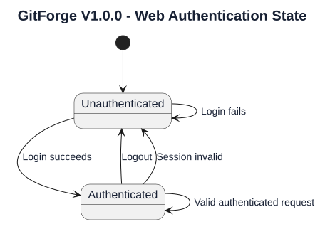
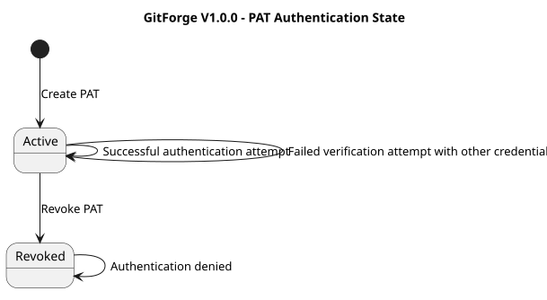
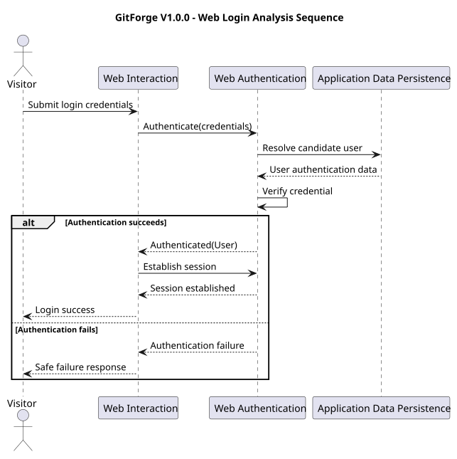
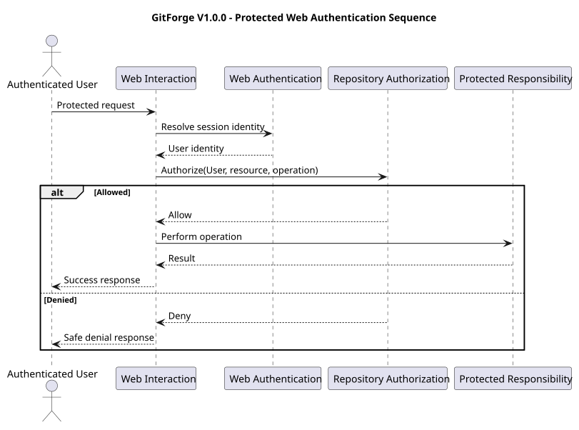
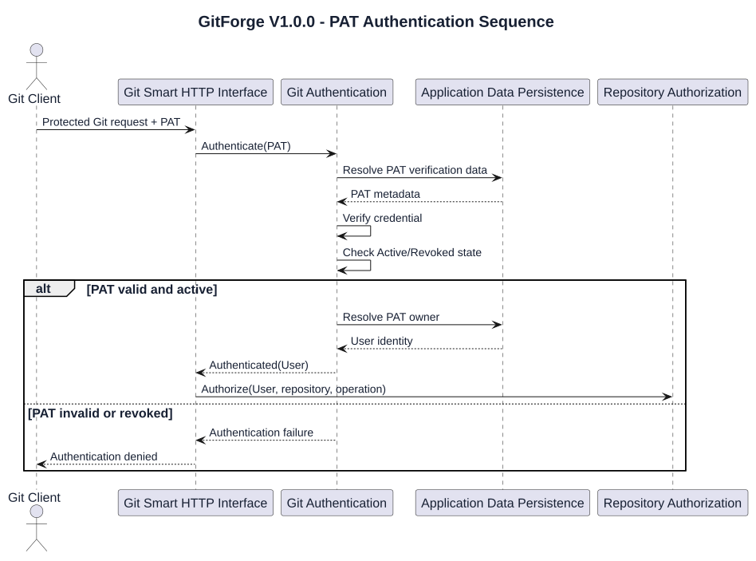
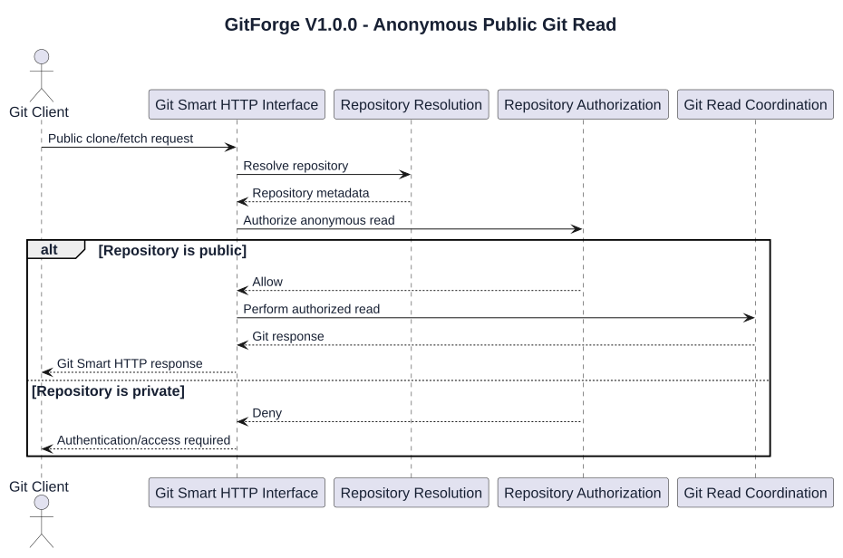
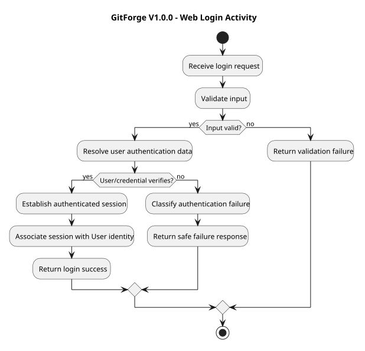
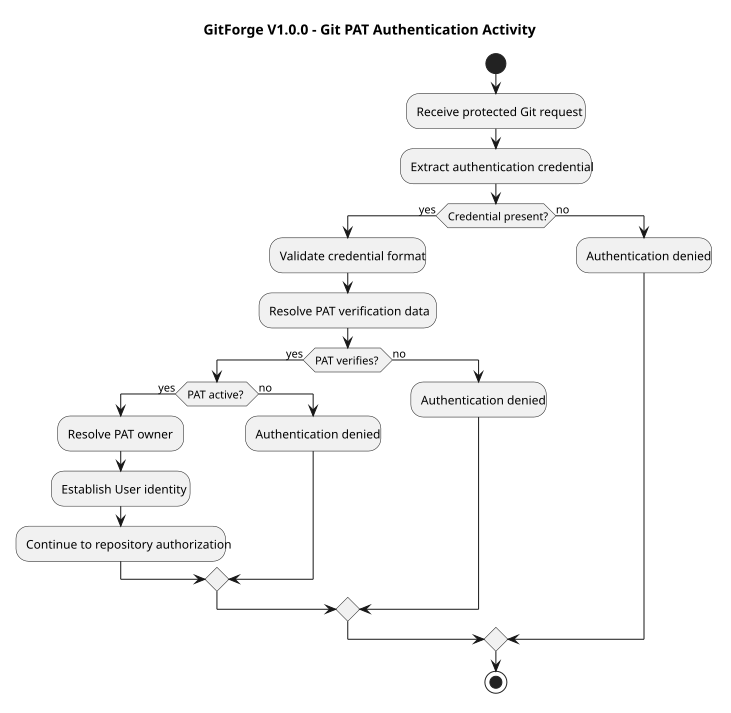

# GitForge V1.0.0 Authentication Analysis

## 1. Document Information

| Field | Value |
|---|---|
| Project | GitForge - Web Git Hosting Platform |
| Target release | V1.0.0 |
| Document | Authentication Analysis |
| SDLC phase | System Analysis |
| Milestone | M2 - System Analysis |
| Project owner | Farhad Valizadegan |
| Status | Approved |
| Last updated | 2026-08-17 |

---

## 2. Purpose

This document analyzes authentication behavior for GitForge V1.0.0.

It defines:

- authentication contexts;

- browser authentication behavior;

- registration-related identity establishment;

- login behavior;

- authenticated session behavior;

- logout behavior;

- Git Smart HTTP authentication;

- Personal Access Token authentication;

- anonymous access behavior;

- authentication failure conditions;

- authentication security boundaries;

- authentication state transitions;

- interaction with authorization.

The purpose is to establish a precise logical authentication model before System Design begins.

---

## 3. Analysis Objective

This document answers:

> How does GitForge establish, maintain, resolve, and terminate caller identity across browser and Git Smart HTTP interactions?

Authentication answers:

```text

Who is making the request?

```

Authentication does not answer:

```text

May this caller perform the requested operation?

```

That second question belongs to authorization.

---

## 4. Authentication Scope

V1.0.0 authentication analysis includes:

```text

User registration

Web login

Web session establishment

Web session identity resolution

Logout

PAT creation dependency on authenticated session

PAT-based Git authentication

Anonymous public repository read

Invalid credential behavior

Revoked PAT behavior

Authentication failure handling

Credential protection

```

---

## 5. Out-of-Scope Authentication Capabilities

The following authentication capabilities are excluded or deferred from V1.0.0:

```text

OAuth login

OpenID Connect

SAML

LDAP

Social login

Multi-factor authentication

Passkeys

SSH-key authentication

API token scopes

PAT expiration

Refresh-token architecture

Device authorization flow

Organization-level identity federation

Enterprise SSO

```

These shall not be introduced implicitly during V1.0.0 design.

---

## 6. Authentication Contexts

GitForge V1.0.0 has two principal authenticated interaction contexts:

```text

1. Web Authentication

2. Git Smart HTTP Authentication

```

They establish the same logical User identity domain but use different credential mechanisms.

Conceptually:

```text

Web Credentials

      ↓

Web Authentication

      ↓

User Identity

PAT Credential

      ↓

Git Authentication

      ↓

User Identity

```

---

## 7. Authentication Actors

Authentication-related actors include:

```text

Visitor

Authenticated User

Git Client

```

Repository Owner is not an authentication identity type.

It is an authorization role derived after authentication.

---

## 8. Visitor Authentication State

A Visitor has no established authenticated web identity.

Conceptually:

```text

Browser Request

      ↓

No Valid Session

      ↓

Visitor

```

A Visitor may access only operations permitted without authentication.

Examples include:

```text

Registration

Login

Public repository web read

```

---

## 9. Authenticated User State

An Authenticated User has a valid resolved web-session identity.

Conceptually:

```text

Browser Request

      ↓

Valid Authentication Session

      ↓

Resolve User

      ↓

Authenticated User

```

This state enables protected application workflows but does not grant unrestricted repository access.

---

## 10. Registration and Authentication Relationship

Registration creates a User account.

Authentication proves that a caller may act as an existing User.

These are separate logical responsibilities.

Conceptually:

```text

Registration

    ↓

Create User Identity Record

Later:

Credentials

    ↓

Authentication

    ↓

Resolve Existing User Identity

```

Whether registration immediately establishes a web session is a workflow detail that must remain consistent with approved requirements and later design.

---

## 11. Registration Input

Registration may require user-supplied identity and credential data defined by approved requirements.

All registration input is untrusted.

Logical processing includes:

```text

Receive input

    ↓

Validate

    ↓

Check required uniqueness constraints

    ↓

Protect credential representation

    ↓

Create User

    ↓

Return registration result

```

---

## 12. Password Handling Principle

Reusable plaintext passwords shall not be stored as recoverable application data.

Conceptually:

```text

Plaintext Password

      ↓

Credential Protection

      ↓

Non-Recoverable Verification Representation

      ↓

Persistent Storage

```

Plaintext password exposure shall be limited to the immediate authentication request context.

---

## 13. Web Login

Web Login establishes User identity from submitted credentials.

Logical flow:

```text

Visitor

   ↓

Submit Credentials

   ↓

Validate Input

   ↓

Resolve Candidate User

   ↓

Verify Credential

   ↓

Authentication Success?

   /          \\

 Yes           No

  |             |

  v             v

Establish      Reject

Session        Request

```

---

## 14. Login Success

Successful login produces an authenticated browser context.

Logical result:

```text

Valid User Identity

        +

Authenticated Session

```

Subsequent protected browser requests may resolve that User identity through the session.

---

## 15. Login Failure

Login fails when authentication cannot establish a valid User identity.

Possible reasons include:

```text

Unknown account

Invalid credential

Malformed authentication input

Unavailable persistence dependency

Invalid authentication state

```

External failure responses should not unnecessarily disclose whether a particular account exists.

---

## 16. Web Authentication Session

A Web Authentication Session associates browser requests with an authenticated User identity.

Logical responsibilities include:

```text

Establish session

Associate session with User identity

Resolve session on later requests

Reject invalid session

Terminate session during logout

```

The exact session persistence mechanism is deferred to System Design.

---

## 17. Session Identity Resolution

For a protected browser request:

```text

Browser Request

      ↓

Resolve Session

      ↓

Session Valid?

   /          \\

 Yes           No

  |             |

  v             v

Resolve User   Treat as

Identity       Unauthenticated

```

Authentication processing must occur before owner-specific authorization.

---

## 18. Session Validity

At analysis level, an authenticated session is either logically:

```text

Valid

Invalid / Absent

```

A request with no valid authenticated session shall not be treated as an Authenticated User.

---

## 19. Session State Model

Conceptually:

```text

Unauthenticated

      ↓ Login Success

Authenticated

      ↓ Logout / Invalid Session

Unauthenticated

```

The exact timeout and session-expiration policy may be determined during design if not already constrained by requirements.

---

## 20. Logout

Logout terminates the current authenticated browser context.

Logical flow:

```text

Authenticated User

      ↓

Logout Request

      ↓

Invalidate Authentication Session

      ↓

Remove Authenticated Context

      ↓

Visitor State

```

After logout, subsequent protected operations require authentication again.

---

## 21. Logout Security Requirement

Logout must invalidate the server-recognized authenticated context.

Merely changing client-side presentation is insufficient.

Conceptually:

```text

Client UI change

        ≠

Session termination

```

---

## 22. Authentication Before Protected Web Operations

Protected web workflows require a valid User identity.

Examples include:

```text

Create repository

List owned repositories

Change repository visibility

Create PAT

List PAT metadata

Revoke PAT

Browse owned private repository

```

Authentication precedes authorization where repository-specific authorization is required.

---

## 23. Public Web Read Authentication Behavior

Public repository web read does not require authentication.

Conceptually:

```text

Repository Request

      ↓

Resolve Repository

      ↓

Public?

   /       \\

 Yes        No

  |          |

Allow       Require identity

Read        and authorize

```

Authentication may still be present for an authenticated caller, but it is not required to permit public read.

---

## 24. Private Web Read Authentication Behavior

Private repository web read requires an authenticated identity.

Conceptually:

```text

Private Repository Request

        ↓

Authenticated?

    /          \\

  No            Yes

  |              |

 Deny      Resolve User Identity

                 ↓

             Authorization

```

Authentication success alone does not grant the private read.

---

## 25. Git Smart HTTP Authentication

Git Smart HTTP authentication establishes a User identity for protected Git operations.

V1.0.0 uses Personal Access Tokens.

Conceptually:

```text

Git Client

    ↓

Credential

    ↓

Git Authentication

    ↓

User Identity

```

---

## 26. Personal Access Token Role

A PAT is a reusable credential owned by one User.

Its authentication purpose is:

```text

PAT

 ↓

Validate

 ↓

Resolve Token Owner

 ↓

Authenticated User Identity

```

A PAT is not itself the repository permission model.

---

## 27. PAT Authentication Preconditions

For a PAT to establish identity, the logical authentication checks include:

```text

Credential is present when required

Credential format is acceptable

Matching PAT exists

Verification succeeds

PAT is not revoked

Associated User exists and is valid

```

Failure of any required condition prevents authentication.

---

## 28. Active PAT

An Active PAT may be used to attempt Git authentication.

Conceptually:

```text

Presented PAT

      ↓

Verify

      ↓

Active?

      ↓ Yes

Resolve Owner

      ↓

Authenticated Identity

```

Active state does not guarantee repository authorization.

---

## 29. Revoked PAT

A Revoked PAT must not establish authenticated identity.

Conceptually:

```text

Presented PAT

      ↓

Resolve Token Record

      ↓

Revoked

      ↓

Authentication Denied

```

Revocation takes effect for future authentication attempts.

---

## 30. PAT Plaintext Handling

The plaintext token is available only during its creation workflow.

Conceptually:

```text

Generate PAT

    ↓

Display Plaintext Once

    ↓

Persist Verification Representation

    ↓

Later Authentication Uses Verification

```

GitForge shall not require recoverable plaintext persistence for PAT authentication.

---

## 31. PAT Authentication Versus PAT Management

PAT Management and PAT Authentication are distinct logical responsibilities.

PAT Management:

```text

Create

List metadata

Revoke

```

PAT Authentication:

```text

Receive credential

Verify credential

Check state

Resolve owner

Establish identity

```

---

## 32. Git Authentication Requirement

Authentication requirements differ between read and write operations.

### Public Repository Read

Authentication is not required.

Examples:

```text

Anonymous clone

Anonymous fetch

Anonymous read-service discovery

```

### Private Repository Read

Authentication is required.

### Repository Write

Authentication is always required.

---

## 33. Anonymous Git Identity

Anonymous Git requests have no authenticated User identity.

Conceptually:

```text

Git Request

   ↓

No Credential / No Required Identity

   ↓

Anonymous Caller

```

Anonymous identity may proceed only to authorization rules that explicitly permit it.

---

## 34. Anonymous Public Clone

Logical flow:

```text

Git Client

    ↓

Public Repository Read Request

    ↓

No Authentication Required

    ↓

Anonymous Identity Context

    ↓

Authorize Public Read

    ↓

Proceed

```

---

## 35. Anonymous Private Clone

Logical flow:

```text

Git Client

    ↓

Private Repository Read Request

    ↓

Authentication Required

    ↓

No Valid Credential

    ↓

Authentication Failure

    ↓

Request Denied

```

---

## 36. Authenticated Private Clone

Logical flow:

```text

Git Client

    ↓

Private Read Request

    ↓

Present PAT

    ↓

Validate PAT

    ↓

Resolve User

    ↓

Authentication Success

    ↓

Repository Authorization

```

The authorization stage determines whether the authenticated User is the owner.

---

## 37. Push Authentication

Push requires authentication.

Logical flow:

```text

Git Client

    ↓

Push Request

    ↓

Present PAT

    ↓

Validate PAT

    ↓

Resolve User

    ↓

Authentication Success

    ↓

Authorize Owner Write

```

No push operation may proceed anonymously.

---

## 38. Authentication and Authorization Ordering

For operations requiring identity:

```text

Receive Request

      ↓

Authenticate

      ↓

Identity Established

      ↓

Authorize

      ↓

Perform Protected Operation

```

For public anonymous reads:

```text

Receive Request

      ↓

Resolve Resource

      ↓

Determine Public Read Eligibility

      ↓

Authorize Anonymous Read

      ↓

Perform Read

```

The exact routing order may differ by interface, but protected operations must never bypass authorization.

---

## 39. Authentication Outcome Model

Authentication has two principal outcomes:

```text

Authenticated(User)

Unauthenticated

```

Failure may additionally carry an internal reason classification such as:

```text

Missing Credential

Malformed Credential

Unknown Credential

Invalid Credential

Revoked Credential

Session Invalid

Dependency Failure

```

External responses may intentionally generalize these reasons.

---

## 40. Authentication Result

An authentication result conceptually contains:

```text

Authentication Status

Resolved User Identity, if successful

Failure Category, if unsuccessful

```

It does not contain repository permission.

---

## 41. Authentication Failure Categories

### AF-001 — Missing Required Credential

A protected request requires authentication but no valid credential is supplied.

### AF-002 — Invalid Web Credential

Submitted web credentials fail verification.

### AF-003 — Invalid Session

A request references no valid authenticated session.

### AF-004 — Invalid PAT

Presented PAT cannot be verified.

### AF-005 — Revoked PAT

Presented PAT was valid previously but has been revoked.

### AF-006 — Unknown User

Authentication cannot resolve a valid associated User identity.

### AF-007 — Persistence Failure

Authentication cannot complete because required application data cannot be accessed.

### AF-008 — Malformed Input

Authentication input fails structural validation.

---

## 42. Authentication Failure Response Principle

Authentication failures must be externally safe.

Conceptually:

```text

Internal Failure Detail

        ↓

Authentication Failure Classification

        ↓

Safe Client Response

        +

Diagnostic Event

```

The response should avoid unnecessary disclosure of:

```text

Password hashes

PAT verification data

Database structure

Filesystem paths

Application secrets

Internal stack traces

```

---

## 43. Credential Enumeration Risk

Authentication responses should avoid making account discovery unnecessarily easy.

For example, login behavior should not needlessly distinguish externally between:

```text

Unknown account

Incorrect password

```

when a generic authentication failure response is sufficient.

---

## 44. PAT Enumeration Risk

Git authentication failures should not expose whether a specific token identifier or secret exists.

Externally, invalid authentication may be generalized.

Internally, diagnostics may retain safe failure classification without recording plaintext credentials.

---

## 45. Credential Logging Rule

GitForge shall not intentionally log:

```text

Plaintext password

Plaintext PAT

Reusable authentication credential

```

Logs may include safe contextual information such as:

```text

Authentication channel

Failure category

Target operation

Timestamp

Resolved User ID when appropriate and safe

```

---

## 46. Credential Transport Boundary

Authentication credentials cross an external-to-application trust boundary.

Conceptually:

```text

External Client

     ↓

Credential

     ↓

GitForge Boundary

     ↓

Authentication Processing

```

Credentials must be treated as sensitive untrusted input.

Transport protection details belong to security and deployment design.

---

## 47. Web Authentication Trust Boundary

For browser authentication:

```text

Browser

   ↓

Untrusted Credential Input

   ↓

GitForge

   ↓

Validation

   ↓

Credential Verification

   ↓

User Identity

```

Client claims about authenticated identity are not authoritative.

---

## 48. Git Authentication Trust Boundary

For Git authentication:

```text

Git Client

    ↓

Untrusted PAT Credential

    ↓

GitForge

    ↓

PAT Verification

    ↓

Token State Check

    ↓

Resolve User

```

The Git client cannot self-assert repository ownership.

---

## 49. Identity Authority

The authoritative application identity is determined by GitForge-controlled authentication data.

Conceptually:

```text

Client-supplied username/identity claim

            ≠

Trusted User Identity

```

Trusted identity exists only after successful authentication resolution.

---

## 50. Authentication State — Web

Logical web states:

```text

Unauthenticated

Authenticated

```

Transitions:

```text

Unauthenticated

    ↓ Successful Login

Authenticated

Authenticated

    ↓ Logout

Unauthenticated

Authenticated

    ↓ Session Becomes Invalid

Unauthenticated

```

---

## 51. Authentication State — PAT

PAT lifecycle relevant to authentication:

```text

Active

Revoked

```

Transitions:

```text

Create

  ↓

Active

  ↓ Revoke

Revoked

```

A Revoked PAT has no transition back to Active in V1.0.0.

---

## 52. Web Authentication State Diagram



[PlantUML source](diagrams/05-authentication-analysis-001.puml)

---

## 53. PAT Authentication State Diagram



[PlantUML source](diagrams/05-authentication-analysis-002.puml)

---

## 54. Web Login Sequence Analysis



[PlantUML source](diagrams/05-authentication-analysis-003.puml)

---

## 55. Protected Web Request Sequence



[PlantUML source](diagrams/05-authentication-analysis-004.puml)

---

## 56. Git PAT Authentication Sequence



[PlantUML source](diagrams/05-authentication-analysis-005.puml)

---

## 57. Anonymous Public Git Read Sequence



[PlantUML source](diagrams/05-authentication-analysis-006.puml)

---

## 58. Authentication Activity — Web Login



[PlantUML source](diagrams/05-authentication-analysis-007.puml)

---

## 59. Authentication Activity — Git PAT



[PlantUML source](diagrams/05-authentication-analysis-008.puml)

---

## 60. Authentication Decision Table — Web

| Condition | Result |
|---|---|
| No session on public operation | Continue as Visitor |
| No session on protected operation | Authentication required |
| Valid session | Resolve authenticated User |
| Invalid session | Treat as unauthenticated |
| Valid login credentials | Establish authenticated session |
| Invalid login credentials | Deny authentication |

---

## 61. Authentication Decision Table — Git

| Repository Operation | Repository Visibility | Valid PAT Required |
|---|---|---|
| Clone / Fetch | Public | No |
| Clone / Fetch | Private | Yes |
| Read-service discovery | Public | No |
| Read-service discovery | Private | Yes |
| Push | Public | Yes |
| Push | Private | Yes |
| Write-service discovery | Public | Yes |
| Write-service discovery | Private | Yes |

Authentication does not replace repository authorization.

---

## 62. Authentication Invariants

### AI-001 — Trusted Identity

A User identity is trusted only after successful GitForge-controlled authentication.

### AI-002 — Authentication Is Not Authorization

Authentication success alone shall not grant repository permission.

### AI-003 — Protected Browser Operations

Protected browser operations require a valid authenticated session.

### AI-004 — Anonymous Public Read

Public repository read may proceed without authentication.

### AI-005 — Private Read Authentication

Private repository access requires authentication before owner authorization.

### AI-006 — Git Write Authentication

Git writes always require authentication.

### AI-007 — Revoked PAT

A revoked PAT shall not establish User identity.

### AI-008 — PAT Ownership Resolution

A successfully verified PAT resolves exactly one owning User identity.

### AI-009 — Plaintext Credential Protection

Reusable plaintext passwords and PATs shall not be stored recoverably.

### AI-010 — Logout

Logout shall terminate the current server-recognized authenticated web context.

### AI-011 — Client Identity Claims

Client-provided identity claims are not authoritative without authentication.

### AI-012 — Authentication Failure Safety

Authentication failures shall not expose reusable credentials or unnecessary sensitive internals.

---

## 63. Authentication Responsibility Matrix

| Responsibility | Logical Owner |
|---|---|
| Receive browser login input | Web Interaction |
| Validate login input | Validation |
| Verify web credentials | Web Authentication |
| Establish web session | Web Authentication |
| Resolve session identity | Web Authentication |
| Terminate session | Web Authentication |
| Create PAT | PAT Management |
| Persist PAT verification representation | PAT Management / Application Persistence |
| Verify PAT | Git Authentication |
| Check PAT revocation | Git Authentication |
| Resolve PAT owner | Git Authentication |
| Determine repository permission | Repository Authorization |

---

## 64. Authentication Data Classification

### Highly Sensitive

```text

Plaintext password

Plaintext PAT

Credential verification data

Application authentication secrets

```

### Security Sensitive

```text

Session identifiers

PAT metadata

Authentication failure context

Authenticated User identity

```

### Normal Application Identity Data

```text

User identifier

Public account-facing identity attributes defined by requirements

```

Protection requirements differ by classification.

---

## 65. Authentication Dependency Analysis

Web Authentication depends logically on:

```text

Validation

Application Data Persistence

Session mechanism

Failure Handling

Diagnostics

```

Git Authentication depends logically on:

```text

Credential extraction

PAT verification

PAT state

PAT owner resolution

Application Data Persistence

Failure Handling

Diagnostics

```

Repository Authorization depends on authentication output where identity is required.

---

## 66. Dependency Failure — Web Authentication

If the required persistence dependency is unavailable during login:

```text

Credentials cannot be reliably verified

        ↓

Authentication cannot complete

        ↓

Fail safely

```

Authentication shall not default to success when dependencies fail.

---

## 67. Dependency Failure — PAT Authentication

If PAT verification data cannot be accessed:

```text

PAT cannot be verified

        ↓

Authenticated identity cannot be established

        ↓

Protected operation denied

```

Failure of authentication infrastructure must be fail-closed for protected operations.

---

## 68. Fail-Closed Principle

Where authentication is mandatory:

```text

Authentication uncertainty

        ↓

Do not establish identity

        ↓

Do not perform protected operation

```

This is particularly important for:

```text

Private repository reads

Repository writes

PAT management

Repository management

```

---

## 69. Authentication Versus Repository Existence Disclosure

Authentication and repository-resolution behavior must be coordinated carefully for private resources.

The system should avoid unnecessary disclosure that a private repository exists to callers who are not permitted to access it.

Detailed external response semantics will be refined in authorization and failure analysis.

---

## 70. Authentication and Public Resources

Public-resource access introduces a deliberate anonymous path.

This means the authentication subsystem must support:

```text

Authenticated identity when available

Anonymous identity when allowed

Authentication requirement when mandatory

```

It must not force authentication for every public read.

---

## 71. Authentication and Repository Ownership

Authentication establishes:

```text

User ID = X

```

Ownership is determined separately:

```text

Repository.owner_id = X ?

```

Conceptually:

```text

Authentication

      ↓

User X

      ↓

Authorization

      ↓

Compare X with Repository Owner

```

---

## 72. Authentication and PAT Ownership

PAT ownership determines which User identity the credential represents.

Conceptually:

```text

PAT

 ↓

Owned by User X

 ↓

Successful PAT Authentication

 ↓

Identity = User X

```

This ownership relationship is not repository ownership.

---

## 73. Authentication Security Risks

Major authentication risks include:

```text

Credential theft

Credential replay

Password exposure

PAT exposure

Session hijacking

Session fixation

Brute-force login attempts

Credential enumeration

Revoked-token acceptance

Plaintext credential logging

Authentication bypass

Fail-open dependency handling

Unauthorized identity assertion

```

Detailed control selection belongs to System Design and Security Design.

---

## 74. Authentication Analysis Findings

### AA-001 — Two Authentication Channels Exist

GitForge has separate browser and Git authentication channels.

Status:

```text

Confirmed

```

### AA-002 — Both Channels Resolve the Same User Domain

Web sessions and PAT authentication ultimately establish a GitForge User identity.

Status:

```text

Confirmed

```

### AA-003 — Public Git Read Requires an Anonymous Authentication Path

The system must support no-authentication Git read behavior for public repositories.

Status:

```text

Confirmed

```

### AA-004 — Git Write Requires Authentication Regardless of Visibility

Public repository visibility does not permit anonymous push.

Status:

```text

Confirmed

```

### AA-005 — PAT Revocation Is Authentication-Relevant

Revocation must prevent future identity establishment through that PAT.

Status:

```text

Confirmed

```

### AA-006 — Authentication Must Fail Closed

Protected operations must not proceed when required authentication cannot be completed reliably.

Status:

```text

Confirmed

```

---

## 75. Areas Requiring Later M2 Analysis

The following authentication-related topics are refined in later M2 documents:

```text

Repository authorization policy

PAT lifecycle details

Git Smart HTTP read behavior

Git Smart HTTP write behavior

Failure response behavior

Trust boundaries

Sequence models

Activity models

```

---

## 76. Design Decisions Intentionally Deferred

This document does not decide:

```text

Laravel authentication guard

Laravel session driver

Cookie name

Cookie implementation details

Session table structure

Password hashing algorithm configuration

Exact PAT hash format

PAT database schema

Authentication middleware classes

Login controller

Git authentication middleware

Rate-limiting implementation

TLS termination location

Exact HTTP status mapping

```

These belong to System Design or later security/deployment design.

---

## 77. Requirements Alignment

This analysis is derived primarily from approved requirements related to:

```text

Registration

Authentication

Logout

Protected repository operations

Public repository reads

Private repository reads

PAT creation

PAT authentication

PAT revocation

Git clone

Git fetch

Git push

Authorization

Credential protection

Failure handling

```

Relevant use cases include:

```text

UC-001 Register

UC-002 Authenticate

UC-003 Logout

UC-016 Clone

UC-017 Fetch

UC-019 Push

UC-020 Create PAT

UC-021 Authenticate Git with PAT

UC-022 Revoke PAT

UC-023 Authorize Read

UC-024 Authorize Write

```

Detailed requirement traceability will be consolidated in:

```text

19-analysis-traceability.md

```

---

## 78. Completion Criteria

This Authentication Analysis is complete when:

- browser authentication behavior is explicit;

- authenticated web-session behavior is explicit;

- logout behavior is explicit;

- Git PAT authentication behavior is explicit;

- anonymous public-read behavior is explicit;

- private-read authentication requirements are explicit;

- write authentication requirements are explicit;

- PAT revocation behavior is explicit;

- authentication and authorization are clearly separated;

- authentication failure behavior is identified;

- authentication states are modeled;

- security-sensitive authentication boundaries are identified;

- excluded V1.0.0 authentication capabilities have not been introduced;

- downstream authorization and Git analysis can proceed without inventing authentication semantics.

---

## 79. Analysis Result

Authentication Analysis result:

```text

SUFFICIENT FOR DOWNSTREAM SYSTEM ANALYSIS

```

No authentication-level contradiction with the approved V1.0.0 requirements has been identified.

---

## 80. Document Status

This document is currently:

```text

Approved

```

It will be changed to:

```text

Approved

```

after the authentication flows, states, failure behavior, security boundaries, diagrams, and requirements alignment have been reviewed.

