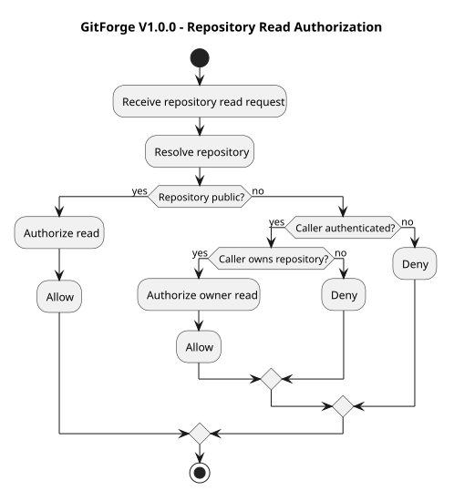
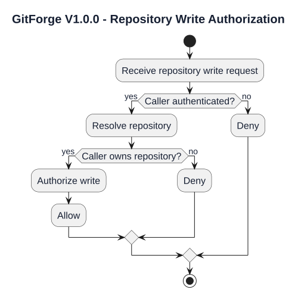
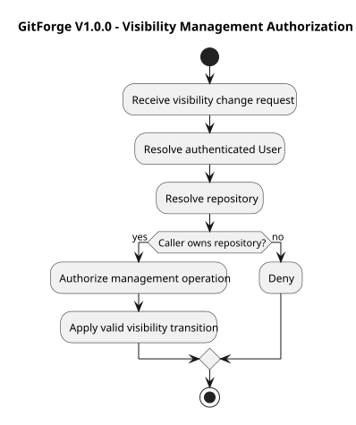
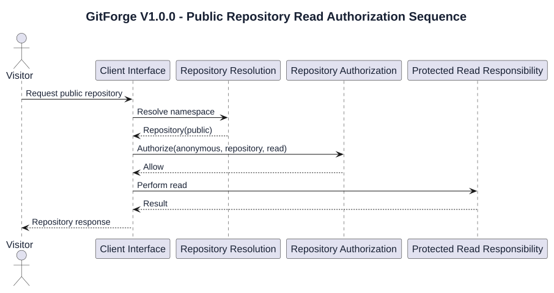
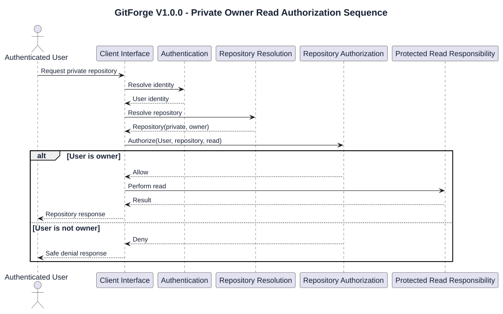
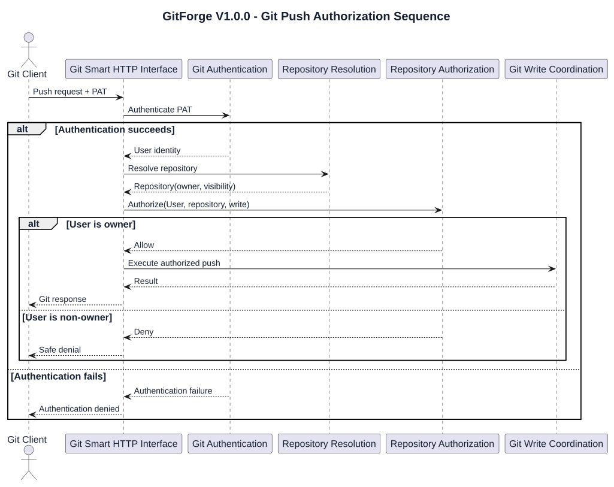
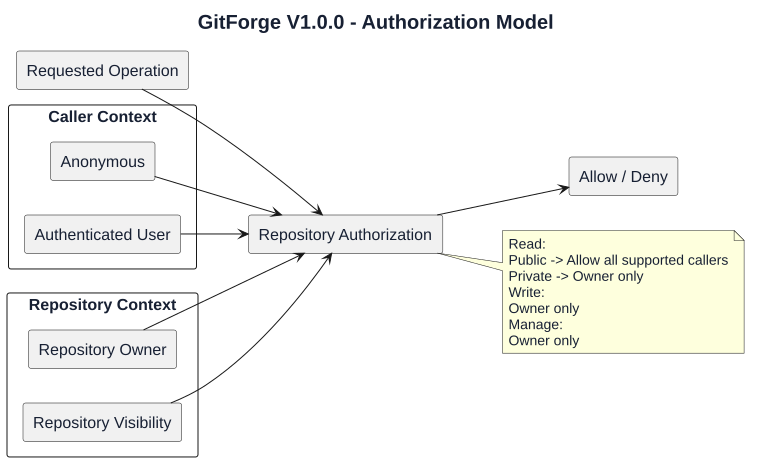

# GitForge V1.0.0 Authorization Analysis

## 1. Document Information

| Field | Value |
|---|---|
| Project | GitForge - Web Git Hosting Platform |
| Target release | V1.0.0 |
| Document | Authorization Analysis |
| SDLC phase | System Analysis |
| Milestone | M2 - System Analysis |
| Project owner | Farhad Valizadegan |
| Status | Approved |
| Last updated | 2026-08-17 |

---

## 2. Purpose

This document analyzes authorization behavior for GitForge V1.0.0.

It defines:

- authorization inputs;

- authorization subjects;

- repository ownership semantics;

- repository visibility semantics;

- public-read policy;

- private-read policy;

- write policy;

- repository-management policy;

- browser authorization behavior;

- Git Smart HTTP authorization behavior;

- authorization decision ordering;

- authorization failure behavior;

- authorization invariants;

- security-sensitive authorization boundaries.

The purpose is to establish a precise logical permission model before System Design begins.

---

## 3. Analysis Objective

This document answers:

> Given a caller, repository, and requested operation, may GitForge allow that operation?

Authorization answers:

```text

May this caller perform this operation on this repository?

```

Authentication answers:

```text

Who is the caller?

```

Authentication and authorization are separate logical decisions.

---

## 4. Authorization Scope

V1.0.0 authorization analysis includes:

```text

Public repository read

Private repository read

Repository write

Repository visibility changes

Owned repository access

Repository browser access

Git clone authorization

Git fetch authorization

Git push authorization

PAT management ownership checks

Anonymous access

Authenticated non-owner access

Repository-owner access

Authorization denial behavior

```

---

## 5. Out-of-Scope Authorization Capabilities

The following authorization capabilities are excluded from V1.0.0:

```text

Organization permissions

Team permissions

Collaborator permissions

Role hierarchies

Enterprise ACLs

Branch protection

Per-branch write rules

Per-path permissions

Repository-scoped PAT scopes

Token scopes

Fine-grained permissions

Admin override

Moderation permissions

Shared ownership

Fork permissions

Pull request permissions

```

These shall not be introduced implicitly during V1.0.0 design.

---

## 6. Authorization Subjects

Authorization subjects are callers evaluated against a target repository or protected resource.

Principal subject classes are:

```text

Visitor

Authenticated User

Repository Owner

Git Client acting anonymously

Git Client acting as an authenticated User

```

Repository Owner is contextual.

It is derived from:

```text

Authenticated User

        +

Target Repository

        +

Ownership Relationship

```

---

## 7. Authorization Resources

Resources subject to authorization include:

```text

Repository metadata

Repository browser content

Repository Git content

Repository visibility setting

Personal Access Token metadata

Git read service

Git write service

```

The primary authorization resource in this document is the Repository.

---

## 8. Authorization Operations

V1.0.0 operations may be grouped into:

```text

Read

Write

Manage

```

### Read Operations

Examples:

```text

View repository

Browse repository

List branches

View commit history

View commit details

Browse tree

View file

Clone

Fetch

Read-service discovery

```

### Write Operations

Examples:

```text

Push

Write-service discovery

```

### Management Operations

Examples:

```text

Change repository visibility

```

---

## 9. Core Authorization Inputs

Repository authorization depends logically on:

```text

Caller identity

Authentication state

Repository identity

Repository owner

Repository visibility

Requested operation

```

Conceptually:

```text

Caller

Repository

Operation

    ↓

Authorization Evaluation

    ↓

Allow / Deny

```

---

## 10. Authorization Result

The principal logical authorization result is:

```text

Allow

Deny

```

An authorization result may also carry an internal reason classification.

Examples:

```text

Anonymous private read

Authenticated non-owner private read

Anonymous write

Authenticated non-owner write

Non-owner management attempt

```

External responses may intentionally expose less detail.

---

## 11. Ownership Model

Every V1.0.0 Repository has exactly one User owner.

Conceptually:

```text

Repository.owner = User

```

Owner determination is repository-specific.

For caller User X and Repository R:

```text

Owner

    if X = R.owner

Non-Owner

    if X != R.owner

```

---

## 12. Repository Owner Is Contextual

Repository Owner is not a permanent application role.

Example:

```text

User Alice owns Repository A

User Alice does not own Repository B

```

Therefore:

```text

Alice = Owner for Repository A

Alice = Non-Owner for Repository B

```

---

## 13. Repository Visibility Model

Repository visibility has exactly two values:

```text

Public

Private

```

Visibility affects read authorization.

Visibility does not grant write permission to non-owners.

---

## 14. Public Repository Read Policy

A Public Repository may be read by:

```text

Visitor

Authenticated Non-Owner

Repository Owner

```

Decision matrix:

| Caller | Public Repository Read |
|---|---|
| Visitor | Allow |
| Authenticated Non-Owner | Allow |
| Owner | Allow |

---

## 15. Private Repository Read Policy

A Private Repository may be read only by its owner.

Decision matrix:

| Caller | Private Repository Read |
|---|---|
| Visitor | Deny |
| Authenticated Non-Owner | Deny |
| Owner | Allow |

---

## 16. Repository Write Policy

Repository writes are owner-only.

Decision matrix:

| Caller | Repository Write |
|---|---|
| Anonymous | Deny |
| Authenticated Non-Owner | Deny |
| Owner | Allow |

This rule applies to both:

```text

Public Repository

Private Repository

```

---

## 17. Repository Management Policy

Repository management operations included in V1.0.0 are owner-only.

The principal management operation is:

```text

Change Repository Visibility

```

Decision matrix:

| Caller | Change Visibility |
|---|---|
| Visitor | Deny |
| Authenticated Non-Owner | Deny |
| Owner | Allow |

---

## 18. Repository Creation Authorization

Repository creation is not authorization against an existing repository.

It requires:

```text

Authenticated User

```

The newly created repository becomes owned by that authenticated User.

Conceptually:

```text

Authenticated User

      ↓

Create Repository

      ↓

Repository.owner = Authenticated User

```

---

## 19. List Owned Repositories Authorization

An authenticated User may list repositories they own.

Conceptually:

```text

Authenticated User X

      ↓

Return repositories where owner = X

```

The operation must not implicitly expose another user's private repository metadata.

---

## 20. Public Repository Web Authorization

Public repository web access permits anonymous read.

Logical flow:

```text

Repository Request

      ↓

Resolve Repository

      ↓

Visibility = Public?

      ↓ Yes

Authorize Read

      ↓

Allow

```

No authenticated identity is required.

---

## 21. Private Repository Web Authorization

Private web read requires authenticated owner identity.

Logical flow:

```text

Repository Request

      ↓

Resolve Repository

      ↓

Visibility = Private

      ↓

Authenticated?

   /          \\

 No            Yes

 |              |

Deny        Owner?

           /    \\

         No      Yes

         |        |

        Deny     Allow

```

---

## 22. Repository Browser Authorization

Repository Browser access follows repository read authorization.

The following operations inherit read policy:

```text

List branches

Commit history

Commit details

Tree browsing

File viewing

Blob viewing

```

Authorization shall occur before protected Git-native data is exposed.

---

## 23. Public Repository Browser Access

For a Public Repository:

```text

Visitor                 → Allow

Authenticated Non-Owner → Allow

Owner                   → Allow

```

The Repository Browser may proceed after repository resolution and successful public-read authorization.

---

## 24. Private Repository Browser Access

For a Private Repository:

```text

Visitor                 → Deny

Authenticated Non-Owner → Deny

Owner                   → Allow

```

A private repository must not be browsed before owner authorization succeeds.

---

## 25. Git Read Authorization

Git read operations include:

```text

Clone

Fetch

git-upload-pack discovery

git-upload-pack execution

```

Authorization follows the same repository read policy as web browsing.

---

## 26. Public Git Read Authorization

For a Public Repository:

```text

Anonymous Git Client           → Allow

Authenticated Non-Owner Client → Allow

Owner Client                   → Allow

```

Authentication is optional for the authorization decision when anonymous public read is allowed.

---

## 27. Private Git Read Authorization

For a Private Repository:

```text

Anonymous Git Client           → Deny

Authenticated Non-Owner Client → Deny

Owner Client                   → Allow

```

Authentication is required before owner determination.

---

## 28. Git Write Authorization

Git write operations include:

```text

git-receive-pack discovery

Push

git-receive-pack execution

```

Authorization policy:

```text

Anonymous               → Deny

Authenticated Non-Owner → Deny

Owner                   → Allow

```

---

## 29. Public Repository Push

Public visibility does not allow public push.

For Public Repository R:

```text

Anonymous               → Deny

Authenticated Non-Owner → Deny

Owner                   → Allow

```

---

## 30. Private Repository Push

For Private Repository R:

```text

Anonymous               → Deny

Authenticated Non-Owner → Deny

Owner                   → Allow

```

The rule is identical to Public Repository write authorization.

---

## 31. Write-Service Discovery Authorization

Write-service discovery is authorization-sensitive because it initiates a write-capable Git workflow.

Therefore:

```text

git-receive-pack discovery

```

requires authenticated owner authorization.

---

## 32. Read-Service Discovery Authorization

For:

```text

git-upload-pack discovery

```

authorization follows repository read policy.

Public repository:

```text

Anonymous allowed

```

Private repository:

```text

Owner only

```

---

## 33. PAT Management Authorization

PAT management is User-owned rather than Repository-owned.

Relevant operations include:

```text

Create PAT

List PAT metadata

Revoke PAT

```

Authorization subject:

```text

Authenticated User

```

---

## 34. PAT Creation Authorization

An authenticated User may create a PAT for themselves.

Conceptually:

```text

Authenticated User X

      ↓

Create PAT

      ↓

PAT.owner = X

```

A User shall not create a PAT representing another User.

---

## 35. PAT Listing Authorization

An authenticated User may list only their own PAT metadata.

Conceptually:

```text

Authenticated User X

      ↓

Return PATs where owner = X

```

Plaintext PAT values are not part of listing.

---

## 36. PAT Revocation Authorization

A User may revoke only a PAT they own.

Decision matrix:

| Caller | Own PAT | Other User's PAT |
|---|---|---|
| Visitor | Deny | Deny |
| Authenticated User | Allow | Deny |

---

## 37. Authentication Before Authorization

For protected operations requiring identity:

```text

Receive Request

      ↓

Authenticate

      ↓

Resolve User Identity

      ↓

Authorize

      ↓

Perform Operation

```

Authorization must not rely on unverified identity claims.

---

## 38. Anonymous Authorization Path

For approved public reads:

```text

Receive Request

      ↓

Resolve Repository

      ↓

Evaluate Visibility

      ↓

Authorize Anonymous Read

      ↓

Perform Read

```

No authenticated User identity is required.

---

## 39. Authorization Ordering Rule

For repository access, GitForge must logically know:

```text

Target Repository

Requested Operation

Caller Identity or Anonymous State

Repository Visibility

Repository Ownership

```

before the final authorization decision.

---

## 40. Authorization Before Protected Resource Access

Protected repository content must not be accessed before authorization.

Conceptually:

```text

Resolve Metadata

      ↓

Authorize

      ↓

Resolve Physical Repository

      ↓

Read / Write Git Data

```

For private repositories, authorization precedes protected Git content access.

---

## 41. Authorization Before Mutation

Repository mutation must occur only after authorization succeeds.

Conceptually:

```text

Authenticate

      ↓

Resolve Repository

      ↓

Authorize Write

      ↓

Allow?

   /      \\

 No        Yes

 |          |

Stop      Mutate

```

---

## 42. Authorization and Repository Resolution

Repository resolution and authorization are related but distinct.

Repository resolution determines:

```text

Which repository is targeted?

```

Authorization determines:

```text

May this caller access it?

```

Repository resolution shall not automatically imply permission.

---

## 43. Authorization and Repository Visibility

Visibility participates in read authorization.

Conceptually:

```text

Public

  ↓

Read available to all supported callers

Private

  ↓

Read limited to owner

```

Visibility does not override owner-only write rules.

---

## 44. Authorization and Ownership

Ownership is the principal protected-access relationship in V1.0.0.

Conceptually:

```text

Caller User ID

      =

Repository Owner ID

```

determines owner status.

No collaborator relationship exists.

---

## 45. Authorization and PAT Authentication

PAT authentication establishes:

```text

User Identity

```

Authorization subsequently evaluates:

```text

User Identity

Repository

Visibility

Ownership

Operation

```

Therefore:

```text

Valid PAT

    ≠

Automatic repository access

```

---

## 46. Valid PAT Used by Non-Owner

Example:

```text

User B has a valid PAT

Repository belongs to User A

```

For a Public Repository:

```text

Read  → Allow

Write → Deny

```

For a Private Repository:

```text

Read  → Deny

Write → Deny

```

The PAT is valid, but repository authorization remains independent.

---

## 47. Authorization Failure Categories

### AZF-001 — Anonymous Private Read

Anonymous caller requests a private repository read.

Result:

```text

Deny

```

### AZF-002 — Non-Owner Private Read

Authenticated non-owner requests a private repository read.

Result:

```text

Deny

```

### AZF-003 — Anonymous Write

Anonymous caller requests repository write.

Result:

```text

Deny

```

### AZF-004 — Non-Owner Write

Authenticated non-owner requests repository write.

Result:

```text

Deny

```

### AZF-005 — Non-Owner Management

Authenticated non-owner attempts to change repository visibility.

Result:

```text

Deny

```

### AZF-006 — Foreign PAT Management

Authenticated User attempts to manage another User's PAT.

Result:

```text

Deny

```

### AZF-007 — Unresolved Authorization Context

Required authorization inputs cannot be established reliably.

Result:

```text

Deny protected operation

```

---

## 48. Fail-Closed Authorization Principle

Where authorization is required:

```text

Authorization uncertainty

        ↓

Deny

```

Protected operations must not proceed when the system cannot determine authorization reliably.

Examples include:

```text

Repository ownership cannot be resolved

Repository metadata cannot be loaded

Authorization dependency fails

Caller identity required but unavailable

```

---

## 49. Authorization Failure Response Principle

Internal authorization detail and external response detail may differ.

Conceptually:

```text

Internal Authorization Reason

        ↓

Safe External Response

        +

Diagnostic Event

```

External responses shall not unnecessarily disclose private repository information.

---

## 50. Private Repository Existence Disclosure

Authorization behavior for private repositories should avoid unnecessary disclosure of repository existence to unauthorized callers.

For example, the system may choose an external response that does not reveal whether:

```text

Repository does not exist

or

Repository exists but caller lacks access

```

The exact HTTP mapping belongs to System Design.

---

## 51. Authorization Diagnostics

Authorization diagnostics may include safe contextual data such as:

```text

Operation class

Caller type

Resolved User ID when appropriate

Repository ID when appropriate

Authorization decision

Denial category

Timestamp

```

Diagnostics shall not include reusable plaintext credentials.

---

## 52. Authorization Security Boundary

The critical authorization boundary is:

```text

Untrusted Caller Request

      ↓

Authenticated or Anonymous Identity Context

      ↓

Repository Resolution

      ↓

Authorization Evaluation

      ↓

Trusted Allow / Deny Decision

      ↓

Controlled Operation

```

Only an `Allow` decision permits protected execution.

---

## 53. Authorization Authority

Authorization policy is enforced server-side.

The following are not authoritative:

```text

Hidden UI buttons

Disabled controls

Client-side JavaScript checks

Client-supplied owner flags

Client-supplied visibility claims

Client-supplied permission values

```

The server determines authorization.

---

## 54. Authorization State Independence

Authorization is primarily a per-request decision.

It depends on current context.

For example:

```text

Repository visibility changes from Public to Private

```

A later request must be evaluated using the new visibility state.

Prior authorization does not guarantee future authorization.

---

## 55. Visibility Transition and Authorization

Visibility transition:

```text

Public → Private

```

changes read authorization from:

```text

All supported callers

```

to:

```text

Owner only

```

Visibility transition:

```text

Private → Public

```

changes read authorization to permit anonymous and non-owner read.

---

## 56. Ownership Stability

Repository ownership remains unchanged when visibility changes.

Conceptually:

```text

Visibility changes

Ownership remains constant

```

Write authorization therefore remains owner-only before and after the visibility transition.

---

## 57. Repository Authorization Decision Table

| Visibility | Caller | Read | Write | Manage |
|---|---|---:|---:|---:|
| Public | Visitor / Anonymous | Allow | Deny | Deny |
| Public | Authenticated Non-Owner | Allow | Deny | Deny |
| Public | Owner | Allow | Allow | Allow |
| Private | Visitor / Anonymous | Deny | Deny | Deny |
| Private | Authenticated Non-Owner | Deny | Deny | Deny |
| Private | Owner | Allow | Allow | Allow |

---

## 58. Git Authorization Decision Table

| Operation | Public Anonymous | Public Non-Owner | Public Owner | Private Anonymous | Private Non-Owner | Private Owner |
|---|---:|---:|---:|---:|---:|---:|
| Read-service discovery | Allow | Allow | Allow | Deny | Deny | Allow |
| Clone | Allow | Allow | Allow | Deny | Deny | Allow |
| Fetch | Allow | Allow | Allow | Deny | Deny | Allow |
| Write-service discovery | Deny | Deny | Allow | Deny | Deny | Allow |
| Push | Deny | Deny | Allow | Deny | Deny | Allow |

---

## 59. Web Authorization Decision Table

| Operation | Visitor | Authenticated Non-Owner | Owner |
|---|---:|---:|---:|
| View public repository | Allow | Allow | Allow |
| View private repository | Deny | Deny | Allow |
| Browse public repository | Allow | Allow | Allow |
| Browse private repository | Deny | Deny | Allow |
| Change visibility | Deny | Deny | Allow |
| Create repository | Deny | Allow | Allow |
| List own repositories | Deny | Allow | Allow |

For create/list operations, `Owner` means the authenticated User context and not ownership of a pre-existing target repository.

---

## 60. PAT Authorization Decision Table

| Operation | Visitor | Authenticated User | Other User's Resource |
|---|---:|---:|---:|
| Create own PAT | Deny | Allow | Not applicable |
| List own PAT metadata | Deny | Allow | Deny |
| Revoke own PAT | Deny | Allow | Deny |
| Recover plaintext PAT | Deny | Deny | Deny |

---

## 61. Read Authorization Activity



[PlantUML source](diagrams/06-authorization-analysis-001.puml)

---

## 62. Write Authorization Activity



[PlantUML source](diagrams/06-authorization-analysis-002.puml)

---

## 63. Visibility Management Authorization Activity



[PlantUML source](diagrams/06-authorization-analysis-003.puml)

---

## 64. Public Repository Read Sequence



[PlantUML source](diagrams/06-authorization-analysis-004.puml)

---

## 65. Private Repository Owner Read Sequence



[PlantUML source](diagrams/06-authorization-analysis-005.puml)

---

## 66. Git Push Authorization Sequence



[PlantUML source](diagrams/06-authorization-analysis-006.puml)

---

## 67. Authorization Model Diagram



[PlantUML source](diagrams/06-authorization-analysis-007.puml)

---

## 68. Authorization Invariants

### AZI-001 — Server-Side Enforcement

Authorization shall be enforced by GitForge server-side responsibilities.

### AZI-002 — Authentication Is Not Authorization

Successful authentication shall not independently grant repository access.

### AZI-003 — Owner Context

Repository Owner status is derived from the target repository ownership relationship.

### AZI-004 — Public Read

Public repositories permit anonymous and authenticated read.

### AZI-005 — Private Read

Private repositories permit owner read only.

### AZI-006 — Owner-Only Write

Repository writes are owner-only.

### AZI-007 — Anonymous Write Denied

Anonymous writes are always denied.

### AZI-008 — Non-Owner Write Denied

Authenticated non-owner writes are always denied.

### AZI-009 — Visibility Management

Repository visibility may be changed only by the owner.

### AZI-010 — Authorization Before Protected Access

Protected repository content shall not be exposed before successful authorization.

### AZI-011 — Authorization Before Mutation

Repository mutation shall not occur before successful write authorization.

### AZI-012 — Fail Closed

Protected operations shall be denied when authorization cannot be determined reliably.

### AZI-013 — Public Does Not Mean Writable

Public visibility affects read access only.

### AZI-014 — PAT Validity Does Not Grant Repository Permission

A valid PAT establishes identity but does not independently authorize repository access.

### AZI-015 — Foreign PAT Management Denied

A User shall not manage another User's PAT.

---

## 69. Authorization Responsibility Matrix

| Responsibility | Logical Owner |
|---|---|
| Establish caller identity | Authentication |
| Resolve target repository | Repository Resolution |
| Resolve ownership | Repository Management / Persistence |
| Resolve visibility | Repository Management / Persistence |
| Evaluate repository read | Repository Authorization |
| Evaluate repository write | Repository Authorization |
| Evaluate management permission | Repository Authorization |
| Enforce browser permission | Web interaction responsibilities |
| Enforce Git read permission | Git Read Coordination |
| Enforce Git write permission | Git Write Coordination |
| Record authorization failure | Diagnostics / Failure Handling |

---

## 70. Authorization Data Requirements

Authorization requires trusted access to:

```text

Resolved User identity

Resolved Repository identity

Repository owner

Repository visibility

Requested operation

```

Authorization shall not trust client-supplied equivalents without server-side resolution.

---

## 71. Authorization Dependency Analysis

Repository Authorization depends logically on:

```text

Authentication when identity is required

Repository Resolution

Application Data Persistence

Requested operation classification

Failure Handling

Diagnostics

```

Public anonymous read additionally supports:

```text

Anonymous caller context

```

---

## 72. Authorization Dependency Failure

If repository ownership or visibility cannot be reliably loaded:

```text

Authorization cannot be reliably evaluated

        ↓

Protected operation denied

```

Authorization shall not default to `Allow`.

---

## 73. Authorization and Database Failure

For protected repository access, if PostgreSQL metadata required for authorization is unavailable:

```text

Owner / visibility cannot be trusted

        ↓

Authorization cannot complete

        ↓

Deny protected operation

```

Safe public-read fallback behavior shall not be invented when authoritative visibility cannot be established.

---

## 74. Authorization and Missing Physical Repository

Authorization may succeed while the physical repository is missing.

Example:

```text

User is owner

Repository metadata exists

Authorization = Allow

Physical Git repository missing

```

This is not an authorization failure.

It is a storage or consistency failure.

The distinction must be preserved.

---

## 75. Authorization and Git Failure

A Git process may fail after authorization succeeds.

Conceptually:

```text

Authorization = Allow

        ↓

Git operation attempted

        ↓

Git operation fails

```

The resulting failure belongs to Git/process analysis, not authorization.

---

## 76. Authorization Security Risks

Major authorization risks include:

```text

Broken access control

IDOR-style repository access

Private repository disclosure

Authorization bypass

Client-side-only enforcement

Owner spoofing

Visibility spoofing

Non-owner push

Anonymous push

Authorization performed after protected access

Fail-open dependency handling

Foreign PAT management

Inconsistent web/Git authorization rules

```

---

## 77. Consistency Between Web and Git Authorization

Equivalent read semantics shall remain consistent across:

```text

Web Repository Browser

Git Smart HTTP

```

For example:

```text

Public Repository

    → anonymous web read allowed

    → anonymous Git read allowed

Private Repository

    → non-owner web read denied

    → non-owner Git read denied

```

---

## 78. Consistency Between Git Read and Write

Git read and write policies are intentionally asymmetric.

Public repository:

```text

Read  → broadly allowed

Write → owner only

```

Private repository:

```text

Read  → owner only

Write → owner only

```

---

## 79. Authorization Analysis Findings

### AZA-001 — Ownership Is the Primary Protected-Access Relationship

V1.0.0 has no collaborator or team authorization layer.

Status:

```text

Confirmed

```

### AZA-002 — Visibility Affects Read Only

Public/private visibility changes repository read accessibility but does not change write ownership.

Status:

```text

Confirmed

```

### AZA-003 — Web and Git Read Policies Must Match

Repository read authorization must remain logically consistent across both interfaces.

Status:

```text

Confirmed

```

### AZA-004 — Git Write Is Always Owner-Only

No anonymous or authenticated non-owner write path exists.

Status:

```text

Confirmed

```

### AZA-005 — Authorization Must Precede Protected Git Access

Physical repository content must not be read or mutated before required authorization succeeds.

Status:

```text

Confirmed

```

### AZA-006 — Authorization Must Fail Closed

Unknown or unreliable authorization context cannot produce an `Allow` result for protected operations.

Status:

```text

Confirmed

```

### AZA-007 — Valid PAT Is Not Permission

Token validity and repository authorization are independent stages.

Status:

```text

Confirmed

```

---

## 80. Areas Requiring Later M2 Analysis

The following authorization-related topics are refined later in M2:

```text

Repository lifecycle

Repository browser workflow

Git Smart HTTP read workflow

Git Smart HTTP write workflow

PAT lifecycle

Repository storage

Data flows

Trust boundaries

Failure responses

Sequence models

Activity models

```

---

## 81. Design Decisions Intentionally Deferred

This document does not decide:

```text

Laravel policy classes

Laravel gates

Middleware structure

Authorization middleware names

Controller authorization calls

Route middleware assignment

Database schema

Owner foreign key implementation

Exact HTTP status codes

Exact Git protocol error text

Authorization caching

Policy object structure

Service class structure

```

These decisions belong to System Design.

---

## 82. Requirements Alignment

This analysis derives from approved requirements related to:

```text

Public repository access

Private repository protection

Repository ownership

Repository visibility

Repository browsing

Clone

Fetch

Push

PAT management

Git PAT authentication

Read authorization

Write authorization

Server-side enforcement

Failure handling

```

Relevant use cases include:

```text

UC-004 Create Repository

UC-005 List Owned Repositories

UC-006 View Repository

UC-007 Change Visibility

UC-009 Browse

UC-010 List Branches

UC-011 Commit History

UC-012 Commit Details

UC-013 Tree

UC-014 File

UC-015 Discover Read Service

UC-016 Clone

UC-017 Fetch

UC-018 Discover Write Service

UC-019 Push

UC-020 Create PAT

UC-022 Revoke PAT

UC-023 Authorize Read

UC-024 Authorize Write

```

The approved authorization requirements are represented by:

```text

AR-001 – AR-060

```

Detailed requirement-to-analysis mapping will be consolidated in:

```text

19-analysis-traceability.md

```

---

## 83. Completion Criteria

This Authorization Analysis is complete when:

- authorization subjects are explicit;

- repository resources are explicit;

- operation classes are explicit;

- ownership semantics are explicit;

- public-read semantics are explicit;

- private-read semantics are explicit;

- owner-only write semantics are explicit;

- repository-management authorization is explicit;

- PAT ownership authorization is explicit;

- browser and Git authorization remain consistent;

- authorization occurs before protected repository access;

- authorization occurs before repository mutation;

- fail-closed behavior is explicit;

- authorization failure categories are identified;

- authorization decision tables are complete;

- authorization diagrams represent the approved policy;

- excluded V1.0.0 permission models have not been introduced;

- downstream repository and Git analysis can proceed without inventing permission rules.

---

## 84. Analysis Result

Authorization Analysis result:

```text

SUFFICIENT FOR DOWNSTREAM SYSTEM ANALYSIS

```

No authorization-level contradiction with approved V1.0.0 requirements has been identified.

---

## 85. Document Status

This document is currently:

```text

Approved

```

It will be changed to:

```text

Approved

```

after the authorization policies, decision tables, failure behavior, diagrams, invariants, and requirements alignment have been reviewed.

