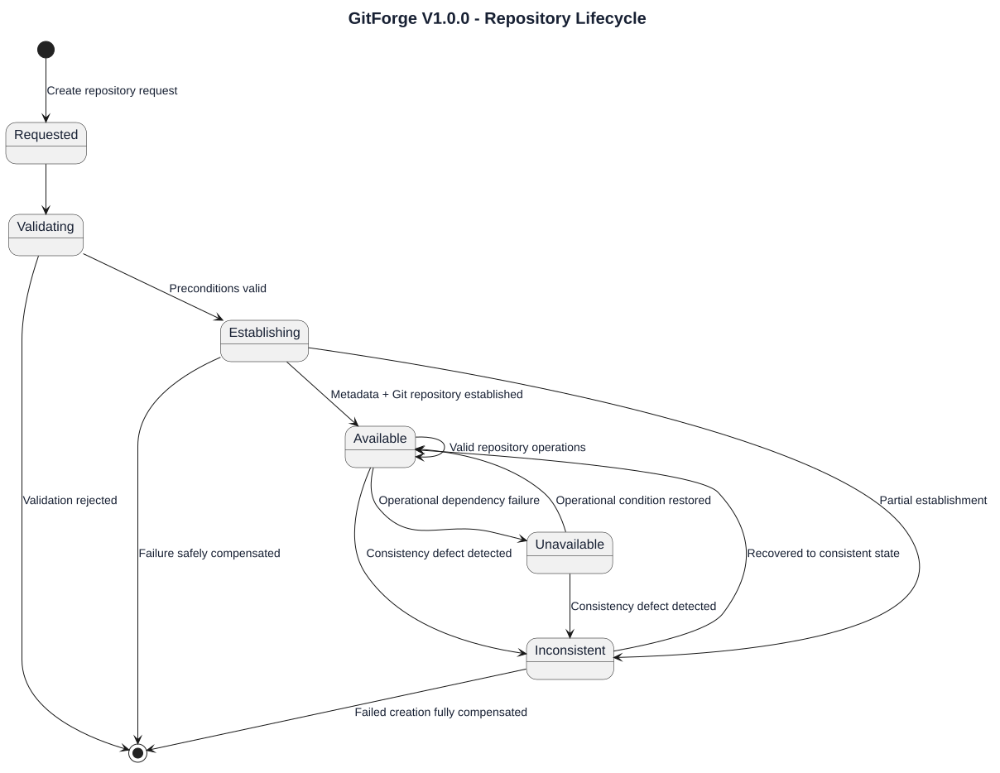
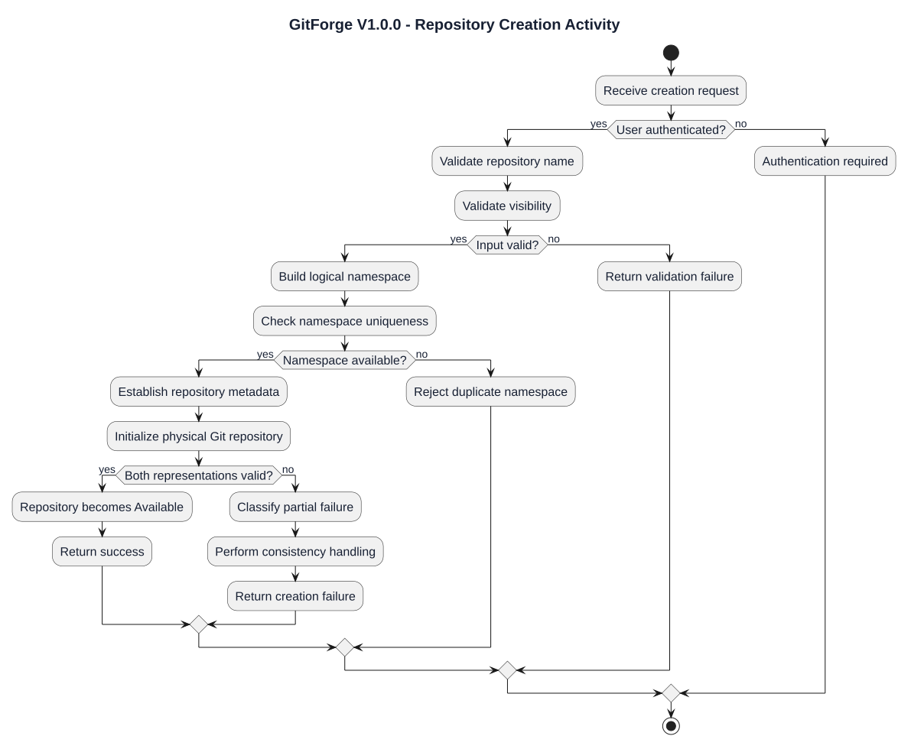
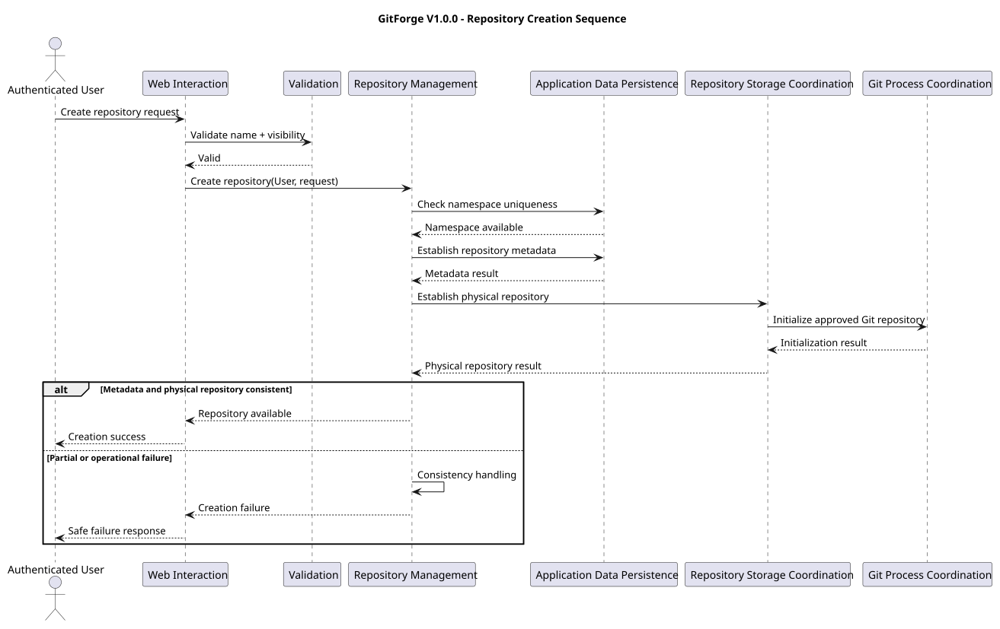
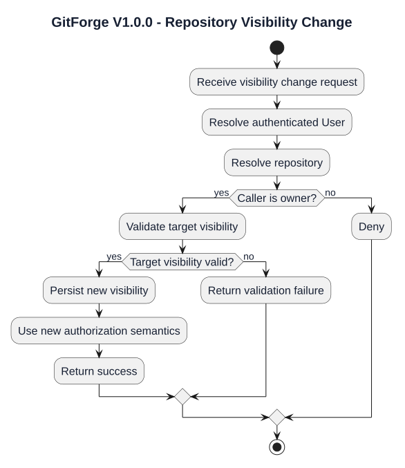
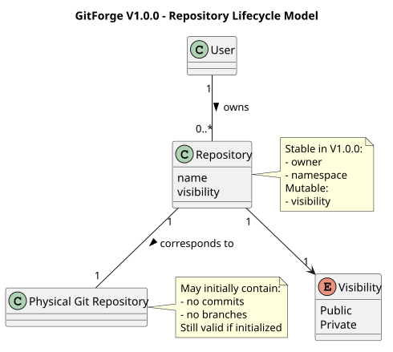
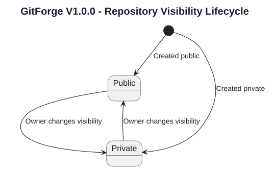

# GitForge V1.0.0 Repository Lifecycle Analysis

## 1. Document Information

| Field | Value |

|---|---|

| Project | GitForge - Web Git Hosting Platform |

| Target release | V1.0.0 |

| Document | Repository Lifecycle Analysis |

| SDLC phase | System Analysis |

| Milestone | M2 - System Analysis |

| Project owner | Farhad Valizadegan |

| Status | Approved |

| Last updated | 2026-08-17 |

---

## 2. Purpose

This document analyzes the logical lifecycle of a GitForge V1.0.0 repository.

It defines:

- repository creation behavior;

- repository identity establishment;

- repository namespace validation;

- ownership establishment;

- visibility establishment;

- application metadata creation;

- physical Git repository initialization;

- metadata/storage consistency;

- repository availability;

- visibility transitions;

- repository operational states;

- repository failure conditions;

- excluded lifecycle operations.

The purpose is to establish how a repository logically comes into existence, becomes usable, changes supported state, and behaves under partial failure before System Design begins.

---

## 3. Analysis Objective

This document answers:

> How does a GitForge repository move from a creation request to a usable repository, and which lifecycle transitions are valid in V1.0.0?

The lifecycle analysis focuses on logical behavior rather than concrete implementation.

It does not prescribe:

```text

Database transactions

Laravel model events

Filesystem directory structure

Exact Git initialization commands

Queue jobs

Concrete service classes

Rollback implementation

Controller behavior

```

Those belong primarily to System Design.

---

## 4. Repository Lifecycle Scope

V1.0.0 repository lifecycle includes:

```text

Repository creation request

Input validation

Namespace validation

Namespace uniqueness checking

Owner assignment

Initial visibility assignment

Metadata establishment

Physical Git repository initialization

Consistency validation

Repository availability

Visibility change

Repository operational failure detection

```

---

## 5. Excluded Lifecycle Capabilities

The following repository lifecycle operations are excluded from V1.0.0:

```text

Repository deletion

Repository rename

Repository transfer

Repository ownership transfer

Repository archiving

Repository restoration

Repository soft delete

Repository trash

Repository undelete

Repository fork lifecycle

Organization ownership migration

Repository import

Repository export

Repository mirroring

```

No lifecycle state shall be introduced solely to support excluded features.

---

## 6. Repository Lifecycle Concept

A GitForge repository has two coordinated representations:

```text

Application Repository Metadata

Physical Git Repository

```

A repository is logically usable only when these representations are consistent enough to satisfy supported operations.

Conceptually:

```text

Repository Request

&#x20;     ↓

Application Identity Established

&#x20;     +

Physical Git Repository Established

&#x20;     ↓

Repository Available

```

---

## 7. Repository Creation Preconditions

A repository creation request requires:

```text

Authenticated User

Valid repository name

Valid visibility value

Available owner namespace

Permitted storage target

Required persistence dependencies

Required Git execution capability

```

If mandatory preconditions cannot be established, repository creation must not be reported as successful.

---

## 8. Authenticated Creator

Repository creation requires an authenticated User.

Conceptually:

```text

Authenticated User X

&#x20;     ↓

Create Repository

&#x20;     ↓

Repository.owner = X

```

The creator becomes the sole owner of the new repository.

---

## 9. Repository Name Validation

The repository name must satisfy approved constraints.

Required logical constraints include:

```text

Length: 1–100 characters

Lowercase ASCII letters allowed

Digits allowed

Hyphen allowed

Underscore allowed

Safe periods allowed

Slash prohibited

Backslash prohibited

.. prohibited

Traversal prohibited

Control characters prohibited

```

Name validation occurs before namespace establishment.

---

## 10. Namespace Establishment

The logical repository namespace is:

```text

<owner>/<repository>

```

Example:

```text

farhad/gitforge

```

The namespace is established from:

```text

Authenticated owner identity

Validated repository name

```

The namespace is a logical identifier and not a client-controlled filesystem path.

---

## 11. Namespace Uniqueness

Repository names must be unique within the owner namespace.

Conceptually:

```text

Owner X + Repository Name Y

&#x20;       ↓

Namespace X/Y

&#x20;       ↓

Already exists?

&#x20;   /          \\

&#x20; Yes           No

&#x20;  |             |

&#x20;Reject        Continue

```

The same repository name may exist under different owners.

---

## 12. Ownership Establishment

Ownership is assigned during creation.

Domain invariant:

```text

Every repository has exactly one owner.

```

For a newly created repository:

```text

Repository.owner = Authenticated Creator

```

No collaborator or shared-owner assignment occurs in V1.0.0.

---

## 13. Initial Visibility

Repository creation establishes one initial visibility value:

```text

Public

or

Private

```

The requested visibility must be valid.

The repository cannot exist logically with an undefined supported visibility.

---

## 14. Application Metadata Establishment

Application metadata includes the logical information required for GitForge to identify and authorize the repository.

Conceptually this includes:

```text

Repository identity

Repository name

Owner

Visibility

Logical namespace relationship

Storage association information as required

```

The exact schema is deferred to System Design.

---

## 15. Physical Repository Initialization

Repository creation also requires establishment of a physical Git repository.

Conceptually:

```text

Resolved Internal Storage Identity

&#x20;     ↓

Validate Storage Target

&#x20;     ↓

Initialize Physical Git Repository

&#x20;     ↓

Verify Initialization Result

```

The exact Git command and physical path structure are design decisions.

---

## 16. Creation Across Two Persistence Domains

Repository creation spans:

```text

PostgreSQL

Repository Filesystem / Git

```

Therefore, creation is not a single-domain operation.

Conceptually:

```text

Application Metadata

&#x20;       +

Physical Git Repository

&#x20;       ↓

Consistent Repository

```

Partial success must be treated explicitly.

---

## 17. Repository Creation Success Condition

Creation is successful only when GitForge can consider the repository logically usable.

At analysis level, success requires:

```text

Valid repository metadata

Valid ownership

Valid visibility

Unique namespace

Valid physical repository association

Usable physical Git repository

```

---

## 18. Repository Creation Failure Classes

Creation may fail because of:

```text

Invalid repository name

Invalid visibility

Duplicate namespace

Authentication absence

Database failure

Storage resolution failure

Filesystem failure

Git executable failure

Git initialization failure

Permission failure

Consistency failure

```

These failures must not result in a falsely reported successful repository.

---

## 19. Metadata-Only Partial Failure

A problematic state may occur when:

```text

Application metadata created

Physical Git repository not created

```

Conceptually:

```text

Metadata = Exists

Git Repository = Missing

```

This is an inconsistent repository state.

It must not be treated as a fully available repository.

---

## 20. Storage-Only Partial Failure

A problematic state may occur when:

```text

Physical Git repository created

Application metadata not successfully established

```

Conceptually:

```text

Metadata = Missing

Git Repository = Exists

```

This creates orphaned physical state.

The system must treat this as a consistency problem.

---

## 21. Consistency Principle

Repository creation must preserve the logical invariant:

```text

Usable Repository

&#x20;   =

Valid Application Metadata

&#x20;   +

Valid Physical Git Repository

```

A repository must not be advertised as usable when this invariant is not satisfied.

---

## 22. Compensation Requirement

Because repository creation crosses persistence boundaries, failures may require compensation.

Conceptually:

```text

Step A succeeds

Step B fails

&#x20;     ↓

Restore safe consistent state

or

Mark operation as failed and recoverable

```

The exact compensation mechanism is intentionally deferred to System Design.

---

## 23. Repository Availability

A repository is logically Available when:

```text

Metadata is resolvable

Ownership is valid

Visibility is valid

Physical repository is resolvable

Physical repository is usable

```

Available does not mean every request is authorized.

Authorization remains separate.

---

## 24. Repository Operational States

At analysis level, useful repository lifecycle states are:

```text

Requested

Validating

Establishing

Available

Inconsistent

Unavailable

```

These are analysis states and do not require literal persisted status fields.

---

## 25. Requested State

`Requested` represents receipt of a repository creation request before creation logic has completed.

Conceptually:

```text

Creation Request Received

```

No usable repository exists yet.

---

## 26. Validating State

`Validating` represents validation of:

```text

Authentication context

Repository name

Visibility

Namespace

Uniqueness

Required creation preconditions

```

Failure during this state results in creation rejection.

---

## 27. Establishing State

`Establishing` represents coordinated creation of:

```text

Application metadata

Physical Git repository

```

A repository is not yet considered fully Available until consistency is established.

---

## 28. Available State

`Available` means the repository can participate in supported GitForge workflows, subject to authorization.

Possible operations include:

```text

View

Browse

Clone

Fetch

Push by owner

Visibility change by owner

```

---

## 29. Inconsistent State

`Inconsistent` represents a detected mismatch between application metadata and physical repository state.

Examples:

```text

Metadata exists but physical repository missing

Physical repository exists without valid metadata relationship

Storage identity resolves incorrectly

Repository initialization incomplete

```

This state represents an operational defect.

---

## 30. Unavailable State

`Unavailable` represents a repository that is logically known but cannot currently satisfy required operational access.

Potential causes include:

```text

Filesystem unavailable

Storage permission failure

Git executable unavailable

Repository corruption

Dependency outage

```

Unavailable is distinct from authorization denial.

---

## 31. Repository Lifecycle State Diagram



[PlantUML source](diagrams/07-repository-lifecycle-analysis-001.puml)

---

## 32. Analysis State Versus Persisted State

The states in this document describe logical behavior.

They do not require a database column such as:

```text

repository_status

```

System Design shall decide whether any lifecycle state needs persistence.

---

## 33. Repository Creation Activity



[PlantUML source](diagrams/07-repository-lifecycle-analysis-002.puml)

---

## 34. Repository Creation Sequence Analysis



[PlantUML source](diagrams/07-repository-lifecycle-analysis-003.puml)

---

## 35. Metadata Establishment Order

This analysis does not require one fixed order between:

```text

Metadata creation

Physical repository creation

```

Either may logically occur first if the final behavior guarantees consistency.

System Design must choose and justify the concrete sequence.

---

## 36. Atomicity Limitation

Because PostgreSQL and filesystem/Git storage are separate systems, a single native atomic transaction may not cover both.

Therefore:

```text

Database transaction alone

&#x20;   ≠

Whole repository creation atomicity

```

The design must account for cross-resource consistency explicitly.

---

## 37. Repository Visibility Lifecycle

Repository visibility may transition between:

```text

Public

Private

```

Valid transitions are:

```text

Public  → Private

Private → Public

```

The repository itself remains the same logical repository.

---

## 38. Visibility Change Preconditions

A visibility change requires:

```text

Authenticated User

Resolved Repository

Owner Authorization

Valid target visibility

Available application metadata

```

A non-owner must not perform the transition.

---

## 39. Visibility Change Activity



[PlantUML source](diagrams/07-repository-lifecycle-analysis-004.puml)

---

## 40. Visibility Change Effects

A visibility change affects read authorization.

### Public to Private

Before:

```text

Anonymous read allowed

Authenticated non-owner read allowed

Owner read allowed

```

After:

```text

Anonymous read denied

Authenticated non-owner read denied

Owner read allowed

```

### Private to Public

Before:

```text

Owner read only

```

After:

```text

Anonymous read allowed

Authenticated non-owner read allowed

Owner read allowed

```

---

## 41. Visibility Change Non-Effects

Visibility changes do not alter:

```text

Repository identity

Repository owner

Repository namespace

Physical repository identity

Git history

Branches

Commits

Write ownership policy

```

Write remains owner-only.

---

## 42. Repository Write Lifecycle Effect

A Git push mutates Git-native repository state.

It may modify:

```text

Refs

Branches

Reachable commits

Trees

Blobs

Repository history graph

```

It does not automatically change application-level:

```text

Owner

Visibility

Namespace

```

---

## 43. Repository Read Lifecycle Effect

Read operations such as:

```text

View

Browse

Clone

Fetch

```

do not intentionally change repository lifecycle state.

They consume existing repository state subject to authorization.

---

## 44. Physical Git Repository Authority

Git-native state remains authoritative in the physical repository.

Repository lifecycle management must not duplicate branch, commit, tree, or blob state as competing lifecycle authorities.

---

## 45. Repository Identity Stability

After creation, repository identity remains stable for V1.0.0.

This follows from the exclusion of:

```text

Rename

Transfer

Deletion/recreation workflow

```

The namespace therefore does not require rename transition semantics.

---

## 46. Repository Namespace Stability

Because repository rename and ownership transfer are excluded:

```text

<owner>/<repository>

```

remains stable for the V1.0.0 repository lifecycle.

Visibility changes do not modify the namespace.

---

## 47. Repository Deletion Exclusion

Repository deletion is explicitly deferred.

Therefore the lifecycle contains no supported transition such as:

```text

Available → Deleted

```

No deletion-state semantics shall be designed for V1.0.0 unless requirements are formally changed.

---

## 48. Repository Rename Exclusion

Repository rename is deferred.

Therefore the lifecycle contains no:

```text

Namespace A → Namespace B

```

transition.

---

## 49. Ownership Transfer Exclusion

V1.0.0 does not support repository ownership transfer.

Therefore:

```text

Repository.owner

```

is stable after creation.

---

## 50. Repository Consistency Dimensions

Consistency must be considered across several dimensions.

### Identity Consistency

```text

Logical repository

↔

Expected physical repository

```

### Ownership Consistency

```text

Repository owner metadata is valid

```

### Visibility Consistency

```text

Repository has one supported visibility value

```

### Storage Consistency

```text

Expected physical repository exists and is usable

```

---

## 51. Repository Consistency Check

Conceptually:

```text

Resolve Repository Metadata

&#x20;       ↓

Resolve Expected Storage Identity

&#x20;       ↓

Physical Repository Exists?

&#x20;       ↓

Usable Git Repository?

&#x20;       ↓

Consistent / Inconsistent

```

The exact frequency and implementation of such checks are deferred.

---

## 52. Missing Physical Repository

If metadata exists but physical storage is missing:

```text

Repository metadata exists

&#x20;       +

Physical repository missing

&#x20;       ↓

Consistency failure

```

This must not be interpreted as:

```text

Authorization denial

```

or:

```text

Repository successfully empty

```

unless the repository was legitimately initialized as an empty Git repository and still physically exists.

---

## 53. Empty Repository Versus Missing Repository

An empty Git repository and a missing repository are different states.

### Empty Repository

```text

Physical Git repository exists

No commits yet

Valid Git repository structure exists

```

### Missing Repository

```text

Expected physical repository does not exist

```

The application must preserve this distinction.

---

## 54. Newly Created Empty Repository

A newly created repository may legitimately have:

```text

No branches

No commits

No files

```

while still being fully Available.

Therefore:

```text

No commits

&#x20;   ≠

Repository failure

```

---

## 55. Empty Repository Browser Behavior

Repository browsing of a newly created empty repository may produce an empty-state result.

The repository remains:

```text

Available

```

provided its physical Git repository exists and is valid.

---

## 56. Empty Repository Git Behavior

A newly initialized repository can still participate in valid Git workflows.

For example:

```text

Owner pushes initial commit

```

The lifecycle transitions logically from:

```text

Available Empty Repository

```

to:

```text

Available Repository with Git History

```

without changing application repository identity.

---

## 57. Initial Push

The first successful push may create:

```text

First branch

First commit

First tree

First blobs

```

This modifies Git-native state only.

The repository remains in the `Available` lifecycle state.

---

## 58. Repository Operational Failure

An Available repository may become temporarily unusable due to dependency failure.

Examples:

```text

Filesystem outage

Permission failure

Git executable unavailable

Repository corruption

```

Conceptually:

```text

Available

&#x20;  ↓

Operational Failure

&#x20;  ↓

Unavailable

```

---

## 59. Operational Recovery

If the underlying operational problem is corrected and repository consistency remains valid:

```text

Unavailable

&#x20;   ↓

Dependency Restored

&#x20;   ↓

Available

```

The application repository identity does not change.

---

## 60. Consistency Failure Versus Availability Failure

These concepts are distinct.

### Availability Failure

```text

Repository is logically consistent

but dependency prevents operation

```

### Consistency Failure

```text

Application metadata and expected physical state disagree

```

This distinction is important for diagnosis.

---

## 61. Repository Lifecycle Failure Matrix

| Failure | Lifecycle Interpretation |

|---|---|

| Invalid name | Creation rejected |

| Duplicate namespace | Creation rejected |

| Invalid visibility | Creation rejected |

| Authentication missing | Creation rejected |

| Database unavailable before creation | Creation fails |

| Git initialization fails | Creation fails / consistency handling required |

| Metadata exists, repository missing | Inconsistent |

| Filesystem temporarily unavailable | Unavailable |

| Git executable unavailable | Unavailable for Git-dependent operations |

| Repository corrupted | Unavailable or Inconsistent depending on condition |

| Visibility update persistence fails | Existing visibility remains authoritative unless successful change confirmed |

---

## 62. Creation Failure Safety Rule

Repository creation shall not report success unless the repository is usable according to the required lifecycle invariant.

Conceptually:

```text

Uncertain final state

&#x20;     ↓

Do not report successful creation

```

---

## 63. Visibility Change Failure Safety

A visibility change shall be considered successful only after the authoritative application metadata reflects the new value.

If update persistence fails:

```text

Do not assume visibility changed

```

Authorization must continue using authoritative stored state.

---

## 64. Concurrent Creation Risk

Two creation requests could attempt the same owner namespace.

Conceptually:

```text

Request A → owner/project

Request B → owner/project

```

The lifecycle must guarantee that at most one valid repository identity is established for that namespace.

The concrete concurrency mechanism belongs to System Design.

---

## 65. Concurrent Visibility Change Risk

Multiple visibility updates may occur close together.

The authoritative stored visibility must determine subsequent authorization.

The design must avoid treating stale client state as authoritative.

---

## 66. Repository Lifecycle Security Risks

Major lifecycle-related risks include:

```text

Namespace collision

Path traversal during creation

Unauthorized repository creation context

Unauthorized visibility change

Partial metadata/storage creation

Orphan physical repository

Missing physical repository

Unsafe Git initialization

Client-controlled physical path

Fail-open creation behavior

Stale visibility authorization

Race conditions

Sensitive failure disclosure

```

---

## 67. Repository Lifecycle Trust Boundaries

Important trust boundaries include:

```text

Client creation input → Validation

Logical namespace → Repository resolution

Repository identity → Storage resolution

Application → PostgreSQL

Application → Filesystem

Application → Git executable

Failure details → External response

```

---

## 68. Repository Creation Responsibility Collaboration

The principal logical responsibilities are:

```text

Web Interaction

Identity / Authentication

Validation

Repository Management

Application Data Persistence

Repository Storage Coordination

Git Process Coordination

Failure Handling

Diagnostics

```

---

## 69. Repository Creation Responsibility Matrix

| Responsibility | Logical Owner |

|---|---|

| Receive creation request | Web Interaction |

| Establish creator identity | Web Authentication |

| Validate repository name | Validation |

| Validate visibility | Validation |

| Build logical namespace | Repository Management |

| Check namespace uniqueness | Repository Management / Persistence |

| Establish ownership | Repository Management |

| Persist metadata | Application Data Persistence |

| Resolve storage identity | Repository Storage Coordination |

| Initialize Git repository | Repository Storage / Git Process Coordination |

| Detect partial failure | Repository Management / Failure Handling |

| Record operational failure | Diagnostics |

---

## 70. Visibility Change Responsibility Matrix

| Responsibility | Logical Owner |

|---|---|

| Receive change request | Web Interaction |

| Resolve caller identity | Web Authentication |

| Resolve repository | Repository Management |

| Authorize owner | Repository Authorization |

| Validate visibility | Validation |

| Persist visibility | Application Data Persistence |

| Apply new policy on future requests | Repository Authorization |

---

## 71. Repository Lifecycle Invariants

### RLI-001 — Single Owner

Every repository has exactly one owner.

### RLI-002 — Namespace Uniqueness

Repository namespace is unique within the owner's namespace.

### RLI-003 — Valid Visibility

Every repository has exactly one supported visibility value.

### RLI-004 — Stable Ownership

Repository ownership does not change in V1.0.0.

### RLI-005 — Stable Namespace

Repository namespace does not change in V1.0.0.

### RLI-006 — Consistent Usable Repository

A usable repository has valid metadata and a valid physical Git repository.

### RLI-007 — Physical Path Control

The physical repository location is derived internally.

### RLI-008 — Creation Success Accuracy

Creation success shall not be returned for an inconsistent final state.

### RLI-009 — Empty Is Valid

A repository with no commits may still be fully Available.

### RLI-010 — Visibility Does Not Change Ownership

Visibility transitions do not alter the repository owner.

### RLI-011 — Visibility Does Not Change Write Policy

Write remains owner-only after any supported visibility transition.

### RLI-012 — Deletion Excluded

No repository deletion transition exists in V1.0.0.

### RLI-013 — Rename Excluded

No repository rename transition exists in V1.0.0.

---

## 72. Repository Lifecycle Model Diagram



[PlantUML source](diagrams/07-repository-lifecycle-analysis-005.puml)

---

## 73. Visibility State Diagram



[PlantUML source](diagrams/07-repository-lifecycle-analysis-006.puml)

---

## 74. Repository Creation Decision Table

| Condition | Result |

|---|---|

| User unauthenticated | Reject |

| Invalid repository name | Reject |

| Invalid visibility | Reject |

| Namespace already exists | Reject |

| Metadata establishment fails | Fail |

| Physical repository initialization fails | Fail / consistency handling |

| Metadata and physical repository valid | Repository Available |

| Final consistency uncertain | Do not report success |

---

## 75. Repository Lifecycle and Authorization

Lifecycle and authorization interact but are different concerns.

Example:

```text

Repository = Available

Caller = Non-Owner

Visibility = Private

```

Lifecycle result:

```text

Repository operationally available

```

Authorization result:

```text

Read denied

```

---

## 76. Repository Lifecycle and Authentication

Authentication is a precondition for:

```text

Repository creation

Visibility change

Owner-only write

Private owner read

```

Authentication does not itself change repository lifecycle state.

---

## 77. Repository Lifecycle and Git Operations

Git operations may change Git-native content while leaving application lifecycle identity unchanged.

Examples:

```text

Push adds commits

Push updates branch

Fetch reads refs

Clone reads repository state

```

Only operational failures may affect logical availability interpretation.

---

## 78. Repository Lifecycle and Repository Browser

Repository Browser consumes Available repository state.

For an empty repository:

```text

Repository Available

Git history empty

Browser presents empty state

```

For a missing physical repository:

```text

Repository Inconsistent / Unavailable

Browser returns safe operational failure

```

---

## 79. Repository Lifecycle Analysis Findings

### RLA-001 — Creation Spans Two Persistence Domains

Repository creation requires coordination between PostgreSQL metadata and physical Git storage.

Status:

```text

Confirmed

```

### RLA-002 — Creation Requires Explicit Consistency Handling

Partial success cannot be ignored.

Status:

```text

Confirmed

```

### RLA-003 — Empty Repository Is a Valid Available State

Lack of commits does not imply repository failure.

Status:

```text

Confirmed

```

### RLA-004 — Visibility Is the Only Supported Repository Lifecycle Mutation

Repository visibility may change after creation while owner and namespace remain stable.

Status:

```text

Confirmed

```

### RLA-005 — Repository Deletion and Rename Must Not Enter V1.0.0 Design

Both remain deferred.

Status:

```text

Confirmed

```

### RLA-006 — Operational Unavailability Is Distinct From Authorization Denial

A repository may be authorized but operationally unavailable.

Status:

```text

Confirmed

```

### RLA-007 — Missing Physical State Is a Consistency Failure

Metadata without the expected Git repository must not be treated as a valid empty repository.

Status:

```text

Confirmed

```

---

## 80. Areas Requiring Later M2 Analysis

The following repository lifecycle areas are refined later in M2:

```text

Repository storage behavior

Failure and exception behavior

Data flows

State analysis

Trust boundaries

Sequence models

Activity models

```

---

## 81. Design Decisions Intentionally Deferred

This document does not decide:

```text

Database transaction boundaries

Compensation implementation

Repository table schema

Repository primary key

Exact uniqueness constraint

Physical repository root layout

Physical directory naming

Bare repository command syntax

Git executable wrapper

Filesystem locking

Concurrency-control mechanism

Repair tooling

Repository health-check mechanism

HTTP error codes

```

These belong to System Design.

---

## 82. Requirements Alignment

This analysis is derived primarily from approved requirements related to:

```text

Repository creation

Repository naming

Repository ownership

Repository visibility

Repository listing

Repository viewing

Visibility update

Repository browsing

Git clone

Git fetch

Git push

Repository storage

Safe path derivation

Git process execution

Failure handling

```

Relevant use cases include:

```text

UC-004 Create Repository

UC-005 List Owned Repositories

UC-006 View Repository

UC-007 Change Visibility

UC-009 Browse

UC-016 Clone

UC-017 Fetch

UC-019 Push

UC-023 Authorize Read

UC-024 Authorize Write

UC-025 Diagnose Failure

```

Repository deletion:

```text

UC-008 Delete Repository

```

remains deferred from V1.0.0.

Detailed requirement-to-analysis mapping will be consolidated in:

```text

19-analysis-traceability.md

```

---

## 83. Completion Criteria

This Repository Lifecycle Analysis is complete when:

- repository creation preconditions are explicit;

- repository name validation role is explicit;

- namespace establishment is explicit;

- namespace uniqueness is explicit;

- ownership establishment is explicit;

- initial visibility establishment is explicit;

- metadata and physical repository creation are both represented;

- cross-resource consistency risk is explicit;

- partial creation failure is identified;

- empty repositories are distinguished from missing repositories;

- visibility transitions are modeled;

- ownership and namespace stability are explicit;

- operational availability and consistency are distinguished;

- deletion and rename remain excluded;

- lifecycle invariants are documented;

- downstream browser, Git, storage, state, and failure analysis can proceed without inventing repository lifecycle semantics.

---

## 84. Analysis Result

Repository Lifecycle Analysis result:

```text

SUFFICIENT FOR DOWNSTREAM SYSTEM ANALYSIS

```

No repository-lifecycle contradiction with approved V1.0.0 requirements has been identified.

---

## 85. Document Status

This document is currently:

```text

Approved

```

It will be changed to:

```text

Approved

```

after repository creation, consistency behavior, lifecycle states, visibility transitions, failure cases, diagrams, invariants, and requirements alignment have been reviewed.

