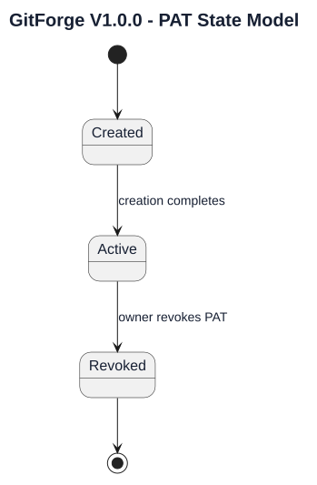
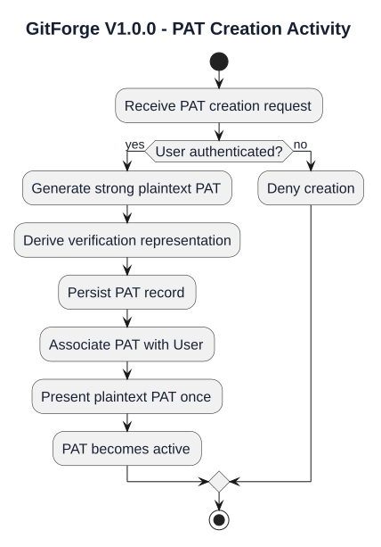
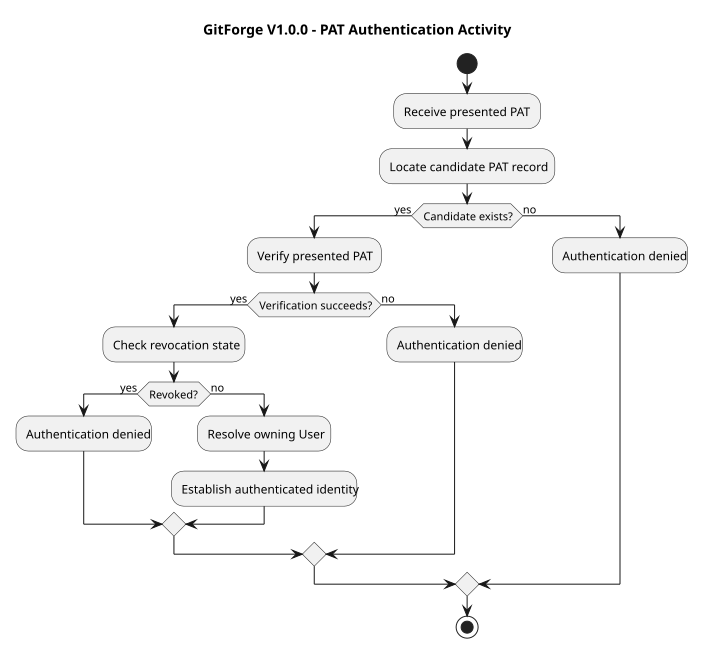
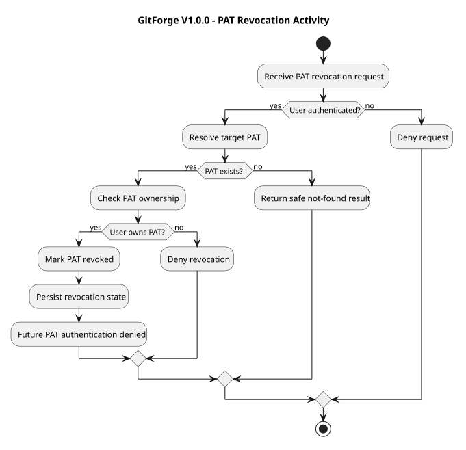
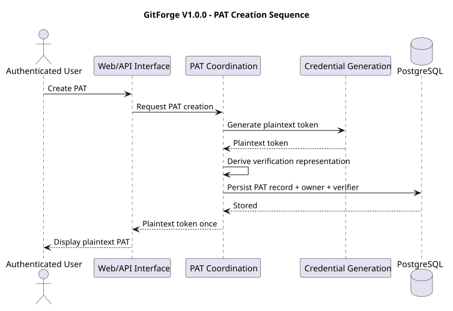
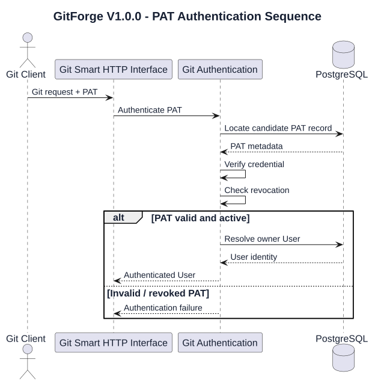
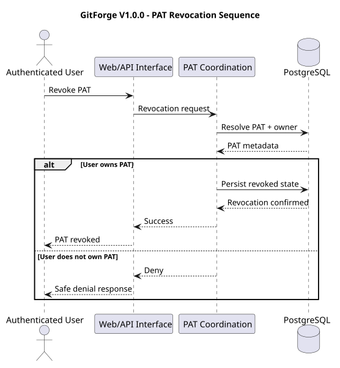
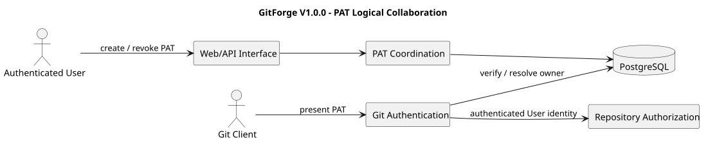

# GitForge V1.0.0 Personal Access Token Analysis

## 1. Document Information

| Field | Value |
|---|---|
| Project | GitForge - Web Git Hosting Platform |
| Target release | V1.0.0 |
| Document | Personal Access Token Analysis |
| SDLC phase | System Analysis |
| Milestone | M2 - System Analysis |
| Project owner | Farhad Valizadegan |
| Status | Approved |
| Last updated | 2026-08-17 |

---

## 2. Purpose

This document analyzes Personal Access Token behavior in GitForge V1.0.0.

It defines:

- PAT purpose;

- PAT ownership;

- PAT creation;

- plaintext-token exposure;

- non-recoverable persistence;

- token verification;

- token-based Git authentication;

- token revocation;

- token lifecycle;

- token failure cases;

- trust boundaries;

- security invariants;

- interactions with repository authorization.

The purpose is to establish the logical PAT model before System Design begins.

---

## 3. Analysis Objective

This document answers:

> How does GitForge create, expose, store, validate, use, and revoke Personal Access Tokens while ensuring that PAT authentication never replaces repository authorization?

The approved V1.0.0 PAT model supports:

```text

PAT creation

One-time plaintext presentation

Secure verification representation

Git authentication

PAT revocation

```

The following are deferred:

```text

PAT scopes

PAT expiration

Fine-grained permissions

Repository-specific PATs

Organization-level PATs

Automatic PAT rotation

```

---

## 4. PAT Role in V1.0.0

A Personal Access Token is an authentication credential used by a Git Client.

Conceptually:

```text

User

  ↓

Creates PAT

  ↓

Receives plaintext token once

  ↓

Configures Git Client

  ↓

Git Client presents token

  ↓

GitForge authenticates User

```

A PAT establishes identity.

It does not independently establish repository permission.

---

## 5. PAT Actor Model

The principal actors related to PAT behavior are:

```text

Authenticated User

Git Client

```

The Authenticated User:

```text

Creates PAT

Receives plaintext token

Revokes PAT

```

The Git Client:

```text

Presents PAT during Git Smart HTTP authentication

```

---

## 6. PAT Ownership

Each PAT belongs to exactly one User.

Conceptually:

```text

User

  1

  |

  | owns

  |

  *

PAT

```

A PAT shall not belong to multiple Users.

---

## 7. PAT Ownership Invariant

For every PAT:

```text

PAT

  ↓

Exactly One User

```

The authenticated identity produced from a valid PAT is always the owning User.

---

## 8. PAT Creation Preconditions

PAT creation requires an authenticated application User.

Conceptually:

```text

Unauthenticated Visitor

      ↓

Cannot Create PAT

```

versus:

```text

Authenticated User

      ↓

May Create PAT

```

---

## 9. PAT Creation Flow

Logical creation flow:

```text

Authenticated User

      ↓

Request PAT Creation

      ↓

Generate Strong Token

      ↓

Derive Verification Representation

      ↓

Persist Non-Recoverable Representation

      ↓

Present Plaintext Token Once

      ↓

PAT Available for Git Authentication

```

---

## 10. Token Generation

The plaintext PAT must be generated by GitForge.

It must not be supplied by the User.

Conceptually:

```text

GitForge

   ↓

Generate Credential

   ↓

Return Credential Once

```

The exact cryptographic generation mechanism belongs to System Design.

---

## 11. Plaintext PAT

The plaintext PAT is sensitive credential material.

Conceptually:

```text

Plaintext PAT

      ↓

Authentication Secret

```

It must be handled as a secret throughout its lifecycle.

---

## 12. One-Time Plaintext Presentation

The plaintext PAT may be exposed only as part of the creation workflow.

Conceptually:

```text

Create PAT

    ↓

Plaintext Available

    ↓

Present to User

    ↓

Creation Workflow Ends

    ↓

Plaintext No Longer Recoverable

```

This is a core V1.0.0 security rule.

---

## 13. Plaintext PAT Non-Recoverability

After creation completes, GitForge shall not provide a mechanism to retrieve the original plaintext PAT.

Conceptually:

```text

Stored PAT Record

      ↓

Cannot Recover Original Token

```

If the User loses the plaintext token:

```text

Revoke Existing PAT

      +

Create New PAT

```

---

## 14. PAT Persistence

GitForge stores only information necessary to:

```text

Identify PAT record

Associate PAT with User

Verify presented credential

Determine revocation state

Support safe diagnostics

```

The original plaintext PAT shall not be persisted in recoverable form.

---

## 15. Verification Representation

GitForge requires a non-recoverable verification representation of the PAT.

Conceptually:

```text

Plaintext PAT

      ↓

Verification Transformation

      ↓

Stored Verification Representation

```

During authentication:

```text

Presented PAT

      ↓

Verification Process

      ↓

Match / No Match

```

Exact hashing, key derivation, lookup, prefixing, and indexing design belongs to System Design.

---

## 16. PAT Metadata

Logical PAT metadata may include:

```text

PAT identifier

Owner User identifier

Verification representation

Creation timestamp

Revocation state

Revocation timestamp if applicable

Human-readable label if required by approved interface requirements

```

No additional metadata should be assumed without requirement support.

---

## 17. PAT Scope Model

PAT scopes are deferred from V1.0.0.

Therefore V1.0.0 shall not introduce semantics such as:

```text

repo:read

repo:write

repository-specific scope

organization scope

branch scope

```

Repository authorization remains responsible for determining permitted operations.

---

## 18. PAT Expiration Model

PAT expiration is deferred from V1.0.0.

Therefore a PAT does not become invalid merely because of an implied expiration rule.

The supported invalidation mechanism is:

```text

Revocation

```

Any future expiration model requires explicit requirement change.

---

## 19. PAT Authentication Purpose

PAT authentication is used primarily for Git Smart HTTP operations.

Examples:

```text

Clone of private repository

Fetch of private repository

Write-service discovery

Push

```

Public anonymous read may not require PAT authentication.

---

## 20. PAT Authentication Flow

Conceptually:

```text

Git Client

    ↓

Present PAT

    ↓

GitForge Receives Credential

    ↓

Locate Candidate PAT Record

    ↓

Verify Credential

    ↓

Check Revocation

    ↓

Resolve Owner User

    ↓

Authenticated User Identity

```

---

## 21. PAT Authentication Result

Successful PAT authentication produces:

```text

Authenticated User Identity

```

It does not directly produce:

```text

Repository Read Permission

Repository Write Permission

```

Those are authorization decisions.

---

## 22. Authentication Versus Authorization

PAT authentication answers:

```text

Who is this client acting as?

```

Repository authorization answers:

```text

May this User perform this operation on this Repository?

```

Therefore:

```text

Valid PAT

    ≠

Repository Authorization

```

---

## 23. PAT and Public Repository Read

Public repository reads may be anonymous.

If a valid PAT is presented for a public repository read:

```text

PAT may establish identity

```

but public visibility may already permit read access.

Authentication does not reduce otherwise valid public access.

---

## 24. PAT and Private Repository Read

Private repository read requires:

```text

Valid PAT

      +

Authenticated User

      +

Owner Authorization

```

Conceptually:

```text

PAT Valid?

   ↓

User Resolved?

   ↓

Repository Owner?

   ↓

Allow Read

```

---

## 25. PAT and Repository Write

All supported repository writes require authentication.

Conceptually:

```text

PAT Valid?

   ↓

User Resolved?

   ↓

Repository Owner?

   ↓

Allow Write

```

A valid PAT belonging to a non-owner must still result in:

```text

Deny

```

---

## 26. Invalid PAT

If PAT verification fails:

```text

Authentication Fails

```

The system shall not establish User identity from that credential.

---

## 27. Unknown PAT

If no valid stored PAT representation corresponds to the presented credential:

```text

Authentication Fails

```

The system must not attempt to infer identity from repository ownership or other context.

---

## 28. Revoked PAT

A revoked PAT is invalid for future authentication.

Conceptually:

```text

Valid Historical PAT

      ↓

Revoked

      ↓

Future Authentication Denied

```

---

## 29. PAT Revocation

An authenticated User may revoke a PAT that belongs to that User.

Conceptually:

```text

Authenticated User

      ↓

Select Owned PAT

      ↓

Request Revocation

      ↓

Verify Ownership

      ↓

Mark PAT Revoked

      ↓

Future Authentication Denied

```

---

## 30. Revocation Ownership Rule

A User may revoke only PATs owned by that User.

Conceptually:

```text

User A

  ↓

PAT owned by User B

  ↓

Revocation Denied

```

---

## 31. Revocation Effect

Revocation affects future authentication attempts.

Conceptually:

```text

PAT active

    ↓

Authentication Allowed

    ↓

PAT revoked

    ↓

Subsequent Authentication Denied

```

Revocation does not retroactively undo completed Git operations.

---

## 32. Revocation Timing

Once revocation is committed as authoritative application state:

```text

Future uses of PAT

      ↓

Must fail authentication

```

Exact transaction, cache invalidation, and propagation design belongs to System Design.

---

## 33. PAT State Model

V1.0.0 PAT state may be analyzed as:

```text

Created

   ↓

Active

   ↓

Revoked

```

A revoked PAT does not return to Active.

---

## 34. PAT State Transition Diagram



[PlantUML source](diagrams/11-personal-access-token-analysis-001.puml)

---

## 35. PAT Creation Activity



[PlantUML source](diagrams/11-personal-access-token-analysis-002.puml)

---

## 36. PAT Authentication Activity



[PlantUML source](diagrams/11-personal-access-token-analysis-003.puml)

---

## 37. PAT Revocation Activity



[PlantUML source](diagrams/11-personal-access-token-analysis-004.puml)

---

## 38. PAT Creation Sequence



[PlantUML source](diagrams/11-personal-access-token-analysis-005.puml)

---

## 39. PAT Authentication Sequence



[PlantUML source](diagrams/11-personal-access-token-analysis-006.puml)

---

## 40. PAT Revocation Sequence



[PlantUML source](diagrams/11-personal-access-token-analysis-007.puml)

---

## 41. PAT Logical Collaboration



[PlantUML source](diagrams/11-personal-access-token-analysis-008.puml)

---

## 42. PAT Responsibility Matrix

| Responsibility | Logical Owner |
|---|---|
| Receive PAT creation request | Web/API Interface |
| Require authenticated User for PAT management | Application Authentication |
| Generate PAT plaintext | PAT Coordination / Credential Generation |
| Derive verification representation | PAT Coordination |
| Persist PAT metadata | PAT Persistence |
| Associate PAT with User | PAT Persistence |
| Present plaintext PAT once | PAT Coordination / Interface |
| Receive Git PAT credential | Git Smart HTTP Interface |
| Verify PAT | Git Authentication |
| Resolve PAT owner | Git Authentication |
| Check revocation | Git Authentication |
| Establish authenticated identity | Git Authentication |
| Evaluate repository access | Repository Authorization |
| Revoke PAT | PAT Coordination |
| Record safe diagnostics | Diagnostics |

---

## 43. PAT Data Flow — Creation

Conceptually:

```text

Authenticated User

      ↓

PAT Creation Request

      ↓

PAT Coordination

      ↓

Strong Token Generation

      ↓

Plaintext PAT

      ├────────────→ One-Time User Presentation

      ↓

Verification Transformation

      ↓

Non-Recoverable Verification Representation

      ↓

PostgreSQL

```

---

## 44. PAT Data Flow — Authentication

Conceptually:

```text

Git Client

    ↓

Presented PAT

    ↓

Git Authentication

    ↓

Verification

    ↓

Revocation Check

    ↓

PAT Owner Resolution

    ↓

Authenticated User Identity

    ↓

Repository Authorization

```

---

## 45. PAT Data Flow — Revocation

Conceptually:

```text

Authenticated User

      ↓

Revocation Request

      ↓

PAT Coordination

      ↓

Resolve PAT

      ↓

Verify PAT Ownership

      ↓

Persist Revoked State

      ↓

Future Authentication Denied

```

---

## 46. PAT and PostgreSQL

PostgreSQL is authoritative for application PAT metadata such as:

```text

PAT identity

PAT ownership

Verification representation

Creation metadata

Revocation state

```

The physical Git repository does not determine PAT validity.

---

## 47. PAT and Physical Git Repository

PAT state is not stored in the physical Git repository.

Conceptually:

```text

PostgreSQL

    ↓

PAT Authority

```

versus:

```text

Physical Git Repository

    ↓

Git Object / Ref Authority

```

These responsibilities must remain separate.

---

## 48. PAT and Repository Ownership

PAT ownership and Repository ownership are independent relationships.

Example:

```text

User A owns PAT-A

User B owns Repository-B

```

Using PAT-A against Repository-B results in:

```text

Authentication = User A

Authorization = Deny

```

---

## 49. PAT and Public Visibility

Public visibility affects repository read authorization.

It does not alter PAT ownership or PAT validity.

PAT behavior remains independent from repository visibility state.

---

## 50. PAT and Visibility Changes

Changing a repository from:

```text

Public → Private

```

does not change any PAT state.

Likewise:

```text

Private → Public

```

does not activate, revoke, regenerate, or alter PATs.

---

## 51. PAT and Repository Lifecycle

Repository creation does not automatically require PAT creation.

A User may:

```text

Create Repository

      ↓

Later Create PAT

      ↓

Use PAT for Git operations

```

PAT lifecycle and Repository lifecycle remain separate.

---

## 52. PAT and User Authentication

Application login authentication and PAT authentication serve related but distinct interaction contexts.

Conceptually:

```text

Web User Authentication

      ↓

Interactive application identity

```

versus:

```text

PAT Authentication

      ↓

Git Client identity

```

Both ultimately resolve to a User.

---

## 53. PAT Credential Exposure Boundary

The plaintext PAT crosses a critical trust boundary when presented to the User.

Conceptually:

```text

GitForge

    ↓

Plaintext PAT

    ↓

User-Controlled Environment

```

After presentation, GitForge cannot control how the User stores the credential.

Therefore GitForge must minimize exposure before that boundary.

---

## 54. Incoming PAT Trust Boundary

A PAT presented by a Git Client is untrusted input until verified.

Conceptually:

```text

External Credential

      ↓

Untrusted

      ↓

Verification

      ↓

Authenticated Identity

```

No User identity may be trusted before successful verification.

---

## 55. PAT Logging Rule

Plaintext PATs shall not intentionally appear in normal diagnostic output.

This includes:

```text

Application logs

Git authentication logs

Error messages

Audit-style diagnostics

Stack traces

Request debugging output

```

---

## 56. PAT Error Response Rule

Authentication failures shall not reveal sensitive verification details.

External responses should not distinguish unnecessarily between:

```text

Unknown token

Wrong token

Revoked token

Stored representation mismatch

Internal credential lookup detail

```

Internal diagnostic classification may remain more specific.

---

## 57. PAT Failure Categories

### PAF-001 — Unauthenticated PAT Creation Attempt

A Visitor attempts to create a PAT.

Result:

```text

Deny

```

### PAF-002 — Token Generation Failure

GitForge cannot safely generate a PAT.

Result:

```text

Creation Fails

```

No unusable PAT shall be reported as successfully created.

### PAF-003 — Persistence Failure During Creation

PAT metadata cannot be safely persisted.

Result:

```text

Creation Fails

```

The system must not represent the PAT as available if its authoritative verification state was not stored.

### PAF-004 — Invalid Presented PAT

Credential verification fails.

Result:

```text

Authentication Denied

```

### PAF-005 — Unknown Presented PAT

No usable PAT record corresponds to the credential.

Result:

```text

Authentication Denied

```

### PAF-006 — Revoked PAT

PAT exists but is revoked.

Result:

```text

Authentication Denied

```

### PAF-007 — PAT Owner Resolution Failure

PAT verification succeeds logically, but its owning User cannot be resolved consistently.

Result:

```text

Authentication Denied

Operational Failure Recorded

```

### PAF-008 — Unauthorized Revocation Attempt

A User attempts to revoke another User's PAT.

Result:

```text

Deny

```

### PAF-009 — Revocation Persistence Failure

Revocation cannot be committed reliably.

Result:

```text

Do Not Report Successful Revocation

```

### PAF-010 — Plaintext Exposure Failure

The creation workflow cannot safely present the plaintext token.

Result:

```text

Do Not Misrepresent Token Availability

```

Exact recovery semantics belong to System Design.

---

## 58. Authentication Failure Versus Authorization Failure

Example:

```text

Invalid PAT

```

Result:

```text

Authentication Failure

```

Example:

```text

Valid PAT

User resolved

User does not own private repository

```

Result:

```text

Authorization Failure

```

These shall remain logically distinct.

---

## 59. PAT Failure Versus Git Failure

Example:

```text

Valid PAT

Owner authorized

git-receive-pack fails

```

This is:

```text

Git Execution Failure

```

not:

```text

PAT Authentication Failure

```

---

## 60. Fail-Closed PAT Principle

When PAT state is uncertain:

```text

Verification uncertainty

or

Revocation uncertainty

or

Owner resolution uncertainty

        ↓

Do Not Establish Authenticated Identity

```

---

## 61. PAT Security Risks

Major risks include:

```text

Weak token generation

Predictable PATs

Plaintext PAT persistence

Credential leakage

Credential logging

PAT disclosure through errors

Revoked PAT reuse

Verification bypass

User identity confusion

Cross-user PAT access

Unauthorized PAT revocation

Credential brute force

Timing-sensitive comparison behavior

Improper token lookup

Fail-open authentication

```

---

## 62. PAT Resource Risks

PAT-related resource risks include:

```text

Repeated authentication attempts

Credential brute-force attempts

Excessive PAT creation

Large numbers of stored PAT records

Repeated invalid-token verification workload

```

Exact rate-limiting and operational controls belong to System Design and Security Design.

---

## 63. PAT Invariants

### PAI-001 — PAT Belongs to One User

Each PAT belongs to exactly one User.

### PAI-002 — PAT Creation Requires Authentication

Only an authenticated User may create a PAT.

### PAI-003 — PAT Generated by GitForge

The plaintext PAT is generated by the system, not selected by the User.

### PAI-004 — Plaintext Presented Once

Plaintext PAT exposure is limited to the creation workflow.

### PAI-005 — Plaintext Not Recoverably Persisted

The original PAT shall not be stored in recoverable form.

### PAI-006 — Valid PAT Establishes Identity Only

Successful PAT verification establishes a User identity, not repository permission.

### PAI-007 — Authorization Remains Separate

Repository read/write authorization shall always be evaluated separately.

### PAI-008 — Revoked PAT Cannot Authenticate

A revoked PAT must fail future authentication.

### PAI-009 — Revocation Is Owner-Controlled

A User may revoke only PATs owned by that User.

### PAI-010 — PAT Scopes Deferred

V1.0.0 shall not invent scope semantics.

### PAI-011 — PAT Expiration Deferred

V1.0.0 shall not invent automatic expiration semantics.

### PAI-012 — Plaintext PAT Not Logged

Normal diagnostics shall not contain plaintext PATs.

### PAI-013 — Fail Closed

Uncertain PAT verification or state shall not establish identity.

### PAI-014 — PAT and Repository State Are Independent

PAT state does not determine repository visibility or ownership.

---

## 64. PAT Decision Table

| PAT State | Credential Verification | User Resolved | Authentication Result |
|---|---:|---:|---:|
| Active | Success | Yes | Allow identity establishment |
| Active | Failure | No | Deny |
| Revoked | Success | Yes | Deny |
| Unknown | Failure | No | Deny |
| Inconsistent | Uncertain | Uncertain | Deny |

---

## 65. PAT Repository Authorization Decision Table

| PAT Authentication | Repository Relationship | Operation | Decision |
|---|---|---|---:|
| Failure | Any | Private read | Deny |
| Failure | Any | Write | Deny |
| Success | Non-Owner | Private read | Deny |
| Success | Owner | Private read | Allow |
| Success | Non-Owner | Write | Deny |
| Success | Owner | Write | Allow |

Public anonymous read remains governed by repository visibility policy and does not require PAT authentication.

---

## 66. Revocation Decision Table

| Caller | PAT Ownership | PAT State | Revocation Decision |
|---|---|---|---:|
| Unauthenticated | Any | Active | Deny |
| Authenticated User | Not Owner | Active | Deny |
| Owner | Owner | Active | Allow |
| Owner | Owner | Revoked | No further activation; remain revoked |

Exact idempotent response behavior for repeat revocation belongs to System Design.

---

## 67. PAT Analysis Findings

### PAA-001 — PAT Is an Authentication Credential

PATs establish User identity for supported Git authentication.

Status:

```text

Confirmed

```

### PAA-002 — PAT Is Not Repository Authorization

Repository authorization remains separate.

Status:

```text

Confirmed

```

### PAA-003 — Plaintext PAT Is One-Time Material

Plaintext token presentation is limited to creation.

Status:

```text

Confirmed

```

### PAA-004 — Plaintext PAT Is Non-Recoverable

The system does not persist plaintext PAT in recoverable form.

Status:

```text

Confirmed

```

### PAA-005 — Revocation Is Required

An owner-controlled PAT revocation mechanism is part of V1.0.0.

Status:

```text

Confirmed

```

### PAA-006 — Revocation Invalidates Future Authentication

Revoked PATs cannot establish future identity.

Status:

```text

Confirmed

```

### PAA-007 — PAT Scopes Are Deferred

No fine-grained PAT scope semantics are introduced in V1.0.0.

Status:

```text

Confirmed

```

### PAA-008 — PAT Expiration Is Deferred

No implicit token expiration model is introduced.

Status:

```text

Confirmed

```

---

## 68. Areas Requiring Later M2 Analysis

The following PAT-related topics are refined in later M2 deliverables:

```text

Repository storage interaction

Data-flow consolidation

State analysis

Trust-boundary consolidation

Failure and exception consolidation

Sequence-model consolidation

Activity-model consolidation

Analysis traceability

```

---

## 69. Design Decisions Intentionally Deferred

This analysis does not decide:

```text

Exact token length

Exact token alphabet

PAT prefix format

Token generation API

Hashing algorithm

Keyed hashing versus password hashing strategy

Database column definitions

Token lookup optimization

Partial-token identifiers

Exact Basic Authentication mapping

Credential parsing implementation

Laravel middleware classes

PAT creation endpoint

PAT revocation endpoint

HTTP status codes

Rate limits

Maximum PATs per User

PAT labels if optional

Audit-event schema

Caching strategy

Revocation cache invalidation

Secret masking implementation

```

These belong primarily to System Design and Security Design.

---

## 70. Requirements Alignment

This analysis derives primarily from approved requirements covering:

```text

PAT creation

PAT authentication

PAT ownership

One-time plaintext presentation

Non-recoverable token storage

PAT revocation

Git authentication

Repository read authorization

Repository write authorization

Security

Failure handling

```

Relevant use cases include:

```text

UC-020 Create PAT

UC-021 Authenticate Git with PAT

UC-022 Revoke PAT

UC-023 Authorize Read

UC-024 Authorize Write

UC-025 Diagnose Failure

```

Representative requirement areas include:

```text

FR-050 and related PAT functional requirements

Relevant DR requirements for PAT persistence

Relevant IR requirements for PAT management and Git authentication

AR-001 – AR-060

Relevant BR requirements governing credentials and ownership

```

The exact requirement-to-analysis mapping will be consolidated in:

```text

19-analysis-traceability.md

```

---

## 71. Completion Criteria

This Personal Access Token Analysis is complete when:

- PAT purpose is explicit;

- PAT ownership is explicit;

- PAT creation preconditions are explicit;

- token generation responsibility is explicit;

- one-time plaintext presentation is explicit;

- non-recoverable persistence is explicit;

- verification behavior is explicit;

- Git authentication behavior is explicit;

- PAT authentication and repository authorization are separated;

- revocation behavior is explicit;

- revoked PAT behavior is explicit;

- PAT scopes are explicitly deferred;

- PAT expiration is explicitly deferred;

- PAT state transitions are modeled;

- PAT activities are modeled;

- PAT sequences are modeled;

- failure categories are identified;

- trust boundaries are identified;

- security invariants are explicit;

- downstream storage, data-flow, state, trust-boundary, failure, and traceability analysis can proceed without inventing PAT semantics.

---

## 72. Analysis Result

Personal Access Token Analysis result:

```text

SUFFICIENT FOR DOWNSTREAM SYSTEM ANALYSIS

```

No PAT-related contradiction with approved V1.0.0 requirements has been identified.

---

## 73. Document Status

This document is currently:

```text

Approved

```

It will be changed to:

```text

Approved

```

after PAT creation, one-time plaintext presentation, verification, ownership, revocation, authentication/authorization separation, failure cases, diagrams, invariants, and requirements alignment have been reviewed.

