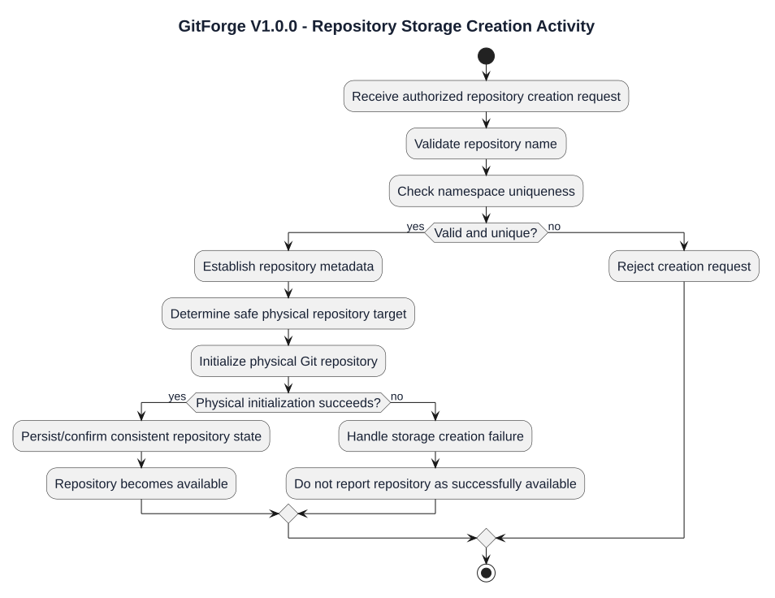
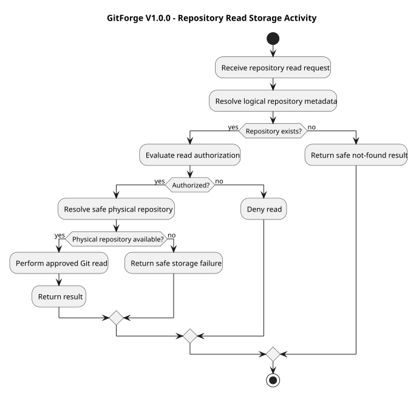
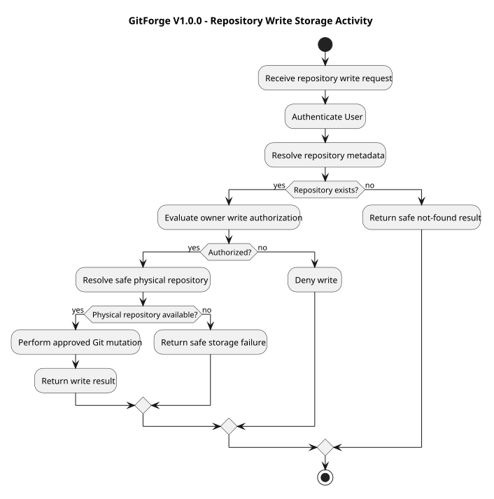
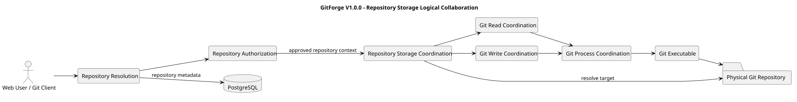
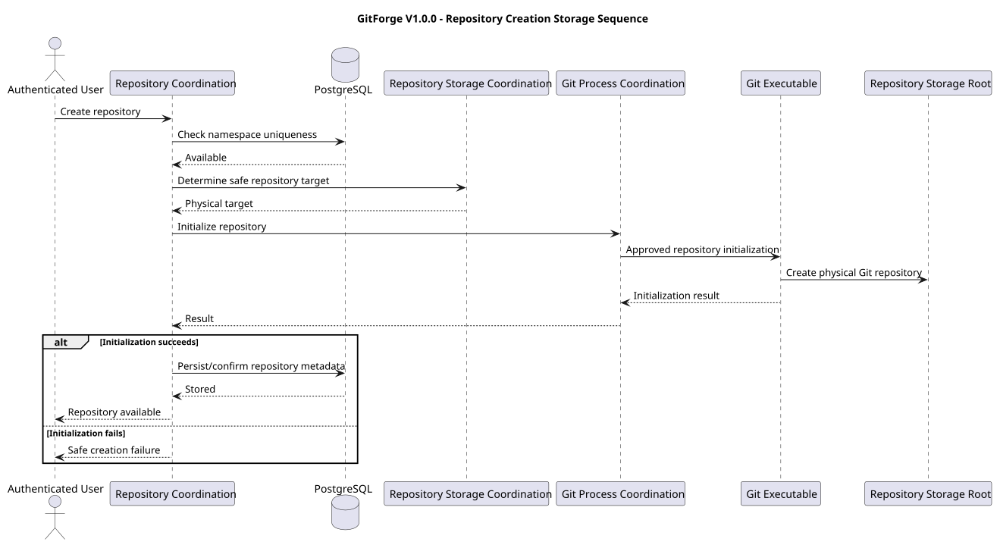
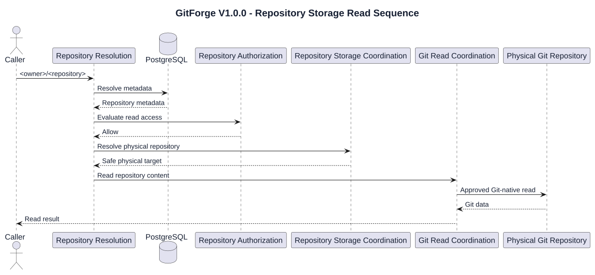
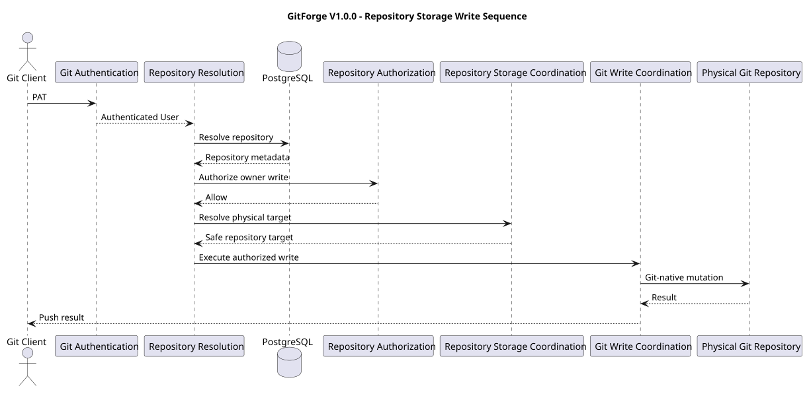

# GitForge V1.0.0 Repository Storage Analysis

## 1. Document Information

| Field | Value |

|---|---|

| Project | GitForge - Web Git Hosting Platform |

| Target release | V1.0.0 |

| Document | Repository Storage Analysis |

| SDLC phase | System Analysis |

| Milestone | M2 - System Analysis |

| Project owner | Farhad Valizadegan |

| Status | Approved |

| Last updated | 2026-08-17 |

---

## 2. Purpose

This document analyzes repository storage behavior for GitForge V1.0.0.

It defines:

- logical repository storage responsibilities;

- separation between application metadata and Git-native data;

- repository namespace mapping;

- physical repository identity;

- repository creation behavior;

- repository lookup behavior;

- repository read and write storage coordination;

- repository consistency expectations;

- repository storage trust boundaries;

- failure conditions;

- storage invariants;

- interactions with PostgreSQL and the Git executable.

The purpose is to establish a stable logical storage model before System Design begins.

---

## 3. Analysis Objective

This document answers:

> How does GitForge represent, locate, create, and access repository storage while preserving the separation between application metadata and Git-native repository state?

The analysis must support:

```text

Repository creation

Repository browser reads

Git Smart HTTP reads

Git Smart HTTP writes

Authorization

Safe path resolution

Failure handling

```

---

## 4. Repository Storage Scope

V1.0.0 repository storage analysis covers:

```text

Logical repository namespace

Repository metadata authority

Physical Git repository authority

Repository creation coordination

Safe physical repository resolution

Repository availability

Repository consistency

Git read storage access

Git write storage access

Failure isolation

```

---

## 5. Out-of-Scope Storage Capabilities

The following are excluded or deferred from V1.0.0:

```text

Distributed object storage

Multi-region repository replication

Repository mirroring

Repository sharding

Repository migration between storage nodes

High-availability Git clusters

Remote object databases

Git LFS storage

Repository archival

Repository restore workflows

Storage quotas

Repository deletion

Repository rename

Repository transfer

Organization-owned repositories

```

These must not be introduced implicitly into V1.0.0.

---

## 6. Dual Storage Model

GitForge uses two distinct authoritative storage domains.

```text

Application Metadata

&#x20;     ↓

PostgreSQL

Git-Native Repository State

&#x20;     ↓

Physical Git Repository

```

These storage domains have different responsibilities.

---

## 7. PostgreSQL Authority

PostgreSQL is authoritative for application-level repository metadata including:

```text

Repository identity

Repository owner

Repository name

Repository visibility

Repository creation metadata

Application relationships

PAT metadata

User metadata

```

PostgreSQL does not become authoritative for Git commits, refs, trees, or blobs.

---

## 8. Physical Git Repository Authority

The physical Git repository is authoritative for:

```text

Refs

Branches

Tags

Commits

Trees

Blobs

Git object graph

Git history

File content

```

Git-native data shall not be duplicated into PostgreSQL as an alternative authority.

---

## 9. Authority Separation

Conceptually:

```text

PostgreSQL

&#x20;   ↓

Who owns the repository?

What is it called?

Is it public or private?

Physical Git Repository

&#x20;   ↓

What branches exist?

What commits exist?

What files exist?

What Git objects exist?

```

This separation is fundamental to V1.0.0.

---

## 10. Logical Repository Identity

A Repository is identified logically by:

```text

<owner>/<repository>

```

Example:

```text

farhad/sample-project

```

The logical namespace is application-facing identity.

It is not itself an arbitrary filesystem path.

---

## 11. Namespace Ownership

The owner component corresponds to a User-controlled namespace.

Conceptually:

```text

User

&#x20; ↓

Owns Namespace

&#x20; ↓

Contains Repositories

```

Repository names are unique within the owner namespace.

---

## 12. Repository Name Validation

Repository names must comply with approved requirements.

Conceptually supported rules include:

```text

1–100 characters

Lowercase ASCII letters

Digits

Hyphen

Underscore

Safe periods

No slash

No backslash

No ".."

No traversal sequence

No control characters

Unique per owner namespace

```

Storage resolution shall assume only validated logical names.

---

## 13. Logical-to-Physical Resolution

The physical repository target must be derived internally.

Conceptually:

```text

Validated Owner

&#x20;     +

Validated Repository Name

&#x20;     ↓

Repository Metadata Resolution

&#x20;     ↓

Internal Storage Mapping

&#x20;     ↓

Safe Physical Repository Path

```

The client shall not provide the authoritative physical path.

---

## 14. Storage Root

All managed physical Git repositories must reside under a configured repository storage root.

Conceptually:

```text

Repository Storage Root

&#x20;       ↓

Managed Repository Space

```

Exact filesystem location belongs to System Design.

---

## 15. Repository Root Containment

Every resolved physical repository target must remain within the configured repository storage root.

Invariant:

```text

Resolved Repository Path

&#x20;       ∈

Configured Repository Root

```

No repository operation may escape this boundary.

---

## 16. Physical Repository Form

V1.0.0 repository storage is based on Git repositories suitable for hosting server-side Git operations.

The exact physical initialization command and directory conventions belong to System Design.

The storage model must support:

```text

git-upload-pack

git-receive-pack

Repository browser reads

Initial push

Subsequent fetch

Subsequent push

```

---

## 17. Repository Creation

Repository creation involves both application metadata and physical Git storage.

Conceptually:

```text

Authenticated User

&#x20;     ↓

Validate Repository Request

&#x20;     ↓

Create Application Repository Identity

&#x20;     ↓

Create Physical Git Repository

&#x20;     ↓

Repository Available

```

The two storage domains must remain consistent.

---

## 18. Repository Creation Responsibilities

Creation logically requires:

```text

Validate repository name

Confirm namespace uniqueness

Establish repository owner

Establish visibility

Persist repository metadata

Initialize physical Git repository

Confirm repository availability

```

Exact transaction coordination belongs to System Design.

---

## 19. Repository Creation Consistency

A repository should not be represented as successfully available when required physical storage initialization failed.

Conceptually:

```text

Metadata Created

Physical Storage Failed

&#x20;       ↓

Inconsistent Repository

```

This condition must be prevented or safely recovered.

---

## 20. Empty Repository

A newly created physical repository may contain no commits.

This is valid.

Conceptually:

```text

Repository Metadata Exists

&#x20;     +

Physical Repository Exists

&#x20;     +

No Commit History

&#x20;     ↓

Valid Empty Repository

```

Empty does not mean missing.

---

## 21. Missing Physical Repository

If PostgreSQL identifies a repository but expected physical Git storage is absent:

```text

Metadata = Present

Storage = Missing

```

This is:

```text

Storage Consistency Failure

```

It is not:

```text

Empty Repository

```

---

## 22. Orphaned Physical Repository

If physical Git storage exists without corresponding authoritative repository metadata:

```text

Storage = Present

Metadata = Missing

```

This represents an orphaned storage condition.

V1.0.0 must not silently expose such a repository as an application repository.

---

## 23. Repository Resolution

Normal repository access begins with logical metadata resolution.

Conceptually:

```text

<owner>/<repository>

&#x20;     ↓

Resolve User Namespace

&#x20;     ↓

Resolve Repository Metadata

&#x20;     ↓

Authorization Context

&#x20;     ↓

Physical Storage Resolution

```

---

## 24. Metadata Before Physical Access

For protected repository interactions:

```text

Resolve Metadata

&#x20;     ↓

Determine Repository Context

&#x20;     ↓

Authorize

&#x20;     ↓

Resolve Physical Storage

```

Physical access shall not bypass application authorization.

---

## 25. Storage and Authorization

Storage resolution does not independently grant access.

Conceptually:

```text

Physical Repository Exists

&#x20;     ≠

Caller Authorized

```

Authorization remains an application responsibility.

---

## 26. Public Repository Read Storage

For a Public Repository:

```text

Repository Resolved

&#x20;     ↓

Read Authorized

&#x20;     ↓

Physical Repository Resolved

&#x20;     ↓

Read Operation

```

The caller may be anonymous.

---

## 27. Private Repository Read Storage

For a Private Repository:

```text

Authenticate

&#x20;     ↓

Resolve User

&#x20;     ↓

Resolve Repository

&#x20;     ↓

Authorize Owner Read

&#x20;     ↓

Resolve Physical Repository

&#x20;     ↓

Read Operation

```

---

## 28. Repository Write Storage

For all supported writes:

```text

Authenticate PAT

&#x20;     ↓

Resolve User

&#x20;     ↓

Resolve Repository

&#x20;     ↓

Authorize Owner Write

&#x20;     ↓

Resolve Physical Repository

&#x20;     ↓

Mutation

```

No mutation occurs before authorization.

---

## 29. Browser Storage Access

Repository browser features use physical Git repository state to obtain:

```text

Branches

Commit history

Commit details

Trees

Files

```

The browser shall not rely on PostgreSQL as the Git-content authority.

---

## 30. Git Smart HTTP Read Storage Access

Git Smart HTTP read operations depend on:

```text

Validated Repository Identity

Authorization Decision

Safe Physical Repository Resolution

git-upload-pack

```

---

## 31. Git Smart HTTP Write Storage Access

Git Smart HTTP write operations depend on:

```text

Authenticated Owner

Safe Physical Repository Resolution

git-receive-pack

```

---

## 32. Storage Resolution Input

The storage layer may receive trusted internal values such as:

```text

Resolved repository identifier

Validated owner namespace

Validated repository name

Repository metadata

Authorized operation context

```

It shall not rely on unvalidated client-supplied filesystem paths.

---

## 33. Path Construction Risk

Improper path construction can produce:

```text

Path traversal

Repository-root escape

Cross-repository access

Unauthorized filesystem access

Platform path confusion

```

Therefore path derivation must be controlled.

---

## 34. Cross-Repository Isolation

A request for one repository must not resolve to another repository's physical storage.

Invariant:

```text

Logical Repository A

&#x20;     ↓

Physical Repository A

```

never:

```text

Logical Repository A

&#x20;     ↓

Physical Repository B

```

---

## 35. Repository Storage Identity

Each application Repository maps to one authoritative physical Git repository in V1.0.0.

Conceptually:

```text

Application Repository

&#x20;      1

&#x20;      |

&#x20;      | maps to

&#x20;      |

&#x20;      1

Physical Git Repository

```

Distributed or replicated mappings are deferred.

---

## 36. Storage Mapping Stability

Once created, the internal repository mapping should remain stable for the supported V1.0.0 lifecycle.

Because repository rename and transfer are deferred, the storage model does not need to support those operations.

---

## 37. Repository Visibility Independence

Repository visibility is application metadata.

Changing:

```text

Public ↔ Private

```

does not require changing Git object storage.

The same physical Git repository remains authoritative.

---

## 38. Repository Ownership Independence

Repository ownership is application metadata.

V1.0.0 does not support ownership transfer.

Therefore physical Git repository content remains associated with the same application Repository owner throughout the supported lifecycle.

---

## 39. Repository Deletion

Repository deletion is deferred from V1.0.0.

Therefore this analysis does not define:

```text

Physical repository removal

Metadata deletion ordering

Retention

Trash

Restore

Garbage collection after deletion

```

---

## 40. Repository Rename

Repository rename is deferred.

Therefore storage remapping for rename is not part of V1.0.0 analysis.

---

## 41. Storage and PAT State

PAT data is not stored in the physical Git repository.

Conceptually:

```text

PAT Metadata

&#x20;   ↓

PostgreSQL

```

Repository storage is not responsible for PAT verification or revocation.

---

## 42. Storage and User State

User identity is application metadata.

The physical repository does not determine application User identity.

---

## 43. Storage and Git Process Execution

Repository storage supplies an approved physical repository target to Git process coordination.

Conceptually:

```text

Repository Storage Coordination

&#x20;     ↓

Safe Physical Target

&#x20;     ↓

Git Process Coordination

&#x20;     ↓

Git Executable

```

---

## 44. Storage and Git Executable

The Git executable operates on the resolved physical Git repository.

Approved examples include:

```text

git-upload-pack

git-receive-pack

Read-only Git inspection operations

```

The client shall not select arbitrary filesystem targets.

---

## 45. Repository Content Trust

Physical repository content is untrusted application input.

This includes:

```text

File names

Directory names

Blob content

Commit messages

Author metadata

Tag messages

Branch names

Git object metadata

```

Storage presence does not imply content safety.

---

## 46. Symlink and Filesystem Boundary Risk

Filesystem behavior can introduce risks such as:

```text

Unexpected links

Path aliasing

Filesystem redirection

Storage-root escape

```

The exact filesystem-hardening mechanisms belong to System Design and Security Design.

The analysis requirement is:

```text

Repository access must remain confined to the intended repository target.

```

---

## 47. Repository Creation Activity



[PlantUML source](diagrams/12-repository-storage-analysis-001.puml)

---

## 48. Repository Read Storage Activity



[PlantUML source](diagrams/12-repository-storage-analysis-002.puml)

---

## 49. Repository Write Storage Activity



[PlantUML source](diagrams/12-repository-storage-analysis-003.puml)

---

## 50. Repository Storage Collaboration Diagram



[PlantUML source](diagrams/12-repository-storage-analysis-004.puml)

---

## 51. Repository Creation Sequence



[PlantUML source](diagrams/12-repository-storage-analysis-005.puml)

---

## 52. Repository Read Sequence



[PlantUML source](diagrams/12-repository-storage-analysis-006.puml)

---

## 53. Repository Write Sequence



[PlantUML source](diagrams/12-repository-storage-analysis-007.puml)

---

## 54. Repository Storage Responsibility Matrix

| Responsibility | Logical Owner |

|---|---|

| Validate repository namespace | Repository Coordination |

| Resolve repository metadata | Repository Resolution |

| Persist application metadata | PostgreSQL Persistence |

| Determine repository owner | Repository Metadata |

| Determine visibility | Repository Metadata |

| Evaluate access | Repository Authorization |

| Derive physical repository target | Repository Storage Coordination |

| Enforce storage-root containment | Repository Storage Coordination |

| Initialize physical Git repository | Git Process / Storage Coordination |

| Read Git-native state | Git Read Coordination |

| Mutate Git-native state | Git Write Coordination |

| Persist Git objects/refs | Physical Git Repository |

| Detect missing repository storage | Repository Storage Coordination |

| Classify storage inconsistency | Failure Handling |

| Record diagnostics | Diagnostics |

---

## 55. Repository Storage Data Flow

Conceptually:

```text

Caller

&#x20; ↓

Logical Repository Identifier

&#x20; ↓

Repository Resolution

&#x20; ↓

PostgreSQL Metadata

&#x20; ↓

Authorization

&#x20; ↓

Repository Storage Coordination

&#x20; ↓

Safe Physical Repository Target

&#x20; ↓

Git Read / Write Coordination

&#x20; ↓

Git Executable

&#x20; ↓

Physical Git Repository

```

---

## 56. Repository Creation Data Flow

```text

Authenticated User

&#x20;     ↓

Repository Creation Request

&#x20;     ↓

Validation

&#x20;     ↓

Namespace Uniqueness Check

&#x20;     ↓

Repository Metadata

&#x20;     ↓

Safe Storage Target

&#x20;     ↓

Physical Git Repository Initialization

&#x20;     ↓

Consistent Available Repository

```

---

## 57. Repository Browser Data Flow

```text

Web Caller

&#x20;   ↓

Repository Identifier

&#x20;   ↓

Repository Resolution

&#x20;   ↓

Authorization

&#x20;   ↓

Safe Physical Repository

&#x20;   ↓

Git-Native Read

&#x20;   ↓

Branches / Commits / Trees / Files

&#x20;   ↓

Web Response

```

---

## 58. Git Read Storage Data Flow

```text

Git Client

&#x20;   ↓

Logical Repository

&#x20;   ↓

Authorization

&#x20;   ↓

Safe Physical Repository

&#x20;   ↓

git-upload-pack

&#x20;   ↓

Git Protocol Output

```

---

## 59. Git Write Storage Data Flow

```text

Git Client + PAT

&#x20;     ↓

Authentication

&#x20;     ↓

Repository Resolution

&#x20;     ↓

Owner Authorization

&#x20;     ↓

Safe Physical Repository

&#x20;     ↓

git-receive-pack

&#x20;     ↓

Refs / Objects Mutated

```

---

## 60. Repository Storage Failure Categories

### RSF-001 — Invalid Repository Namespace

Logical owner or repository name is invalid.

Result:

```text

Reject Before Physical Resolution

```

### RSF-002 — Repository Metadata Missing

Application repository cannot be resolved.

Result:

```text

Safe Not-Found Handling

```

### RSF-003 — Physical Repository Missing

Metadata exists but physical repository does not.

Result:

```text

Storage Consistency Failure

```

### RSF-004 — Physical Repository Unreadable

Repository exists but cannot be safely read.

Result:

```text

Operational Failure

```

### RSF-005 — Physical Repository Unwritable

Authorized write cannot be performed.

Result:

```text

Operational Failure

```

### RSF-006 — Repository Initialization Failure

Physical repository cannot be created successfully.

Result:

```text

Repository Creation Fails

```

### RSF-007 — Storage Root Unavailable

Configured storage root is inaccessible.

Result:

```text

Storage Operation Fails

```

### RSF-008 — Storage Target Escapes Root

Resolved physical target is outside the configured repository root.

Result:

```text

Reject

Security Failure

```

### RSF-009 — Cross-Repository Mapping Failure

Logical repository resolves to the wrong physical repository.

Result:

```text

Reject

Critical Consistency/Security Failure

```

### RSF-010 — Physical Repository Corrupt

Git repository cannot be processed reliably.

Result:

```text

Operational Failure

```

### RSF-011 — Orphaned Physical Repository

Physical repository exists without valid application metadata.

Result:

```text

Do Not Expose Automatically

```

### RSF-012 — Metadata/Storage Creation Inconsistency

One creation domain succeeds while the other fails.

Result:

```text

Creation Must Not Be Reported as Fully Successful

```

---

## 61. Missing Versus Empty Repository

The distinction is mandatory.

```text

Empty Repository

=

Metadata exists

\+

Physical Git repository exists

\+

No commits

```

versus:

```text

Missing Repository Storage

=

Metadata exists

\+

Expected physical Git repository absent

```

These are different states.

---

## 62. Authorization Failure Versus Storage Failure

Example:

```text

Private Repository

Authenticated Non-Owner

```

Result:

```text

Authorization Failure

```

Example:

```text

Owner Authorized

Physical Repository Missing

```

Result:

```text

Storage Failure

```

These must not be conflated.

---

## 63. Git Failure Versus Storage Failure

Example:

```text

Physical repository exists

Git executable rejects operation

```

This may be:

```text

Git Execution Failure

```

not necessarily:

```text

Storage Resolution Failure

```

---

## 64. Fail-Closed Storage Principle

When repository identity or target resolution is uncertain:

```text

Repository identity uncertainty

or

Path uncertainty

or

Root containment uncertainty

or

Cross-repository mapping uncertainty

&#x20;       ↓

Do Not Access Physical Repository

```

---

## 65. Safe Storage Failure Responses

External failures shall not unnecessarily expose:

```text

Absolute filesystem paths

Storage-root paths

Server usernames

Filesystem mount details

Internal directory naming conventions

Stack traces

Git command construction details

```

Internal diagnostics may record controlled information.

---

## 66. Repository Storage Diagnostics

Safe diagnostics may include:

```text

Repository application identifier

Owner identifier

Logical repository name

Storage operation type

Storage availability result

Git process result category

Consistency failure category

Timestamp

```

Sensitive or unnecessary raw filesystem information should be minimized.

---

## 67. Repository Storage Security Risks

Major risks include:

```text

Path traversal

Repository-root escape

Cross-repository access

Unauthorized physical access

Incorrect namespace mapping

Symlink/path aliasing abuse

Arbitrary filesystem access

Command injection through paths

Storage permission errors

Repository corruption

Orphaned repositories

Metadata/storage inconsistency

Sensitive path disclosure

Fail-open behavior

```

---

## 68. Repository Storage Operational Risks

Operational risks include:

```text

Disk exhaustion

Filesystem permission failure

Git executable failure

Repository corruption

Large repository growth

Concurrent reads and writes

Long-running Git processes

Storage-root unavailability

Partial initialization

Unexpected filesystem state

```

Exact operational controls belong to System Design and Deployment Design.

---

## 69. Concurrent Repository Access

V1.0.0 may experience:

```text

Concurrent clone/fetch

Concurrent browsing

Push during reads

Multiple push attempts

```

Git-native semantics and the underlying filesystem participate in concurrency behavior.

GitForge must not bypass Git-native repository integrity mechanisms.

---

## 70. Push During Read

A repository may be read while an owner performs a push.

Conceptually:

```text

Read Operation

&#x20;     +

Write Operation

```

GitForge should rely on controlled Git-native operations rather than manually interpreting partially changing repository files.

Exact concurrency behavior belongs to design and testing.

---

## 71. Storage Growth

Repository content may grow after pushes.

Conceptually:

```text

Initial Empty Repository

&#x20;     ↓

Push

&#x20;     ↓

Objects + Refs

&#x20;     ↓

Larger Repository

```

No V1.0.0 quota model is assumed unless approved requirements explicitly introduce one.

---

## 72. Repository Storage Invariants

### RSI-001 — Dual Authority

PostgreSQL is authoritative for application repository metadata; the physical Git repository is authoritative for Git-native state.

### RSI-002 — One Logical Repository, One Physical Repository

Each V1.0.0 Repository maps to one authoritative physical Git repository.

### RSI-003 — Logical Namespace Is Not a Physical Path

`<owner>/<repository>` does not directly authorize filesystem access.

### RSI-004 — Safe Internal Resolution

Physical repository paths are derived internally.

### RSI-005 — Storage Root Containment

Every managed repository target remains within the configured repository root.

### RSI-006 — Metadata Before Protected Storage Access

Protected access requires repository metadata resolution and authorization before physical repository use.

### RSI-007 — Empty Is Valid

A repository may exist validly without commits.

### RSI-008 — Missing Is Failure

Missing expected physical storage is a consistency failure.

### RSI-009 — Orphaned Storage Is Not Automatically Exposed

Physical Git storage without application metadata is not a valid visible application Repository.

### RSI-010 — Public Visibility Does Not Change Storage Authority

Visibility affects authorization, not Git storage authority.

### RSI-011 — Physical Storage Does Not Grant Authorization

Repository existence on disk does not grant access.

### RSI-012 — Cross-Repository Isolation

One logical repository shall never resolve to another repository's physical target.

### RSI-013 — Client Cannot Select Physical Path

External callers shall not control the authoritative filesystem target.

### RSI-014 — Repository Content Remains Untrusted

Git repository content is untrusted even when stored successfully.

### RSI-015 — Fail Closed

Uncertain repository identity or path resolution prevents physical access.

---

## 73. Repository Storage Decision Table

| Metadata | Physical Repository | Authorization | Result |

|---|---|---|---|

| Missing | Unknown | N/A | Safe not-found handling |

| Present | Present | Allow | Perform approved repository operation |

| Present | Present | Deny | Deny access |

| Present | Missing | Allow | Storage consistency failure |

| Present | Corrupt | Allow | Operational failure |

| Missing | Present | N/A | Orphaned storage; do not expose automatically |

| Present | Target escapes root | Any | Reject |

---

## 74. Repository Creation Decision Table

| Name Valid | Namespace Unique | Physical Init | Result |

|---|---|---|---|

| No | N/A | Not attempted | Reject |

| Yes | No | Not attempted | Reject |

| Yes | Yes | Success | Repository may become available |

| Yes | Yes | Failure | Creation fails / consistency handling required |

Exact transaction ordering belongs to System Design.

---

## 75. Storage Access Decision Table

| Operation | Authorization Required | Physical Repository Required |

|---|---:|---:|

| Public repository web read | Yes, public-read policy | Yes |

| Private repository web read | Yes, owner | Yes |

| Public anonymous Git clone/fetch | Yes, public-read policy | Yes |

| Private Git clone/fetch | Yes, owner | Yes |

| Git push | Yes, owner | Yes |

| Repository creation | Authenticated User ownership context | Creates physical repository |

---

## 76. Repository Storage Analysis Findings

### RSA-001 — GitForge Has Two Storage Authorities

Application metadata and Git-native state have distinct authorities.

Status:

```text

Confirmed

```

### RSA-002 — Logical Repository Identity Must Be Resolved Internally

Clients do not control physical repository paths.

Status:

```text

Confirmed

```

### RSA-003 — Storage Root Containment Is Mandatory

Managed repositories must remain within the configured repository root.

Status:

```text

Confirmed

```

### RSA-004 — Authorization Precedes Protected Physical Access

Physical repository existence never bypasses application authorization.

Status:

```text

Confirmed

```

### RSA-005 — Empty and Missing Repositories Are Different

A valid empty Git repository is not a storage failure.

Status:

```text

Confirmed

```

### RSA-006 — Metadata/Physical Storage Consistency Is Required

A repository must not be reported as healthy if required storage is absent.

Status:

```text

Confirmed

```

### RSA-007 — Repository Content Remains Untrusted

Stored Git data must not be treated as trusted application content.

Status:

```text

Confirmed

```

### RSA-008 — Cross-Repository Isolation Is Critical

Logical repository resolution must map only to its own physical repository.

Status:

```text

Confirmed

```

---

## 77. Areas Requiring Later M2 Analysis

The following repository-storage topics are consolidated later in M2:

```text

Data flows

State transitions

Trust boundaries

Failure and exception handling

Sequence models

Activity models

Analysis traceability

System analysis validation

```

---

## 78. Design Decisions Intentionally Deferred

This analysis does not decide:

```text

Exact repository storage root path

Directory naming convention

Bare repository initialization command

Filesystem permissions

Filesystem ownership

Windows versus Linux path strategy

Git executable path

Laravel service classes

Repository storage service class

Database schema

Transaction strategy

Compensation strategy

Locking strategy

Process execution library

Git command syntax

Storage quotas

Disk monitoring thresholds

Backup strategy

Repository replication

Filesystem layout optimization

Symlink-hardening implementation

Mount configuration

Container volume layout

```

These belong primarily to System Design, Security Design, Deployment Design, or Operations Design.

---

## 79. Requirements Alignment

This analysis derives primarily from approved requirements covering:

```text

Repository creation

Repository identity

Repository ownership

Repository visibility

Repository browser

Git Smart HTTP reads

Git Smart HTTP writes

Safe repository path derivation

Git process execution

Data authority

Authorization

Security

Failure handling

```

Relevant use cases include:

```text

UC-004 Create Repository

UC-006 View Repository

UC-009 Browse

UC-010 List Branches

UC-011 Commit History

UC-012 Commit Details

UC-013 Tree

UC-014 File

UC-015 Discover Read Service

UC-016 Clone

UC-017 Fetch

UC-018 Discover Write Service

UC-019 Push

UC-023 Authorize Read

UC-024 Authorize Write

UC-025 Diagnose Failure

```

Representative requirement areas include:

```text

Relevant FR requirements for repository creation, browsing, Git read, and Git write

Relevant DR requirements for application metadata and Git-native authority

Relevant IR requirements for repository and Git interfaces

Relevant BR requirements for repository naming and ownership

AR-001 – AR-060

```

Exact requirement-to-analysis mapping will be consolidated in:

```text

19-analysis-traceability.md

```

---

## 80. Completion Criteria

This Repository Storage Analysis is complete when:

- application metadata authority is explicit;

- Git-native storage authority is explicit;

- logical repository identity is explicit;

- namespace validation is explicit;

- internal physical repository resolution is explicit;

- storage-root containment is explicit;

- repository creation behavior is explicit;

- metadata/storage consistency is explicit;

- empty repository behavior is explicit;

- missing physical repository behavior is explicit;

- orphaned physical repository behavior is identified;

- browser storage access is explicit;

- Git read storage access is explicit;

- Git write storage access is explicit;

- authorization ordering is explicit;

- cross-repository isolation is explicit;

- storage failure categories are identified;

- trust and security boundaries are identified;

- diagrams and data flows are modeled;

- downstream data-flow, state, trust-boundary, failure, and traceability analysis can proceed without inventing storage semantics.

---

## 81. Analysis Result

Repository Storage Analysis result:

```text

SUFFICIENT FOR DOWNSTREAM SYSTEM ANALYSIS

```

No repository-storage contradiction with approved V1.0.0 requirements has been identified.

---

## 82. Document Status

This document is currently:

```text

Approved

```

It will be changed to:

```text

Approved

```

after dual-storage authority, logical-to-physical resolution, repository creation, storage containment, authorization ordering, failure cases, diagrams, invariants, and requirements alignment have been reviewed.

