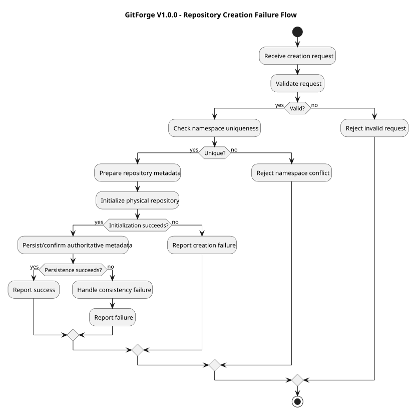
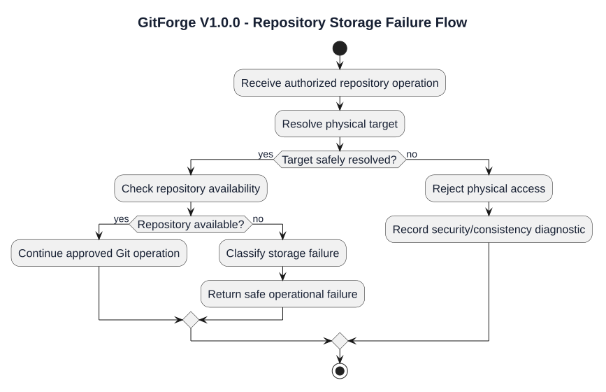
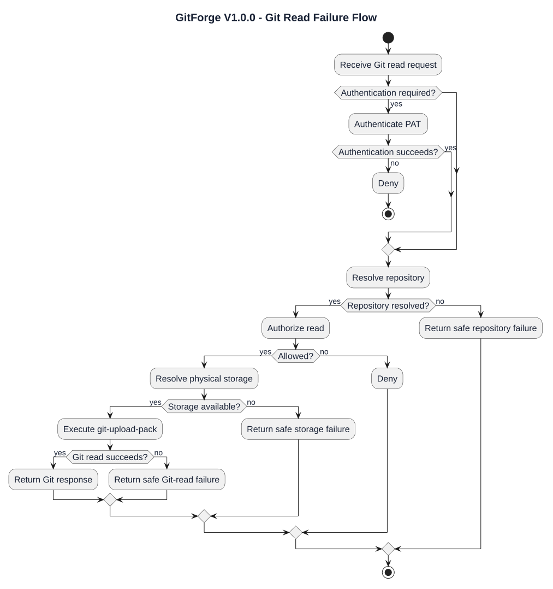
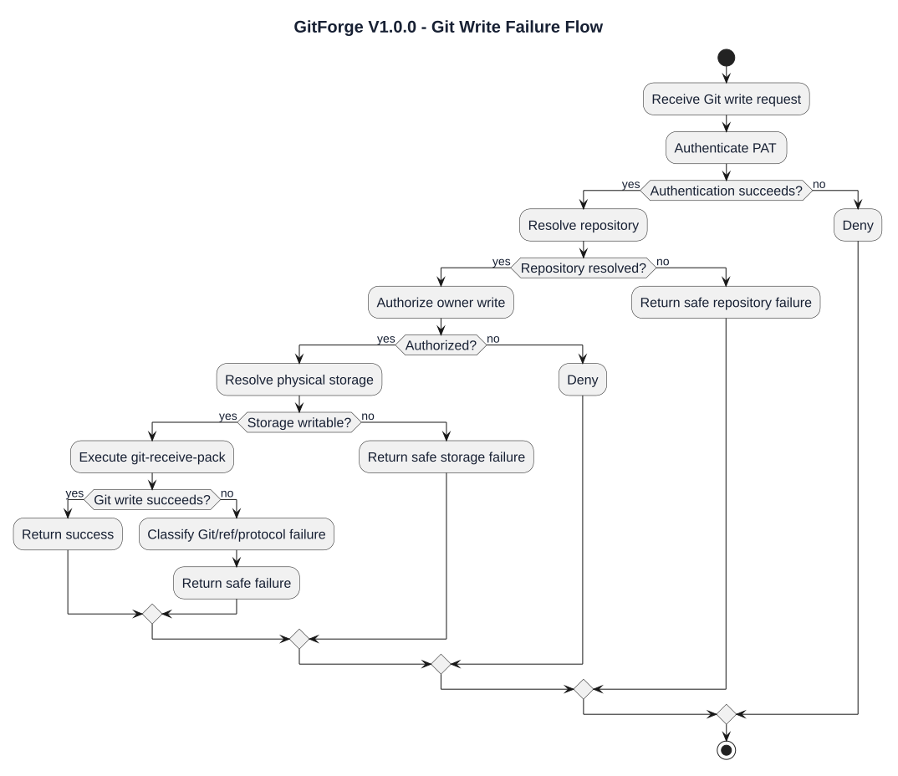
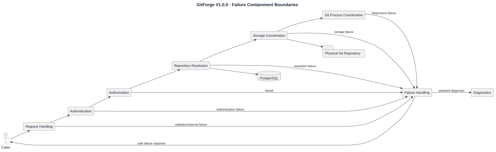

# GitForge V1.0.0 Failure and Exception Analysis

## 1. Document Information

| Field | Value |
|---|---|
| Project | GitForge - Web Git Hosting Platform |
| Target release | V1.0.0 |
| Document | Failure and Exception Analysis |
| SDLC phase | System Analysis |
| Milestone | M2 - System Analysis |
| Project owner | Farhad Valizadegan |
| Status | Approved |
| Last updated | 2026-08-17 |

---

## 2. Purpose

This document analyzes failure and exception behavior for GitForge V1.0.0.

It defines:

- failure categories;

- exception boundaries;

- authentication failures;

- authorization failures;

- repository-resolution failures;

- repository-storage failures;

- repository-browser failures;

- Personal Access Token failures;

- Git Smart HTTP read failures;

- Git Smart HTTP write failures;

- Git process failures;

- persistence failures;

- consistency failures;

- protocol failures;

- diagnostic behavior;

- fail-closed behavior;

- failure propagation principles.

The purpose is to establish a coherent logical failure model before System Design begins.

---

## 3. Analysis Objective

This document answers:

> How does GitForge classify, contain, propagate, and safely report failures while preventing uncertain or invalid states from becoming successful or authorized outcomes?

The analysis remains logical and implementation-neutral.

It does not define:

```text

Concrete exception classes

Laravel exception handlers

HTTP status codes

Exact JSON error structures

Retry libraries

Logging framework

Monitoring products

Alert thresholds

Database transaction implementation

Process supervision implementation

```

These decisions belong primarily to System Design, Testing, Deployment, and Operations.

---

## 4. Failure Analysis Scope

V1.0.0 failure analysis covers:

```text

Input validation

Interactive authentication

PAT authentication

Repository authorization

Repository resolution

Repository creation

Repository visibility update

Repository browsing

PAT creation

PAT revocation

Repository storage

Git Smart HTTP read

Git Smart HTTP write

Git process execution

Database persistence

Data consistency

Protocol handling

Diagnostics

```

---

## 5. Out-of-Scope Failure Domains

The following are excluded or deferred because the related features are not part of V1.0.0:

```text

Organization failures

Team membership failures

Collaborator invitation failures

Repository deletion failures

Repository rename failures

Repository transfer failures

Pull request failures

Issue workflow failures

CI/CD pipeline failures

Package registry failures

Container registry failures

Git LFS failures

SSH transport failures

Billing failures

Multi-region failover

Distributed-replication failures

```

---

## 6. Failure Classification Principle

Failures must be classified by cause rather than collapsed into one generic internal category.

Major classes include:

```text

Validation Failure

Authentication Failure

Authorization Failure

Resolution Failure

Persistence Failure

Storage Failure

Consistency Failure

Git Execution Failure

Protocol Failure

Security Failure

Operational Failure

Diagnostic Failure

```

---

## 7. Failure Versus Denial

A denial is not the same as an operational failure.

Example:

```text

Authenticated Non-Owner

      ↓

Push Request

      ↓

Authorization Denied

```

This is expected policy behavior.

Example:

```text

Authenticated Owner

      ↓

Push Authorized

      ↓

Physical Repository Corrupt

      ↓

Operation Failed

```

This is an operational failure.

---

## 8. Failure Versus Invalid Input

Invalid input should normally be rejected before protected execution begins.

Conceptually:

```text

Invalid Input

      ↓

Validation Failure

      ↓

Reject

```

This is different from:

```text

Valid Request

      ↓

Operational Execution

      ↓

Runtime Failure

```

---

## 9. Failure State Principle

Every protected operation must end in a clear logical outcome:

```text

Succeeded

Denied

Rejected

Failed

```

Ambiguous success is not permitted.

---

## 10. Fail-Closed Principle

When required security or identity state is uncertain:

```text

Authentication uncertainty

Authorization uncertainty

Repository identity uncertainty

PAT state uncertainty

Storage mapping uncertainty

```

the result must be:

```text

Deny or Fail

```

not:

```text

Allow or Succeed

```

---

## 11. No False Success Principle

GitForge must not report success when authoritative state change or required execution did not complete successfully.

Examples:

```text

Repository metadata stored

Physical repository creation failed

    ↓

Do Not Report Repository Creation Success

```

```text

Visibility update requested

Database persistence failed

    ↓

Do Not Report Visibility Change Success

```

```text

PAT revocation requested

Revocation persistence failed

    ↓

Do Not Report PAT Revocation Success

```

---

## 12. Failure Containment Principle

A failure should be contained within the smallest logical boundary possible.

Conceptually:

```text

Failure

  ↓

Classify

  ↓

Prevent Invalid Continuation

  ↓

Preserve Safe State

  ↓

Emit Safe Diagnostic

  ↓

Return Safe External Result

```

---

## 13. Failure Propagation Principle

Failures may propagate upward through logical responsibilities.

Example:

```text

Physical Repository Missing

      ↓

Repository Storage Failure

      ↓

Repository Browser Failure

      ↓

Safe Web Failure Response

```

The lower-level cause may remain internally precise while the external response is sanitized.

---

## 14. Exception Boundary Principle

Critical exception boundaries exist around:

```text

External input handling

Credential verification

Authorization

Database persistence

Repository storage

Git process execution

Git protocol processing

Repository-content interpretation

Diagnostics

```

Unexpected exceptions at these boundaries must not result in fail-open behavior.

---

## 15. Failure Severity Categories

Logical severity categories:

```text

Expected Rejection

Expected Denial

Recoverable Operational Failure

Consistency Failure

Security-Critical Failure

System Dependency Failure

Unexpected Internal Failure

```

---

## 16. Expected Rejection

Examples:

```text

Invalid repository name

Duplicate repository name

Invalid visibility value

Invalid path identifier

Malformed revision identifier

```

Expected result:

```text

Reject Request

```

---

## 17. Expected Denial

Examples:

```text

Invalid login credentials

Invalid PAT

Revoked PAT

Private repository read by non-owner

Push by non-owner

PAT revocation attempt by non-owner

```

Expected result:

```text

Deny

```

---

## 18. Recoverable Operational Failure

Examples:

```text

Temporary database failure

Temporary storage unavailability

Git process failure

Repository unreadable

```

The current operation fails, but the overall system may continue serving unrelated requests.

---

## 19. Consistency Failure

Consistency failures indicate disagreement between authoritative or required states.

Examples:

```text

Repository metadata exists but physical repository missing

Physical repository exists but metadata missing

PAT record exists but owner cannot be resolved

Logical repository maps to wrong physical target

Creation partially completed

```

These require safe failure and diagnostic visibility.

---

## 20. Security-Critical Failure

Examples:

```text

Authentication bypass

Authorization bypass

Storage-root escape

Cross-repository access

Arbitrary command execution

Plaintext PAT leakage

Non-owner reaching Git write execution

```

These represent critical violations of required security boundaries.

---

## 21. Dependency Failure

Major dependencies include:

```text

PostgreSQL

Filesystem

Git executable

Repository storage root

```

Dependency failure must not be transformed into successful application behavior.

---

## 22. Unexpected Internal Failure

Unexpected internal exceptions must produce:

```text

Safe failure

\+

Sanitized external response

\+

Internal diagnostic event

```

They must not expose raw internal details by default.

---

## 23. Validation Failure Category

Validation failures include:

```text

Invalid repository name

Invalid logical namespace

Invalid visibility

Malformed PAT-management input

Invalid revision

Invalid tree path

Invalid file path

Malformed Git request parameters

```

---

## 24. Validation Failure Handling

Conceptually:

```text

External Input

      ↓

Validation

      ↓

Invalid

      ↓

Reject

```

Protected execution must not proceed.

---

## 25. Authentication Failure Category

Authentication failures include:

```text

Missing login credential

Invalid login credential

Missing PAT where PAT required

Unknown PAT

Invalid PAT

Revoked PAT

PAT owner resolution failure

```

---

## 26. Interactive Authentication Failure

Conceptually:

```text

Login Request

      ↓

Credential Verification

      ↓

Failure

      ↓

Remain Unauthenticated

```

No User identity is established.

---

## 27. PAT Authentication Failure

Conceptually:

```text

Presented PAT

      ↓

Verification / Revocation / Owner Resolution

      ↓

Failure

      ↓

No Git User Identity

```

---

## 28. Authentication Failure Invariant

Failed authentication shall never transition into:

```text

Authenticated User

Repository Authorization Allow

Git Write Execution

```

---

## 29. Authorization Failure Category

Authorization failures include:

```text

Private read by anonymous caller

Private read by authenticated non-owner

Write by anonymous caller

Write by authenticated non-owner

Visibility change by non-owner

PAT revocation by non-owner

Protected browser access by unauthorized caller

```

---

## 30. Authorization Failure Handling

Conceptually:

```text

Identity + Repository + Operation

      ↓

Authorization

      ↓

Deny

      ↓

Protected Execution Stops

```

---

## 31. Authorization Denial Invariant

A denied operation must not proceed to:

```text

Protected physical repository access

Git write execution

Protected repository browser content

Metadata mutation

```

---

## 32. Repository Resolution Failure

Repository resolution failures include:

```text

Owner namespace not found

Repository not found

Logical repository identifier invalid

Metadata lookup inconsistency

Repository owner relationship missing

```

---

## 33. Repository Resolution Failure Handling

Conceptually:

```text

Logical Repository Identifier

      ↓

Resolution

      ↓

Failure

      ↓

Stop Protected Repository Flow

```

The system shall not guess a repository target.

---

## 34. Private Repository Disclosure Consideration

For unauthorized callers, failure handling should avoid unnecessary disclosure of private repository existence.

Exact outward behavior belongs to System Design.

---

## 35. Repository Creation Failure Category

Repository creation may fail because of:

```text

Invalid repository name

Namespace conflict

Metadata persistence failure

Physical repository initialization failure

Storage root unavailable

Git executable failure

Consistency failure

```

---

## 36. Repository Creation Failure Flow



[PlantUML source](diagrams/16-failure-and-exception-analysis-001.puml)

---

## 37. Repository Creation Consistency Rule

Creation must not leave a repository logically available when required physical storage is absent.

If partial creation occurs:

```text

Metadata Present

Storage Missing

```

or:

```text

Storage Present

Metadata Missing

```

the condition must be treated as:

```text

Consistency Failure

```

---

## 38. Visibility Update Failure

Visibility update failures include:

```text

Unauthorized caller

Invalid visibility

Repository not found

Persistence failure

Unexpected metadata inconsistency

```

---

## 39. Visibility Persistence Rule

If persistence fails:

```text

Requested Visibility

      ↓

Not Authoritatively Stored

      ↓

Do Not Report Update Success

```

---

## 40. Repository Browser Failure Category

Browser failures include:

```text

Repository not found

Unauthorized repository

Physical repository missing

Repository corrupt

Branch/ref not found

Commit not found

Tree path not found

File/blob not found

Invalid revision

Invalid path

Git inspection failure

Output interpretation failure

```

---

## 41. Repository Browser Failure Separation

Example:

```text

Private repository + non-owner

```

Result:

```text

Authorization Denial

```

Example:

```text

Owner authorized + requested file missing

```

Result:

```text

Repository Content Resolution Failure

```

Example:

```text

Owner authorized + repository corrupt

```

Result:

```text

Operational Git/Storage Failure

```

These are different failure classes.

---

## 42. Empty Repository Browser Behavior

An empty repository is not a failure.

Conceptually:

```text

Repository Available

No Commits

      ↓

Valid Empty State

```

The browser should represent emptiness rather than report missing storage.

---

## 43. Branch/Ref Resolution Failure

A requested ref may be:

```text

Invalid

Missing

Resolvable

```

Only Resolvable proceeds to Git-native content inspection.

---

## 44. Commit Resolution Failure

A commit identifier may be:

```text

Invalid

Unresolvable

Resolvable

```

An invalid or unresolvable commit does not become an internal server failure merely because the requested object is absent.

---

## 45. Tree/File Resolution Failure

A repository path may be:

```text

Invalid

Valid but Missing

Valid and Existing

```

Path-validation failure and object-not-found failure are logically distinct.

---

## 46. PAT Creation Failure Category

PAT creation failures include:

```text

Unauthenticated User

Token generation failure

Verification-representation derivation failure

Persistence failure

Owner-association failure

Plaintext presentation failure

Unexpected internal error

```

---

## 47. PAT Creation No-False-Success Rule

A PAT must not be reported as available unless its authoritative verification state exists consistently.

---

## 48. Plaintext PAT Presentation Failure

If the system cannot safely present the plaintext PAT during creation:

```text

Do Not Fabricate Recoverability

Do Not Claim Token Can Be Retrieved Later

```

Exact compensation behavior belongs to System Design.

---

## 49. PAT Verification Failure Category

Verification failures include:

```text

Unknown token

Malformed token

Verification mismatch

Revoked token

Owner resolution failure

Persistence lookup failure

```

---

## 50. PAT Verification Safe Response Rule

External authentication behavior should not expose unnecessary internal distinctions among:

```text

Unknown token

Wrong token

Revoked token

Lookup internals

Verification algorithm details

```

Internal diagnostics may classify these separately.

---

## 51. PAT Revocation Failure Category

PAT revocation may fail because of:

```text

Unauthenticated caller

PAT not found

Non-owner revocation attempt

Persistence failure

Unexpected PAT state inconsistency

```

---

## 52. PAT Revocation Invariant

If revocation cannot be committed reliably:

```text

Do Not Report Revocation Success

```

---

## 53. Repository Storage Failure Category

Repository storage failures include:

```text

Storage root missing

Storage root unavailable

Physical repository missing

Physical repository unreadable

Physical repository unwritable

Repository corrupt

Path escapes storage root

Cross-repository mapping

Orphaned repository

Filesystem exception

Permission failure

```

---

## 54. Storage Failure Flow



[PlantUML source](diagrams/16-failure-and-exception-analysis-002.puml)

---

## 55. Storage Root Escape Failure

If a resolved target escapes the configured repository root:

```text

Reject

```

This is not a normal not-found condition.

It is a:

```text

Security-Critical Storage Failure

```

---

## 56. Cross-Repository Mapping Failure

If:

```text

Logical Repository A

      ↓

Resolves to Physical Repository B

```

the system must:

```text

Reject

Record Critical Diagnostic

Do Not Continue Git Operation

```

---

## 57. Missing Repository Versus Empty Repository

Mandatory distinction:

```text

Empty

=

Physical repository exists

No commits

```

versus:

```text

Missing

=

Expected physical repository does not exist

```

Missing is failure; Empty is valid state.

---

## 58. Git Smart HTTP Read Failure Category

Git read failures include:

```text

Authentication failure where required

Authorization denial

Repository resolution failure

Physical repository missing

Repository corrupt

git-upload-pack unavailable

git-upload-pack failure

Malformed Git read protocol input

Read timeout

Read resource exhaustion

Response streaming failure

```

---

## 59. Public Git Read Failure

Public repository reads may fail even though authorization is allowed.

Example:

```text

Public Repository

      ↓

Anonymous Read Allowed

      ↓

Physical Repository Missing

      ↓

Storage Failure

```

Public visibility does not convert operational failure into success.

---

## 60. Private Git Read Failure

Private repository reads may fail at different stages:

```text

PAT Authentication

Repository Resolution

Owner Authorization

Storage Resolution

git-upload-pack Execution

Protocol Response

```

Each stage should retain its own internal failure class.

---

## 61. Git Read Failure Flow



[PlantUML source](diagrams/16-failure-and-exception-analysis-003.puml)

---

## 62. Git Smart HTTP Write Failure Category

Git write failures include:

```text

Missing PAT

Invalid PAT

Revoked PAT

Repository not found

Non-owner write

Physical repository missing

Repository unwritable

Repository corrupt

git-receive-pack unavailable

git-receive-pack failure

Ref update rejection

Malformed Git write protocol input

Write timeout

Disk exhaustion

Resource exhaustion

Response failure

```

---

## 63. Git Write Failure Flow



[PlantUML source](diagrams/16-failure-and-exception-analysis-004.puml)

---

## 64. Git Ref Rejection

A push may be authenticated and authorized but still fail because Git rejects the update.

Conceptually:

```text

Authentication = Success

Authorization = Allow

Storage = Available

Git Ref Update = Rejected

```

Result:

```text

Git-Native Write Failure

```

not:

```text

Authorization Failure

```

---

## 65. Git Process Failure Category

Git process failures include:

```text

Executable unavailable

Process launch failure

Invalid internally selected command

Process timeout

Non-zero process result

Input/output stream failure

Unexpected process termination

Resource exhaustion

```

---

## 66. Git Process Safety Rule

A process failure must not cause fallback to:

```text

Arbitrary shell execution

Alternative uncontrolled path

Fail-open authorization

Unvalidated repository target

```

---

## 67. Git Executable Unavailable

If the approved Git executable cannot run:

```text

Repository operation fails

```

The system shall not emulate success.

---

## 68. Git Process Timeout

If a Git process exceeds its allowed operational lifetime:

```text

Operation Fails

Process Must Be Terminated/Contained

Safe Diagnostic Recorded

```

Exact timeout values belong to System Design.

---

## 69. Git Process Resource Exhaustion

Possible causes:

```text

Large packfiles

Large repositories

Concurrent Git operations

CPU pressure

Memory pressure

Disk pressure

```

These are operational failures, not authorization failures.

---

## 70. Protocol Failure Category

Git protocol failures include:

```text

Malformed discovery request

Malformed service request

Invalid Git protocol input

Unexpected stream termination

Invalid client request shape

Response streaming failure

```

---

## 71. Protocol Failure Handling

Conceptually:

```text

Malformed / Invalid Protocol

      ↓

Reject or Fail Current Interaction

      ↓

Do Not Execute Uncontrolled Operation

```

---

## 72. Database Persistence Failure Category

Database failures include:

```text

Connection unavailable

Query failure

Constraint failure

Transaction failure

Write failure

Unexpected missing authoritative record

```

---

## 73. Database Failure Invariant

When authoritative application persistence fails:

```text

Do Not Report State Change Success

```

This applies to:

```text

User creation

Repository creation

Visibility update

PAT creation

PAT revocation

```

---

## 74. Repository Metadata Consistency Failure

Examples:

```text

Repository owner missing

Repository references missing User

Visibility state invalid

Repository identity duplicated unexpectedly

Metadata relationship inconsistent

```

These should be treated as internal consistency failures.

---

## 75. PAT Consistency Failure

Examples:

```text

PAT exists but owner missing

PAT revocation state invalid

PAT verification record malformed

PAT ownership inconsistent

```

PAT authentication must fail closed.

---

## 76. Metadata/Physical Storage Consistency Failure

Examples:

```text

Metadata present + storage missing

Metadata missing + storage present

Metadata points to wrong repository target

Creation completed only in one domain

```

---

## 77. Consistency Failure Handling

Conceptually:

```text

Detect Inconsistency

      ↓

Stop Protected Operation

      ↓

Record Diagnostic

      ↓

Return Safe Failure

```

The system shall not invent missing authoritative state.

---

## 78. Repository Browser Output Failure

Even after Git data is successfully read, output preparation may fail.

Examples:

```text

Unsafe/unexpected content representation

Encoding issue

Response generation failure

Unexpected object format

```

The system must not emit unsafe raw internal output merely to avoid failure.

---

## 79. Repository Content Safety Failure

Repository content is untrusted.

Failures may arise from:

```text

Unexpected filenames

Unexpected text encoding

Large blobs

Binary content

Malicious text payloads

Unexpected commit metadata

```

Exact output-safety mechanisms belong to System Design.

---

## 80. Diagnostics Failure Category

Diagnostic handling may fail if:

```text

Logging unavailable

Diagnostic sink unavailable

Message serialization fails

Sensitive data cannot be safely emitted

```

Diagnostic failure must not cause protected operation authorization to fail open.

---

## 81. Diagnostic Data Minimization

Diagnostics should prefer:

```text

Operation type

Repository application identifier

User identifier where safe

Failure category

Git process result category

Timestamp

Correlation/context identifier if designed

```

and avoid:

```text

Plaintext PAT

Plaintext password

Database password

Application secret

Raw authorization header

Unnecessary absolute filesystem path

Raw stack trace in external response

```

---

## 82. External Error Response Principle

External responses should communicate enough to support correct client behavior without exposing unnecessary internal state.

Exact HTTP or Git protocol mappings belong to System Design.

---

## 83. Internal Versus External Failure Detail

Example:

Internal:

```text

PAT record found

Verification mismatch

```

External:

```text

Authentication Failed

```

Example:

Internal:

```text

Repository physical path missing

```

External:

```text

Repository operation unavailable

```

where appropriate.

---

## 84. Failure Correlation Principle

A single external failure may involve multiple internal events.

Example:

```text

Push Request

      ↓

Storage Missing

      ↓

Storage Failure

      ↓

Git Write Aborted

      ↓

Safe Client Failure

```

The primary root cause should remain identifiable internally.

---

## 85. Retry Principle

Retry behavior is not universally safe.

Examples:

Potentially retryable:

```text

Transient database availability failure

Temporary filesystem availability failure

```

Potentially unsafe to retry blindly:

```text

Repository creation

PAT creation

Git push

Visibility update

PAT revocation

```

because state may have changed partially or concurrently.

Exact retry policies belong to System Design.

---

## 86. Idempotency Consideration

Some operations may be naturally or intentionally idempotent; others are not guaranteed to be.

Analysis does not assume idempotency unless requirements support it.

Examples requiring design care:

```text

Repository creation

PAT creation

PAT revocation

Visibility update

Git push

```

---

## 87. Concurrency Failure Category

Concurrency may produce:

```text

Namespace creation conflict

Concurrent visibility changes

Concurrent PAT revocation/authentication

Concurrent Git pushes

Ref update rejection

Read/write overlap

```

Git-native concurrency behavior remains authoritative for Git state.

---

## 88. Concurrent Repository Creation

Two requests may attempt the same:

```text

<owner>/<repository>

```

Only one may become the authoritative repository identity.

The other must fail/reject safely.

---

## 89. Concurrent Push Failure

Concurrent push may cause Git-native ref rejection.

This is a valid Git write failure.

GitForge shall not bypass Git-native consistency rules.

---

## 90. PAT Revocation Race

A PAT may be used near the time it is revoked.

The authoritative revocation state must govern future authentication after revocation is committed.

Exact transaction/caching semantics belong to System Design.

---

## 91. Security Failure Category

Security failures include:

```text

Credential bypass

Authorization bypass

Path traversal

Repository-root escape

Cross-repository access

Command injection

Arbitrary process execution

Secret leakage

Repository-content injection

Fail-open behavior

```

---

## 92. Security Failure Handling Principle

Security-sensitive failure should:

```text

Stop Protected Operation

Fail Closed

Minimize External Detail

Record High-Value Internal Diagnostic

Avoid Secret Exposure

```

---

## 93. Failure Trust-Boundary Diagram



[PlantUML source](diagrams/16-failure-and-exception-analysis-005.puml)

---

## 94. Failure Handling Responsibility Matrix

| Failure Area | Primary Logical Responsibility |
|---|---|
| Input validation failure | Web/API Interface |
| Interactive authentication failure | Application Authentication |
| PAT authentication failure | Git Authentication |
| Repository authorization denial | Repository Authorization |
| Repository resolution failure | Repository Resolution |
| Repository creation failure | Repository Coordination |
| Visibility update failure | Repository Coordination |
| PAT creation/revocation failure | PAT Coordination |
| Physical storage failure | Repository Storage Coordination |
| Browser Git-read failure | Repository Browser / Git Read Coordination |
| Smart HTTP read failure | Git Read Coordination |
| Smart HTTP write failure | Git Write Coordination |
| Git process failure | Git Process Coordination |
| Persistence failure | Persistence Coordination |
| Failure classification | Failure Handling |
| Safe diagnostics | Diagnostics |

---

## 95. Failure Decision Table — Authentication

| Condition | Result |
|---|---|
| Missing required credential | Deny |
| Invalid credential | Deny |
| Unknown PAT | Deny |
| Revoked PAT | Deny |
| PAT owner unresolved | Deny + consistency diagnostic |
| Credential verification succeeds | Continue to authorization where required |

---

## 96. Failure Decision Table — Authorization

| Condition | Result |
|---|---|
| Public repository + read | Allow read path |
| Private repository + owner read | Allow |
| Private repository + non-owner read | Deny |
| Private repository + anonymous read | Deny |
| Owner write | Allow |
| Non-owner write | Deny |
| Anonymous write | Deny |
| Authorization context uncertain | Deny |

---

## 97. Failure Decision Table — Repository Storage

| Metadata | Physical Storage | Result |
|---|---|---|
| Present | Present and usable | Continue |
| Present | Missing | Consistency/storage failure |
| Present | Corrupt | Operational failure |
| Present | Unavailable | Operational failure |
| Missing | Present | Orphaned-storage consistency failure |
| Missing | Missing | Repository not found |
| Any | Target escapes root | Security failure |

---

## 98. Failure Decision Table — Git Read

| Condition | Result |
|---|---|
| Public + valid repository + storage available | Execute read |
| Private + valid PAT + owner + storage available | Execute read |
| Authentication fails | Deny |
| Authorization fails | Deny |
| Storage missing | Fail |
| `git-upload-pack` fails | Fail |
| Protocol malformed | Reject/fail |
| Response delivery fails | Fail current interaction |

---

## 99. Failure Decision Table — Git Write

| Condition | Result |
|---|---|
| Valid PAT + owner + storage available | Execute write |
| Missing/invalid/revoked PAT | Deny |
| Non-owner | Deny |
| Storage missing/unwritable | Fail |
| `git-receive-pack` fails | Fail |
| Ref update rejected | Git write failure |
| Protocol malformed | Reject/fail |
| Mutation result uncertain | Do not report success |

---

## 100. Failure Decision Table — PAT

| Condition | Result |
|---|---|
| Unauthenticated PAT creation | Deny |
| Token generation failure | Fail creation |
| PAT persistence failure | Fail creation |
| Active valid PAT | Authentication may succeed |
| Revoked PAT | Deny |
| Non-owner revocation | Deny |
| Revocation persistence failure | Do not report revocation success |

---

## 101. Failure Invariants

### FAI-001 — Fail Closed

Uncertain security-sensitive state never becomes Allow.

### FAI-002 — No False Success

Failed authoritative persistence or execution is never reported as success.

### FAI-003 — Authentication Failure Produces No Identity

Invalid credentials cannot establish User identity.

### FAI-004 — Authorization Denial Stops Protected Execution

Denied requests do not proceed to protected repository access or mutation.

### FAI-005 — Repository Resolution Failure Does Not Guess a Target

No fallback physical repository path is inferred.

### FAI-006 — Missing Storage Is Not Empty Repository

Missing expected physical repository is a failure.

### FAI-007 — Git Failure Is Distinct From Authorization Failure

Authorized Git operations may fail operationally.

### FAI-008 — PAT Failure Is Distinct From Repository Authorization

Valid PAT establishes identity only.

### FAI-009 — Sensitive Failure Details Are Restricted

Secrets and unnecessary internals are not exposed externally.

### FAI-010 — Security Boundary Violations Are Terminal for the Operation

Path escape, cross-repository mapping, or arbitrary execution attempts stop execution.

### FAI-011 — Persistence Failure Prevents State-Change Success

Repository, visibility, PAT creation, and PAT revocation changes require successful authoritative persistence.

### FAI-012 — Consistency Failure Stops Protected Operations

Inconsistent metadata/storage or PAT-owner state does not fail open.

### FAI-013 — Git-Native Rejection Is Preserved

Ref update rejection remains a Git failure, not converted into false success.

### FAI-014 — Unexpected Exceptions Are Sanitized

Unexpected internal failures are contained and externally sanitized.

### FAI-015 — Diagnostics Must Not Leak Credentials

Plaintext PATs and passwords are excluded from ordinary diagnostics.

---

## 102. Failure Analysis Findings

### FAA-001 — Failure Classes Must Remain Distinct

Authentication, authorization, storage, Git execution, protocol, and persistence failures have different semantics.

Status:

```text

Confirmed

```

### FAA-002 — Denial Is Not Operational Failure

Expected policy denial is separated from runtime failure.

Status:

```text

Confirmed

```

### FAA-003 — Repository Creation Requires Consistent Completion

Partial metadata/storage creation cannot be reported as success.

Status:

```text

Confirmed

```

### FAA-004 — Empty Repository Is Not Failure

Empty repository state remains valid.

Status:

```text

Confirmed

```

### FAA-005 — Missing Physical Repository Is Consistency Failure

Metadata with absent storage cannot be treated as an empty repository.

Status:

```text

Confirmed

```

### FAA-006 — PAT Revocation Must Affect Future Authentication

Revoked PATs cannot authenticate.

Status:

```text

Confirmed

```

### FAA-007 — Git Ref Rejection Is a Valid Write Failure

Authorized push may still fail due to Git-native rules.

Status:

```text

Confirmed

```

### FAA-008 — Sensitive Failures Require Sanitized Responses

External failure detail must not expose secrets or unnecessary internals.

Status:

```text

Confirmed

```

### FAA-009 — Fail-Closed Semantics Apply Across the System

Uncertain identity, authorization, mapping, or security state prevents protected execution.

Status:

```text

Confirmed

```

---

## 103. Relationship to Previous Analysis

This document consolidates failure behavior identified in:

```text

05-authentication-analysis.md

06-authorization-analysis.md

07-repository-lifecycle-analysis.md

08-repository-browser-analysis.md

09-git-smart-http-read-analysis.md

10-git-smart-http-write-analysis.md

11-personal-access-token-analysis.md

12-repository-storage-analysis.md

13-data-flow-analysis.md

14-state-analysis.md

15-trust-boundary-analysis.md

```

---

## 104. Relationship to Sequence Models

Failure ordering is incorporated into:

```text

17-analysis-sequence-models.md

```

The sequence models must include critical negative paths, not only success paths.

---

## 105. Relationship to Activity Models

Decision-driven failure paths are consolidated into:

```text

18-analysis-activity-models.md

```

---

## 106. Relationship to Traceability

Failure behaviors will be mapped to approved requirements in:

```text

19-analysis-traceability.md

```

---

## 107. Relationship to Validation

Consistency and completeness of this failure model will be reviewed in:

```text

20-system-analysis-validation.md

```

---

## 108. Design Decisions Intentionally Deferred

This analysis does not decide:

```text

Concrete exception class hierarchy

Laravel exception-handler implementation

HTTP error codes

Git Smart HTTP exact failure codes

JSON error schema

Error identifiers

Retry count

Backoff strategy

Circuit breakers

Process timeout values

Database retry policy

Transaction isolation

Compensation implementation

Repository creation rollback mechanism

Filesystem recovery mechanism

Logging framework

Monitoring platform

Alert thresholds

Trace/correlation ID format

Security-event schema

Audit-log schema

User-facing error text

Operator dashboard

```

These belong primarily to System Design, Testing, Deployment, and Operations.

---

## 109. Requirements Alignment

This analysis derives from approved requirements covering:

```text

Input validation

Authentication

PAT authentication

Authorization

Repository ownership

Repository visibility

Repository creation

Repository browser

PAT creation

PAT revocation

Git Smart HTTP read

Git Smart HTTP write

Repository storage

Git process execution

Security

Diagnostics

Failure handling

```

Relevant use cases include:

```text

UC-001 Register

UC-002 Authenticate

UC-003 Logout

UC-004 Create Repository

UC-005 List Owned Repositories

UC-006 View Repository

UC-007 Change Visibility

UC-009 Browse

UC-010 List Branches

UC-011 Commit History

UC-012 Commit Details

UC-013 Tree

UC-014 File

UC-015 Discover Read Service

UC-016 Clone

UC-017 Fetch

UC-018 Discover Write Service

UC-019 Push

UC-020 Create PAT

UC-021 Authenticate Git with PAT

UC-022 Revoke PAT

UC-023 Authorize Read

UC-024 Authorize Write

UC-025 Diagnose Failure

```

Exact requirement-to-analysis mapping will be consolidated in:

```text

19-analysis-traceability.md

```

---

## 110. Completion Criteria

This Failure and Exception Analysis is complete when:

- major failure classes are identified;

- validation failures are explicit;

- authentication failures are explicit;

- authorization failures are explicit;

- repository-resolution failures are explicit;

- repository-creation failures are explicit;

- repository-browser failures are explicit;

- PAT creation/authentication/revocation failures are explicit;

- storage failures are explicit;

- metadata/storage consistency failures are explicit;

- Git Smart HTTP read failures are explicit;

- Git Smart HTTP write failures are explicit;

- Git process failures are explicit;

- protocol failures are explicit;

- persistence failures are explicit;

- diagnostic failure behavior is explicit;

- failure propagation is explicit;

- fail-closed semantics are explicit;

- no-false-success behavior is explicit;

- security-critical failure handling is explicit;

- decision tables are defined;

- failure invariants are explicit;

- negative paths can be incorporated into sequence and activity models;

- downstream traceability and system-analysis validation can proceed without inventing missing failure semantics.

---

## 111. Analysis Result

Failure and Exception Analysis result:

```text

SUFFICIENT FOR DOWNSTREAM SYSTEM ANALYSIS

```

No failure-handling contradiction with approved V1.0.0 requirements or previously approved M2 analyses has been identified.

---

## 112. Document Status

This document is currently:

```text

Approved

```

It will be changed to:

```text

Approved

```

after validation, authentication, authorization, repository resolution, repository creation, PAT, storage, Git read/write, process, protocol, persistence, consistency, security, diagnostic, fail-closed, no-false-success, decision-table, invariant, and requirements-alignment behavior have been reviewed.

