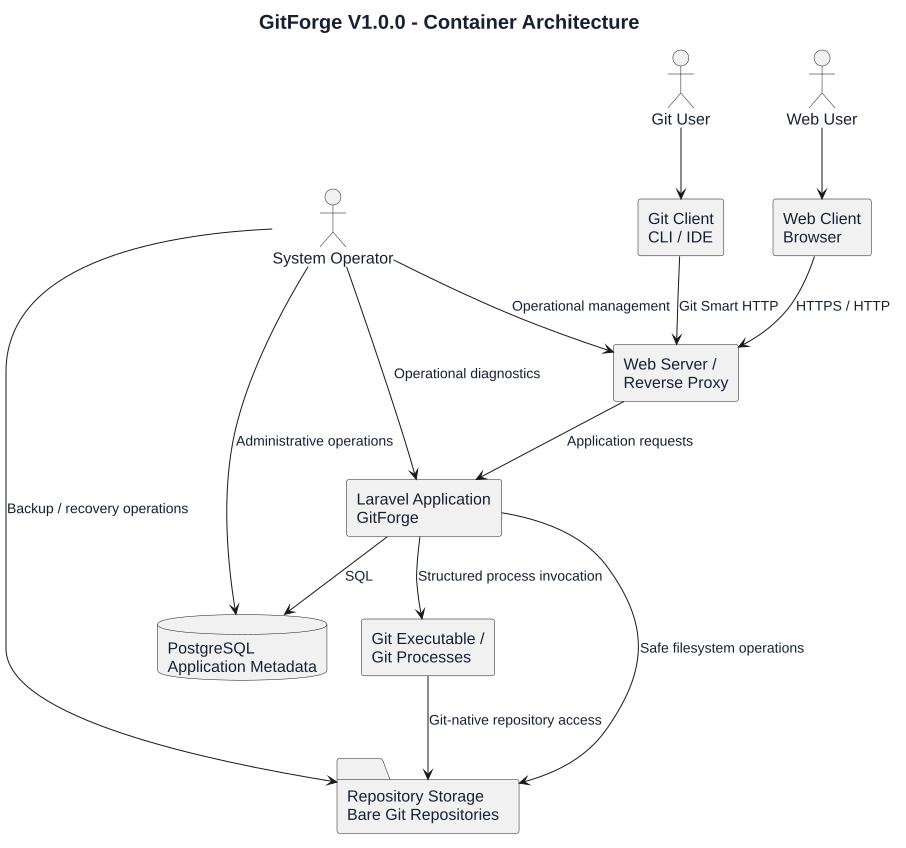
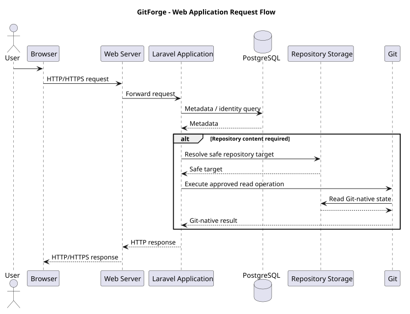
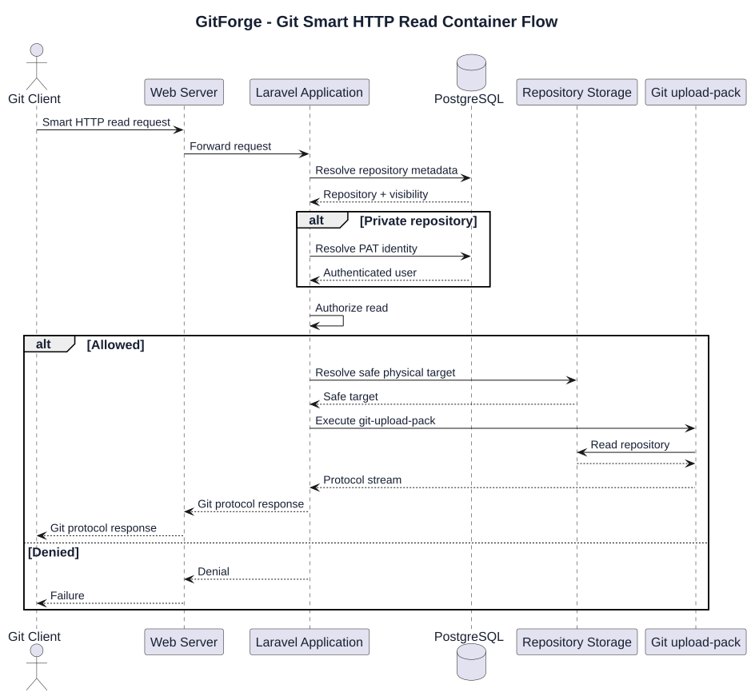
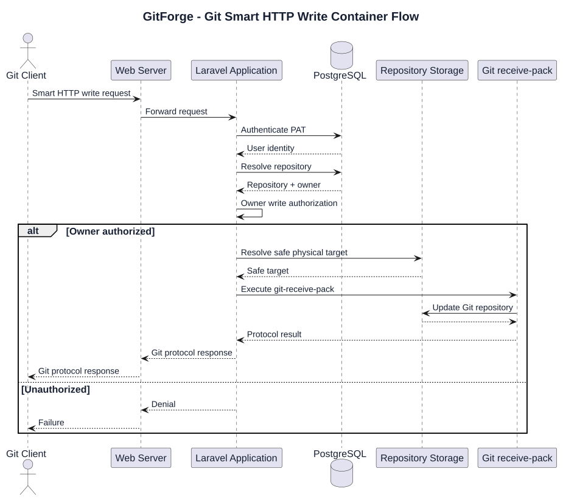
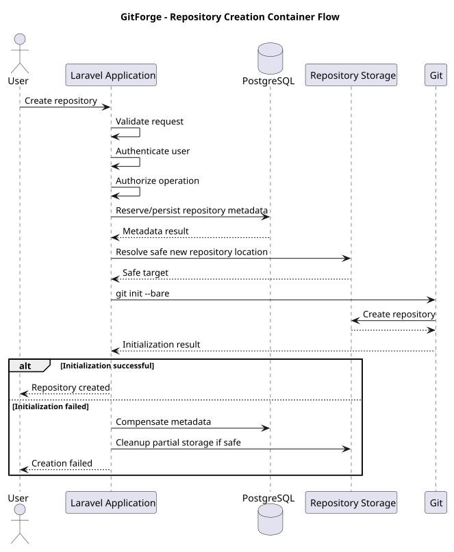
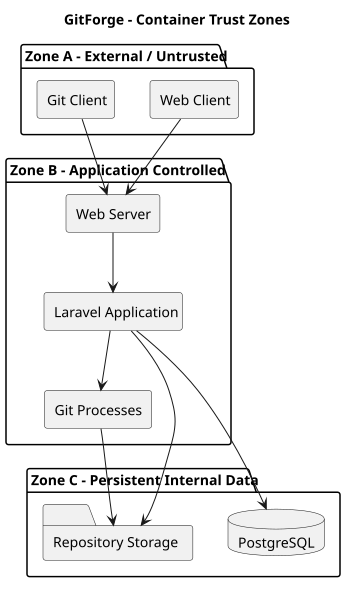
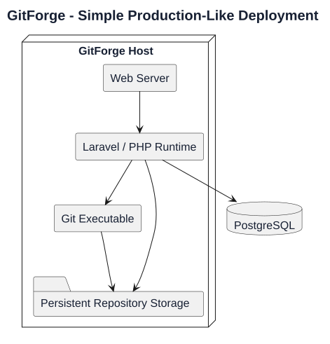

# GitForge V1.0.0 Container Architecture

## 1. Document Information

| Field | Value |

|---|---|

| Project | GitForge - Web Git Hosting Platform |

| Target release | V1.0.0 |

| Document | Container Architecture |

| SDLC phase | System Design |

| Milestone | M3 - System Design |

| Project owner | Farhad Valizadegan |

| Status | Approved |

| Last updated | 2026-08-18 |

---

## 2. Purpose

This document defines the runtime container architecture for GitForge V1.0.0.

It translates approved architecture decisions into a concrete container-level view covering:

```text

External actors

Web ingress

Laravel application runtime

PostgreSQL

Repository filesystem

Git executable/process boundary

Persistent storage

Trust boundaries

Network relationships

Primary data flows

Deployment responsibilities

```

The purpose is to define how the major runtime units collaborate without yet specifying detailed internal application components.

---

## 3. Architecture Level

This document describes:

```text

Container-level architecture

```

It does not yet define detailed:

```text

Controller classes

Service classes

Policies

Repositories

Database tables

Exact routes

Process wrapper classes

Frontend components

```

Those belong to later M3 artifacts.

---

## 4. Architecture Style

GitForge V1.0.0 uses:

```text

Modular Monolith

```

The primary application runs as one Laravel deployment unit.

Supporting runtime dependencies remain separate at the container level:

```text

PostgreSQL

Repository filesystem

Git executable/process environment

Web server / reverse proxy

```

---

## 5. Primary Containers

The V1.0.0 runtime consists of:

```text

C-01 Web Client

C-02 Git Client

C-03 Web Server / Reverse Proxy

C-04 Laravel Application

C-05 PostgreSQL Database

C-06 Repository Storage

C-07 Git Executable / Git Processes

```

---

# Container Overview

## 6. High-Level Container Model



[PlantUML source](diagrams/03-container-architecture-001.puml)

---

## 7. Container Responsibility Summary

| ID | Container | Primary Responsibility |

|---|---|---|

| C-01 | Web Client | Interactive browser access |

| C-02 | Git Client | Git clone/fetch/push operations |

| C-03 | Web Server / Reverse Proxy | HTTP ingress and request forwarding |

| C-04 | Laravel Application | Core application behavior and policy |

| C-05 | PostgreSQL | Authoritative application metadata |

| C-06 | Repository Storage | Persistent bare Git repository storage |

| C-07 | Git Executable / Processes | Git-native protocol and repository operations |

---

# C-01 — Web Client

## 8. Responsibility

The Web Client represents the user's browser.

It supports:

```text

Registration

Login

Logout

Repository management

Repository browsing

Visibility changes

PAT management

```

---

## 9. Trust Level

The Web Client is:

```text

Untrusted External

```

All incoming data must be validated.

---

## 10. Communication

Primary communication:

```text

Browser

   ↓

HTTP / HTTPS

   ↓

Web Server / Reverse Proxy

```

---

## 11. Authentication

Interactive browser authentication uses:

```text

Laravel session authentication

```

---

## 12. Security Constraints

The browser must not directly access:

```text

PostgreSQL

Repository filesystem

Git executable

Server configuration

Secrets

```

---

# C-02 — Git Client

## 13. Responsibility

The Git Client represents standard Git-compatible software such as:

```text

git CLI

IDE Git integration

Other Git Smart HTTP clients

```

---

## 14. Supported V1.0.0 Operations

The Git Client supports:

```text

Clone

Fetch

Push

```

through:

```text

Git Smart HTTP

```

---

## 15. Trust Level

The Git Client is:

```text

Untrusted External

```

Git protocol input must not be assumed safe.

---

## 16. Authentication

Git authentication uses:

```text

Personal Access Token

```

where authentication is required.

---

## 17. Communication

Primary path:

```text

Git Client

     ↓

Git Smart HTTP

     ↓

Web Server / Reverse Proxy

     ↓

Laravel Application

```

---

# C-03 — Web Server / Reverse Proxy

## 18. Responsibility

The Web Server / Reverse Proxy is the external HTTP ingress boundary.

Its responsibilities include:

```text

Accept HTTP/HTTPS requests

Forward application requests

Serve appropriate static assets where applicable

Enforce request-size and transport-level configuration

Integrate with PHP/Laravel runtime

Provide TLS termination in production deployment where configured

```

---

## 19. Candidate Technology

The concrete deployment may use:

```text

Nginx

Apache HTTP Server

```

The exact production selection is finalized in Deployment Design.

For current local development, Apache/XAMPP may be used.

---

## 20. Trust Boundary

The Web Server separates:

```text

Untrusted External Network

```

from:

```text

Application Runtime

```

---

## 21. Security Responsibilities

The Web Server must not:

```text

Expose repository storage directly

Expose .env files

Expose application secrets

Expose internal logs

Expose database ports publicly

Expose arbitrary filesystem paths

```

---

## 22. Git Smart HTTP Role

The Web Server forwards Git Smart HTTP requests to the Laravel application.

It does not independently decide repository authorization.

Authorization remains an application responsibility.

---

# C-04 — Laravel Application

## 23. Responsibility

The Laravel Application is the central runtime container.

It implements:

```text

HTTP routing

Session authentication

PAT authentication coordination

Repository resolution

Repository authorization

Repository management

Repository browsing

Git Smart HTTP coordination

Repository storage coordination

Git process execution coordination

Database access

Validation

Failure mapping

Logging

```

---

## 24. Architecture Role

The Laravel application is the:

```text

Application Policy Boundary

```

It decides whether a requested operation is allowed before protected resources are accessed.

---

## 25. Internal Modularity

Although deployed as one runtime container, the application is logically divided into components for:

```text

Authentication

Repository Management

Authorization

Repository Browser

PAT Management

Git Smart HTTP

Repository Storage

Git Process Execution

Persistence

Observability

Failure Handling

```

Detailed component design is defined in:

```text

04-component-design.md

```

---

## 26. Database Dependency

The Laravel application accesses PostgreSQL for:

```text

Users

Repositories

Ownership

Visibility

PAT metadata

PAT revocation state

Application timestamps

```

---

## 27. Repository Storage Dependency

The application accesses Repository Storage only through controlled internal storage behavior.

It must never use arbitrary client-supplied filesystem paths.

---

## 28. Git Dependency

The application invokes the approved Git executable through structured process execution.

The Laravel application does not reimplement Git object/protocol semantics.

---

## 29. Security Responsibilities

The Laravel application owns enforcement of:

```text

Authentication

Authorization

Input validation

Repository-name validation

Path safety

PAT verification

CSRF protection

Output safety

Git process restrictions

Sensitive logging restrictions

Failure mapping

```

---

# C-05 — PostgreSQL Database

## 30. Responsibility

PostgreSQL is authoritative for application metadata.

---

## 31. Authoritative Data

PostgreSQL stores:

```text

User identity records

Password verification data

Repository metadata

Repository owner relationship

Repository visibility

PAT metadata

PAT verification representation

PAT revocation state

Application timestamps

```

---

## 32. Non-Authoritative Git Data

PostgreSQL is not authoritative for:

```text

Git refs

Branches

Tags

Commits

Trees

Blobs

Repository history

File contents

Packfiles

```

---

## 33. Trust Level

PostgreSQL is:

```text

Trusted Internal Infrastructure

```

but application input reaching SQL still requires validated and parameterized access.

---

## 34. Connectivity

Only the application and authorized operational tooling should access the database.

Conceptually:

```text

Laravel Application

       ↓

PostgreSQL

```

Public direct database access is prohibited.

---

## 35. Persistence

PostgreSQL data must survive:

```text

Application restart

Web server restart

Deployment

Host process restart

```

---

# C-06 — Repository Storage

## 36. Responsibility

Repository Storage contains the authoritative physical Git repositories.

Repositories are stored as:

```text

Bare Git repositories

```

---

## 37. Repository Root

All hosted repositories exist beneath a configured root:

```text

GITFORGE_REPOSITORY_ROOT

```

The exact environment variable name may be finalized during implementation, but the architectural concept is mandatory.

---

## 38. Stored Data

Repository Storage contains Git-native data including:

```text

HEAD

refs

objects

packed-refs

config

hooks where intentionally controlled

Git object database

Packfiles

```

---

## 39. Authority

Repository Storage is authoritative for:

```text

Branches

Tags

Refs

Commits

Trees

Blobs

History

Repository file content

```

---

## 40. Persistence

Repository Storage must be persistent.

It must survive:

```text

Laravel process restart

Web server restart

Deployment

Application replacement

```

---

## 41. Trust Boundary

The storage root is a security boundary.

Any derived repository path outside the configured root is:

```text

Invalid

```

and must stop processing.

---

## 42. Direct External Access

Repository Storage must not be directly exposed through:

```text

Web server static-file serving

Public SMB/NFS access

Direct user filesystem access

Client-provided file paths

```

---

## 43. Accessors

Normal access is limited to:

```text

Laravel Repository Storage component

Git processes launched by GitForge

Authorized System Operator operations

```

---

# C-07 — Git Executable / Git Processes

## 44. Responsibility

The Git process container represents controlled operating-system Git execution launched by the application.

It provides Git-native behavior for:

```text

Repository initialization

Repository inspection

Branch/ref listing

Commit history

Commit details

Tree inspection

Blob retrieval

git-upload-pack

git-receive-pack

```

---

## 45. Process Boundary

Each Git invocation is a temporary process created by GitForge.

Conceptually:

```text

Laravel Application

       ↓

Controlled Process Invocation

       ↓

Git Executable

       ↓

Bare Repository

```

---

## 46. Approved Operations

Only explicitly approved operations may be executed.

Examples include:

```text

git init --bare

git upload-pack

git receive-pack

git rev-parse

git for-each-ref

git log

git show

git ls-tree

git cat-file

```

The exact command allowlist is finalized in:

```text

09-git-process-execution-design.md

```

---

## 47. Prohibited Execution Model

The application must not execute:

```text

Arbitrary shell commands

Client-provided executable names

Client-provided complete command strings

Unvalidated repository paths

```

---

## 48. Process Environment

Git subprocesses must use:

```text

Controlled executable

Controlled arguments

Controlled environment

Explicit timeout

Safe repository target

Controlled stdin

Controlled stdout

Controlled stderr

```

---

## 49. Git Process Trust

The Git executable itself is trusted infrastructure.

However:

```text

Git input is untrusted

Repository content is untrusted

Repository state may be corrupt

Process output may contain untrusted repository content

```

---

# Container Communication Model

## 50. Web Application Flow



[PlantUML source](diagrams/03-container-architecture-002.puml)

---

## 51. Git Read Flow



[PlantUML source](diagrams/03-container-architecture-003.puml)

---

## 52. Git Write Flow



[PlantUML source](diagrams/03-container-architecture-004.puml)

---

# Repository Creation Container Flow

## 53. Repository Creation

Repository creation spans:

```text

Laravel Application

PostgreSQL

Repository Storage

Git Executable

```

---

## 54. Creation Flow



[PlantUML source](diagrams/03-container-architecture-005.puml)

---

## 55. Creation Consistency Requirement

The final implementation must guarantee:

```text

No successful response

```

unless required metadata and physical repository initialization are both successful.

---

# Authentication Container Flows

## 56. Web Session Authentication

```text

Browser

    ↓

Web Server

    ↓

Laravel Application

    ↓

PostgreSQL

```

Laravel verifies account credentials and establishes session state.

---

## 57. Git PAT Authentication

```text

Git Client

    ↓

Web Server

    ↓

Laravel Application

    ↓

PostgreSQL

```

The Laravel application:

```text

Extracts credential

Resolves PAT candidate

Verifies PAT

Checks revocation

Resolves owner identity

```

Only after successful authentication may protected authorization occur.

---

# Authorization Boundaries

## 58. Read Authorization

Read authorization occurs inside:

```text

Laravel Application

```

before protected repository storage or Git-native content access.

---

## 59. Write Authorization

Write authorization occurs inside:

```text

Laravel Application

```

before:

```text

Repository Storage resolution

git-receive-pack execution

```

---

## 60. Metadata Mutation Authorization

Repository metadata mutation is authorized inside the Laravel application before PostgreSQL mutation.

---

# Container Trust Model

## 61. Trust Zones

The architecture contains three primary trust zones.

### Zone A — External / Untrusted

```text

Web Client

Git Client

Internet-supplied requests

Repository/user-controlled input

```

### Zone B — Application-Controlled

```text

Web Server

Laravel Application

Git process launcher

Application configuration

```

### Zone C — Persistent Internal Data

```text

PostgreSQL

Repository Storage

```

---

## 62. Trust-Zone Diagram



[PlantUML source](diagrams/03-container-architecture-006.puml)

---

# Network Architecture

## 63. External Network Exposure

Expected externally exposed interface:

```text

HTTP/HTTPS

```

for:

```text

Web UI

Application endpoints

Git Smart HTTP

```

---

## 64. Database Exposure

PostgreSQL should not be publicly exposed.

Preferred relationship:

```text

Application Network

       ↓

PostgreSQL

```

---

## 65. Repository Storage Exposure

Repository Storage has:

```text

No direct public network interface

```

in the V1.0.0 architecture.

---

## 66. Git Executable Exposure

Git executable has:

```text

No network listener

```

It is launched internally by the application.

---

# Deployment Profiles

## 67. Development Profile

A local development profile may place:

```text

Web Server

Laravel

PostgreSQL

Git

Repository Storage

```

on the same development machine.

Current environment may include:

```text

Windows

XAMPP

PHP

PostgreSQL

Git

```

---

## 68. Production-Like Profile

A simple V1.0.0 deployment may place application responsibilities on one server:

```text

Host

├── Web Server

├── PHP/Laravel

├── Git executable

├── Repository Storage

└── PostgreSQL

```

or separate PostgreSQL where operationally justified.

---

## 69. Production-Like Diagram



[PlantUML source](diagrams/03-container-architecture-007.puml)

---

## 70. Scaling Position

Independent service scaling is not a V1.0.0 requirement.

The modular monolith can initially scale vertically or through multiple application workers while sharing required persistent authorities.

Advanced distributed repository storage is deferred.

---

# Persistent Data Architecture

## 71. Persistent Authority A — PostgreSQL

Persistent application metadata includes:

```text

Users

Repositories

Ownership

Visibility

PAT records

PAT revocation state

```

---

## 72. Persistent Authority B — Git Repository Storage

Persistent Git-native data includes:

```text

Refs

Objects

Commits

Trees

Blobs

Packfiles

History

```

---

## 73. Backup Implication

A complete backup strategy must account for both:

```text

PostgreSQL

+

Repository Storage

```

Backing up only one is insufficient.

---

# Failure Boundaries

## 74. Web Server Failure

Effect:

```text

External service unavailable

```

Persistent PostgreSQL and repository data remain authoritative.

---

## 75. Laravel Application Failure

Effect:

```text

Application requests fail

Git Smart HTTP requests fail

```

Persistent data remains intact unless a concurrent operation was partially completed.

---

## 76. PostgreSQL Failure

Effect:

```text

Authentication may fail

Repository metadata resolution fails

Authorization-dependent operations fail

Metadata mutation fails

```

The application must not guess metadata from filesystem contents.

---

## 77. Repository Storage Failure

Effect:

```text

Repository creation may fail

Repository browser may fail

Git clone/fetch may fail

Git push may fail

```

Database metadata must not cause silent repository recreation.

---

## 78. Git Executable Failure

Effect:

```text

Git-native operation fails

```

Application metadata must not convert this into a false successful Git operation.

---

## 79. Partial Repository Creation Failure

If database metadata succeeds but physical Git initialization fails:

```text

Compensation is required

```

The application should attempt to restore a consistent state.

Detailed algorithm is defined later.

---

# Container Security Constraints

## 80. No Direct Database Access from Clients

```text

Web Client ─X→ PostgreSQL

Git Client ─X→ PostgreSQL

```

---

## 81. No Direct Repository Storage Access from Clients

```text

Web Client ─X→ Repository Storage

Git Client ─X→ Repository Storage

```

---

## 82. No Direct Git Process Access from Clients

```text

Web Client ─X→ Git Executable

Git Client ─X→ Git Executable

```

All Git access is mediated through GitForge application policy.

---

## 83. No Web Server Repository Publication

The repository root must not reside under a publicly served web document root.

---

## 84. Authorization Before Protected Access

Protected flow invariant:

```text

Identity

    ↓

Repository

    ↓

Authorization

    ↓

Storage

    ↓

Git

```

---

## 85. Fail-Closed Rule

If the application cannot safely establish:

```text

Repository identity

Authentication state

Authorization

Storage mapping

PAT validity

```

the protected operation must not continue.

---

# Configuration Boundaries

## 86. Application Configuration

Environment-specific configuration includes:

```text

APP_ENV

APP_KEY

Application URL

Database connection

Repository root

Git executable path

Git process timeout defaults

Logging configuration

```

---

## 87. Secrets

Secrets include:

```text

APP_KEY

Database password

Other deployment credentials

```

Secrets must not be committed to source control.

---

## 88. Non-Secret Configuration

Examples:

```text

Repository root path

Git executable path

Application environment

Timeout policy

Log level

```

These may still be security-sensitive operational values even when not cryptographic secrets.

---

# Observability Boundaries

## 89. Application Logging

Laravel Application emits structured diagnostics for:

```text

Authentication failures

Authorization denials where appropriate

Repository storage failures

Git execution failures

Database failures

Unexpected internal failures

```

---

## 90. Git Process Diagnostics

Git process diagnostics may capture safe:

```text

Operation type

Exit code

Execution duration

Repository logical identifier

Failure category

```

They must avoid plaintext credentials.

---

## 91. Request Correlation

Web and Git requests should support a request/correlation identifier so multi-container failure paths can be diagnosed.

---

# Health Boundaries

## 92. Application Health

A lightweight application health signal should confirm:

```text

Laravel runtime responds

```

---

## 93. Database Health

Operational health checks may verify:

```text

Database connectivity

```

without exposing credentials or detailed schema internals.

---

## 94. Repository Storage Health

Operational health may verify:

```text

Configured repository root exists

Expected access permissions are available

```

without enumerating private repositories publicly.

---

# Container Architecture Invariants

## 95. CAI-001 — Single Application Policy Boundary

```text

Laravel Application

=

Primary authentication and authorization policy boundary

```

---

## 96. CAI-002 — Metadata Authority

```text

PostgreSQL

=

Application metadata authority

```

---

## 97. CAI-003 — Git Authority

```text

Repository Storage

=

Git-native authority

```

---

## 98. CAI-004 — Git Execution

```text

Laravel Application

       ↓

Controlled Git Process

```

Only this path is permitted for normal application Git execution.

---

## 99. CAI-005 — Storage Containment

```text

Every repository target

∈

Configured Repository Root

```

---

## 100. CAI-006 — Client Isolation

Clients cannot directly access internal data or Git infrastructure.

---

## 101. CAI-007 — Authentication/Authorization Separation

```text

Authentication

≠

Authorization

```

---

## 102. CAI-008 — Public Read

Public repository read may proceed without authenticated identity.

---

## 103. CAI-009 — Private Read

Private repository read requires authenticated owner identity.

---

## 104. CAI-010 — Write

Repository write requires authenticated owner identity.

---

## 105. CAI-011 — Persistent Authorities

```text

PostgreSQL

+

Repository Storage

```

are both persistent.

---

## 106. CAI-012 — No False Success

Infrastructure failure must not result in successful operation reporting.

---

# Container Responsibilities Matrix

## 107. Responsibility Matrix

| Capability | Web Client | Git Client | Web Server | Laravel | PostgreSQL | Repo Storage | Git |

|---|---:|---:|---:|---:|---:|---:|---:|

| Registration UI | X |  |  | X | X |  |  |

| Login | X |  | X | X | X |  |  |

| Session auth | X |  | X | X | X |  |  |

| PAT auth |  | X | X | X | X |  |  |

| Repository metadata |  |  |  | X | X |  |  |

| Repository authorization |  |  |  | X | X |  |  |

| Repository creation | X |  | X | X | X | X | X |

| Repository browser | X |  | X | X |  | X | X |

| Clone/fetch |  | X | X | X | X | X | X |

| Push |  | X | X | X | X | X | X |

| PAT creation | X |  | X | X | X |  |  |

| PAT revocation | X |  | X | X | X |  |  |

| Git-native state |  |  |  |  |  | X | X |

| Application metadata |  |  |  | X | X |  |  |

---

# Container Dependency Rules

## 108. Rule CD-001

The Web Server may depend on the Laravel application.

It must not implement domain authorization.

---

## 109. Rule CD-002

Laravel may depend on PostgreSQL.

PostgreSQL does not depend on Laravel.

---

## 110. Rule CD-003

Laravel may depend on Repository Storage through explicit storage behavior.

Repository Storage does not call application logic.

---

## 111. Rule CD-004

Laravel may launch Git processes.

Git processes do not bypass application authorization before launch.

---

## 112. Rule CD-005

Git processes may access only the repository target supplied through the safe internal process path.

---

## 113. Rule CD-006

External clients communicate only through HTTP-facing ingress.

---

# Container Scope Preservation

## 114. Excluded Runtime Containers

The V1.0.0 architecture does not require:

```text

Redis

Message broker

Queue worker cluster

Search engine

Object storage service

Separate identity service

Separate authorization service

Separate Git storage service

SSH daemon for Git

CI runner

Artifact registry

Analytics platform

Kubernetes

Service mesh

Event bus

```

---

## 115. Future Extraction Possibility

Although not required now, explicit component boundaries may allow future extraction of:

```text

Git storage

Git process execution

Authentication

Background processing

```

if later requirements justify it.

This is not part of V1.0.0 design.

---

# Architecture Decision Alignment

## 116. ADR Alignment

This container architecture implements major decisions from:

```text

ADR-001 Modular Monolith

ADR-002 Laravel Framework

ADR-003 PostgreSQL

ADR-004 Git-Native State Outside PostgreSQL

ADR-005 Bare Repositories

ADR-006 Logical/Physical Separation

ADR-007 Repository Root

ADR-008 Git Executable

ADR-009 No Arbitrary Shell

ADR-010 Git Smart HTTP

ADR-011 Separate Git Read/Write

ADR-012 Session Authentication

ADR-013 PAT Authentication

ADR-016 Central Authorization

ADR-017 Authorization Before Storage

ADR-024 Repository Storage Component

ADR-025 Git Process Component

ADR-026 Creation Compensation

ADR-033 Streaming Preference

ADR-034 Git Timeout

ADR-035 Controlled Environment

ADR-036 Fail-Closed Architecture

ADR-039 Structured Logging

ADR-049 Small Runtime Model

ADR-050 Persistent Repository Storage

ADR-051 Persistent PostgreSQL

ADR-052 Deployment Secrets

ADR-053 Health Verification

ADR-054 Dual-Authority Backup

ADR-055 No Mandatory Redis

ADR-056 No Mandatory Queue

ADR-069 No Separate Identity Service

ADR-070 No Separate Git Storage Service

```

---

# Requirements and Analysis Alignment

## 117. Requirements Alignment

The container architecture supports:

```text

Web authentication

Repository management

Repository browser

Public/private visibility

PAT lifecycle

Git clone

Git fetch

Git push

Owner-only write

Public anonymous read

Private owner-only read

```

Result:

```text

PASS

```

---

## 118. System Analysis Alignment

The architecture preserves M2 conclusions for:

```text

System boundary

Authentication

Authorization

Repository lifecycle

Repository browser

Git Smart HTTP

PAT authentication

Storage

Data authority

Trust boundaries

Failure handling

```

Result:

```text

PASS

```

---

# Container Validation

## 119. Boundary Validation

External and internal boundaries are explicitly identified.

Result:

```text

PASS

```

---

## 120. Authority Validation

Application metadata and Git-native authorities are separated.

Result:

```text

PASS

```

---

## 121. Authorization Validation

All protected storage/Git paths pass through Laravel authorization.

Result:

```text

PASS

```

---

## 122. Storage Validation

Repository Storage is persistent, internal, and root-contained.

Result:

```text

PASS

```

---

## 123. Process Validation

Git execution is mediated by the Laravel application and has no direct external network exposure.

Result:

```text

PASS

```

---

## 124. Deployment Simplicity Validation

The architecture can run on a small number of runtime units without requiring distributed infrastructure.

Result:

```text

PASS

```

---

## 125. Scope Validation

Unapproved mandatory containers introduced:

```text

0

```

Result:

```text

PASS

```

---

# Completion

## 126. Completion Criteria

This container architecture is complete when:

- all major external actors are represented;

- web and Git clients are separated;

- ingress boundary is defined;

- Laravel application boundary is defined;

- PostgreSQL container responsibility is defined;

- repository-storage responsibility is defined;

- Git process boundary is defined;

- primary communication paths are defined;

- authentication paths are defined;

- authorization ordering is defined;

- repository creation cross-container flow is defined;

- Git read flow is defined;

- Git write flow is defined;

- trust zones are defined;

- network exposure rules are defined;

- persistence responsibilities are defined;

- failure boundaries are defined;

- security constraints are defined;

- observability responsibilities are defined;

- health boundaries are defined;

- architecture decisions are preserved;

- approved V1.0.0 scope remains preserved.

---

## 127. Container Architecture Result

Container architecture status:

```text

DEFINED

```

Blocking container architecture gaps:

```text

0

```

Readiness for component design:

```text

READY

```

Next design artifact:

```text

04-component-design.md

```

---

## 128. Document Status

This document is currently:

```text

Approved

```

It will be changed to:

```text

Approved

```

after container responsibilities, communication paths, trust boundaries, persistence, failure boundaries, deployment relationships, security constraints, and architecture alignment have been reviewed.
