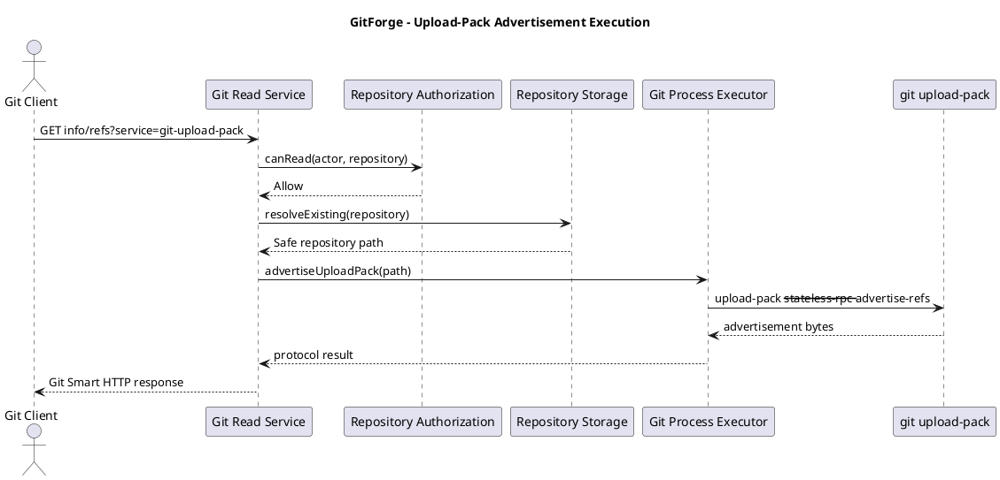
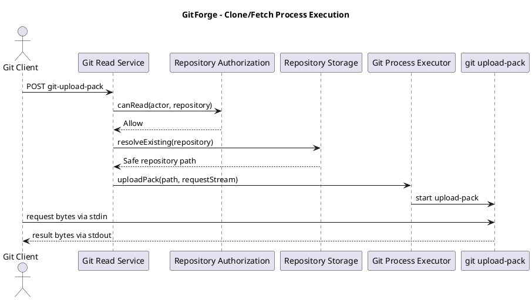
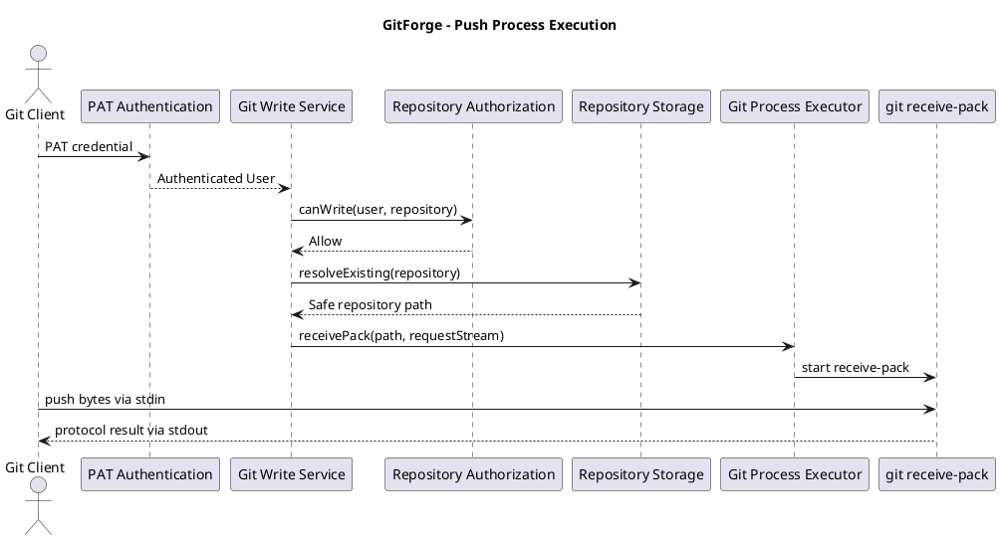
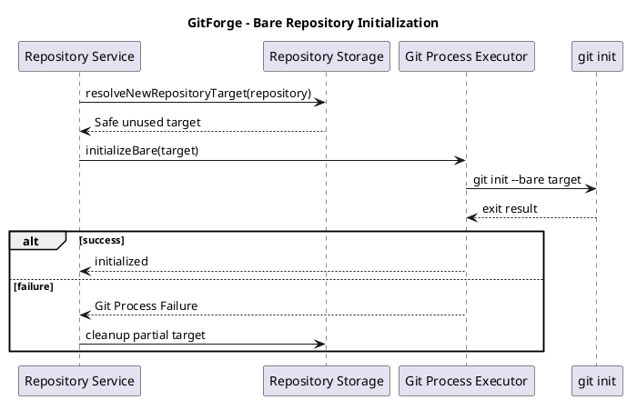

# GitForge V1.0.0 Git Process Execution Design

## 1. Document Information

| Field | Value |

|---|---|

| Project | GitForge - Web Git Hosting Platform |

| Target release | V1.0.0 |

| Document | Git Process Execution Design |

| SDLC phase | System Design |

| Milestone | M3 - System Design |

| Project owner | Farhad Valizadegan |

| Status | Approved |

| Last updated | 2026-08-18 |

---

## 2. Purpose

This document defines the implementation-ready design for executing Git-native operations inside GitForge V1.0.0.

It translates approved:

```text

Requirements

System Analysis

Architecture Decisions

Container Architecture

Component Design

API Specification

Authorization Design

Repository Storage Design

```

into a controlled execution model for:

```text

Bare repository initialization

Git Smart HTTP read operations

Git Smart HTTP write operations

Repository browser reads

Git process construction

Argument handling

Standard input/output handling

Timeouts

Environment control

Failure classification

Process termination

Security boundaries

Logging

```

---

## 3. Design Objective

GitForge must use the system Git executable without exposing arbitrary command execution.

The primary invariant is:

```text

User Input

≠

Executable Command

```

Only explicitly approved Git operations may be executed.

---

## 4. Git Process Role

The Git Process Execution component is the exclusive normal application boundary for launching Git-native processes.

It receives:

```text

Approved operation

Validated repository path

Validated operation-specific arguments

Controlled environment

```

and returns:

```text

Structured execution result

or

Protocol stream

```

---

## 5. Responsibility Separation

The Git Process Execution component does not decide:

```text

Authentication

Authorization

Repository ownership

Repository visibility

Physical repository mapping

```

These decisions occur before process execution.

---

## 6. Upstream Preconditions

Before any protected Git operation:

```text

Repository metadata resolved

Authorization completed

Repository Storage returned safe path

Requested Git operation classified

Input validated

```

---

# Git Executable

## 7. Executable Configuration

The Git executable is deployment-controlled configuration.

Conceptually:

```text

GITFORGE_GIT_BINARY

```

Example Windows development path:

```text

C:\\Program Files\\Git\\cmd\\git.exe

```

Example Linux path:

```text

/usr/bin/git

```

---

## 8. Executable Trust

The configured Git binary is:

```text

Trusted Deployment Configuration

```

It is not supplied by:

```text

HTTP input

Repository metadata

PAT input

Git protocol data

Repository content

```

---

## 9. Executable Validation

07-deployment/startup validation should confirm that the configured executable:

```text

Exists

Is executable by the runtime

Is the intended Git executable

Can report a supported Git version

```

---

# Execution Architecture

## 10. Process Boundary

Conceptually:

```text

Application Service

       ↓

Git Process Executor

       ↓

Operating System Process API

       ↓

Configured Git Executable

       ↓

Validated Repository

```

---

## 11. No Shell Requirement

GitForge must launch the executable directly.

It must not normally execute through:

```text

cmd.exe /c

powershell -Command

sh -c

bash -c

```

---

## 12. Why Shell Execution Is Prohibited

Shell execution creates unnecessary command-injection risk through:

```text

Quoting

Escaping

Metacharacters

Environment expansion

Command chaining

Redirection

Substitution

```

---

## 13. Structured Arguments

Arguments must be supplied as structured process arguments.

Conceptually:

```text

Executable:

git

Arguments:

\[

   "upload-pack",

   "--stateless-rpc",

   "<safe-repository-path>"

]

```

not:

```text

"git upload-pack --stateless-rpc " + userInput

```

---

# Approved Git Operations

## 14. Operation Allowlist

V1.0.0 permits only predefined operation categories:

```text

INIT_BARE

UPLOAD_PACK_ADVERTISE

UPLOAD_PACK_RPC

RECEIVE_PACK_ADVERTISE

RECEIVE_PACK_RPC

LIST_REFS

COMMIT_HISTORY

COMMIT_DETAILS

TREE_LIST

BLOB_READ

REPOSITORY_VERIFY

```

No arbitrary operation name may be supplied by a client.

---

## 15. INIT_BARE

Purpose:

```text

Create a new bare repository

```

Conceptual command:

```text

git init --bare <safe-target>

```

Used only during approved repository creation.

---

## 16. UPLOAD_PACK_ADVERTISE

Purpose:

```text

Advertise Git Smart HTTP read capabilities and refs

```

Conceptual execution:

```text

git upload-pack --stateless-rpc --advertise-refs <safe-repository-path>

```

---

## 17. UPLOAD_PACK_RPC

Purpose:

```text

Serve Git Smart HTTP clone/fetch request

```

Conceptual execution:

```text

git upload-pack --stateless-rpc <safe-repository-path>

```

Git request body is supplied to process standard input.

Process standard output becomes Git protocol response payload.

---

## 18. RECEIVE_PACK_ADVERTISE

Purpose:

```text

Advertise Git Smart HTTP write capabilities and refs

```

Conceptual execution:

```text

git receive-pack --stateless-rpc --advertise-refs <safe-repository-path>

```

---

## 19. RECEIVE_PACK_RPC

Purpose:

```text

Serve Git Smart HTTP push request

```

Conceptual execution:

```text

git receive-pack --stateless-rpc <safe-repository-path>

```

Request body is supplied to process standard input.

Process standard output becomes Git protocol response payload.

---

# Repository Browser Operations

## 20. Browser Design Principle

Repository Browser operations use Git-native object/ref inspection.

They must not parse Git internal files manually where Git provides a safe supported command.

---

## 21. LIST_REFS

Purpose:

```text

List repository branches

```

Preferred command family:

```text

git for-each-ref

```

Example conceptual invocation:

```text

git --git-dir=<safe-repository-path> for-each-ref refs/heads

```

with controlled formatting.

---

## 22. COMMIT_HISTORY

Purpose:

```text

Retrieve bounded commit history

```

Preferred command family:

```text

git log

```

or:

```text

git rev-list

```

with explicitly controlled output format and bounds.

---

## 23. COMMIT_DETAILS

Purpose:

```text

Retrieve one resolved commit's metadata

```

Preferred command family:

```text

git show

```

or equivalent plumbing-oriented Git commands.

---

## 24. TREE_LIST

Purpose:

```text

List entries in a tree

```

Preferred command:

```text

git ls-tree

```

---

## 25. BLOB_READ

Purpose:

```text

Read a Git object representing file/blob content

```

Preferred command family:

```text

git cat-file

```

---

## 26. REPOSITORY_VERIFY

Purpose:

```text

Determine whether the repository is structurally recognized by Git

```

Possible controlled operations include:

```text

git rev-parse

git fsck

```

depending on verification depth.

Expensive integrity scans are not required for every request.

---

# Repository Argument Model

## 27. Repository Path Source

Repository path must come only from:

```text

Repository Storage

```

after:

```text

Internal mapping

Normalization

Root containment

Expected-state validation

```

---

## 28. No Client Repository Path

The following must never become authoritative process arguments:

```text

Client filesystem path

URL path concatenated directly to repository root

Query parameter representing server path

Request body representing server path

```

---

## 29. Git Directory Selection

For browser operations, the executor may use either:

```text

--git-dir=<safe-path>

```

or an equivalent direct repository-target mechanism.

The path is always internally derived.

---

# Untrusted Git Identifiers

## 30. Ref Inputs

Inputs such as:

```text

main

refs/heads/main

commit SHA

tag name

```

must be treated as untrusted.

---

## 31. Ref Validation

The executor or an upstream validation component must reject identifiers that cannot safely participate in the intended operation.

Where practical, Git-native validation should be used.

---

## 32. Revision Ambiguity

Untrusted revision identifiers must not accidentally become Git options.

For operations accepting revision arguments, implementation should use:

```text

--

```

where supported and appropriate, or otherwise use command-specific option separation and validation.

---

## 33. Option Injection

User-controlled values beginning with:

```text

-

```

must not be allowed to become command-line options.

---

## 34. Tree Paths

Repository tree paths are:

```text

Git-internal paths

```

not host filesystem paths.

They remain untrusted input and must only be used in commands intended to resolve Git tree/blob content.

---

# Standard Input

## 35. Smart HTTP Request Body

For:

```text

UPLOAD_PACK_RPC

RECEIVE_PACK_RPC

```

the HTTP request body is streamed or supplied to process standard input.

---

## 36. Request Body Is Data

Git protocol request bytes must never be interpreted as:

```text

Shell input

Command arguments

Environment variables

Filesystem paths

```

---

## 37. Input Size Control

The implementation should enforce operational limits appropriate to:

```text

Request body size

Execution time

Resource availability

```

without violating Git protocol correctness.

---

# Standard Output

## 38. Smart HTTP Output

For Git protocol operations:

```text

Process stdout

       ↓

Git Smart HTTP response body

```

subject to required protocol framing at the HTTP layer.

---

## 39. Browser Output

For repository-browser commands, stdout is parsed into structured application data.

Examples:

```text

Branch records

Commit records

Tree entries

Blob bytes

```

---

## 40. Output Is Untrusted

Git-generated output may include repository-controlled values such as:

```text

Commit message

Author name

Author email

Ref name

File path

Blob content

```

These remain untrusted after process execution.

---

# Standard Error

## 41. stderr Handling

Process stderr is captured separately from stdout.

---

## 42. stderr Is Internal Diagnostic Data

Raw stderr should not normally be returned directly to end users.

---

## 43. Protocol Consideration

For Smart HTTP operations, failure handling must preserve valid Git/HTTP behavior.

Application wrappers must not blindly prepend arbitrary text to Git protocol output.

---

# Process Environment

## 44. Controlled Environment

Git subprocesses should run with an explicitly controlled environment.

---

## 45. Environment Objectives

The process environment should minimize dependence on:

```text

Interactive shell state

User profile configuration

Global Git aliases

Unexpected credential helpers

Editor configuration

Pager configuration

Locale-dependent output

```

---

## 46. Non-Interactive Execution

Git subprocesses must not require interactive prompts.

The environment should disable or avoid interactive credential and editor behavior.

---

## 47. Pager

Pager behavior must be disabled for machine-readable operations.

Conceptually:

```text

GIT_PAGER=cat

```

or equivalent process configuration.

---

## 48. Terminal Prompt

GitForge must not rely on terminal prompts.

Conceptually:

```text

GIT_TERMINAL_PROMPT=0

```

where applicable.

---

## 49. Locale

Machine-parsed command output should use a predictable locale where needed.

Structured/custom formatting should be preferred over parsing human-readable localized text.

---

## 50. Git Configuration Isolation

Execution should avoid unintended dependency on user-global Git configuration where this could change security or behavior.

Deployment-level system configuration must be controlled.

---

# Working Directory

## 51. Working Directory Rule

GitForge must not rely on arbitrary current working directory state.

Each operation explicitly identifies its repository or controlled working context.

---

## 52. Application Directory Separation

Repository operations must not implicitly execute against the GitForge application's own source repository.

---

# Timeouts

## 53. Timeout Requirement

Every Git subprocess must have an explicit timeout policy.

---

## 54. Timeout Classes

Different operation classes may use different limits:

```text

Short metadata reads

Repository initialization

Clone/fetch RPC

Push RPC

Integrity verification

```

---

## 55. Example Initial Policy

Conceptual initial limits:

```text

Simple browser read      → short timeout

Repository init          → short timeout

Ref advertisement        → moderate timeout

Clone/fetch RPC          → longer timeout

Push RPC                 → longer timeout

Deep verification        → operational/background only

```

Exact seconds are implementation/configuration decisions.

---

## 56. Timeout Result

A process timeout must produce:

```text

Git Process Timeout

```

and must not return false success.

---

## 57. Process Termination

When timeout occurs:

```text

Terminate process

Release associated resources

Close streams

Record safe diagnostic data

Return failure

```

Child-process handling must be appropriate to the operating system.

---

# Concurrency

## 58. Concurrent Reads

Git supports concurrent repository read operations.

GitForge should not introduce a global read lock.

---

## 59. Concurrent Pushes

Git-native receive-pack behavior manages repository ref update concurrency.

GitForge must preserve Git's result rather than falsely reporting success.

---

## 60. Create Concurrency

Repository creation additionally relies on:

```text

Database namespace uniqueness

Unique internal repository ID

Target-absence verification

```

---

## 61. Application Locks

V1.0.0 does not require a distributed application-level lock service.

---

# Streaming

## 62. Smart HTTP Streaming

Clone, fetch, and push may involve large payloads.

The implementation should stream:

```text

HTTP request body → Git stdin

Git stdout → HTTP response

```

rather than buffering the entire payload in application memory.

---

## 63. Memory Safety

The execution design should prevent process output/input from causing unnecessary unbounded application memory growth.

---

## 64. Browser Blob Limits

Repository-browser file/blob views should enforce practical size limits.

Very large blobs should not be blindly loaded into memory for HTML rendering.

---

# Smart HTTP Read Flow

## 65. Upload-Pack Discovery Flow



---

## 66. Upload-Pack RPC Flow



---

# Smart HTTP Write Flow

## 67. Receive-Pack Flow



---

# Repository Initialization Flow

## 68. Bare Initialization



---

# Repository Browser Execution

## 69. Branch Listing

Conceptually:

```text

Repository Browser Service

       ↓

AUTH-READ

       ↓

Repository Storage

       ↓

Git Process Executor

       ↓

for-each-ref

```

---

## 70. Branch Output Format

The command should use an explicit machine-readable format rather than human-oriented default output.

---

## 71. Commit History

A bounded command should request:

```text

Commit ID

Parents where needed

Author

Committer

Timestamps

Commit message

```

using controlled formatting.

---

## 72. Commit Detail

Commit detail execution must resolve the requested commit safely and distinguish:

```text

Valid commit

Unknown object/ref

Wrong object type

Git failure

```

---

## 73. Tree Listing

Tree listing should use:

```text

git ls-tree

```

with explicit object/ref selection.

---

## 74. Blob Reading

Blob reading should use:

```text

git cat-file

```

or equivalent safe Git plumbing.

Binary data must remain byte-safe.

---

# Process Result Model

## 75. Structured Result

Non-streaming operations may return conceptually:

```text

GitProcessResult

{

     operation

     exitCode

     stdout

     stderr

     duration

     timedOut

}

```

---

## 76. Streaming Result

Streaming Smart HTTP operations require a different abstraction.

Conceptually:

```text

GitStreamingProcess

{

     stdin

     stdout

     stderr

     processHandle

     completion

}

```

---

## 77. Exit Code

A non-zero Git exit code normally means:

```text

Git Process Failure

```

unless the specific operation defines the condition as an expected negative result.

---

## 78. No Exit-Code Ignoring

The application must not infer success solely because some stdout was produced.

---

# Failure Classification

## 79. Executor Configuration Failure

Examples:

```text

Git binary missing

Git binary not executable

Invalid deployment configuration

```

Classification:

```text

Infrastructure Failure

```

---

## 80. Process Start Failure

Examples:

```text

OS denied execution

Executable unavailable

Resource exhaustion

```

Classification:

```text

Git Process Start Failure

```

---

## 81. Timeout

Classification:

```text

Git Process Timeout

```

---

## 82. Non-Zero Exit

Classification:

```text

Git Process Failure

```

with operation-specific sub-classification where useful.

---

## 83. Repository Missing

If Repository Storage already identified a missing repository:

```text

Git process should not be started

```

---

## 84. Repository Corruption

If Git indicates repository corruption:

```text

Repository/Git Failure

```

This must remain distinct from authorization failure.

---

## 85. Invalid Revision

If a browser request references a non-existent commit/ref:

```text

Git Object/Ref Not Found

```

which may map to an application-level 404.

---

## 86. Push Rejection

Normal Git push rejection examples:

```text

Non-fast-forward

Invalid ref update

Receive-pack policy rejection

```

must remain Git-native failure semantics.

They must not be transformed into:

```text

Authentication Failure

```

or:

```text

Authorization Denial

```

after authorization has succeeded.

---

# Security Design

## 87. No Arbitrary Commands

No API accepts:

```text

Git subcommand

Executable name

Command line

Shell expression

```

from the client.

---

## 88. No Arbitrary Options

No client may inject arbitrary Git options into an approved operation.

---

## 89. No Shell Metacharacter Interpretation

Because no shell is used, strings such as:

```text

;

\&\&

||

|

>

<

$()

``

```

remain data rather than shell syntax.

---

## 90. Safe Path Requirement

No Git process starts without a repository path approved by Repository Storage.

---

## 91. Authorization Requirement

No protected Git process starts before authorization.

---

## 92. Untrusted Repository Content

Repository contents remain untrusted.

GitForge does not execute:

```text

Repository scripts

Checked-in executables

Build definitions

User Git hooks

```

as part of V1.0.0 repository operations.

---

## 93. Hook Safety

User-controlled repository content must not become server-side executable Git hooks.

---

## 94. Environment Secret Safety

Sensitive deployment secrets should not be unnecessarily inherited by Git subprocesses.

---

## 95. Process Privilege

Git processes execute with the same controlled service-level privilege or another explicitly configured least-privileged runtime identity.

They do not require administrator/root privileges.

---

# Logging

## 96. Execution Logging

Safe metadata may include:

```text

Correlation ID

Repository ID

Operation type

Process start time

Duration

Exit code

Timeout status

Failure category

```

---

## 97. Command Logging

Logging may record the approved operation name.

It should avoid exposing sensitive full raw command data where unnecessary.

---

## 98. Credentials

Never log:

```text

PAT

Password

Authorization header

Session secret

```

---

## 99. Git Protocol Payload

Do not log complete clone/fetch/push request or response payloads by default.

---

## 100. Repository Content

Do not log arbitrary blob contents, commit bodies, or repository file data merely because Git produced them.

---

## 101. stderr Logging

stderr may be logged internally in bounded/sanitized form when needed for diagnosis.

It must not contain credentials or unsafe uncontrolled volume.

---

# Resource Control

## 102. Process Count

The runtime should avoid uncontrolled subprocess creation.

Implementation may apply:

```text

Web server concurrency limits

Application-level process limits

Infrastructure limits

```

---

## 103. Large Clone/Fetch

Large Git transfers may consume:

```text

CPU

Disk I/O

Network

Process time

```

Operational limits should be observable and configurable.

---

## 104. Large Push

Pushes may consume:

```text

Temporary object storage

CPU

Disk

Network

Lock time

```

A storage-full or Git failure must propagate as failure.

---

# Configuration

## 105. Git Configuration Set

Relevant centralized application configuration may include:

```text

Git binary path

Repository root

Default process timeout

Smart HTTP timeout

Browser read timeout

Maximum browser blob size

Environment controls

```

---

## 106. Configuration Source

Security-critical process configuration comes from:

```text

07-deployment/application configuration

```

not client input.

---

## 107. Configuration Failure

Invalid critical configuration should fail clearly during startup or health validation where practical.

---

# Health Validation

## 108. Git Executable Health

Health diagnostics may verify:

```text

Configured Git binary exists

Process can start

Git version can be queried

```

---

## 109. Repository Root Health

Repository root health is owned primarily by Repository Storage but contributes to Git execution readiness.

---

## 110. No Destructive Health Check

Health checks must not mutate actual user repositories.

---

# Git Version

## 111. Version Observability

The deployed Git version should be observable operationally.

---

## 112. Version Compatibility

GitForge V1.0.0 should document and test against the Git version used in its target deployment environment.

Exact minimum supported Git version can be fixed during 05-implementation/Deployment validation.

---

# Process Execution Interface

## 113. Conceptual Service

A possible implementation abstraction:

```php

final class GitProcessExecutor

{

     public function initializeBare(string $repositoryPath): GitProcessResult;

     public function advertiseUploadPack(

         string $repositoryPath

     ): GitProcessResult;

     public function uploadPack(

         string $repositoryPath,

         mixed $inputStream

     ): mixed;

     public function advertiseReceivePack(

         string $repositoryPath

     ): GitProcessResult;

     public function receivePack(

         string $repositoryPath,

         mixed $inputStream

     ): mixed;

     public function listBranches(

         string $repositoryPath

     ): array;

     public function commitHistory(

         string $repositoryPath,

         string $ref,

         int $limit

     ): array;

     public function commitDetails(

         string $repositoryPath,

         string $commit

     ): array;

     public function listTree(

         string $repositoryPath,

         string $ref,

         string $path

     ): array;

     public function readBlob(

         string $repositoryPath,

         string $object

     ): mixed;

}

```

This is illustrative and may be refined during implementation.

---

## 114. Typed Operation Objects

Implementation may further improve safety by representing operations using dedicated request objects instead of raw arrays/string commands.

---

# Git Process Invariants

## 115. GPI-001 — Controlled Executable

```text

Only configured Git executable is launched

```

---

## 116. GPI-002 — Allowlisted Operations

```text

Only approved Git operation types may execute

```

---

## 117. GPI-003 — No Shell

```text

GitForge does not use a shell

for normal Git process execution

```

---

## 118. GPI-004 — Structured Arguments

```text

Arguments are passed structurally

```

---

## 119. GPI-005 — Safe Repository Path

```text

Every repository path comes from

Repository Storage

```

---

## 120. GPI-006 — Authorization Before Git

```text

Protected operation

requires authorization

before process start

```

---

## 121. GPI-007 — Explicit Timeout

```text

Every Git process has timeout policy

```

---

## 122. GPI-008 — Non-Interactive

```text

Git process execution requires no terminal interaction

```

---

## 123. GPI-009 — Output Untrusted

```text

Git output derived from repository content

remains untrusted

```

---

## 124. GPI-010 — No False Success

```text

Process failure

cannot become

successful application result

```

---

## 125. GPI-011 — No Credential Logging

```text

Sensitive authentication values

are excluded from process logs

```

---

## 126. GPI-012 — Protocol Preservation

```text

Smart HTTP process streams

preserve Git protocol semantics

```

---

# Operation Matrix

## 127. Operation Design Matrix

| Operation | Git Command Family | Repository Access | Streaming | Mutation |

|---|---|---|---:|---:|

| Bare initialization | `git init --bare` | New target | No | Yes |

| Read advertisement | `git upload-pack --advertise-refs` | Existing | No/Small stream | No |

| Clone/fetch RPC | `git upload-pack --stateless-rpc` | Existing | Yes | No |

| Write advertisement | `git receive-pack --advertise-refs` | Existing | No/Small stream | No |

| Push RPC | `git receive-pack --stateless-rpc` | Existing | Yes | Yes |

| Branch list | `git for-each-ref` | Existing | No | No |

| Commit history | `git log` / `git rev-list` | Existing | No | No |

| Commit detail | `git show` / plumbing | Existing | No | No |

| Tree list | `git ls-tree` | Existing | No | No |

| Blob read | `git cat-file` | Existing | No/Bounded | No |

| Repository verify | `git rev-parse` / controlled verification | Existing | No | No |

---

# Failure Matrix

## 128. Failure Matrix

| Condition | Start Process? | Result |

|---|---:|---|

| Authorization denied | No | Authorization failure |

| Unsafe repository path | No | Security failure |

| Repository missing | No | Consistency/not-found failure |

| Git binary missing | No/Start fails | Infrastructure failure |

| Timeout | Yes | Git process timeout |

| Non-zero exit | Yes | Git process failure |

| Invalid commit/ref | Yes or prevalidated | Object/ref not found |

| Push rejected by Git | Yes | Git-native rejection |

| Storage full during push | Yes | Git/storage failure |

---

# Testing Design

## 129. Command Injection Tests

Verify that malicious inputs cannot inject:

```text

Additional Git options

Additional commands

Shell commands

Filesystem paths

```

---

## 130. Repository Path Tests

Verify:

```text

Only Repository Storage paths accepted

Unsafe paths rejected

Outside-root paths rejected

```

---

## 131. Timeout Tests

Verify:

```text

Long-running process is terminated

Failure returned

No false success

Resources released

```

---

## 132. Exit-Code Tests

Verify non-zero exit values are classified correctly.

---

## 133. Git Smart HTTP Tests

Verify:

```text

Advertisement output

Clone

Fetch

Push

Streaming

Protocol content types

Authentication/authorization boundary

```

---

## 134. Browser Git Tests

Verify:

```text

Branches

Empty repository

Commit history

Commit detail

Tree

Text blob

Binary blob

Unknown ref

Unknown commit

```

---

## 135. Security Tests

Verify:

```text

No shell invocation

No arbitrary command selection

No arbitrary Git option injection

No credential logging

No unauthorized Git process start

No execution outside repository root

```

---

# Traceability

## 136. Use-Case Mapping

This design directly supports:

```text

UC-004 Create Repository

UC-009 Browse Repository

UC-010 List Branches

UC-011 Commit History

UC-012 Commit Details

UC-013 Tree

UC-014 File

UC-015 Discover Read Service

UC-016 Clone

UC-017 Fetch

UC-018 Discover Write Service

UC-019 Push

UC-023 Authorize Read

UC-024 Authorize Write

UC-025 Diagnose Failure

```

---

## 137. Architecture Decision Mapping

This design implements:

```text

ADR-005 Bare Git Repositories

ADR-008 System Git Executable as Git-Native Engine

ADR-009 No Arbitrary Shell Execution

ADR-010 Git Smart HTTP

ADR-011 Separate Git Read/Write Services

ADR-017 Authorization Before Protected Storage

ADR-020 Git-Native Repository Browser Reads

ADR-025 Explicit Git Process Component

ADR-032 Git Protocol-Specific Responses

ADR-033 Streaming Preferred for Git Payloads

ADR-034 Explicit Git Process Timeout

ADR-035 Explicit Controlled Git Process Environment

ADR-036 Fail-Closed Architecture

ADR-040 Sensitive Data Excluded from Logs

ADR-058 Centralized Git Configuration

ADR-063 Git Failure Distinct from Auth Failure

ADR-064 Empty Repository Is Valid

ADR-067 Repository Browser Is Read-Only

```

---

# Scope Preservation

## 138. No SSH Transport

V1.0.0 does not execute SSH Git transport services.

---

## 139. No Git LFS

No Git LFS subprocess or protocol service is included.

---

## 140. No User Hooks

No user-defined executable hooks are supported.

---

## 141. No Arbitrary Server Commands

Repository owners cannot run arbitrary server-side Git commands.

---

## 142. No Build Execution

GitForge V1.0.0 does not execute repository builds, tests, CI jobs, deployment scripts, or checked-in commands.

---

# Validation

## 143. Architecture Alignment

Configured Git executable, explicit Git process boundary, and no-shell execution align with approved architecture.

Result:

```text

PASS

```

---

## 144. Repository Storage Alignment

Every repository path originates from the approved Repository Storage component.

Result:

```text

PASS

```

---

## 145. Authorization Alignment

Protected Git operations execute only after authorization.

Result:

```text

PASS

```

---

## 146. Git Smart HTTP Alignment

Upload-pack and receive-pack execution paths support the approved Git Smart HTTP interface.

Result:

```text

PASS

```

---

## 147. Browser Alignment

Repository browser operations use controlled Git-native reads.

Result:

```text

PASS

```

---

## 148. Security Alignment

Shell execution, arbitrary commands, option injection, unsafe paths, and credential leakage are explicitly constrained.

Result:

```text

PASS

```

---

## 149. Failure Alignment

Timeout, process-start failure, non-zero exit, push rejection, invalid refs, and Git corruption are explicitly distinguishable.

Result:

```text

PASS

```

---

## 150. Scope Alignment

Unapproved process-execution capabilities introduced:

```text

0

```

Result:

```text

PASS

```

---

# Implementation Readiness

## 151. Executor Readiness

The Git Process Executor has defined responsibilities and operation categories.

---

## 152. Smart HTTP Readiness

Upload-pack advertisement and RPC execution are defined.

---

## 153. Smart HTTP Write Readiness

Receive-pack advertisement and RPC execution are defined.

---

## 154. Browser Readiness

Controlled Git command families for branches, commits, trees, and blobs are defined.

---

## 155. Security Readiness

Executable selection, argument control, no-shell rule, path control, environment control, and timeout policies are defined.

---

## 156. Test Readiness

Positive, negative, protocol, failure, and injection test categories are defined.

---

# Completion

## 157. Completion Criteria

This Git process-execution design is complete when:

- Git executable configuration is defined;

- the Git Process Executor boundary is defined;

- arbitrary shell execution is prohibited;

- structured argument execution is required;

- approved operation types are defined;

- bare repository initialization is defined;

- upload-pack advertisement is defined;

- upload-pack RPC execution is defined;

- receive-pack advertisement is defined;

- receive-pack RPC execution is defined;

- repository browser Git operations are defined;

- repository path source is restricted to Repository Storage;

- ref/revision/path inputs are treated as untrusted;

- option injection is prevented;

- stdin behavior is defined;

- stdout behavior is defined;

- stderr behavior is defined;

- controlled process environment is defined;

- non-interactive execution is required;

- timeout handling is defined;

- process termination behavior is defined;

- streaming behavior is defined;

- failure classification is defined;

- push rejection remains distinct from auth failure;

- logging constraints are defined;

- credential leakage is prohibited;

- process resource considerations are defined;

- testing expectations are defined;

- excluded/deferred process capabilities remain preserved;

- no blocking Git process-execution design gap remains.

---

## 158. Git Process Execution Design Result

Git process-execution design:

```text

DEFINED

```

Blocking Git process-execution design gaps:

```text

0

```

Readiness for UI information architecture design:

```text

READY

```

Next design artifact:

```text

10-ui-information-architecture.md

```

---

## 159. Document Status

This document is currently:

```text

Approved

```

It will be changed to:

```text

Approved

```

after executable control, operation allowlisting, argument safety, path safety, Git Smart HTTP process behavior, repository browser command behavior, streaming, timeout, environment, failure handling, logging, security, and scope alignment have been reviewed.
