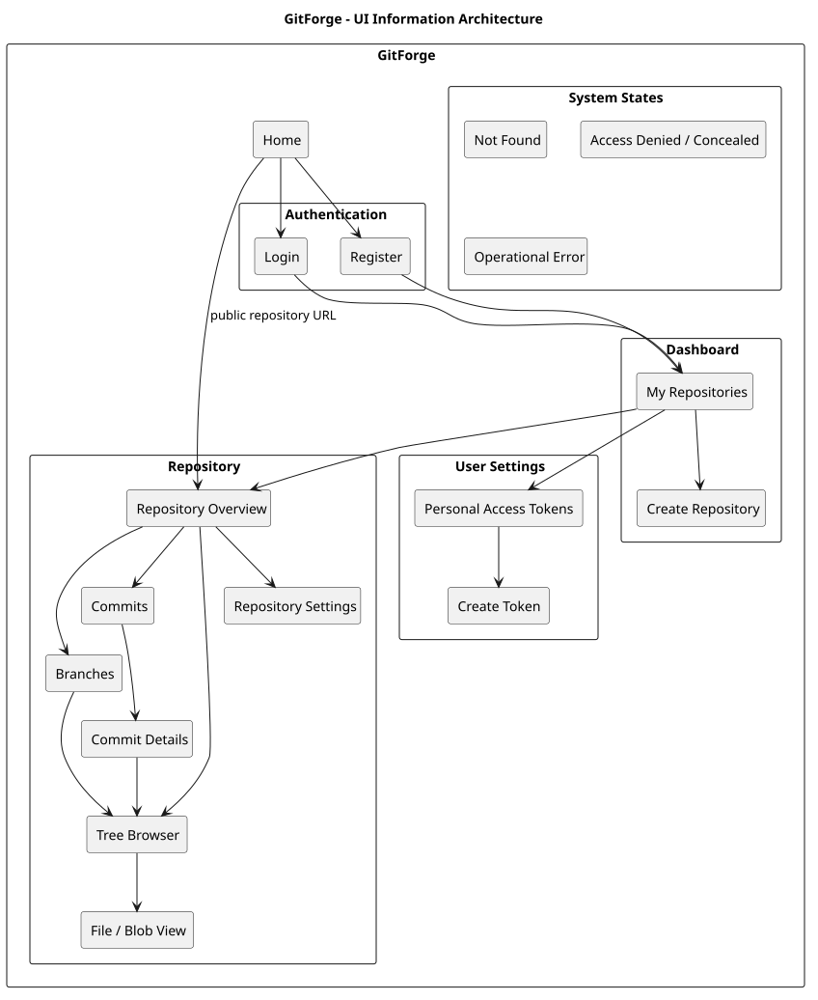
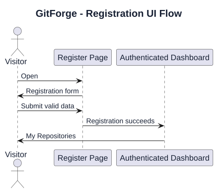
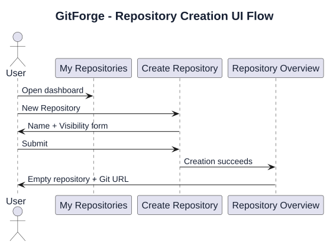
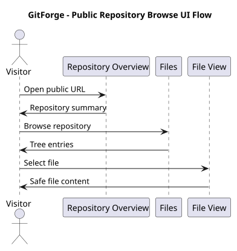
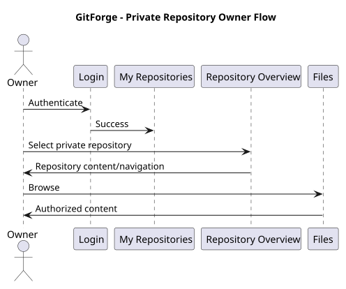
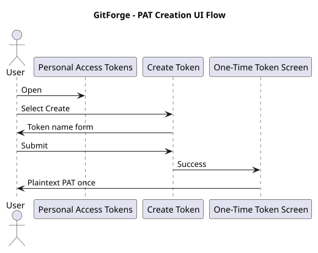

# GitForge V1.0.0 UI Information Architecture

## 1. Document Information

| Field | Value |
|---|---|
| Project | GitForge - Web Git Hosting Platform |
| Target release | V1.0.0 |
| Document | UI Information Architecture |
| SDLC phase | System Design |
| Milestone | M3 - System Design |
| Project owner | Farhad Valizadegan |
| Status | Approved |
| Last updated | 2026-08-18 |

---

## 2. Purpose

This document defines the information architecture of the GitForge V1.0.0 web user interface.

It translates approved:

```text

Requirements

System Analysis

Architecture Decisions

Container Architecture

Component Design

API Specification

Authorization Design

Repository Storage Design

Git Process Execution Design

```

into a coherent UI structure for:

```text

Public navigation

Authentication

Repository discovery

Repository management

Repository browsing

Personal Access Token management

Error states

Empty states

```

The objective is to define:

```text

Pages

Navigation hierarchy

Page relationships

Primary actions

Information grouping

Authorization-dependent visibility

User flows

```

before detailed wireframes are created.

---

## 3. UI Design Scope

The V1.0.0 UI supports:

```text

Registration

Login

Logout

Owned repository listing

Repository creation

Repository detail

Repository visibility update

Repository browsing

Branch navigation

Commit history

Commit details

Tree navigation

File/blob viewing

PAT creation

PAT listing

PAT revocation

```

---

## 4. UI Scope Exclusions

The V1.0.0 UI does not include:

```text

Organizations

Teams

Collaborators

Forks

Pull requests

Issues

Project boards

CI/CD

Wiki

Packages

Container registry

Git LFS

SSH key management

Billing

Stars

Followers

Social feeds

Analytics dashboards

Repository deletion

Repository rename

Repository transfer

Account deletion

PAT scopes

PAT expiration

```

---

# Information Architecture Principles

## 5. Simplicity

The interface should prioritize a small number of clear user goals:

```text

Authenticate

Create repository

Find repository

Browse repository

Use Git

Manage PATs

```

---

## 6. Repository-Centered Navigation

The repository is the primary domain object of the UI.

Repository-specific views should remain grouped under one logical repository context.

---

## 7. Context Preservation

When navigating within a repository, the UI should preserve:

```text

Owner

Repository name

Current branch/ref where applicable

Current tree path where applicable

```

---

## 8. Authorization-Aware Presentation

The UI may hide actions the current actor cannot perform.

However:

```text

UI visibility

≠

Authorization enforcement

```

Server-side authorization remains authoritative.

---

## 9. Public Accessibility

Public repositories must remain accessible without login.

Visitors must be able to browse approved public repository content.

---

## 10. Private Repository Confidentiality

Private repository content and private repository-specific navigation must not be exposed to unauthorized users.

---

# Top-Level Site Structure

## 11. Top-Level Pages

GitForge V1.0.0 contains these primary page families:

```text

Home

Authentication

Dashboard / Repositories

Repository

Settings / Personal Access Tokens

Error / System State

```

---

## 12. Site Map



[PlantUML source](diagrams/10-ui-information-architecture-001.puml)

---

# Global Navigation

## 13. Anonymous Navigation

For a Visitor:

```text

GitForge

Login

Register

```

Repository URLs may be reached directly for public repositories.

---

## 14. Authenticated Navigation

For an Authenticated User:

```text

GitForge

Repositories

Tokens

Logout

```

---

## 15. Repository Context Navigation

Within a repository:

```text

Repository

Branches

Commits

Files

Settings

```

`Settings` appears only to the repository owner.

---

## 16. Navigation Authorization

Examples:

```text

Visitor viewing public repository

→ no repository Settings action

Authenticated non-owner viewing public repository

→ no repository Settings action

Owner viewing repository

→ Settings available

```

---

# Home

## 17. Home Page Purpose

The Home page introduces GitForge and provides entry points to authentication.

For authenticated users, it may redirect or link prominently to:

```text

My Repositories

```

---

## 18. Anonymous Home Content

Primary content:

```text

GitForge name

Short product description

Login action

Register action

```

Optional explanatory content:

```text

Host Git repositories

Browse repositories

Clone/fetch with Git

Push using PAT authentication

```

---

## 19. Home Page Constraints

The Home page must not expose:

```text

Private repository listings

Internal filesystem information

Operational diagnostics

```

---

# Authentication Information Architecture

## 20. Registration Page

Route concept:

```text

/register

```

Primary information:

```text

Name

Email

Password

Password confirmation

```

Primary action:

```text

Create Account

```

Secondary navigation:

```text

Already have an account?

Login

```

---

## 21. Login Page

Route concept:

```text

/login

```

Primary information:

```text

Email

Password

```

Primary action:

```text

Login

```

Secondary navigation:

```text

Need an account?

Register

```

---

## 22. Authentication Error Placement

Validation/authentication failures should appear:

```text

Near affected fields

and/or

as a clear form-level message

```

Sensitive authentication details must not be disclosed.

---

# Dashboard

## 23. Dashboard Purpose

The authenticated user's main workspace is:

```text

My Repositories

```

---

## 24. Dashboard Primary Content

Display repositories owned by the authenticated user.

Each repository item should show at minimum:

```text

Repository name

Visibility

Link to repository

```

Optional useful metadata:

```text

Created date

Updated date

```

---

## 25. Dashboard Primary Action

```text

New Repository

```

---

## 26. Empty Dashboard

If the authenticated user owns no repositories:

```text

No repositories yet

```

with a prominent:

```text

Create Repository

```

action.

---

## 27. Dashboard Information Source

Repository listing comes from:

```text

PostgreSQL application metadata

```

not filesystem enumeration.

---

# Repository Creation

## 28. Create Repository Page

Route concept:

```text

/repositories/create

```

or equivalent UI route.

---

## 29. Creation Fields

Required:

```text

Repository name

Visibility

```

---

## 30. Visibility Options

```text

Private

Public

```

Default:

```text

Private

```

---

## 31. Repository Name Guidance

The interface should communicate the approved naming restrictions.

Examples of valid names:

```text

my-project

gitforge

project_1

release.v1

```

Examples of invalid concepts:

```text

owner/project

../project

project\\name

```

---

## 32. Creation Success

Successful creation routes the user to:

```text

Repository Overview

```

---

## 33. Creation Failure

Failure remains on the creation context with a clear safe error.

No successful repository page should be shown if physical repository initialization failed.

---

# Repository Overview

## 34. Repository Overview Purpose

The Repository Overview is the central landing page for one logical repository.

Route concept:

```text

/{owner}/{repository}

```

---

## 35. Repository Header

The header displays:

```text

Owner

Repository name

Visibility

```

Example:

```text

farhad / gitforge

Public

```

---

## 36. Repository Primary Navigation

Tabs or equivalent navigation:

```text

Files

Commits

Branches

Settings

```

`Settings` is owner-only.

---

## 37. Repository Git URL

The repository page should provide a clone URL.

Conceptually:

```text

https://<host>/<owner>/<repository>.git

```

---

## 38. Clone Guidance

For a public repository:

```text

git clone <repository-url>

```

For a private repository:

```text

PAT authentication required

```

Credential details should be presented safely and briefly.

---

## 39. Empty Repository Overview

For a valid empty repository, show an empty state such as:

```text

This repository is empty.

```

Useful guidance may include:

```text

Clone URL

Initial push instructions

```

This must not be represented as:

```text

Repository not found

```

---

# Repository Files / Tree Browser

## 40. Files Page Purpose

The Files view provides read-only navigation through Git tree content.

---

## 41. Files Page Information

Display:

```text

Current ref/branch

Current path

Directory entries

File entries

```

---

## 42. Tree Entry Information

Each entry should display at minimum:

```text

Name

Type

```

Possible types:

```text

Directory/tree

File/blob

```

---

## 43. Breadcrumb

Tree navigation should provide a breadcrumb.

Example:

```text

gitforge / src / Services

```

Each ancestor segment should be navigable.

---

## 44. Branch Context

The current branch/ref must remain visible while browsing.

---

## 45. Branch Selector

Where multiple branches exist, provide a branch/ref selector or equivalent navigation.

---

## 46. Empty Tree

A valid tree with no entries should display an empty state rather than an error.

---

# File / Blob View

## 47. File Page Purpose

The File/Blob view displays repository content for one selected path/ref.

---

## 48. File Header

Display:

```text

File path

Current ref

File size where useful

```

---

## 49. Text File

Text content should be shown as encoded text.

Repository content must not execute as HTML or script.

---

## 50. Binary File

Binary files should not be blindly rendered as text.

The UI may display:

```text

Binary file

Size

Download/view action where supported

```

---

## 51. Large File

For files beyond configured browser-display limits, show a safe informational state.

Example:

```text

This file is too large to display.

```

---

# Branches

## 52. Branches Page

Route concept:

```text

/{owner}/{repository}/branches

```

Display:

```text

Branch name

Current commit ID or abbreviated commit

```

---

## 53. Branch Selection

Selecting a branch should lead to repository browsing in that branch context.

---

## 54. Empty Repository Branches

For a valid empty repository:

```text

No branches yet.

```

---

# Commit History

## 55. Commits Page

Route concept:

```text

/{owner}/{repository}/commits

```

---

## 56. Commit List Information

Each commit entry should display:

```text

Commit message summary

Author

Timestamp

Abbreviated commit ID

```

---

## 57. Commit List Navigation

Selecting a commit opens:

```text

Commit Details

```

---

## 58. Pagination

Long commit histories require bounded navigation.

Conceptual controls:

```text

Previous

Next

```

or equivalent pagination/cursor interaction.

---

## 59. Empty Commit History

For an empty repository:

```text

No commits yet.

```

---

# Commit Details

## 60. Commit Details Page

Route concept:

```text

/{owner}/{repository}/commits/{commit}

```

---

## 61. Commit Information

Display:

```text

Full commit ID

Commit message

Author name

Author email

Author timestamp

Committer name

Committer email

Commit timestamp

Parent commit IDs

Tree link

```

where available.

---

## 62. Commit Content Safety

Commit metadata is untrusted and must be safely encoded.

---

# Repository Settings

## 63. Settings Access

Repository Settings are visible and accessible only to:

```text

Repository Owner

```

---

## 64. V1.0.0 Settings Scope

The only required repository mutation is:

```text

Visibility

```

---

## 65. Repository Settings Page

Display:

```text

Repository identity

Current visibility

Visibility control

Save action

```

---

## 66. Visibility Values

```text

Public

Private

```

---

## 67. Excluded Settings

Do not show active controls for:

```text

Delete repository

Rename repository

Transfer repository

Collaborators

Teams

Webhooks

Deploy keys

Branches protection

Repository description

```

unless explicitly introduced in a later version.

---

# Personal Access Token Information Architecture

## 68. Token Management Entry

Authenticated global navigation includes:

```text

Tokens

```

or:

```text

Settings → Personal Access Tokens

```

---

## 69. Personal Access Tokens Page

Route concept:

```text

/settings/tokens

```

Purpose:

```text

List existing PATs

Create PAT

Revoke PAT

```

---

## 70. PAT List Information

Each token entry may show:

```text

Name

Token identifier

Created date

Status

Revoked date where applicable

```

---

## 71. PAT Secret Exclusion

The PAT list must never display:

```text

Plaintext PAT

Token hash

```

---

## 72. Create PAT Action

Primary action:

```text

Create Token

```

---

## 73. PAT Creation Form

Required input:

```text

Token name

```

No UI fields are required for:

```text

Scope

Expiration

```

because both are deferred.

---

# PAT One-Time Secret Screen

## 74. One-Time Display

After successful PAT creation, display the plaintext token exactly once.

---

## 75. PAT Warning

The UI must clearly communicate:

```text

Copy this token now.

You will not be able to view it again.

```

---

## 76. PAT Secret Presentation

The secret may be displayed in a dedicated field with:

```text

Copy action

```

where implemented.

---

## 77. Navigation Away

Once the user leaves the successful creation response, the application must not offer secret recovery.

---

# PAT Revocation

## 78. Revoke Action

Each active PAT may provide:

```text

Revoke

```

---

## 79. Revocation Confirmation

A confirmation interaction is recommended to prevent accidental revocation.

Example:

```text

Revoke this token?

```

---

## 80. Revoked Token Display

Revoked tokens may remain visible as historical metadata.

Display state:

```text

Revoked

```

---

# User Flows

## 81. Registration Flow



[PlantUML source](diagrams/10-ui-information-architecture-002.puml)

---

## 82. Repository Creation Flow



[PlantUML source](diagrams/10-ui-information-architecture-003.puml)

---

## 83. Public Repository Browse Flow



[PlantUML source](diagrams/10-ui-information-architecture-004.puml)

---

## 84. Private Owner Browse Flow



[PlantUML source](diagrams/10-ui-information-architecture-005.puml)

---

## 85. PAT Creation Flow



[PlantUML source](diagrams/10-ui-information-architecture-006.puml)

---

# Error Information Architecture

## 86. Error Categories

UI-level errors include:

```text

Validation Error

Authentication Failure

Authorization/Concealment

Not Found

Repository Consistency Failure

Git Failure

Storage Failure

Unexpected Internal Failure

```

---

## 87. Validation Errors

Validation errors remain within the current form/page context.

---

## 88. Authentication Failure

Login failures should not identify whether:

```text

Email exists

Password alone was incorrect

```

unless safely designed otherwise.

---

## 89. Private Repository Concealment

Unauthorized private repository access may use the same user-facing state as:

```text

Repository Not Found

```

---

## 90. Not Found Page

A generic not-found page may represent:

```text

Unknown repository

Unknown commit

Unknown ref

Concealed private repository

```

as appropriate.

---

## 91. Operational Error Page

Storage/Git/internal failures should show a safe generic error.

Example:

```text

The repository could not be accessed.

Please try again later.

```

No filesystem paths, command output, or stack traces should be exposed.

---

# Empty States

## 92. Empty-State Principle

A valid empty domain state must not be confused with an error.

---

## 93. Required Empty States

Explicit UI states are required for:

```text

No repositories

Empty repository

No branches

No commits

Empty tree

No PATs

```

---

## 94. No Repositories

Example:

```text

You do not have any repositories yet.

```

Action:

```text

Create Repository

```

---

## 95. No PATs

Example:

```text

You do not have any personal access tokens.

```

Action:

```text

Create Token

```

---

# Page Ownership Matrix

## 96. Page Access Matrix

| Page | Visitor | Authenticated Non-Owner | Owner |
|---|---:|---:|---:|
| Home | Allow | Allow | Allow |
| Register | Allow | Allow/redirect | Allow/redirect |
| Login | Allow | Allow/redirect | Allow/redirect |
| My Repositories | Deny | Allow own | Allow own |
| Create Repository | Deny | Allow | Allow |
| Public Repository Overview | Allow | Allow | Allow |
| Private Repository Overview | Deny | Deny | Allow |
| Public Files | Allow | Allow | Allow |
| Private Files | Deny | Deny | Allow |
| Public Commits | Allow | Allow | Allow |
| Private Commits | Deny | Deny | Allow |
| Repository Settings | Deny | Deny | Allow |
| PAT List | Deny | Allow own | Allow own |
| Create PAT | Deny | Allow own | Allow own |

---

# Primary Action Matrix

## 97. Primary Actions

| Context | Primary Action |
|---|---|
| Home anonymous | Register / Login |
| Dashboard | Create Repository |
| Repository overview empty | Clone / Initial Push Guidance |
| Repository files | Navigate Tree |
| Commit history | Open Commit |
| Repository settings | Save Visibility |
| PAT list | Create Token |
| PAT creation success | Copy Token |

---

# Navigation Model

## 98. Global Navigation Model

Anonymous:

```text

GitForge

├── Home

├── Login

└── Register

```

Authenticated:

```text

GitForge

├── Repositories

├── Tokens

└── Logout

```

---

## 99. Repository Navigation Model

```text

Repository

├── Files

├── Commits

├── Branches

└── Settings [Owner only]

```

---

## 100. Files Navigation Model

```text

Files

├── Branch selector

├── Breadcrumb

├── Tree entries

└── File view

```

---

# URL Information Architecture

## 101. Application Route Concepts

Conceptual UI routes:

```text

/

GET /register

GET /login

GET /repositories

GET /repositories/create

GET /{owner}/{repository}

GET /{owner}/{repository}/branches

GET /{owner}/{repository}/commits

GET /{owner}/{repository}/commits/{commit}

GET /{owner}/{repository}/tree/{ref}

GET /{owner}/{repository}/blob/{ref}

GET /{owner}/{repository}/settings

GET /settings/tokens

GET /settings/tokens/create

```

Exact Laravel route names may differ.

---

## 102. Route Separation from Git Smart HTTP

Git protocol routes such as:

```text

/{owner}/{repository}.git/info/refs

/{owner}/{repository}.git/git-upload-pack

/{owner}/{repository}.git/git-receive-pack

```

are protocol interfaces, not normal UI pages.

---

# Responsive Information Priority

## 103. Small-Screen Priority

On narrow screens, preserve highest-value information first:

```text

Repository identity

Current path/ref

Primary action

Content

```

Secondary metadata may stack below.

---

## 104. Navigation Collapse

Global and repository navigation may collapse into compact controls on small screens without changing the information hierarchy.

---

# Accessibility Information Architecture

## 105. Semantic Structure

Pages should use meaningful structure such as:

```text

Header

Navigation

Main

Sections

Forms

Tables/Lists

Footer where useful

```

---

## 106. Keyboard Navigation

Primary navigation, forms, repository tree links, token actions, and dialogs should remain keyboard accessible.

---

## 107. Form Labels

Every field requires an explicit accessible label.

---

## 108. Error Association

Validation errors should be programmatically associated with their fields where practical.

---

## 109. Visibility Indicators

Repository visibility must not be communicated by color alone.

Use text such as:

```text

Public

Private

```

---

# Security-Oriented UI Rules

## 110. No Authorization Trust in UI

Hiding a control does not replace server-side authorization.

---

## 111. No Secret Re-display

PAT plaintext cannot be reconstructed in later UI requests.

---

## 112. No Physical Storage Information

The UI must never show:

```text

Physical repository path

Repository storage root

Server filesystem details

```

---

## 113. No Raw Git Process Information

The UI must not expose:

```text

Full command lines

Environment variables

Raw stderr

Process IDs

Internal executable paths

```

under normal user flows.

---

## 114. Repository Content Encoding

Repository-controlled data must remain safely encoded.

Examples:

```text

Commit messages

File names

Branch names

Author metadata

Blob text

```

---

# Component Mapping

## 115. UI-to-Component Mapping

| UI Area | Primary Backend Component |
|---|---|
| Registration/Login/Logout | Authentication Service |
| Dashboard | Repository Service |
| Create Repository | Repository Service |
| Repository Overview | Repository Service |
| Files/Branches/Commits | Repository Browser Service |
| Repository Settings | Repository Service + Authorization Policy |
| PAT List/Create/Revoke | PAT Service |

---

# API Mapping

## 116. UI-to-API Mapping

| UI Action | Interface |
|---|---|
| Register | `POST /register` |
| Login | `POST /login` |
| Logout | `POST /logout` |
| Create repository | `POST /repositories` |
| List repositories | `GET /repositories` |
| View repository | `GET /{owner}/{repository}` |
| Change visibility | `PATCH /{owner}/{repository}/visibility` |
| List branches | `GET /{owner}/{repository}/branches` |
| Commit history | `GET /{owner}/{repository}/commits` |
| Commit detail | `GET /{owner}/{repository}/commits/{commit}` |
| Tree | `GET /{owner}/{repository}/tree/{ref}` |
| Blob | `GET /{owner}/{repository}/blob/{ref}` |
| List PATs | `GET /settings/tokens` |
| Create PAT | `POST /settings/tokens` |
| Revoke PAT | `POST /settings/tokens/{token}/revoke` |

---

# Use-Case Mapping

## 117. UI Use Cases

The UI directly supports:

```text

UC-001 Register

UC-002 Authenticate

UC-003 Logout

UC-004 Create Repository

UC-005 List Owned Repositories

UC-006 View Repository

UC-007 Change Visibility

UC-009 Browse Repository

UC-010 List Branches

UC-011 Commit History

UC-012 Commit Details

UC-013 Tree

UC-014 File

UC-020 Create PAT

UC-022 Revoke PAT

```

---

## 118. Git-Client-Only Use Cases

These do not require normal web UI execution pages:

```text

UC-015 Discover Read Service

UC-016 Clone

UC-017 Fetch

UC-018 Discover Write Service

UC-019 Push

UC-021 Authenticate Git with PAT

```

The web UI provides supporting information such as:

```text

Repository Git URL

PAT creation

PAT usage guidance

```

---

# Architecture Decision Mapping

## 119. Relevant ADR Alignment

The UI Information Architecture implements or respects:

```text

ADR-012 Session Authentication for Web UI

ADR-016 Centralized Repository Authorization

ADR-019 Visibility Controls Read

ADR-020 Git-Native Repository Browser Reads

ADR-022 Thin HTTP Controllers

ADR-031 Shared Core Services

ADR-036 Fail-Closed Architecture

ADR-040 Sensitive Data Excluded from Logs

ADR-041 Safe Error Mapping

ADR-045 Output Encoding

ADR-046 REST-Oriented Application Endpoints

ADR-047 No Repository Deletion

ADR-048 No Rename/Transfer

ADR-064 Empty Repository Is Valid

ADR-067 Repository Browser Is Read-Only

ADR-068 Server-Oriented API-Compatible UI

```

---

# UI Invariants

## 120. UII-001 — Repository Context

Repository-specific pages preserve repository identity.

---

## 121. UII-002 — Public Readability

Public repository browse views are reachable without authentication.

---

## 122. UII-003 — Private Confidentiality

Private repository content is not exposed to unauthorized actors.

---

## 123. UII-004 — Owner-Only Settings

Repository mutation controls are owner-only.

---

## 124. UII-005 — Empty Is Valid

Empty repositories receive a valid empty state.

---

## 125. UII-006 — PAT One-Time Secret

PAT plaintext appears only immediately after creation.

---

## 126. UII-007 — No Physical Paths

Physical repository paths never appear in the UI.

---

## 127. UII-008 — No UI Authorization Trust

Backend authorization remains mandatory regardless of visible controls.

---

## 128. UII-009 — Untrusted Content Safety

Repository-controlled content is rendered safely.

---

## 129. UII-010 — Scope Preservation

No excluded V1.0.0 product feature is implied by navigation.

---

# Validation

## 130. Requirements Alignment

All required V1.0.0 browser-facing capabilities have corresponding UI destinations.

Result:

```text

PASS

```

---

## 131. Authorization Alignment

Public/private access and owner-only management are represented consistently.

Result:

```text

PASS

```

---

## 132. API Alignment

Every required browser action maps to an approved application endpoint.

Result:

```text

PASS

```

---

## 133. Repository Browser Alignment

Branches, commits, trees, and blobs have explicit navigation structure.

Result:

```text

PASS

```

---

## 134. PAT Alignment

Creation, one-time secret display, listing, and revocation are represented.

Result:

```text

PASS

```

---

## 135. Empty-State Alignment

Valid empty repository states are distinguished from failures.

Result:

```text

PASS

```

---

## 136. Security Alignment

Private-resource concealment, output safety, secret handling, and server-detail exclusion are preserved.

Result:

```text

PASS

```

---

## 137. Scope Alignment

Unapproved UI feature families introduced:

```text

0

```

Result:

```text

PASS

```

---

# Wireframe Readiness

## 138. Required Wireframes

The following screens are ready for wireframing:

```text

Home

Register

Login

My Repositories

Create Repository

Repository Overview

Repository Files

File / Blob View

Branches

Commit History

Commit Details

Repository Settings

Personal Access Tokens

Create PAT

PAT One-Time Secret

Not Found

Operational Error

```

---

## 139. Reusable UI Structures

Wireframes should reuse:

```text

Global header

Repository header

Repository navigation

Form layout

Error message pattern

Empty-state pattern

Repository list item

Tree row

Commit row

Token row

```

---

# Completion

## 140. Completion Criteria

This UI information architecture is complete when:

- top-level page families are defined;

- anonymous navigation is defined;

- authenticated navigation is defined;

- repository-context navigation is defined;

- registration structure is defined;

- login structure is defined;

- dashboard structure is defined;

- repository creation structure is defined;

- repository overview structure is defined;

- repository files/tree structure is defined;

- file/blob structure is defined;

- branches structure is defined;

- commit history structure is defined;

- commit details structure is defined;

- repository settings structure is defined;

- PAT management structure is defined;

- PAT one-time secret behavior is defined;

- PAT revocation interaction is defined;

- page authorization is defined;

- URL concepts are defined;

- error states are defined;

- empty states are defined;

- accessibility structure is defined;

- security-oriented presentation rules are defined;

- UI-to-component mapping is defined;

- UI-to-API mapping is defined;

- wireframe targets are identified;

- excluded/deferred scope remains preserved;

- no blocking UI information architecture gap remains.

---

## 141. UI Information Architecture Result

UI information architecture:

```text

DEFINED

```

Blocking UI information architecture gaps:

```text

0

```

Readiness for wireframe design:

```text

READY

```

Next design artifact:

```text

11-wireframes.md

```

---

## 142. Document Status

This document is currently:

```text

Approved

```

It will be changed to:

```text

Approved

```

after page hierarchy, navigation, repository context, authentication flows, repository browsing structure, PAT management structure, authorization-aware presentation, empty/error states, API mapping, accessibility, security, and scope alignment have been reviewed.
