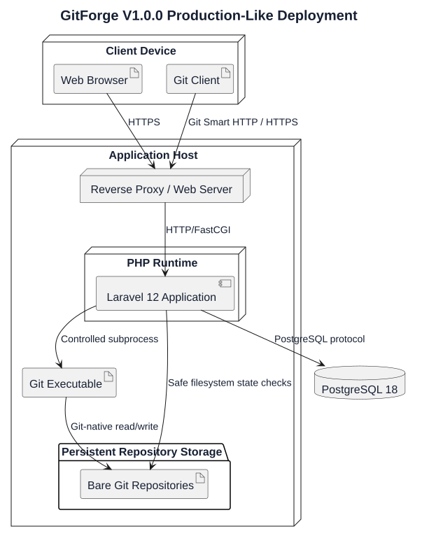
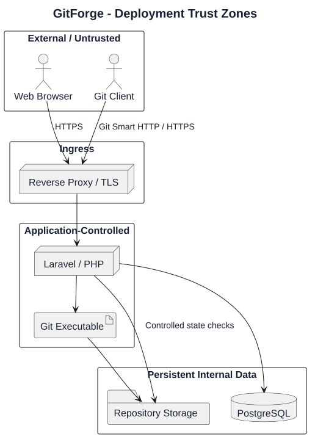

# GitForge V1.0.0 Deployment Design

## 1. Document Information

| Field | Value |

|---|---|

| Project | GitForge - Web Git Hosting Platform |

| Target release | V1.0.0 |

| Document | Deployment Design |

| SDLC phase | System Design |

| Milestone | M3 - System Design |

| Project owner | Farhad Valizadegan |

| Status | Approved |

| Last updated | 2026-08-18 |

---

## 2. Purpose

This document defines the deployment design for GitForge V1.0.0.

It translates the approved:

```text

Requirements

System Analysis

Architecture Decisions

Container Architecture

Component Design

Database Schema Design

API Specification

Authorization Design

Repository Storage Design

Git Process Execution Design

UI Information Architecture

Wireframes

```

into an implementation-ready deployment topology for:

```text

Web ingress

Laravel application runtime

PHP runtime

PostgreSQL

Persistent Git repository storage

Git executable

Configuration and secrets

TLS termination

Filesystem permissions

Process identity

Health checks

Backup boundaries

Deployment lifecycle

Recovery considerations

```

---

## 3. Deployment Design Goals

The V1.0.0 deployment must be:

```text

Simple

Reproducible

Persistent

Secure

Observable

Recoverable

Suitable for a portfolio-scale deployment

Compatible with Laravel 12

Compatible with PostgreSQL 18

Compatible with system Git

```

---

## 4. Deployment Model

GitForge V1.0.0 uses a small-runtime deployment model.

A production-like deployment may run on:

```text

One application host

+

One PostgreSQL service

+

Persistent repository storage

```

PostgreSQL may run:

```text

On the same host

or

On a separately managed database host

```

depending on deployment environment.

---

## 5. No Microservice Requirement

V1.0.0 does not require:

```text

Microservices

Service mesh

Message broker

Distributed cache

Background queue cluster

Kubernetes

Multi-region deployment

Distributed Git storage

```

---

# Deployment Units

## 6. Runtime Units

Primary deployment units are:

```text

DU-01 Reverse Proxy / Web Server

DU-02 Laravel Application Runtime

DU-03 PostgreSQL Database

DU-04 Repository Storage

DU-05 Git Executable

```

---

## 7. DU-01 — Reverse Proxy / Web Server

Responsibilities:

```text

Accept external HTTP/HTTPS traffic

Terminate TLS where configured

Serve static application assets

Forward dynamic requests to PHP/Laravel

Preserve required Git Smart HTTP request/response streaming

Apply request-size and timeout policies carefully

```

Possible implementation:

```text

Nginx

Apache HTTP Server

```

The exact web server is deployment-specific.

---

## 8. DU-02 — Laravel Application Runtime

Responsibilities:

```text

Web UI

Authentication

Application APIs

Repository authorization

PAT management

Repository orchestration

Repository browser orchestration

Git Smart HTTP handlers

Git process orchestration

Observability

Failure mapping

```

Runtime technology:

```text

PHP 8.4

Laravel 12

```

---

## 9. DU-03 — PostgreSQL Database

Responsibilities:

```text

Application metadata persistence

Users

Repositories

Personal Access Tokens

Database constraints

Transactional metadata operations

```

Technology:

```text

PostgreSQL 18

```

---

## 10. DU-04 — Repository Storage

Responsibilities:

```text

Persistent bare Git repositories

Git-native refs

Objects

Commits

Trees

Blobs

Packfiles

```

Storage is not served directly to external clients.

---

## 11. DU-05 — Git Executable

Responsibilities:

```text

Bare repository initialization

upload-pack

receive-pack

Repository browser Git-native reads

Repository verification

```

It is launched by the Laravel application through the Git Process Execution component.

---

# Deployment Topology

## 12. Production-Like Topology



[PlantUML source](diagrams/12-deployment-design-001.puml)

---

## 13. Single-Host Profile

For a simple deployment:

```text

Application Host

├── Web Server

├── PHP Runtime

├── Laravel

├── Git executable

├── PostgreSQL

└── Persistent repository storage

```

This is acceptable for V1.0.0 if:

```text

Storage is persistent

Backups are configured

Database is not externally exposed unnecessarily

Filesystem permissions are controlled

TLS is configured for external traffic

```

---

## 14. Split-Database Profile

Alternative:

```text

Application Host

├── Web Server

├── Laravel

├── Git executable

└── Repository storage

Database Host

└── PostgreSQL

```

Network communication between Laravel and PostgreSQL must be restricted appropriately.

---

# Development Deployment

## 15. Current Development Environment

Current project development environment uses:

```text

Windows

PowerShell

Laravel 12

PHP 8.4

PostgreSQL 18

System Git

```

Project location:

```text

C:\\xampp\\htdocs\\projects\\web\\Web-Git-Hosting-Platform

```

---

## 16. Development Database

Current development database concept:

```text

Database: git_hosting_platform

Role: git_hosting_app

Host: 127.0.0.1

Port: 5432

```

---

## 17. Development Repository Storage

Repository storage must still remain separate from:

```text

Public web root

Application source repository

User-controlled arbitrary paths

```

Example:

```text

C:\\gitforge\\repositories

```

---

## 18. Development Git Binary

Deployment configuration should identify the system Git executable.

Example:

```text

C:\\Program Files\\Git\\cmd\\git.exe

```

Exact path depends on the installed Git distribution.

---

# Production Directory Model

## 19. Application Directory

Conceptual Linux application location:

```text

/var/www/gitforge

```

or:

```text

/opt/gitforge/app

```

---

## 20. Repository Storage Directory

Recommended conceptual location:

```text

/var/lib/gitforge/repositories

```

---

## 21. Application Logs

Conceptual location:

```text

/var/log/gitforge

```

or standard Laravel/runtime logging destination.

---

## 22. Configuration

Runtime configuration should not be committed as production secrets.

Laravel environment/configuration controls include:

```text

APP_ENV

APP_KEY

APP_URL

DB_CONNECTION

DB_HOST

DB_PORT

DB_DATABASE

DB_USERNAME

DB_PASSWORD

GITFORGE_REPOSITORY_ROOT

GITFORGE_GIT_BINARY

```

---

# Web Server Design

## 23. External Interface

The web server accepts:

```text

HTTPS : 443

```

Production-like deployments should redirect plain HTTP to HTTPS.

---

## 24. Application Root

The public web document root must point only to Laravel's public directory.

Conceptually:

```text

<application>/public

```

It must not expose:

```text

.env

storage repository root

vendor internals

application source files

Git repository storage

```

---

## 25. Static Assets

The web server may serve:

```text

CSS

JavaScript

Images

Compiled frontend assets

```

from the application public directory.

---

## 26. Dynamic Requests

Dynamic application routes are forwarded to:

```text

Laravel / PHP runtime

```

---

# Git Smart HTTP Deployment Requirements

## 27. Smart HTTP Routing

The reverse proxy must permit Git Smart HTTP routes such as:

```text

/{owner}/{repository}.git/info/refs

/{owner}/{repository}.git/git-upload-pack

/{owner}/{repository}.git/git-receive-pack

```

to reach Laravel handlers.

---

## 28. Git Request Bodies

Clone/fetch/push requests may contain substantial binary payloads.

Reverse proxy configuration must not accidentally reject valid Git traffic because of overly restrictive generic request-size limits.

---

## 29. Streaming

Proxy/runtime configuration should support streaming behavior between:

```text

Git Client

↕

Reverse Proxy

↕

Laravel

↕

Git subprocess

```

---

## 30. Proxy Buffering

Where proxy buffering interferes with Git Smart HTTP streaming, configuration should be adjusted specifically for Git protocol endpoints.

Exact directives depend on the selected web server.

---

## 31. Timeouts

Proxy timeouts must be compatible with Git process timeout design.

The proxy should not terminate valid Git transfers significantly earlier than the application-level Git operation timeout.

---

# PHP Runtime

## 32. PHP Version

Target runtime:

```text

PHP 8.4

```

---

## 33. Required Capability

PHP runtime must support:

```text

Laravel 12 requirements

PDO PostgreSQL

PostgreSQL extension where used

Process execution mechanism selected during Implementation

OpenSSL

JSON

Mbstring

Filesystem operations

Session support

```

---

## 34. Process Execution Permission

The PHP application runtime must be permitted to start the configured Git executable.

---

## 35. PHP Resource Limits

Production-like configuration should define reasonable:

```text

Memory limits

Request limits

Execution settings

Upload/request body limits

```

while accounting for Git Smart HTTP streaming requirements.

---

# PostgreSQL Deployment

## 36. Database Network Exposure

PostgreSQL must not be publicly exposed unless operationally required and explicitly secured.

Preferred:

```text

Application-private network

or

localhost for single-host deployment

```

---

## 37. Application Database Role

GitForge uses an application-specific role.

Conceptually:

```text

git_hosting_app

```

---

## 38. Least Privilege

The application role must not require:

```text

SUPERUSER

CREATEDB

CREATEROLE

REPLICATION

```

---

## 39. Schema Changes

Database schema changes are applied through:

```text

Laravel migrations

```

as part of controlled deployment.

---

## 40. Database Persistence

PostgreSQL data must reside on persistent storage independent of application deployment package replacement.

---

# Repository Storage Deployment

## 41. Repository Storage Persistence

Repository storage must survive:

```text

Application restart

Web server restart

Application release deployment

Host process restart

```

subject to underlying persistent disk availability.

---

## 42. Repository Storage Ownership

The application/Git runtime identity must have required access to:

```text

Read

Write

Create

Traverse

Controlled partial cleanup

```

within the repository root.

---

## 43. No Public Exposure

The web server must not map repository storage as:

```text

Static web content

Download directory

Public alias

```

---

## 44. Storage Mount

If repository storage uses a dedicated disk or volume, it must be mounted before the application is considered ready.

---

## 45. Storage Root Configuration

Conceptual environment variable:

```text

GITFORGE_REPOSITORY_ROOT=/var/lib/gitforge/repositories

```

---

# Service Identity

## 46. Application User

Production-like deployments should run GitForge under a dedicated service account.

Example conceptual identity:

```text

gitforge

```

---

## 47. Least-Privilege Identity

The service identity should have access only to resources required for:

```text

Application runtime

Application logs

Repository storage

Required temporary directories

Git executable

Database connection

```

---

## 48. No Root Requirement

Normal application and Git subprocess execution must not require:

```text

root

Administrator

```

privileges.

---

# Filesystem Permissions

## 49. Application Source

Application source should be writable only where deployment/runtime explicitly requires.

---

## 50. Laravel Writable Directories

Laravel runtime requires controlled write access to locations such as:

```text

storage/

bootstrap/cache/

```

---

## 51. Repository Root

The service account requires read/write access to the Git repository root.

Unrelated users should not have write access.

---

## 52. Environment File

Production environment configuration containing secrets must not be broadly readable.

---

# Secrets Management

## 53. Secret Categories

Deployment secrets include:

```text

APP_KEY

Database password

Other future private infrastructure credentials

```

---

## 54. Secret Source

Secrets must come from deployment configuration.

They must not be:

```text

Hard-coded in source

Committed to Git

Displayed in UI

Logged

```

---

## 55. PAT Storage Distinction

User PATs are application data.

Their plaintext secret is not a deployment configuration secret and is not recoverably persisted.

Only the secure verification representation is stored.

---

# TLS

## 56. Production Transport

Externally accessible GitForge traffic should use:

```text

HTTPS

```

---

## 57. TLS Termination

TLS may terminate at:

```text

Reverse proxy

Load balancer

Managed platform ingress

```

depending on deployment.

---

## 58. Git Credentials

Because PAT credentials travel over HTTP authentication mechanisms, HTTPS is required for production-like Git client authentication.

---

# Application Deployment Lifecycle

## 59. Release Deployment Steps

A controlled release should conceptually perform:

```text

1. Obtain approved application release

2. Install production dependencies

3. Configure environment

4. Build frontend assets

5. Verify required directories

6. Verify repository storage mount/root

7. Verify Git executable

8. Verify PostgreSQL connectivity

9. Run database migrations

10. Refresh application caches where appropriate

11. Restart/reload runtime

12. Run health verification

13. Run smoke tests

```

---

## 60. Composer Installation

Production dependency installation conceptually uses:

```text

composer install

```

with production-appropriate flags.

Exact command options are defined during Deployment implementation.

---

## 61. Frontend Build

If compiled frontend assets are required:

```text

npm install / npm ci

npm run build

```

or equivalent package-manager commands are executed during build/deployment.

---

## 62. Environment Configuration

Production deployment requires valid configuration before traffic is enabled.

---

## 63. Database Migration Ordering

Migrations should run:

```text

Before new code depends on new schema

```

within a controlled release procedure.

---

# Health Design

## 64. Health Check Purpose

Health verification should determine whether GitForge can safely serve requests.

---

## 65. Basic Application Health

Checks may include:

```text

Laravel runtime starts

Configuration loads

Application can return HTTP response

```

---

## 66. Database Health

Verify:

```text

PostgreSQL reachable

Application role can perform required safe query

```

---

## 67. Repository Storage Health

Verify:

```text

Repository root configured

Repository root exists

Repository root accessible

Required permissions available

```

---

## 68. Git Executable Health

Verify:

```text

Git binary configured

Git binary exists

Git process can start

Git version can be queried

```

---

## 69. Health Endpoint Safety

Public health responses must not expose:

```text

Database credentials

Absolute sensitive paths

Git executable internals

Stack traces

Environment variables

```

---

# Readiness Model

## 70. Liveness

Liveness answers:

```text

Is the application process running?

```

---

## 71. Readiness

Readiness answers:

```text

Can the application safely serve core requests?

```

Potential readiness dependencies:

```text

Database

Repository root

Git executable

Critical configuration

```

---

# Backup Design

## 72. Backup Scope

A complete GitForge backup requires:

```text

PostgreSQL

+

Repository Storage

```

---

## 73. Database Backup

Use PostgreSQL-supported backup procedures appropriate to deployment.

---

## 74. Repository Backup

Repository storage backup must preserve:

```text

Bare repository directories

Git objects

Refs

Repository configuration required for GitForge

```

---

## 75. Backup Coordination

Backups of PostgreSQL and repository storage should be coordinated to reduce cross-authority inconsistency.

---

## 76. Backup Security

Backups may contain:

```text

Private repository content

User account metadata

PAT verification hashes

```

and must therefore be protected.

---

# Restore Design

## 77. Restore Scope

Recovery requires restoring:

```text

Database metadata

Repository storage

Application configuration/secrets

```

---

## 78. Post-Restore Verification

Verify:

```text

Application starts

Database is reachable

Repository IDs resolve to expected storage

Repositories exist

Git can access repositories

Authentication works

Public/private authorization works

```

---

## 79. Missing Storage After Restore

If metadata exists but repository storage is absent:

```text

Do not silently recreate repository

```

Treat as consistency failure.

---

## 80. Orphaned Storage After Restore

If repository storage exists without metadata:

```text

Do not automatically adopt it

```

Operational review is required.

---

# Logging Deployment

## 81. Application Logs

Laravel/application logs must be writable by the application service identity.

---

## 82. Web Server Logs

Reverse proxy access/error logs may be retained according to deployment policy.

---

## 83. Sensitive Header Logging

Logging configuration must avoid recording:

```text

Authorization header

Session secret

Plaintext PAT

Password

```

---

## 84. Log Rotation

Production-like deployments should configure:

```text

Rotation

Retention

Disk-space control

```

for application and web-server logs.

---

# Temporary Storage

## 85. Temporary Files

GitForge should minimize use of temporary files for Git Smart HTTP payloads.

Streaming is preferred.

---

## 86. Temporary Directory

If temporary storage is required, it must be:

```text

Controlled

Writable by service account

Not publicly exposed

Cleaned safely

```

---

# Process Management

## 87. Web Runtime Management

The PHP application runtime should be managed by an operating system/service manager.

Examples:

```text

PHP-FPM service

Apache-managed PHP

Platform application runtime

```

---

## 88. Git Subprocesses

Git subprocesses are request-driven child processes.

They are not independent long-running network services.

---

## 89. Process Restart

Application runtime restart must not destroy:

```text

PostgreSQL data

Repository storage

```

---

# Deployment Failure Conditions

## 90. Missing Configuration

Critical missing configuration results in:

```text

07-deployment/Startup Failure

```

rather than unsafe fallback.

---

## 91. Database Unavailable

Core metadata operations fail safely.

Readiness should indicate unavailable state.

---

## 92. Repository Storage Unavailable

Repository operations fail safely.

Readiness may indicate unavailable state depending on health policy.

---

## 93. Git Binary Unavailable

Git-native operations cannot execute.

Readiness should detect this before normal traffic where practical.

---

## 94. Invalid Permissions

Filesystem permission failure is a deployment fault.

The application must not attempt privilege escalation.

---

# Deployment Security Boundaries

## 95. External Zone

Contains:

```text

Web Browser

Git Client

Internet

```

---

## 96. Ingress Zone

Contains:

```text

Reverse Proxy

TLS Termination

HTTP Request Handling

```

---

## 97. Application Zone

Contains:

```text

Laravel

PHP Runtime

Authentication

Authorization

Business/Application Services

```

---

## 98. Data Zone

Contains:

```text

PostgreSQL

Repository Storage

```

---

## 99. Git Execution Zone

Contains:

```text

Configured Git executable

Git subprocesses

```

The Git process runs under controlled service-level privileges.

---

## 100. Trust-Zone Diagram



[PlantUML source](diagrams/12-deployment-design-002.puml)

---

# Network Design

## 101. Public Ports

Typical externally exposed port:

```text

443/TCP

```

Optional:

```text

80/TCP

```

only for redirecting to HTTPS.

---

## 102. PostgreSQL Port

PostgreSQL commonly listens on:

```text

5432/TCP

```

but should be restricted to trusted application network/host access.

---

## 103. Git Network Port

No separate Git daemon port is required.

Git traffic uses:

```text

HTTPS

```

through Git Smart HTTP.

---

## 104. SSH Port

GitForge V1.0.0 does not require SSH Git transport.

---

# Deployment Configuration Matrix

## 105. Core Configuration

| Setting | Purpose | Secret |

|---|---|---:|

| `APP_ENV` | Runtime environment | No |

| `APP_KEY` | Laravel cryptographic application key | Yes |

| `APP_URL` | Public application URL | No |

| `DB_HOST` | PostgreSQL host | No |

| `DB_PORT` | PostgreSQL port | No |

| `DB_DATABASE` | Database name | No |

| `DB_USERNAME` | Database role | Usually no |

| `DB_PASSWORD` | Database credential | Yes |

| `GITFORGE_REPOSITORY_ROOT` | Persistent Git storage root | No |

| `GITFORGE_GIT_BINARY` | Git executable path | No |

---

# Environment Separation

## 106. Local Development

May use:

```text

Local PostgreSQL

Local filesystem repository root

Local Git executable

Laravel development server or Apache

```

---

## 107. Testing

Testing should use isolated:

```text

Database

Repository storage directory

Application configuration

```

to prevent corruption of development/production data.

---

## 108. Production

Production must use:

```text

Production APP_KEY

Production database

Production persistent repository storage

Production TLS

Production logging

Production backups

```

---

## 109. Environment Isolation Rule

The same repository storage root must not be unintentionally shared between:

```text

Development

Test

Production

```

environments.

---

# Deployment and Database Migration Safety

## 110. Migration Source

Only version-controlled Laravel migrations are approved sources of schema change.

---

## 111. Manual Production Schema Mutation

Untracked manual production schema changes should be avoided.

---

## 112. Migration Failure

If a required migration fails:

```text

Deployment must not be declared successful

```

---

# Rollback Considerations

## 113. Application Rollback

Application code rollback may be possible by deploying the prior approved release.

---

## 114. Database Rollback

Database rollback may be non-trivial after destructive migrations.

V1.0.0 migration design should favor forward-safe evolution.

---

## 115. Repository Data

Application rollback must never casually roll back user Git repository contents.

Git repositories are persistent user data, not disposable deployment artifacts.

---

# Release Artifact Boundaries

## 116. Included in Application Release

Conceptually:

```text

Laravel source

Composer metadata

Frontend source/build configuration

Database migrations

Application configuration templates

Documentation

```

---

## 117. Not Included as Disposable Release Content

Persistent user data must not be packaged as replaceable release artifacts:

```text

PostgreSQL data directory

Bare user repositories

Production secrets

```

---

# Deployment Smoke Tests

## 118. Basic Smoke Test

After deployment:

```text

Home page loads

```

---

## 119. Authentication Smoke Test

Verify:

```text

Register/Login as permitted

Logout

```

---

## 120. Repository Smoke Test

Verify:

```text

Create repository

Repository appears in dashboard

Bare repository initialized

```

---

## 121. Public Read Smoke Test

Verify:

```text

Public repository page available anonymously

```

---

## 122. Private Read Smoke Test

Verify:

```text

Private repository hidden from unauthorized user

Owner can access

```

---

## 123. Git Read Smoke Test

Verify:

```text

Public clone/fetch works

Private owner clone/fetch with PAT works

```

---

## 124. Git Write Smoke Test

Verify:

```text

Owner push with PAT works

Anonymous push fails

Non-owner push fails

```

---

## 125. Repository Browser Smoke Test

Verify:

```text

Branches

Commits

Tree

File/blob

```

for a repository with content.

---

# Deployment Observability Hooks

## 126. Deployment Metadata

Operational logs should identify:

```text

Application version

Environment

07-deployment/release identifier where available

```

---

## 127. Git Version

Operational diagnostics should make deployed Git version discoverable to administrators/operators.

---

## 128. Database Version

Operational diagnostics may record PostgreSQL version.

---

## 129. PHP/Laravel Version

Operational diagnostics should permit verification of:

```text

PHP version

Laravel version

```

without exposing sensitive configuration publicly.

---

# Deployment Invariants

## 130. DDI-001 — Persistent Database

```text

PostgreSQL data

survives application deployment

```

---

## 131. DDI-002 — Persistent Git Storage

```text

Bare repositories

survive application deployment

```

---

## 132. DDI-003 — No Public Repository Storage

```text

Repository root

is not served as static content

```

---

## 133. DDI-004 — HTTPS

```text

Production authenticated external traffic

uses HTTPS

```

---

## 134. DDI-005 — Least Privilege

```text

Application runtime

does not require root/admin

```

---

## 135. DDI-006 — Controlled Git Binary

```text

Git executable

comes from deployment configuration

```

---

## 136. DDI-007 — Environment Isolation

```text

Development

Test

Production

do not unintentionally share data roots

```

---

## 137. DDI-008 — Dual Backup

```text

Complete recovery

requires database + Git storage

```

---

## 138. DDI-009 — No Silent Repair

```text

07-deployment/runtime

does not silently recreate missing user repositories

```

---

## 139. DDI-010 — Health Before Success

```text

Deployment should not be considered healthy

until critical dependencies are verified

```

---

# Traceability

## 140. Use-Case Support

Deployment directly enables operation of:

```text

UC-001 Register

UC-002 Authenticate

UC-003 Logout

UC-004 Create Repository

UC-005 List Owned Repositories

UC-006 View Repository

UC-007 Change Visibility

UC-009 Browse Repository

UC-010 List Branches

UC-011 Commit History

UC-012 Commit Details

UC-013 Tree

UC-014 File

UC-015 Discover Read Service

UC-016 Clone

UC-017 Fetch

UC-018 Discover Write Service

UC-019 Push

UC-020 Create PAT

UC-021 Authenticate Git with PAT

UC-022 Revoke PAT

UC-023 Authorize Read

UC-024 Authorize Write

UC-025 Diagnose Failure

```

---

## 141. Architecture Decision Mapping

This deployment design implements or supports:

```text

ADR-002 Laravel 12

ADR-003 PostgreSQL 18

ADR-004 Git-Native State Outside PostgreSQL

ADR-005 Bare Git Repositories

ADR-007 Configured Repository Root

ADR-008 System Git Executable

ADR-010 Git Smart HTTP

ADR-033 Streaming Preferred

ADR-034 Git Process Timeout

ADR-035 Controlled Git Process Environment

ADR-036 Fail Closed

ADR-039 Structured Logging

ADR-040 Sensitive Data Excluded from Logs

ADR-049 Small Runtime Deployment Model

ADR-050 Persistent Repository Storage

ADR-051 Persistent PostgreSQL

ADR-052 Secrets via Deployment Configuration

ADR-053 Health Verification

ADR-054 PostgreSQL + Git Storage Backup

ADR-055 No Mandatory Redis

ADR-056 No Mandatory Background Queue

ADR-058 Central Configuration

ADR-070 No Separate Git Storage Service

```

---

# Scope Preservation

## 142. No Mandatory Container Orchestration

V1.0.0 does not require:

```text

Kubernetes

Docker Swarm

Nomad

Service mesh

```

---

## 143. No Distributed Database

V1.0.0 does not require:

```text

PostgreSQL cluster

Multi-primary database

Cross-region replication

```

---

## 144. No Distributed Git Storage

V1.0.0 does not require:

```text

Repository replication

Storage sharding

Geo-replicated Git storage

Object-storage repository backend

```

---

## 145. No Redis Requirement

Redis is not required for core V1.0.0 deployment.

---

## 146. No Queue Worker Requirement

Background queue workers are not required for core V1.0.0 functionality.

---

## 147. No SSH Git Service

No SSH daemon or Git-over-SSH deployment is required.

---

# Deployment Validation

## 148. Architecture Alignment

The topology matches the approved modular monolith and container architecture.

Result:

```text

PASS

```

---

## 149. Database Alignment

PostgreSQL is deployed as the authoritative persistent metadata store.

Result:

```text

PASS

```

---

## 150. Repository Storage Alignment

Bare Git repositories are kept on persistent internal storage.

Result:

```text

PASS

```

---

## 151. Git Execution Alignment

Laravel launches only the configured system Git executable.

Result:

```text

PASS

```

---

## 152. Smart HTTP Alignment

Git client traffic reaches Laravel through the HTTP ingress path.

Result:

```text

PASS

```

---

## 153. Security Alignment

TLS, least privilege, secret isolation, private data boundaries, and no-public-storage exposure are defined.

Result:

```text

PASS

```

---

## 154. Backup Alignment

Both application metadata and Git-native repositories are included in backup scope.

Result:

```text

PASS

```

---

## 155. Recovery Alignment

Missing/orphan storage behavior remains consistent with approved storage design.

Result:

```text

PASS

```

---

## 156. Scope Alignment

Unapproved infrastructure requirements introduced:

```text

0

```

Result:

```text

PASS

```

---

# Implementation Readiness

## 157. Runtime Readiness

Required runtime units and responsibilities are defined.

---

## 158. Network Readiness

Ingress and PostgreSQL network boundaries are defined.

---

## 159. Storage Readiness

Persistent application metadata and repository storage boundaries are defined.

---

## 160. Security Readiness

TLS, secrets, service identity, filesystem permissions, and exposure boundaries are defined.

---

## 161. Health Readiness

Application, database, repository storage, and Git executable health expectations are defined.

---

## 162. Backup Readiness

Backup and restore boundaries are defined.

---

## 163. Deployment Procedure Readiness

A controlled deployment sequence and smoke-test set are defined.

---

# Completion

## 164. Completion Criteria

This deployment design is complete when:

- runtime units are defined;

- production-like topology is defined;

- single-host profile is defined;

- optional split-database profile is defined;

- development environment mapping is defined;

- application directory boundaries are defined;

- repository storage directory is defined;

- web ingress responsibilities are defined;

- Git Smart HTTP deployment requirements are defined;

- PHP runtime requirements are defined;

- PostgreSQL deployment requirements are defined;

- repository storage persistence is defined;

- service identity and least privilege are defined;

- filesystem permissions are defined;

- secrets handling is defined;

- TLS expectations are defined;

- deployment lifecycle is defined;

- migration ordering is defined;

- health and readiness checks are defined;

- backup scope is defined;

- restore behavior is defined;

- logging deployment concerns are defined;

- process management is defined;

- deployment failure behavior is defined;

- network exposure is defined;

- environment isolation is defined;

- rollback implications are defined;

- release artifact boundaries are defined;

- smoke tests are defined;

- excluded infrastructure scope remains preserved;

- no blocking deployment-design gap remains.

---

## 165. Deployment Design Result

Deployment design:

```text

DEFINED

```

Blocking deployment-design gaps:

```text

0

```

Readiness for observability design:

```text

READY

```

Next design artifact:

```text

13-observability-design.md

```

---

## 166. Document Status

This document is currently:

```text

Approved

```

It will be changed to:

```text

Approved

```

after runtime topology, ingress, PHP/Laravel runtime, PostgreSQL, repository storage, Git executable, TLS, secrets, permissions, health, backups, restore, deployment lifecycle, failure behavior, environment isolation, and scope alignment have been reviewed.
