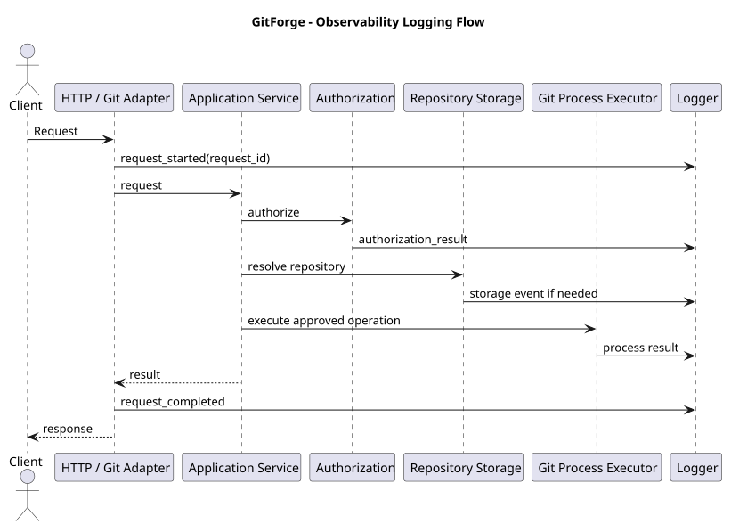

# GitForge V1.0.0 Observability Design

## 1. Document Information

| Field | Value |

|---|---|

| Project | GitForge - Web Git Hosting Platform |

| Target release | V1.0.0 |

| Document | Observability Design |

| SDLC phase | System Design |

| Milestone | M3 - System Design |

| Project owner | Farhad Valizadegan |

| Status | Approved |

| Last updated | 2026-08-18 |

---

## 2. Purpose

This document defines the observability design for GitForge V1.0.0.

It translates the approved:

```text

Requirements

System Analysis

Architecture Decisions

Component Design

API Specification

Authorization Design

Repository Storage Design

Git Process Execution Design

Deployment Design

```

into an implementation-ready observability model for:

```text

Application logging

Request correlation

Authentication events

Authorization decisions

Repository operations

PAT lifecycle events

Git process execution

Git Smart HTTP operations

Repository storage failures

Database failures

Health status

Deployment diagnostics

Operational metrics

Alertable conditions

Sensitive-data handling

```

---

## 3. Observability Objectives

GitForge observability must support:

```text

Diagnosing failures

Tracing requests across components

Distinguishing authentication from authorization failures

Distinguishing application from Git/storage failures

Understanding Git process behavior

Detecting deployment/runtime faults

Verifying health

Investigating security-relevant activity

Supporting maintenance and incident analysis

```

---

## 4. Observability Scope

V1.0.0 observability includes:

```text

Structured application logs

Correlation/request IDs

Health checks

Operational counters/metrics where practical

Git process execution diagnostics

Repository storage diagnostics

Security-relevant audit-style events

07-deployment/version diagnostics

```

---

## 5. Scope Exclusions

V1.0.0 does not require:

```text

Distributed tracing platform

OpenTelemetry collector

Prometheus cluster

Grafana

ELK stack

SIEM integration

APM SaaS

Centralized log aggregation service

Machine-learning anomaly detection

Full enterprise audit subsystem

```

These may be added later without changing the core observability principles.

---

# Observability Principles

## 6. Structured Logging

Application logs should use structured context.

Preferred conceptual format:

```text

timestamp

level

message

event

request_id

user_id

repository_id

operation

result

duration_ms

failure_category

```

---

## 7. Correlation

Every externally initiated application request should have a correlation identifier.

Conceptually:

```text

request_id

```

The same identifier should follow the request through:

```text

HTTP adapter

Application service

Authorization

Repository storage

Git process execution

Failure handling

```

---

## 8. Safe Logging

Observability must not expose secrets.

Never log:

```text

Plaintext password

Plaintext PAT

PAT token_hash

Raw Authorization header

Session secret

APP_KEY

Database password

Complete environment configuration

```

---

## 9. Failure Classification

Operational failures should be classified instead of logged only as generic exceptions.

Examples:

```text

authentication_failure

authorization_denied

validation_failure

repository_not_found

repository_consistency_failure

storage_failure

git_process_start_failure

git_process_timeout

git_process_failure

database_failure

configuration_failure

```

---

## 10. No False Success

Observability must record the final actual operation result.

Example:

```text

repository_create_started

repository_create_failed

```

must not be followed by:

```text

repository_create_succeeded

```

unless the complete operation actually succeeded.

---

# Logging Architecture

## 11. Logging Flow



[PlantUML source](diagrams/13-observability-design.puml)

---

# Request Logging

## 12. Request Start Event

Every external application request should record a safe event such as:

```text

request_started

```

Useful context:

```text

request_id

HTTP method

route name

actor state

timestamp

```

---

## 13. Route Logging

Prefer logging:

```text

route name

```

over raw unbounded URLs where possible.

Example:

```text

repository.show

repository.create

repository.visibility.update

tokens.create

git.upload_pack

git.receive_pack

```

---

## 14. Client Data

Avoid logging full:

```text

Request body

Git protocol payload

Password fields

PAT credential

Authorization headers

```

---

## 15. Request Completion

Record:

```text

request_completed

```

with:

```text

request_id

status_code

duration_ms

result

```

---

# Correlation IDs

## 16. Correlation ID Creation

If no trusted request ID exists, GitForge should generate one at request ingress.

---

## 17. Correlation ID Propagation

The request ID should be available to:

```text

Controllers/handlers

Application services

Authorization policies/services

Storage component

Git Process Executor

Error handlers

```

---

## 18. External Response

The request/correlation ID may optionally be returned through a safe response header.

Conceptually:

```text

X-Request-ID

```

This assists support/debugging.

---

# Authentication Observability

## 19. Login Success

Record:

```text

authentication_succeeded

```

Safe context:

```text

request_id

user_id

authentication_type = session

```

---

## 20. Login Failure

Record:

```text

authentication_failed

```

Do not log:

```text

Password

Password hash

```

Email logging should be minimized or handled according to privacy policy.

---

## 21. Logout

Record:

```text

logout_succeeded

```

with:

```text

user_id

request_id

```

where available.

---

# PAT Authentication Observability

## 22. PAT Authentication Success

Record:

```text

pat_authentication_succeeded

```

Safe fields may include:

```text

request_id

user_id

token_identifier

```

The token identifier may be logged only if considered safe operational metadata.

---

## 23. PAT Authentication Failure

Record:

```text

pat_authentication_failed

```

Possible internal reason classes:

```text

missing

invalid

revoked

malformed

```

Do not log the submitted secret.

---

## 24. Revoked PAT Use

A revoked token attempt should remain distinguishable operationally from a valid active token.

---

# Authorization Observability

## 25. Authorization Decision Event

Security-relevant repository authorization decisions may log:

```text

authorization_decision

```

Context:

```text

request_id

user_id or anonymous

repository_id

operation

decision

```

---

## 26. Allowed Decision

Example:

```text

operation = read

decision = allow

```

---

## 27. Denied Decision

Example:

```text

operation = write

decision = deny

```

External response may still conceal repository existence.

---

## 28. Private Repository Concealment

Logs may distinguish internally:

```text

repository exists

authorization denied

```

while the client receives:

```text

404 Not Found

```

---

## 29. Authorization Logging Volume

Not every trivial public read must necessarily generate high-volume audit-style logs.

Implementation may balance:

```text

Operational value

Storage volume

Security relevance

```

---

# Repository Lifecycle Observability

## 30. Repository Creation Started

Record:

```text

repository_create_started

```

Context:

```text

request_id

user_id

repository_name

visibility

```

---

## 31. Metadata Creation

May record:

```text

repository_metadata_created

```

with:

```text

repository_id

```

---

## 32. Physical Initialization

Record outcome of:

```text

bare_repository_initialization

```

---

## 33. Repository Creation Success

Record only after:

```text

Metadata success

+

Physical Git repository success

```

Event:

```text

repository_create_succeeded

```

---

## 34. Repository Creation Failure

Record:

```text

repository_create_failed

```

with safe failure category.

---

## 35. Compensation

If compensation runs:

```text

repository_creation_compensation_started

repository_creation_compensation_succeeded

repository_creation_compensation_failed

```

where operationally useful.

---

# Repository Visibility Observability

## 36. Visibility Update

Record:

```text

repository_visibility_changed

```

Safe context:

```text

request_id

repository_id

user_id

old_visibility

new_visibility

```

---

# Repository Browser Observability

## 37. Browser Operations

Operations may be classified as:

```text

branch_list

commit_history

commit_detail

tree_list

blob_read

```

---

## 38. Browser Timing

Useful performance context:

```text

repository_id

operation

duration_ms

result

```

---

## 39. Large Blob Rejection

If UI display size limits reject a blob, record a bounded operational event if useful:

```text

blob_display_limit_exceeded

```

---

# Git Smart HTTP Observability

## 40. Git Service Categories

Git Smart HTTP operations should be classified as:

```text

upload_pack_advertisement

upload_pack_rpc

receive_pack_advertisement

receive_pack_rpc

```

---

## 41. Git Read Event

Safe context:

```text

request_id

repository_id

user_id or anonymous

operation = upload_pack

result

duration_ms

```

---

## 42. Git Write Event

Safe context:

```text

request_id

repository_id

user_id

operation = receive_pack

result

duration_ms

```

---

## 43. No Protocol Payload Logging

Do not log full:

```text

Packfile payloads

Git RPC request bodies

Git RPC response bodies

```

---

# Git Process Observability

## 44. Process Start

Record:

```text

git_process_started

```

Context:

```text

request_id

repository_id

operation

```

---

## 45. Process Completion

Record:

```text

git_process_completed

```

with:

```text

operation

exit_code

duration_ms

timed_out

result

```

---

## 46. Git Command Logging

Prefer:

```text

operation type

```

instead of arbitrary raw command strings.

Example:

```text

operation = RECEIVE_PACK_RPC

```

---

## 47. Git Binary Path

Full executable path need not be logged on every request.

It may be logged:

```text

At startup

In protected diagnostics

```

---

## 48. Timeout

Record:

```text

git_process_timeout

```

with:

```text

repository_id

operation

configured_timeout

duration_ms

```

---

## 49. Start Failure

Record:

```text

git_process_start_failed

```

---

## 50. Non-Zero Exit

Record:

```text

git_process_failed

```

with:

```text

exit_code

failure_category

```

---

## 51. stderr

stderr may be captured internally.

Logging policy:

```text

Bounded

Sanitized where practical

Internal only

No credentials

```

---

# Repository Storage Observability

## 52. Storage Resolution Failure

Event:

```text

repository_storage_resolution_failed

```

Categories:

```text

missing

unavailable

unsafe

invalid

inconsistent

```

---

## 53. Missing Repository Storage

Record:

```text

repository_storage_missing

```

This is a high-value operational condition.

---

## 54. Unsafe Path Detection

Record:

```text

repository_storage_unsafe_path

```

This should be treated as security-relevant.

---

## 55. Unexpected Existing Creation Target

Record:

```text

repository_storage_unexpected_existing_target

```

This may indicate:

```text

Operational inconsistency

Manual filesystem interference

Potential security issue

```

---

## 56. Orphan Detection

Operational maintenance tooling may record:

```text

repository_storage_orphan_detected

```

Normal user requests do not automatically adopt it.

---

# Database Observability

## 57. Database Connectivity Failure

Record:

```text

database_unavailable

```

---

## 58. Database Operation Failure

Record safe context such as:

```text

operation category

request_id

failure classification

```

Do not log:

```text

DB password

Raw credentials

Sensitive query parameters

```

---

## 59. Constraint Violations

Expected constraint failures may be classified.

Examples:

```text

repository_namespace_conflict

email_unique_conflict

```

---

# PAT Lifecycle Observability

## 60. PAT Creation

Record:

```text

pat_created

```

Safe context:

```text

request_id

user_id

token_id

token_identifier

```

Never log:

```text

plaintext PAT

token_hash

```

---

## 61. PAT Revocation

Record:

```text

pat_revoked

```

---

## 62. Repeated Revocation

A repeated idempotent revocation may record:

```text

pat_already_revoked

```

if operationally useful.

---

# Security-Relevant Events

## 63. Security Event Categories

High-value events include:

```text

Repeated login failures

Repeated invalid PAT attempts

Authorization denials

Unsafe repository path detection

Unexpected repository target collision

Attempted non-owner push

Attempted private repository access

Configuration failure

```

---

## 64. No Security Overclaim

A denied request is not automatically:

```text

Attack

```

Observability should distinguish:

```text

Security-relevant event

```

from confirmed malicious activity.

---

# Health Observability

## 65. Health Domains

Health verification includes:

```text

Application

Database

Repository Storage

Git Executable

Critical Configuration

```

---

## 66. Application Health

Possible state:

```text

healthy

unhealthy

```

---

## 67. Database Health

Possible state:

```text

reachable

unreachable

```

---

## 68. Repository Storage Health

Possible state:

```text

available

unavailable

misconfigured

permission_denied

```

---

## 69. Git Executable Health

Possible state:

```text

available

missing

not_executable

execution_failed

```

---

## 70. Public Health Response

Public health output should be minimal.

Example:

```json

{

   "status": "ok"

}

```

Detailed component diagnostics should remain protected or internal.

---

# Liveness and Readiness

## 71. Liveness Event

Liveness answers:

```text

Is application process responsive?

```

---

## 72. Readiness Event

Readiness answers:

```text

Can core GitForge functions safely execute?

```

Dependencies may include:

```text

PostgreSQL

Repository root

Git binary

Required configuration

```

---

# Operational Metrics

## 73. Metrics Philosophy

V1.0.0 may expose or derive lightweight operational metrics from logs/application instrumentation.

A dedicated metrics platform is not mandatory.

---

## 74. Request Metrics

Useful metrics:

```text

request_count

request_error_count

request_duration

```

---

## 75. Authentication Metrics

Useful metrics:

```text

login_success_count

login_failure_count

pat_auth_success_count

pat_auth_failure_count

```

---

## 76. Repository Metrics

Useful metrics:

```text

repository_create_success_count

repository_create_failure_count

repository_storage_failure_count

```

---

## 77. Git Metrics

Useful metrics:

```text

git_process_count

git_process_failure_count

git_process_timeout_count

upload_pack_count

receive_pack_count

```

---

## 78. Duration Metrics

Useful timing categories:

```text

HTTP request duration

Git process duration

Repository creation duration

Repository browser duration

```

---

# Alertable Conditions

## 79. Alert Philosophy

V1.0.0 does not require a full alerting platform, but conditions that should be operationally alertable are identified.

---

## 80. Database Unavailability

High-priority condition:

```text

Database unreachable

```

---

## 81. Repository Storage Unavailability

High-priority condition:

```text

Repository root inaccessible

```

---

## 82. Git Binary Failure

High-priority condition:

```text

Configured Git executable cannot run

```

---

## 83. Repeated Git Timeouts

Potential degradation condition:

```text

git_process_timeout_count increases significantly

```

---

## 84. Storage Consistency Failures

High-value condition:

```text

metadata exists + repository storage missing

```

---

## 85. Disk Pressure

Where the deployment environment provides filesystem capacity data, low disk space should be monitored.

This is especially important for:

```text

Repository storage

PostgreSQL data

Application logs

```

---

# Log Levels

## 86. DEBUG

Examples:

```text

Detailed development diagnostics

Safe process lifecycle details

```

Production DEBUG should normally be disabled.

---

## 87. INFO

Examples:

```text

Successful repository creation

Successful PAT creation/revocation

Deployment startup

Git version detection

```

---

## 88. NOTICE / INFO

May represent:

```text

Authorization denial

Expected invalid authentication

```

depending on logging framework conventions.

---

## 89. WARNING

Examples:

```text

Repeated failed authentication

Repository inconsistency

Unexpected creation target

Recoverable operational degradation

```

---

## 90. ERROR

Examples:

```text

Git process failure

Storage access failure

Database operation failure

Repository creation compensation failure

```

---

## 91. CRITICAL

Examples:

```text

Repository root unavailable at startup

Critical configuration missing

Application cannot access PostgreSQL

Git executable completely unavailable

```

depending on impact.

---

# Laravel Logging Design

## 92. Logging Framework

GitForge uses Laravel logging facilities.

Conceptually:

```text

Log channels

Structured context

Context propagation

Exception logging

```

---

## 93. Context Enrichment

Common Laravel logging context may include:

```text

request_id

user_id

repository_id

operation

```

---

## 94. Environment Logging

Development may use:

```text

single

daily

stderr

```

or equivalent local channels.

Production may use:

```text

daily

stderr

syslog

platform logging

```

depending on deployment.

---

## 95. Channel Choice

Exact log-channel deployment is not architecture-critical.

The design requirement is:

```text

Persistent enough for diagnosis

Protected

Rotated

No secrets

```

---

# Log Retention

## 96. Retention Principle

Production logs must not grow without bound.

---

## 97. Rotation

Configure:

```text

Rotation

Retention

Disk usage control

```

---

## 98. Sensitive Retention

Security-related logs may contain user identifiers and repository identifiers.

Retention should follow deployment/privacy policy.

---

# Startup Observability

## 99. Startup Event

Record:

```text

application_started

```

with safe runtime metadata.

---

## 100. Version Metadata

Safe startup information may include:

```text

GitForge version

Environment

PHP version

Laravel version

Git version

PostgreSQL version where obtainable

```

---

## 101. Configuration Verification

Startup/health diagnostics should verify critical configuration but must not dump secret values.

Example:

```text

repository_root configured = true

git_binary configured = true

database configured = true

```

---

# Deployment Observability

## 102. Release Identifier

Where available, log:

```text

release_version

commit_sha

deployment_id

```

---

## 103. Migration Result

Deployment should record whether:

```text

Database migrations succeeded

```

---

## 104. Smoke-Test Result

Operational deployment tooling may record:

```text

smoke_test_passed

smoke_test_failed

```

---

# Error Handling Integration

## 105. Exception Mapping

Application exceptions should map to both:

```text

Safe external response

+

Useful internal diagnostic event

```

---

## 106. Example

Internal:

```text

RepositoryStorageMissingException

```

External:

```text

500/503 safe repository access failure

```

Log:

```text

repository_storage_missing

```

---

## 107. Authentication Example

Internal:

```text

InvalidPersonalAccessToken

```

External:

```text

401

```

Log:

```text

pat_authentication_failed

```

without token secret.

---

# Observability and Privacy

## 108. Data Minimization

Logs should contain only information required for:

```text

Operations

Security diagnosis

Failure diagnosis

Maintenance

```

---

## 109. User Data

Avoid unnecessarily logging:

```text

Email address

Full commit content

File content

PAT name if not needed

Request body

```

---

## 110. Repository Content

Do not log arbitrary:

```text

Blob contents

Commit messages

Source code

Packfiles

```

by default.

---

# Observability and Performance

## 111. Logging Overhead

Logging must not significantly disrupt:

```text

Clone

Fetch

Push

Large repository reads

```

---

## 112. Streaming Operations

Git protocol streams should not be duplicated into logs.

---

## 113. Bounded Diagnostics

Diagnostic payloads such as stderr should have a bounded logging size.

---

# Operational Dashboard Concept

## 114. Dashboard Requirement

A dedicated graphical dashboard is not required in V1.0.0.

However, operators should be able to determine:

```text

Application healthy?

Database healthy?

Repository storage healthy?

Git binary healthy?

Recent failures?

Git timeouts occurring?

```

from logs and health information.

---

# Observability Event Catalog

## 115. Core Event Catalog

```text

application_started

request_started

request_completed

authentication_succeeded

authentication_failed

logout_succeeded

pat_authentication_succeeded

pat_authentication_failed

pat_created

pat_revoked

authorization_decision

repository_create_started

repository_metadata_created

repository_create_succeeded

repository_create_failed

repository_visibility_changed

repository_creation_compensation_started

repository_creation_compensation_succeeded

repository_creation_compensation_failed

repository_storage_missing

repository_storage_resolution_failed

repository_storage_unsafe_path

repository_storage_unexpected_existing_target

git_process_started

git_process_completed

git_process_start_failed

git_process_timeout

git_process_failed

database_unavailable

health_check_failed

readiness_failed

```

---

# Event Field Matrix

## 116. Common Fields

| Field | Purpose |

|---|---|

| `timestamp` | Event time |

| `level` | Severity |

| `event` | Stable event name |

| `message` | Human-readable summary |

| `request_id` | Correlation |

| `user_id` | Authenticated identity where applicable |

| `repository_id` | Internal repository identity |

| `operation` | Requested operation |

| `result` | Success/failure/allow/deny |

| `duration_ms` | Timing |

| `failure_category` | Stable failure class |

---

# Sensitive Field Matrix

## 117. Never Log

| Value | Logging Rule |

|---|---|

| Password | Never |

| Plaintext PAT | Never |

| PAT hash | Never |

| Raw Authorization header | Never |

| Session secret | Never |

| APP_KEY | Never |

| DB password | Never |

| Full environment dump | Never |

| Packfile payload | Never |

| Arbitrary blob content | Never |

---

# Observability Testing

## 118. Correlation Test

Verify:

```text

One request ID

appears across

controller/service/storage/Git failure logs

```

---

## 119. Secret Logging Test

Verify that:

```text

Password

PAT

Authorization header

DB password

```

do not appear in logs.

---

## 120. Authorization Logging Test

Verify:

```text

Non-owner push

```

produces a safe authorization-denied event without starting receive-pack.

---

## 121. Git Timeout Logging Test

Verify:

```text

Timeout

→ git_process_timeout

→ operation failed

→ no success event

```

---

## 122. Storage Missing Test

Verify:

```text

Metadata exists

Storage absent

```

produces:

```text

repository_storage_missing

```

and no silent initialization.

---

## 123. Repository Creation Failure Test

Verify failed Git initialization records:

```text

repository_create_failed

```

and compensation result.

---

## 124. Private Repository Test

Verify unauthorized private access:

```text

External 404/concealment

Internal authorization denial

```

without exposing sensitive data.

---

# Observability Invariants

## 125. OBI-001 — Structured Context

```text

Operational events include stable structured context

```

---

## 126. OBI-002 — Correlation

```text

External requests have correlation IDs

```

---

## 127. OBI-003 — Secret Exclusion

```text

Passwords, PAT secrets, and credentials

are never logged

```

---

## 128. OBI-004 — Failure Classification

```text

Authentication

Authorization

Storage

Git

Database

are distinguishable

```

---

## 129. OBI-005 — No Git Payload Logging

```text

Git protocol payloads

are not logged

```

---

## 130. OBI-006 — No Repository Content Logging

```text

Repository source/blob contents

are not logged by default

```

---

## 131. OBI-007 — No False Success

```text

Failed operation

never emits final success semantics

```

---

## 132. OBI-008 — Health Safety

```text

Health responses

do not expose secrets

```

---

## 133. OBI-009 — Bounded Logs

```text

Untrusted diagnostic output

is bounded before logging

```

---

## 134. OBI-010 — Operational Readiness

```text

Core deployment dependencies

are observable

```

---

# Traceability

## 135. Use-Case Mapping

Observability supports diagnosis of:

```text

UC-001 Register

UC-002 Authenticate

UC-003 Logout

UC-004 Create Repository

UC-005 List Owned Repositories

UC-006 View Repository

UC-007 Change Visibility

UC-009 Browse Repository

UC-010 List Branches

UC-011 Commit History

UC-012 Commit Details

UC-013 Tree

UC-014 File

UC-015 Discover Read Service

UC-016 Clone

UC-017 Fetch

UC-018 Discover Write Service

UC-019 Push

UC-020 Create PAT

UC-021 Authenticate Git with PAT

UC-022 Revoke PAT

UC-023 Authorize Read

UC-024 Authorize Write

UC-025 Diagnose Failure

```

---

## 136. Architecture Decision Mapping

This design implements or supports:

```text

ADR-034 Explicit Git Process Timeout

ADR-035 Controlled Git Process Environment

ADR-036 Fail-Closed Architecture

ADR-039 Structured Laravel Logging

ADR-040 Sensitive Data Excluded from Logs

ADR-041 Safe Error Mapping

ADR-053 Health Verification

ADR-058 Central Configuration

ADR-063 Git Failure Distinct from Auth Failure

ADR-065 Missing Storage Is Consistency Failure

ADR-066 No Implicit Repair

```

---

# Scope Preservation

## 137. No Mandatory Distributed Tracing

V1.0.0 does not require a tracing backend.

---

## 138. No Mandatory Metrics Platform

Metrics may initially be derived from logs/application instrumentation.

---

## 139. No Enterprise Audit System

The design defines security-relevant operational events but not a complete regulatory audit subsystem.

---

## 140. No Repository Content Analytics

GitForge does not analyze repository content for:

```text

Product analytics

Behavior profiling

Source-code telemetry

```

in V1.0.0.

---

# Validation

## 141. Architecture Alignment

Structured logging and health verification align with approved architecture.

Result:

```text

PASS

```

---

## 142. Authentication Alignment

Session and PAT authentication success/failure events are distinguishable.

Result:

```text

PASS

```

---

## 143. Authorization Alignment

Authorization decisions are observable without replacing external concealment rules.

Result:

```text

PASS

```

---

## 144. Repository Storage Alignment

Missing, unsafe, inconsistent, and unavailable storage conditions are observable.

Result:

```text

PASS

```

---

## 145. Git Execution Alignment

Git process start, completion, timeout, and failure are observable.

Result:

```text

PASS

```

---

## 146. Deployment Alignment

Application, database, repository storage, Git executable, and configuration health are observable.

Result:

```text

PASS

```

---

## 147. Security Alignment

Secrets, protocol payloads, and repository content are excluded from logs.

Result:

```text

PASS

```

---

## 148. Scope Alignment

Mandatory enterprise observability infrastructure introduced:

```text

0

```

Result:

```text

PASS

```

---

# Implementation Readiness

## 149. Logging Readiness

Stable event categories and common fields are defined.

---

## 150. Correlation Readiness

Request-level correlation behavior is defined.

---

## 151. Security Logging Readiness

Sensitive-data exclusion rules are defined.

---

## 152. Git Observability Readiness

Git operation timing, exit, timeout, and failure behavior are defined.

---

## 153. Storage Observability Readiness

Repository consistency and storage failure events are defined.

---

## 154. Health Readiness

Application dependency health states are defined.

---

## 155. Testing Readiness

Observability-specific tests are defined.

---

# Completion

## 156. Completion Criteria

This observability design is complete when:

- observability objectives are defined;

- structured logging is defined;

- correlation IDs are defined;

- request start/completion events are defined;

- authentication events are defined;

- PAT authentication events are defined;

- authorization decision events are defined;

- repository lifecycle events are defined;

- repository visibility events are defined;

- repository browser observability is defined;

- Git Smart HTTP observability is defined;

- Git process observability is defined;

- repository storage observability is defined;

- database observability is defined;

- PAT lifecycle observability is defined;

- security-relevant events are defined;

- health observability is defined;

- liveness/readiness observability is defined;

- useful metrics are identified;

- alertable conditions are identified;

- log levels are defined;

- Laravel logging integration is defined;

- retention/rotation expectations are defined;

- startup/deployment diagnostics are defined;

- privacy/data-minimization rules are defined;

- performance/bounded-log rules are defined;

- event catalog is defined;

- sensitive field exclusions are defined;

- observability tests are defined;

- excluded infrastructure scope remains preserved;

- no blocking observability-design gap remains.

---

## 157. Observability Design Result

Observability design:

```text

DEFINED

```

Blocking observability-design gaps:

```text

0

```

Readiness for security design:

```text

READY

```

Next design artifact:

```text

14-security-design.md

```

---

## 158. Document Status

This document is currently:

```text

Approved

```

It will be changed to:

```text

Approved

```

after structured logging, correlation, authentication/authorization events, repository lifecycle observability, storage/Git process diagnostics, health checks, metrics, alertable conditions, sensitive-data handling, privacy, testing, and scope alignment have been reviewed.
