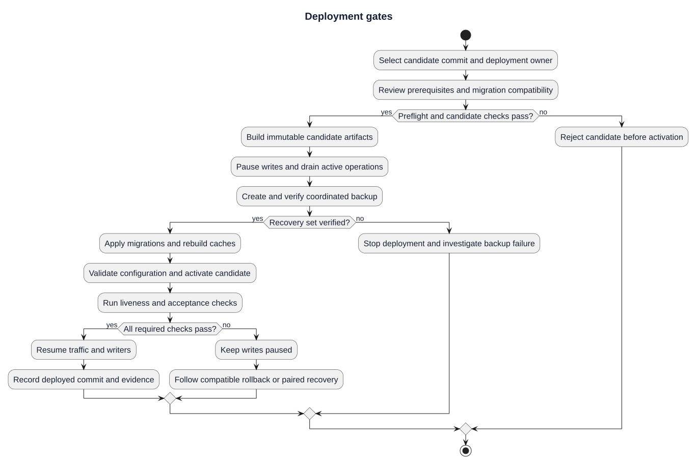

# Deployment Plan

| Field | Value |
|---|---|
| Project | GitForge — Web Git Hosting Platform |
| Version | V1.0.0 |
| SDLC phase | 7 — Deployment |
| Milestone | M6 — Deployment |
| Status | Approved |
| Date | 2026-08-23 |

## Purpose

M6 converts the tested V1.0.0 implementation into a reproducible, production-oriented deployment package suitable for a portfolio release and for later installation on a Linux host.

## Deployment Objectives

1. Define a deterministic Linux production topology.
2. Keep secrets outside version control.
3. Provide production Nginx, PHP-FPM, Laravel and PostgreSQL configuration boundaries.
4. Make frontend and backend release preparation reproducible.
5. Validate migrations, build output, runtime liveness and Nginx syntax in CI.
6. Define backup, restore, rollback and operational verification procedures.
7. Preserve persistent Git repositories independently from application releases.

## Scope

M6 validates the deployment package in GitHub Actions using a production-like environment. A paid VPS, public domain and public TLS certificate are intentionally not required for the portfolio V1.0.0 milestone. The package is designed so those external resources can be attached later without redesigning the application.

## Exit Criteria

All repository-side M6 exit criteria passed in Deployment Validation run `32659338381` and Backend CI run `32659338516`:

- deployment configuration is version controlled;
- production secrets are not committed;
- deployment scripts pass shell syntax validation;
- frontend production build succeeds;
- backend production dependency installation succeeds;
- PostgreSQL migrations succeed against PostgreSQL 18;
- Laravel production configuration and route caching succeed;
- `/up` responds in a production-like runtime;
- Nginx configuration passes `nginx -t` with temporary test TLS material;
- backup and recovery procedures are documented;
- M6 milestone review is approved.

## Current candidate planning supplement

The approval and CI run IDs above are historical V1.0.0 evidence. This supplement completes the planning procedure; it does not approve an unreleased candidate or certify a live public host. Use the [release checklist](../../Releases/v1/RELEASE-CHECKLIST.md) and [unreleased scope](../../Releases/v1/UNRELEASED.md) when selecting a new candidate.

### Prerequisites and deliverables

| Area | Required input or deliverable | Acceptance boundary |
| --- | --- | --- |
| Candidate | Exact approved tag or commit, lockfiles, change and migration review | Do not deploy an unspecified moving branch |
| Host | Supported Linux runtime, Nginx, PHP-FPM, PostgreSQL, Git and build tools | Confirm actual versions and available disk space |
| Configuration | Reviewed environment, ingress and PHP-FPM templates | Real secrets remain on the target host |
| State | Private database and persistent repository root | State survives code deployment independently |
| Recovery | Verified database dump, Git archive, manifest and checksums | Pause and drain all writers before creating the pair |
| Validation | Candidate CI evidence and host acceptance results | Historical green runs do not validate a new candidate |
| Operations | Deployment record, responsible operator and recovery instructions | Record failures and resumed service state |

### Responsibilities

| Responsibility | Required action |
| --- | --- |
| Release owner | Select candidate, review scope and accept evidence |
| Deployment operator | Prepare host, protect secrets, coordinate writers and activate code |
| Verification reviewer | Review required checks and record failures or acceptance |
| Recovery owner | Confirm backup integrity and schema compatibility before recovery |

One person may fulfill multiple responsibilities for a local or portfolio deployment. Record the actual responsible person for a real deployment; these roles are not a claim that a staffed operations team exists.

### Execution and stop gates

1. Review the [architecture](02-deployment-architecture.md), [configuration](03-production-configuration.md) and [network boundaries](06-network-tls-and-runtime.md). Run [preflight](../../../deployment/scripts/preflight.sh) and resolve failures before activation.
2. Prepare dependencies and frontend build for the selected candidate. Preserve the existing `APP_KEY` during upgrades; generate it only for a first installation.
3. Review schema compatibility. Block new writes, drain active requests and pushes, pause jobs and direct writers, then create and verify a [coordinated backup](07-backup-and-restore.md).
4. Follow the [runbook](04-deployment-runbook.md): migrations, caches, configuration validation and service reload. A failed migration or validation stops deployment; never assume automatic database rollback is safe.
5. Verify `/up` through the intended ingress, then perform the acceptance checks below. Liveness alone does not establish operational readiness.
6. Resume traffic and writers only after required checks pass. Record commit/tag, operator, check results, backup identifier and any recovery decision. Keep writes blocked on failure and follow [rollback and recovery](08-rollback-and-recovery.md).

### Acceptance and evidence matrix

| Check | Evidence to record |
| --- | --- |
| Build, migration and caches | Candidate workflow and command results |
| Ingress and runtime | Configuration validation and HTTPS/liveness results |
| Authentication and authorization | Sign-in/session result; private access rejected for unauthorized users |
| Git Smart HTTP | PAT-authenticated clone/fetch/push in a designated test repository |
| Browsing and persistent state | Expected branch, commit and file content; metadata/storage consistency |
| Backup and recovery | Verified paired backup; compatible recovery path and restore exercise evidence when performed |
| Candidate-specific features | Checks for changed UI, repository collaboration and Actions behavior |

Use designated test data for write checks. Do not record PATs, passwords, cookies or Authorization headers in evidence. A restore exercise must use an isolated target unless a real recovery has been explicitly selected.

### Actions worker for current development candidates

Actions is newer than the recorded V1.0.0 deployment milestone. A candidate containing Actions requires a separate queue worker consuming `gitforge-actions`; PHP-FPM does not execute queued jobs. The repository provides a [Windows local starter](../../../backend/scripts/start-actions-worker.ps1). For Linux, arrange an operator-managed service running the following from the deployed backend:

```bash
php artisan queue:work --queue=gitforge-actions --tries=1 --timeout=60 --sleep=1
```

Linux service installation, restart supervision and startup after reboot remain host responsibilities; the repository does not supply an installed Linux worker service. Pause and drain the worker during coordinated backups and restart it with the deployed candidate before verifying Actions. These checks execute built-in repository checks, not arbitrary project build commands.

### Schedule and recovery targets

Choose the deployment window, downtime allowance, backup retention, recovery time objective and recovery point objective for the actual host. No measured production SLA or fixed deployment duration is asserted here. Stop the change if recovery cannot fit the agreed operational constraints.

## Deployment gates



[PlantUML source](diagrams/01-deployment-plan.puml) · [Full-size SVG](diagrams/01-deployment-plan.svg)

This diagram illustrates the documented procedure. Historical approvals remain tied to their recorded release and evidence; new candidates require fresh validation.
