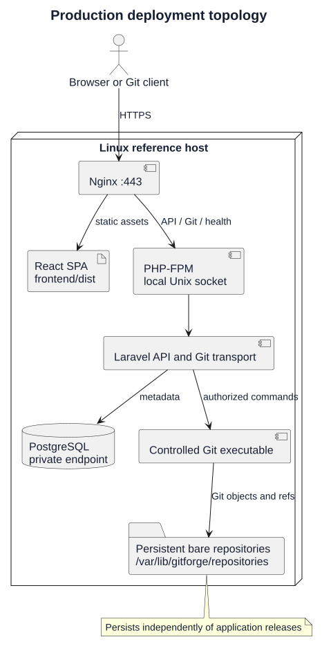
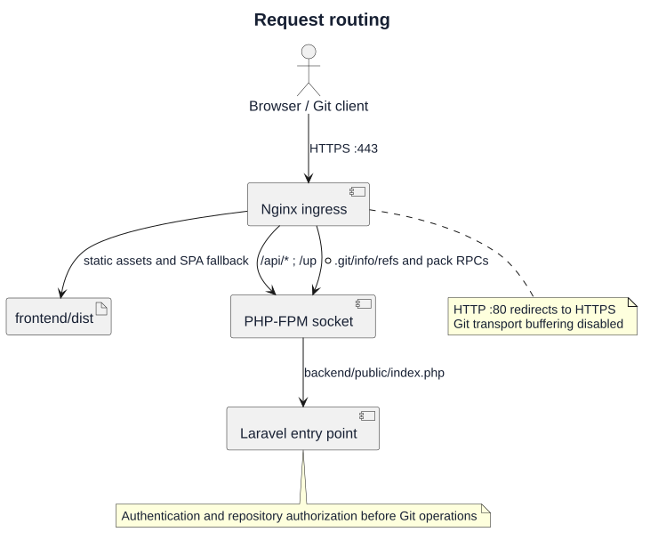
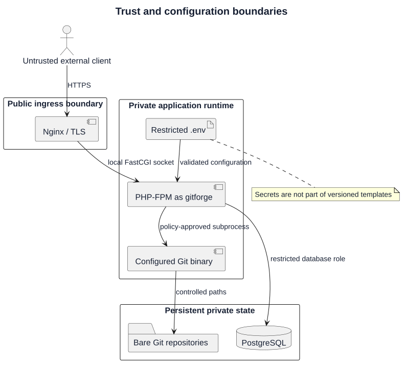
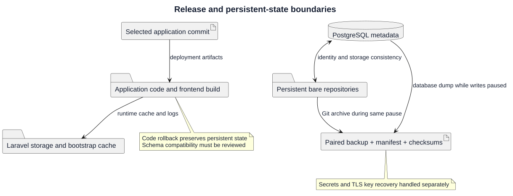
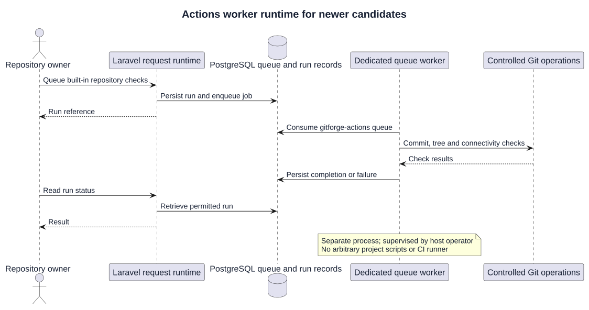
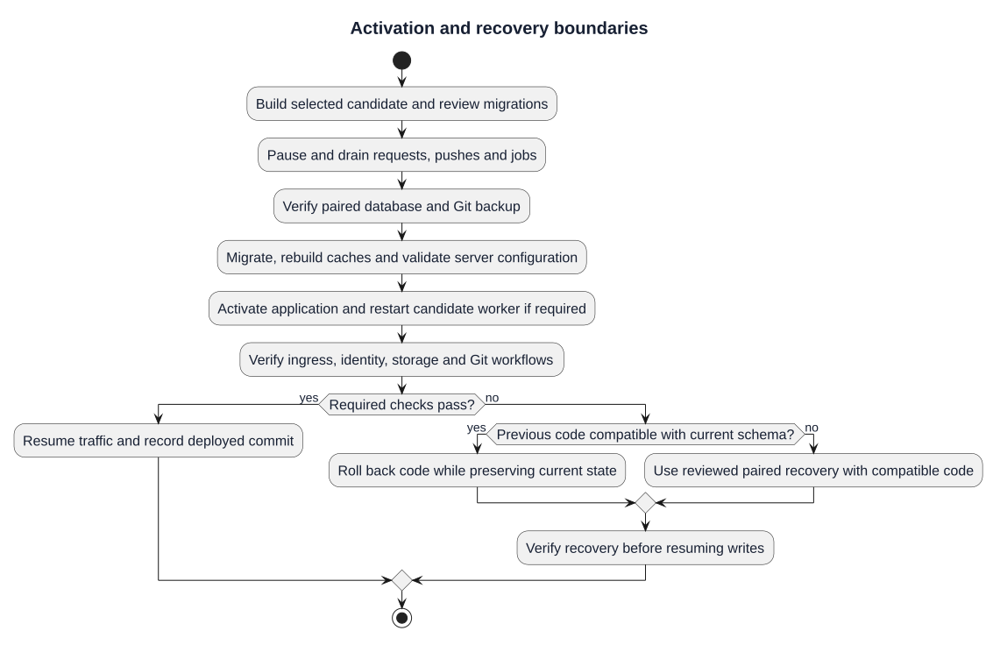
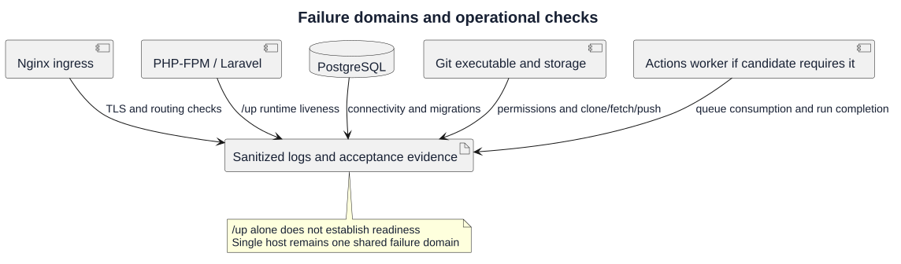

# Deployment Architecture

| Field | Value |
| --- | --- |
| Project | GitForge — Web Git Hosting Platform |
| Historical version | V1.0.0 |
| Milestone | M6 — Deployment |
| Historical status | Approved |
| Architecture supplement | Current repository reference; requires candidate and host validation |

## Purpose and version context

This architecture defines the Linux reference deployment, request paths, trust boundaries, persistent-state separation, and operational responsibilities. The recorded M6 approval applies to the historical V1.0.0 package. Newer collaboration and Actions capabilities are development-candidate additions; their inclusion here does not publish or approve a release.

The reference is a single host with Nginx, PHP 8.4/PHP-FPM, Laravel 12, PostgreSQL 18, system Git and a compiled React SPA. Node.js/npm prepares frontend assets; it is not a production web request server. See the [deployment plan](01-deployment-plan.md) and [release status](../../Releases/v1/UNRELEASED.md).

## Production topology

[PlantUML source](diagrams/02-deployment-architecture.puml) · [Full-size SVG](diagrams/02-deployment-architecture.svg)

Nginx serves public traffic and frontend assets. It forwards dynamic requests through a local FastCGI socket to the Laravel entry point. Laravel applies authentication and repository policies, uses PostgreSQL for metadata, and invokes a configured Git executable against managed bare repositories. PostgreSQL and repository storage survive application deployments independently.

## Component responsibilities

| Component | Responsibility | Boundary |
| --- | --- | --- |
| Nginx | TLS termination, static assets, SPA fallback and dynamic routing | Public ingress; port 80 redirects to HTTPS |
| React build | Browser application in `frontend/dist` | Build artifacts contain no server secrets |
| PHP-FPM | Execute Laravel requests as `gitforge` | Local socket; no public FastCGI listener |
| Laravel | Sessions, PAT authentication, policies, metadata and Git orchestration | Authorize every protected operation |
| PostgreSQL | Identity, repository metadata and application records | Localhost or trusted private network |
| Git executable | Read/write Git objects and references under application control | Executable and paths selected by deployment configuration |
| Bare repositories | Durable source history and refs | Outside public web roots |
| Actions worker | Process built-in checks for candidates that include Actions | Separate queue process; host supervision required |

## Request routing

[PlantUML source](diagrams/02-deployment-architecture-request-routing.puml) · [Full-size SVG](diagrams/02-deployment-architecture-request-routing.svg)

The [Nginx template](../../../deployment/nginx/gitforge.conf) routes `/api/`, exact `/up`, and Git Smart HTTP `info/refs`, `git-upload-pack`, and `git-receive-pack` requests to `backend/public/index.php`. Other frontend routes use the SPA fallback. The production template disables Git request and response buffering and currently sets a `100m` request limit and 60-second FastCGI timeouts. These are configuration defaults, not tested capacity guarantees; align them with application limits and actual workload before deployment.

Git clients present PAT credentials for operations requiring authentication. Private repositories remain owner-only; permitted public reads and owner write policies are enforced in Laravel. TLS protects credentials in transit. The exact PHP-FPM socket is `/run/php/php8.4-fpm-gitforge.sock` in both runtime templates.

## Trust and configuration boundaries

[PlantUML source](diagrams/02-deployment-architecture-trust-boundaries.puml) · [Full-size SVG](diagrams/02-deployment-architecture-trust-boundaries.svg)

The [PHP-FPM pool](../../../deployment/php-fpm/gitforge.conf) runs as `gitforge`, exposes its socket to the Nginx identity, clears inherited environment variables, and disables displayed PHP errors. Real secrets belong in a restricted deployed `backend/.env` or equivalent operator-managed secret provision; versioned examples contain placeholders. Rebuild Laravel configuration caches after approved environment changes.

The application source and public assets must not be broadly writable by runtime processes. Required writable paths include Laravel storage, bootstrap cache and managed repositories. PostgreSQL is not publicly exposed by default. The deployment-controlled Git binary and validated repository identifiers prevent client input from defining arbitrary executables or physical storage paths.

## Release and persistent-state boundaries

[PlantUML source](diagrams/02-deployment-architecture-persistent-state.puml) · [Full-size SVG](diagrams/02-deployment-architecture-persistent-state.svg)

| Path or resource | Lifecycle |
| --- | --- |
| `/var/www/gitforge` | Selected application release and build artifacts |
| `backend/.env` | Host-specific configuration; preserve application key during upgrades |
| `backend/storage` | Runtime logs and framework state; review persistence and permissions |
| `backend/bootstrap/cache` | Regenerated candidate-specific caches |
| PostgreSQL | Durable metadata; migration compatibility reviewed before activation |
| `/var/lib/gitforge/repositories` | Durable bare repositories; never replaced by code-only rollback |

Repository metadata and physical storage form a logical pair. Missing storage must not be silently recreated for existing metadata, and orphaned repositories must not be automatically adopted. A complete application data recovery set includes both PostgreSQL and Git storage. The backup scripts do not replace a separate plan for securely recovering `APP_KEY`, host configuration or TLS keys. See [storage deployment](05-database-and-storage-deployment.md) and [backup and restore](07-backup-and-restore.md).

## Actions worker runtime for newer candidates

[PlantUML source](diagrams/02-deployment-architecture-actions-worker.puml) · [Full-size SVG](diagrams/02-deployment-architecture-actions-worker.svg)

Actions requires a separate worker consuming the `gitforge-actions` queue. PHP-FPM handles web requests and does not consume queued jobs. The worker uses the deployed backend configuration, accesses authorized Git data, and stores run results. It executes built-in commit, tree and connectivity checks; arbitrary project commands and isolated CI runners are outside this implementation.

The [Windows starter](../../../backend/scripts/start-actions-worker.ps1) supports local development. Linux service installation, startup on reboot, supervision and restart policy remain host responsibilities; an installed Linux service is not supplied by the repository. Pause and drain jobs with other writers during backup or deployment, then restart workers with the activated candidate. See the [planning supplement](01-deployment-plan.md#actions-worker-for-current-development-candidates).

## Activation and recovery boundaries

[PlantUML source](diagrams/02-deployment-architecture-lifecycle.puml) · [Full-size SVG](diagrams/02-deployment-architecture-lifecycle.svg)

Build a selected candidate and review migration compatibility before activation. Block new writes, drain active requests and pushes, pause jobs and verify a coordinated recovery set before changing persistent state. Validate ingress/runtime configuration before reloading services; restart workers to load the selected code where applicable.

Code-only rollback preserves database and Git data and is valid only when the previous code supports the current schema. Incompatible recovery requires a reviewed paired backup and compatible application release. Keep writes paused until recovery acceptance checks pass. The repository does not provide automatic traffic switching, zero-downtime rollout or safe automatic reversal of every migration. Follow the [runbook](04-deployment-runbook.md) and [recovery procedure](08-rollback-and-recovery.md).

## Failure domains and operational checks

[PlantUML source](diagrams/02-deployment-architecture-failure-domains.puml) · [Full-size SVG](diagrams/02-deployment-architecture-failure-domains.svg)

`GET /up` demonstrates Laravel runtime liveness. Readiness additionally requires database connectivity, migration state, storage permissions, Git executable availability and acceptance workflows through the intended ingress. A candidate containing Actions also needs verified worker queue consumption. Inspect sanitized Nginx, Laravel and worker logs; never retain PATs, passwords, cookies, Authorization headers or raw Git protocol payloads in evidence.

Single-host failure can affect all components simultaneously. A database outage, unavailable storage, a full disk, an invalid socket configuration or an absent worker can break specific journeys even when another endpoint responds. Record actual host measurements and check results rather than assuming the production templates certify capacity or uptime. See [health verification](09-observability-and-health.md) and [deployment validation](10-deployment-validation.md).

## Scope and architecture acceptance

Kubernetes, distributed storage, SSH Git transport and high-availability clustering remain outside the historical single-host deployment scope. A public VPS, DNS record and public TLS certificate are optional infrastructure for the portfolio package and must be independently validated if attached.

Before accepting a candidate architecture, record the exact commit, configured host paths, runtime identities, ingress/TLS results, database/storage consistency checks, recovery-set verification and feature-specific acceptance evidence. Historical CI runs establish historical repository readiness; they do not certify the target host or a new candidate. No production SLA, recovery duration or tested maximum concurrency is asserted here.
