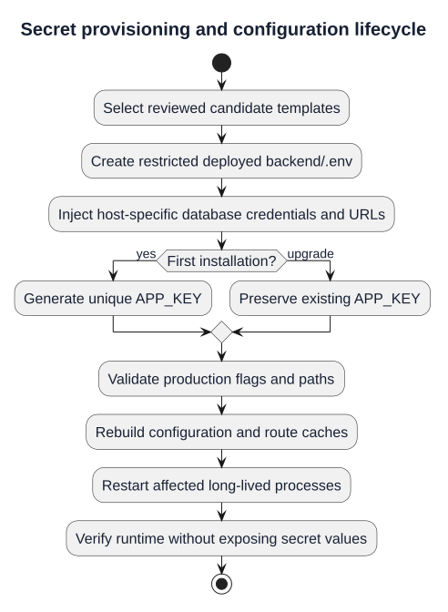
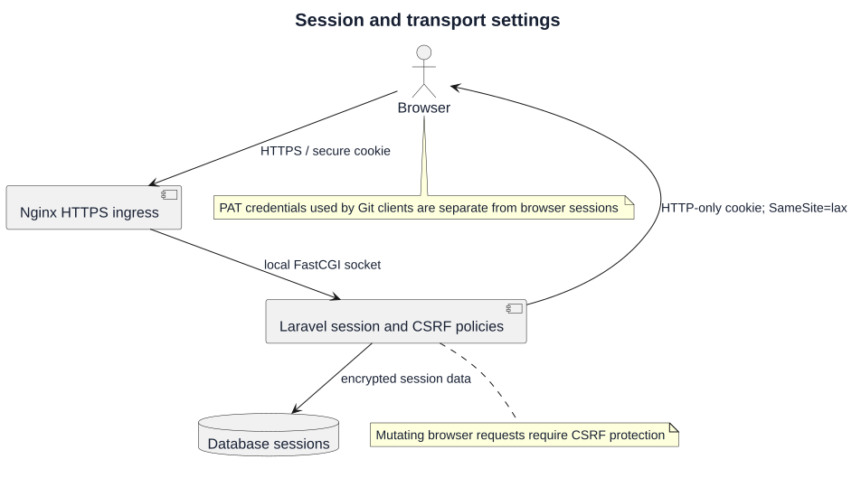
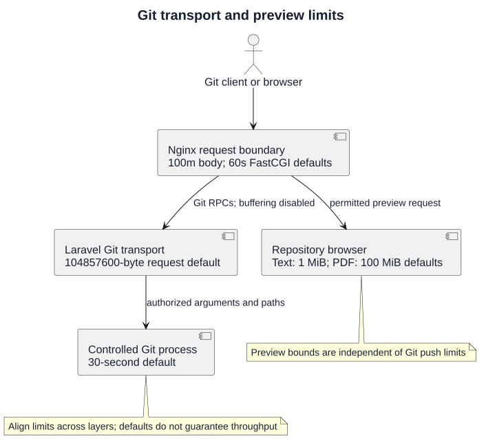
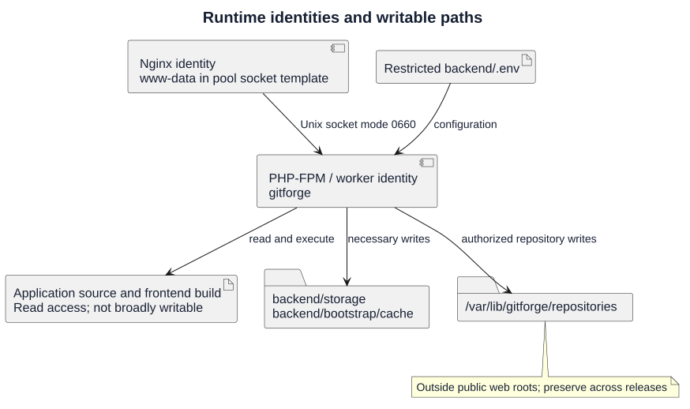
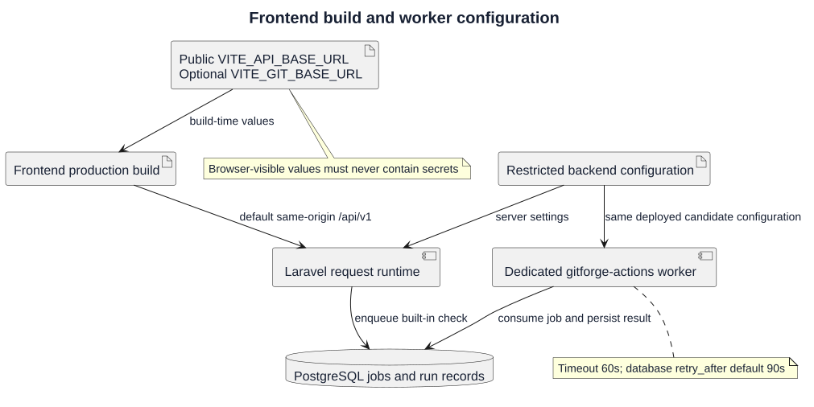
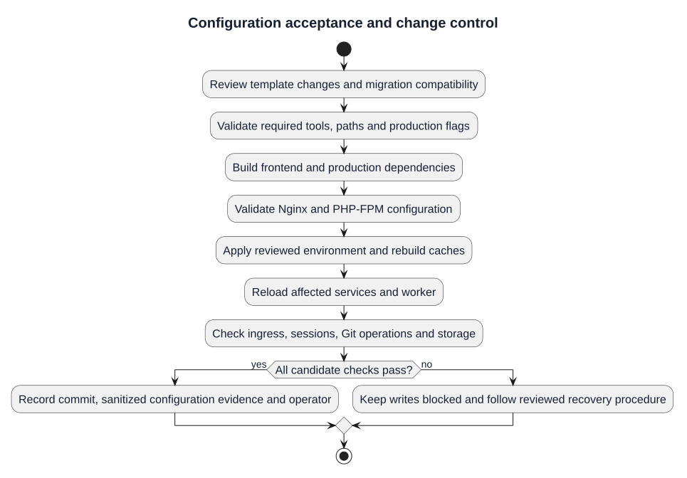

# Production Configuration

| Field | Value |
| --- | --- |
| Project | GitForge — Web Git Hosting Platform |
| Historical version | V1.0.0 |
| Milestone | M6 — Deployment |
| Historical status | Approved |
| Supplement | Current repository configuration reference; candidate and host verification required |

## Purpose and configuration authority

This document defines production settings, secret handling, runtime permissions, frontend build variables and validation responsibilities. Historical M6 approval describes the V1.0.0 package; it does not approve a new candidate or certify an installed production host. Read the [deployment architecture](02-deployment-architecture.md), [plan](01-deployment-plan.md) and [unreleased scope](../../Releases/v1/UNRELEASED.md) alongside this reference.

| Authority | Configuration covered |
| --- | --- |
| [Production environment example](../../../deployment/env/production.env.example) | Reviewed baseline with empty secret placeholders |
| [Nginx template](../../../deployment/nginx/gitforge.conf) | Ingress, certificate paths, routing and transport limits |
| [PHP-FPM pool](../../../deployment/php-fpm/gitforge.conf) | Identity, socket, process pool and PHP limits |
| [Git configuration](../../../backend/config/git.php) | Executable, storage, transport and preview bounds |
| [Queue configuration](../../../backend/config/queue.php) | Queue connection and retry interval |
| [Frontend API client](../../../frontend/src/lib/api.ts) | API base URL, credentialed requests and CSRF handling |

Versioned templates are examples. Deployed host values must be reviewed separately; no real secret file is copied into documentation or Git.

## Production configuration boundaries


[PlantUML source](diagrams/03-production-configuration.puml) · [Full-size SVG](diagrams/03-production-configuration.svg)

## Secret provisioning and configuration lifecycle



[PlantUML source](diagrams/03-production-configuration-secrets.puml) · [Full-size SVG](diagrams/03-production-configuration-secrets.svg)


Create a restricted `backend/.env` from the production example on the target host and inject actual values through the operator's approved secret process. Generate a unique `APP_KEY` only for a first installation; preserve the existing key during upgrades. Replacing it can invalidate encrypted data and sessions. Arrange secure recovery of the key and host configuration separately from the database/Git backup scripts.

| Setting | Baseline or operator input | Meaning |
| --- | --- | --- |
| `APP_ENV` | `production` | Production execution context |
| `APP_DEBUG` | `false` | Prevent client-facing debug detail |
| `APP_KEY` | Unique secret, empty in template | Laravel encryption key; preserve across upgrades |
| `APP_URL` | Actual HTTPS host | Public application URL; replace example domain |
| `APP_MAINTENANCE_DRIVER` | `file` | Maintenance marker required by backup coordination |
| `BCRYPT_ROUNDS` | `12` | Password hashing work factor in template |
| `LOG_CHANNEL`, `LOG_STACK`, `LOG_LEVEL` | `stack`, `single`, `info` | Baseline logging configuration |
| `MAIL_MAILER` | `log` | Template mail transport; not proof of email delivery |

Do not place secrets in frontend variables, command history, logs, screenshots or deployment evidence. Restrict `.env` to authorized operators and required runtime access. Rebuild Laravel configuration caches after approved changes and restart long-lived workers to load the selected configuration. Do not use a configuration-dump command that exposes secrets as validation evidence.

## Database, cache and queue configuration

| Setting | Template value | Required host review |
| --- | --- | --- |
| `DB_CONNECTION` | `pgsql` | PostgreSQL driver and PHP extensions available |
| `DB_HOST`, `DB_PORT` | `127.0.0.1`, `5432` | Actual private endpoint and connection policy |
| `DB_DATABASE` | `git_hosting_platform` | Provisioned application database |
| `DB_USERNAME` | `git_hosting_app` | Restricted application role |
| `DB_PASSWORD` | Empty placeholder | Inject real credential privately |
| `SESSION_DRIVER` | `database` | Session tables and migrations available |
| `CACHE_STORE` | `database` | Cache tables available before cache operations |
| `QUEUE_CONNECTION` | `database` | Jobs table and dedicated worker available for Actions candidates |
| `FILESYSTEM_DISK` | `local` | Default Laravel disk; separate from explicit Git storage root |

Keep PostgreSQL on localhost or a trusted private network. The application role does not require superuser, role creation or replication privileges. Apply reviewed migrations from the selected candidate; verify schema compatibility before activation or rollback. Database-backed sessions, cache and queue add dependencies beyond simple `/up` liveness.

## Session and transport settings



[PlantUML source](diagrams/03-production-configuration-sessions.puml) · [Full-size SVG](diagrams/03-production-configuration-sessions.svg)


| Setting | Template value | Effect |
| --- | --- | --- |
| `SESSION_LIFETIME` | `120` | Session lifetime in minutes |
| `SESSION_ENCRYPT` | `true` | Encrypt stored session payloads |
| `SESSION_PATH` | `/` | Application-wide cookie path |
| `SESSION_DOMAIN` | `null` | Default host-bound cookie scope |
| `SESSION_SECURE_COOKIE` | `true` | Send session cookie over HTTPS |
| `SESSION_HTTP_ONLY` | `true` | Prevent script access to session cookie |
| `SESSION_SAME_SITE` | `lax` | Baseline cross-site cookie behavior |

Production ingress uses HTTPS; port 80 redirects to HTTPS. Replace the example hostname and certificate paths before enabling public traffic. Verify sign-in, credentialed browser requests, CSRF protection and unauthorized access rejection through the actual host. Cross-origin or subdomain deployment requires deliberate cookie/CORS configuration and validation; the same-origin template does not establish that setup automatically.

## Git transport and preview limits



[PlantUML source](diagrams/03-production-configuration-limits.puml) · [Full-size SVG](diagrams/03-production-configuration-limits.svg)


| Setting | Current default | Configuration source |
| --- | --- | --- |
| `GITFORGE_GIT_BINARY` | `/usr/bin/git` in production example | Operator-controlled executable |
| `GITFORGE_REPOSITORY_ROOT` | `/var/lib/gitforge` | Managed repos under `repositories/<id>.git` |
| `GIT_PROCESS_TIMEOUT_SECONDS` | `30` seconds | Git subprocess time bound |
| `GIT_MAX_REQUEST_BYTES` | `104857600` bytes, 100 MiB | Git request body bound |
| `GIT_BROWSER_MAX_BLOB_BYTES` | `1048576` bytes, 1 MiB | Text preview bound |
| `GIT_BROWSER_MAX_PDF_BYTES` | `104857600` bytes, 100 MiB | Application default; not explicitly listed in production example |
| `GIT_INITIAL_BRANCH` | `main` | Initial repository branch setting |

Nginx currently sets `client_max_body_size 100m` and 60-second FastCGI read/send timeouts; Git-route request and response buffering are disabled. PHP-FPM's example sets 256 MiB memory, 60-second execution and 100 MiB post/upload defaults. These settings govern different layers and must be reviewed together. Text/PDF previews have independent application bounds; raising an ingress limit does not raise preview or Git process bounds. Defaults are not measured upload capacity or latency guarantees.

## Runtime identities and writable paths



[PlantUML source](diagrams/03-production-configuration-permissions.puml) · [Full-size SVG](diagrams/03-production-configuration-permissions.svg)


The dedicated PHP-FPM pool runs as user/group `gitforge`. Its local socket uses owner/group `www-data` and mode `0660` in the reference template; adapt these identities consistently for the actual host. `clear_env=yes`, displayed PHP errors are disabled, and logged PHP errors remain enabled.

Runtime write access is required for `backend/storage`, `backend/bootstrap/cache` and `/var/lib/gitforge/repositories`. Source code and frontend build artifacts require appropriate read/execute access and must not be broadly writable by runtime processes. Keep Git storage outside every public web root. Verify ownership and permissions after deployment and restoration; do not solve permission failures by recursively making the application world-writable.

## Frontend build and worker configuration



[PlantUML source](diagrams/03-production-configuration-frontend-worker.puml) · [Full-size SVG](diagrams/03-production-configuration-frontend-worker.svg)


The frontend defaults to same-origin `/api/v1`. Optional `VITE_API_BASE_URL` overrides that public API base, and `VITE_GIT_BASE_URL` overrides the clone URL base as implemented in the [Git URL helper](../../../frontend/src/lib/git-url.ts). These are browser-visible build inputs; never include credentials. Changing a Vite build variable requires rebuilding the frontend, rather than only changing the backend's cached configuration.

Candidates containing Actions need a separate process consuming `gitforge-actions` with the deployed backend's environment:

```bash
php artisan queue:work --queue=gitforge-actions --tries=1 --timeout=60 --sleep=1
```

The job timeout is 60 seconds and database queue `retry_after` defaults to 90 seconds in application configuration. Keep the retry interval greater than the effective worker/job timeout to reduce overlapping execution risk. The [Windows starter](../../../backend/scripts/start-actions-worker.ps1) is for local use; Linux service supervision and reboot startup are host responsibilities. This worker executes built-in repository checks, not arbitrary project tests or build scripts.

## Configuration acceptance and change control



[PlantUML source](diagrams/03-production-configuration-verification.puml) · [Full-size SVG](diagrams/03-production-configuration-verification.svg)


1. Record the exact candidate and review template changes, secrets provision, migration compatibility and recovery plan.
2. Run [preflight](../../../deployment/scripts/preflight.sh) and candidate build/validation checks. Preflight checks a subset of tools and template invariants; it does not certify every deployed value or the public host.
3. Apply approved settings without exposing secrets. Validate Nginx/PHP-FPM configuration before reload; rebuild Laravel config/route caches and frontend assets where their inputs changed.
4. Reload affected services and restart candidate workers. Verify HTTPS, `/up`, sessions/CSRF, PostgreSQL access, storage permissions, PAT-authenticated Git workflows and Actions completion where applicable.
5. Record sanitized results, operator, candidate commit and configuration change summary. Keep writes blocked after a failed required check and follow the [recovery procedure](08-rollback-and-recovery.md).

Do not regenerate `APP_KEY` or casually revert migrations during a failed configuration change. Restore approved settings and compatible code only after reviewing persistent-state implications. Historical approval is not fresh acceptance evidence for changed values.
