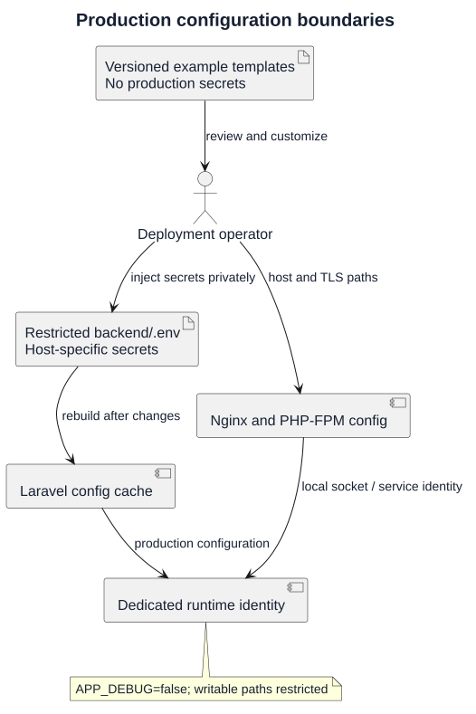

# Production Configuration

| Field | Value |
|---|---|
| Project | GitForge — Web Git Hosting Platform |
| Version | V1.0.0 |
| Milestone | M6 — Deployment |
| Status | Approved |

## Canonical Templates

- `deployment/env/production.env.example`
- `deployment/nginx/gitforge.conf`
- `deployment/php-fpm/gitforge.conf`

## Required Production Properties

The deployed environment uses `APP_ENV=production` and `APP_DEBUG=false`. A unique `APP_KEY` is generated on the target host. Database credentials and other secrets are never committed.

The Git executable is controlled by `GITFORGE_GIT_BINARY=/usr/bin/git`. Persistent repository storage is controlled by `GITFORGE_REPOSITORY_ROOT=/var/lib/gitforge`.

## Session and Transport Security

Production sessions use encrypted, HTTP-only, secure cookies. External traffic uses HTTPS. Port 80 exists only for redirection to HTTPS.

## Filesystem Permissions

The dedicated `gitforge` service identity requires write access only where needed:

- `backend/storage`;
- `backend/bootstrap/cache`;
- `/var/lib/gitforge/repositories`.

Application source and public build output must not be broadly writable by the runtime user.

## Secret Handling Rule

`deployment/env/production.env.example` contains placeholders only. The real production `.env` is created on the server, permission-restricted, and excluded from Git.

## Production configuration boundaries

[PlantUML source](diagrams/03-production-configuration.puml) · [Full-size SVG](diagrams/03-production-configuration.svg)

This diagram illustrates the documented procedure. Historical approvals remain tied to their recorded release and evidence; new candidates require fresh validation.
