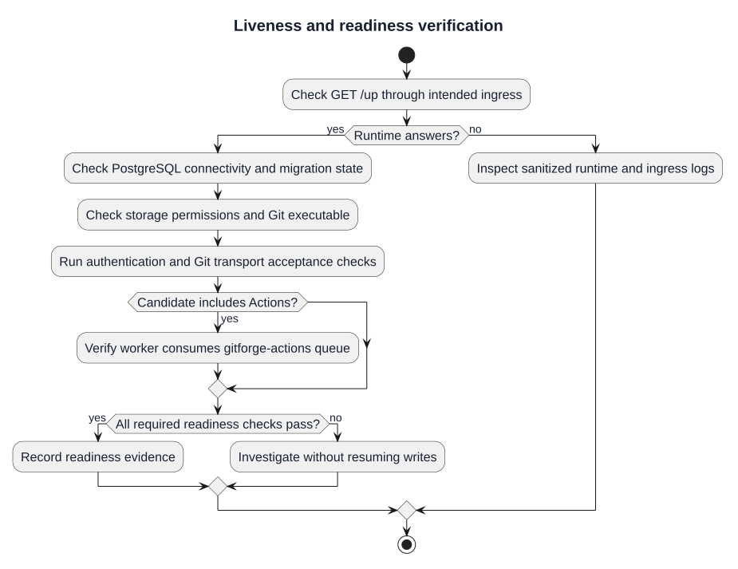

# Observability and Health Verification

| Field | Value |
|---|---|
| Project | GitForge — Web Git Hosting Platform |
| Version | V1.0.0 |
| Milestone | M6 — Deployment |
| Status | Approved |

## Liveness

`GET /up` is the deployment liveness endpoint. It confirms that the Laravel runtime can answer a request through the configured application path.

## Readiness

Operational readiness additionally requires:

- PostgreSQL connectivity;
- writable repository storage;
- configured Git executable availability;
- valid production configuration;
- successful migrations.

## Logs

Laravel and Nginx logs must not contain passwords, plaintext PATs, PAT hashes, Authorization headers, session secrets or raw Git protocol payloads.

## Deployment Evidence

Deployment Validation run `32659338381` passed on a clean GitHub-hosted runner, providing reproducible evidence that production dependency installation, migration, build, Nginx syntax and application liveness are valid.

## Liveness and readiness verification

[PlantUML source](diagrams/09-observability-and-health.puml) · [Full-size SVG](diagrams/09-observability-and-health.svg)

This diagram illustrates the documented procedure. Historical approvals remain tied to their recorded release and evidence; new candidates require fresh validation.
