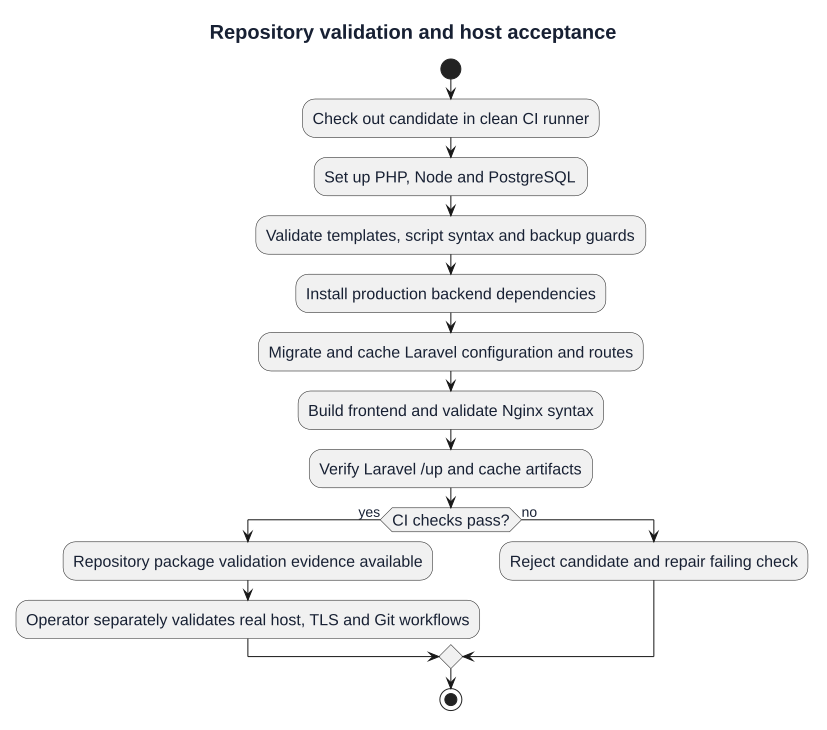

# Deployment Validation

| Field | Value |
|---|---|
| Project | GitForge — Web Git Hosting Platform |
| Version | V1.0.0 |
| Milestone | M6 — Deployment |
| Status | Approved |

## Automated Validation

The `.github/workflows/deployment-validation.yml` workflow performs the following on a clean GitHub-hosted runner:

1. starts PostgreSQL 18;
2. sets up PHP 8.4 and Composer;
3. sets up Node.js and npm;
4. checks security-critical production template values;
5. runs shell syntax validation for deployment scripts;
6. installs backend dependencies in production mode without dev packages;
7. creates a production-like Laravel environment;
8. executes all database migrations;
9. caches Laravel configuration and routes;
10. builds the production React frontend;
11. validates Nginx syntax using temporary test TLS material;
12. starts Laravel and verifies `GET /up`;
13. confirms generated production cache artifacts.

## Evidence

Deployment Validation run `32659338381`: **PASS**.  
Backend CI run `32659338516`: **PASS**.

## Interpretation

A green workflow means the repository contains a reproducible deployment package that can be built and started in a clean production-like environment. It does not claim that a public VPS, DNS record or public certificate exists.

## Manual Public-Host Validation

When a real host is later attached, run `BASE_URL=https://<domain> deployment/scripts/smoke-test.sh` and then exercise the approved authentication, repository, PAT and Git transport acceptance workflows.

## Repository validation and host acceptance

[PlantUML source](diagrams/10-deployment-validation.puml) · [Full-size SVG](diagrams/10-deployment-validation.svg)

This diagram illustrates the documented procedure. Historical approvals remain tied to their recorded release and evidence; new candidates require fresh validation.
