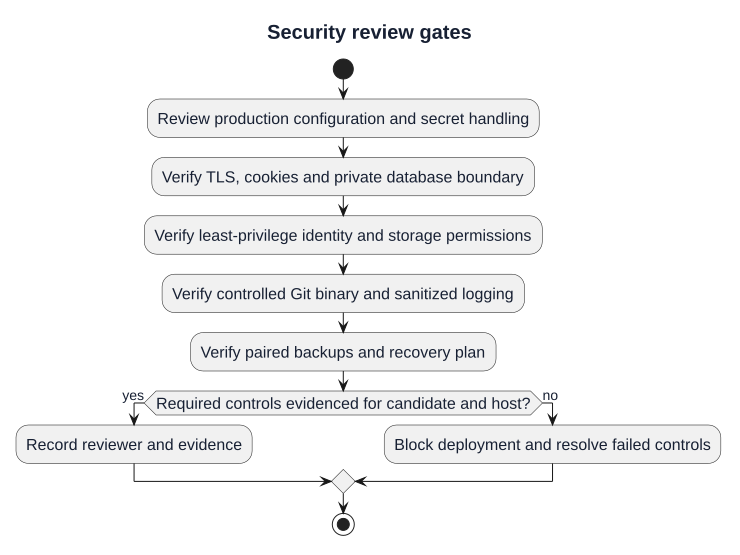

# Deployment Security Checklist

| Control | Required V1.0.0 State | Validation |
|---|---|---|
| Production environment | `APP_ENV=production` | PASS |
| Debugging | `APP_DEBUG=false` | PASS |
| TLS profile | HTTPS configuration present | PASS |
| Session cookies | Secure, HTTP-only, encrypted | PASS |
| Application secret | Unique at deployment, never committed | PASS |
| Database | PostgreSQL not publicly exposed by default | PASS |
| Runtime identity | Dedicated least-privilege `gitforge` user | PASS |
| Repository storage | Outside public web roots | PASS |
| Git binary | Deployment-controlled `/usr/bin/git` | PASS |
| Nginx server tokens | Disabled | PASS |
| Git request buffering | Disabled on Smart HTTP route | PASS |
| Production `.env` | Template only; real secret file untracked | PASS |
| Logs | Policy excludes credentials and authorization secrets | PASS |
| Backups | Database + Git storage with integrity checks | PASS |
| Rollback | Persistent data protected from casual overwrite | PASS |

## Approval Rule

All repository-side required controls for the portfolio V1.0.0 deployment package are satisfied. Host-specific controls such as a real certificate and DNS record are applied only when an external public host is attached.

## Security review gates

[PlantUML source](diagrams/11-deployment-security-checklist.puml) · [Full-size SVG](diagrams/11-deployment-security-checklist.svg)

This diagram illustrates the documented procedure. Historical approvals remain tied to their recorded release and evidence; new candidates require fresh validation.
