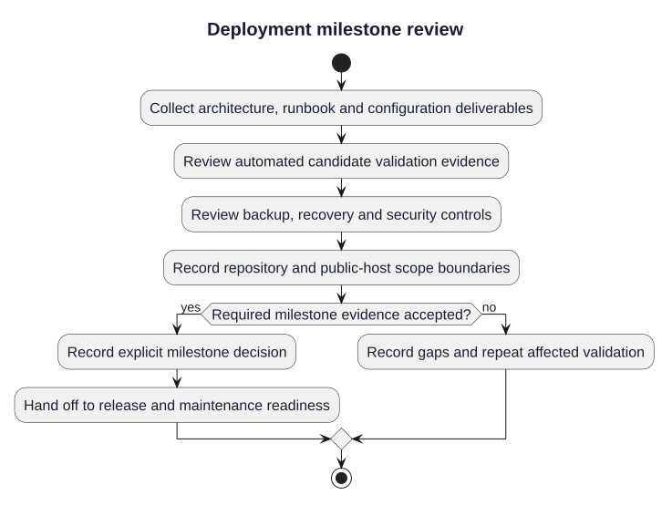

# M6 Milestone Review — Deployment

| Field | Value |
|---|---|
| Project | GitForge — Web Git Hosting Platform |
| Version | V1.0.0 |
| Milestone | M6 — Deployment |
| Status | Approved |
| Review date | 2026-08-23 |

## Deliverables

- production deployment architecture;
- environment/configuration specification;
- deployment runbook;
- PostgreSQL and persistent Git storage procedure;
- Nginx/TLS/PHP-FPM runtime specification;
- backup and restore procedure;
- rollback and recovery procedure;
- observability and health procedure;
- deployment security checklist;
- executable preflight, smoke-test and backup-verification scripts;
- automated Deployment Validation GitHub Actions workflow.

## Automated Evidence

- Deployment Validation run `32659338381`: **PASS**.
- Backend CI run `32659338516`: **PASS**.
- Deployment Validation included the frontend production build from a clean npm install.
- No product feature behavior was intentionally changed by M6.

## Scope Decision

For the V1.0.0 portfolio release, M6 requires a reproducible, production-like deployment package and automated clean-runner verification. A paid VPS, public DNS record and public CA certificate are optional demonstration infrastructure and are not required to establish repository deployment readiness.

## Final Decision

**APPROVED — M6 Complete.**

GitForge V1.0.0 is deployment-ready at repository level. The next milestone is M7 — V1.0.0 Release and Maintenance Readiness.

## Deployment milestone review

[PlantUML source](diagrams/12-m6-milestone-review.puml) · [Full-size SVG](diagrams/12-m6-milestone-review.svg)

This diagram illustrates the documented procedure. Historical approvals remain tied to their recorded release and evidence; new candidates require fresh validation.
